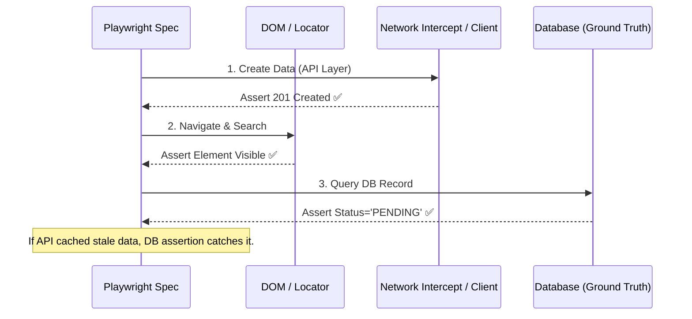

# 30. Database Verification — Direct SQL Assertions in Tests

**Navigation**: [← Chapter 29: Visual Regression](../07_Specialised_Testing/29_Visual_Regression_Testing.md) | [Index](../00_INDEX.md) | [→ Chapter 31: API Mocking with page.route()](./31_API_Mocking_page_route.md)

**Cross-links:**

- [`07_test_step_E2E_Architecture.md`](../02_Test_Architecture/07_test_step_E2E_Architecture.md) — Three-layer verification pattern
- [`28_Test_Data_Lifecycle_and_Cleanup.md`](./28_Test_Data_Lifecycle_and_Cleanup.md) — DB seeding strategy
- [`15_CrossSite_Pattern5_UI_API_Side_Effects.md`](../04_Cross_Site_Patterns_And_D365/15_CrossSite_Pattern5_UI_API_Side_Effects.md) — When DB is the ground truth

---

## 5W1H

- **WHAT**: Connecting your Playwright test suite directly to the application's database (PostgreSQL, SQL Server, Oracle) and writing SQL-based assertions alongside UI and API assertions.
- **WHY**: The API can return stale cache. The UI can show "Success" while the write failed silently. The database is the ground truth. When a test says "verify the citation was saved" — the only real verification is reading the database row directly.
- **WHO**: SDETs on teams where they have DB access (most enterprise on-premise or internal test environments). Not for production-only deployments.
- **WHEN**: For critical write operations — creation, status changes, financial records, audit logs. You don't need DB verification for every read operation.
- **HOW**: A typed `DbClient` wrapper that opens a connection in the fixture, executes typed queries, and closes after each test.

---

## 0. War Stories — When SQL Saved the Day (and When It Didn't)

### Story 1: The API that lied for 6 months

The citation management service returned `{ status: "PENDING" }` for new citations. Tests asserted on the API response. Every test passed.

Six months after launch, a support ticket: "Citations are never being processed." Investigation: the database had `status = 'OVERDUE'` for every citation created in the last 6 months. The API was returning stale values from a Redis cache that was seeded at startup and never invalidated. The write path had silently broken when a migration changed the column name from `status` to `citation_status`.

The API read path was querying the old column name, getting null, and falling back to the cached "PENDING" value. The tests never checked the database.

A single test with `await dbClient.query('SELECT citation_status FROM citations WHERE id = $1', [citationId])` would have caught this on day 1.

**Cost of not verifying DB:** 6 months of broken data. 14,000 unprocessed citations. Entire backlog required manual review.

### Story 2: The 40K connection pool exhaustion

A team added DB verification to every test. 80 tests, each opening a new `pg.Client()` in `beforeEach` and closing in `afterEach`. Locally: fine. In CI with `workers: 4` and `fullyParallel: true`: 80 tests × 4 workers = up to 320 concurrent connections. The PostgreSQL server's `max_connections` was 100.

Tests started failing with `too many connections for role "test_user"`. The failures were random — whichever test tried to open a connection when all 100 slots were taken.

Fix: pool-scoped connection (Section 10 of this chapter):

```typescript
// worker-scoped: one pool per worker process, not per test
db: [async ({ }, use) => {
  const pool = new Pool({ max: 3 }); // 3 connections per worker
  await use(pool);
  await pool.end();
}, { scope: 'worker' }]
```

4 workers × 3 connections = 12 total. No more exhaustion.

**Lesson:** Every test tool that touches a shared resource (DB, queue, file system) needs a scoped strategy. `test`-scoped = one-per-test. `worker`-scoped = one-per-process. For DB connections, always use `worker`-scoped pooling.

---

## 1. When the API Lies — Why DB Matters

```
Scenario:
  1. Test calls POST /api/v2/citations → gets 201 { citationId: 'CIT-001', status: 'PENDING' }
  2. Test asserts on the API response → passes ✅
  3. BUT: the API has a bug — it cached the response from a previous request
  4. The database actually has status: 'OVERDUE' for CIT-001
  5. The customer portal reads from the DB directly
  6. Customer sees OVERDUE — but your test said it was PENDING ✅

Result: Test gives false confidence. Production incident not caught.

With DB verification:
  1. API returns 201 { citationId: 'CIT-001', status: 'PENDING' } ✅
  2. API assertion passes ✅
  3. DB query: SELECT status FROM citations WHERE citation_id = 'CIT-001'
  4. DB returns: 'OVERDUE'
  5. DB assertion FAILS ❌ → test correctly catches the discrepancy
```

---

## 2. Setting Up the Database Connection

### PostgreSQL (most enterprise Linux stacks)

```bash
npm install pg
npm install --save-dev @types/pg
```

```typescript
// clients/DbClient.ts — your database client

import { Pool, type PoolClient, type QueryResult } from "pg";

export class DbClient {
  private pool: Pool;
  private client: PoolClient | null = null;

  constructor() {
    this.pool = new Pool({
      host: process.env.DB_HOST!,
      port: parseInt(process.env.DB_PORT ?? "5432"),
      database: process.env.DB_NAME!,
      user: process.env.DB_USER!,
      password: process.env.DB_PASSWORD!,
      ssl:
        process.env.DB_SSL === "true" ? { rejectUnauthorized: false } : false,
      max: 2, // max 2 connections per test (keep it low)
      idleTimeoutMillis: 30_000,
      connectionTimeoutMillis: 10_000,
    });
  }

  async connect(): Promise<void> {
    this.client = await this.pool.connect();
  }

  // Execute a typed query: returns rows as T[]
  async query<T extends Record<string, unknown>>(
    sql: string,
    params: unknown[] = [],
  ): Promise<T[]> {
    if (!this.client)
      throw new Error("DbClient: not connected. Call connect() first.");
    const result: QueryResult<T> = await this.client.query(sql, params);
    return result.rows;
  }

  // Convenience: expect exactly one row
  async queryOne<T extends Record<string, unknown>>(
    sql: string,
    params: unknown[] = [],
  ): Promise<T | null> {
    const rows = await this.query<T>(sql, params);
    if (rows.length === 0) return null;
    if (rows.length > 1)
      throw new Error(`queryOne: expected 1 row, got ${rows.length}`);
    return rows[0];
  }

  // Execute a write (INSERT/UPDATE/DELETE) — returns affected row count
  async execute(sql: string, params: unknown[] = []): Promise<number> {
    if (!this.client) throw new Error("DbClient: not connected.");
    const result = await this.client.query(sql, params);
    return result.rowCount ?? 0;
  }

  async disconnect(): Promise<void> {
    this.client?.release();
    this.client = null;
    await this.pool.end();
  }
}
```

### SQL Server (Microsoft stack — common with D365)

```bash
npm install mssql
npm install --save-dev @types/mssql
```

```typescript
// clients/SqlServerClient.ts

import sql from "mssql";

export class SqlServerClient {
  private pool: sql.ConnectionPool | null = null;

  async connect(): Promise<void> {
    this.pool = await sql.connect({
      server: process.env.MSSQL_HOST!,
      database: process.env.MSSQL_DATABASE!,
      user: process.env.MSSQL_USER!,
      password: process.env.MSSQL_PASSWORD!,
      port: parseInt(process.env.MSSQL_PORT ?? "1433"),
      options: {
        encrypt: true, // required for Azure SQL
        trustServerCertificate: process.env.MSSQL_TRUST_CERT === "true",
      },
    });
  }

  async query<T>(
    sql: string,
    params: Record<string, unknown> = {},
  ): Promise<T[]> {
    if (!this.pool) throw new Error("SqlServerClient: not connected.");
    const request = this.pool.request();
    // Bind parameters to prevent SQL injection
    for (const [key, value] of Object.entries(params)) {
      request.input(key, value);
    }
    const result = await request.query(sql);
    return result.recordset as T[];
  }

  async disconnect(): Promise<void> {
    await this.pool?.close();
    this.pool = null;
  }
}
```

---

## 3. The Database Fixture

```typescript
// fixtures/index.ts — adding dbClient

export const test = base.extend<{
  dbClient: DbClient;
  // ... other fixtures
}>({
  dbClient: async ({}, use) => {
    const client = new DbClient();
    await client.connect();
    try {
      await use(client);
    } finally {
      await client.disconnect(); // always disconnect after test
    }
  },
  // ... other fixtures
});
```

---

## 4. Three-Layer Verification Pattern

The most reliable test architecture: UI assertion → API assertion → DB assertion.

### Verification Flow Visualised



**How to read this diagram.** Read it top to bottom as three layers of proof: the test creates data through the API and asserts 201, navigates and searches in the UI and asserts the element is visible, then queries the database and asserts the status is `PENDING`. Notice the closing note: the database is the ground truth, so it catches stale data the API layer may have cached.

```typescript
// tests/specs/citations/create-citation-three-layer.spec.ts

test("Create citation — verified at UI + API + DB level", async ({
  page,
  citationsClient,
  account,
  dbClient,
}) => {
  const masterSearch = new MasterSearchPage(page);
  const data = { citationId: null as string | null };

  // ── LAYER 1: Create via API ──────────────────────────────────────────────
  await test.step("Create PENDING citation via API", async () => {
    const citation = await citationsClient.create(
      PayloadsCitation.pending({ customerId: account.userId }),
    );
    data.citationId = citation.citationId;
    expect(citation.status).toBe("PENDING");
    expect(citation.customerId).toBe(account.userId);
  });

  // ── LAYER 2: Verify in UI ────────────────────────────────────────────────
  await test.step("Citation appears in CRM search", async () => {
    await masterSearch.goto();
    await masterSearch.searchPanel.searchByCitationId(data.citationId!);
    await masterSearch.resultsGrid.waitForResults();
    await expect(masterSearch.resultsGrid.rows.first()).toBeVisible();
    const rowText = await masterSearch.resultsGrid.rows.first().textContent();
    expect(rowText).toContain(data.citationId);
  });

  // ── LAYER 3: Verify in DB (ground truth) ─────────────────────────────────
  await test.step("DB: citation row is correct in database", async () => {
    // Direct SQL — this CANNOT lie like a caching API can
    const row = await dbClient.queryOne<{
      citation_id: string;
      customer_id: string;
      status: string;
      amount: number;
      created_at: Date;
    }>(
      "SELECT citation_id, customer_id, status, amount, created_at FROM citations WHERE citation_id = $1",
      [data.citationId],
    );

    expect(row, "Citation must exist in database").not.toBeNull();
    expect(row!.status).toBe("PENDING");
    expect(row!.customer_id).toBe(account.userId);
    expect(row!.amount).toBe(150.0);
    // Verify it was created within the last 60 seconds
    const ageMs = Date.now() - row!.created_at.getTime();
    expect(ageMs).toBeLessThan(60_000);
  });
});
```

---

## 5. Typed DB Query Interfaces

Always type your DB query results — column names from SQL can be anything:

```typescript
// types/db-rows.types.ts
// SQL column naming convention: snake_case (PostgreSQL default)
// TypeScript interface fields match the SQL column names exactly

export interface CitationDbRow {
  citation_id: string;
  customer_id: string;
  status: "PENDING" | "PAID" | "OVERDUE" | "DISPUTED" | "CANCELLED";
  amount: number; // DECIMAL in DB → number in TypeScript
  citation_type: string;
  issue_date: Date; // DATE in DB → Date in TypeScript
  due_date: Date | null; // nullable
  notes: string | null;
  officer_id: string | null;
  created_at: Date;
  updated_at: Date;
  is_deleted: boolean; // soft-delete flag
}

export interface NotificationDbRow {
  notification_id: string;
  user_id: string;
  type: string;
  channel: "email" | "sms" | "push";
  status: "queued" | "sent" | "delivered" | "failed";
  sent_at: Date | null;
  reference_id: string | null;
  created_at: Date;
}

export interface AuditLogDbRow {
  log_id: string;
  entity_type: string;
  entity_id: string;
  action: "CREATE" | "UPDATE" | "DELETE";
  changed_by: string;
  old_value: unknown; // JSONB in DB
  new_value: unknown; // JSONB in DB
  changed_at: Date;
}
```

---

## 6. Audit Log Verification — A Critical Enterprise Pattern

Enterprise apps must log every change for compliance (GDPR, financial regulations). Your tests should verify audit logs:

```typescript
await test.step("DB: Audit log records the status change", async () => {
  const auditRow = await dbClient.queryOne<AuditLogDbRow>(
    `SELECT log_id, entity_type, entity_id, action, changed_by, old_value, new_value, changed_at
     FROM audit_logs
     WHERE entity_type = 'citation'
       AND entity_id = $1
       AND action = 'UPDATE'
     ORDER BY changed_at DESC
     LIMIT 1`,
    [data.citationId],
  );

  expect(auditRow, "Audit log must record the status change").not.toBeNull();
  expect(auditRow!.entity_type).toBe("citation");
  expect(auditRow!.action).toBe("UPDATE");

  // Verify the old_value and new_value JSON
  const oldValue = auditRow!.old_value as { status: string };
  const newValue = auditRow!.new_value as { status: string };
  expect(oldValue.status).toBe("PENDING");
  expect(newValue.status).toBe("PAID");

  // Verify changed within 30 seconds
  const ageMs = Date.now() - auditRow!.changed_at.getTime();
  expect(ageMs).toBeLessThan(30_000);
});
```

---

## 7. DB-Only Verification Functions in `DbClient`

Add domain-specific query methods to the `DbClient` for reuse:

```typescript
// clients/DbClient.ts — domain methods

// Check if a citation exists in the DB
async citationExists(citationId: string): Promise<boolean> {
  const row = await this.queryOne<{ count: string }>(
    'SELECT COUNT(*)::text AS count FROM citations WHERE citation_id = $1 AND is_deleted = false',
    [citationId]
  );
  return parseInt(row?.count ?? '0') > 0;
}

// Get the latest audit log entry for an entity
async getLatestAudit(entityType: string, entityId: string): Promise<AuditLogDbRow | null> {
  return this.queryOne<AuditLogDbRow>(
    `SELECT * FROM audit_logs
     WHERE entity_type = $1 AND entity_id = $2
     ORDER BY changed_at DESC LIMIT 1`,
    [entityType, entityId]
  );
}

// Wait for a DB record to reach an expected state (polling)
async pollForStatus(
  citationId: string,
  expectedStatus: string,
  timeoutMs = 30_000
): Promise<CitationDbRow> {
  const { expect } = await import('@playwright/test');
  let lastRow: CitationDbRow | null = null;

  await expect.poll(
    async () => {
      lastRow = await this.queryOne<CitationDbRow>(
        'SELECT * FROM citations WHERE citation_id = $1',
        [citationId]
      );
      return lastRow?.status;
    },
    {
      message: `Waiting for citation ${citationId} to have DB status '${expectedStatus}'`,
      timeout: timeoutMs,
      intervals: [500, 1000, 2000, 5000],
    }
  ).toBe(expectedStatus);

  return lastRow!;
}

// Direct cleanup (for teardown when API delete fails)
async hardDeleteCitation(citationId: string): Promise<void> {
  await this.execute(
    'DELETE FROM citations WHERE citation_id = $1',
    [citationId]
  );
}
```

---

## 8. Transaction Testing — Verify Atomicity

Some operations must be atomic (all-or-nothing). Test that a failed mid-transaction rollback happens correctly:

```typescript
test("Payment failure rolls back citation status change", async ({
  citationsClient,
  dbClient,
}) => {
  // Create a citation to work with
  const citation = await citationsClient.create(
    PayloadsCitation.pending({ customerId: "CUST-001" }),
  );

  // Attempt payment with an invalid card — should fail
  const paymentResponse = await citationsClient.processPayment(
    citation.citationId,
    {
      cardNumber: "4000000000000002", // Stripe test card that always declines
      amount: citation.amount,
    },
  );

  expect(paymentResponse.status).toBe(402); // Payment Required (declined)

  // KEY ASSERTION: Citation status must NOT have changed in the DB
  // A buggy implementation might change status to PROCESSING before the payment fails
  // and forget to roll back
  const dbRow = await dbClient.queryOne<CitationDbRow>(
    "SELECT status FROM citations WHERE citation_id = $1",
    [citation.citationId],
  );

  expect(
    dbRow!.status,
    "Citation must remain PENDING after payment failure (transaction rolled back)",
  ).toBe("PENDING");

  // Also verify no payment record was created
  const paymentRecord = await dbClient.queryOne<{ payment_id: string }>(
    "SELECT payment_id FROM payments WHERE citation_id = $1",
    [citation.citationId],
  );
  expect(
    paymentRecord,
    "No payment record should exist after declined payment",
  ).toBeNull();
});
```

---

## 9. Soft Delete Verification

Most enterprise apps don't physically delete rows — they set `is_deleted = true` or `deleted_at = now()`. Verify both sides:

```typescript
test("Citation delete: soft-deleted in DB, hidden in UI", async ({
  page,
  citationsClient,
  dbClient,
  account,
}) => {
  const citation = await citationsClient.create(
    PayloadsCitation.pending({ customerId: account.userId }),
  );

  // Delete via API
  const deleteResponse = await citationsClient.delete(citation.citationId);
  expect(deleteResponse.status).toBe(204);

  // DB: row still exists (soft delete), but marked deleted
  const dbRow = await dbClient.queryOne<CitationDbRow>(
    // Note: query without WHERE is_deleted = false to see the soft-deleted row
    "SELECT citation_id, is_deleted, deleted_at FROM citations WHERE citation_id = $1",
    [citation.citationId],
  );
  expect(dbRow, "Row should still exist in DB (soft delete)").not.toBeNull();
  expect(dbRow!.is_deleted).toBe(true);
  expect(dbRow!.deleted_at).not.toBeNull();

  // UI: citation should not appear in search results
  const masterSearch = new MasterSearchPage(page);
  await masterSearch.goto();
  await masterSearch.searchPanel.searchByCitationId(citation.citationId);
  await masterSearch.resultsGrid.waitForLoadState();
  await expect(masterSearch.resultsGrid.rows).toHaveCount(0);

  // API: GET should return 404
  const getResponse = await citationsClient.getById(citation.citationId);
  expect(getResponse.status).toBe(404);
});
```

---

## 10. Worker-Scoped DB Fixture — Connection Pooling

DB connections are expensive (~100-500ms to establish). Use worker scope:

```typescript
// fixtures/db.fixture.ts

export const test = base.extend<{}, { dbClient: DbClient }>({
  dbClient: [
    async ({}, use) => {
      const client = new DbClient();
      try {
        await client.connect();
        console.log("[dbClient] Connected to DB");
      } catch (e) {
        throw new Error(
          `[dbClient fixture] Failed to connect to database:\n` +
            `  Host: ${process.env.DB_HOST}\n` +
            `  Database: ${process.env.DB_NAME}\n` +
            `  Error: ${e}`,
        );
      }

      await use(client);

      // Teardown: runs once per worker after ALL tests
      await client.disconnect();
      console.log("[dbClient] Disconnected from DB");
    },
    { scope: "worker" }, // 1 connection per worker, not per test
  ],
});

// IMPORTANT: worker-scoped means:
// - 4 workers = 4 DB connections total (not 400 for 100 tests × 4 workers)
// - The connection is reused across all tests in the worker
// - BUT: transactions must not span tests (commit/rollback before use() returns)
```

---

## 11. SQL Injection Prevention

DB assertions are internal automation code, but still write them safely:

```typescript
// ❌ NEVER: string concatenation (SQL injection risk, even in test code)
const citationId = testData.citationId; // could be "'; DROP TABLE citations; --"
const rows = await client.query(
  `SELECT * FROM citations WHERE citation_id = '${citationId}'`, // DANGEROUS
);

// ✅ ALWAYS: parameterized queries (prevents injection, also handles escaping)
const rows = await client.query<CitationDbRow>(
  "SELECT * FROM citations WHERE citation_id = $1", // PostgreSQL positional param
  [citationId], // bound safely
);

// SQL Server parameterization:
const request = this.pool.request();
request.input("citationId", sql.NVarChar, citationId); // typed param
const result = await request.query(
  "SELECT * FROM Citations WHERE CitationId = @citationId",
);

// Why this matters even in test code:
// 1. If testData is ever read from a file or external source, injection is possible
// 2. Parameterized queries handle special chars (', ", %) correctly
// 3. Builds good habits that carry over to production code reviews
```

---

```typescript
// config/environments.ts — add DB config
export const Environments = {
  local: {
    // ... existing URL config ...
    db: {
      host: "localhost",
      port: 5432,
      database: "citations_test",
      user: "test_user",
      password: "test_password",
      ssl: false,
    },
  },
  staging: {
    // ... existing URL config ...
    db: {
      host: process.env.DB_HOST!,
      port: parseInt(process.env.DB_PORT ?? "5432"),
      database: process.env.DB_NAME!,
      user: process.env.DB_USER!,
      password: process.env.DB_PASSWORD!,
      ssl: true,
    },
  },
} as const;
```

**Add to `scripts/check-env.ts`:**

```typescript
const DB_ENV_VARS = [
  "DB_HOST",
  "DB_PORT",
  "DB_NAME",
  "DB_USER",
  "DB_PASSWORD",
] as const;
// Check these in addition to API env vars
```

---

## 🏋️ Practice Challenges

### Challenge 1 [MCQ] — When to Add DB Verification?

Which scenario MOST warrants adding a DB assertion to an existing API test?

A) GET /api/citations — returns a list of citations  
B) GET /api/citations/CIT-001 — returns one citation's details  
C) POST /api/payments — creates a financial payment record and debits an account  
D) GET /api/notifications/count — returns a count

<details><summary>Answer</summary>

**C** — Financial write operations are the highest-stakes data in enterprise systems. A payment must be correctly recorded in the DB — the consequences of a silent write failure are severe (money processed but not recorded, or double-charged). Financial audits also require the data to be correct at the DB level, not just at the API response level.

GET endpoints (A, B, D) are reads — DB verification would just compare the API response to the DB query, which mostly confirms the API is working correctly (useful but lower priority). POST/PATCH/DELETE for financial, compliance, or audit-sensitive data are where DB verification is non-negotiable.

</details>

---

### Challenge 2 [Write It Yourself]

Write a `DbClient` method `getNotificationsForUser(userId, afterTimestamp?)` that returns notifications from the DB, optionally filtered to those created after a given timestamp. Use the `NotificationDbRow` interface.

<details><summary>Answer</summary>

```typescript
async getNotificationsForUser(
  userId: string,
  afterTimestamp?: Date
): Promise<NotificationDbRow[]> {
  if (afterTimestamp) {
    return this.query<NotificationDbRow>(
      `SELECT *
       FROM notifications
       WHERE user_id = $1
         AND created_at > $2
       ORDER BY created_at DESC`,
      [userId, afterTimestamp]
    );
  }

  return this.query<NotificationDbRow>(
    `SELECT *
     FROM notifications
     WHERE user_id = $1
     ORDER BY created_at DESC`,
    [userId]
  );
}

// Usage in test:
const beforeTest = new Date();
await citationsClient.create(PayloadsCitation.pending({ customerId: account.userId }));
// Wait briefly for notification processing
const notifications = await dbClient.getNotificationsForUser(account.userId, beforeTest);
const citationNotif = notifications.find(n => n.type === 'CITATION_CREATED');
expect(citationNotif).toBeDefined();
expect(citationNotif!.status).toBe('sent');
```

</details>

---

### Challenge 3 [Transaction Isolation]

Your test creates a citation, calls the payment API (which should update 3 tables atomically: citations, payments, audit_log), and then queries the DB. You find citations is updated but payments and audit_log are empty. What does this indicate about the application code, and how do you write a test that catches it early?

<details><summary>Answer</summary>

This indicates a **partial transaction commit** bug: the application wrote to `citations` outside the transaction, then either the transaction failed and rolled back (leaving payments/audit_log empty) or the code started the transaction AFTER writing to citations.

Expected behavior: all 3 tables must update atomically — if any one fails, ALL should roll back.

**Test that catches it:**

```typescript
test("Payment updates citations + payments + audit_log atomically", async ({
  citationsClient,
  dbClient,
}) => {
  const citation = await citationsClient.create(
    PayloadsCitation.pending({ customerId: "CUST-001" }),
  );
  const beforePayment = new Date();

  await citationsClient.processPayment(citation.citationId, {
    cardNumber: "4242424242424242", // Stripe's real "always succeeds" test card
    amount: citation.amount,
  });

  // Check ALL 3 tables in the same assertion step — they all must be updated
  const [citRow, payRow, auditRow] = await Promise.all([
    dbClient.queryOne<CitationDbRow>(
      "SELECT status FROM citations WHERE citation_id = $1",
      [citation.citationId],
    ),
    dbClient.queryOne<{ payment_id: string; status: string }>(
      "SELECT payment_id, status FROM payments WHERE citation_id = $1",
      [citation.citationId],
    ),
    dbClient.queryOne<AuditLogDbRow>(
      `SELECT action FROM audit_logs WHERE entity_id = $1 AND action = 'UPDATE' AND changed_at > $2`,
      [citation.citationId, beforePayment],
    ),
  ]);

  expect(citRow!.status, "citations table").toBe("PAID");
  expect(payRow!.status, "payments table").toBe("COMPLETED");
  expect(auditRow!.action, "audit_log table").toBe("UPDATE");
});
```

**Verified, not assumed — the card number above was wrong for the scenario it claims to test.** `4111111111111111` isn't a card Stripe documents at all; it's a generic Luhn-valid dummy number that circulates widely across older payment-gateway tutorials, not specific to Stripe. Checked Stripe's own real published test cards: the "always succeeds" card is `4242424242424242`, and — usefully for cross-checking this chapter's *other* payment example — `4000000000000002` (used earlier in this section for the declined-payment test) really is Stripe's documented "always declines" card. One example in this chapter had the right card for the wrong platform's convention; the other already had it right. Fixed to the real success card.

</details>

---

### Challenge 4 [MCQ] — Fixture Scope for DB Connection

You have 50 tests that need DB access. Your connection setup takes 300ms. Should the DB fixture be `scope: 'test'` or `scope: 'worker'`? What is the total connection overhead difference with 4 workers?

A) `scope: 'test'` — 50 connections × 300ms = 15,000ms total overhead  
B) `scope: 'worker'` — 4 connections × 300ms = 1,200ms total overhead  
C) Both are the same — connection pooling handles it automatically  
D) `scope: 'test'` is required because transactions must be per-test

<details><summary>Answer</summary>

**B** is correct. Worker scope means 1 connection setup per worker. With 4 workers, that's 4 × 300ms = 1,200ms. Test scope would mean 50 × 300ms = 15,000ms — **12.5 seconds of pure connection overhead eliminated**.

**D** is a common misconception: worker scope doesn't prevent per-test transaction isolation. Each test should commit or rollback its own transactions before `use()` returns. The connection itself is reused, but transactions are test-specific.

**C** is false: connection pooling reduces connection creation cost, but each `Pool.connect()` call still acquires a client from the pool (which takes time if all clients are in use). Worker-scoped fixture avoids pool churn.

</details>

### Challenge 5 [Spot the Bug — SQL Injection in Test Queries]

```typescript
// In a test helper:
async function findCitationByPlate(
  db: Pool,
  plate: string,
): Promise<CitationRow | null> {
  const result = await db.query(
    `SELECT * FROM citations WHERE registration_plate = '${plate}'`,
  );
  return result.rows[0] ?? null;
}

// Called from test:
const citation = await findCitationByPlate(db, testData.plate);
```

What is the bug, and why does it matter even in a test environment?

<details><summary>Answer</summary>

**SQL injection vulnerability**: The `plate` parameter is directly interpolated into the query string. If `testData.plate` contains a value like `'; DROP TABLE citations; --`, the resulting query is:

```sql
SELECT * FROM citations WHERE registration_plate = ''; DROP TABLE citations; --'
```

This would truncate the `citations` table in the staging database.

Why it matters in tests specifically:

1. **Test data strings can contain special characters**: Plates, names, and addresses may contain apostrophes (e.g., `O'Brien-1234`). Without parameterization, these break the query with a syntax error.
2. **Staging database destruction**: If staging is shared across teams, corrupting it blocks everyone's testing until the database is restored.
3. **Developers copy test patterns**: If test code uses string concatenation for SQL, developers learn this pattern and may reproduce it in production code.

The fix — always use parameterized queries:

```typescript
async function findCitationByPlate(
  db: Pool,
  plate: string,
): Promise<CitationRow | null> {
  const result = await db.query(
    "SELECT * FROM citations WHERE registration_plate = $1",
    [plate], // parameter binding — the driver handles escaping
  );
  return result.rows[0] ?? null;
}

// The query sent to PostgreSQL is always:
// SELECT * FROM citations WHERE registration_plate = $1
// with plate as a separate parameter — impossible to inject SQL
```

Rule: never use string interpolation for SQL in ANY environment. Parameterized queries are faster (plan caching), safer, and correct for all input values including apostrophes and special characters.

</details>

---

**Navigation**: [← Chapter 29: Visual Regression](../07_Specialised_Testing/29_Visual_Regression_Testing.md) | [Index](../00_INDEX.md) | [→ Chapter 31: API Mocking with page.route()](./31_API_Mocking_page_route.md)


---

## Reality Check

**"UI assertions are sufficient for data verification"**→ The UI shows what the APPLICATION RENDERS, not what the DATABASE STORES. A caching bug can show correct data on the UI while the database has wrong data. A display formatting bug can show wrong data on the UI while the database is correct. Database verification catches the class of bugs where the data pipeline (controller → service → repository → database) has errors invisible on the UI.

**"Direct SQL in tests couples tests to the database schema"**→ This coupling is intentional and valuable. If a schema change breaks your SQL verification queries, it reveals that the schema change needs application code updates too. The alternative — only testing through the UI — hides schema-application mismatches until users encounter them. Use a data access layer in your test code to centralize SQL queries and isolate schema coupling.

**"Test databases should be production replicas"**→ Production replicas contain PII (personal data), have massive volume (slow test queries), and change unpredictably (new data invalidates test assertions). Use: schema-identical empty databases with seed data, or TestContainers with migrations applied. Test data should be CREATED by the test, not assumed to exist.

**"Cleaning up test data after each test is mandatory"**→ Cleanup is necessary for shared databases. But with TestContainers or per-test databases, cleanup is unnecessary — the entire database is destroyed after the test suite. Choose the isolation strategy that matches your infrastructure: cleanup for shared databases, disposal for isolated databases.

**"SQL verification should check every column"**→ Verify only the columns your test CHANGES or DEPENDS ON. An order creation test should verify: order total, customer ID, status, and item count. Verifying every column (created_at, updated_at, internal flags) makes tests brittle to unrelated changes. Use SELECT specific_columns, not SELECT *.
