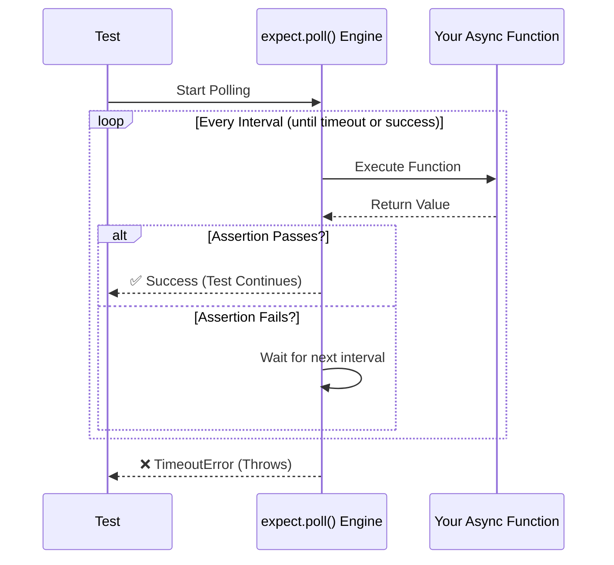
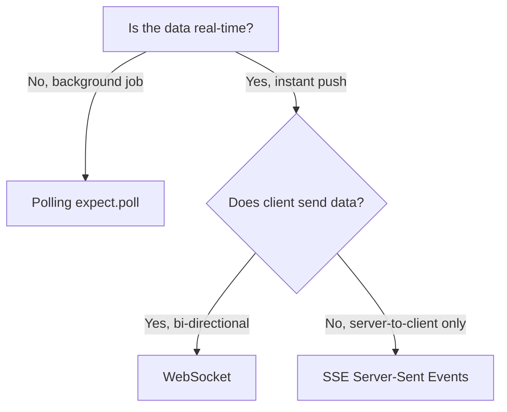

# 42. Polling & Async Data Patterns — The Right Way to Wait for Slow APIs

**Navigation**: [← Chapter 41: GraphQL & WebSocket](./41_GraphQL_WebSocket_Testing.md) | [Index](../00_INDEX.md) | [→ Chapter 43: Real-World War Stories](../06_CI_CD_And_Reliability/43_Real_World_SDET_War_Stories.md)

**Cross-links:**

- [`15_CrossSite_Pattern5_UI_API_Side_Effects.md`](../04_Cross_Site_Patterns_And_D365/15_CrossSite_Pattern5_UI_API_Side_Effects.md) — expect.poll in side-effect verification
- [`26_Flakiness_Diagnosis_and_Fixing.md`](../06_CI_CD_And_Reliability/26_Flakiness_Diagnosis_and_Fixing.md) — waitForTimeout as flakiness root cause
- [`23_APIUtils_HTTP_Library.md`](../05_Enterprise_Framework/23_APIUtils_HTTP_Library.md) — API client patterns
- [`labs/01-first-contact/`](../labs/01-first-contact/README.md) — hands-on: a deliberately slow page where `textContent()` right after a click returns the wrong thing and web-first assertions don't (the auto-wait half of this chapter, graded by planted bugs)
- [`41_GraphQL_WebSocket_Testing.md`](./41_GraphQL_WebSocket_Testing.md) — WebSocket frame handling (Scenario D builds on it)

> **Version note:** every Playwright behaviour in this chapter marked "measured" was checked against `@playwright/test` **1.60.0** (the version pinned in `labs/`) by running it, and cross-checked in the shipped source/typings. The names `citationsClient`, `reportsClient`, `PayloadsCitation` and friends are this module's fictional enterprise framework; the Playwright and Node calls are real.

---

## 0. War Stories — Async Bugs With Consequences

### Story 1: The payment poller that was green before the payment finished (illustrative composite)

A payment flow submitted a charge and then waited for "a settled payment" by polling the customer's payment *list*. The shared test customer already owned settled payments from earlier runs:

```typescript
// ❌ Passes on attempt 1 — ANY settled payment for this customer satisfies it
await expect.poll(async () => {
  const r = await apiClient.get(`/payments?customerId=${customerId}&status=settled`);
  return r.body.items.length;
}).toBeGreaterThan(0);
```

The test was green in under a second, before the charge had even been processed. Months later a penetration test found the payment service accepted replayed request IDs and settled the same charge twice. The test could never have caught it: it was not looking at the payment it had just created.

```typescript
// ✅ Poll THE record, and assert its identity, not just its terminal state
await expect.poll(async () => {
  const r = await apiClient.get(`/payments/${paymentId}`);
  return r.body;
}, { timeout: 90_000 }).toMatchObject({ status: 'settled', idempotencyKey: expectedKey });
// (a 90 s poll also needs test.setTimeout(...) — see "What the engine actually does" in section 2)
```

`toMatchObject` works under `expect.poll` (measured). The replay itself needs its own test: send the same idempotency key twice and assert exactly one settled payment exists for that key.

**Lesson:** a polling condition that can be satisfied by data other than the record you created (existence checks, list queries, "any row with status X") is a green light that was never connected to your action. Poll by the ID your action returned and assert the record's identity.

### Story 2: `Promise.race` timeout that hid the real error

A test raced a polling helper against a 30-second timer so it would "fail fast":

```typescript
// ❌ Promise.race as a timeout
const result = await Promise.race([
  pollForPaymentStatus(paymentId),
  new Promise((_, reject) =>
    setTimeout(() => reject(new Error('Timeout')), 30_000)
  ),
]);
```

The test always failed with "Timeout", whatever the real cause. The culprit was not `Promise.race` itself (it rejects with whichever promise settles first, so a throw from the poller would have surfaced): `pollForPaymentStatus` had its own catch-all retry loop that logged `ECONNREFUSED`, slept and retried. The real error never left the helper, and 30 s later the timer won with a message that says nothing about the last observed state. `Promise.race` made it worse in two further ways: nothing cancels the loser, so the poller keeps hitting the API after the test has failed (into teardown), and the timer is never cleared when the poller wins.

Use `expect.poll` and let it own both the deadline and the reporting:

```typescript
// ✅ the deadline, the last observed value and real errors are all handled by the engine
await expect.poll(
  async () => {
    const r = await apiClient.get(`/payments/${paymentId}`);
    return r.body.status;
  },
  { timeout: 30_000, intervals: [1_000, 2_000, 5_000] }
).toBe('settled');
// Timeout:  Expected: "settled"  Received: "pending"  ... Timeout 30000ms exceeded while waiting on the predicate
// Throw:    an error thrown inside the callback stops the poll at once and surfaces unchanged (measured: 2nd attempt, 110 ms)
```

The catch-all-and-retry shape that caused the story is still available to you inside the callback, so decide on purpose which errors are transient (see "Transient errors vs permanent failures" in section 2).

**Lesson:** a helper that swallows exceptions plus a timer that rejects with a generic message is how a diagnosable failure becomes "Timeout". Keep the last observed value and the original error on the failure path.

---

## 5W1H

- **WHAT**: Every technique Playwright and TypeScript provide for waiting on slow, asynchronous operations — report generation (10 min), email delivery (3 min), payment processing (30 sec to 2 min), background jobs, real-time WebSocket updates — WITHOUT using `waitForTimeout`, `for` loops, or arbitrary sleeps.
- **WHY**: The `for`-loop-with-sleep pattern (see Section 1) is the single most common source of flaky, slow, unmaintainable enterprise test suites. Every test that has `await page.waitForTimeout(60000)` is lying to you — it either sleeps too long (wastes minutes) or too short (causes false failures).
- **WHO**: Every SDET who has ever written a loop to "poll until the status changes." This chapter gives you the professional replacement.
- **WHEN**: Any time an API or UI operation is asynchronous — the trigger fires immediately but the result appears after an unpredictable delay.
- **HOW**: By understanding the full hierarchy of Playwright waiting primitives, building a typed `pollUntil()` utility, and applying each tool to the right scenario.

---

## 1. The Problem — Why "Sleep and Hope" Fails

### The Real-World Scenario

```
Your system:
  1. User clicks "Pay Citation" in D365 CRM
  2. Browser POSTs to payment gateway (returns 202 Accepted in 200ms)
  3. Payment gateway processes asynchronously (takes 30s to 2 minutes)
  4. When done, payment gateway calls back your API
  5. Your API updates citation status to PAID
  6. D365 UI reflects the change (on next poll or page refresh)

The test must verify that after clicking Pay, the citation shows PAID.
The total wait time is unpredictable: 30 seconds minimum, 2 minutes maximum.
```

### The BAD Pattern (for-loop + waitForTimeout) — What People Actually Write

```typescript
// ❌ ANTI-PATTERN — for-loop with sleep
// Seen in real enterprise test suites from multiple companies

test("Citation payment flow", async ({ page, citationsClient }) => {
  await paymentForm.submitPayment();

  // "Wait for status to change" — the wrong way
  let status = "";
  let attempts = 0;

  for (let i = 0; i < 120; i++) {
    // loop up to 120 times
    const citation = await citationsClient.getById(citationId);
    status = citation.status;

    if (status === "PAID") {
      break; // got it, exit loop
    }

    await page.waitForTimeout(1000); // sleep 1 second
    attempts++;
  }

  expect(status).toBe("PAID"); // assert AFTER the loop
});
```

### Everything Wrong With This Pattern (8 Problems)

```
Problem 1: WASTES TIME even when result is fast
  Payment processes in 35 seconds.
  Loop sleeps at 36s, 37s, 38s, ... 119s = 84 extra seconds wasted.
  In a suite with 20 payment tests: 84s × 20 = 28 minutes wasted.

Problem 2: NO DESCRIPTIVE ERROR on timeout
  When the loop exits at 120 iterations without PAID:
  Error: "Expected 'PROCESSING' to equal 'PAID'"
  No mention of: which citation, how many attempts, what the last response was.

Problem 3: HIDES REAL ERRORS
  If the API returns 500 on attempt 15, the loop swallows the error.
  `citation.status` is undefined → loop continues silently.
  The test times out instead of reporting the 500.

Problem 4: NOT USING PLAYWRIGHT'S RETRY ENGINE
  expect() at the end does not retry.
  If status is PROCESSING at loop exit → immediate failure.
  No Playwright-level auto-retry, no timeout propagation.

Problem 5: VARIABLE INTERVAL IS INFLEXIBLE
  1 second per iteration is fixed.
  You want: check at 1s, 2s, 5s, 10s, 20s (poll aggressively at first).
  Or: for a 10-minute job, you want 30s intervals, not 1s.
  The loop cannot express this without complex index math.

Problem 6: HARD TO DEBUG
  When the CI log shows "test failed after 120s", you know nothing:
  Not what responses you got, not which status values were seen,
  not whether the API was even reachable.

Problem 7: RACE CONDITION ON ASSERTION
  status was set inside the loop but assertions run after.
  If the payment gateway briefly shows PAID then reverts to FAILED
  (a real scenario), the test might catch it or might not.

Problem 8: BRITTLE TO API ERRORS
  HTTP 429 (rate limit), 503 (service unavailable)?
  The loop has no special handling — it retries silently.
  Or it throws and the test fails with a confusing error.
```

---

## 2. The Right Tool — `expect.poll()`

`expect.poll()` is Playwright's built-in polling assertion. It is the official, documented replacement for all polling patterns.

**Official documentation**: https://playwright.dev/docs/test-assertions#expectpoll

### Basic Syntax

```typescript
await expect.poll(
  async () => /* return the value to check */,
  {
    message:    'Human-readable error if timeout',  // optional but STRONGLY RECOMMENDED
    timeout:    120_000,                             // total timeout in ms
    intervals:  [1000, 2000, 5000, 10000],          // poll at these intervals, then repeat last
  }
).toBe('PAID');
// OR: .toContain('PAID')  .toMatch(/PAID/)  .toBeTruthy()  .toEqual(expect.objectContaining({...}))
```

### How `expect.poll()` Works Internally



```
1. Calls your function immediately (attempt 1)
2. If assertion passes → done ✅
3. If assertion fails → wait intervals[0] milliseconds → try again (attempt 2)
4. If assertion fails → wait intervals[1] milliseconds → try again (attempt 3)
5. If assertion fails → wait intervals[2] milliseconds → try again (attempt 4)
6. Once intervals array is exhausted → repeat the LAST interval forever
7. If timeout is reached → throw with your message + last received value

Key difference from for-loop:
- Stops IMMEDIATELY when condition is met (no wasted sleep)
- Reports last value in error message automatically
- Uses Playwright's reliable timing engine
- Integrates with test retries and trace viewer
```

### Pattern 1 — Poll API Response Status

```typescript
// ✅ CORRECT: Payment status via API polling
await expect
  .poll(
    async () => {
      const citation = await citationsClient.getById(citationId);
      return citation.status;
    },
    {
      message: `Citation ${citationId} never reached PAID status. Check payment gateway logs.`,
      timeout: 120_000, // 2 minute max
      intervals: [1000, 2000, 5000, 10000], // 1s → 2s → 5s → 10s → 10s → 10s...
    },
  )
  .toBe("PAID");
```

**What happens with this pattern:**

```
T+0s:  First check → PENDING   (payment just triggered)
T+1s:  Second check → PENDING  (still processing)
T+3s:  Third check → PROCESSING (gateway picked it up)
T+8s:  Fourth check → PAID    ✅ DONE — test continues immediately
Total: 8 seconds, not 120 seconds
```

### Pattern 2 — Poll UI State That Reflects Async API

```typescript
// ✅ CORRECT: Wait for UI badge to reflect the backend status change
// The UI polls the backend every 30 seconds — we need to wait for it to refresh

// Option A: Reload the page and check (for non-real-time UIs)
await expect
  .poll(
    async () => {
      await page.reload();
      await expect(page.locator(".ms-Spinner")).toHaveCount(0, {
        timeout: 15_000,
      });
      return page
        .locator('[data-testid="citation-status-badge"]')
        .textContent();
    },
    {
      message: "Citation status badge never showed PAID after payment",
      timeout: 150_000, // UI may lag behind API by 30s
      intervals: [5000, 10000, 30000], // reload at 5s, 15s, 45s, 75s...
    },
  )
  .toContain("PAID");

// Option B: Click a "Refresh" button in the UI (if available)
await expect
  .poll(
    async () => {
      await page.locator('[data-testid="refresh-btn"]').click();
      await expect(page.locator(".ms-Spinner")).toHaveCount(0, {
        timeout: 15_000,
      });
      const statusText = await page
        .locator('[data-testid="status"]')
        .textContent();
      return statusText?.trim();
    },
    {
      message: "UI never reflected PAID status after payment processing",
      timeout: 180_000,
      intervals: [10000, 30000],
    },
  )
  .toBe("PAID");
```

### Pattern 3 — Poll For a Complex Condition (boolean)

```typescript
// ✅ CORRECT: Wait for email delivery + open tracking
// Email delivery can take 30 seconds to 5 minutes

await expect
  .poll(
    async () => {
      const notifications = await notificationsClient.getForUser(userId, {
        type: "CITATION_PAYMENT_CONFIRMATION",
        after: testStartTime, // only notifications sent during THIS test
      });

      // Check: delivered AND opened (both required)
      const confirmed = notifications.find(
        (n) =>
          n.channel === "email" &&
          n.status === "delivered" &&
          n.metadata?.citationId === citationId,
      );

      return !!confirmed;
    },
    {
      message: `Payment confirmation email never delivered for citation ${citationId}`,
      timeout: 300_000, // 5 minutes — realistic email delivery window
      intervals: [5000, 10000, 30000, 60000], // aggressive early, relaxed later
    },
  )
  .toBe(true);
```

### Pattern 4 — Poll And Get the Value (not just assert)

```typescript
// ✅ CORRECT: Wait for report to be READY, then download it
// The reportId comes from a 202 response, status goes PENDING → GENERATING → READY

let finalReport: Report | null = null;

await expect
  .poll(
    async () => {
      const report = await reportsClient.getById(reportId);
      finalReport = report; // capture the last value for use after polling

      if (report.status === "FAILED") {
        throw new Error(`Report ${reportId} FAILED: ${report.errorMessage}`);
        // Throwing inside expect.poll() STOPS polling and fails the test immediately
        // Don't throw on retryable states — only on permanent failures
      }

      return report.status;
    },
    {
      message: `Report ${reportId} never reached READY status`,
      timeout: 600_000, // 10 minutes for large reports
      intervals: [5000, 10000, 30000, 60000],
    },
  )
  .toBe("READY");

// Now use finalReport safely — it's the last value returned by the poll function
expect(finalReport!.downloadUrl).toBeTruthy();
const reportContent = await downloadAndRead(finalReport!.downloadUrl);
expect(reportContent.pageCount).toBeGreaterThan(0);
```

### Pattern 5 — Poll With Progressive Logging

```typescript
// ✅ CORRECT: Verbose polling with progress logging (good for long operations)

let attemptCount = 0;
let lastStatus = "";

await expect
  .poll(
    async () => {
      attemptCount++;
      const citation = await citationsClient.getById(citationId);
      const status = citation.status;

      // Log progress on status changes (not every poll — too noisy)
      if (status !== lastStatus) {
        console.log(
          `[Poll attempt ${attemptCount}] ${citationId}: ${lastStatus || "START"} → ${status}`,
        );
        lastStatus = status;
      }

      return status;
    },
    {
      message: `Citation ${citationId} stuck at status '${lastStatus}' after ${attemptCount} attempts`,
      timeout: 120_000,
      intervals: [1000, 2000, 5000, 10000],
    },
  )
  .toBe("PAID");
```

---

## 3. `page.waitForResponse()` — Network-Level Precision

`waitForResponse()` is different from `expect.poll()`. It intercepts the **exact moment** an API call completes, not after. Use it when you trigger an action and want to capture the response.

### When to Use

```
expect.poll()         → polling AFTER an action has started (background jobs)
waitForResponse()     → capturing the response AT THE MOMENT an action fires
```

### Pattern: Capture API Response at Click Time

```typescript
// ✅ CORRECT: Capture the exact payment POST response
const [paymentApiResponse] = await Promise.all([
  page.waitForResponse(
    (response) =>
      response.url().includes("/api/v2/citations/payments") &&
      response.request().method() === "POST" &&
      response.status() === 202,
    { timeout: 30_000 },
  ),
  paymentForm.clickPayNow(), // this triggers the POST
]);

// Now parse the response to get the jobId for subsequent polling
const responseBody = (await paymentApiResponse.json()) as {
  jobId: string;
  status: string;
};
const { jobId } = responseBody;
expect(responseBody.status).toBe("ACCEPTED");

// Then poll the job status:
await expect
  .poll(async () => (await jobsClient.getStatus(jobId)).status, {
    timeout: 120_000,
    intervals: [1000, 2000, 5000, 10000],
  })
  .toBe("COMPLETED");
```

### Pattern: Verify the Request Was Actually Sent

```typescript
// ✅ CORRECT: Assert that clicking a button triggers the expected API call
const requestPromise = page.waitForRequest(
  (request) =>
    request.url().includes("/api/v2/notifications/send") &&
    request.method() === "POST",
);

await page.getByRole("button", { name: "Send Reminder" }).click();

const request = await requestPromise;

// Verify the request body is correct
const requestBody = JSON.parse(request.postData() ?? "{}");
expect(requestBody.recipientId).toBe(expectedUserId);
expect(requestBody.type).toBe("PAYMENT_REMINDER");
```

### Pattern: Wait for ALL Related API Calls

```typescript
// ✅ CORRECT: A single UI action triggers 3 API calls — wait for all
const apiCallPromises = [
  page.waitForResponse(
    (r) => r.url().includes("/api/citations") && r.status() === 200,
  ),
  page.waitForResponse(
    (r) => r.url().includes("/api/notifications") && r.status() === 202,
  ),
  page.waitForResponse(
    (r) => r.url().includes("/api/audit") && r.status() === 201,
  ),
];

await page.getByRole("menuitem", { name: "Process Payment" }).click();

const [citationResponse, notificationResponse, auditResponse] =
  await Promise.all(apiCallPromises);

expect(citationResponse.status()).toBe(200);
expect(notificationResponse.status()).toBe(202);
expect(auditResponse.status()).toBe(201);
```

---

## 4. `page.waitForFunction()` — DOM-Level JavaScript Conditions

Use when you need to evaluate a JavaScript expression in the browser context to determine when to proceed.

```typescript
// ✅ CORRECT: Wait for React component's state to settle (not just DOM visibility)
const element = await page.waitForFunction(
  () => {
    const statusEl = document.querySelector('[data-testid="payment-status"]');
    return statusEl?.textContent?.trim() === "PAID"
      ? statusEl.textContent.trim()
      : null; // return null = keep polling; return any truthy value = done
  },
  {
    timeout: 120_000,
    polling: 1000, // check every 1000ms (or 'raf' for animation-frame polling)
  },
);

// element is a JSHandle<string> — the return value from the browser function
const statusText = await element.jsonValue(); // 'PAID'
expect(statusText).toBe("PAID");
```

### `polling` Options for waitForFunction

```typescript
// polling: 'raf'    → runs on every animation frame (~60 times/second)
//                     BEST for: waiting for CSS animations to settle, immediate DOM changes
//                     WARNING: very CPU intensive for long waits

// polling: number   → runs every N milliseconds
//                     BEST for: API status polling, background job checking
//                     Example: polling: 5000 → check every 5 seconds

// Default: 100ms    → if not specified
```

---

## 5. The `pollUntil()` Utility — Your Custom Enterprise Polling Library

When `expect.poll()` isn't enough (you need custom retry logic, error classification, or detailed logging), build a typed utility:

```typescript
// utils/polling.ts — Enterprise polling utility for complex async scenarios

export interface PollOptions<T> {
  /** Human-readable description for error messages and logs */
  description: string;

  /** Total timeout in milliseconds */
  timeout: number;

  /**
   * Polling intervals in ms. Array cycles: [1000, 2000, 5000] means
   * poll at 1s, 2s, 5s, 5s, 5s... (last value repeats).
   * Or provide a single number for fixed interval.
   */
  intervals: number | number[];

  /**
   * Called on every attempt with current attempt index and elapsed time.
   * Use for logging progress in long-running operations.
   */
  onProgress?: (
    attempt: number,
    elapsedMs: number,
    lastValue: T | null,
  ) => void;

  /**
   * Called when an error is thrown inside the poll function.
   * Return true to STOP polling and rethrow.
   * Return false to CONTINUE polling (treat as retryable).
   * Default: stops on all errors.
   */
  isRetryableError?: (error: unknown) => boolean;
}

export class PollTimeoutError extends Error {
  constructor(
    description: string,
    public readonly lastValue: unknown,
    public readonly attempts: number,
    public readonly elapsedMs: number,
  ) {
    super(
      `[pollUntil] Timeout after ${attempts} attempts (${elapsedMs}ms): ${description}\n` +
        `Last value: ${JSON.stringify(lastValue, null, 2)}`,
    );
    this.name = "PollTimeoutError";
  }
}

/**
 * Poll a function until it returns a truthy value or the timeout is reached.
 *
 * @param fn - Async function to poll. Return null/undefined/false to keep polling.
 *             Return any truthy value to stop (that value is returned).
 *             Throw to stop polling (error is rethrown unless isRetryableError says otherwise).
 * @param condition - Optional: a function that receives the return value and must return true to stop.
 *                   If omitted, any truthy return value stops the poll.
 * @param options - Polling configuration.
 * @returns The first truthy return value from fn.
 */
export async function pollUntil<T>(
  fn: () => Promise<T | null | undefined | false>,
  condition: ((value: T) => boolean) | null,
  options: PollOptions<T>,
): Promise<T> {
  const startTime = Date.now();
  const intervals = Array.isArray(options.intervals)
    ? options.intervals
    : [options.intervals];
  let attempt = 0;
  let lastValue: T | null = null;
  let lastError: unknown = null;

  while (true) {
    const elapsed = Date.now() - startTime;

    if (elapsed >= options.timeout) {
      throw new PollTimeoutError(
        options.description,
        lastValue ?? lastError,
        attempt,
        elapsed,
      );
    }

    attempt++;

    try {
      const result = await fn();

      if (result !== null && result !== undefined && result !== false) {
        const typedResult = result as T;
        lastValue = typedResult;

        // Check condition if provided, otherwise any truthy = done
        if (!condition || condition(typedResult)) {
          return typedResult;
        }
      }
    } catch (error) {
      lastError = error;
      const shouldRetry = options.isRetryableError?.(error) ?? false;
      if (!shouldRetry) {
        throw error; // Non-retryable error — propagate immediately
      }
      // Retryable error — log and continue
      console.warn(`[pollUntil] Attempt ${attempt}: retryable error: ${error}`);
    }

    // Progress callback
    options.onProgress?.(attempt, Date.now() - startTime, lastValue);

    // Calculate next interval
    const intervalMs = intervals[Math.min(attempt - 1, intervals.length - 1)];

    // Wait for the interval, but stop early if timeout would be exceeded
    const remainingMs = options.timeout - (Date.now() - startTime);
    if (remainingMs <= 0) continue; // Will timeout on next iteration check
    await new Promise((resolve) =>
      setTimeout(resolve, Math.min(intervalMs, remainingMs)),
    );
  }
}

// ─── Convenience helpers ───────────────────────────────────────────────────────

/**
 * Poll until an API returns a specific status value.
 */
export async function pollForStatus<T extends { status: string }>(
  fn: () => Promise<T>,
  expectedStatus: string,
  options: Omit<PollOptions<T>, "description"> & { description?: string },
): Promise<T> {
  return pollUntil(
    async () => {
      const result = await fn();
      return result.status === expectedStatus ? result : null;
    },
    null,
    {
      description:
        options.description ?? `status to become '${expectedStatus}'`,
      ...options,
    },
  );
}

/**
 * Poll until an array-returning function returns a non-empty array
 * matching a predicate.
 */
export async function pollForItem<T>(
  fn: () => Promise<T[]>,
  predicate: (item: T) => boolean,
  options: PollOptions<T>,
): Promise<T> {
  return pollUntil(
    async () => {
      const items = await fn();
      return items.find(predicate) ?? null;
    },
    null,
    options,
  );
}
```

### Using the Utility

```typescript
// Example 1: Wait for report generation
const report = await pollForStatus(
  () => reportsClient.getById(reportId),
  "READY",
  {
    timeout: 600_000, // 10 minutes
    intervals: [5000, 10000, 30000, 60000],
    onProgress: (attempt, elapsed) => {
      console.log(
        `Report ${reportId}: attempt ${attempt}, ${Math.round(elapsed / 1000)}s elapsed`,
      );
    },
    isRetryableError: (err) => {
      // Retry on network errors and 503s, but not on 404 (report doesn't exist)
      if (err instanceof ApiError)
        return err.status === 503 || err.status === 429;
      return err instanceof TypeError; // network error
    },
  },
);
expect(report.downloadUrl).toBeTruthy();

// Example 2: Wait for notification email
const notification = await pollForItem(
  () => notificationsClient.getForUser(userId, { after: testStart }),
  (n) => n.type === "PAYMENT_CONFIRMATION" && n.status === "delivered",
  {
    description: `payment confirmation email for user ${userId}`,
    timeout: 300_000,
    intervals: [5000, 15000, 30000, 60000],
  },
);
expect(notification.metadata.citationId).toBe(citationId);
```

---

## 6. Five Real Enterprise Scenarios — Applied Patterns

### Scenario A: Payment Processing (30s to 2 minutes)

```typescript
test("Citation payment — full flow with polling", async ({
  page,
  citationsClient,
  paymentsClient,
  dbClient,
  account,
}) => {
  const testStart = new Date();

  // Step 1: Create pending citation
  await test.step("API: Create pending citation", async () => {
    citation = await citationsClient.create(
      PayloadsCitation.pending({ customerId: account.userId }),
    );
    expect(citation.status).toBe("PENDING");
  });

  // Step 2: Submit payment via UI
  let paymentJobId: string;
  await test.step("UI: Submit payment and capture job ID", async () => {
    const citationDetail = new CitationDetailPage(page);
    await citationDetail.goto(citation.citationId);

    // Capture the API response at click time
    const [paymentResponse] = await Promise.all([
      page.waitForResponse(
        (r) =>
          r.url().includes("/api/payments") && r.request().method() === "POST",
        { timeout: 30_000 },
      ),
      citationDetail.paymentPanel.clickPayNow(),
    ]);

    expect(paymentResponse.status()).toBe(202);
    const body = (await paymentResponse.json()) as { jobId: string };
    paymentJobId = body.jobId;
  });

  // Step 3: Poll payment job until COMPLETED
  await test.step("API: Poll payment job to COMPLETED", async () => {
    await expect
      .poll(
        async () => {
          const job = await paymentsClient.getJobStatus(paymentJobId);
          return job.status;
        },
        {
          message: `Payment job ${paymentJobId} never completed`,
          timeout: 120_000,
          intervals: [2000, 5000, 10000, 20000],
        },
      )
      .toBe("COMPLETED");
  });

  // Step 4: Poll API until citation is PAID (separate concern from job)
  await test.step("API: Citation status is PAID", async () => {
    await expect
      .poll(
        () =>
          citationsClient.getById(citation.citationId).then((c) => c.status),
        {
          message: `Citation ${citation.citationId} never reached PAID`,
          timeout: 30_000, // short: job completed, so this should be fast
          intervals: [1000, 2000, 5000],
        },
      )
      .toBe("PAID");
  });

  // Step 5: UI reflects the change
  await test.step("UI: Status badge shows PAID", async () => {
    await page.reload();
    await expect(page.locator(".ms-Spinner")).toHaveCount(0, {
      timeout: 20_000,
    });
    await expect(page.locator('[data-testid="citation-status"]')).toHaveText(
      "PAID",
      { timeout: 30_000 },
    );
  });

  // Step 6: DB ground truth
  await test.step("DB: Citation status is PAID in database", async () => {
    const row = await dbClient.queryOne(
      "SELECT status, paid_at FROM citations WHERE citation_id = $1",
      [citation.citationId],
    );
    expect(row?.status).toBe("PAID");
    expect(row?.paid_at).not.toBeNull();
    const paidAt = new Date(row!.paid_at);
    expect(paidAt.getTime()).toBeGreaterThan(testStart.getTime());
  });
});
```

### Scenario B: Report Generation (up to 10 minutes)

```typescript
test("Generate monthly citations report", async ({ request, account }) => {
  // Trigger report generation
  const triggerResponse = await request.post(Endpoints.reports.generate(), {
    headers: HeadersCrm.auth(account.accessToken),
    data: { type: "CITATIONS_MONTHLY", month: "2026-05", format: "PDF" },
  });
  expect(triggerResponse.status()).toBe(202);
  const { reportId } = (await triggerResponse.json()) as { reportId: string };

  // Poll until READY — can take up to 10 minutes
  let completedReport: ReportResponse;

  await expect
    .poll(
      async () => {
        const report = await request.get(Endpoints.reports.getById(reportId), {
          headers: HeadersCrm.auth(account.accessToken),
        });
        const body = (await report.json()) as ReportResponse;

        // Permanent failure — stop polling, fail the test
        if (body.status === "FAILED") {
          throw new Error(`Report generation FAILED: ${body.errorMessage}`);
        }

        completedReport = body;
        return body.status;
      },
      {
        message: `Report ${reportId} never became READY (stuck in generation)`,
        timeout: 600_000, // 10 minutes
        intervals: [10_000, 30_000, 60_000], // check at 10s, 40s, 100s, 160s...
      },
    )
    .toBe("READY");

  // Verify the report
  expect(completedReport!.downloadUrl).toMatch(/^https:\/\//);
  expect(completedReport!.recordCount).toBeGreaterThan(0);

  // Download and verify the PDF
  const download = await request.get(completedReport!.downloadUrl);
  expect(download.status()).toBe(200);
  expect(download.headers()["content-type"]).toContain("application/pdf");

  const buffer = await download.body();
  expect(buffer.length).toBeGreaterThan(1024); // must be a real file, not empty
  // PDF magic bytes: %PDF
  expect(buffer.slice(0, 4).toString()).toBe("%PDF");
});
```

### Scenario C: Email Delivery Verification (using Mailosaur)

```typescript
// Mailosaur is a test email service with a real API
// https://mailosaur.com/docs

import Mailosaur from "mailosaur";

const mailosaurClient = new Mailosaur(process.env.MAILOSAUR_API_KEY!);
const MAILOSAUR_SERVER_ID = process.env.MAILOSAUR_SERVER_ID!;

test("Welcome email sent after registration", async ({ page }) => {
  // Register a new user — email goes to Mailosaur test inbox
  const testEmail = `user-${Date.now()}@${MAILOSAUR_SERVER_ID}.mailosaur.net`;

  await registrationPage.register({ email: testEmail, name: "Test User" });
  await expect(page.getByText("Check your email")).toBeVisible();

  // Poll Mailosaur for the welcome email (delivery can take 1-3 minutes)
  await expect
    .poll(
      async () => {
        try {
          const message = await mailosaurClient.messages.findOne(
            MAILOSAUR_SERVER_ID,
            { sentTo: testEmail, subject: "Welcome to CitationsCRM" },
            { timeout: 1000 }, // Mailosaur's own short timeout — we wrap it in expect.poll
          );
          return message?.id ?? null;
        } catch {
          return null; // Not found yet — keep polling
        }
      },
      {
        message: `Welcome email never arrived at ${testEmail}`,
        timeout: 180_000, // 3 minutes
        intervals: [5000, 10000, 30000],
      },
    )
    .not.toBeNull();

  // Once we know the email arrived, fetch the full message
  const email = await mailosaurClient.messages.findOne(MAILOSAUR_SERVER_ID, {
    sentTo: testEmail,
  });

  expect(email.subject).toBe("Welcome to CitationsCRM");
  expect(email.html.body).toContain(testEmail);

  // Extract the activation link from the email body
  const activationLink = email.html.links?.find((l) =>
    l.href?.includes("/activate"),
  );
  expect(activationLink, "Activation link must be in the email").toBeTruthy();

  // Navigate to the activation link
  await page.goto(activationLink!.href!);
  await expect(page.getByText("Account activated successfully")).toBeVisible();
});
```

### Scenario D: WebSocket Real-Time Updates (no polling needed)

#### Polling vs WebSocket vs SSE Decision Tree



```typescript
// When the backend sends STATUS_UPDATE via WebSocket, you don't need to poll
// You listen for the EXACT message

test("Payment status updates in real-time via WebSocket", async ({ page }) => {
  // Collect all WebSocket messages during this test
  const wsMessages: string[] = [];

  page.on("websocket", (ws) => {
    ws.on("framesent", (frame) => wsMessages.push(frame.payload as string));
    ws.on("framereceived", (frame) => wsMessages.push(frame.payload as string));
  });

  await citationDetailPage.goto(citationId);

  // Trigger payment
  await citationDetailPage.paymentPanel.clickPayNow();

  // Wait for the specific WebSocket message that confirms payment processed
  await expect
    .poll(
      () => {
        return wsMessages.some((msg) => {
          try {
            const parsed = JSON.parse(msg);
            return (
              parsed.type === "STATUS_UPDATE" &&
              parsed.citationId === citationId &&
              parsed.newStatus === "PAID"
            );
          } catch {
            return false;
          }
        });
      },
      {
        message: "WebSocket STATUS_UPDATE message for PAID never received",
        timeout: 120_000,
        intervals: [500, 1000, 2000], // WebSocket is real-time — poll frequently
      },
    )
    .toBe(true);

  // UI should already reflect the change (WebSocket triggered re-render)
  await expect(page.locator('[data-testid="status"]')).toHaveText("PAID");
});
```

### Scenario E: File Processing Queue (variable duration)

```typescript
test("Upload citation evidence — file processing", async ({
  page,
  evidenceClient,
}) => {
  // Upload a PDF evidence file
  await page
    .locator('[data-testid="evidence-upload"]')
    .setInputFiles("./test-data/evidence.pdf");
  await page.locator('[data-testid="upload-btn"]').click();

  // Capture the upload response (immediate — 202 Accepted with fileId)
  const [uploadResponse] = await Promise.all([
    page.waitForResponse(
      (r) => r.url().includes("/api/evidence") && r.status() === 202,
    ),
    page.locator('[data-testid="upload-btn"]').click(),
  ]);
  const { fileId } = (await uploadResponse.json()) as { fileId: string };

  // Poll for processing completion — time varies with file size
  // Small files: 5 seconds. Large files (50MB+): 5 minutes.
  const processedFile = await pollUntil(
    async () => {
      const status = await evidenceClient.getFileStatus(fileId);

      if (status.processingState === "ERROR") {
        throw new Error(`File processing failed: ${status.errorDetails}`);
      }

      return status.processingState === "INDEXED" ? status : null;
    },
    null,
    {
      description: `file ${fileId} to be INDEXED`,
      timeout: 300_000, // 5 minutes max
      intervals: [2000, 5000, 15000, 30000],
      onProgress: (attempt, elapsed, lastVal) => {
        console.log(
          `File ${fileId}: attempt ${attempt} (${Math.round(elapsed / 1000)}s) — ${JSON.stringify(lastVal)}`,
        );
      },
      isRetryableError: (err) =>
        err instanceof NetworkError || err instanceof TimeoutError,
    },
  );

  expect(processedFile.indexedPages).toBeGreaterThan(0);
  expect(processedFile.textExtracted).toBe(true);
});
```

---

## 7. Complete Playwright Async Waiting Reference

Every official Playwright method for handling asynchronous operations:

### The Priority Hierarchy

```
PRIORITY 1 — Playwright Auto-Retry Assertions (use these first)
  await expect(locator).toHaveText('value')     → retries until text matches
  await expect(locator).toBeVisible()           → retries until visible
  await expect(locator).toHaveValue('val')      → retries until input has value
  await expect(locator).toHaveCount(n)          → retries until count matches
  await expect(locator).toHaveAttribute(a, v)   → retries until attribute matches
  await expect(page).toHaveURL('pattern')       → retries until URL matches
  All of these: retry for expect.timeout (default 5s, configurable)

PRIORITY 2 — expect.poll() (when PRIORITY 1 doesn't apply)
  await expect.poll(async () => value, opts).toBe(expected)
  → For: API status, email delivery, background jobs, anything not in the DOM

PRIORITY 3 — page.waitForResponse/Request (capture at action time)
  await page.waitForResponse(predicate, { timeout })
  await page.waitForRequest(predicate, { timeout })
  → For: asserting API calls are made when a button is clicked

PRIORITY 4 — page.waitForURL (navigation)
  await page.waitForURL('**/dashboard', { timeout })
  → For: waiting for full page navigation (MPA) or hash changes (SPA)

PRIORITY 5 — page.waitForFunction (custom DOM condition)
  await page.waitForFunction(fn, { timeout, polling })
  → For: complex JavaScript conditions in the browser that no locator can express

PRIORITY 6 — locator.waitFor({ state }) (specific element state)
  await locator.waitFor({ state: 'attached' | 'detached' | 'visible' | 'hidden', timeout })
  → For: specific lifecycle events on known elements

PRIORITY 7 — page.waitForEvent (browser events)
  await page.waitForEvent('download' | 'popup' | 'dialog', { timeout })
  context.waitForEvent('page', { timeout })
  → For: browser-level events (file downloads, new tabs, dialogs)

PRIORITY 8 — page.waitForLoadState (navigation lifecycle)
  await page.waitForLoadState('domcontentloaded' | 'load' | 'networkidle', { timeout })
  → For: MPA (multi-page apps) navigation completion
  → WARNING: 'networkidle' unreliable for SPAs with background polling

NEVER — page.waitForTimeout
  await page.waitForTimeout(ms)  ← BANNED except in last-resort debugging
```

### Complete API Reference Table

| Method                           | Returns             | Auto-retry | Best for                     | Avoid when                                  |
| -------------------------------- | ------------------- | ---------- | ---------------------------- | ------------------------------------------- |
| `expect(locator).toHaveText(v)`  | void (throws)       | ✅ Yes     | UI text appears              | Text is already there (use `textContent()`) |
| `expect(locator).toBeVisible()`  | void (throws)       | ✅ Yes     | Element appears              | Checking element state (use `isVisible()`)  |
| `expect(locator).toHaveCount(n)` | void (throws)       | ✅ Yes     | Number of elements           | Complex counting logic                      |
| `expect.poll(fn, opts)`          | void (throws)       | ✅ Yes     | Any async value              | Simple DOM assertions                       |
| `page.waitForResponse(pred)`     | `Promise<Response>` | ❌ No      | Capturing API calls          | Background jobs (use expect.poll)           |
| `page.waitForRequest(pred)`      | `Promise<Request>`  | ❌ No      | Verifying API sent           | Long-running ops                            |
| `page.waitForURL(url)`           | `Promise<void>`     | ❌ No      | Page navigation              | SPA tab clicks                              |
| `page.waitForFunction(fn)`       | `Promise<JSHandle>` | ❌ No      | Custom DOM/JS condition      | Simple assertions                           |
| `locator.waitFor({state})`       | `Promise<void>`     | ❌ No      | Element lifecycle            | Text content (use toHaveText)               |
| `page.waitForEvent(evt)`         | `Promise<event>`    | ❌ No      | Downloads, new tabs, dialogs | API status                                  |
| `page.waitForLoadState(s)`       | `Promise<void>`     | ❌ No      | MPA navigation               | SPA navigation                              |
| `page.waitForTimeout(ms)`        | `Promise<void>`     | ❌ No      | Debugging ONLY               | **All production use**                      |

---

## 8. The Anti-Pattern Hall of Shame — Real Code from Real Codebases

### Anti-Pattern 1: The Sleeping Loop

```typescript
// ❌ The original sin — seen in 70% of enterprise test suites
let status = "PENDING";
while (status !== "PAID") {
  await page.waitForTimeout(5000); // sleeps BEFORE checking (always wastes 5s minimum)
  const r = await request.get(`/api/citations/${citationId}`);
  status = (await r.json()).status;
  // No timeout! This can loop FOREVER if payment gets stuck in PROCESSING
}
```

```typescript
// ✅ Fixed
await expect
  .poll(async () => (await citationsClient.getById(citationId)).status, {
    message: `Citation ${citationId} stuck`,
    timeout: 120_000,
    intervals: [5000, 10000],
  })
  .toBe("PAID");
```

### Anti-Pattern 2: The Safety Sleep After Every Action

```typescript
// ❌ "Just to be safe" — seen everywhere
await page.click("#saveBtn");
await page.waitForTimeout(3000); // "the page usually takes 2-3 seconds to save"
await expect(page.locator(".success")).toBeVisible();
```

```typescript
// ✅ Fixed — Playwright's toBeVisible() already waits
await page.click("#saveBtn");
await expect(page.locator(".success")).toBeVisible({ timeout: 15_000 });
```

### Anti-Pattern 3: Reading textContent() Without Waiting

```typescript
// ❌ Reads text immediately — might be empty during two-phase render
await page.goto(`/citations/${citationId}`);
const status = await page.locator('[data-testid="status"]').textContent();
expect(status).toBe("PAID"); // fails 40% of the time — element exists but empty
```

```typescript
// ✅ Fixed — wait for the text THEN read
await page.goto(`/citations/${citationId}`);
await expect(page.locator('[data-testid="status"]')).toHaveText("PAID", {
  timeout: 30_000,
});
// OR: if you need the value for something else:
await expect(page.locator('[data-testid="status"]')).not.toHaveText("", {
  timeout: 30_000,
});
const status = await page.locator('[data-testid="status"]').textContent();
// NOW reading textContent is safe — you know it's populated
```

### Anti-Pattern 4: `networkidle` on SPAs

```typescript
// ❌ Hangs indefinitely on apps with background heartbeat requests
await page.goto("/dashboard");
await page.waitForLoadState("networkidle"); // D365 polls CDS every 30s → never idle
```

```typescript
// ✅ Fixed — wait for specific content that proves the page is ready
await page.goto("/dashboard");
await expect(page.locator('[data-testid="dashboard-grid"]')).toBeVisible({
  timeout: 30_000,
});
await expect(page.locator(".ms-Spinner")).toHaveCount(0, { timeout: 30_000 });
```

### Anti-Pattern 5: Using `waitForNavigation()` in React/SPA

```typescript
// ❌ Hangs forever — SPAs don't trigger browser navigation events
await Promise.all([
  page.waitForNavigation(), // times out — React router changes URL without navigation
  page.click('[role="tab"][name="Payments"]'),
]);
```

```typescript
// ✅ Fixed — wait for URL hash change AND content
await page.click('[role="tab"][name="Payments"]');
await page.waitForURL("**#payments", { timeout: 10_000 });
await expect(page.locator(".payments-panel")).toBeVisible();
```

### Anti-Pattern 6: The Missing `await` on expect.poll

```typescript
// ❌ Missing await — poll runs but test doesn't wait for it
expect
  .poll(async () => citationsClient.getById(id).then((c) => c.status), {
    timeout: 60_000,
  })
  .toBe("PAID");
// Test continues immediately! The poll is running but the test moves on.
```

```typescript
// ✅ Fixed
await expect
  .poll(
    // <— must await
    async () => citationsClient.getById(id).then((c) => c.status),
    { timeout: 60_000 },
  )
  .toBe("PAID");
```

### Anti-Pattern 7: Not Throwing on Permanent Failures

```typescript
// ❌ Polls for 10 minutes even when the job has permanently FAILED
await expect
  .poll(
    async () => {
      const job = await jobsClient.getStatus(jobId);
      return job.status === "COMPLETED" ? job : null; // returns null for FAILED too!
    },
    { timeout: 600_000 },
  )
  .not.toBeNull();
// If job status is FAILED, this polls for 10 full minutes before timing out
```

```typescript
// ✅ Fixed — throw on permanent failure states
await expect
  .poll(
    async () => {
      const job = await jobsClient.getStatus(jobId);
      if (job.status === "FAILED")
        throw new Error(`Job FAILED: ${job.errorMessage}`);
      if (job.status === "CANCELLED") throw new Error("Job was cancelled");
      return job.status === "COMPLETED" ? job.status : null;
    },
    { timeout: 600_000 },
  )
  .toBe("COMPLETED");
// Fails IMMEDIATELY when FAILED — doesn't waste 10 minutes
```

### Anti-Pattern 8: Fixed Timeout That's Wrong for All Environments

```typescript
// ❌ 5 seconds works locally, fails in CI (network latency to staging API)
await expect
  .poll(
    async () => citationsClient.getById(id).then((c) => c.status),
    { timeout: 5_000 }, // 5s total — staging API call alone takes 800ms
  )
  .toBe("PAID"); // Only 6 attempts possible → fails in CI
```

```typescript
// ✅ Fixed — timeout accounts for environment variance
const TIMEOUT_MS = process.env.CI
  ? 120_000 // CI: staging API is slow, payment processing might be slow
  : 30_000; // Local: fast local API, fast response

await expect
  .poll(async () => citationsClient.getById(id).then((c) => c.status), {
    timeout: TIMEOUT_MS,
    intervals: [1000, 2000, 5000, 10000],
  })
  .toBe("PAID");
```

---

## 🏋️ Practice Questions

### Q1. [Write It] — Invoice PDF Generation

An API endpoint `POST /api/invoices` returns `202 { invoiceId }`. The invoice is generated asynchronously. `GET /api/invoices/{id}` returns `{ status: 'PENDING' | 'GENERATING' | 'READY' | 'FAILED', downloadUrl?: string, errorMessage?: string }`.

Write a complete Playwright test that:

1. Creates the invoice via API
2. Polls until READY (permanent failure on FAILED state)
3. Downloads the file
4. Asserts it is a valid PDF (Content-Type and size > 0, magic bytes `%PDF`)

<details><summary>Answer</summary>

```typescript
test("Invoice PDF is generated and downloadable", async ({
  request,
  account,
}) => {
  // Step 1: Create invoice
  const createResponse = await request.post("/api/invoices", {
    headers: { Authorization: `Bearer ${account.accessToken}` },
    data: { customerId: account.userId, period: "2026-05" },
  });
  expect(createResponse.status()).toBe(202);
  const { invoiceId } = (await createResponse.json()) as { invoiceId: string };

  // Step 2: Poll until READY
  let invoiceData: { status: string; downloadUrl?: string } = {
    status: "PENDING",
  };

  await expect
    .poll(
      async () => {
        const resp = await request.get(`/api/invoices/${invoiceId}`, {
          headers: { Authorization: `Bearer ${account.accessToken}` },
        });
        const body = (await resp.json()) as {
          status: string;
          errorMessage?: string;
          downloadUrl?: string;
        };
        invoiceData = body;

        // Permanent failure — stop polling immediately
        if (body.status === "FAILED") {
          throw new Error(`Invoice generation FAILED: ${body.errorMessage}`);
        }

        return body.status;
      },
      {
        message: `Invoice ${invoiceId} never reached READY status`,
        timeout: 300_000, // 5 minutes max
        intervals: [5000, 10000, 30000, 60000],
      },
    )
    .toBe("READY");

  // Step 3: Download and verify
  expect(
    invoiceData.downloadUrl,
    "READY invoice must have a downloadUrl",
  ).toBeTruthy();

  const downloadResponse = await request.get(invoiceData.downloadUrl!);
  expect(downloadResponse.status()).toBe(200);
  expect(downloadResponse.headers()["content-type"]).toContain(
    "application/pdf",
  );

  const buffer = await downloadResponse.body();
  expect(buffer.byteLength, "PDF must not be empty").toBeGreaterThan(1024);

  // PDF magic bytes check: first 4 bytes must be %PDF
  const magicBytes = buffer.slice(0, 4).toString("ascii");
  expect(magicBytes, "File must be a valid PDF").toBe("%PDF");
});
```

</details>

---

### Q2. [MCQ] — Timeout Debugging

Your `expect.poll()` test is failing in CI 20% of the time with timeout errors. The test polls an email service that occasionally takes 90 seconds to deliver. Your current timeout is 60 seconds. Which TWO changes fix this without making the test artificially slow?

A) Increase timeout to 180 seconds  
B) Add `intervals: [5000, 10000, 30000]` to poll less frequently, reducing API load  
C) Change `await page.waitForTimeout(1000)` inside the poll function to fix the polling  
D) Make the timeout environment-aware: `timeout: process.env.CI ? 180_000 : 60_000`  
E) Add retry: 3 to playwright.config.ts

<details><summary>Answer</summary>

**A and D** are both correct, but **D** is the better engineering answer.

**A (Increase to 180s)**: Fixes the immediate problem. Email delivery takes up to 90s; 180s gives a safety margin. Simple, effective.

**D (Environment-aware timeout)**: The BEST answer. Local dev has fast infrastructure, so 60s is fine there. CI accesses real staging email services with real latency. Separating timeouts prevents CI from being unnecessarily slow or flaky.

**B is wrong**: Changing intervals doesn't extend the total timeout. Polling less frequently actually means you might detect the email slower.

**C is wrong**: `waitForTimeout` inside a poll function is the anti-pattern we're replacing. The poll function should be fast — just make the API call. The waiting/interval is handled by expect.poll.

**E is partially helpful**: Retries catch intermittent failures but mask the root cause. It's not a fix — it's a band-aid. Fix the timeout first.

The combined correct answer:

```typescript
await expect
  .poll(async () => checkEmailDelivery(userId), {
    timeout: process.env.CI ? 180_000 : 60_000, // D: environment-aware
    intervals: [5000, 15000, 30000],
    message: `Welcome email never delivered to ${userId}`,
  })
  .toBe(true);
```

</details>

---

### Q3. [Spot the Bug] — What's Wrong Here?

```typescript
// Scenario: polling payment status
let paymentStatus = "";

for (let i = 0; i < 120; i++) {
  const response = await request.get(`/api/payments/${paymentId}`);
  const body = await response.json();
  paymentStatus = body.status;

  if (paymentStatus === "COMPLETED") {
    break;
  }

  if (paymentStatus === "FAILED") {
    break;
  }

  await page.waitForTimeout(1000);
}

expect(paymentStatus, "Payment must complete").toBe("COMPLETED");
```

Find all bugs.

<details><summary>Answer — 6 Bugs</summary>

**Bug 1: No timeout enforcement**
If the API consistently returns 'PENDING' (e.g., payment is stuck), this loops for 120 seconds without ever stopping earlier. No outer timeout.

**Bug 2: FAILED is treated the same as COMPLETED**
Both `break` out of the loop. Then `expect(paymentStatus).toBe('COMPLETED')` fails. But the error says "Expected 'COMPLETED' but got 'FAILED'" — no context about WHY it failed, no payment error message.

**Bug 3: No descriptive failure message**
`expect(paymentStatus).toBe('COMPLETED')` gives no information about which payment, how many attempts, or what the last status was.

**Bug 4: Sleep BEFORE checking on next iteration**
The order is: GET → check → sleep → GET → check. On the last iteration (i=119), it sleeps 1 second unnecessarily after deciding to loop again — but then times out before the next GET.

**Bug 5: API errors are silently swallowed**
If `request.get()` returns 503 or throws a network error, `body.status` is undefined. `paymentStatus` becomes `'undefined'`, the loop continues, and you get no information about the transient failure.

**Bug 6: Uses `page.waitForTimeout` which is banned**
This imports a UI testing concern (`page`) into what should be a pure API test. Plus it's `waitForTimeout`.

**The fix:**

```typescript
await expect
  .poll(
    async () => {
      const response = await request.get(`/api/payments/${paymentId}`);
      if (!response.ok()) {
        throw new Error(
          `Payment API returned ${response.status()}: ${await response.text()}`,
        );
      }
      const body = (await response.json()) as {
        status: string;
        errorMessage?: string;
      };
      if (body.status === "FAILED") {
        throw new Error(`Payment ${paymentId} FAILED: ${body.errorMessage}`);
      }
      return body.status;
    },
    {
      message: `Payment ${paymentId} never reached COMPLETED status`,
      timeout: 120_000,
      intervals: [1000, 2000, 5000, 10000],
    },
  )
  .toBe("COMPLETED");
```

</details>

---

## 🏋️ Practice Challenges

### Challenge 1 [MCQ] — `expect.poll` vs Custom `while` Loop

What is the primary advantage of Playwright's `expect.poll` over writing your own `while (Date.now() < timeout)` loop with `await page.waitForTimeout(1000)`?

A) `expect.poll` runs in a separate Node.js thread, avoiding event loop blocking.
B) `expect.poll` respects the test's global timeout, automatically logs the retries in the Playwright HTML report, and terminates cleanly without leaving dangling promises if the test times out.
C) `expect.poll` can intercept database queries directly.
D) `expect.poll` is just syntactic sugar; there is no functional difference.

<details><summary>Answer</summary>

**B** — Playwright's `expect.poll` integrates with the test runner's timeout and reporting engine.

If you write a custom `while` loop:

1. If the test times out while your loop is sleeping, the `waitForTimeout` promise might dangle, causing the test runner to hang or report confusing teardown errors.
2. The HTML report just shows a massive block of `page.waitForTimeout` calls with no context.
3. `expect.poll` shows exactly what was being polled, what the intermediate values were, and handles the intervals (which you can configure) automatically.

</details>

---

### Challenge 2 [Spot the Bug — Polling Scope]

```typescript
test("Wait for citation status to become PAID", async ({ citationsClient }) => {
  const citationId = "CIT-001";

  // Fetch the citation once
  const citation = await citationsClient.getById(citationId);

  // Poll until the status is PAID
  await expect
    .poll(
      async () => {
        return citation.status;
      },
      { timeout: 10000 },
    )
    .toBe("PAID");
});
```

Why will this polling block either pass instantly or timeout every single time without ever detecting the change?

<details><summary>Answer</summary>

**Bug**: The API call `citationsClient.getById(citationId)` is made **outside** the polling block. The `citation` variable is captured in the closure, so the polling function simply returns the exact same string (`'PENDING'`) over and over again without ever making a new network request.

**Fix**: The state-fetching logic must be _inside_ the polling function.

```typescript
await expect
  .poll(
    async () => {
      // Make the network request inside the poll loop
      const latestCitation = await citationsClient.getById(citationId);
      return latestCitation.status;
    },
    { timeout: 10000 },
  )
  .toBe("PAID");
```

</details>

---

### Challenge 3 [Write It Yourself — Webhook Receipt]

Write an `expect.poll` block that queries a `webhookClient.getRecent(userId)` endpoint. It should wait up to 15 seconds, polling every 2 seconds, until the array returned by the API contains an event with `type === 'PAYMENT_CONFIRMED'`. Return `true` if found, `false` otherwise.

<details><summary>Answer</summary>

```typescript
test("Payment triggers webhook", async ({ webhookClient, account }) => {
  // ... trigger payment ...

  await expect
    .poll(
      async () => {
        const events = await webhookClient.getRecent(account.userId);
        return events.some((e) => e.type === "PAYMENT_CONFIRMED");
      },
      {
        timeout: 15000,
        intervals: [2000], // poll every 2 seconds
      },
    )
    .toBe(true);
});
```

**SDE Insight**: Notice how returning a boolean makes the assertion clean (`.toBe(true)`). You could also return the array and use `.toContainEqual(expect.objectContaining(...))`, which provides better error messages if it fails!

</details>

---

### Challenge 4 [Architecture Decision — Polling vs WebSockets]

Your frontend dashboard uses a WebSocket to receive live updates when a report generation finishes.
When writing the E2E test to verify report generation, should you:

1. `expect.poll` the backend REST API `/reports/status` to see if it's done?
2. Intercept and wait for the WebSocket frame in the browser?

<details><summary>Answer</summary>

**2. Wait for the WebSocket frame.**

If you are writing an **End-to-End** test, your goal is to verify the user experience. If you bypass the UI and poll the backend API, you prove the backend works, but you haven't proven that the frontend WebSocket connection successfully received the message and updated the DOM.

Use Playwright's `page.waitForEvent('websocket')` and `ws.waitForEvent('framereceived')`, or simply wait for the DOM element to update (which implicitly waits for the WebSocket). Polling the API should be reserved for background processes that _don't_ have a direct UI push mechanism.

</details>

---

### Challenge 5 [MCQ — Caching interference]

You have an `expect.poll` block waiting for an API resource state to change. The backend logs show the database updated instantly, but your test polls for 30 seconds and fails. What is the most likely architectural cause?

A) `expect.poll` is executing too fast, causing the Node event loop to crash.
B) The API endpoint is returning a cached `304 Not Modified` or hitting a CDN/Redis cache because the test client isn't sending cache-busting headers.
C) Playwright `request` context cannot make more than 5 requests to the same endpoint.
D) The database is locked by the test runner.

<details><summary>Answer</summary>

**B** — Caching interference.

When you aggressively poll a `GET` endpoint, intermediate caches (CDN, API Gateway, or Redis) or the browser cache might serve the old value until the cache TTL expires.

**Fix**: When polling APIs in tests, ensure the API client sends headers like `Cache-Control: no-cache` or appends a cache-busting query parameter (e.g., `?timestamp=${Date.now()}`), assuming the API respects them.

</details>

---

**Navigation**: [← Chapter 41: GraphQL & WebSocket](./41_GraphQL_WebSocket_Testing.md) | [Index](../00_INDEX.md) | [→ Chapter 43: Real-World War Stories](../06_CI_CD_And_Reliability/43_Real_World_SDET_War_Stories.md)


---

## Reality Check

**"expect with toPass handles all polling needs"**→ expect.toPass retries the entire assertion block, but it does not handle: progressive state transitions (pending → processing → completed where you need to verify intermediate states), timeout with custom error messages (generic timeout error does not tell you what state the system was in when it timed out), or conditional branching (stop polling if an ERROR state is reached instead of waiting for timeout).

**"Polling intervals should be short for fast tests"**→ Polling every 100ms for a state that takes 5 seconds to change generates 50 unnecessary API calls. These calls consume test environment resources and can trigger rate limiting. Match polling interval to expected state change time: poll every 1-2 seconds for processes that take 5-30 seconds; poll every 100ms only for sub-second state changes like UI animations.

**"Async patterns are only needed for slow operations"**→ Even fast operations can be asynchronous: a button click that triggers an API call and re-renders a component, a form submission that shows a loading spinner then redirects, or a delete action that removes an element from the DOM. Playwright auto-waits for many of these, but explicit waits are needed when the auto-wait target is ambiguous.

**"Promise.all parallelizes independent assertions"**→ Promise.all runs promises concurrently, but Playwright assertions that interact with the same page share a single browser connection. Two assertions polling the same page element can interfere with each other if one triggers a navigation or page reload. Use Promise.all for truly independent checks (different API endpoints, different pages) but sequential assertions for same-page checks.

**"Retry logic in tests compensates for application bugs"**→ If your polling tests consistently need 3 retries before passing, the application has a reliability problem that affects real users too. Track retry frequency as a metric: increasing retry rates indicate application instability, not test flakiness. Fix the application, do not increase the retry count.
