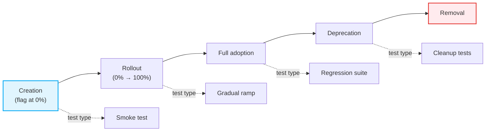

# 49. Feature Flag Testing — When the App Has Two Behaviours and the Flag Decides

**Navigation**: [← 48. Sharding & Test Selection](../06_CI_CD_And_Reliability/48_Sharding_And_Test_Selection.md) | [Index](../00_INDEX.md) | [→ 50. Email Service Testing](./50_Email_Service_Testing.md)

---

## 5W1H

- **WHAT**: Testing strategy for codebases gated by feature flags (LaunchDarkly, GrowthBook, Unleash, Split, or in-house).
- **WHY**: A modern app behaves differently for different users **at runtime**. A test that doesn't pin the flag state is non-deterministic by definition.
- **WHO**: Every team that uses flags — and that's now most teams.
- **WHEN**: The moment a flag enters the codebase that changes user-visible behaviour.
- **HOW**: Pin flag state explicitly per test, ideally via API or cookie, never by hoping the default ramp catches you.

---

## 0. War Stories — What Flag-Aware Tests Actually Prevent

### Story 1: The silent flag kill that broke 28 tests for a week

A team launched a feature behind a flag (`newCheckoutFlow: true`). They wrote tests for the new flow, pinned with `newCheckoutFlow: true` in the test fixture. Tests passed in CI for 3 months.

Then product decided to kill the flag — the new checkout flow had a conversion problem. The flag was removed from the codebase entirely. No API call was needed to set it — the old code path was just... the code.

The 28 tests that pinned `newCheckoutFlow: true` now tried to set a flag that didn't exist. The flag client silently returned the default (`false`). The tests were now testing the old checkout flow but asserting on new-flow UI elements. 28 failures, all "element not found."

Root cause: the tests pinned a flag that could disappear without notice. No test tracked that the flag existed. When the flag died, nothing detected it.

Fix: a smoke test that verifies the set of known flags:

```typescript
test('flag registry is complete', async ({ flagClient }) => {
  const knownFlags = ['newCheckoutFlow', 'betaDashboard', 'v2Api'];
  const actualFlags = await flagClient.getAllFlags();
  const actualKeys = Object.keys(actualFlags);

  for (const flag of knownFlags) {
    expect(actualKeys, `Flag "${flag}" was deleted from the registry without removing its tests`).toContain(flag);
  }
});
```

When `newCheckoutFlow` disappears, this test fails immediately with a clear message: "Flag 'newCheckoutFlow' was deleted from the registry without removing its tests."

### Story 2: The interaction bug that only appeared in one of four flag combinations

A pricing page had two flags: `showDiscount: boolean` and `v2PricingEngine: boolean`. Tests covered both flags independently: 4 tests total (each flag × on/off).

In production at 25% rollout: `showDiscount=true` + `v2PricingEngine=true` combined showed a negative price in the UI. The discount was applied twice: once by the frontend and once by the new pricing engine. The 4 independent tests never caught it because none tested the combination.

The fix: test the matrix explicitly when flags interact:

```typescript
const PRICING_FLAG_MATRIX = [
  { showDiscount: false, v2PricingEngine: false },
  { showDiscount: true,  v2PricingEngine: false },
  { showDiscount: false, v2PricingEngine: true  },
  { showDiscount: true,  v2PricingEngine: true  }, // ← the bug lived here
] as const;

for (const combo of PRICING_FLAG_MATRIX) {
  test(`pricing: discount=${combo.showDiscount}, v2engine=${combo.v2PricingEngine}`, async ({ page, flagClient }) => {
    await flagClient.setFlags(combo);
    await page.goto('/pricing');
    const price = await page.locator('[data-testid="total-price"]').textContent();
    expect(parseFloat(price!.replace('$', ''))).toBeGreaterThan(0);
  });
}
```

Cost of not testing combinations: a P0 production bug at 25% rollout. 3 hours of engineer time on a Saturday to roll back the flag.

---

## 1. Why this fails without intent

```
Day 1: Flag created at 0% rollout. Tests pass.
Day 5: Eng ramps to 50%. Half your tests fail randomly — by user assignment.
Day 6: Engineers add `--retries=5`. False green. Real bugs land.
```

You don't have flake. You have **uncontrolled state**. Pin it.

---

## 2. Three patterns for pinning flags

### Pattern A — API override per test

If your flag service has an admin API:

```typescript
test.beforeEach(async ({ request }) => {
  await request.put(`${envConfig.flagsService}/overrides`, {
    headers: { Authorization: `Bearer ${process.env.FLAGS_ADMIN_TOKEN}` },
    data: { user: "test-user-1", flag: "new_checkout", value: true },
  });
});
```

Pros: one source of truth. Cons: needs admin credentials in test env.

### Pattern B — Bootstrap cookie or local storage

Many SDKs (LaunchDarkly, GrowthBook) accept a "bootstrap" payload in localStorage:

```typescript
await page.addInitScript(() => {
  localStorage.setItem(
    "gb-features",
    JSON.stringify({ new_checkout: { defaultValue: true } }),
  );
});
```

Pros: zero backend coordination. Cons: SDK-specific syntax.

### Pattern C — `page.route` interception

Intercept the SDK's poll/init call and replace the response:

```typescript
await page.route("**/sdk/features**", async (route) => {
  await route.fulfill({
    status: 200,
    contentType: "application/json",
    body: JSON.stringify({ flags: { new_checkout: { value: true } } }),
  });
});
```

Pros: no admin access needed, works in any env. Cons: tied to a specific URL pattern.

---

## 3. Testing the _matrix_, not the flag

The real risk isn't "does the new path work." It's "do the old path AND the new path coexist correctly during ramp." So every flagged behaviour gets at least **two tests**:

```typescript
test.describe("checkout", () => {
  test("@new-flow @flag:new_checkout=true completes via new flow", async ({
    page,
  }) => {
    await pinFlag(page, "new_checkout", true);
    // ...
  });

  test("@old-flow @flag:new_checkout=false completes via old flow", async ({
    page,
  }) => {
    await pinFlag(page, "new_checkout", false);
    // ...
  });
});
```

A clean ramp-down later means deleting the old test, not rewriting the new one.

---

## 4. Fixture for flag pinning

```typescript
import { test as base } from "@playwright/test";

type FlagOverrides = Record<string, unknown>;

export const test = base.extend<{
  pinFlags: (overrides: FlagOverrides) => Promise<void>;
}>({
  pinFlags: async ({ page }, use) => {
    const pin = async (overrides: FlagOverrides): Promise<void> => {
      await page.addInitScript((flags) => {
        const window = globalThis as unknown as {
          __FLAG_OVERRIDES__: FlagOverrides;
        };
        window.__FLAG_OVERRIDES__ = flags;
      }, overrides);
    };
    await use(pin);
  },
});
```

Now any test gets a single function call:

```typescript
test("new checkout", async ({ page, pinFlags }) => {
  await pinFlags({ new_checkout: true, payments_v2: "fast-path" });
  await page.goto("/checkout");
});
```

---

## 5. Anti-patterns

1. **Setting flags via UI toggles.** Eats 30 seconds per test, fragile across SDK changes.
2. **Sharing flag state across tests.** One test enables the flag, the next assumes it's off. Bug in your tests, not in the app.
3. **Hardcoding the flag value as a query param** that the app no longer reads. Silently wrong → test passes always.
4. **Not asserting the flag pin worked.** Add `expect(await page.evaluate(() => window.__FLAG_OVERRIDES__))` to be sure.

---

## 6. Senior SDET perspective

Flag testing is **process work** as much as code work. Push the team to:

- Tag every test with the flag it exercises (`@flag:new_checkout`).
- Run "old path" and "new path" as separate projects in `playwright.config.ts`.
- Delete the old-path tests within 2 sprints of the flag hitting 100% rollout — otherwise they rot.

---

## 7. DevSecOps seed

Feature flags are also **kill switches**. A test that validates "flag off → endpoint returns 503" is a security/availability test. Build at least one of these per critical flag.

---

## 8. Exercise

Add a `pinFlags` fixture to [`framework/fixtures/page.fixture.ts`](../framework/fixtures/page.fixture.ts). Write two tests against any toy site (LocalStorage-based feature flagging is fine) that prove both code paths work. Verify by deliberately breaking the flag pin — both tests should fail in different ways.

---

## 9. Flag Service Comparison

The feature flag ecosystem has four major players. Here is a structured comparison to help teams choose.

|                             | **LaunchDarkly**                      | **GrowthBook**                     | **Unleash**                    | **Split**               |
| --------------------------- | ------------------------------------- | ---------------------------------- | ------------------------------ | ----------------------- |
| **Hosting**                 | SaaS + self-hosted                    | SaaS + self-hosted                 | SaaS + self-hosted             | SaaS + self-hosted      |
| **Starting price**          | Free < 5 users, then ~$20/mo per seat | Free self-hosted; $20/mo SaaS      | Free open-source; ~$80/mo SaaS | Contact sales           |
| **Real-time updates**       | Yes — streaming SSE/WebSocket         | Polling (SDK polls, not streaming) | Yes — SSE streaming            | Yes — streaming         |
| **Audit logs**              | Full audit trail, all changes         | Basic audit log                    | Audit log (Enterprise)         | Full audit trail        |
| **SSO**                     | SAML/OIDC                             | OIDC (SaaS)                        | SAML/OIDC (Enterprise)         | SAML/OIDC               |
| **On-premise**              | Yes (Enterprise)                      | Yes (self-host)                    | Yes (self-host)                | Yes (Enterprise)        |
| **SDK quality**             | Excellent — 20+ SDKs                  | Good — 10+ SDKs                    | Good — 15+ SDKs                | Good — 15+ SDKs         |
| **A/B testing**             | Built-in, sophisticated               | Built-in, good stats               | No (integrates separately)     | Built-in, sophisticated |
| **Flag evaluation latency** | < 5 ms (edge), SDK caching built-in   | Polling = delay risk               | < 5 ms (edge)                  | < 5 ms (edge)           |

### Decision table — choosing a provider

| Scenario                                | Recommended                                |
| --------------------------------------- | ------------------------------------------ |
| Small team, budget < $50/mo             | GrowthBook (SaaS) or Unleash (self-hosted) |
| Enterprise with compliance requirements | LaunchDarkly or Split                      |
| Need deep A/B testing with stats        | LaunchDarkly or GrowthBook                 |
| Need full on-premise control            | Unleash (open-source)                      |
| Already in GCP ecosystem                | LaunchDarkly (GCP integration)             |
| Cost-sensitive, technical team          | Unleash self-hosted                        |

### What the SDET needs to know per provider

**LaunchDarkly**: Bootstraps via localStorage key `launchdarkly-js-sdk-data` or a cookie. Real-time streaming means flag state can change mid-session — test with the snapshot SDK mode in CI to get deterministic behaviour.

**GrowthBook**: Polling-based. Set bootstrap via `localStorage.setItem('growthbook_features', JSON.stringify({...}))` for instant pin. Without it, tests wait for the first poll.

**Unleash**: Bootstrap via `UNLEASH_BOOTSTRAP` init option or `instanceId` storage. Supports offline mode — use it in tests to avoid a network call.

**Split**: Similar to LaunchDarkly. Uses `localStorage` or offline mode for testing. Less common but solid.

---

## 10. Testing the Flag Lifecycle

Every feature flag has a lifecycle. Tests should exist for every stage.

### Lifecycle stages



### Stage 1 — Creation (flag at 0%)

```typescript
test("@flag:new_algorithm is off at 0% rollout", async ({ page, pinFlags }) => {
  await pinFlags({ new_algorithm: false });
  await page.goto("/dashboard");
  // App should use the legacy algorithm — assert here
  await expect(page.locator(".algo-badge")).toHaveText("Classic");
});
```

### Stage 2 — Gradual rollout (50% canary)

```typescript
test("@flag:new_algorithm is enabled for treatment users", async ({
  page,
  pinFlags,
}) => {
  // Simulate a canary user (user ID in the 50th percentile hash bucket)
  await pinFlags({ new_algorithm: true });
  await page.goto("/dashboard");
  await expect(page.locator(".algo-badge")).toHaveText("Next Gen");
});
```

### Stage 3 — Full adoption (flag at 100%)

```typescript
test("@flag:new_algorithm: full rollout — old path removed", async ({
  page,
  pinFlags,
}) => {
  await pinFlags({ new_algorithm: true });
  await page.goto("/dashboard");
  // Confirm the old algorithm path no longer exists in the DOM
  await expect(page.locator(".algo-badge")).toHaveText("Next Gen");
  // Confirm no legacy element present
  await expect(page.locator(".legacy-alert-banner")).not.toBeAttached();
});
```

### Stage 4 — Deprecation

```typescript
test("@flag:new_algorithm deprecated — fallback behaviour works", async ({
  page,
  pinFlags,
}) => {
  // Pin to both true and false; both should land on a known-good state
  await pinFlags({ new_algorithm: false }); // fallback to legacy
  await page.goto("/dashboard");
  await expect(page.locator(".algo-badge")).toHaveText("Classic");

  await pinFlags({ new_algorithm: true }); // explicit on
  await page.goto("/dashboard");
  await expect(page.locator(".algo-badge")).toHaveText("Next Gen");
});
```

### Stage 5 — Removal (graceful degradation)

```typescript
test("@flag:new_algorithm removed — app does not crash", async ({
  page,
  pinFlags,
}) => {
  // Flag is removed from provider — simulate by not setting it at all
  await page.goto("/dashboard");
  // App should degrade gracefully — fallback to default behaviour
  await expect(page.getByRole("alert")).not.toBeVisible();
  await expect(page.locator(".algo-badge")).toBeVisible();
});
```

### Testing 0% / 50% / 100% rollout with synthetic users

```typescript
// A synthetic user hash to deterministically pick a bucket
function syntheticUserId(percentage: number, userId: string): string {
  const hash =
    userId.split("").reduce((acc, c) => acc + c.charCodeAt(0), 0) % 100;
  return hash < percentage ? `canary-${userId}` : `control-${userId}`;
}

test("canary user sees new algorithm at 50% rollout", async ({
  page,
  pinFlags,
}) => {
  const canaryUser = syntheticUserId(50, "user-canary-001");
  await pinFlags({ new_algorithm: true }, canaryUser);
  await page.goto("/dashboard");
  await expect(page.locator(".algo-badge")).toHaveText("Next Gen");
});
```

---

## 11. A/B Test Validation

Feature flags underpin A/B experiments. Testing them without contaminating production analytics requires isolation.

### The contamination problem

If your test suite uses real user IDs that also appear in your production analytics pipeline, test signups and polluted sessions contaminate your experiment metrics. A 5% conversion lift can look like 4.2% because test data diluted it.

### Isolation strategy 1 — Synthetic user segmentation

```typescript
test("@ab:pricing CTA copy experiment — treatment", async ({
  page,
  pinFlags,
}) => {
  await pinFlags({ experiment_pricing_cta: "treatment" });
  await page.goto("/pricing");
  await expect(page.locator(".cta-button")).toContainText("Start free");
});

test("@ab:pricing CTA copy experiment — control", async ({
  page,
  pinFlags,
}) => {
  await pinFlags({ experiment_pricing_cta: "control" });
  await page.goto("/pricing");
  await expect(page.locator(".cta-button")).toContainText("Get started");
});
```

Tag tests with a marker (`@ab:treatment` / `@ab:control`) so CI can run them separately from the main suite if needed.

### Isolation strategy 2 — Separate test environment analytics

Route analytics events to a test-specific project or endpoint:

```typescript
await page.addInitScript(() => {
  const originalFetch = window.fetch;
  window.fetch = (input, init) => {
    const url = input instanceof Request ? input.url : input;
    if (url.includes("/analytics")) {
      return originalFetch("https://analytics-test.internal/collect", init);
    }
    return originalFetch(input, init);
  };
});
```

### Asserting experiment outcomes

```typescript
test("treatment group sees variant B content", async ({ page, pinFlags }) => {
  await pinFlags({ ab_homepage_hero: "variant-b" });
  await page.goto("/");
  await expect(page.locator(".hero-headline")).toContainText(
    "Your data, your way",
  );
});

test("control group sees original content", async ({ page, pinFlags }) => {
  await pinFlags({ ab_homepage_hero: "control" });
  await page.goto("/");
  await expect(page.locator(".hero-headline")).toContainText(
    "Welcome to the platform",
  );
});
```

These are behaviour assertions, not statistical ones. The stats layer belongs in your analytics tooling, not in Playwright.

### What to test in the E2E layer

- Each variant renders correctly (no layout break).
- The variant ID is associated with the user session.
- Events fired from each variant carry the correct experiment context.
- Switching the flag mid-session does not reload the page (for single-page apps).

---

## 12. Multi-Flag Combinatorial Testing

Real systems have multiple flags active simultaneously. Testing all combinations is a combinatorial explosion.

### The explosion problem

With 10 boolean flags, there are 2^10 = 1,024 configurations. With 15 flags, there are 32,768. Testing all of them is impractical.

### Pairwise testing strategy

Pairwise testing (all-pairs algorithm) ensures every pair of flag states appears together in at least one test configuration. For most bugs, two interacting factors are sufficient to expose them.

**Example — 4 flags, 2 states each, pairwise needs ~6-8 tests instead of 16**

```
Flags: [new_checkout, dark_mode, beta_dashboard, payments_v2]
Each takes: { true, false }

Pairwise combinations to cover:
  (new_checkout=true, dark_mode=true)
  (new_checkout=true, dark_mode=false)
  (new_checkout=false, dark_mode=true)
  (new_checkout=false, dark_mode=false)
  ... and so on for every pair
```

### Tool: `test.each` in Playwright

```typescript
const flagCombinations = [
  {
    new_checkout: true,
    dark_mode: true,
    beta_dashboard: true,
    payments_v2: true,
  },
  {
    new_checkout: true,
    dark_mode: false,
    beta_dashboard: true,
    payments_v2: false,
  },
  {
    new_checkout: false,
    dark_mode: true,
    beta_dashboard: false,
    payments_v2: true,
  },
  {
    new_checkout: false,
    dark_mode: false,
    beta_dashboard: false,
    payments_v2: false,
  },
  {
    new_checkout: true,
    dark_mode: true,
    beta_dashboard: false,
    payments_v2: false,
  },
  {
    new_checkout: false,
    dark_mode: false,
    beta_dashboard: true,
    payments_v2: true,
  },
  // ... generated by an all-pairs tool
];

for (const combo of flagCombinations) {
  test(`flags ${JSON.stringify(combo)} renders correctly`, async ({
    page,
    pinFlags,
  }) => {
    await pinFlags(combo);
    await page.goto("/dashboard");
    await expect(page.locator("body")).toBeVisible();
    // Assert no crash
  });
}
```

### Generating pairwise combinations

Use a library to generate the minimal set:

```bash
npx @geut/pairwise-generator --factors new_checkout,dark_mode,beta_dashboard,payments_v2 --levels true,false --output test-configs.json
```

This outputs the minimal set of combinations that cover all 2-way interactions.

### What to assert in combinatorial tests

- Page loads without JS errors.
- No console errors (capture `page.on('console', ...)`).
- The combination itself does not crash — not asserting full behaviour for every combo.

---

## 13. Flag Cleanup Governance

Orphaned flags are a tax every team eventually pays. Proactive governance reduces the debt.

### Detecting stale flags automatically

Most flag providers expose a "last evaluated" or "last used" API:

```typescript
async function findStaleFlags(
  flagClient: LaunchDarklyClient,
  maxAgeDays = 90,
): Promise<string[]> {
  const flags = await flagClient.getAllFlagsState();
  const staleFlags: string[] = [];
  for (const [key, flag] of Object.entries(flags.allValues())) {
    const lastEval = (flag as any).lastEvaluation?.getTime();
    if (lastEval && Date.now() - lastEval > maxAgeDays * 86_400_000) {
      staleFlags.push(key);
    }
  }
  return staleFlags;
}

test("stale flag report", async () => {
  const stale = await findStaleFlags(launchDarklyClient, 90);
  console.log(`Stale flags (> 90 days): ${stale.join(", ")}`);
  expect(stale, "Expected no flags unused for 90+ days").toHaveLength(0);
});
```

### Testing "flag removed" graceful degradation

```typescript
test("@teardown flag removed — app falls back to default", async ({ page }) => {
  const consoleErrors: string[] = [];
  page.on("console", (msg) => {
    if (msg.type() === "error") consoleErrors.push(msg.text());
  });

  await page.goto("/dashboard");
  await expect(page.locator(".main-content")).toBeVisible();
  expect(consoleErrors.filter((e) => !e.includes("favicon"))).toHaveLength(0);
});
```

### The 2-sprint cleanup rule (formal)

1. **Sprint N**: Flag reaches 100% rollout. Old code path is deleted from the codebase.
2. **Sprint N+1**: Flag removal ticket is created. Scheduled for sprint N+2.
3. **Sprint N+2**: Flag is deleted from the provider. CI test for the flag name is removed.
4. Stale flags that survive past sprint N+2 are tracked as technical debt.

### Flag removal checklist

- [ ] Code path for the old flag state is deleted.
- [ ] All tests referencing the flag name are removed.
- [ ] Flag is deleted from the provider (not just set to 0%).
- [ ] "Flag cleanup" runbook step is removed from deploy checklist.
- [ ] Post-mortem if removal caused any regression.

---

## 14. Anti-patterns

1. **Hardcoding flag names across 50 tests.** One rename and 50 tests fail. Use a central `flags.ts` constant map and import from it. Changing a flag name becomes a one-line change.

2. **Not testing the default/fallback path.** Every flag has a default. If you only test the new-path state, you have zero coverage of what happens when the flag evaluates to its default. Write at least one test for the fallback.

3. **Ignoring flag evaluation latency (SDK fetching).** Many SDKs make a network call on page load. If your test asserts flag-dependent behaviour before that call resolves, it fails intermittently. Use bootstrap or init script to make evaluation synchronous.

4. **Testing production flags in CI without override.** Leaving real flag overrides in CI is dangerous — a bad value in CI config can affect production-equivalent tests. CI should always use test-only flag values.

5. **Not documenting flag intent.** Every flag should have a doc comment or entry in a `flags.md` registry explaining why it exists, when it should be removed, and what the expected default is. Without this, the next engineer guesses.

6. **Mixing feature flags with entitlements.** A "feature flag" controls a code path. An "entitlement" controls what a user is allowed to do (tier, role, plan). Conflating them leads to flags with many possible values that are really entitlement checks. Split them.

7. **Running A/B test assertions against production analytics.** If your Playwright test generates fake conversion events in the production analytics pipeline, you corrupt your experiment results. Always route test analytics to a separate sink (see section 11).

8. **Not deleting old-path tests after rollout.** Old-path tests that linger after a flag hits 100% are a maintenance liability. They test dead code that the app no longer has. Delete them. If you worry about losing the test knowledge, archive the test file in `../archive/` with a note.

---

## 15. Decision Matrix — Where to Test Flag Logic

| Scenario                                              | Best layer                 | Rationale                                         |
| ----------------------------------------------------- | -------------------------- | ------------------------------------------------- |
| Flag SDK evaluation (what value does the SDK return?) | Unit test                  | No browser needed, fast, deterministic            |
| Default value when flag is missing                    | Unit test                  | No external dependency                            |
| Flag state to UI element renders                      | E2E (Playwright)           | User-visible behaviour                            |
| Flag override mechanism (bootstrap/cookie)            | E2E                        | Must verify the override actually reaches the app |
| Multiple flags interacting (combinatorial)            | E2E or integration         | Browser context required                          |
| Flag evaluation latency / streaming                   | E2E with timing assertions | Must measure real browser behaviour               |
| A/B experiment bucketing                              | E2E                        | Analytics event context lives in browser          |
| Flag deprecation / removal                            | E2E                        | End-to-end path must degrade gracefully           |
| Flag provider API contract                            | Integration / API test     | Not a browser concern                             |
| Stale flag detection                                  | CI script / scheduled job  | Not a browser test                                |

**Rule of thumb**: If it affects what the user sees, it belongs in an E2E test. If it is pure logic internal to the SDK, it belongs in a unit test.

---

## 16. Senior SDET Perspective

Feature flags are the mechanism behind "deploy without release." The SDET's job is ensuring both paths work — the old and the new — and that the transition between them is invisible to the user.

### The strategic view

A team that can deploy at any time but is afraid to release has a testing problem, not a deployment problem. Flag testing is the discipline that makes continuous delivery safe:

- **Zero-downtime releases** become possible when the old path is always tested alongside the new one.
- **Rollback** is instantaneous — flip the flag, the old path is still there and tested.
- **Dark launches** (enabling for internal users first) are a flag testing pattern.

### The SDET's unique contribution

Developers test the new path because they are building it. The SDET's job is to **protect the old path**. When the new path is promoted to 100%, the SDET's test suite is what gives the team confidence to delete the old code.

This is the difference between a test suite that exists and a test suite that enables velocity. A team without flag testing can deploy — but they cannot release with confidence.

### Maturity model

| Level  | Flag testing maturity                                         |
| ------ | ------------------------------------------------------------- |
| **L1** | Tests do not pin flag state — flaky, blamed on "the flag"     |
| **L2** | Flag pin fixture exists, used inconsistently                  |
| **L3** | Every flagged behaviour has a test for both on/off states     |
| **L4** | Combinatorial multi-flag coverage, stale flag detection in CI |
| **L5** | Flag tests are the gate for promoting a flag to 100% rollout  |

Most teams are L1-L2. L3 is achievable in one quarter. L4-5 require process discipline.

---

## 17. DevSecOps Seed — Kill-Switch Testing

Feature flags are a first line of defence during active incidents. A tested kill-switch is worth more than a runbook that says "flip the flag."

### The kill-switch pattern

```typescript
test("@security:kill-switch disables payment processing", async ({
  page,
  pinFlags,
}) => {
  await pinFlags({ payment_processing_enabled: false });
  await page.goto("/checkout");
  await page.locator("input[name=card]").fill("4111111111111111");
  await page.locator("button[type=submit]").click();
  // Payment endpoint should return an error or redirect to safe state
  const response = await page.evaluate(async () => {
    const r = await fetch("/api/payment", {
      method: "POST",
      body: JSON.stringify({ amount: 100 }),
    });
    return { status: r.status, ok: r.ok };
  });
  expect(response.status).toBeGreaterThanOrEqual(400);
});

test("@security:kill-switch disables new feature under DDoS", async ({
  page,
  pinFlags,
}) => {
  await pinFlags({ new_api_endpoint: false });
  await page.goto("/new-endpoint");
  await expect(page.locator(".feature-disabled-notice")).toBeVisible();
  await expect(page.url()).not.toContain("/new-endpoint");
});
```

### What kill-switch tests verify

1. Flipping the flag off causes the endpoint or feature to become unavailable or return a safe error — not a crash.
2. The old (safe) path is still accessible when the new feature is disabled.
3. No data leaks occur through the disabled feature's cached responses.
4. The kill-switch itself can be toggled programmatically via API during an incident.

### Incident response integration

```typescript
async function emergencyDisableFlag(
  flagKey: string,
  reason: string,
): Promise<void> {
  await flagProvider.updateFlag(flagKey, false, {
    comment: `EMERGENCY DISABLE: ${reason} at ${new Date().toISOString()}`,
  });
}
```

---

## 18. Exercise — Complete Deliverable

### Objective

Build a `flagProvider` fixture that supports three override patterns:

1. **localStorage** — SDK reads flag state from localStorage on init.
2. **Cookie** — SDK reads flag state from a cookie.
3. **API override** — Test makes a real HTTP call to the flag provider admin API to set flag state per-user.

### Fixture specification

```typescript
// framework/fixtures/flag.fixture.ts
import { test as base } from "@playwright/test";

export type FlagOverride = Record<string, unknown>;

type FlagProviderFixture = {
  pinFlag: (
    flagKey: string,
    value: unknown,
    strategy?: "localStorage" | "cookie" | "api",
  ) => Promise<void>;
  pinFlags: (
    overrides: FlagOverride,
    strategy?: "localStorage" | "cookie" | "api",
  ) => Promise<void>;
  clearFlags: () => Promise<void>;
};

export const test = base.extend<{ flagProvider: FlagProviderFixture }>({
  flagProvider: [
    async ({ page }, use) => {
      const impl: FlagProviderFixture = {
        async pinFlag(key, value, strategy = "localStorage") {
          if (strategy === "api") {
            await page.request.put(`${process.env.FLAGS_ADMIN_URL}/overrides`, {
              headers: {
                Authorization: `Bearer ${process.env.FLAGS_ADMIN_TOKEN}`,
              },
              data: { userId: "test-user", flagKey: key, value },
            });
          } else if (strategy === "cookie") {
            await page.context().addCookies([
              {
                name: `flag_${key}`,
                value: String(value),
                domain: "localhost",
                path: "/",
              },
            ]);
          } else {
            await page.addInitScript(
              (args) => {
                const store: Record<string, unknown> = JSON.parse(
                  localStorage.getItem("__FLAG_OVERRIDES__") || "{}",
                );
                store[args.key] = args.value;
                localStorage.setItem(
                  "__FLAG_OVERRIDES__",
                  JSON.stringify(store),
                );
              },
              { key, value },
            );
          }
        },
        async pinFlags(overrides, strategy = "localStorage") {
          for (const [key, value] of Object.entries(overrides)) {
            await this.pinFlag(key, value, strategy);
          }
        },
        async clearFlags() {
          await page.evaluate(() =>
            localStorage.removeItem("__FLAG_OVERRIDES__"),
          );
          const ctx = page.context();
          const cookies = await ctx.cookies();
          await ctx.clearCookies();
        },
      };
      await use(impl);
    },
    { scope: "test" },
  ],
});
```

### Implementation steps

1. **localStorage strategy**: Use `page.addInitScript` to set `localStorage` before the page loads. Works for any SDK that reads localStorage on boot.

2. **Cookie strategy**: Use `page.context().addCookies()` to set a cookie the SDK reads on page load. Verify the SDK supports cookie bootstrapping first.

3. **API strategy**: `POST` to the provider overrides endpoint with `{ userId, flagKey, value }`. Requires `FLAGS_ADMIN_TOKEN` in the environment.

4. **Testing both flag states for `new_dashboard`**:

```typescript
test("@flag:new_dashboard=true — new dashboard loads", async ({
  page,
  flagProvider,
}) => {
  await flagProvider.pinFlag("new_dashboard", true, "localStorage");
  await page.goto("/dashboard");
  await expect(page.locator(".dashboard-v2")).toBeVisible();
  await expect(page.locator(".dashboard-v1")).not.toBeAttached();
});

test("@flag:new_dashboard=false — legacy dashboard loads", async ({
  page,
  flagProvider,
}) => {
  await flagProvider.pinFlag("new_dashboard", false, "localStorage");
  await page.goto("/dashboard");
  await expect(page.locator(".dashboard-v1")).toBeVisible();
  await expect(page.locator(".dashboard-v2")).not.toBeAttached();
});
```

5. **Verify the pin works** (add to both tests):

```typescript
const flagState = await page.evaluate(() =>
  JSON.parse(localStorage.getItem("__FLAG_OVERRIDES__") || "{}"),
);
if (expectedValue === true) {
  expect(flagState.new_dashboard).toBeTruthy();
} else {
  expect(flagState.new_dashboard).toBeFalsy();
}
```

### Self-grading rubric

| Criterion                                       | 0 (missing)           | 1 (partial)                      | 2 (complete)                            |
| ----------------------------------------------- | --------------------- | -------------------------------- | --------------------------------------- |
| `pinFlag` function implemented for localStorage | Not implemented       | Only one strategy works          | All three strategies implemented        |
| `pinFlags` bulk override works                  | No bulk method        | Manually pins each flag          | `pinFlags` loops correctly              |
| `clearFlags` removes overrides                  | Not implemented       | Clears localStorage only         | Clears all override strategies          |
| Both `new_dashboard` states tested              | Only one state        | One state + one edge case        | Both states with assertions             |
| Pin verification added                          | No verification       | Partial check                    | Full `evaluate` assertion on flag value |
| No `waitForTimeout` in tests                    | Used `waitForTimeout` | Partial use                      | Zero `waitForTimeout` calls             |
| Fixture scoped correctly                        | Global scope          | Test scope declared but not used | `{ scope: 'test' }` correctly used      |
| **Total**                                       | **0-6**               | **1-12**                         | **8-16**                                |

**Passing threshold**: 12/16. Below 12, revisit and retest.

### Bonus challenges

- Add a fourth strategy: intercept the flag SDK HTTP call with `page.route` and return a synthetic response (zero network, deterministic in CI).
- Write a pairwise combinatorial test covering 5 boolean flags with 8 configurations using a pairwise generator.
- Add a stale flag detection test that reads the flag provider API and asserts no flag is > 90 days unused.
- Integrate the flag provider fixture into `playwright.config.ts` so every project inherits it automatically via `globalSetup`.


---

## Reality Check

**"Feature flags are just if-else statements"**→ Feature flags represent: gradual rollouts (5 percent of users see the new feature), A/B experiments (variant A vs variant B with metric tracking), kill switches (disable a broken feature instantly), and entitlements (premium users see additional features). Testing each type requires different strategies: toggle-based tests for kill switches, variant-based tests for experiments, and segment-based tests for rollouts.

**"Testing with all flags on and all flags off covers everything"**→ The combinatorial explosion of N feature flags creates 2-to-the-N possible configurations. Two flags interacting (new checkout with new payment processor) can produce bugs that neither flag alone surfaces. Test the MEANINGFUL combinations: flags that affect the same user flow, flags that modify shared components, and the production default configuration.

**"Feature flag state can be set in the test"**→ Client-side feature flags can be overridden in tests by: injecting flag values into localStorage, intercepting the flag service API response, or setting environment variables. Server-side feature flags require: API calls to the flag service (LaunchDarkly, Split), database updates, or test-specific configuration. The approach depends on where the flag is evaluated.

**"Feature flags should be removed after full rollout"**→ Old feature flags that remain in code after full rollout become dead code paths that still need testing, increase cognitive load for developers reading the code, and accumulate as technical debt. Establish a flag lifecycle: create, test, rollout, verify, REMOVE. Track flag age and alert when flags exceed their expected lifetime.

**"Feature flag testing is a CI concern only"**→ Feature flags in production can be changed WITHOUT deployment. A flag toggled at 3 PM can break a feature that passed all CI tests. Production monitoring must verify features work correctly AFTER flag changes. Synthetic monitoring (running test scenarios against production continuously) catches flag-related regressions that CI cannot.
