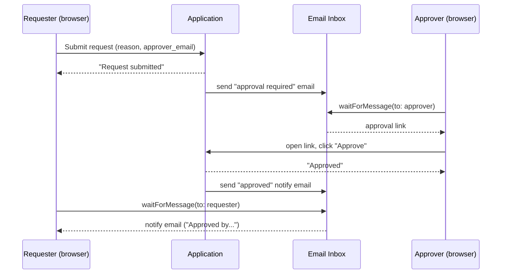

# 50. Email Service Testing — Magic Links, OTPs, and Notifications Without `setTimeout(60000)`

**Navigation**: [← 49. Feature Flag Testing](./49_Feature_Flag_Testing.md) | [Index](../00_INDEX.md) | [→ 51. Secrets Management](../06_CI_CD_And_Reliability/51_Secrets_Management_For_SDETs.md)

---

## 5W1H

- **WHAT**: Testing flows that depend on email delivery — magic links, password reset OTPs, order confirmation notifications.
- **WHY**: Real Gmail accounts are forbidden (rate-limited, flaky, leak data). You need a real inbox the test can introspect via API.
- **WHO**: Any team testing signup, login-by-link, password reset, or transactional emails.
- **WHEN**: As soon as an email gates a flow. Don't try to "skip" by clicking a backdoor — that doesn't test the actual delivery path.
- **HOW**: Mailosaur (SaaS) or Mailpit (self-hosted; MailHog is unmaintained — [§9](#9-mailpit-self-hosted-setup-and-why-not-mailhog)). A provider's "sandbox mode" is **not** an inbox ([§14](#14-decision-matrix--email-provider-choice)).

---

## 0. War Stories — Email Tests Gone Wrong

### Story 1: The attachment validation that passed for 6 months without testing attachments

A team tested the email delivery for invoice emails. The test checked: email arrived, subject correct, body contains order number. Tests passed.

Six months in, an accounting user noticed: "The invoices have no attachment — we've been getting blank emails." The API was sending the email correctly (Mailosaur confirmed delivery), but the PDF attachment generation service was silently failing after a dependency update. The attachment field in the email was present but 0 bytes.

The test never checked `email.attachments.length` or `attachment.content.length`. A test that checks email arrival but not attachment presence is not testing the invoice email flow — it's testing the email infrastructure.

**Fix:**
```typescript
const email = await mailosaur.messages.get(serverId, { sentTo: recipient });
expect(email.attachments).toHaveLength(1);
const [pdf] = email.attachments ?? [];
expect(pdf?.fileName).toBe('invoice-2024-001.pdf');
expect(pdf?.length).toBeGreaterThan(1_000); // sanity check: PDF can't be < 1KB
```

(`attachments` is optional and `fileName`/`length` are `string | undefined` / `number | undefined` in the `mailosaur@11.1.1` typings, so the bare `attachments[0].fileName` form does not compile under `strict` + `noUncheckedIndexedAccess`. The provider-agnostic `InboxMessage` in [§2](#2-generic-email-client-provider-agnostic-shape) carries `attachments` so the same assertion works on every provider.)

**Lesson:** Always assert on what you actually care about. "Email arrived" is table stakes. "Email arrived with a valid non-empty attachment" is the assertion that catches bugs.

### Story 2: Bounce handling that caused 11,000 emails to be sent to a dead inbox

A test account was created with `test-user-8847@internal.corp` — a valid internal email at the time. The email service had a bounce retry policy: if delivery failed, retry 3 times over 24 hours. No test validated the bounce behavior.

After a company restructuring, the `internal.corp` domain was retired. The email service's retry logic kept sending to the dead address. Over 3 months, the test suite triggered 11,232 emails that bounced. The bounce rate put the company's sending domain on a spam blocklist.

**What should have been tested:**
```typescript
// Test the bounce handling endpoint exists and responds correctly
// (`request` is Playwright's APIRequestContext fixture — note status() is a METHOD there)
const bouncePayload = { event: 'bounce', email: testEmail, reason: 'user_unknown' };
const resp = await request.post('/webhooks/email-bounce', { data: bouncePayload });
expect(resp.status()).toBe(200);
// Verify no retry was queued
const retryQueue = await request.get(`/email-retries?email=${encodeURIComponent(testEmail)}`);
expect((await retryQueue.json()).count).toBe(0);
```

**Lesson:** Email testing isn't just "did the email send" — it's also "does the system handle failure correctly." Bounce webhooks, suppression lists, and retry policies need dedicated tests.

---

## 1. The choice

|                     | Mailosaur                              | Mailpit                                       | Provider "sandbox" (SendGrid etc.)                    |
| ------------------- | -------------------------------------- | --------------------------------------------- | ----------------------------------------------------- |
| **Hosting**         | SaaS                                   | Self-hosted, free (Docker or static binary)   | The provider                                          |
| **API**             | Polished REST + SDK                    | REST API with a published Swagger spec        | A validation response — **no inbox to read**          |
| **Real-world feel** | Real delivery to an inbox it hosts     | SMTP capture; nothing leaves the network      | SendGrid: the mail "will never be delivered"          |
| **Cost**            | Paid, 14-day trial                     | Free                                          | Free                                                  |
| **Use when**        | Real delivery path matters (staging)   | Local dev, and a CI service container         | You only need to validate the Mail Send payload       |

Default: **Mailosaur for staging tests; Mailpit for local dev and CI service containers.** MailHog was the usual self-hosted answer for years; Mailpit's README describes it as no longer maintained and without security updates for a few years — see [§9](#9-mailpit-self-hosted-setup-and-why-not-mailhog) for what that costs you in practice.

Sources: [Mailosaur pricing](https://mailosaur.com/pricing), [SendGrid sandbox mode](https://www.twilio.com/docs/sendgrid/for-developers/sending-email/sandbox-mode), [Mailpit README](https://github.com/axllent/mailpit).

---

## 2. Generic email client (provider-agnostic shape)

Tests depend on this interface and never on a provider — swap implementations per environment via the fixture ([§10](#10-email-fixture-factory)).

```typescript
// framework/emails/email-client.ts
import { randomUUID } from "node:crypto";

export interface InboxAttachment {
  fileName: string;
  contentType: string;
  length: number; // bytes
}

export interface InboxMessage {
  id: string;
  to: string;
  subject: string;
  textBody: string;
  htmlBody: string;
  receivedAt: Date;
  links: string[];
  attachments: InboxAttachment[];
}

export interface WaitCriteria {
  to: string;
  subjectContains?: string;
  receivedAfter: Date;
  timeoutMs: number;
}

/** Every http(s) URL in the bodies. Decodes the `&amp;` that HTML hrefs carry. */
export function extractLinks(...bodies: string[]): string[] {
  const found = new Set<string>();
  for (const body of bodies) {
    for (const m of body.matchAll(/https?:\/\/[^\s"'<>)]+/g)) {
      found.add(m[0].replace(/&amp;/g, "&").replace(/[.,;]+$/, ""));
    }
  }
  return [...found];
}

/** First run of exactly `digits` digits that is not part of a longer number. Throws if none. */
export function extractOtp(body: string, digits = 6): string {
  const m = body.match(new RegExp(`(?<!\\d)(\\d{${digits}})(?!\\d)`));
  if (!m?.[1]) throw new Error(`No ${digits}-digit code in email body: ${body.slice(0, 200)}`);
  return m[1];
}

export abstract class EmailClient {
  private readonly issued: string[] = [];

  protected abstract readonly domain: string;
  abstract waitForMessage(criteria: WaitCriteria): Promise<InboxMessage>;
  abstract deleteMessage(id: string): Promise<void>;
  /** Delete every message addressed to `address` and nothing else. */
  protected abstract deleteAllFor(address: string): Promise<void>;

  /** A fresh, collision-proof address. Random, not Date.now(): two workers can share a millisecond. */
  uniqueAddress(prefix = "test"): string {
    const address = `${prefix}-${randomUUID().slice(0, 8)}@${this.domain}`;
    this.issued.push(address);
    return address;
  }

  /** Fixture teardown: remove only the mail for addresses THIS test created. */
  async cleanup(): Promise<void> {
    await Promise.all(this.issued.map((a) => this.deleteAllFor(a)));
  }
}
```

Three details here are load-bearing:

- **`&amp;` in `href`s.** The raw HTML of a link with two query parameters is `…?token=abc&amp;next=%2Fhome`. A regex over the HTML that does not decode it hands the browser a URL with the literal text `amp;next=`, and the second parameter silently goes missing.
- **`uniqueAddress` is random, not `Date.now()`.** With `fullyParallel` and several workers, two tests starting in the same millisecond mint the same address and read each other's mail.
- **Cleanup is per-address, not per-inbox.** A "purge the whole inbox" step in a test-scoped fixture deletes mail that *other workers' tests are currently waiting for* ([§13 #9](#13-anti-patterns)).

The abstract class (rather than an interface plus `{...client}` wrappers) is deliberate: object spread on a class instance drops its prototype methods.

---

## 3. Mailosaur SDK in a few calls

The provider wrapper lives in [§10](#10-email-fixture-factory); this is what the SDK itself does, checked against the `mailosaur@11.1.1` typings and source:

```typescript
import MailosaurClient from "mailosaur";

const mailosaur = new MailosaurClient(process.env.MAILOSAUR_API_KEY ?? "");
const serverId = process.env.MAILOSAUR_SERVER_ID ?? "";

// Any address at <serverId>.mailosaur.net lands in the server; there is nothing to create first.
const address = `signup-${crypto.randomUUID().slice(0, 8)}@${serverId}.mailosaur.net`;

const msg = await mailosaur.messages.get(
  serverId,
  { sentTo: address, subject: "Confirm your account" },
  { timeout: 30_000, receivedAfter: new Date(Date.now() - 5_000) },
);

const link = msg.html?.links?.[0]?.href; // already extracted and HTML-decoded by Mailosaur
const code = msg.text?.codes?.[0]?.value; // Mailosaur extracts numeric codes for you
const pdf = msg.attachments?.[0]; // { fileName, contentType, length, ... }
```

- **`messages.get` polls for you.** Defaults, from the SDK source: `timeout` 10 000 ms, and `receivedAfter` = *one hour ago* if you pass nothing. On expiry it throws a `MailosaurError` whose `type` is `search_timeout`; pass `errorOnTimeout: false` to `messages.search` if you want an empty list instead.
- **`messages.deleteAll(serverId)` empties the whole server** — every parallel worker's mail. Use `search(serverId, { sentTo }, { timeout: 0 })` plus `del` to remove one address ([§10](#10-email-fixture-factory) does).
- **`messages.list` is paged.** A "list everything and delete it" loop without paging only sees the first page.

---

## 4. The magic-link test pattern

```typescript
test("@e2e magic link signs the user in", async ({ page, emailInbox }) => {
  const address = emailInbox.uniqueAddress("signup");
  const beforeTime = new Date(Date.now() - 5_000);

  await page.goto("/signup");
  await page.locator("input[name=email]").fill(address);
  await page.locator("button[type=submit]").click();

  const message = await emailInbox.waitForMessage({
    to: address,
    subjectContains: "Confirm your account",
    receivedAfter: beforeTime,
    timeoutMs: 30_000,
  });

  const link = message.links.find((l) => l.includes("/auth/verify"));
  expect(link, "magic link missing from email").toBeDefined();

  await page.goto(link!);
  await expect(page.getByText("Welcome")).toBeVisible();

  await emailInbox.deleteMessage(message.id);
});
```

Three principles to notice:

1. `uniqueAddress()` — every test gets a fresh inbox-side address.
2. `receivedAfter: beforeTime` — never collide with prior runs. Note whose clock this is: `beforeTime` is the *test runner's* clock, compared with a timestamp stamped by the *mail server* (Mailosaur's, or Mailpit's `Created`). A CI container whose clock runs a few seconds fast makes a perfectly delivered message look "older than `beforeTime`" and the wait times out. With a unique address `receivedAfter` is belt-and-braces, so backdate it by a few seconds (`new Date(Date.now() - 5_000)`) rather than trusting the two clocks to agree.
3. `deleteMessage` on success, plus the fixture's per-address `cleanup()` ([§10](#10-email-fixture-factory)) for the failure path — the inbox stays sane for parallel runs.

> **On the form selectors.** `input[name=email]` and `button[type=submit]` stand in for your app's real form, whose structure this chapter cannot know. They are written as `page.locator(...)` because the string-selector form `page.click(sel)` / `page.fill(sel)` carries a "use locator-based `locator.click()` instead" note in Playwright's typings. On a form with proper labels, prefer `page.getByLabel("Email")` and `page.getByRole("button", { name: "Sign up" })` ([Ch02 locator priority](../01_Foundations/02_Enterprise_Locators_XPath.md#2-the-locator-priority-hierarchy--best-to-worst)); `data-testid` buttons below use `getByTestId`.

---

## 5. Common mistakes

1. ❌ **`waitForTimeout(60000)` then "check Gmail."** Slow, flaky, depends on a human Gmail account that gets rate-limited and locked. Playwright's own API docs (and the installed typings) say `page.waitForTimeout()` is for debugging only and that tests relying on the timer in production become flaky; wait on a signal (here: the inbox API) instead.
2. **Reusing the same email address across tests.** Two parallel tests pull the same message → one of them grabs the wrong one.
3. **Asserting `textBody` only.** Many flows render via HTML only — the text part may be empty. Assert one or the other deliberately.
4. **Not deleting on success.** After 500 runs your inbox has 5,000 messages and `waitForMessage` slows to a crawl.
5. **Trusting the link in the email is in the right env.** Always assert the link contains your env's host.

---

## 6. Senior SDET perspective

Email testing is where new SDETs reach for `waitForTimeout`. Train yourself: any flow involving "wait for something external" → poll the source, never the clock.

---

## 7. DevSecOps seed

Password reset is **the** classic test target for security regressions: token reuse, token expiry, token guessability. Once you have an email fixture, write these three tests for any reset flow you ship:

- Token works once, fails the second time.
- Token expires after N minutes.
- New reset request invalidates the old token.

---

## 8. Exercise

Start a local Mailpit (`docker run -d -p 1025:1025 -p 8025:8025 axllent/mailpit`) or sign up for a Mailosaur trial. Add an `emailInbox` fixture to [`framework/fixtures/page.fixture.ts`](../framework/fixtures/page.fixture.ts). Write a test for any signup/reset flow you have access to (try a test account on [the-internet.herokuapp.com](https://the-internet.herokuapp.com/forgot_password) for practice). Confirm zero `waitForTimeout` calls in your test code.

---

## 9. Mailpit Self-Hosted Setup (and why not MailHog)

[Mailpit](https://github.com/axllent/mailpit) is a self-contained SMTP server, web UI and REST API that captures every message sent to it. It accepts mail for **any** recipient domain, so `anything@inbox.test` just works, and nothing ever leaves your network.

> **Verification status.** Mailpit's endpoints and field names below come from its published Swagger 2.0 file ([`swagger.json`](https://github.com/axllent/mailpit/blob/develop/server/ui/api/v1/swagger.json)) and [docs](https://mailpit.axllent.org/docs/api-v1/). The client in [§10](#10-email-fixture-factory) compiles under `strict` + `noUncheckedIndexedAccess` + `noUnusedLocals`, and its polling, link-decoding, attachment-mapping, timeout and per-address cleanup logic passed under Playwright 1.64.1 against a stand-in HTTP server shaped from that spec. It was **not** run against the real Mailpit binary (no Docker daemon was running when this chapter was verified). Run the exercise in [§17](#17-exercise--complete-deliverable) against a real one before you trust it.

### Quick start

```bash
docker run -d --name mailpit \
  -p 1025:1025   `# SMTP — point your app here` \
  -p 8025:8025   `# Web UI + REST API — http://localhost:8025` \
  axllent/mailpit
```

Static binaries (Windows, macOS, Linux), Homebrew and a Linux/macOS install script are listed in the [README](https://github.com/axllent/mailpit). In GitHub Actions run it as a service container so the app under test and the tests both reach it on `localhost`:

```yaml
services:
  mailpit:
    image: axllent/mailpit
    ports:
      - 1025:1025
      - 8025:8025
```

### Configuring your app

```bash
# .env for local development / CI
SMTP_HOST=localhost
SMTP_PORT=1025
SMTP_FROM=noreply@myapp.local
# no SMTP_USER / SMTP_PASS: no SMTP auth is configured by default
```

For a Node.js app using Nodemailer:

```typescript
import nodemailer from "nodemailer";

const transporter = nodemailer.createTransport({
  host: process.env.SMTP_HOST ?? "localhost",
  port: Number(process.env.SMTP_PORT ?? 1025),
  secure: false,
  ignoreTLS: true, // plain SMTP: Mailpit requires neither TLS nor auth by default
});

await transporter.sendMail({
  from: "noreply@myapp.local",
  to: "user@example.com",
  subject: "Test email",
  text: "Hello from Mailpit",
});
```

### Mailpit API

| Need | Request |
| --- | --- |
| Find a message | `GET /api/v1/search?query=to:"user@example.com"&limit=50` → `{ messages: MessageSummary[], … }` |
| Read one (decoded body, attachments) | `GET /api/v1/message/{ID}` → `{ Text, HTML, Attachments[], … }` |
| List newest | `GET /api/v1/messages?start=0&limit=50` |
| Delete some | `DELETE /api/v1/messages` with JSON body `{ "IDs": ["…"] }` |
| Delete everything | `DELETE /api/v1/messages` with **no** body |
| Delete by search | `DELETE /api/v1/search?query=to:"user@example.com"` |

Search filters include `to:`, `from:`, `subject:`, `has:attachment`, `after:`/`before:` (date granularity only — filter on `Created` client-side for sub-day precision) and `!`/`-` negation; quote values containing spaces ([search filters](https://mailpit.axllent.org/docs/usage/search-filters/)). Field names, from the Swagger file: `MessageSummary` = `ID, Created, Subject, To[{Name, Address}], Attachments, Snippet, …`; `Message` = `ID, Text, HTML, Attachments[{FileName, ContentType, Size, PartID, …}], …`. Mailpit hands you **decoded** `Text` and `HTML`.

Two server defaults that bite shared CI instances ([runtime options](https://mailpit.axllent.org/docs/configuration/runtime-options/)): messages live in a temp database file that is deleted when Mailpit exits (`MP_DATABASE` persists it), and **`MP_MAX_MESSAGES` defaults to 500** — beyond that Mailpit periodically deletes the *oldest* messages, so a busy shared instance can prune a message before its test reads it. Per-test cleanup ([§10](#10-email-fixture-factory)) keeps you far below that; set `MP_MAX_MESSAGES=0` only if you must.

### Why not MailHog

Mailpit's README describes MailHog as no longer maintained and without security updates for a few years. The practical costs, for code written against the old API:

- **`To` has no `Email` field.** MailHog's `Message` is `{ ID, From, To[], Content, Created, MIME, Raw }` with `Path` = `{ Relays, Mailbox, Domain, Params }` ([`mailhog/data`](https://github.com/mailhog/data/blob/master/message.go)). The address is `Mailbox + "@" + Domain`. A matcher that reads `msg.To[0].Email` (an easy mistake, because Mailpit and most SaaS APIs do have a single address field) gets `""`, `"".includes(address)` is always `false`, and **`waitForMessage` times out on every message**. (Reproduced against that struct shape.)
- **`/api/v1/delete/all` does not exist.** Delete-all is `DELETE /api/v1/messages`; one message is `DELETE /api/v1/messages/{id}` ([APIv1](https://github.com/mailhog/MailHog/blob/master/docs/APIv1.md)).
- **Bodies are the wire format.** Nodemailer's HTML+text mail is `Content-Transfer-Encoding: quoted-printable`, so a long link is stored split across lines with `=` soft breaks and every `=` escaped as `=3D`:

  ```
  Hi Zo=C3=AB, verify: https://app.example.com/auth/verify?=
  token=3Daaaaaaaaaaaaaaaaaaaaaaaaaaaaaaaaaaaaaaaa&next=3D%2Fdashboard&utm=3D1
  ```

  (Output of Nodemailer's `streamTransport`, i.e. what goes over SMTP.) MailHog's `Content.Body` is a plain string in its Go type, so a regex over it needs a quoted-printable decoder first; Mailpit's `Text`/`HTML` arrive decoded.

If you inherit a MailHog setup, keep it running but fix those three things, or move to Mailpit — the swap is the fixture in [§10](#10-email-fixture-factory).

### Mailpit vs Mailosaur

|                          | Mailpit                          | Mailosaur                          |
| ------------------------ | -------------------------------- | ---------------------------------- |
| Cost                     | Free (self-hosted)               | Paid SaaS, 14-day trial            |
| Setup time               | One container                    | Account + API key                  |
| Delivers to a real inbox | No — captures, nothing leaves    | Yes — real internet delivery to its servers |
| Works offline            | Yes                              | No                                 |
| Extracts links / codes   | No (regex them — [§2](#2-generic-email-client-provider-agnostic-shape)) | Yes (`links`, `codes`) |
| Persistence              | Temp DB unless `MP_DATABASE`     | Persistent                         |
| CI                       | Service container                | Anywhere with internet             |

**Rule**: Mailpit when your app sends through an SMTP host you control (local dev, CI service container, ephemeral preview environments). Mailosaur when the real delivery path is under test (staging with the production email provider) or you cannot run containers.

---

## 10. Email Fixture Factory

A well-designed email fixture abstracts the provider away so tests never hardcode Mailpit vs Mailosaur. The same suite then runs against Mailpit locally and Mailosaur on staging by changing `EMAIL_PROVIDER`. The shared `EmailClient` base class, `extractLinks` and `extractOtp` are in [§2](#2-generic-email-client-provider-agnostic-shape).

### Mailpit implementation

```typescript
// framework/emails/providers/mailpit-client.ts
import { setTimeout as sleep } from "node:timers/promises";
import { EmailClient, extractLinks, type InboxMessage, type WaitCriteria } from "../email-client";

// Field names from Mailpit's published swagger.json (MessageSummary / Message / Attachment).
interface MailpitSummary {
  ID: string;
  Created: string;
  Subject: string;
  To: { Name: string; Address: string }[];
}
interface MailpitMessage {
  Text: string;
  HTML: string;
  Attachments: { FileName: string; ContentType: string; Size: number }[];
}

export class MailpitClient extends EmailClient {
  protected readonly domain = "inbox.test"; // .test is reserved (RFC 2606); Mailpit accepts any recipient

  constructor(private readonly baseUrl = process.env.MAILPIT_URL ?? "http://localhost:8025") {
    super();
  }

  private async api<T>(path: string, init?: RequestInit): Promise<T> {
    const res = await fetch(`${this.baseUrl}${path}`, init);
    if (!res.ok) throw new Error(`Mailpit ${init?.method ?? "GET"} ${path} -> ${res.status}`);
    return (await res.json()) as T;
  }

  async waitForMessage({ to, subjectContains, receivedAfter, timeoutMs }: WaitCriteria): Promise<InboxMessage> {
    const deadline = Date.now() + timeoutMs;
    const query = new URLSearchParams({ query: `to:"${to}"`, limit: "50" });
    do {
      const { messages } = await this.api<{ messages: MailpitSummary[] }>(`/api/v1/search?${query}`);
      const hit = messages.find(
        (m) =>
          new Date(m.Created) >= receivedAfter &&
          (!subjectContains || m.Subject.includes(subjectContains)),
      );
      if (hit) {
        const full = await this.api<MailpitMessage>(`/api/v1/message/${hit.ID}`);
        return {
          id: hit.ID,
          to,
          subject: hit.Subject,
          textBody: full.Text,
          htmlBody: full.HTML,
          receivedAt: new Date(hit.Created),
          links: extractLinks(full.HTML, full.Text),
          attachments: full.Attachments.map((a) => ({
            fileName: a.FileName,
            contentType: a.ContentType,
            length: a.Size,
          })),
        };
      }
      await sleep(500); // poll interval — the loop exits as soon as the message exists
    } while (Date.now() < deadline);
    throw new Error(`No email to ${to} (subject contains "${subjectContains ?? ""}") within ${timeoutMs}ms`);
  }

  async deleteMessage(id: string): Promise<void> {
    await this.api("/api/v1/messages", {
      method: "DELETE",
      headers: { "Content-Type": "application/json" },
      body: JSON.stringify({ IDs: [id] }),
    });
  }

  protected async deleteAllFor(address: string): Promise<void> {
    await this.api(`/api/v1/search?${new URLSearchParams({ query: `to:"${address}"` })}`, {
      method: "DELETE",
    });
  }
}
```

The loop is a `do … while`, so even `timeoutMs: 0` checks once. The thrown error names the address, subject filter and timeout, which is what you need at 2 a.m. when CI says "email never arrived".

### Mailosaur implementation

```typescript
// framework/emails/providers/mailosaur-client.ts
import MailosaurClient from "mailosaur";
import { EmailClient, type InboxMessage, type WaitCriteria } from "../email-client";

export class MailosaurInbox extends EmailClient {
  protected readonly domain: string;
  private readonly client: MailosaurClient;

  constructor(apiKey: string, private readonly serverId: string) {
    super();
    this.client = new MailosaurClient(apiKey);
    this.domain = `${serverId}.mailosaur.net`;
  }

  async waitForMessage({ to, subjectContains, receivedAfter, timeoutMs }: WaitCriteria): Promise<InboxMessage> {
    // Throws MailosaurError (type "search_timeout") if nothing matches in time.
    const msg = await this.client.messages.get(
      this.serverId,
      { sentTo: to, ...(subjectContains ? { subject: subjectContains } : {}) },
      { timeout: timeoutMs, receivedAfter },
    );
    return {
      id: msg.id ?? "",
      to,
      subject: msg.subject ?? "",
      textBody: msg.text?.body ?? "",
      htmlBody: msg.html?.body ?? "",
      receivedAt: new Date(msg.received ?? Date.now()),
      links: msg.html?.links?.map((l) => l.href ?? "").filter(Boolean) ?? [],
      attachments: (msg.attachments ?? []).map((a) => ({
        fileName: a.fileName ?? "",
        contentType: a.contentType ?? "",
        length: a.length ?? 0,
      })),
    };
  }

  async deleteMessage(id: string): Promise<void> {
    await this.client.messages.del(id);
  }

  protected async deleteAllFor(address: string): Promise<void> {
    // timeout: 0 = look once, do not poll. (messages.deleteAll(serverId) would wipe other workers' mail.)
    const { items = [] } = await this.client.messages.search(this.serverId, { sentTo: address }, { timeout: 0 });
    await Promise.all(items.map((m) => this.client.messages.del(m.id)));
  }
}
```

Compiled against `mailosaur@11.1.1`. Not run against a live Mailosaur server (needs an account); `search`/`get`/`del` signatures and the `timeout: 0` no-poll behaviour are from the package's typings and source.

### Factory function — choose provider by environment variable

```typescript
// framework/emails/email-client-factory.ts
import { MailpitClient } from "./providers/mailpit-client";
import { MailosaurInbox } from "./providers/mailosaur-client";
import type { EmailClient } from "./email-client";

export function createEmailClient(): EmailClient {
  if ((process.env.EMAIL_PROVIDER ?? "mailpit") === "mailosaur") {
    const { MAILOSAUR_API_KEY, MAILOSAUR_SERVER_ID } = process.env;
    if (!MAILOSAUR_API_KEY || !MAILOSAUR_SERVER_ID) {
      throw new Error("MAILOSAUR_API_KEY and MAILOSAUR_SERVER_ID must be set");
    }
    return new MailosaurInbox(MAILOSAUR_API_KEY, MAILOSAUR_SERVER_ID);
  }
  return new MailpitClient();
}
```

### Playwright fixture wiring

```typescript
// framework/fixtures/email.fixture.ts
import { test as base } from "@playwright/test";
import { createEmailClient } from "../emails/email-client-factory";
import type { EmailClient } from "../emails/email-client";

export { expect } from "@playwright/test";

export const test = base.extend<{ emailInbox: EmailClient }>({
  emailInbox: async ({}, use) => {
    const client = createEmailClient(); // one instance per test, so `issued` is per-test state
    await use(client);
    await client.cleanup(); // deletes only the addresses this test minted: safe with parallel workers
  },
});
```

**Why cleanup is per-address, not "purge the inbox first".** The tempting fixture calls a global `purgeInbox()` before every test "for a clean slate". With `workers > 1` that deletes the message another worker's test is *about to read* — a failure that shows up as a random `waitForMessage` timeout and only under parallelism. Unique addresses already give every test a clean slate; the fixture only has to tidy up after itself, including when the test failed before reaching its own `deleteMessage`. Test-scoped fixtures are the default; the point is that the state they touch must be private to the test.

---

## 11. Testing Complex Email Flows

Beyond magic links, real applications send multi-step, transactional, and scheduled email flows. This section covers the patterns for testing them robustly.

### Order confirmation with attachments

```typescript
test("@e2e order confirmation email with PDF attachment", async ({
  page,
  emailInbox,
}) => {
  const address = emailInbox.uniqueAddress("order");
  const beforeTime = new Date(Date.now() - 5_000);

  await page.goto("/shop");
  await page.getByTestId("buy-now").click();
  await page.locator("input[name=email]").fill(address);
  await page.locator("button[type=submit]").click();
  // Complete payment (mock or test card)
  await page.locator("input[name=card]").fill("4242424242424242");
  await page.locator("input[name=expiry]").fill("12/26");
  await page.getByTestId("pay").click();
  await expect(page.getByText("Order confirmed")).toBeVisible();

  const message = await emailInbox.waitForMessage({
    to: address,
    subjectContains: "Order Confirmation",
    receivedAfter: beforeTime,
    timeoutMs: 30_000,
  });

  // Verify the email contains the order number
  expect(message.subject).toContain("12345");
  expect(message.textBody).toContain("Thank you for your order");

  // Verify the attachment itself — name, type, and that it is not an empty shell
  // (the Story 1 bug: present but 0 bytes). Never infer it from words in the body.
  expect(message.attachments).toHaveLength(1);
  const [receipt] = message.attachments;
  expect(receipt?.contentType).toBe("application/pdf");
  expect(receipt?.length ?? 0).toBeGreaterThan(1_000);

  await emailInbox.deleteMessage(message.id);
});
```

### Multi-step approval chain (request -> approve -> notify)

The test plays both human roles (requester and approver) itself, but the workflow it's verifying genuinely hands off between two people via email — that hand-off is the thing under test:



```typescript
test("@e2e approval workflow sends notify email after approval", async ({
  page,
  emailInbox,
}) => {
  const requester = emailInbox.uniqueAddress("req");
  const approver = emailInbox.uniqueAddress("approver");
  const beforeTime = new Date(Date.now() - 5_000);

  // Step 1: Requester submits a request
  await page.goto("/requests/new");
  await page.locator("input[name=email]").fill(requester);
  await page.locator("textarea[name=reason]").fill("Q4 budget approval");
  await page.locator("input[name=approver_email]").fill(approver);
  await page.locator("button[type=submit]").click();
  await expect(page.getByText("Request submitted")).toBeVisible();

  // Step 2: Approval email arrives for approver
  const approvalEmail = await emailInbox.waitForMessage({
    to: approver,
    subjectContains: "approval required",
    receivedAfter: beforeTime,
    timeoutMs: 30_000,
  });
  const approvalLink = approvalEmail.links.find((l) => l.includes("/approve"));
  expect(approvalLink).toBeDefined();
  await emailInbox.deleteMessage(approvalEmail.id);

  // Step 3: Approver approves the request
  const notifyTime = new Date(Date.now() - 5_000);
  await page.goto(approvalLink!);
  await page.getByTestId("approve-request").click();
  await expect(page.getByText("Approved")).toBeVisible();

  // Step 4: Requester gets notify email
  const notifyEmail = await emailInbox.waitForMessage({
    to: requester,
    subjectContains: "approved",
    receivedAfter: notifyTime,
    timeoutMs: 30_000,
  });
  expect(notifyEmail.textBody).toContain("Q4 budget approval");
  expect(notifyEmail.textBody).toContain("Approved by");
  await emailInbox.deleteMessage(notifyEmail.id);
});
```

### Scheduled digest emails

Digest emails are tricky because they fire based on a cron schedule. Use a test clock to control time:

```typescript
test("@e2e weekly digest email reflects correct period", async ({
  page,
  emailInbox,
}) => {
  const address = emailInbox.uniqueAddress("digest");
  const beforeTime = new Date(Date.now() - 5_000);

  // Set the user to receive weekly digests and perform some activity
  await page.goto("/settings/emails");
  await page.locator("select[name=digest-frequency]").selectOption("weekly");
  await page.locator("button[type=submit]").click();
  await page.goto("/dashboard");
  // Create some activity that should appear in the digest
  await page.getByTestId("log-activity").click();
  // ... more activity ...

  // Manually trigger digest send (if your app exposes a /api/digest/send endpoint)
  // OR advance the test clock (if your app uses a time-mockable scheduler).
  // Use page.request, not page.evaluate(() => fetch(...)): evaluate resolves to {} even when
  // the server answers 500, so a failed trigger would surface as a 30 s inbox timeout instead.
  const trigger = await page.request.post("/api/test/trigger-digest");
  expect(trigger.ok(), `digest trigger returned ${trigger.status()}`).toBe(true);

  const digest = await emailInbox.waitForMessage({
    to: address,
    subjectContains: "Weekly Digest",
    receivedAfter: beforeTime,
    timeoutMs: 30_000,
  });
  expect(digest.textBody).toContain("Your weekly activity summary");
  await emailInbox.deleteMessage(digest.id);
});
```

### Email localisation (i18n)

```typescript
test("@e2e password reset email respects user locale (French)", async ({
  page,
  emailInbox,
}) => {
  const address = emailInbox.uniqueAddress("i18n");
  const beforeTime = new Date(Date.now() - 5_000);

  await page.goto("/settings");
  await page.locator("select[name=locale]").selectOption("fr");
  await page.locator("input[name=email]").fill(address);
  await page.locator("button[type=submit]").click();
  await page.goto("/forgot-password");
  await page.locator("input[name=email]").fill(address);
  await page.locator("button[type=submit]").click();

  const message = await emailInbox.waitForMessage({
    to: address,
    subjectContains: "mot de passe",
    receivedAfter: beforeTime,
    timeoutMs: 30_000,
  });
  expect(message.textBody).toContain("Cliquez ici pour");
  expect(message.htmlBody).toContain("Réinitialiser");
  await emailInbox.deleteMessage(message.id);
});
```

### Emailed one-time codes (OTP)

The chapter title promises OTPs; the retrieval half is the same pattern with a code instead of a link:

```typescript
import { test, expect } from "../framework/fixtures/email.fixture";
import { extractOtp } from "../framework/emails/email-client";

test("@e2e emailed OTP signs the user in", async ({ page, emailInbox }) => {
  const address = emailInbox.uniqueAddress("otp");
  const sentAfter = new Date(Date.now() - 5_000); // backdated: runner clock vs mail-server clock

  await page.goto("/login");
  await page.getByLabel("Email").fill(address);
  await page.getByRole("button", { name: "Send code" }).click();

  const message = await emailInbox.waitForMessage({
    to: address,
    subjectContains: "sign-in code",
    receivedAfter: sentAfter,
    timeoutMs: 30_000,
  });
  const code = extractOtp(message.textBody); // the TEXT part — see below

  await page.getByLabel("Code").fill(code);
  await page.getByRole("button", { name: "Verify" }).click();
  await expect(page.getByRole("heading", { name: `Welcome, ${address}` })).toBeVisible();
});
```

- **Run the regex over `textBody`, not `htmlBody`.** On `<td style="color:#333333">Your code: <b>482913</b></td>`, `extractOtp` returns `333333` — the CSS colour. Measured: the lookarounds reject a 7-digit order number but happily accept a 6-digit hex colour. If an email is HTML-only, strip tags first or anchor on the label (`/code is (\d{6})/`).
- **Mailosaur has already done this**: `msg.text?.codes?.[0]?.value` ([§3](#3-mailosaur-sdk-in-a-few-calls)).
- **Retrieval is the easy half.** Single-use, expiry, "resend invalidates the old code", lockout after N wrong attempts, and the server-enforced resend cooldown are where OTP bugs ship; they are tabulated in [Ch57 §6.2](./57_Login_Taxonomy_OAuth_OIDC_SAML_MFA_mTLS.md#62-email--sms-otp--retrieval-and-the-negative-paths-that-matter). Most of those are better tested through a test-support endpoint than through a mailbox (Ch57 ranks the strategies); use the real inbox for the one test that proves delivery.
- **`page.clock` does not move the server's clock.** Expiry and cooldown are enforced server-side, so a browser-clock test of them proves nothing (Ch57 §6.2 shows the measurement). [Lab 05 — OTP login](../labs/05-otp-login/README.md) is the graded drill for exactly this, and the same server-side clock hook is what the expiry test in [§16](#token-expiry--expired-tokens-must-be-rejected) assumes.

---

## 12. Testing Email Rendering

Email clients (Gmail, Outlook, Apple Mail, mobile) each render HTML email differently. Cross-client rendering tests catch layout breakage before users do.

> **What the Playwright screenshots below are — and are not.** They render the message HTML in *Chromium* at a given viewport width. That catches broken layout, missing images and responsive-CSS mistakes. It does **not** reproduce Gmail's CSS sanitising or Outlook's Word-based renderer, so a screenshot named `gmail-…` is "Chromium at Gmail's width", not a Gmail screenshot. For real-client rendering you need a preview service (Mailosaur's SDK exposes `messages.generatePreviews`, and there are dedicated email-preview products). Also note `setContent` makes Chromium fetch every remote image in the email, including tracking pixels — point it at a staging asset host, not production.

### Screenshot emails in the inbox with Playwright

```typescript
test("@render gmail: password reset email", async ({ page, emailInbox }, testInfo) => {
  const address = emailInbox.uniqueAddress("render");
  const beforeTime = new Date(Date.now() - 5_000);

  await page.goto("/forgot-password");
  await page.locator("input[name=email]").fill(address);
  await page.locator("button[type=submit]").click();

  const message = await emailInbox.waitForMessage({
    to: address,
    subjectContains: "Reset your password",
    receivedAfter: beforeTime,
    timeoutMs: 30_000,
  });

  // Render the email HTML in a headless browser
  const emailPage = await page.context().newPage();
  await emailPage.setViewportSize({ width: 600, height: 800 }); // Gmail desktop width
  await emailPage.setContent(message.htmlBody || message.textBody);
  const gmailScreenshot = await emailPage.screenshot();

  // Attach the screenshot to the test report for manual review. (The test body runs in
  // Node, so testInfo.attach is the right tool; page.evaluate() would run in the browser,
  // where require("fs") does not exist, and takes a single argument.)
  await testInfo.attach("reset-email-gmail", {
    body: gmailScreenshot,
    contentType: "image/png",
  });

  await emailPage.close();
  await emailInbox.deleteMessage(message.id);
});
```

### Testing across multiple viewport sizes (responsive emails)

```typescript
const viewports = [
  { name: "gmail-desktop", width: 600, height: 800 },
  { name: "outlook-desktop", width: 700, height: 900 },
  { name: "iphone-se", width: 375, height: 667 },
  { name: "pixel-6", width: 412, height: 915 },
];

for (const vp of viewports) {
  test(`@render ${vp.name}: order confirmation email`, async ({
    page,
    emailInbox,
  }) => {
    const address = emailInbox.uniqueAddress(`render-${vp.name}`);
    const beforeTime = new Date(Date.now() - 5_000);

    await page.goto("/shop");
    await page.getByTestId("buy-now").click();
    await page.locator("input[name=email]").fill(address);
    await page.locator("button[type=submit]").click();
    // ... complete order ...

    const message = await emailInbox.waitForMessage({
      to: address,
      subjectContains: "Order Confirmation",
      receivedAfter: beforeTime,
      timeoutMs: 30_000,
    });

    const emailPage = await page.context().newPage();
    await emailPage.setViewportSize({ width: vp.width, height: vp.height });
    await emailPage.setContent(message.htmlBody || message.textBody);
    await emailPage.screenshot({
      path: `./test-results/emails/order-conf-${vp.name}-${Date.now()}.png`,
    });
    await emailPage.close();
    await emailInbox.deleteMessage(message.id);
  });
}
```

### Asserting email structure (not just rendering)

Screenshots are visual — they require a human to review. Automated assertions should complement them:

```typescript
test("@structure order confirmation has required elements", async ({
  page,
  emailInbox,
}) => {
  const address = emailInbox.uniqueAddress("struct");
  const beforeTime = new Date(Date.now() - 5_000);
  await page.goto("/shop"); // ... place an order with `address` to trigger the email ...
  const message = await emailInbox.waitForMessage({
    to: address,
    subjectContains: "Order Confirmation",
    receivedAfter: beforeTime,
    timeoutMs: 30_000,
  });

  // Check that key elements are present in the HTML
  const html = message.htmlBody;
  expect(html, "Email should include a logo image").toContain("logo");
  expect(html, "Email should include the order number").toMatch(
    /order.*\d{5,}/i,
  );
  expect(html, "Email should include a call-to-action button").toMatch(
    /<a.*href.*track/i,
  );
  expect(html, "Email should include a footer with unsubscribe").toContain(
    "unsubscribe",
  );
  expect(
    html,
    "Email should use table-based layout for Outlook compatibility",
  ).toContain("<table");

  await emailInbox.deleteMessage(message.id);
});
```

---

## 13. Anti-patterns

1. **`waitForTimeout(60000)` before checking the inbox.** The worst offender. This is the manual, human equivalent of refreshing Gmail. Instead, poll the inbox API with a timeout (see section 4 pattern).

2. **Reusing the same email address across tests.** When Test A and Test B both use `test@example.com`, and the app sends an email to that address, whichever test calls `waitForMessage` first gets the message — possibly the wrong one. Always use `uniqueAddress()` to generate a fresh per-test address.

3. **Asserting `textBody` only when HTML is what the user actually sees.** Many transactional email templates send HTML-only emails where the plain text part is empty or minimal. If your assertions live exclusively on the text body, you have no coverage of the rendered email a real user opens. Assert at least one element in `htmlBody`.

4. **Not deleting messages on success.** After 500 test runs, the inbox has 5,000 messages. `waitForMessage` has to filter through all of them on every poll call, slowing your suite from 5 seconds to 90 seconds. Delete messages as soon as the test is done with them.

5. **Trusting email links without asserting the host.** A magic link in an email that reads `https://evil.com/auth/verify?token=xyz` will pass a test that asserts `links.includes('/auth/verify')` but is actually a phishing link. Always assert `new URL(link).host === expectedHost` for security-critical links.

6. **Not testing email in CI (skipping the step).** When a test is flaky, the first thing engineers disable is the email step. This leaves CI green while email delivery is actually broken. Make email tests a hard requirement — do not allow skips in CI.

7. **Testing with a real personal Gmail account.** Using a personal Gmail for automated tests violates Google's Terms of Service, gets the account rate-limited within hours, and leaks test data into a personal inbox. Use Mailpit locally and as a CI service container, and Mailosaur where the real delivery path matters.

8. **Ignoring email accessibility (alt text, colour contrast).** Automated email rendering tests should include accessibility assertions: every `` tag needs an `alt` attribute, and link text should be descriptive (not "click here"). Screen reader users rely on these.

9. **Purging the whole inbox in a per-test fixture.** "Delete everything before each test" deletes the mail other workers' tests are waiting for, so it passes serially and flakes in parallel with random `waitForMessage` timeouts. Mint unique addresses and delete only those ([§10](#10-email-fixture-factory)). The same applies to Mailosaur's `messages.deleteAll(serverId)`.

---

## 14. Decision Matrix — Email Provider Choice

| Scenario                                         | Recommended provider              | Why                                                  |
| ------------------------------------------------ | --------------------------------- | ---------------------------------------------------- |
| Local development, no budget                     | Mailpit                           | Free, instant, no account needed                     |
| CI where your app sends via an SMTP host you set | Mailpit service container         | No external dependency, fast teardown, free          |
| Staging with the real email provider path        | Mailosaur                         | Real delivery to a hosted inbox; SDK waits for you   |
| Already paying for SendGrid/AWS SES              | Mailosaur or Mailpit **plus** the provider's sandbox for payload checks | SendGrid sandbox mode only validates the request; it delivers nothing and gives you no inbox |
| Simulating bounces/complaints on SES             | SES mailbox simulator addresses   | `bounce@simulator.amazonses.com` etc. generate the feedback events; there is no inbox to read |
| Team without Docker access                       | Mailosaur SaaS                    | Works without any infra                              |
| Testing email rendering across clients           | A preview service (Mailosaur previews, Litmus-class tools) | Chromium screenshots are not Gmail/Outlook ([§12](#12-testing-email-rendering)) |
| Enterprise with compliance needs                 | Mailosaur plan with the controls you need | Check the vendor's current plan page, not this table |

### Cost (checked October 2026; vendors change these)

| Provider         | Free                                              | Paid                                                         |
| ---------------- | ------------------------------------------------- | ------------------------------------------------------------ |
| Mailpit          | Unlimited (self-hosted)                           | N/A                                                          |
| Mailosaur        | 14-day trial, no permanent free plan listed       | Personal plan "from $20/month" billed annually: 1 inbox, unlimited addresses, up to 15,000 inbound emails/month, 500/day cap |
| SendGrid sandbox | n/a — sandbox mode sends nothing and consumes no credits | Not applicable: it is a validation switch, not an inbox |
| AWS SES          | New accounts get up to $200 in AWS Free Tier credits (6-month free plan) | À la carte outbound $0.10 per 1,000 emails |

Sources: [Mailosaur pricing](https://mailosaur.com/pricing), [SendGrid sandbox mode](https://www.twilio.com/docs/sendgrid/for-developers/sending-email/sandbox-mode), [AWS SES pricing](https://aws.amazon.com/ses/pricing/), [SES mailbox simulator](https://docs.aws.amazon.com/ses/latest/dg/send-an-email-from-console.html).

---

## 15. Senior SDET Perspective

Email testing is where the discipline of "poll the source, never the clock" is most visibly violated by engineers who have not yet internalised it.

### The foundational rule

Any flow that depends on an external system (email delivery, webhook arrival, database replication, message queue processing) should be tested by **polling the source until the expected state appears**, with a timeout. Never use `waitForTimeout`. The difference:

- `waitForTimeout(60_000)` waits 60 seconds regardless of whether the email arrived at 2 seconds or 59 seconds.
- `waitForMessage({ timeoutMs: 60_000 })` checks every 500ms and returns as soon as the email is found.

In a suite of 200 tests, eliminating one 60-second `waitForTimeout` per test saves 3.3 hours of CI time.

### Email fixtures as reusable infrastructure

The `emailInbox` fixture is infrastructure, not test code. It belongs in `framework/emails/` and is owned by the SDET team, not by individual test authors. The fixture should:

- Handle all provider differences transparently.
- Guarantee a private inbox per test: unique addresses, and teardown that deletes only those addresses (`cleanup()` — never a global purge).
- Provide clear error messages when the email never arrives (include the address, expected subject, and timeout in the error).
- Support both polling (default) and webhook-based wake-up for lower latency.

### The SDET's role in email quality

SDETs who own the email fixture become the go-to person when email delivery breaks. This is a form of **infrastructure ownership** that compounds over time: the better the fixture, the fewer email-related bugs escape to production, and the faster the team moves on email-gated flows.

---

## 16. DevSecOps Seed — Password Reset Security Testing (Expanded)

Password reset is the highest-value target for an attacker because a successful reset grants full account access. This section covers the full security test suite for any reset flow.

Two rules apply to every test below:

- **Call the app's API through `page.request`, not `page.evaluate(() => fetch(...))`.** `page.request` shares the page's cookies, takes `{ data }` and sends it as `application/json`, and returns a response whose status you can read. A `fetch` with a string body goes out as `text/plain`, so a JSON-parsing server silently ignores the body; and `evaluate` hands back `{}` for a `Response` even when the server answered 500. Both were measured on Playwright 1.64.1.
- **Assert the *specific* rejection statuses, not `>= 400`.** `toBeGreaterThanOrEqual(400)` also passes when the server crashes with a 500, which makes "the token was rejected" and "the endpoint is broken" indistinguishable.

```typescript
// tests/security/password-reset.spec.ts
import type { Page } from "@playwright/test";
import { test, expect } from "../framework/fixtures/email.fixture";
import type { EmailClient } from "../framework/emails/email-client";

const REJECTED = [400, 401, 403, 410]; // adapt to your API's contract

/** Submit the forgot-password form and return the reset link from the email. */
async function requestResetLink(page: Page, inbox: EmailClient, address: string): Promise<string> {
  const requestedAt = new Date(Date.now() - 5_000); // runner clock vs mail-server clock
  await page.goto("/forgot-password");
  await page.locator("input[name=email]").fill(address);
  await page.locator("button[type=submit]").click();

  const email = await inbox.waitForMessage({
    to: address,
    subjectContains: "password",
    receivedAfter: requestedAt,
    timeoutMs: 30_000,
  });
  const link = email.links.find((l) => l.includes("/reset-password"));
  expect(link, "reset link missing from email").toBeDefined();
  await inbox.deleteMessage(email.id); // deleted, so a second request's wait cannot match this one
  return link!;
}

const tokenOf = (link: string) => new URL(link).searchParams.get("token") ?? "";
```

### Token reuse — a used token must be invalidated

```typescript
test("@security: reset token cannot be used twice", async ({ page, emailInbox }) => {
  const resetLink = await requestResetLink(page, emailInbox, emailInbox.uniqueAddress("reset-sec"));

  // First use — should succeed
  await page.goto(resetLink);
  await page.locator("input[name=newPassword]").fill("ValidPassword123!");
  await page.locator("button[type=submit]").click();
  await expect(page.getByText("Password changed")).toBeVisible();

  // Second use — must be rejected (POST shape is app-specific: adapt URL and body)
  const again = await page.request.post(resetLink, { data: { password: "AnotherPwd456!" } });
  expect(REJECTED, `token reuse returned ${again.status()}`).toContain(again.status());
});
```

### A new request invalidates the old token

```typescript
test("@security: requesting a new reset link kills the previous one", async ({ page, emailInbox }) => {
  const address = emailInbox.uniqueAddress("reset-supersede");
  const oldLink = await requestResetLink(page, emailInbox, address);
  const newLink = await requestResetLink(page, emailInbox, address);
  expect(tokenOf(oldLink)).not.toBe(tokenOf(newLink));

  const stale = await page.request.post(oldLink, { data: { password: "Stale#Pwd789" } });
  expect(REJECTED, `old token returned ${stale.status()}`).toContain(stale.status());
});
```

### Token expiry — expired tokens must be rejected

Expiry is enforced by the **server's** clock. `page.clock` only moves time inside the browser, so it cannot test this — that measurement is in [Ch57 §6.2](./57_Login_Taxonomy_OAuth_OIDC_SAML_MFA_mTLS.md#62-email--sms-otp--retrieval-and-the-negative-paths-that-matter), and [Lab 05](../labs/05-otp-login/README.md) drills the same server-side hook (`POST /test-support/clock`). You need the equivalent: a test-environment-only endpoint, or a short token TTL configured for the test environment.

```typescript
test("@security: expired reset token is rejected", async ({ page, emailInbox }) => {
  const resetLink = await requestResetLink(page, emailInbox, emailInbox.uniqueAddress("reset-exp"));

  // Advance the SERVER clock past token expiry (requires test-environment support)
  const advanced = await page.request.post("/api/test/advance-clock", { data: { seconds: 3601 } });
  expect(advanced.ok(), "test clock endpoint missing or disabled").toBe(true);

  const expired = await page.request.post(resetLink, { data: { password: "AnyPwd!1234" } });
  expect(REJECTED, `expired token returned ${expired.status()}`).toContain(expired.status());
});
```

### Token guessability — what a test can and cannot show

```typescript
test("@security: consecutive reset tokens differ and are not trivially structured", async ({ page, emailInbox }) => {
  const address = emailInbox.uniqueAddress("reset-rng");
  const token1 = tokenOf(await requestResetLink(page, emailInbox, address));
  const token2 = tokenOf(await requestResetLink(page, emailInbox, address));

  expect(token1).not.toBe(token2);
  expect(token1.length).toBeGreaterThanOrEqual(32);
  expect(token1).not.toMatch(/^[0-9]+$/); // not a counter or timestamp
  expect(token2).not.toMatch(/^[0-9]+$/);
});
```

This catches the lazy implementations (sequential ids, timestamps, a short numeric code). It does **not** prove randomness — two outputs cannot. The real control is code review of the generator (a CSPRNG such as `crypto.randomBytes`, at least 128 bits) and a unit test on that function.

### Rate limiting on reset requests

```typescript
test("@security: reset request rate limiting is enforced", async ({ page, emailInbox }) => {
  const address = emailInbox.uniqueAddress("reset-rate");

  // Rapid-fire 10 reset requests; keep the RESPONSES — the status lives there, not in the JSON body
  const responses = await Promise.all(
    Array.from({ length: 10 }, () =>
      page.request.post("/api/password/reset-request", { data: { email: address } }),
    ),
  );
  const statuses = responses.map((r) => r.status());
  expect(statuses, "Rate limiting should trigger after rapid reset requests").toContain(429);
});
```

### Brute-force protection on reset token submission

```typescript
test("@security: many wrong tokens trigger lockout", async ({ page, emailInbox }) => {
  // A real reset must be pending so there is something to brute-force
  await requestResetLink(page, emailInbox, emailInbox.uniqueAddress("reset-brute"));

  const attempts = await Promise.all(
    Array.from({ length: 20 }, (_, i) =>
      page.request.post(`/api/password/reset?token=wrong-${i}-${"0".repeat(32)}`, {
        data: { password: "TestPw123!" },
      }),
    ),
  );
  const statuses = attempts.map((r) => r.status());
  expect(statuses.some((s) => s === 423 || s === 429), `statuses: ${statuses.join(",")}`).toBe(true);
});
```

---

## 17. Exercise — Complete Deliverable

### Objective

Add an `emailInbox` fixture backed by Mailpit. Write a test for a signup flow with email verification. Zero `waitForTimeout` calls.

### Prerequisites

```bash
docker run -d --name mailpit -p 1025:1025 -p 8025:8025 axllent/mailpit
```

Open <http://localhost:8025> — you should see an empty inbox. Point your app's SMTP settings at `localhost:1025`.

### Step 1 — Add the email client

Create `framework/emails/email-client.ts` ([§2](#2-generic-email-client-provider-agnostic-shape)) and `framework/emails/providers/mailpit-client.ts` ([§10](#10-email-fixture-factory)). Implement every abstract method: `waitForMessage`, `deleteMessage`, `deleteAllFor`, plus the inherited `uniqueAddress` and `cleanup`.

### Step 2 — Wire the Playwright fixture

Use `framework/fixtures/email.fixture.ts` from [§10](#10-email-fixture-factory) (it re-exports `expect`, so specs import both from one place).

### Step 3 — Write the signup + email verification test

```typescript
// tests/e2e/signup-email-verification.spec.ts
import { test, expect } from "../../framework/fixtures/email.fixture";

test("@e2e signup with email verification", async ({ page, emailInbox }) => {
  const address = emailInbox.uniqueAddress("signup");
  const beforeTime = new Date(Date.now() - 5_000);

  await page.goto("/signup");
  await page.locator("input[name=email]").fill(address);
  await page.locator("input[name=password]").fill("TestPassword123!");
  await page.locator("button[type=submit]").click();

  // Should show "check your email" state, not error
  await expect(page.getByText("check your email", { exact: false })).toBeVisible();

  const message = await emailInbox.waitForMessage({
    to: address,
    subjectContains: "Confirm",
    receivedAfter: beforeTime,
    timeoutMs: 30_000,
  });

  // Verify subject indicates confirmation
  expect(message.subject.toLowerCase()).toContain("confirm");

  // Extract and validate the verification link
  const verifyLink = message.links.find((l) => l.includes("/auth/verify"));
  expect(verifyLink, "Verification link must be present").toBeDefined();

  // Security: confirm the link points to the expected host, not a phishing domain
  const linkHost = new URL(verifyLink!).host;
  expect(linkHost).toMatch(/localhost|myapp\.local|app\.example\.com/);

  // Click the verification link
  await page.goto(verifyLink!);
  await expect(page.getByText("Welcome")).toBeVisible();
  await expect(page.getByText("Email verified")).toBeVisible();

  await emailInbox.deleteMessage(message.id);
});
```

(In the Mailpit client `subjectContains` is a case-sensitive `String.includes`, so match your real subject's casing.)

### Step 4 — Verify zero `waitForTimeout`

```bash
grep -rn 'waitForTimeout' tests/
# Must return zero results before the test is considered complete
```

### Self-grading rubric

Score each row 0, 1 or 2; maximum 16.

| Criterion                                                                | 0 (missing)           | 1 (partial)            | 2 (complete)                                  |
| ------------------------------------------------------------------------ | --------------------- | ---------------------- | --------------------------------------------- |
| Client implements every abstract method                                  | Not implemented       | Some methods           | All methods implemented                       |
| `waitForMessage` polls without `waitForTimeout`                          | Uses `waitForTimeout` | Partial polling        | Pure polling loop with a `setTimeout` sleep   |
| `uniqueAddress` generates per-test unique addresses                      | Hardcoded address     | Timestamp only         | Random suffix (UUID), not a bare `Date.now()` |
| Signup test completes full flow (signup -> email -> verify -> logged in) | Incomplete            | Partial flow           | Full end-to-end flow, user logged in          |
| Link host is asserted for security                                       | No host check         | Partial check          | Full `new URL(link).host` assertion           |
| Messages deleted after use                                               | Not deleted           | Only on success        | Deleted on success **and** failure (fixture `cleanup()`) |
| Cleanup is per-address, never a global purge                             | Global purge per test | Purge in `beforeAll`   | Only this test's addresses are deleted        |
| Zero `waitForTimeout` in test suite                                      | Used 1+ times         | Used only in helper    | Zero occurrences                              |

**Passing threshold**: 12/16. Below 12, revisit and retest.

### Bonus challenges

- Swap Mailpit for `MailosaurInbox` using only `EMAIL_PROVIDER=mailosaur` and the two Mailosaur variables. Verify the test still passes.
- Write a multi-step approval chain test (request -> approve -> notify) with no `waitForTimeout`.
- Integrate the password-reset security specs from [§16](#16-devsecops-seed--password-reset-security-testing-expanded) as `tests/security/password-reset.spec.ts`.
- Run the suite with `--workers=4 --repeat-each=5` and confirm no test reads another's mail — the check that a global purge would fail.

---

## Reality Check

**"Real email services should be used in test environments"**→ Real email services (SendGrid, SES) have: rate limits that test suites can exceed, delivery delays (seconds to minutes) that slow tests, and costs per email that accumulate with frequent CI runs. Use: local SMTP servers (Mailpit; MailHog is unmaintained) for test environments, API interception to verify email CONTENT without sending, or test-mode endpoints that return email content without delivery.

**"Email delivery verification is binary — sent or not sent"**→ Email delivery involves: application sending to SMTP server (verifiable), SMTP server delivering to recipient MTA (eventual, not guaranteed), and email landing in inbox vs spam (depends on SPF, DKIM, DMARC configuration). Test automation can verify: email was sent to the SMTP server with correct content. Production monitoring should verify: delivery rates, bounce rates, and spam classification.

**"Email content testing means checking the subject and body"**→ Email rendering varies dramatically across email clients (Gmail, Outlook, Apple Mail). HTML emails that look correct in one client may be broken in another. Email content testing should verify: subject line, body text content, link URLs (not just that links exist, but that they point to correct destinations), attachment presence and type, and sender address.

**"Email verification in E2E tests should wait for delivery"**→ Instead of sending an email and polling a mailbox (slow, flaky), intercept the email at the APPLICATION level: mock the email service to capture the email content, query the email sending queue or log, or use an event listener for the email-sent event. This approach is instant, deterministic, and does not depend on email infrastructure.

**"Testing email unsubscribe is a low-priority test"**→ CAN-SPAM and GDPR require functioning unsubscribe mechanisms. A broken unsubscribe link is a compliance violation with potential fines. Test that: unsubscribe links in emails are valid, clicking unsubscribe actually removes the user from the mailing list, and subsequent emails are NOT sent to unsubscribed users. Compliance testing is non-negotiable, not low-priority.
