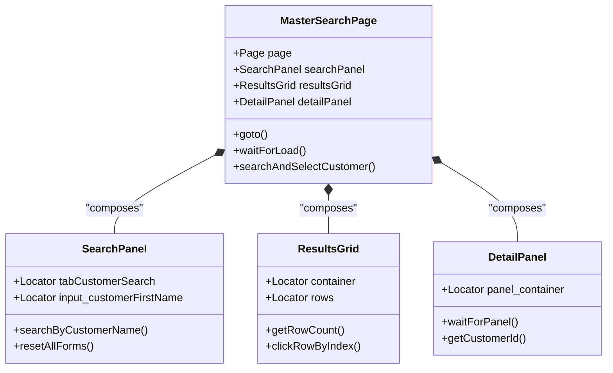

# 18. Mega POM Architecture — Writing, Navigating & Splitting 2500–5000 Line POMs

**Navigation**: [← Chapter 17: D365 Advanced Timing](../03_D365_And_Patterns/17_D365_Advanced_Timing_Patterns.md) | [Index](../00_INDEX.md) | [→ Chapter 19: Console Scripts & Security](../05_Advanced_Topics/19_Advanced_Console_Scripts_Security.md)

**Cross-links:**

- [`05_POM_Architecture_Deep_Dive.md`](../02_Core_Architecture/05_POM_Architecture_Deep_Dive.md) — Foundational POM patterns
- [`06_Custom_Fixtures_Architecture.md`](../02_Core_Architecture/06_Custom_Fixtures_Architecture.md) — Injecting POMs as fixtures

---

## 5W1H

- **WHAT**: How large enterprise POMs (2500–5000 lines) are born, how to survive and navigate them, how to add locators safely, and how to architect a Component POM system so yours never gets that large.
- **WHY**: A 5000-line POM is a trap. Nobody knows what's in it, locators are duplicated, methods conflict, and adding anything is terrifying. But the fix is systematic, not a big-bang rewrite.
- **WHO**: Any SDET joining an existing team with a mature codebase, or building a framework from scratch that shouldn't become a monster.
- **WHEN**: When you see a POM file scroll for more than 30 seconds, or when your IDE's "Go to Definition" takes you to a file with 80 class properties before the first method.
- **HOW**: By understanding the Component POM Pattern, the Locator Dictionary, and the safe refactoring strategy.

---

## 1. How a 5000-Line POM Is Born

It doesn't happen overnight. It happens over 18 months of reasonable individual decisions:

```
Month 1 — The Good Start:
  MasterSearchPage.ts — 180 lines
  20 locators, 8 methods, clean constructor
  "This is well-organised!" ← everyone agrees

Month 3 — First Growth:
  New team member joins. Adds 30 locators for new feature.
  "I'll add them at the bottom — don't want to break anything." ← classic mistake
  MasterSearchPage.ts — 350 lines

Month 6 — The Split Never Happens:
  Three features ship. Each adds 40–60 locators.
  "We need to split this file." ← discussed in sprint planning
  "We don't have time this sprint." ← repeated for 4 sprints
  MasterSearchPage.ts — 800 lines

Month 9 — The Duplication Begins:
  Nobody knows what's already in the file.
  buttonSearchCustomer defined on line 45 AND line 623 (different selectors).
  MasterSearchPage.ts — 1400 lines

Month 12 — The Inheritance Horror:
  MasterSearchPage extends BasePage.
  BasePage extends CorePage.
  CorePage extends PlaywrightBasePage.
  Nobody knows what's in BasePage anymore.
  MasterSearchPage.ts — 2200 lines

Year 2 — The Monster:
  Every developer afraid to touch it.
  Compile time noticeably slow.
  Tests randomly fail due to wrong locators being used.
  MasterSearchPage.ts — 4800 lines
```

---

## 2. Surviving an Existing Mega POM — Tactical Navigation

When you join a team with a 4000-line POM, these techniques save you:

### VS Code Survival Kit

```
Ctrl+Shift+O    → Symbol search within file (jump to any property or method by name)
Ctrl+F          → File search (search for 'customerName' to find all related locators)
Ctrl+G          → Go to line number
Alt+F12         → Peek Definition (see a method without leaving current file)
Shift+Alt+F12   → Find All References (where is this locator actually used?)
Ctrl+Click      → Go to Definition (even into parent class)
```

### Read This First Before Touching Anything

```typescript
// 1. Find the class declaration — understand the inheritance chain
export class MasterSearchPage extends BaseCRMPage {
  //                                    ↑ Read this class first!

// 2. Read the constructor completely before reading any method
constructor(page: Page) {
  super(page);        // ← What does BaseCRMPage constructor do?
  this.searchInput = page.locator('#masterSearch');
  // ...read all 50 property assignments before writing anything
}

// 3. Find ALL properties with a pattern search before adding a new one
// Ctrl+F: "orderNumber" → are there already 3 locators for the order number field?
// Ctrl+F: "Transit" → how many transit-related locators exist?
```

### Detect Duplicate Locators (Common in Mega POMs)

```typescript
// Run this in terminal to find duplicate locator names in the file:
// grep -n "readonly\s\+\w\+" MasterSearchPage.ts | sort | uniq -d
// (or use VS Code Find All References on each property)

// What to look for:
readonly buttonSearch: Locator;          // line 45
// ... 400 lines later ...
readonly btnSearch: Locator;             // line 461 — different name, same element!
// ... 200 lines later ...
readonly searchButton: Locator;          // line 682 — third duplicate!
```

---

## 3. How to Write a Large POM Correctly (From the Start)

When YOU are starting a new POM for a complex page (400+ locators), use this structure:

### Phase 1 — Map the Page First (Before Writing Any Code)

```
MasterSearch Page Audit:
└── Search Panel (left side)
    ├── Tab 1: Customer Search
    │   ├── Input: firstName, lastName, email, phone, dateOfBirth
    │   ├── Dropdown: accountStatus, accountType
    │   └── Buttons: search, reset, advancedSearch
    ├── Tab 2: Order Search
    │   ├── Input: orderNumber, orderDateFrom, orderDateTo
    │   └── Buttons: search, reset
    └── Tab 3: Citation Search
        ├── Input: citationId, registrationPlate, transitAccount
        └── Buttons: search, reset
├── Results Grid (center)
│   ├── Columns: name, id, status, date, amount
│   ├── Pagination: prev, next, pageSize, currentPage
│   └── Actions: export, refresh, columnSettings
└── Detail Panel (right)
    ├── Customer Info section
    ├── Tabs: Profile, Addresses, Phone, Payment History
    └── Buttons: edit, view full record, close panel
```

**Count them: 3 search forms × ~10 locators + 1 grid × ~15 + 1 panel × ~20 = ~70 core locators.**
This tells you: one POM file will handle it. If you had 400+, you'd need component split.

### Phase 2 — Use Section Comments to Organise

```typescript
export class MasterSearchPage {
  readonly page: Page;

  // ════════════════════════════════════════════════════════════════════════
  // SECTION: Search Panel — Customer Search Tab (Tab 1)
  // ════════════════════════════════════════════════════════════════════════
  readonly searchTab_Customer: Locator;
  readonly input_firstName: Locator;
  readonly input_lastName: Locator;
  readonly input_email: Locator;
  readonly input_phone: Locator;
  readonly dropdown_accountStatus: Locator;
  readonly button_searchCustomer: Locator;
  readonly button_resetCustomer: Locator;

  // ════════════════════════════════════════════════════════════════════════
  // SECTION: Search Panel — Order Search Tab (Tab 2)
  // ════════════════════════════════════════════════════════════════════════
  readonly searchTab_Order: Locator;
  readonly input_orderNumber: Locator;
  readonly input_orderDateFrom: Locator;
  readonly input_orderDateTo: Locator;
  readonly button_searchOrder: Locator;

  // ════════════════════════════════════════════════════════════════════════
  // SECTION: Results Grid
  // ════════════════════════════════════════════════════════════════════════
  readonly grid_container: Locator;
  readonly grid_rows: Locator;
  readonly grid_headerRow: Locator;
  readonly pagination_next: Locator;
  readonly pagination_prev: Locator;
  readonly pagination_info: Locator;

  // ════════════════════════════════════════════════════════════════════════
  // SECTION: Detail Panel
  // ════════════════════════════════════════════════════════════════════════
  readonly panel_container: Locator;
  readonly panel_customerName: Locator;
  readonly panel_customerId: Locator;

  // ════════════════════════════════════════════════════════════════════════
  // SECTION: Constructor
  // ════════════════════════════════════════════════════════════════════════
  constructor(page: Page) {
    this.page = page;

    // Customer Search Tab
    this.searchTab_Customer = page.getByRole('tab', { name: 'Customer' });
    this.input_firstName = page.locator('[data-automation-key="firstname"]');
    this.input_lastName = page.locator('[data-automation-key="lastname"]');
    // ... etc.
  }

  // ════════════════════════════════════════════════════════════════════════
  // SECTION: Navigation Methods
  // ════════════════════════════════════════════════════════════════════════
  async goto(): Promise<void> { ... }
  async waitForLoad(): Promise<void> { ... }
  async navigateToCustomerTab(): Promise<void> { ... }

  // ════════════════════════════════════════════════════════════════════════
  // SECTION: Search Actions
  // ════════════════════════════════════════════════════════════════════════
  async searchByCustomerName(firstName: string, lastName: string): Promise<void> { ... }
  async searchByEmail(email: string): Promise<void> { ... }
  async searchByOrderNumber(orderNumber: string): Promise<void> { ... }

  // ════════════════════════════════════════════════════════════════════════
  // SECTION: Grid Operations
  // ════════════════════════════════════════════════════════════════════════
  async getRowCount(): Promise<number> { ... }
  async clickRowByIndex(index: number): Promise<void> { ... }
  async getRowData(index: number): Promise<{ name: string; id: string; status: string }> { ... }
}
```

---

## 4. The Component POM Pattern (The Right Way for 400+ Locators)

When a page has 400+ locators, split by COMPONENT (functional area of the page), not by screen region:

### Component POM Architecture Visualised



```
pages/
└── MasterSearchPage.ts     ← Orchestrator (~80 lines): navigation, waitForLoad, composes components

components/master-search/
├── SearchPanel.ts          ← All search form logic (~250 lines)
│   Has: all input/dropdown/button locators for 3 search tabs
│   Methods: searchByCustomer(), searchByOrder(), searchByCitation(), reset()
│
├── ResultsGrid.ts          ← All grid logic (~300 lines)
│   Has: row, header, pagination locators
│   Methods: getRowCount(), clickRow(), getRowData(), waitForResults(), sortByColumn()
│
├── DetailPanel.ts          ← All detail panel logic (~250 lines)
│   Has: all panel field locators, tab locators
│   Methods: waitForPanel(), getCustomerId(), clickTab(), verifyField()
│
└── SearchDialogs.ts        ← Any dialog/modal locators (~100 lines)
    Methods: confirmDialog(), cancelDialog()
```

### The Orchestrator — `MasterSearchPage.ts`

```typescript
// pages/MasterSearchPage.ts — The ONLY file tests import directly

import { type Page } from "@playwright/test";
import { SearchPanel } from "../components/master-search/SearchPanel";
import { ResultsGrid } from "../components/master-search/ResultsGrid";
import { DetailPanel } from "../components/master-search/DetailPanel";

export class MasterSearchPage {
  readonly page: Page;
  readonly searchPanel: SearchPanel;
  readonly resultsGrid: ResultsGrid;
  readonly detailPanel: DetailPanel;

  constructor(page: Page) {
    this.page = page;
    this.searchPanel = new SearchPanel(page);
    this.resultsGrid = new ResultsGrid(page);
    this.detailPanel = new DetailPanel(page);
  }

  async goto(): Promise<void> {
    await this.page.goto(`${process.env.CRM_URL}/masterSearch`);
    await this.waitForLoad();
  }

  async waitForLoad(): Promise<void> {
    await this.page
      .locator(".ms-Spinner")
      .waitFor({ state: "hidden", timeout: 30000 });
    await this.searchPanel.waitForVisible();
  }

  // High-level test-facing methods that combine components:
  async searchAndSelectCustomer(
    firstName: string,
    lastName: string,
  ): Promise<void> {
    await this.searchPanel.searchByCustomerName(firstName, lastName);
    await this.resultsGrid.waitForResults();
    await this.resultsGrid.clickFirstRow();
    await this.detailPanel.waitForPanel();
  }
}
```

### `SearchPanel.ts` — Component POM

```typescript
// components/master-search/SearchPanel.ts

import { type Page, type Locator, expect } from "@playwright/test";

export class SearchPanel {
  private readonly page: Page;

  // Tab navigation
  readonly tabCustomerSearch: Locator;
  readonly tabOrderSearch: Locator;
  readonly tabCitationSearch: Locator;

  // Customer Search Tab inputs
  readonly input_customerFirstName: Locator;
  readonly input_customerLastName: Locator;
  readonly input_customerEmail: Locator;
  readonly input_customerPhone: Locator;
  readonly input_customerDOB: Locator;
  readonly dropdown_customerStatus: Locator;
  readonly dropdown_customerType: Locator;
  readonly button_searchCustomer: Locator;
  readonly button_resetCustomer: Locator;

  // Order Search Tab inputs
  readonly input_orderNumber: Locator;
  readonly input_orderDateFrom: Locator;
  readonly input_orderDateTo: Locator;
  readonly dropdown_orderStatus: Locator;
  readonly button_searchOrder: Locator;
  readonly button_resetOrder: Locator;

  // Citation Search Tab inputs
  readonly input_citationId: Locator;
  readonly input_registrationPlate: Locator;
  readonly input_transitAccount: Locator;
  readonly button_searchCitation: Locator;
  readonly button_resetCitation: Locator;

  constructor(page: Page) {
    this.page = page;

    // Tabs
    this.tabCustomerSearch = page.getByRole("tab", { name: "Customer Search" });
    this.tabOrderSearch = page.getByRole("tab", { name: "Order Search" });
    this.tabCitationSearch = page.getByRole("tab", { name: "Citation Search" });

    // Customer Search inputs
    this.input_customerFirstName = page.locator("#masterSearch_firstName");
    this.input_customerLastName = page.locator("#masterSearch_lastName");
    this.input_customerEmail = page.locator("#masterSearch_email");
    this.input_customerPhone = page.locator("#masterSearch_phone");
    this.input_customerDOB = page.locator("#masterSearch_dob");
    this.dropdown_customerStatus = page.locator("#masterSearch_statusDropdown");
    this.dropdown_customerType = page.locator("#masterSearch_typeDropdown");
    this.button_searchCustomer = page.locator(
      "#masterSearch_btnCustomerSearch",
    );
    this.button_resetCustomer = page.locator("#masterSearch_btnCustomerReset");

    // Order Search inputs
    this.input_orderNumber = page.locator("#masterSearch_orderNumber");
    this.input_orderDateFrom = page.locator("#masterSearch_orderFrom");
    this.input_orderDateTo = page.locator("#masterSearch_orderTo");
    this.dropdown_orderStatus = page.locator("#masterSearch_orderStatus");
    this.button_searchOrder = page.locator("#masterSearch_btnOrderSearch");
    this.button_resetOrder = page.locator("#masterSearch_btnOrderReset");

    // Citation inputs
    this.input_citationId = page.locator("#masterSearch_citationId");
    this.input_registrationPlate = page.locator("#masterSearch_plate");
    this.input_transitAccount = page.locator("#masterSearch_transit");
    this.button_searchCitation = page.locator(
      "#masterSearch_btnCitationSearch",
    );
    this.button_resetCitation = page.locator("#masterSearch_btnCitationReset");
  }

  async waitForVisible(): Promise<void> {
    await expect(this.tabCustomerSearch).toBeVisible({ timeout: 20000 });
  }

  async navigateToTab(
    tabName: "Customer Search" | "Order Search" | "Citation Search",
  ): Promise<void> {
    const tabLocator = {
      "Customer Search": this.tabCustomerSearch,
      "Order Search": this.tabOrderSearch,
      "Citation Search": this.tabCitationSearch,
    }[tabName];

    await tabLocator.click();
    await expect(tabLocator).toHaveAttribute("aria-selected", "true", {
      timeout: 5000,
    });
  }

  async searchByCustomerName(
    firstName: string,
    lastName: string,
  ): Promise<void> {
    await this.navigateToTab("Customer Search");
    await this.input_customerFirstName.fill(firstName);
    await this.input_customerLastName.fill(lastName);
    await this.button_searchCustomer.click();
  }

  async searchByCitationId(citationId: string): Promise<void> {
    await this.navigateToTab("Citation Search");
    await this.input_citationId.fill(citationId);
    await this.button_searchCitation.click();
  }

  async searchByTransitAccount(transitAccount: string): Promise<void> {
    await this.navigateToTab("Citation Search");
    await this.input_transitAccount.fill(transitAccount);
    await this.button_searchCitation.click();
  }

  async resetAllForms(): Promise<void> {
    if (
      (await this.tabCustomerSearch.getAttribute("aria-selected")) === "true"
    ) {
      await this.button_resetCustomer.click();
    } else if (
      (await this.tabOrderSearch.getAttribute("aria-selected")) === "true"
    ) {
      await this.button_resetOrder.click();
    } else {
      await this.button_resetCitation.click();
    }
  }
}
```

---

## 5. Adding 50 Locators to an Existing Mega POM Safely

When you must add locators to an existing large file:

```typescript
// ── RULE 1: Find the right section first
// Ctrl+F: search for similar locators — where do related ones live?
// If you have input_orderNumber on line 234, add input_orderDate near line 235.

// ── RULE 2: Use the existing naming convention
// If the file uses: readonly buttonSearch: Locator
// Add:              readonly buttonReset: Locator  ← same style
// Don't add:        readonly btn_reset: Locator    ← different convention

// ── RULE 3: Add BOTH the property declaration AND the constructor assignment
// Step 1: Add property declaration in the right section at the top
readonly input_newField: Locator;

// Step 2: Add constructor assignment in the right section of the constructor
this.input_newField = page.locator('#newFieldId');

// Forgetting either one is a common bug in mega POMs.

// ── RULE 4: Check for duplicates before adding
// Ctrl+F: "newField" → does it already exist?

// ── RULE 5: Test your new locators with a quick codegen check
// npx playwright codegen https://your-staging-url.com
// Hover over the element → see what Playwright suggests
```

---

## 6. The Locator Dictionary Pattern (400+ Locators)

When you genuinely have 400+ locators and can't split into separate files (e.g., existing codebase constraints):

```typescript
// Instead of 400 flat class properties, use a typed nested object:

interface MasterSearchLocators {
  customerSearch: {
    tab: () => Locator;
    firstName: () => Locator;
    lastName: () => Locator;
    email: () => Locator;
    searchButton: () => Locator;
    resetButton: () => Locator;
    // Parameterised locators:
    statusOption: (statusValue: string) => Locator;
  };
  orderSearch: {
    tab: () => Locator;
    orderNumber: () => Locator;
    searchButton: () => Locator;
  };
  citationSearch: {
    tab: () => Locator;
    citationId: () => Locator;
    transitAccount: () => Locator;
    searchButton: () => Locator;
  };
  resultsGrid: {
    container: () => Locator;
    rows: () => Locator;
    row: (index: number) => Locator;
    rowByText: (text: string) => Locator;
    nextPage: () => Locator;
    prevPage: () => Locator;
  };
}

// In the POM class:
export class MasterSearchPage {
  readonly page: Page;
  readonly loc: MasterSearchLocators; // The entire dictionary

  constructor(page: Page) {
    this.page = page;
    this.loc = {
      customerSearch: {
        tab: () => page.getByRole("tab", { name: "Customer Search" }),
        firstName: () => page.locator("#masterSearch_firstName"),
        lastName: () => page.locator("#masterSearch_lastName"),
        email: () => page.locator("#masterSearch_email"),
        searchButton: () => page.locator("#masterSearch_btnCustomerSearch"),
        resetButton: () => page.locator("#masterSearch_btnCustomerReset"),
        statusOption: (value) => page.locator(`[data-value="${value}"]`),
      },
      orderSearch: {
        tab: () => page.getByRole("tab", { name: "Order Search" }),
        orderNumber: () => page.locator("#masterSearch_orderNumber"),
        searchButton: () => page.locator("#masterSearch_btnOrderSearch"),
      },
      citationSearch: {
        tab: () => page.getByRole("tab", { name: "Citation Search" }),
        citationId: () => page.locator("#masterSearch_citationId"),
        transitAccount: () => page.locator("#masterSearch_transit"),
        searchButton: () => page.locator("#masterSearch_btnCitationSearch"),
      },
      resultsGrid: {
        container: () => page.locator(".masterSearch-results"),
        rows: () => page.locator(".masterSearch-results .ms-DetailsList-row"),
        row: (i) =>
          page.locator(".masterSearch-results .ms-DetailsList-row").nth(i),
        rowByText: (text) =>
          page
            .locator(".masterSearch-results .ms-DetailsList-row")
            .filter({ hasText: text }),
        nextPage: () => page.locator('[aria-label="Next page"]'),
        prevPage: () => page.locator('[aria-label="Previous page"]'),
      },
    };
  }
}

// Usage in tests — namespaced, IDE autocomplete works:
await masterSearch.loc.customerSearch.firstName().fill("John");
await masterSearch.loc.customerSearch.searchButton().click();
await masterSearch.loc.resultsGrid.row(0).click();
```

---

## 7. The Safe Refactoring Strategy

How to split a 5000-line POM without breaking 200+ tests:

```
Step 1 — Create new component classes (EMPTY — no moving code yet)
   Create: SearchPanel.ts, ResultsGrid.ts, DetailPanel.ts
   Don't move anything yet. Run tests. All pass.

Step 2 — Copy locators from original to components (COPY, don't delete yet)
   SearchPanel.ts gets copies of all search-related locators
   ResultsGrid.ts gets copies of all grid-related locators
   Run tests. All pass. (Original still has the locators)

Step 3 — Compose components in the original class
   MasterSearchPage gets: this.searchPanel = new SearchPanel(page);
   Add delegation methods: masterSearch.searchPanel.searchByName()
   Run tests. All pass.

Step 4 — Update ONE test to use the new component API
   Change: masterSearch.input_firstName → masterSearch.searchPanel.input_firstName
   Run THAT test. If it passes:

Step 5 — Migrate all tests (use Find + Replace carefully)
   Replace method calls systematically, one section at a time
   Run full test suite after each section

Step 6 — Delete old locators from MasterSearchPage (now they're only in components)
   Run tests. All pass. Done.

Why NOT big-bang rewrite:
   You can never safely delete 200 locators and update 200 test files simultaneously.
   Bugs hide. The step-by-step approach keeps tests green throughout.
```

---

## 🏋️ Practice Challenges

### Challenge 1 [MCQ] — Naming Conventions

You're adding a locator for a "Date of Birth" input field in the customer search tab. The existing file uses this naming convention: `readonly input_customerPhone: Locator`. What should your new locator be named?

A) `readonly DateOfBirth: Locator`  
B) `readonly input_customerDOB: Locator`  
C) `readonly customer_dob_input: Locator`  
D) `readonly dobField: Locator`

<details><summary>Answer</summary>

**B** — `input_customerDOB`. Match the existing convention exactly: `input_` prefix + `customer` context + field abbreviation. Changing naming convention mid-file (A, C, D) makes the file harder to navigate and breaks grep patterns.

</details>

---

### Challenge 2 [Spot the Bug]

```typescript
export class SearchPanel {
  readonly input_transitAccount: Locator;

  constructor(page: Page) {
    this.input_transitAccount = page.locator("#transitSearch");
  }
}

export class MasterSearchPage {
  readonly searchPanel: SearchPanel;
  readonly input_transitAccount: Locator; // forgot to remove old one

  constructor(page: Page) {
    this.searchPanel = new SearchPanel(page);
    this.input_transitAccount = page.locator("#OLD_transitSearch"); // old selector!
  }
}
```

<details><summary>Answer</summary>

After migrating to the component pattern, the old `input_transitAccount` on `MasterSearchPage` still exists AND has the OLD (possibly wrong) selector. Tests that call `masterSearchPage.input_transitAccount` instead of `masterSearchPage.searchPanel.input_transitAccount` will use the stale selector and fail intermittently (or silently use the wrong element if both selectors match something).

Fix: Delete `input_transitAccount` from `MasterSearchPage` after migrating all callers to `searchPanel.input_transitAccount`.

</details>

---

### Challenge 3 [Write It Yourself]

Write a `ResultsGrid` component class with:

- `rows` locator (all grid rows)
- `header` locator (the header row)
- `pagination_info` locator (e.g., "Page 1 of 5")
- `waitForResults(minRows?)` — waits for spinner to clear and minimum rows
- `getRowCount()` — returns current visible row count
- `clickRowByIndex(index)` — clicks nth row

<details><summary>Answer</summary>

```typescript
import { type Page, type Locator, expect } from "@playwright/test";

export class ResultsGrid {
  private readonly page: Page;
  readonly container: Locator;
  readonly rows: Locator;
  readonly header: Locator;
  readonly pagination_info: Locator;
  readonly pagination_next: Locator;
  readonly pagination_prev: Locator;
  readonly spinner: Locator;

  constructor(page: Page) {
    this.page = page;
    this.container = page.locator(".search-results-container");
    this.rows = page.locator(".search-results-container .ms-DetailsList-row");
    this.header = page.locator(".search-results-container .ms-DetailsHeader");
    this.pagination_info = page.locator(".pagination-info");
    this.pagination_next = page.locator('[aria-label="Next page"]');
    this.pagination_prev = page.locator('[aria-label="Previous page"]');
    this.spinner = page.locator(".search-results-container .ms-Spinner");
  }

  async waitForResults(minRows: number = 1): Promise<void> {
    await expect(this.spinner).toHaveCount(0, { timeout: 30000 });
    await expect(this.rows.nth(minRows - 1)).toBeVisible({ timeout: 30000 });
    // Wait for first row's first cell to have non-empty text
    await expect(this.rows.first()).not.toHaveText("", { timeout: 15000 });
  }

  async getRowCount(): Promise<number> {
    return this.rows.count();
  }

  async clickRowByIndex(index: number): Promise<void> {
    const row = this.rows.nth(index);
    await expect(row).toBeVisible();
    await row.click();
  }

  async getRowTextByIndex(index: number): Promise<string> {
    const row = this.rows.nth(index);
    await expect(row).toBeVisible();
    return ((await row.textContent()) ?? "").trim();
  }
}
```

</details>

---

## 8. The Module Registry Pattern (Enterprise Scale)

When your framework grows to 50+ POMs across multiple micro-frontends, importing and instantiating them manually in every test becomes a maintenance nightmare.

**The Anti-Pattern:**

```typescript
test("complex workflow", async ({ page }) => {
  const loginPage = new LoginPage(page);
  const searchPage = new MasterSearchPage(page);
  const detailPage = new CustomerDetailPage(page);
  const paymentPage = new PaymentPage(page);
  // Manual instantiation cluttering the test
});
```

**The Module Registry Pattern:**
Create a central registry fixture that groups POMs by business domain.

```typescript
// fixtures/app.fixture.ts
import { test as base } from "@playwright/test";

class CRMApp {
  constructor(public readonly page: Page) {}

  // Expose POMs as getter properties
  get login() {
    return new LoginPage(this.page);
  }
  get masterSearch() {
    return new MasterSearchPage(this.page);
  }
  get customerDetail() {
    return new CustomerDetailPage(this.page);
  }
}

class BillingApp {
  constructor(public readonly page: Page) {}
  get payment() {
    return new PaymentPage(this.page);
  }
  get invoice() {
    return new InvoicePage(this.page);
  }
}

export const test = base.extend<{ crm: CRMApp; billing: BillingApp }>({
  crm: async ({ page }, use) => await use(new CRMApp(page)),
  billing: async ({ page }, use) => await use(new BillingApp(page)),
});

// Usage in tests - clean and namespaced:
test("complex workflow", async ({ crm, billing }) => {
  await crm.masterSearch.goto();
  await crm.masterSearch.searchAndSelectCustomer("John", "Smith");

  await crm.customerDetail.clickMakePayment();

  await billing.payment.payBalance(150.0);
});
```

---

## 9. Lazy-Loaded POM Strategy

In the Module Registry pattern above, doing `new MasterSearchPage(page)` instantly triggers `page.locator(...)` calls for all 400 properties. If you instantiate 20 POMs at the start of a test, Playwright creates 8000 `Locator` objects in memory before the test even starts.

**The Solution: Lazy Initialization (Getters)**

Instead of assigning locators in the constructor, use TypeScript getters. The `Locator` object is only created the _first time_ it is accessed during the test.

```typescript
// ❌ EAGER LOAD (High Memory)
export class SearchPanel {
  readonly button_search: Locator;

  constructor(private page: Page) {
    // 400 locator objects created instantly upon 'new SearchPanel(page)'
    this.button_search = page.locator("#searchBtn");
  }
}

// ✅ LAZY LOAD (Zero Memory until used)
export class SearchPanel {
  constructor(private page: Page) {}

  // Locator is only created when searchPanel.button_search is accessed
  get button_search() {
    return this.page.locator("#searchBtn");
  }
  get input_firstName() {
    return this.page.locator("#firstName");
  }

  async searchByCustomerName(firstName: string) {
    await this.input_firstName.fill(firstName); // Locator created here
    await this.button_search.click(); // Locator created here
  }
}
```

This ensures that even if a fixture provides access to 50 POMs, zero memory is wasted on locators for pages the test never visits.

---

## 📚 References & Further Reading

### Architecture Patterns

- [Martin Fowler: PageObject](https://martinfowler.com/bliki/PageObject.html) — The original definition and intent of the pattern
- [Playwright POM Best Practices](https://playwright.dev/docs/pom) — Official documentation
- [Playwright Fixtures](https://playwright.dev/docs/test-fixtures) — How to inject your POM registries into tests securely

---

**Navigation**: [← Chapter 17: D365 Advanced Timing](../03_D365_And_Patterns/17_D365_Advanced_Timing_Patterns.md) | [Index](../00_INDEX.md) | [→ Chapter 19: Console Scripts & Security](../05_Advanced_Topics/19_Advanced_Console_Scripts_Security.md)


---

## Reality Check

**"The test framework architecture is decided once and never changes"** → Test architectures evolve with the product. A POM-only structure outgrows itself when the product adds API layers. A fixture-only approach hits limits when component coverage requirements emerge. Build architecture that can absorb: new test types (component, API, visual), new environments (mobile, different browsers), new team members. The best architecture is the one your team can maintain and understand — not the theoretically purest one.

**"TypeScript generics in test utilities are premature optimization"** → Generic test utilities eliminate an entire class of runtime errors: passing the wrong page object type to a utility function. TypeScript-typed fixtures, generic base page classes, and typed API clients turn runtime `undefined is not a function` errors into compile-time errors. For a large test suite, this pays off immediately. The investment is small (type parameters on 5-10 base classes) with disproportionate returns.

**"CI/CD test failures are always flaky tests"** → Flaky tests are real but not the only cause of CI failures. Other causes: test environment differences (different Chrome version, different screen resolution, missing font, different locale/timezone), race conditions exposed by CI's slower machines, shared test data contamination (tests run in parallel on CI, sharing a test database), missing test isolation (test B depends on test A's state), missing wait for async events in local environment masked by slower CI. Profile failure frequency: true flaky tests fail 10-30% of the time; environment failures fail 100% on CI, 0% locally.

**"Allure/HTML reports are just for showing management dashboards"** → Test reports serve developers: Playwright's HTML report shows screenshots at failure, video replay, DOM snapshot at the moment of failure, network timeline, and console logs — all time-correlated. This lets you debug a CI failure without re-running it locally. Allure additionally provides: historical trend analysis (is this flakier than last week?), retry analysis (how many retries were needed?), epic/story tagging for feature coverage mapping. Good reporting cuts debugging time by 50%+ on large suites.

**"Test data management is a test concern, not a developer concern"** → Test data management is a shared concern. Application developers should: build factories/seeds for test data, document what data assumptions tests rely on, keep test-critical APIs stable. SDET/QA should: not rely on production data shapes, use builders/factories to generate test data, reset state between tests, version test data schemas alongside application schema migrations. Data management debt compounds — fix it early with `factory` patterns and `fixture` databases.
