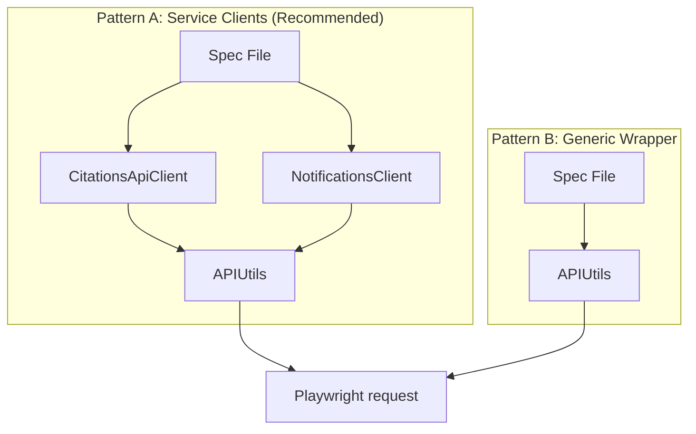
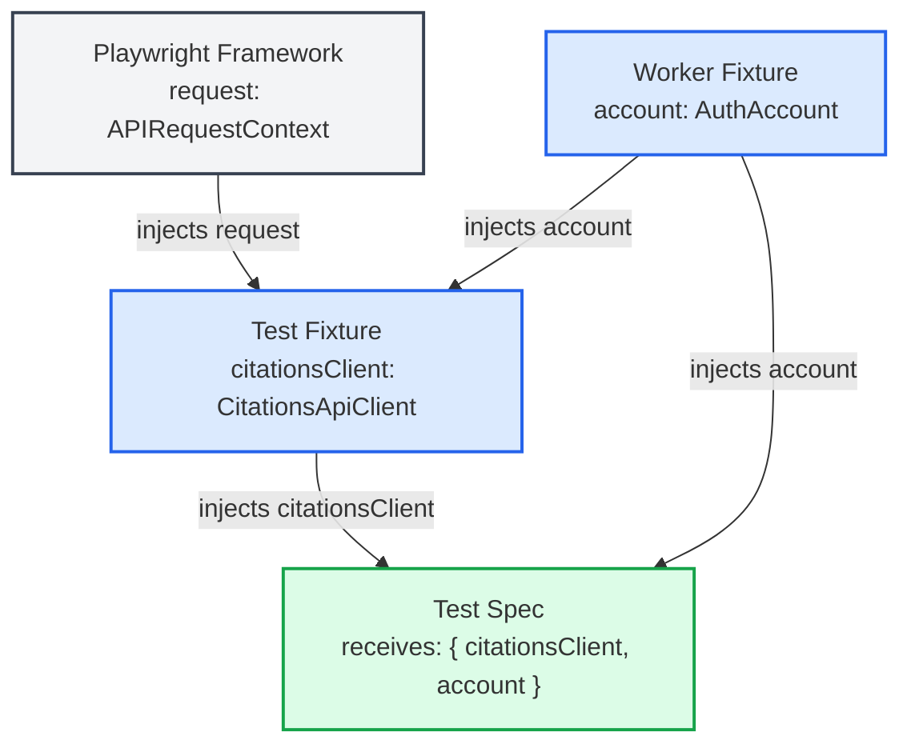

# 23. APIUtils — Writing Your Team's HTTP Library

**Navigation**: [← Chapter 22: Headers, Payloads & Endpoints](./22_Headers_Payloads_Endpoints_Factory.md) | [Index](../00_INDEX.md) | [→ Chapter 24: Test Script Architecture](./24_Test_Script_Architecture.md)

**Cross-links:**
- [`22_Headers_Payloads_Endpoints_Factory.md`](./22_Headers_Payloads_Endpoints_Factory.md) — The data factories that feed into APIUtils
- [`06_Custom_Fixtures_Architecture.md`](../02_Core_Architecture/06_Custom_Fixtures_Architecture.md) — How APIUtils is injected as a fixture
- [`24_Test_Script_Architecture.md`](./24_Test_Script_Architecture.md) — How tests call APIUtils without seeing raw HTTP

---

## 5W1H

- **WHAT**: `APIUtils` (also called a "library file" or "HTTP wrapper") is a TypeScript class that wraps Playwright's raw `request` object and provides your test suite with typed, authenticated, error-handled methods for every HTTP operation — hiding all HTTP complexity from test scripts.
- **WHY**: Playwright's `request.post(url, { headers, data })` is correct but low-level. Without a wrapper, every test file has to know the URL, the headers, the error handling, and the response parsing. That's implementation leaking into specs. `APIUtils` seals that leak.
- **WHO**: Any team writing 20+ API tests. Beyond that threshold, you WILL duplicate code without a shared HTTP library.
- **WHEN**: Before writing your second API test. Write it after the first so you understand what you're abstracting.
- **HOW**: A class that takes `APIRequestContext` and `accessToken` in its constructor. Every method maps to one API endpoint. Tests call methods, not HTTP.

---

## 1. The Problem APIUtils Solves

Without `APIUtils`:

```typescript
// ❌ test-1: Create citation (raw HTTP in spec)
const r1 = await request.post(`${process.env.API_URL}/api/v2/citations`, {
  headers: { 'Authorization': `Bearer ${account.token}`, 'Content-Type': 'application/json', 'X-Tenant-ID': process.env.TENANT_ID! },
  data: { customerId: account.userId, amount: 150, status: 'PENDING', citationType: 'PARKING', issueDate: today }
});
expect(r1.status()).toBe(201);
const citation = await r1.json();

// ❌ test-2: Same thing, 6 files later, with a subtle difference
const r2 = await request.post(`${process.env.API_URL}/api/v2/citations`, {
  headers: { 'Authorization': `Bearer ${account.token}`, 'Content-Type': 'application/json' },
  // ← X-Tenant-ID forgotten! Works in dev, silently fails in staging
  data: { ... }
});
```

With `APIUtils` / a client class:

```typescript
// ✅ test-1:
const citation = await citationsClient.create(PayloadsCitation.pending({ customerId: account.userId }));

// ✅ test-2: identical call, no HTTP details anywhere
const citation = await citationsClient.create(PayloadsCitation.pending({ customerId: account.userId }));
```

---

## 2. Two Patterns: Specific Client vs Generic APIUtils

Teams use one of two approaches:

### HTTP Client Architecture Visualised



### Pattern A — Specific Client Per Service (Recommended for large suites)

```
clients/
├── CitationsApiClient.ts     ← only knows about citation endpoints
├── NotificationsClient.ts    ← only knows about notification endpoints
├── UsersApiClient.ts         ← only knows about user endpoints
└── IvrClient.ts              ← only knows about IVR endpoints
```

Each client is small, focused, and easy to understand. This is what Chapter 22 showed.

### Pattern B — Generic `APIUtils` (Used in smaller suites or as a base class)

```
utils/
└── APIUtils.ts               ← wraps ALL services with generic get/post/patch/delete methods
```

`APIUtils` is a generic HTTP wrapper. Service-specific methods are added as needed, or it's subclassed per service.

Both are valid. Most enterprise teams use Pattern A for large suites and Pattern B when starting. This chapter shows Pattern B in depth, plus how they combine.

---

## 3. `APIUtils.ts` — The Generic HTTP Library

```typescript
// utils/APIUtils.ts
// This is a "library file" — your team's internal HTTP library for tests.
// It wraps Playwright's APIRequestContext with:
//   - Automatic auth header injection
//   - Response validation with clear error messages
//   - Typed response parsing
//   - Request/response logging for debugging

import { type APIRequestContext } from '@playwright/test';

export interface RequestOptions {
  headers?: Record<string, string>;
  data?: unknown;
  params?: Record<string, string>;
  timeoutMs?: number;
  ignoreStatuses?: number[];  // statuses NOT to throw on (e.g. 404 in a "not found" test)
}

export interface ApiResponse<T = unknown> {
  status: number;
  body: T;
  headers: Record<string, string>;
  ok: boolean;
}

export class APIUtils {
  private readonly request: APIRequestContext;
  private readonly accessToken: string;
  private readonly defaultHeaders: Record<string, string>;

  constructor(
    request: APIRequestContext,
    accessToken: string,
    defaultHeaders: Record<string, string> = {}
  ) {
    this.request = request;
    this.accessToken = accessToken;
    // Build default headers once — merged into every request
    this.defaultHeaders = {
      'Authorization': `Bearer ${this.accessToken}`,
      'Content-Type': 'application/json',
      'Accept': 'application/json',
      'X-Tenant-ID': process.env.TENANT_ID!,
      'X-Request-Source': 'playwright-automation',
      ...defaultHeaders,  // allow caller to override/extend
    };
  }

  // ─── GET ────────────────────────────────────────────────────────────────────
  async get<T = unknown>(url: string, options: RequestOptions = {}): Promise<ApiResponse<T>> {
    const response = await this.request.get(url, {
      headers: { ...this.defaultHeaders, ...options.headers },
      timeout: options.timeoutMs ?? 30_000,
    });

    return this.processResponse<T>(response, 'GET', url, options);
  }

  // ─── POST ───────────────────────────────────────────────────────────────────
  async post<T = unknown>(url: string, options: RequestOptions = {}): Promise<ApiResponse<T>> {
    const response = await this.request.post(url, {
      headers: { ...this.defaultHeaders, ...options.headers },
      data: options.data,
      timeout: options.timeoutMs ?? 30_000,
    });

    return this.processResponse<T>(response, 'POST', url, options);
  }

  // ─── PATCH ──────────────────────────────────────────────────────────────────
  async patch<T = unknown>(url: string, options: RequestOptions = {}): Promise<ApiResponse<T>> {
    const response = await this.request.patch(url, {
      headers: { ...this.defaultHeaders, ...options.headers },
      data: options.data,
      timeout: options.timeoutMs ?? 30_000,
    });

    return this.processResponse<T>(response, 'PATCH', url, options);
  }

  // ─── DELETE ─────────────────────────────────────────────────────────────────
  async delete<T = unknown>(url: string, options: RequestOptions = {}): Promise<ApiResponse<T>> {
    const response = await this.request.delete(url, {
      headers: { ...this.defaultHeaders, ...options.headers },
      timeout: options.timeoutMs ?? 30_000,
    });

    return this.processResponse<T>(response, 'DELETE', url, options);
  }

  // ─── PUT ────────────────────────────────────────────────────────────────────
  async put<T = unknown>(url: string, options: RequestOptions = {}): Promise<ApiResponse<T>> {
    const response = await this.request.put(url, {
      headers: { ...this.defaultHeaders, ...options.headers },
      data: options.data,
      timeout: options.timeoutMs ?? 30_000,
    });

    return this.processResponse<T>(response, 'PUT', url, options);
  }

  // ─── PRIVATE: response processing ───────────────────────────────────────────
  private async processResponse<T>(
    response: Awaited<ReturnType<APIRequestContext['get']>>,
    method: string,
    url: string,
    options: RequestOptions
  ): Promise<ApiResponse<T>> {
    const status = response.status();
    const ignoreStatuses = options.ignoreStatuses ?? [];

    // Log every request (helps debug in CI where you can't open DevTools)
    if (process.env.PLAYWRIGHT_API_LOGGING === 'true') {
      console.log(`[APIUtils] ${method} ${url} → ${status}`);
    }

    // Throw on error statuses (unless caller explicitly said to ignore)
    if (!response.ok() && !ignoreStatuses.includes(status)) {
      const body = await response.text();
      throw new Error(
        `[APIUtils] ${method} ${url}\n` +
        `  Status: ${status} ${response.statusText()}\n` +
        `  Response: ${body.substring(0, 500)}` +
        (body.length > 500 ? `... [truncated]` : '')
      );
    }

    // Parse body — handle empty responses (204 No Content)
    let body: T;
    const contentType = response.headers()['content-type'] ?? '';

    if (contentType.includes('application/json')) {
      body = await response.json() as T;
    } else if (status === 204) {
      body = undefined as T;  // No Content — intentionally empty
    } else {
      body = await response.text() as T;
    }

    return {
      status,
      body,
      headers: response.headers(),
      ok: response.ok(),
    };
  }
}
```

---

## 3b. Advanced `APIUtils`: Retry with Exponential Backoff

APIs in staging environments are inherently flaky. A 502 Bad Gateway or 503 Service Unavailable often resolves if retried 2 seconds later. `APIUtils` is the perfect place to add an exponential backoff retry mechanism.

```typescript
  // Inside APIUtils class

  // Wrapper method for retries
  private async executeWithRetry<T>(
    operation: () => Promise<ApiResponse<T>>, 
    maxRetries = 3
  ): Promise<ApiResponse<T>> {
    let attempt = 0;
    
    while (attempt < maxRetries) {
      try {
        const response = await operation();
        // If it's a 5xx error, we WANT it to throw so we can catch and retry
        if (response.status >= 500 && response.status <= 599) {
            throw new Error(`Server Error: ${response.status}`);
        }
        return response;
      } catch (error: any) {
        attempt++;
        if (attempt >= maxRetries) {
          throw error; // Retries exhausted
        }
        
        // Exponential backoff: 1s, 2s, 4s...
        const delayMs = Math.pow(2, attempt - 1) * 1000;
        console.warn(`[APIUtils] Retry ${attempt}/${maxRetries} after ${delayMs}ms due to: ${error.message}`);
        await new Promise(res => setTimeout(res, delayMs));
      }
    }
    throw new Error('Unreachable');
  }

  // Update HTTP methods to use the retry wrapper
  async get<T = unknown>(url: string, options: RequestOptions = {}): Promise<ApiResponse<T>> {
    return this.executeWithRetry(async () => {
      const response = await this.request.get(url, {
        headers: { ...this.defaultHeaders, ...options.headers },
        timeout: options.timeoutMs ?? 30_000,
      });
      return this.processResponse<T>(response, 'GET', url, options);
    }, options.retries ?? 3); // Allow custom retry count
  }
```

---

## 3c. Error Taxonomy & Normalisation

Not all API errors are the same. A 401 means your token is dead, a 404 means the data is missing, and a 500 means the server crashed. `APIUtils` should categorize these errors so tests or fixtures can react accordingly.

```typescript
// utils/api-errors.ts
export class ApiError extends Error {
  constructor(public status: number, public url: string, message: string) {
    super(message);
    this.name = 'ApiError';
  }
}

export class AuthenticationError extends ApiError {
  constructor(url: string, message: string) {
    super(401, url, message);
    this.name = 'AuthenticationError';
  }
}

export class ServerError extends ApiError {
  constructor(status: number, url: string, message: string) {
    super(status, url, message);
    this.name = 'ServerError';
  }
}
```

In `APIUtils.ts`, throw these specific errors:
```typescript
    if (!response.ok() && !ignoreStatuses.includes(status)) {
      const body = await response.text();
      const message = `[APIUtils] ${method} ${url} - ${status} ${response.statusText()}\n${body}`;
      
      if (status === 401 || status === 403) {
        throw new AuthenticationError(url, message);
      } else if (status >= 500) {
        throw new ServerError(status, url, message);
      } else {
        throw new ApiError(status, url, message);
      }
    }
```
*Benefit*: Your fixtures can catch `AuthenticationError` specifically and attempt a token refresh mid-test!

---

## 4. Building a Service Client ON TOP of APIUtils

Pattern B clients extend or compose `APIUtils`:

```typescript
// clients/CitationsApiClient.ts — using APIUtils as the HTTP engine

import { type APIRequestContext } from '@playwright/test';
import { APIUtils } from '../utils/APIUtils';
import { Endpoints } from '../config/endpoints';
import type { CreateCitationPayload, UpdateCitationPayload } from '../data/payloads/PayloadsCitation';
import type { CitationApiResponse } from '../types/api-responses.types';

export class CitationsApiClient {
  private readonly api: APIUtils;  // ← composition, not inheritance

  constructor(request: APIRequestContext, accessToken: string) {
    this.api = new APIUtils(request, accessToken);
  }

  async create(payload: CreateCitationPayload): Promise<CitationApiResponse> {
    const result = await this.api.post<CitationApiResponse>(
      Endpoints.citations.create(),
      { data: payload }
    );
    // api.post already validates status and throws with good messages
    // Here we just return the typed body
    return result.body;
  }

  async getById(citationId: string): Promise<CitationApiResponse> {
    const result = await this.api.get<CitationApiResponse>(
      Endpoints.citations.getById(citationId)
    );
    return result.body;
  }

  async updateStatus(citationId: string, payload: UpdateCitationPayload): Promise<CitationApiResponse> {
    const result = await this.api.patch<CitationApiResponse>(
      Endpoints.citations.update(citationId),
      { data: payload }
    );
    return result.body;
  }

  async delete(citationId: string): Promise<void> {
    await this.api.delete(
      Endpoints.citations.delete(citationId),
      { ignoreStatuses: [404] }  // ignore 404 in teardown (citation may already be gone)
    );
  }

  /**
   * Polls until a citation reaches the expected status.
   * Used when status changes happen asynchronously (e.g., payment processing).
   */
  async waitForStatus(
    citationId: string,
    expectedStatus: string,
    timeoutMs = 30_000
  ): Promise<CitationApiResponse> {
    const { expect } = await import('@playwright/test');
    let lastCitation!: CitationApiResponse;

    await expect.poll(
      async () => {
        lastCitation = await this.getById(citationId);
        return lastCitation.status;
      },
      {
        message: `Waiting for citation ${citationId} to reach status '${expectedStatus}'`,
        timeout: timeoutMs,
        intervals: [500, 1000, 2000, 5000],
      }
    ).toBe(expectedStatus);

    return lastCitation;
  }
}
```

---

## 5. How APIUtils Is Injected via Fixtures

```typescript
// tests/fixtures/index.ts — adding citationsClient to the fixture system

import { test as base, expect } from '@playwright/test';
import { CitationsApiClient } from '../clients/CitationsApiClient';
import { NotificationsClient } from '../clients/NotificationsClient';

interface AuthAccount {
  accessToken: string;
  userId: string;
  email: string;
  role: 'ADMIN' | 'AGENT' | 'SUPERVISOR';
}

interface TestFixtures {
  citationsClient: CitationsApiClient;
  notificationsClient: NotificationsClient;
}

interface WorkerFixtures {
  account: AuthAccount;
}

export const test = base.extend<TestFixtures, WorkerFixtures>({

  // ── WORKER-SCOPED: auth account, created once per worker ──────────────────
  account: [
    async ({}, use) => {
      await use({
        accessToken: process.env.ADMIN_ACCESS_TOKEN!,
        userId: process.env.ADMIN_USER_ID!,
        email: process.env.ADMIN_EMAIL!,
        role: 'ADMIN',
      });
    },
    { scope: 'worker' },
  ],

  // ── TEST-SCOPED: clients, created fresh per test ───────────────────────────
  // Why test-scoped? Because each test might use a different user's token
  // (e.g., a test that creates a customer user and then calls the API as that user)

  citationsClient: async ({ request, account }, use) => {
    // request = Playwright built-in (APIRequestContext)
    // account = our worker-scoped fixture above
    // We combine them here → test gets a ready-to-use, authenticated client
    const client = new CitationsApiClient(request, account.accessToken);
    await use(client);
    // No teardown — client is stateless
  },

  notificationsClient: async ({ request, account }, use) => {
    const client = new NotificationsClient(request, account.accessToken);
    await use(client);
  },
});

export { expect };
```

**The fixture injection chain:**



---

## 6. Calling APIUtils From a Test — What the Test LOOKS Like

```typescript
// tests/specs/citations/citation-lifecycle.spec.ts

// ✅ This is the ONLY import — your fixtures file
import { test, expect } from '../../fixtures';

// ✅ Business-level data, not HTTP data
import { PayloadsCitation } from '../../data/payloads/PayloadsCitation';
import { CitationStatus } from '../../data/enums/citation.enums';

test.describe('Citation lifecycle @smoke @citations', () => {

  test('Create → Pay → Verify notification', async ({ citationsClient, notificationsClient, account }) => {

    // Step 1: Create (no URL, no headers, no JSON — just method call)
    const citation = await citationsClient.create(
      PayloadsCitation.pending({ customerId: account.userId })
    );
    expect(citation.status).toBe(CitationStatus.PENDING);
    expect(citation.citationId).toMatch(/^CIT-/);

    // Step 2: Pay
    const paid = await citationsClient.updateStatus(
      citation.citationId,
      { status: CitationStatus.PAID }
    );
    expect(paid.status).toBe(CitationStatus.PAID);

    // Step 3: Wait for notification (async event processing)
    await expect.poll(
      async () => {
        const notifs = await notificationsClient.getByUser(account.userId);
        return notifs.some(n => n.type === 'PAYMENT_RECEIVED' && n.referenceId === citation.citationId);
      },
      { timeout: 15_000, message: 'PAYMENT_RECEIVED notification must arrive' }
    ).toBe(true);

    // Step 4: Cleanup (fixture teardown would also call this via afterEach)
    await citationsClient.delete(citation.citationId);
  });
});
```

**What the test does NOT contain:**
- No URLs (`https://staging-api.company.com/api/v2/citations`)
- No header construction (`{ 'Authorization': 'Bearer ...' }`)
- No raw JSON (`{ customerId: 'USR-001', amount: 150, ... }`)
- No `response.status()` checks
- No `await response.json()` calls

**What the test DOES contain:**
- Business intent: `citationsClient.create(...)`, `updateStatus(...)`, `getByUser(...)`
- Business data: `CitationStatus.PAID`, `PayloadsCitation.pending(...)`
- Business assertions: `expect(citation.status).toBe(CitationStatus.PAID)`

This is the target. A non-technical business analyst could read the test steps and understand what's being tested.

---

## 7. APIUtils in CI — The Logging Flag

In CI pipelines, you can't open DevTools to inspect network requests. The logging flag helps:

```bash
# .env.ci or GitHub Actions secrets:
PLAYWRIGHT_API_LOGGING=true
```

```typescript
// In APIUtils.processResponse():
if (process.env.PLAYWRIGHT_API_LOGGING === 'true') {
  console.log(`[APIUtils] ${method} ${url} → ${status}`);
}
```

In CI logs you'll see:
```
[APIUtils] POST https://staging-api.company.com/api/v2/citations → 201
[APIUtils] PATCH https://staging-api.company.com/api/v2/citations/CIT-001 → 200
[APIUtils] GET https://staging-api.company.com/api/notifications?userId=USR-001 → 200
```

This tells you EXACTLY which API call failed without any code changes.

---

## 🏋️ Practice Challenges

### Challenge 1 [MCQ] — Why Composition Over Inheritance?

`CitationsApiClient` HAS an `APIUtils` instance (composition) rather than EXTENDS `APIUtils` (inheritance). Why is composition preferred here?

A) TypeScript doesn't support inheritance for classes with constructors  
B) Composition lets `CitationsApiClient` have only citation-specific methods; inheritance would expose ALL of APIUtils's generic methods (`get`, `post`, etc.) as public methods of the client  
C) Inheritance is slower at runtime  
D) Composition allows multiple inheritance  

<details><summary>Answer</summary>

**B** — With inheritance, `new CitationsApiClient().get(someUrl)` would be valid TypeScript — a test could bypass the client's typed methods and make raw HTTP calls. With composition (`this.api.get(...)` is private), only the client's typed methods are exposed. Tests are forced to use the clean API, not the raw HTTP layer.

This enforces the abstraction: tests talk to `CitationsApiClient`, not to `APIUtils`.
</details>

---

### Challenge 2 [Spot the Bug]

```typescript
// In fixture:
citationsClient: async ({ request }, use) => {
  //                              ↑ account fixture NOT requested
  const client = new CitationsApiClient(request, process.env.ADMIN_ACCESS_TOKEN!);
  await use(client);
},
```

**What is the bug? When does it manifest?**

<details><summary>Answer</summary>

The token is read directly from `process.env.ADMIN_ACCESS_TOKEN` instead of from the `account` fixture. This creates two problems:

1. **Token staleness**: The `account` fixture may perform a token refresh (if it detects expiry). Reading from `process.env` bypasses that refresh — the client uses an expired token.

2. **No multi-role support**: If a test needs a CUSTOMER token instead of ADMIN, it can't override it — the client always uses the ADMIN token from env.

Fix:
```typescript
citationsClient: async ({ request, account }, use) => {
  //                                    ↑ always request from the fixture
  const client = new CitationsApiClient(request, account.accessToken);
  await use(client);
},
```
</details>

---

### Challenge 3 [Write It Yourself]

Write a `NotificationsClient` class (using `APIUtils` via composition) with:
- `getByUser(userId: string)` — GET notifications for a user
- `pollForNotification(userId: string, type: string, timeoutMs?)` — polls until a notification of that type exists, returns it

<details><summary>Answer</summary>

```typescript
// clients/NotificationsClient.ts

import { type APIRequestContext, expect } from '@playwright/test';
import { APIUtils } from '../utils/APIUtils';
import { Endpoints } from '../config/endpoints';
import type { NotificationSummary } from '../types/api-responses.types';

interface NotificationsListResponse {
  notifications: NotificationSummary[];
}

export class NotificationsClient {
  private readonly api: APIUtils;

  constructor(request: APIRequestContext, accessToken: string) {
    this.api = new APIUtils(request, accessToken);
  }

  async getByUser(userId: string): Promise<NotificationSummary[]> {
    const result = await this.api.get<NotificationsListResponse>(
      Endpoints.notifications.byUser(userId)
    );
    return result.body.notifications ?? [];
  }

  async pollForNotification(
    userId: string,
    type: string,
    timeoutMs = 30_000
  ): Promise<NotificationSummary> {
    let found: NotificationSummary | undefined;

    await expect.poll(
      async () => {
        const notifs = await this.getByUser(userId);
        found = notifs.find(n => n.type === type);
        return found !== undefined;
      },
      {
        message: `Expected notification of type '${type}' for user ${userId}`,
        timeout: timeoutMs,
        intervals: [500, 1000, 2000, 5000],
      }
    ).toBe(true);

    return found!;
  }
}
```
</details>

---

### Challenge 4 [MCQ] — `ignoreStatuses` vs `try/catch` in Teardown

Your fixture teardown calls `citationsClient.delete(citationId)` in `afterEach`. The citation might already be deleted by the test itself. Which is the correct pattern to handle the expected 404?

```typescript
// Option A: try/catch in teardown
afterEach(async () => {
  try {
    await citationsClient.delete(testData.citationId);
  } catch {
    // citation already deleted — ignore
  }
});

// Option B: ignoreStatuses in the client
async delete(citationId: string): Promise<void> {
  await this.api.delete(
    Endpoints.citations.delete(citationId),
    { ignoreStatuses: [404] }
  );
}
```

A) Option A — try/catch is the correct JavaScript pattern for handling expected errors
B) Option B — `ignoreStatuses` in the client is more explicit and does not swallow unexpected errors
C) Both are equivalent — choose based on team preference
D) Neither — the test should always clean up before deletion to prevent this situation

<details><summary>Answer</summary>

**B** — `ignoreStatuses: [404]` is superior because it is explicit about which status codes are acceptable.

`try/catch` in Option A swallows all exceptions from the delete call — including unexpected 500 errors, network failures, and real infrastructure problems. You lose visibility into genuine failures.

`ignoreStatuses: [404]` tells the HTTP library "a 404 here is expected and acceptable." If the server returns 500 instead, `processResponse` still throws. You only silence the one status you consciously decided to allow.

The pattern in `APIUtils.processResponse`:
```typescript
if (!response.ok() && !ignoreStatuses.includes(status)) {
  throw new Error(...)  // only throws for statuses NOT in the ignore list
}
```

Practical difference:
- Option A: delete returns 500 Internal Server Error, caught by try/catch, SILENTLY IGNORED — teardown masked a real infrastructure problem
- Option B: delete returns 500, NOT in ignoreStatuses, THROWN — test infrastructure failure visible in CI logs

</details>

---

### Challenge 5 [Spot the Bug — Polling]

```typescript
// Manual polling loop
async waitForStatus(citationId: string, expectedStatus: string): Promise<void> {
  const maxAttempts = 10;
  for (let i = 0; i < maxAttempts; i++) {
    const citation = await this.getById(citationId);
    if (citation.status === expectedStatus) return;
    await new Promise(resolve => setTimeout(resolve, 2000));
  }
  throw new Error(`Citation ${citationId} did not reach status ${expectedStatus} in ${maxAttempts * 2}s`);
}
```

Three problems with this implementation compared to `expect.poll`. Find all three.

<details><summary>Answer</summary>

**Problem 1 — Fixed interval (always 2000ms)**
`setTimeout(resolve, 2000)` waits 2 full seconds between every attempt. `expect.poll` with `intervals: [500, 1000, 2000, 5000]` starts short and backs off — it finds fast state changes quickly while not hammering the server for slow changes.

**Problem 2 — Error message has no context about the last received value**
The thrown error says "did not reach status PAID in 20s" but does not include what status the citation DID have on the last poll. `expect.poll` automatically shows:
```
Waiting for citation CIT-001 to reach status 'PAID'
Expected: "PAID"
Received: "PENDING"
```

**Problem 3 — Timeout is implicitly `maxAttempts * interval`**
Changing the interval from 2000ms to 3000ms silently changes the total timeout from 20s to 30s. With `expect.poll({ timeout: 30_000 })`, the timeout is an explicit, named value independent of the polling interval.

Correct implementation:
```typescript
async waitForStatus(
  citationId: string,
  expectedStatus: string,
  timeoutMs = 30_000
): Promise<CitationApiResponse> {
  const { expect } = await import('@playwright/test');
  let lastCitation!: CitationApiResponse;

  await expect.poll(
    async () => {
      lastCitation = await this.getById(citationId);
      return lastCitation.status;
    },
    {
      message: `Waiting for citation ${citationId} to reach status '${expectedStatus}'`,
      timeout: timeoutMs,
      intervals: [500, 1000, 2000, 5000],
    }
  ).toBe(expectedStatus);

  return lastCitation;
}
```

</details>

---
**Navigation**: [← Chapter 22: Headers, Payloads & Endpoints](./22_Headers_Payloads_Endpoints_Factory.md) | [Index](../00_INDEX.md) | [→ Chapter 24: Test Script Architecture](./24_Test_Script_Architecture.md)
