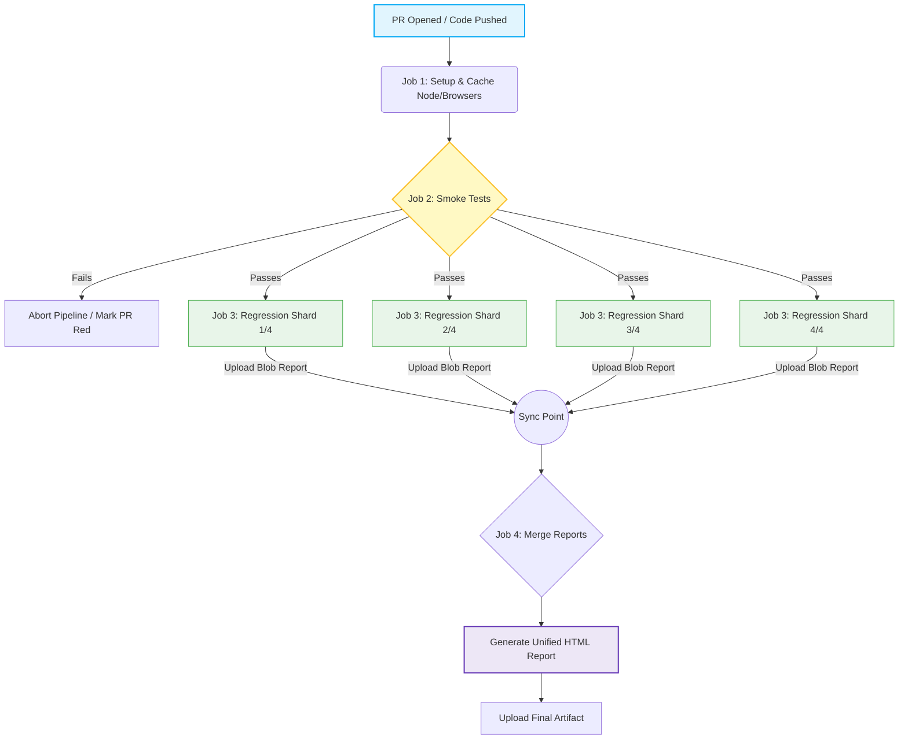

# 25. CI/CD Integration — Playwright in GitHub Actions & Azure DevOps

**Navigation**: [← Chapter 24: Test Script Architecture](../04_Enterprise_Architecture/24_Test_Script_Architecture.md) | [Index](../00_INDEX.md) | [→ Chapter 26: Flakiness Diagnosis](./26_Flakiness_Diagnosis_and_Fixing.md)

**Cross-links:**

- [`09_Parallel_Execution_Workers.md`](../02_Core_Architecture/09_Parallel_Execution_Workers.md) — Sharding and workers
- [`16_CrossSite_Pattern6_StorageState_Chaining.md`](../03_D365_And_Patterns/16_CrossSite_Pattern6_StorageState_Chaining.md) — globalSetup in CI
- [`21_Enterprise_Project_Structure.md`](../04_Enterprise_Architecture/21_Enterprise_Project_Structure.md) — Environment config
- [`62_Enterprise_Test_Operations.md`](../04_Enterprise_Architecture/62_Enterprise_Test_Operations.md) — gate tiers, flake SLA, and the operating rhythm around this pipeline

---

## 5W1H

- **WHAT**: How to run your Playwright test suite in a CI/CD pipeline — GitHub Actions and Azure DevOps — including sharding, secrets, artifact collection, and environment-specific runs.
- **WHY**: Tests that only pass on your laptop are not tests — they're scripts. CI is what makes automation real. If your team can't run tests on every PR automatically, the suite has no business value.
- **WHO**: Every SDET. Even if you don't own the pipeline, you need to understand it to debug CI-only failures.
- **WHEN**: Day 1 of writing tests. CI is not an afterthought. Every new test must pass in CI, not just locally.
- **HOW**: YAML workflow files, environment secrets, parallel sharding across agents, HTML reports as artifacts.

---

## 1. Why Tests Fail in CI But Pass Locally — The 7 Reasons

Before writing any pipeline, understand why CI is harder than local:

```
Reason 1 — No headed browser
  Local:  Chromium opens visibly. You see what's happening.
  CI:     Runs headless. No visual feedback. Timing can differ.
  Fix:    Always run headless locally too: npx playwright test (not --headed)

Reason 2 — Slower machine
  Local:  Your dev machine has 32GB RAM, SSD.
  CI:     GitHub Actions runner: 2-core CPU, 7GB RAM, slower I/O.
  Fix:    Use generous timeouts (30s for D365), don't rely on hardcoded speeds.

Reason 3 — No .env file
  Local:  You have .env.local with your credentials.
  CI:     .env file is NOT in git (and should never be). Env vars come from secrets.
  Fix:    Every process.env.X must be set as a CI secret or env var.

Reason 4 — Network latency to real environments
  Local:  You might test against localhost.
  CI:     Agent must reach staging.company.com over the internet.
  Fix:    Use staging URLs in CI env config. Add VPN steps if needed.

Reason 5 — No previous browser state
  Local:  You might have storageState from a previous run cached.
  CI:     Every run starts from zero. globalSetup MUST produce fresh auth state.
  Fix:    globalSetup runs before every CI run. Don't assume cached state.

Reason 6 — Parallel test order is non-deterministic
  Local:  You run tests in the same order every time (habit).
  CI:     With workers=4, tests run in parallel and in unpredictable order.
  Fix:    Every test must be self-contained. See Chapter 28.

Reason 7 — Environment variables missing
  Local:  You have all vars in .env.
  CI:     If you missed adding a secret, process.env.X is undefined.
  Fix:    Add a startup check script (shown below).
```

---

## 2. Environment Startup Check

Add this script to catch missing env vars BEFORE tests run:

```typescript
// scripts/check-env.ts
// Run: npx ts-node scripts/check-env.ts
// In CI: runs before `npx playwright test`

const REQUIRED_ENV_VARS = [
  "ADMIN_EMAIL",
  "ADMIN_PASSWORD",
  "ADMIN_ACCESS_TOKEN",
  "TENANT_ID",
  "CRM_URL",
  "CUSTOMER_PORTAL_URL",
  "API_BASE_URL",
  "NOTIFICATION_SERVICE_URL",
  "TEST_ENV",
] as const;

let hasErrors = false;

for (const varName of REQUIRED_ENV_VARS) {
  const value = process.env[varName];
  if (!value) {
    console.error(`❌ Missing required env var: ${varName}`);
    hasErrors = true;
  } else {
    const preview = value.length > 20 ? value.substring(0, 20) + "..." : value;
    console.log(`✅ ${varName}: ${preview}`);
  }
}

if (hasErrors) {
  console.error("\nAbort: Required environment variables are missing.");
  process.exit(1); // Non-zero exit → CI pipeline fails with clear message
}

console.log(
  "\nAll required environment variables are set. Ready to run tests.",
);
```

In `package.json`:

```json
{
  "scripts": {
    "pretest": "npx ts-node scripts/check-env.ts",
    "test": "playwright test",
    "test:smoke": "playwright test --grep '@smoke'",
    "test:regression": "playwright test --grep '@regression'",
    "test:ci": "playwright test --reporter=html,github"
  }
}
```

---

## 3. GitHub Actions — Complete Workflow

Before diving into the YAML, here is the architectural flow of the enterprise pipeline:



```yaml
# .github/workflows/playwright.yml

name: Playwright E2E Tests

on:
  push:
    branches: [main, develop]
  pull_request:
    branches: [main, develop]
  # Manual trigger with environment selection
  workflow_dispatch:
    inputs:
      environment:
        description: "Target environment"
        required: true
        default: "staging"
        type: choice
        options: [dev, staging, prod-readonly]
      test_tag:
        description: "Test tag to run (e.g. @smoke, @regression, leave empty for all)"
        required: false
        default: "@smoke"

jobs:
  # ── Job 1: Dependency check ────────────────────────────────────────────────
  setup:
    runs-on: ubuntu-latest
    steps:
      - uses: actions/checkout@v4
      - uses: actions/setup-node@v4
        with:
          node-version: "20"
          cache: "npm"
      - run: npm ci # install exact locked versions
      - run: npx playwright install chromium # install only what we need
        # Note: --with-deps installs system dependencies (fonts, libs)
      - run: npx playwright install-deps chromium

  # ── Job 2: Smoke tests (fast, runs on every PR) ───────────────────────────
  smoke:
    needs: setup
    runs-on: ubuntu-latest
    environment: staging # GitHub Environment with secrets
    timeout-minutes: 30

    steps:
      - uses: actions/checkout@v4
      - uses: actions/setup-node@v4
        with:
          node-version: "20"
          cache: "npm"
      - run: npm ci
      - run: npx playwright install chromium --with-deps

      # Check env vars before wasting 30 minutes
      - name: Validate environment variables
        run: npx ts-node scripts/check-env.ts
        env:
          # Map GitHub Secrets to environment variables
          # Secrets are set in: GitHub repo → Settings → Secrets and Variables → Actions
          ADMIN_EMAIL: ${{ secrets.STAGING_ADMIN_EMAIL }}
          ADMIN_PASSWORD: ${{ secrets.STAGING_ADMIN_PASSWORD }}
          ADMIN_ACCESS_TOKEN: ${{ secrets.STAGING_ADMIN_TOKEN }}
          TENANT_ID: ${{ secrets.TENANT_ID }}
          CRM_URL: ${{ vars.STAGING_CRM_URL }} # vars = non-secret config
          CUSTOMER_PORTAL_URL: ${{ vars.STAGING_PORTAL_URL }}
          API_BASE_URL: ${{ vars.STAGING_API_URL }}
          NOTIFICATION_SERVICE_URL: ${{ vars.STAGING_NOTIF_URL }}
          TEST_ENV: staging

      - name: Run smoke tests
        run: npx playwright test --grep "@smoke" --reporter=html,github
        env:
          ADMIN_EMAIL: ${{ secrets.STAGING_ADMIN_EMAIL }}
          ADMIN_PASSWORD: ${{ secrets.STAGING_ADMIN_PASSWORD }}
          ADMIN_ACCESS_TOKEN: ${{ secrets.STAGING_ADMIN_TOKEN }}
          TENANT_ID: ${{ secrets.TENANT_ID }}
          CRM_URL: ${{ vars.STAGING_CRM_URL }}
          CUSTOMER_PORTAL_URL: ${{ vars.STAGING_PORTAL_URL }}
          API_BASE_URL: ${{ vars.STAGING_API_URL }}
          NOTIFICATION_SERVICE_URL: ${{ vars.STAGING_NOTIF_URL }}
          TEST_ENV: staging
          # Enable API request logging for CI debugging
          PLAYWRIGHT_API_LOGGING: "true"

      # Always upload artifacts — even if tests fail
      # This is where you get the HTML report, screenshots, videos, traces
      - name: Upload test results
        uses: actions/upload-artifact@v4
        if: always() # ← CRITICAL: always upload, even on failure
        with:
          name: playwright-smoke-report
          path: |
            playwright-report/
            test-results/
          retention-days: 7

  # ── Job 3: Full regression (sharded — runs in parallel across 4 machines) ──
  regression:
    needs: smoke # Only run full suite if smoke passes
    runs-on: ubuntu-latest
    environment: staging
    timeout-minutes: 60
    # Sharding: run tests across 4 machines simultaneously
    # Machine 1 runs shard 1/4, machine 2 runs shard 2/4, etc.
    strategy:
      fail-fast: false # Don't cancel other shards if one fails
      matrix:
        shard: [1, 2, 3, 4]

    steps:
      - uses: actions/checkout@v4
      - uses: actions/setup-node@v4
        with:
          node-version: "20"
          cache: "npm"
      - run: npm ci
      - run: npx playwright install chromium --with-deps

      - name: Run regression shard ${{ matrix.shard }}/4
        run: |
          npx playwright test \
            --grep "@regression" \
            --shard=${{ matrix.shard }}/4 \
            --reporter=blob
        env:
          ADMIN_EMAIL: ${{ secrets.STAGING_ADMIN_EMAIL }}
          ADMIN_PASSWORD: ${{ secrets.STAGING_ADMIN_PASSWORD }}
          ADMIN_ACCESS_TOKEN: ${{ secrets.STAGING_ADMIN_TOKEN }}
          TENANT_ID: ${{ secrets.TENANT_ID }}
          CRM_URL: ${{ vars.STAGING_CRM_URL }}
          CUSTOMER_PORTAL_URL: ${{ vars.STAGING_PORTAL_URL }}
          API_BASE_URL: ${{ vars.STAGING_API_URL }}
          NOTIFICATION_SERVICE_URL: ${{ vars.STAGING_NOTIF_URL }}
          TEST_ENV: staging
          PLAYWRIGHT_API_LOGGING: "true"

      - name: Upload shard blob report
        uses: actions/upload-artifact@v4
        if: always()
        with:
          name: blob-report-shard-${{ matrix.shard }}
          path: blob-report/
          retention-days: 1 # short retention — only needed for merge

  # ── Job 4: Merge shard reports into one HTML report ───────────────────────
  merge-reports:
    needs: regression
    runs-on: ubuntu-latest
    if: always()
    steps:
      - uses: actions/checkout@v4
      - uses: actions/setup-node@v4
        with:
          node-version: "20"
          cache: "npm"
      - run: npm ci

      - name: Download all blob reports
        uses: actions/download-artifact@v4
        with:
          path: all-blob-reports
          pattern: blob-report-shard-*
          merge-multiple: true

      - name: Merge into single HTML report
        run: npx playwright merge-reports --reporter html ./all-blob-reports

      - name: Upload merged HTML report
        uses: actions/upload-artifact@v4
        with:
          name: playwright-regression-report
          path: playwright-report/
          retention-days: 30
```

---

## 4. Azure DevOps Pipeline

Microsoft stack (D365) teams often use Azure DevOps:

```yaml
# azure-pipelines.yml
# Equivalent to the GitHub Actions workflow above

trigger:
  branches:
    include:
      - main
      - develop

pool:
  vmImage: "ubuntu-latest"

variables:
  # Non-secret config (set in Azure DevOps Pipeline → Variables)
  TEST_ENV: "staging"
  STAGING_CRM_URL: "https://staging-crm.company.com"
  STAGING_API_URL: "https://staging-api.company.com"
  NODE_VERSION: "20"

stages:
  # ── Stage 1: Smoke ─────────────────────────────────────────────────────────
  - stage: SmokeTests
    displayName: "Smoke Tests (@smoke)"
    jobs:
      - job: RunSmoke
        displayName: "Run @smoke tests"
        timeoutInMinutes: 30

        steps:
          - task: NodeTool@0
            inputs:
              versionSpec: "$(NODE_VERSION)"

          - script: npm ci
            displayName: "Install dependencies"

          - script: npx playwright install chromium --with-deps
            displayName: "Install Playwright browsers"

          - script: npx ts-node scripts/check-env.ts
            displayName: "Validate environment variables"
            env:
              # Azure DevOps secrets — set as secret variables in pipeline
              ADMIN_EMAIL: $(STAGING_ADMIN_EMAIL) # (secret)
              ADMIN_PASSWORD: $(STAGING_ADMIN_PASSWORD) # (secret)
              ADMIN_ACCESS_TOKEN: $(STAGING_ADMIN_TOKEN) # (secret)
              TENANT_ID: $(TENANT_ID) # (secret)
              CRM_URL: $(STAGING_CRM_URL)
              CUSTOMER_PORTAL_URL: $(STAGING_PORTAL_URL)
              API_BASE_URL: $(STAGING_API_URL)
              NOTIFICATION_SERVICE_URL: $(STAGING_NOTIF_URL)
              TEST_ENV: $(TEST_ENV)

          - script: |
              npx playwright test \
                --grep "@smoke" \
                --reporter=html,junit
            displayName: "Run smoke tests"
            env:
              ADMIN_EMAIL: $(STAGING_ADMIN_EMAIL)
              ADMIN_PASSWORD: $(STAGING_ADMIN_PASSWORD)
              ADMIN_ACCESS_TOKEN: $(STAGING_ADMIN_TOKEN)
              TENANT_ID: $(TENANT_ID)
              CRM_URL: $(STAGING_CRM_URL)
              CUSTOMER_PORTAL_URL: $(STAGING_PORTAL_URL)
              API_BASE_URL: $(STAGING_API_URL)
              NOTIFICATION_SERVICE_URL: $(STAGING_NOTIF_URL)
              TEST_ENV: $(TEST_ENV)
              PLAYWRIGHT_API_LOGGING: "true"

          # Publish JUnit results (shows in Azure DevOps Tests tab)
          - task: PublishTestResults@2
            condition: always()
            inputs:
              testResultsFormat: "JUnit"
              testResultsFiles: "test-results/junit-results.xml"
              testRunTitle: "Playwright Smoke Tests"
              failTaskOnFailedTests: true

          # Publish HTML report as build artifact
          - task: PublishBuildArtifacts@1
            condition: always()
            inputs:
              pathToPublish: "playwright-report"
              artifactName: "playwright-smoke-report"

  # ── Stage 2: Regression (parallel) ────────────────────────────────────────
  - stage: RegressionTests
    displayName: "Regression Tests (sharded)"
    dependsOn: SmokeTests
    condition: succeeded()
    jobs:
      # Azure DevOps parallel jobs via strategy matrix
      - job: Shard
        strategy:
          parallel: 4 # 4 parallel agents
        timeoutInMinutes: 60

        steps:
          - task: NodeTool@0
            inputs:
              versionSpec: "$(NODE_VERSION)"
          - script: npm ci
          - script: npx playwright install chromium --with-deps

          - script: |
              # SYSTEM_JOBPOSITIONINPHASE is 1-indexed shard number
              npx playwright test \
                --grep "@regression" \
                --shard=$(SYSTEM_JOBPOSITIONINPHASE)/$(SYSTEM_TOTALJOBSINPHASE) \
                --reporter=blob
            displayName: "Run regression shard $(SYSTEM_JOBPOSITIONINPHASE)/4"
            env:
              ADMIN_EMAIL: $(STAGING_ADMIN_EMAIL)
              ADMIN_PASSWORD: $(STAGING_ADMIN_PASSWORD)
              ADMIN_ACCESS_TOKEN: $(STAGING_ADMIN_TOKEN)
              TENANT_ID: $(TENANT_ID)
              CRM_URL: $(STAGING_CRM_URL)
              CUSTOMER_PORTAL_URL: $(STAGING_PORTAL_URL)
              API_BASE_URL: $(STAGING_API_URL)
              NOTIFICATION_SERVICE_URL: $(STAGING_NOTIF_URL)
              TEST_ENV: $(TEST_ENV)

          - task: PublishBuildArtifacts@1
            condition: always()
            inputs:
              pathToPublish: "blob-report"
              artifactName: "blob-shard-$(SYSTEM_JOBPOSITIONINPHASE)"
```

---

## 5. `playwright.config.ts` for CI

The config must behave differently locally vs in CI:

```typescript
// playwright.config.ts

import { defineConfig, devices } from "@playwright/test";

const isCI = Boolean(process.env.CI); // GitHub Actions / Azure DevOps both set CI=true

export default defineConfig({
  testDir: "./tests/specs",
  globalSetup: "./tests/globalSetup.ts",

  // In CI: run all tests in parallel across workers
  // Locally: limit workers to avoid hogging your machine
  workers: isCI ? "100%" : 4,

  // Retry failed tests automatically
  // In CI: retry up to 2 times (catches transient network/timing issues)
  // Locally: no retries (you want to see failures immediately)
  retries: isCI ? 2 : 0,

  // Timeout for each test
  timeout: isCI ? 90_000 : 60_000, // CI is slower

  // Timeout for expect() assertions
  expect: { timeout: isCI ? 30_000 : 15_000 },

  // Reporter: different in CI vs local
  reporter: isCI
    ? [
        ["github"], // Annotates PRs with test failures inline
        ["html", { outputFolder: "playwright-report", open: "never" }],
        ["junit", { outputFile: "test-results/junit-results.xml" }],
      ]
    : [
        ["html", { outputFolder: "playwright-report", open: "on-failure" }],
        ["list"], // Compact live output in terminal
      ],

  use: {
    // In CI: headless mandatory. Locally: allow headed debugging.
    headless: isCI ? true : !process.env.PLAYWRIGHT_HEADED,

    // Capture trace on retry (essential for debugging CI failures)
    trace: isCI ? "on-first-retry" : "retain-on-failure",

    // Screenshot on failure
    screenshot: "only-on-failure",

    // Video on retry (helps see what actually happened)
    video: isCI ? "on-first-retry" : "off",

    // Global viewport
    viewport: { width: 1920, height: 1080 },

    // Base URL — overridden per-project
    baseURL: process.env.CRM_URL,
  },

  projects: [
    {
      name: "admin-chrome",
      testMatch: "**/admin/**/*.spec.ts",
      use: {
        ...devices["Desktop Chrome"],
        storageState: "auth-states/admin-state.json",
        baseURL: process.env.CRM_URL,
      },
    },
    {
      name: "customer-chrome",
      testMatch: "**/customer/**/*.spec.ts",
      use: {
        ...devices["Desktop Chrome"],
        storageState: "auth-states/customer-state.json",
        baseURL: process.env.CUSTOMER_PORTAL_URL,
      },
    },
    {
      name: "api-tests",
      testMatch: "**/api/**/*.spec.ts",
      use: {
        baseURL: process.env.API_BASE_URL,
      },
    },
  ],
});
```

---

## 6. The HTML Report — What to Send to Management

After a CI run, the HTML report at `playwright-report/index.html` shows:

```
Summary:          237 passed | 3 failed | 2 skipped | 14m 32s
Failures:
  ❌ Citation Dispute Flow › Admin reviews → Status updates (attempt 2/3)
      Expected: 'DISPUTED'
      Received: 'PENDING'
      Screenshot: [click to view]
      Trace: [click to open Playwright Trace Viewer]

By tag:
  @smoke:        42/42 passed ✅
  @citations:    87/89 passed ⚠
  @regression:  237/242 passed ⚠
```

**What to share with your manager:**

- The summary line: "237/242 tests passed in 14 minutes"
- Links to failing test screenshots
- Tag-based breakdown: "All smoke tests passed. 3 regression-only tests failed — investigating."

---

## 7. Secrets Management Best Practices

```
Rule 1: NEVER commit credentials to Git.
  .gitignore must include:
    .env
    .env.local
    .env.staging
    auth-states/         ← storageState files contain tokens!
    test-results/

Rule 2: Rotate secrets regularly.
  When: every 90 days, or immediately on any leak.
  Where: Update in GitHub Secrets / Azure DevOps Variable Groups.
  Test: manually trigger the pipeline after rotation to confirm it still works.

Rule 3: Use Variable Groups in Azure DevOps.
  A Variable Group lets you share secrets across multiple pipelines.
  Link the group in the pipeline YAML:
    variables:
      - group: 'Playwright-Staging-Secrets'

Rule 4: Use GitHub Environments for approval gates.
  Production tests require a manual approval from a senior SDET.
  GitHub → Settings → Environments → production → Required reviewers.

Rule 5: Least privilege.
  CI tokens should only have READ access to the test environment.
  They should NOT be production admin tokens.
```

---

## 🏋️ Practice Challenges

### Challenge 1 [MCQ] — `if: always()` in GitHub Actions

```yaml
- name: Upload test results
  uses: actions/upload-artifact@v4
  if: always()
  with:
    name: playwright-report
    path: playwright-report/
```

Why is `if: always()` critical on the upload step?

A) Without it, the step runs twice  
B) Without it, if tests fail, the upload step is skipped — you lose the report exactly when you need it most  
C) `if: always()` makes the step run in parallel with the test step  
D) It enables automatic retry of the upload

<details><summary>Answer</summary>

**B** — GitHub Actions skips subsequent steps when a previous step fails (by default). If tests fail, the `playwright test` step exits with a non-zero code → GitHub marks the job as failed → all following steps are skipped — including the artifact upload. Without `if: always()`, you lose the report, screenshots, and trace files precisely when a test failure has just occurred and you need them most.

`if: always()` forces the step to run regardless of whether previous steps succeeded or failed.

</details>

---

### Challenge 2 [Spot the Bug]

```yaml
- name: Run tests
  run: npx playwright test
  env:
    ADMIN_TOKEN: ${{ secrets.ADMIN_TOKEN }}

- name: Upload report
  uses: actions/upload-artifact@v4
  with:
    name: report
    path: playwright-report/
```

**Two bugs. Find them.**

<details><summary>Answer</summary>

**Bug 1:** Missing `if: always()` on the upload step. If tests fail, the upload is skipped and you lose the report.

**Bug 2:** Missing `--reporter=html` flag (or equivalent config). Unless `playwright.config.ts` already sets `reporter: 'html'`, the default reporter writes no HTML files. The `playwright-report/` directory would be empty, and the artifact upload would succeed but contain nothing useful.

Fix:

```yaml
- name: Run tests
  run: npx playwright test --reporter=html,github
  env:
    ADMIN_TOKEN: ${{ secrets.ADMIN_TOKEN }}

- name: Upload report
  uses: actions/upload-artifact@v4
  if: always() # ← required
  with:
    name: report
    path: playwright-report/
```

</details>

---

### Challenge 3 [Write It Yourself]

Write the `package.json` scripts section for a team that needs:

- `test:smoke` — run only @smoke tests with HTML + GitHub reporter
- `test:regression` — run @regression tests with retries=2 and blob reporter (for sharding)
- `test:local` — run all tests, headed, with 2 workers, HTML report opens on failure
- `check-env` — run the environment check script

<details><summary>Answer</summary>

```json
{
  "scripts": {
    "check-env": "npx ts-node scripts/check-env.ts",

    "test:smoke": "npx playwright test --grep @smoke --reporter=html,github",

    "test:regression": "npx playwright test --grep @regression --retries=2 --reporter=blob",

    "test:local": "PLAYWRIGHT_HEADED=true npx playwright test --workers=2 --reporter=html",

    "test:shard": "npx playwright test --shard=$SHARD_INDEX/$SHARD_TOTAL --reporter=blob",

    "merge-reports": "npx playwright merge-reports --reporter html ./all-blob-reports",

    "report": "npx playwright show-report"
  }
}
```

</details>

---

**Navigation**: [← Chapter 24: Test Script Architecture](../04_Enterprise_Architecture/24_Test_Script_Architecture.md) | [Index](../00_INDEX.md) | [→ Chapter 26: Flakiness Diagnosis](./26_Flakiness_Diagnosis_and_Fixing.md)

### Challenge 4 [MCQ] — Sharding: `fail-fast: false`

```yaml
strategy:
  fail-fast: false
  matrix:
    shard: [1, 2, 3, 4]
```

Why is `fail-fast: false` critical for sharded Playwright runs?

A) Without it, shards run sequentially instead of in parallel
B) Without it, if shard 1 fails, GitHub cancels shards 2-4 — you lose test results from three-quarters of the suite and the merged HTML report will be incomplete
C) `fail-fast: false` enables the blob reporter to write partial results
D) It prevents duplicate test execution when matrix values overlap

<details><summary>Answer</summary>

**B** — By default, GitHub Actions `fail-fast: true` means: if any matrix job fails, cancel all remaining matrix jobs. For sharding, this means: if shard 1 has a failing test, shards 2, 3, and 4 are cancelled. You receive results from only one quarter of your suite.

The consequences:

- The `merge-reports` job (which needs ALL four blob reports) runs with incomplete data
- You cannot tell if shards 2-4 have additional failures or all-passing
- The merged HTML report shows 25% of tests — misleading for management dashboards

With `fail-fast: false`:

- All 4 shards run to completion regardless of each other's failures
- The merge job receives all 4 blob reports
- The merged HTML shows the FULL picture: which tests failed, which passed, across all shards
- `merge-reports` job's `if: always()` condition ensures it runs even when some shards fail

Rule: For test sharding, always set `fail-fast: false`. Cancelling partial runs loses information. You need the complete picture to diagnose flakiness patterns.

</details>

---

### Challenge 5 [Spot the Bug — Secrets vs Variables]

A new SDET sets up the pipeline and adds the following:

```yaml
env:
  ADMIN_PASSWORD: ${{ vars.STAGING_ADMIN_PASSWORD }}
  #               ↑ using `vars` namespace
  API_BASE_URL: ${{ secrets.STAGING_API_URL }}
  #              ↑ using `secrets` namespace
```

What is wrong, and what is the real difference between `vars` and `secrets` in GitHub Actions?

<details><summary>Answer</summary>

Both usages are backwards:

**`ADMIN_PASSWORD` should use `secrets`, not `vars`**
`vars` (GitHub Actions Variables) are stored in plaintext and their values are visible in workflow logs and the GitHub UI. A password stored as `vars.STAGING_ADMIN_PASSWORD` would be visible to anyone with read access to the repository — a security breach.

**`API_BASE_URL` should use `vars`, not `secrets`**
`secrets` are masked in logs (replaced with `***`), which makes debugging impossible. If the URL is wrong, you cannot see what value was used because it is always redacted. Non-sensitive config (URLs, tenant IDs, environment names) belongs in `vars` so it is visible in logs and auditable.

The correct distinction:

- `secrets`: passwords, tokens, API keys, private certificates — anything that would cause harm if leaked. Values are masked in ALL logs.
- `vars`: URLs, environment names, feature flags, non-sensitive config — values you need to see in logs to debug pipeline failures.

Correct setup:

```yaml
env:
  ADMIN_PASSWORD: ${{ secrets.STAGING_ADMIN_PASSWORD }} # secret: masked in logs
  ADMIN_TOKEN: ${{ secrets.STAGING_ADMIN_TOKEN }} # secret: masked in logs
  API_BASE_URL: ${{ vars.STAGING_API_URL }} # variable: visible in logs, auditable
  TEST_ENV: staging # hardcoded constant: fine in YAML
```

</details>

---

**Navigation**: [← Chapter 24: Test Script Architecture](../04_Enterprise_Architecture/24_Test_Script_Architecture.md) | [Index](../00_INDEX.md) | [→ Chapter 26: Flakiness Diagnosis](./26_Flakiness_Diagnosis_and_Fixing.md)


---

## Reality Check

**"CI/CD and DevOps are the same thing"** → CI (Continuous Integration): developers merge code frequently, automated builds and tests run on every merge. CD (Continuous Delivery): every code change that passes CI is automatically deployable (may require manual approval). CD (Continuous Deployment): every change that passes tests is deployed automatically without human approval. DevOps is broader: a culture and set of practices combining development and operations — CI/CD pipelines are one tool within DevOps, alongside infrastructure-as-code, monitoring, incident response, and cross-functional team structures.

**"Playwright tests in CI should use the same config as local dev"** → CI environments differ: no display (headless mandatory), different CPU/memory (shared CI runners are slower — increase timeouts), different network (API calls to external services may be blocked), different timezone/locale (affects date/time tests), different font rendering (affects visual regression screenshots), no persistent browser cache. Maintain separate `playwright.config.ci.ts` (or environment variables): `CI=true` in environment → headless, more workers, higher timeouts, no video by default. Never assume local and CI are identical.

**"Sharding splits tests across multiple CI machines and is always faster"** → Sharding (`--shard=1/4`) distributes tests across machines — useful when your test suite takes longer than your CI timeout. But: each shard must set up its environment independently (slower if setup is expensive), you need to merge reports from all shards, flaky tests mean only one shard fails (the job that ran that shard retries the full shard, not just the flaky test). Sharding reduces wall-clock time at the cost of CI resource cost (4 machines × test time instead of 1 machine × test time × 4). Use sharding when: total test time exceeds acceptable CI wait time; don't use it prematurely.

**"GitHub Actions and Azure DevOps Playwright setup is the same"** → Both support Playwright but with different configurations: GitHub Actions uses YAML workflows with `uses: actions/...` steps and `${{ secrets.* }}` for secrets. Azure DevOps uses YAML pipelines with `task: ...` steps and `$(variableName)` syntax. Playwright's `--reporter=github` produces GitHub Actions-compatible annotations (errors appear inline in PR diffs); for Azure DevOps use JUnit XML reporter (`--reporter=junit`) and Azure's `PublishTestResults` task. Browser installation differs: `npx playwright install --with-deps` on both, but Docker images and cache strategies differ.

**"Tests that pass CI are ready for production"** → CI tests catch regressions in tested scenarios. They don't catch: performance regressions (unless you have perf tests in CI), security vulnerabilities (requires SAST, DAST, dependency scanning), configuration differences between CI and production, edge cases not in your test suite, data migration issues (if your CI uses fresh test data every run), or issues that only appear at production traffic scale. CI green = "the code change didn't break the things we test" — a necessary but not sufficient condition for production readiness.
