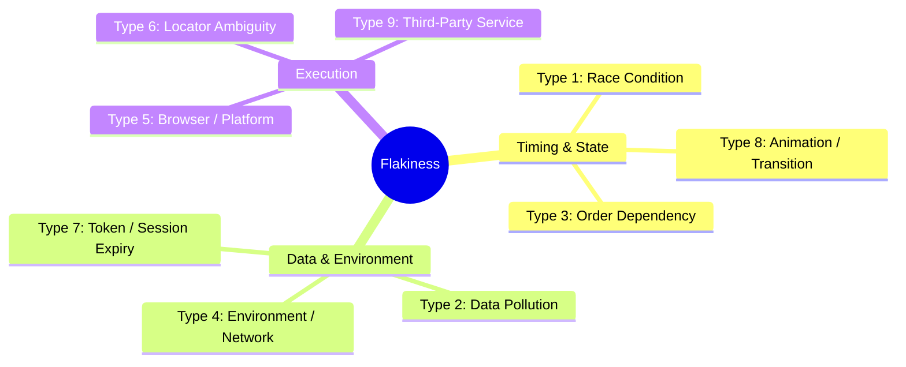
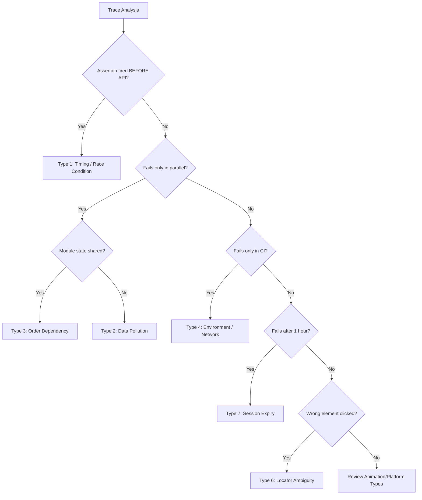

# 26. Flakiness — Diagnosing, Classifying & Systematically Fixing Unstable Tests

**Navigation**: [← Chapter 25: CI/CD Integration](./25_CICD_Integration_GitHub_Azure.md) | [Index](../00_INDEX.md) | [→ Chapter 27: Advanced TypeScript Patterns](./27_Advanced_TypeScript_for_SDETs.md)

**Cross-links:**

- [`08_Browser_Internals_for_SDETs.md`](../02_Core_Architecture/08_Browser_Internals_for_SDETs.md) — Root cause: rendering timelines
- [`17_D365_Advanced_Timing_Patterns.md`](../03_D365_And_Patterns/17_D365_Advanced_Timing_Patterns.md) — D365-specific flakiness
- [`25_CICD_Integration_GitHub_Azure.md`](./25_CICD_Integration_GitHub_Azure.md) — Retries in CI

---

## 5W1H

- **WHAT**: A systematic methodology for diagnosing why a test sometimes passes and sometimes fails — not by guessing, but by evidence-based analysis using Playwright Trace Viewer, timeline inspection, and flakiness classification.
- **WHY**: Flaky tests are the single biggest destroyer of SDET credibility. When tests randomly fail, developers stop trusting them. When developers stop trusting them, they get disabled. A dead test suite is worse than no test suite — it gives false confidence.
- **WHO**: Every SDET who has ever said "it passed when I ran it manually."
- **WHEN**: The moment a test fails in CI but passes locally, or fails 1 in 5 runs — you stop writing new tests and fix this first.
- **HOW**: Classify the flakiness type → collect evidence (trace, video, logs) → apply the specific fix for that type.

---

## 1. The Flakiness Taxonomy — 9 Types

Every flaky test falls into one (or more) of these categories.

### Flakiness Taxonomy Visualised



```
TYPE 1 — Timing / Race Condition
  Symptom: passes with a delay, fails without one; fails more on slow machines
  Root cause: code doesn't wait for the right signal before asserting
  Example: assertion fires before D365 spinner has hidden

TYPE 2 — Data Pollution
  Symptom: fails when run after a specific other test
  Root cause: Test A creates/modifies data that Test B unexpectedly reads
  Example: Test A creates customer 'AutoTest-1'. Test B searches all customers,
           finds 'AutoTest-1' in the list, expects exactly 1 result but gets 2.

TYPE 3 — Order Dependency
  Symptom: fails only when run in parallel, or after specific tests
  Root cause: module-level shared state, or tests assuming previous test ran
  Example: `let userId` at module level — Worker 2 reads Worker 1's value

TYPE 4 — Environment / Network
  Symptom: fails only in CI, or only on certain machines, or after a deploy
  Root cause: environment-specific URLs, network timeouts, slow external services
  Example: staging API takes 12s to respond; CI timeout is 10s; local is fast

TYPE 5 — Browser / Platform
  Symptom: fails in Chromium but passes in Firefox, or vice versa
  Root cause: CSS rendering difference, timing difference, browser-specific behaviour
  Example: D365 uses Chrome-specific APIs that Chromium handles differently headless

TYPE 6 — Locator Ambiguity
  Symptom: occasionally selects the wrong element
  Root cause: selector matches multiple elements; nth() index shifts unexpectedly
  Example: `.order-row:nth-child(1)` — row order changes if previous row loaded late

TYPE 7 — Token / Session Expiry
  Symptom: passes for first 20 tests, fails after an hour
  Root cause: storageState token expires during a long test run
  Example: globalSetup saves a 1-hour token; full regression takes 75 minutes

TYPE 8 — Animation / Transition
  Symptom: screenshot assertion fails intermittently
  Root cause: asserting mid-CSS animation; element is partially rendered
  Example: button has a 200ms fade-in; click fires before opacity reaches 1

TYPE 9 — Third-Party Service
  Symptom: test fails at the same step intermittently; affects notification tests
  Root cause: external service (email, SMS, webhook) has SLA, not instantaneous
  Example: CITATION_CREATED email arrives in 2-30 seconds; test waits exactly 3s
```

---

## 2. The Diagnosis Flowchart

When a test is flaky, follow this exact sequence:

```
Step 1: Reproduce locally
  Run the test 10 times: npx playwright test --repeat-each=10 <test-file>
  → If it fails 0/10: it's a CI-specific issue → go to Step 4
  → If it fails 1-9/10: you have a local reproducer → go to Step 2

Step 2: Get the trace
  npx playwright test --trace=on <test-file>
  Open trace: npx playwright show-trace test-results/.../trace.zip
  Look at:
    - Timeline: what happened and in what order?
    - Network panel: was an API call slow? Did it fail?
    - DOM snapshots: what did the element look like AT the moment of failure?
    - Action log: which action caused the failure?

Step 3: Compare passing vs failing trace
  Run twice: keep one trace from a passing run, one from a failing run.
  Compare the timelines side by side:
    - Did the spinner hide faster in the passing run?
    - Did a network request complete before/after the assertion?
  This reveals the TIMING DIFFERENCE.

Step 4: Check CI-specific factors
  - Is the CI machine slower? → Add buffer to timeouts
  - Is a secret missing? → Add check-env script
  - Is storageState stale? → Add token refresh in globalSetup
  - Does the test assume previous state? → Add explicit setup

Step 5: Classify the type (see Section 1)
  Once you know WHAT is different between pass and fail, you know the TYPE.
  Each type has a specific fix (see Section 3).

Step 6: Apply the fix
  Apply ONE fix, then run 50 times: npx playwright test --repeat-each=50 <test-file>
  → If still flaky: the fix was wrong or incomplete → go back to Step 2
  → If passes 50/50: merge the fix, monitor for 1 week in CI
```

---

## 3. Fixes for Each Flakiness Type

### Type 1 Fix — Timing / Race Condition

```typescript
// ❌ Root cause: asserting immediately after navigation
await page.click("#processPayment");
expect(await page.locator(".confirmation-id").textContent()).toMatch(
  /CONF-\d+/,
);
// Fails when the confirmation renders slowly

// ✅ Fix: assert with expect() which auto-retries until timeout
await page.click("#processPayment");
await expect(page.locator(".confirmation-id")).toHaveText(/CONF-\d+/, {
  timeout: 20_000,
});
// expect() retries the assertion for up to 20 seconds — timing safe

// ❌ D365 specific: asserting before spinner hides
await page.getByRole("menuitem", { name: "Save & Close" }).click();
const status = await page
  .locator('[data-automation-key="statecode"]')
  .textContent();

// ✅ Fix: wait for spinner, THEN wait for correct content
await page.getByRole("menuitem", { name: "Save & Close" }).click();
await expect(page.locator(".ms-Spinner")).toHaveCount(0, { timeout: 45_000 });
await expect(page.locator('[data-automation-key="statecode"]')).toHaveText(
  "Active",
  { timeout: 30_000 },
);
```

### Type 2 Fix — Data Pollution

```typescript
// ❌ Root cause: search returns previous test's data
await masterSearch.searchPanel.searchByCustomerName("AutoTest");
const count = await masterSearch.resultsGrid.rows.count();
expect(count).toBe(1); // Fails if another test left AutoTest-1 in the DB

// ✅ Fix: use UNIQUE, TEST-SPECIFIC identifiers
const uniqueId = `AutoTest-${Date.now()}-${Math.random().toString(36).slice(2)}`;
// uniqueId = 'AutoTest-1716892345678-k7m2x'
await masterSearch.searchPanel.searchByCustomerName(uniqueId);
// Only THIS test's data matches this name

// ✅ Fix 2: search by ID, not by name
// IDs are unique by definition. Names are not.
await masterSearch.searchPanel.searchByCitationId(data.citationId!);
// CIT-001 exists exactly once. AutoTest might not.
```

### Type 3 Fix — Order Dependency

```typescript
// ❌ Root cause: module-level state
let createdUserId: string; // ← shared across tests in module

// ✅ Fix: use test.describe.serial() with a SCOPED object
test.describe.serial("User lifecycle", () => {
  const state = { userId: "" }; // scoped to this describe block, same worker

  test("Create user", async ({ usersClient, account }) => {
    const user = await usersClient.create(
      PayloadsUser.newAgent(StringUtils.randomEmail()),
    );
    state.userId = user.userId; // safe: describe.serial runs these in order, same worker
  });

  test("Verify user", async ({ usersClient }) => {
    const user = await usersClient.getById(state.userId);
    expect(user.role).toBe("AGENT");
  });
});
```

### Type 4 Fix — Environment / Network

```typescript
// ❌ Root cause: hardcoded timeout too short for CI
await expect(page.locator(".search-results")).toBeVisible({ timeout: 5000 });
// Fails in CI because the staging API takes 8-12 seconds

// ✅ Fix: environment-aware timeouts
const isCI = Boolean(process.env.CI);
const NETWORK_TIMEOUT = isCI ? 30_000 : 15_000;
const D365_TIMEOUT = isCI ? 60_000 : 30_000;

await expect(page.locator(".search-results")).toBeVisible({
  timeout: NETWORK_TIMEOUT,
});

// ✅ Or: configure via playwright.config.ts (better)
// expect: { timeout: isCI ? 30_000 : 15_000 }
// Then all assertions use the CI-appropriate timeout without per-line changes
```

### Type 5 Fix — Browser / Platform

```typescript
// D365 headless Chrome behaves differently to headed on Windows for CSS transitions

// Diagnose: run the same test on each browser:
// npx playwright test --project=chromium --repeat-each=5
// npx playwright test --project=firefox --repeat-each=5
// npx playwright test --project=webkit --repeat-each=5

// Fix A: skip on browsers where the feature isn't applicable:
test("D365 CommandBar drag-drop", async ({ page, browserName }) => {
  test.skip(
    browserName !== "chromium",
    "D365 drag-drop only supported on Chrome",
  );
  // ...
});

// Fix B: per-browser timeout config:
// playwright.config.ts:
projects: [
  {
    name: "chromium",
    use: { ...devices["Desktop Chrome"], actionTimeout: 15_000 },
  },
  {
    name: "firefox",
    use: { ...devices["Desktop Firefox"], actionTimeout: 25_000 }, // Firefox renders slower
  },
];

// Fix C: disable CSS transitions globally for visual tests:
// In globalSetup or test beforeEach, inject CSS to disable animations:
await page.addStyleTag({
  content:
    "*, *::before, *::after { transition: none !important; animation: none !important; }",
});
// This eliminates timing differences caused by different browser animation speeds
```

### Type 6 Fix — Locator Ambiguity

```typescript
// ❌ Root cause: index shifts
await page.locator(".order-row").nth(0).click(); // which row? loaded in what order?

// ✅ Fix: identify by data attribute, not position
await page.locator(".order-row").filter({ hasText: data.orderId! }).click();

// ✅ Or: get the specific row by its unique ID attribute
await page.locator(`[data-order-id="${data.orderId}"]`).click();

// ❌ Root cause: text match too broad
await page.getByText("Edit").click(); // matches 5 Edit buttons on the same page

// ✅ Fix: scope to the correct container
await page
  .locator(".citation-actions-panel")
  .getByRole("menuitem", { name: "Edit" })
  .click();
```

### Type 7 Fix — Token / Session Expiry

```typescript
// globalSetup.ts — detect and refresh expired tokens

export default async function globalSetup() {
  const browser = await chromium.launch();
  const context = await browser.newContext();
  const page = await context.newPage();

  // Check if saved state is still valid before trusting it
  const savedStatePath = "auth-states/admin-state.json";
  const isStateValid = await checkStateValidity(savedStatePath);

  if (isStateValid) {
    console.log("[globalSetup] Auth state is still valid — skipping login");
  } else {
    console.log(
      "[globalSetup] Auth state is expired or missing — re-logging in",
    );
    await performLogin(page, context, savedStatePath);
  }

  await browser.close();
}

async function checkStateValidity(statePath: string): Promise<boolean> {
  try {
    const { readFileSync } = await import("fs");
    const state = JSON.parse(readFileSync(statePath, "utf-8"));
    const now = Date.now() / 1000; // Unix timestamp

    // Check if any auth cookie expires soon (within 5 minutes)
    for (const cookie of state.cookies ?? []) {
      if (
        cookie.name === "session_token" ||
        cookie.name === ".AspNet.ApplicationCookie"
      ) {
        if (cookie.expires && cookie.expires < now + 300) {
          console.log(
            `[globalSetup] Cookie ${cookie.name} expires in < 5 minutes`,
          );
          return false;
        }
      }
    }
    return true;
  } catch {
    return false; // File missing or corrupt
  }
}
```

### Type 8 Fix — Animation / Transition

```typescript
// ❌ Root cause: visual regression assertion fires during CSS animation
test('Login button visual regression', async ({ page }) => {
  await page.goto('/login');
  // Button has a 300ms fade-in animation on page load:
  await expect(page.locator('#loginBtn')).toBeVisible();
  await expect(page.locator('#loginBtn')).toHaveScreenshot('login-btn.png');
  // FLAKY: sometimes the screenshot captures the button at 50% opacity during the fade-in
});

// ✅ Fix A: wait for the animation to complete
// Playwright's 'stable' actionability check only applies to ACTIONS (click, fill), not to screenshots.
// For screenshots, you must wait manually:
await page.locator('#loginBtn').waitFor({ state: 'visible' });
await page.waitForFunction(() => {
  const btn = document.querySelector('#loginBtn');
  if (!btn) return false;
  const style = window.getComputedStyle(btn);
  return style.animationPlayState === 'running' ? false : true;
});
await expect(page.locator('#loginBtn')).toHaveScreenshot('login-btn.png');

// ✅ Fix B: disable all animations (best for visual regression tests)
// playwright.config.ts:
use: {
  launchOptions: {
    args: ['--disable-web-security'],  // Not this
  },
  // Disable CSS animations via config:
}
// Or in beforeEach:
await page.emulateMedia({ reducedMotion: 'reduce' });  // triggers prefers-reduced-motion
// For Playwright visual tests specifically:
// use: { screenshot: { animations: 'disabled' } }  // disables CSS animations during screenshot
// This is in the screenshot options, not a CSS override

// ✅ Fix C: inject a CSS override (guaranteed, works everywhere)
test.beforeEach(async ({ page }) => {
  await page.addStyleTag({
    content: '*, *::before, *::after { animation-duration: 0s !important; transition-duration: 0s !important; }'
  });
});
```

### Type 9 Fix — Third-Party Service

```typescript
// ❌ Root cause: fixed wait for async notification
await page.waitForTimeout(3000); // "should arrive in 3 seconds"
const notif = await notificationsClient.getByUser(account.userId);
// Fails when the notification service is slow and arrives in 5 seconds

// ✅ Fix: polling with expect.poll()
await expect
  .poll(
    async () => {
      const notifs = await notificationsClient.getByUser(account.userId);
      return notifs.some(
        (n) =>
          n.type === "CITATION_CREATED" && n.referenceId === data.citationId,
      );
    },
    {
      message: "CITATION_CREATED notification must arrive",
      timeout: 30_000, // total wait: 30 seconds
      intervals: [1000, 2000, 3000, 5000, 10_000], // check at 1s, 2s, 3s, 5s, 10s intervals
    },
  )
  .toBe(true);
// If notification arrives in 2s → test passes in 2s
// If notification arrives in 28s → test still passes
// If notification hasn't arrived after 30s → clear failure message
```

---

## 3b. Root-Cause Decision Tree & Matrix

Use this decision tree when you have evidence but aren't sure which type it is:



### Quick Reference Matrix

| Evidence from Trace                       | Flakiness Type             | First Fix to Try                                         |
| ----------------------------------------- | -------------------------- | -------------------------------------------------------- |
| Assertion fires BEFORE API response       | Type 1 (Timing)            | Replace immediate assertion with `expect()` with timeout |
| Test fails after Test A in same suite     | Type 2 (Data pollution)    | Use unique IDs; add explicit teardown                    |
| Fails in parallel but not serial          | Type 3 (Order dependency)  | Use `test.describe.serial()` or scoped state             |
| Fails in CI but not locally               | Type 4 (Environment)       | Increase timeouts; check secrets; check network SLA      |
| Fails in Firefox but not Chromium         | Type 5 (Browser/Platform)  | Add browser skip; adjust per-browser timeout             |
| Screenshot assertion fails intermittently | Type 8 (Animation)         | Disable CSS animations in test setup                     |
| Token/cookie expires mid-run              | Type 7 (Session)           | Add cookie expiry check in globalSetup                   |
| Notification/webhook test fails 1-in-5    | Type 9 (Third-party)       | Replace `waitForTimeout` with `expect.poll`              |
| Locator selects wrong element             | Type 6 (Locator ambiguity) | Use data attributes instead of nth/text selectors        |

---

---

## 3c. Retry Strategy Comparison

When tests fail, CI pipelines often retry them. But not all retries are equal.

| Strategy            | Setup in Playwright                                          | Best For                                                                                  | Risk Level                                |
| ------------------- | ------------------------------------------------------------ | ----------------------------------------------------------------------------------------- | ----------------------------------------- |
| **No Retries**      | `retries: 0`                                                 | Local dev, catching real bugs immediately.                                                | 🟢 Low (but high frustration in CI)       |
| **Test Retries**    | `retries: process.env.CI ? 2 : 0`                            | CI environments where network blips are common. Automatically re-runs the `test()` block. | 🟡 Medium (masks Type 1-4 flakiness)      |
| **Step Retries**    | `await expect.poll(...)`                                     | Waiting for async data without failing the whole test.                                    | 🟢 Low (smart waiting, not blind retries) |
| **Browser Restart** | Use `worker-scoped` fixtures to rebuild contexts on failure. | Memory leaks, corrupted browser cache state.                                              | 🔴 High (slows down suite significantly)  |

**Rule of Thumb**: Do not use Test Retries (`retries: 2`) as a permanent crutch. If a test _needs_ retries to pass, it belongs in quarantine until the root cause is fixed using the decision tree above.

---

## 3d. `--repeat-each` Progressive Reproduction Strategy

Never assume a test is fixed after one pass. Use this escalating protocol:

```bash
# Level 1: quick sanity (1 min)
npx playwright test mytest.spec.ts --repeat-each=10

# Level 2: moderate confidence (5 min)
npx playwright test mytest.spec.ts --repeat-each=50

# Level 3: high confidence (30 min) — required before closing a flakiness ticket
npx playwright test mytest.spec.ts --repeat-each=200

# Level 4: soak test (overnight) — for mission-critical tests
npx playwright test mytest.spec.ts --repeat-each=1000 --timeout=600000

# Run repeat-each with trace ON to get a trace on every single failure:
npx playwright test mytest.spec.ts --repeat-each=50 --trace=on
# Then compare the first failing trace vs a passing trace

# Run on the CI machine (Windows/Linux difference matters!):
# If your CI uses Linux and local is Windows, reproduce the Linux behavior:
npx playwright test mytest.spec.ts --repeat-each=50 --project=chromium
# Headless Chromium on Linux is the closest match to CI
```

**Confidence table:**

| Repeat count | Failure rate detectable | Confidence |
| ------------ | ----------------------- | ---------- |
| 10           | ≥30% failure rate       | Low        |
| 50           | ≥5% failure rate        | Medium     |
| 200          | ≥1% failure rate        | High       |
| 1000         | ≥0.2% failure rate      | Very High  |

A test that fails 1-in-50 has a 2% failure rate — it will fail roughly once per full regression suite run.

---

## 4. Using Playwright Trace Viewer — Step by Step

The trace viewer is your most powerful debugging tool. Use it for every unresolved failure.

```bash
# Step 1: Run with tracing enabled
npx playwright test tests/specs/citations/dispute-flow.spec.ts --trace=on

# Step 2: Open the trace
npx playwright show-trace test-results/dispute-flow/trace.zip
# Or: npx playwright show-report (then click the test → open trace)
```

**What to look for in the trace:**

```
Timeline panel (top):
  Each horizontal bar = one page action
  Hover over a bar to see the EXACT DOM state at that moment
  Look for: gaps (waiting periods), long bars (slow actions)

Network panel (right):
  Each row = one HTTP request
  Color: green = 2xx, yellow = 3xx, red = 4xx/5xx
  Click a row: see the full request headers, payload, response body
  Look for: failed requests (red), slow requests (long duration bars), missing requests

Action log (left):
  Each action with timestamp
  The failing action is highlighted
  Compare timestamps to the network panel: did the page assert BEFORE the API returned?

DOM snapshots:
  Click any point in the timeline → see a screenshot of the browser at that EXACT moment
  This shows you what the test "saw" when it made its assertion
  Common finding: "Expected 'DISPUTED' but the spinner was still showing"
```

**The most common trace finding:**

```
Timeline shows:
  00:12.450 → Page click: Save & Close
  00:12.680 → Assertion: expect(statusField).toHaveText('Active')  ← assertion fires HERE
  00:13.200 → Network: PATCH /api/citations/CIT-001 → 200           ← API call completes HERE

Discovery: The assertion fires 0.52 seconds BEFORE the API returns.
The UI is showing the OLD status while the save is still in-flight.
Fix: wait for the save request to complete, THEN assert.
```

---

## 5. The Quarantine Pattern — When You Can't Fix It Now

Sometimes a flaky test can't be fixed immediately (blocked on backend, or it's a known environment issue). The quarantine pattern keeps it visible without breaking CI:

```typescript
// Option A: Playwright's built-in tag skip
test('Flaky notification test — quarantined 2026-05-28', async ({ ... }) => {
  test.skip(true, 'ISSUE-1234: Notification service SLA inconsistent in staging. Fix by 2026-06-10.');
  // ...
});

// Option B: Tag-based quarantine
// Tag the test:
test('Flaky test @quarantine', async () => { ... });

// Exclude quarantined tests from CI:
// npx playwright test --grep-invert "@quarantine"

// Monitor quarantined tests separately (weekly job, not blocking PR):
// npx playwright test --grep "@quarantine" --retries=3
```

**Quarantine rules:**

1. Always add the JIRA/GitHub issue number and expected fix date
2. Review quarantine list weekly — tests cannot stay in quarantine indefinitely
3. Any test quarantined for 30+ days gets escalated to the team lead
4. Track quarantine count in your weekly SDET report — rising count = systemic problem

---

## 6. Flakiness Metrics — What to Track

```typescript
// scripts/flakiness-report.ts
// Parses playwright's JSON report and calculates flakiness metrics
// Run: npx ts-node scripts/flakiness-report.ts

import { readFileSync } from "fs";

interface PlaywrightResult {
  suites: Suite[];
}

interface Suite {
  title: string;
  specs: Spec[];
  suites?: Suite[];
}

interface Spec {
  title: string;
  tests: Test[];
}

interface Test {
  results: { status: "passed" | "failed" | "skipped"; retry: number }[];
}

function analyzeFlakiness(reportPath = "test-results/report.json") {
  const report: PlaywrightResult = JSON.parse(
    readFileSync(reportPath, "utf-8"),
  );

  let totalTests = 0;
  let flakyTests = 0; // passed after retry
  let failedTests = 0;

  function processSpec(spec: Spec) {
    for (const test of spec.tests) {
      totalTests++;
      const retried = test.results.some((r) => r.retry > 0);
      const finalPassed =
        test.results[test.results.length - 1].status === "passed";
      const finalFailed =
        test.results[test.results.length - 1].status === "failed";

      if (retried && finalPassed) flakyTests++; // passed on retry = flaky
      if (finalFailed) failedTests++;
    }
  }

  // Process all specs recursively
  // ... (recursion omitted for brevity)

  const flakyRate = ((flakyTests / totalTests) * 100).toFixed(1);
  console.log(`Total tests: ${totalTests}`);
  console.log(`Flaky (passed on retry): ${flakyTests} (${flakyRate}%)`);
  console.log(`Failed: ${failedTests}`);
  console.log(`\nFlakiness rate: ${flakyRate}%`);
  console.log(
    flakyRate > "5"
      ? "⚠ Above 5% — investigation required"
      : "✅ Within acceptable range",
  );
}

analyzeFlakiness();
```

**Flakiness rate targets:**

| Rate  | Meaning                                                       |
| ----- | ------------------------------------------------------------- |
| 0–2%  | Healthy — occasional env blips                                |
| 2–5%  | Watch — find patterns, fix worst offenders                    |
| 5–10% | Problem — start quarantine, stop adding new tests until fixed |
| 10%+  | Crisis — tests have lost developer trust                      |

---

## 🏋️ Practice Challenges

### Challenge 1 [MCQ] — Trace Viewer Diagnosis

You open a trace and see:

- At `00:08.100`: `expect(page.locator('.ms-Spinner')).toHaveCount(0)` — PASSES
- At `00:08.105`: `expect(statusField).toHaveText('DISPUTED')` — FAILS: received `'PENDING'`
- At `00:09.200`: Network: `PATCH /api/citations/CIT-001` → 200, response: `{status: 'DISPUTED'}`

Which flakiness type is this and what is the fix?

A) Type 3 (order dependency) — the PATCH needs to run before the spinner check  
B) Type 1 (timing) — the spinner hid, but the D365 React UI hasn't re-rendered the field value yet from the API response. Need a second wait targeting the actual field content, not just the spinner.  
C) Type 4 (environment) — CI machines are slow, increase timeout  
D) Type 6 (locator ambiguity) — statusField matches the wrong element

<details><summary>Answer</summary>

**B** — Classic D365 two-phase render. The spinner disappearing means the API call fired, but D365's React layer hasn't processed the response yet and re-rendered the field. The PATCH request completes at 09.200 — a full second after the assertion fires at 08.105.

Fix:

```typescript
// Wait for spinner (phase 1)
await expect(page.locator(".ms-Spinner")).toHaveCount(0, { timeout: 45_000 });

// Wait for the FIELD to show the new value (phase 2 — React re-render)
await expect(statusField).toHaveText("DISPUTED", { timeout: 30_000 });
// expect() retries for 30 seconds — will catch the update when it arrives
```

</details>

---

### Challenge 2 [Spot the Bug — Data Pollution]

```typescript
// tests/specs/citations/search.spec.ts

test.describe("Citation search", () => {
  let testCitationId: string;

  test.beforeAll(async ({ citationsClient, account }) => {
    const citation = await citationsClient.create(
      PayloadsCitation.pending({ customerId: account.userId }),
    );
    testCitationId = citation.citationId; // ← module-scoped
  });

  test("Search by ID returns exactly 1 result", async ({ masterSearch }) => {
    await masterSearch.searchPanel.searchByCitationId(testCitationId);
    await masterSearch.resultsGrid.waitForResults();
    expect(await masterSearch.resultsGrid.rows.count()).toBe(1);
  });

  test("First result matches the citation ID", async ({ masterSearch }) => {
    await masterSearch.searchPanel.searchByCitationId(testCitationId);
    const firstId = await masterSearch.resultsGrid.getFirstRowId();
    expect(firstId).toBe(testCitationId);
  });

  test.afterAll(async ({ citationsClient }) => {
    await citationsClient.delete(testCitationId);
  });
});
```

**Two bugs. What goes wrong in CI?**

<details><summary>Answer</summary>

**Bug 1 — `test.beforeAll` doesn't receive fixtures correctly:**
`test.beforeAll` runs once per worker with scope tied to the describe block. The `{ citationsClient, account }` fixtures in `beforeAll` use test-scoped fixtures — this causes a Playwright error because test-scoped fixtures aren't available in `beforeAll`. Use worker-scoped fixtures or set up data via the API client directly (without fixture injection).

**Bug 2 — Parallel workers each get their own `testCitationId` but the search returns ALL citations:**
If two workers run these tests simultaneously, each creates a citation. But `searchByCitationId` should find exactly 1 — that part is fine. However, `testCitationId` is in JavaScript module memory scoped to the worker. If the describe block somehow runs on two workers (e.g., with `fullyParallel: true`), each worker has its own separate `testCitationId`. The `afterAll` only deletes the worker's own citation. Race conditions on the delete can cause 404s.

Fix: Use `test.describe.serial()` for ordered lifecycle tests, and ensure `beforeAll` only uses worker-scoped fixtures.

</details>

---

### Challenge 3 [Classify the Flakiness]

Your team has these 4 failing tests. Classify each by flakiness type and name the first fix:

1. Test fails when `worker 2` runs before `worker 1`. Locally (single worker) it always passes.
2. Test fails every time after 11pm on weekdays.
3. Test fails on GitHub Actions (Linux) but passes on your Windows laptop.
4. Test fails 1-in-10 runs with: `"Expected '#spinner' to have count 0 but found 1"`

<details><summary>Answer</summary>

1. **Type 3 (Order dependency)** — module-level state shared across workers. Fix: move state into test scope or use `test.describe.serial()`.

2. **Type 7 (Token/Session expiry)** — the auth token expires at 11pm (probably a 1-hour token issued at login). Fix: add cookie expiry check in `globalSetup`, refresh token before expiry.

3. **Type 4 (Environment) or Type 5 (Browser/Platform)** — Linux runs Chromium headless, Windows runs Chromium headed. Headless has no GPU compositor, slightly different rendering. Could also be network SLA difference. Fix: run `--repeat-each=20` on Linux. If it's timing, increase timeouts. If it's rendering, disable CSS animations.

4. **Type 1 (Timing)** — the spinner occasionally takes longer than the default timeout. Fix:

```typescript
// Don't check for count(0) directly — retry until it's gone:
await expect(page.locator("#spinner")).toHaveCount(0, { timeout: 30_000 });
// Or wait for what comes AFTER the spinner (the content):
await expect(page.locator(".result-row").first()).toBeVisible({
  timeout: 30_000,
});
```

</details>

---

### Challenge 4 [Quarantine Policy]

You have 3 tests in quarantine. Your manager asks: "Why are these tests quarantined? When will they be fixed?" Write a 5-point quarantine policy for your SDET team.

<details><summary>Answer</summary>

**SDET Quarantine Policy v1.0:**

1. **Entry criteria:** A test may only be quarantined if it has a filed issue (JIRA/GitHub) with a root cause analysis. No issue number = no quarantine. Add: `test.skip(true, 'ISSUE-1234: [root cause]. Fix by [date].')`

2. **Maximum quarantine duration:** 2 sprints (typically 4 weeks). If not fixed in 2 sprints, the test is escalated to the team lead for either a fix or permanent removal.

3. **Quarantine CI job:** Run quarantined tests weekly in a non-blocking CI job (`--grep @quarantine`). Track pass/fail trend. If a quarantined test starts passing consistently (5/5 runs), re-evaluate removing the quarantine flag.

4. **Flakiness threshold:** If quarantine count exceeds 5% of the total suite, freeze all new test additions until the count drops below 2%. Flaky tests dilute trust faster than new tests build it.

5. **Weekly report:** Include in weekly SDET report: `Quarantine count: N | This week added: X | This week fixed: Y`. Rising count = systemic problem. Declining count = healthy team.
</details>

---

**Navigation**: [← Chapter 25: CI/CD Integration](./25_CICD_Integration_GitHub_Azure.md) | [Index](../00_INDEX.md) | [→ Chapter 27: Advanced TypeScript Patterns](./27_Advanced_TypeScript_for_SDETs.md)

### Challenge 5 [MCQ] — Statistical Confidence in Flakiness Testing

A test that fails 1 run out of every 20 (5% failure rate) must be proven fixed before you remove the quarantine. You run it 10 times and it passes all 10. Is the test fixed?

A) Yes — 10/10 passes proves the fix worked
B) No — at a 5% failure rate, the probability of getting 10 consecutive passes by chance is (0.95)^10 = 59.9%. A 60% chance means you have a 40% chance the bug is still present and you got lucky
C) Yes — 10 runs is the industry standard for flakiness verification
D) No — you need to run exactly 200 times as per the Playwright documentation

<details><summary>Answer</summary>

**B** — This is the core statistical trap in flakiness remediation. Running 10 times and seeing 10 passes does NOT prove the test is fixed if the original failure rate was 5%.

The math: P(10 consecutive passes | 5% failure rate) = 0.95^10 ≈ 0.599 = 59.9%.

You have a nearly 40% chance of seeing 10 passes in a row even if the bug is completely unmodified. You have simply observed a statistically likely sequence.

To achieve 95% confidence that the failure rate is below 5%:

- You need approximately 59 consecutive passes (0.95^59 ≈ 0.05)
- To achieve 99% confidence: approximately 90 consecutive passes (0.95^90 ≈ 0.01)

Practical guidance using the chapter's table:

- 10 passes: only detects failure rates of 30%+ with reasonable confidence — use for quick triage only
- 50 passes: detects 5%+ failure rates — use before calling a fix "done"
- 200 passes: detects 1%+ failure rates — required before removing quarantine from high-value tests

The correct protocol: after applying a fix, run `--repeat-each=200`. If 0 failures in 200 runs: remove quarantine. If any failures: the root cause was not fully addressed.

</details>

---

**Navigation**: [← Chapter 25: CI/CD Integration](./25_CICD_Integration_GitHub_Azure.md) | [Index](../00_INDEX.md) | [→ Chapter 27: Advanced TypeScript Patterns](./27_Advanced_TypeScript_for_SDETs.md)


---

## Reality Check

**"A test that fails 10% of the time is flaky — just add a retry"** → Retries hide flakiness; they don't fix it. A flaky test that passes on retry consumed: extra time (retry adds latency to your CI pipeline), extra browser resources (retried tests run the full browser again), and masked signal (CI shows green but the test is non-deterministic). Retries are a temporary bandage — correct for CI reporting, but always file a follow-up to fix the root cause. Root causes: timing (use `waitFor` not `sleep`), test isolation (shared state between tests), environment differences (CI vs local viewport, locale, fonts).

**"Playwright's auto-wait eliminates flakiness"** → Auto-wait handles actionability (element exists, is visible, is enabled, is stable). It does NOT handle: background API calls completing, WebSocket messages arriving, animations finishing (if not using `waitForLoadState('networkidle')`), third-party scripts loading, server-side session state propagating. For "I clicked submit and expect the record to appear in a separate list" — auto-wait on the submit button fires immediately after click; the auto-wait on the list element only starts when you interact with the list. The gap between click and data appearing requires explicit waiting.

**"Increasing timeout fixes flakiness"** → Higher timeouts mask slow execution — they don't fix the underlying race condition. A test with `timeout: 60000` that was failing at 30s now passes, but: the test runs slower (wasted 30s of CI time each run), the underlying slowness may indicate a performance regression (an API that should respond in 200ms now takes 30s), and the root cause is still present. Set timeouts to what SHOULD work on healthy infrastructure; investigate when they're exceeded rather than increasing them.

**"Flaky tests are always caused by the test, not the application"** → Flaky tests can be caused by: the test (timing, state isolation — fix in tests), the application (non-deterministic behavior, race conditions in backend logic — fix in application), the infrastructure (CI machine with inconsistent performance, shared test database, flaky test service), or the environment (browser version differences, network timeouts to external services). Diagnose by eliminating variables: run in isolation (no parallelism), with fixed network conditions, and on consistent infrastructure. Blame assignment requires evidence, not assumption.

**"Video recording helps debug all flaky tests"** → Video recording helps when the flakiness is visual — a UI state that's wrong at the moment of assertion. It doesn't help when: the flakiness is in network requests (a missing or out-of-order API call), in test state (data from a previous test leaked), or in timing between video frames. For network flakiness: Playwright's network trace (in the HTML report) shows every request and response with timing. For data flakiness: add debug assertions before the failing assertion to narrow down the state. Use the right diagnostic tool for the symptom.
