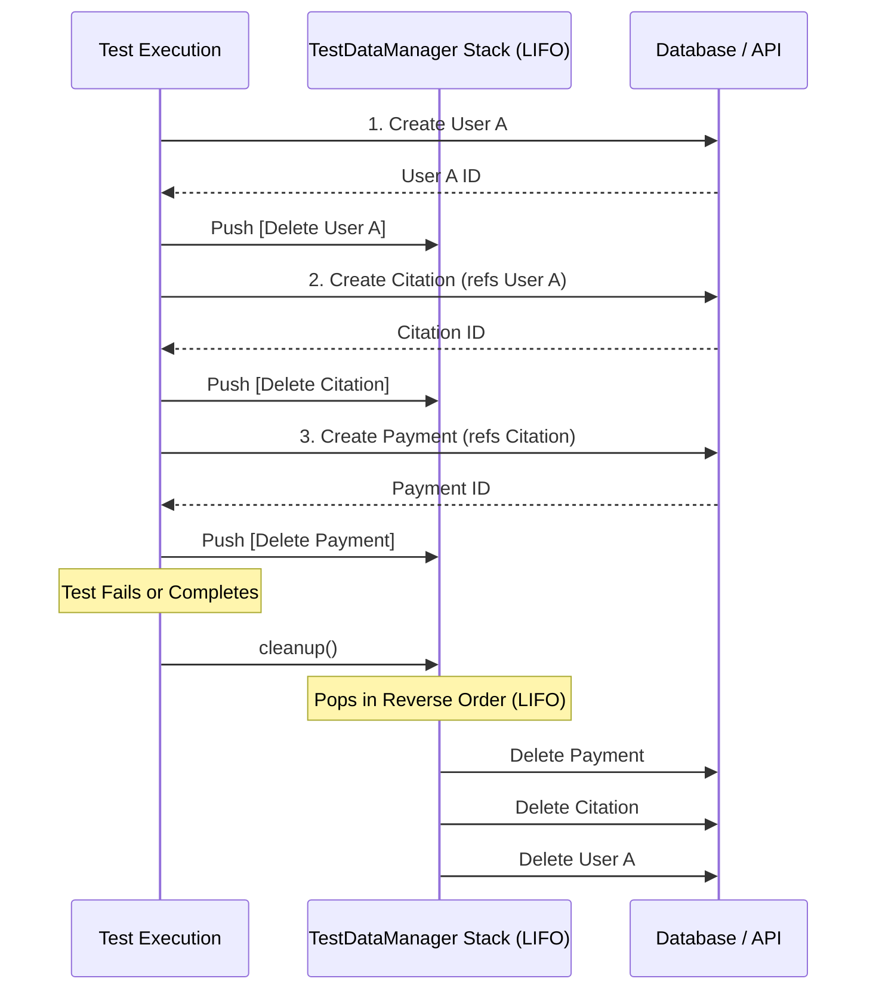
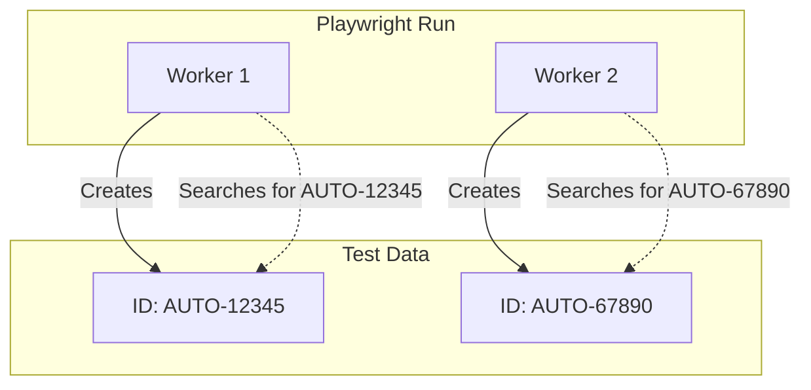

# 28. Test Data Lifecycle — Seeding, Isolation & Guaranteed Cleanup

**Navigation**: [← Chapter 27: Advanced TypeScript Patterns](./27_Advanced_TypeScript_for_SDETs.md) | [Index](../00_INDEX.md)

**Cross-links:**

- [`06_Custom_Fixtures_Architecture.md`](../02_Core_Architecture/06_Custom_Fixtures_Architecture.md) — How fixtures handle teardown
- [`09_Parallel_Execution_Workers.md`](../02_Core_Architecture/09_Parallel_Execution_Workers.md) — Data isolation in parallel
- [`21_Enterprise_Project_Structure.md`](../04_Enterprise_Architecture/21_Enterprise_Project_Structure.md) — Where test data utilities live
- [`26_Flakiness_Diagnosis_and_Fixing.md`](./26_Flakiness_Diagnosis_and_Fixing.md) — Data pollution flakiness
- [`62_Enterprise_Test_Operations.md`](../04_Enterprise_Architecture/62_Enterprise_Test_Operations.md) — test data as a service, golden datasets, environment tiers

---

## 5W1H

- **WHAT**: A complete system for creating, managing, and cleaning up test data so that tests are always independent, always start in a known state, and never pollute each other's data — in local, CI, and parallel execution environments.
- **WHY**: Test data is the #1 source of CI flakiness and test interdependence. Without a strategy, tests that pass alone fail in a suite. Tests that pass today fail tomorrow when someone's test data leaks. This chapter prevents all of that.
- **WHO**: Any SDET writing tests against a real database. Every test that creates data must also clean it up.
- **WHEN**: Before writing your third test. By test 3, you're already sharing a database with test 1 and 2. Without a lifecycle strategy, you have data pollution.
- **HOW**: Unique identifiers, fixture-based teardown, a TestDataManager class, seeding strategies for each use case.

---

## 1. The Five Test Data Strategies

Different situations call for different approaches:

```
STRATEGY 1 — Create via API in fixture, delete in teardown
  When: Data needed for one test only, moderate setup cost
  Example: citation test needs one citation; fixture creates + deletes it
  Speed: medium (API call before + after each test)
  Isolation: perfect

STRATEGY 2 — Create once in worker fixture, share across worker's tests
  When: Expensive-to-create reference data (e.g., a test company, test contract)
  Example: creating a "company" takes 5 API calls; 50 tests read but don't modify it
  Speed: fast (created once per worker)
  Isolation: good (if tests don't modify the shared data)

STRATEGY 3 — Seed via database directly (before test suite)
  When: Bulk reference data that never changes (lookup tables, categories, locations)
  Example: seeding 100 valid postcodes for UK address validation tests
  Speed: very fast (SQL bulk insert)
  Isolation: perfect (read-only data)

STRATEGY 4 — Use globalSetup to seed before all tests
  When: Data that all tests need but shouldn't each create
  Example: a "standard test company" with contracts, users, and settings pre-configured
  Speed: fast (created once per run)
  Isolation: requires all tests to read-only or use their own sub-data

STRATEGY 5 — Synthetic data generated on-the-fly with unique identifiers
  When: Data so cheap to create it needs no teardown (e.g., reads only), or
        when you can't delete test data (prod-readonly environments)
  Example: generate a UUID as a search key, confirm 0 results — no cleanup needed
  Speed: instant
  Isolation: perfect by design (UUID is unique)
```

---

## 2. The Unique Identifier Pattern — Never Reuse Test Data IDs

```typescript
// utils/test-id.utils.ts
// Every piece of test data created by automation must be identifiable as test data
// and unique enough to avoid collision with other tests running in parallel

export const TestId = {
  // Generates: 'AUTO-1716892345678-k7m2x'
  // Format: prefix + timestamp (ms since epoch) + random suffix
  // Why: timestamp makes it sortable/searchable; random suffix prevents collision
  //      if two tests start in the same millisecond
  create(prefix = "AUTO"): string {
    const timestamp = Date.now();
    const random = Math.random().toString(36).slice(2, 7); // 5 random chars
    return `${prefix}-${timestamp}-${random}`;
  },

  // Email version: 'auto-1716892345678-k7m2x@company-test.com'
  createEmail(prefix = "auto"): string {
    return `${TestId.create(prefix).toLowerCase()}@company-test.com`;
  },

  // Plate version: 'AU-16892-K7M2X'
  createPlate(): string {
    const timestamp = Date.now().toString().slice(-5); // last 5 digits
    const random = Math.random().toString(36).slice(2, 7).toUpperCase();
    return `AU-${timestamp}-${random}`;
  },

  // Is this a test-generated ID? (useful for cleanup scripts)
  isTestData(id: string): boolean {
    return id.startsWith("AUTO-") || id.includes("@company-test.com");
  },
};

// Usage:
const email = TestId.createEmail("agent"); // 'agent-1716892345678-k7m2x@company-test.com'
const userId = TestId.create("USR"); // 'USR-1716892345678-k7m2x'
```

---

## 3. The TestDataManager — Your Test-Scoped Registry

### The TestDataManager Stack Visualised



**Why LIFO? (Last-In, First-Out) / FK-Constraint Cleanup Order**
It perfectly handles **Foreign Key (FK) constraints**. If you create a User, then a Citation for that user, the database enforces that you _cannot_ delete the User while the Citation exists. By pushing cleanup tasks to a stack, popping them in reverse order guarantees that children (Citations) are deleted before their parents (Users), naturally respecting database constraints.

```typescript
// utils/TestDataManager.ts
// Tracks everything created by a test and ensures cleanup after it

interface ManagedResource<T = unknown> {
  type: string;
  data: T;
  deleteAsync: () => Promise<void>;
}

export class TestDataManager {
  private resources: ManagedResource[] = [];

  // Register any resource for cleanup
  track<T>(type: string, data: T, deleteAsync: () => Promise<void>): T {
    this.resources.push({ type, data, deleteAsync });
    return data;
  }

  // Cleanup in reverse order (last created = first deleted, respects FK constraints).
  //
  // IMPORTANT: this loop is SEQUENTIAL by design.
  // If you replace it with Promise.all / Promise.allSettled over the reversed list,
  // the whole point of LIFO cleanup is lost — every delete fires at once and the
  // database sees the child and parent deletions racing. FK-constrained rows will
  // fail with "violates foreign key constraint" errors that you cannot reproduce
  // locally on a small dataset.
  async cleanup(): Promise<void> {
    const reversed = [...this.resources].reverse();
    let failures = 0;

    for (const resource of reversed) {
      try {
        await resource.deleteAsync();
        console.log(`[TestDataManager] Cleaned up ${resource.type}`);
      } catch (error) {
        failures++;
        // Swallow — one failed cleanup must not prevent the next one from running.
        // The count and warning below give the test operator visibility.
        console.warn(
          `[TestDataManager] Failed to clean up ${resource.type}:`,
          error,
        );
      }
    }

    if (failures > 0) {
      console.warn(
        `[TestDataManager] ${failures}/${reversed.length} cleanup operations failed. ` +
          "Test data may remain in the database — check the nightly janitor (Ch62 §1.3).",
      );
    }

    this.resources = [];
  }

  // Convenience: register a citation
  trackCitation(
    citation: CitationApiResponse,
    deleteAsync: () => Promise<void>,
  ): CitationApiResponse {
    return this.track("citation", citation, deleteAsync);
  }

  // Convenience: register a user
  trackUser(
    user: UserApiResponse,
    deleteAsync: () => Promise<void>,
  ): UserApiResponse {
    return this.track("user", user, deleteAsync);
  }

  // How many resources are being tracked?
  get size(): number {
    return this.resources.length;
  }
}
```

### Using TestDataManager in a Fixture

```typescript
// fixtures/index.ts — adding testDataManager

export const test = base.extend<{
  testDataManager: TestDataManager;
  citationsClient: CitationsApiClient;
}>({
  testDataManager: async ({}, use) => {
    const manager = new TestDataManager();
    await use(manager);
    // Teardown: clean up all tracked resources after test completes
    // This runs even if the test throws an error
    await manager.cleanup();
  },

  citationsClient: async ({ request, account, testDataManager }, use) => {
    const client = new CitationsApiClient(request, account.accessToken);

    // Wrap the client's create method to auto-register with the manager.
    // Reassign the ONE method directly on the instance — do NOT spread the
    // instance into a new object (see the note below for why that breaks).
    const originalCreate = client.create.bind(client);
    client.create = async (
      payload: CreateCitationPayload,
    ): Promise<CitationApiResponse> => {
      const citation = await originalCreate(payload);
      // Auto-register for cleanup
      testDataManager.trackCitation(citation, () =>
        client.delete(citation.citationId),
      );
      return citation;
    };

    await use(client);
  },
});
```

**Verified, not assumed — the original `{ ...client, create: ... }` pattern silently breaks every OTHER method on the client.** Object spread only copies an instance's OWN enumerable properties; `CitationsApiClient`'s methods (`getById`, `updateStatus`, `delete`, `waitForStatus`) live on `CitationsApiClient.prototype`, not on the instance itself, so spreading strips all of them. Confirmed by running this exact pattern: `managedClient.getById` and `managedClient.delete` both come back `undefined`, and calling either throws `TypeError: managedClient.getById is not a function` — a failure that wouldn't surface until some OTHER test in the suite happened to call `citationsClient.getById(...)`, far from where the real mistake was made. The fix reassigns `create` directly on the instance instead of building a new object — the same pattern [Ch23 §3c](../04_Enterprise_Architecture/23_APIUtils_HTTP_Library.md#3c-error-taxonomy--normalisation) already uses for its token-refresh fixture, verified there to preserve every other prototype method untouched.

### Using It in a Test

```typescript
test("Create 3 citations and verify aggregation", async ({
  citationsClient, // This is the managed client — auto-registers for cleanup
  account,
}) => {
  // All three citations are automatically tracked for cleanup
  const c1 = await citationsClient.create(
    PayloadsCitation.pending({ customerId: account.userId }),
  );
  const c2 = await citationsClient.create(
    PayloadsCitation.paid({ customerId: account.userId }),
  );
  const c3 = await citationsClient.create(
    PayloadsCitation.overdue({ customerId: account.userId }),
  );

  // Your test assertions...
  const summary = await citationsClient.getSummaryByUser(account.userId);
  expect(summary.total).toBeGreaterThanOrEqual(3);
  expect(summary.pending).toBeGreaterThanOrEqual(1);
  expect(summary.paid).toBeGreaterThanOrEqual(1);

  // After the test: testDataManager.cleanup() runs automatically
  // Deletes c3, then c2, then c1 — in reverse order
});
```

---

## 4. Guaranteed Cleanup — The `try/finally` Pattern

Even without a full TestDataManager, always use `try/finally` in fixtures:

```typescript
// Scenario: create a user for the test, delete after

citationWithUser: async ({ request, account }, use) => {
  // Setup
  const user = await usersClient.create(PayloadsUser.newAgent(TestId.createEmail()));
  const citation = await citationsClient.create(
    PayloadsCitation.pending({ customerId: user.userId })
  );

  try {
    // ← Provide both to the test
    await use({ user, citation });
  } finally {
    // ← This block ALWAYS runs — even if the test threw an error
    // Delete in dependency order: citation first (references user), then user
    try {
      await citationsClient.delete(citation.citationId);
    } catch (e) {
      console.warn('Failed to delete test citation:', e);
    }
    try {
      await usersClient.delete(user.userId);
    } catch (e) {
      console.warn('Failed to delete test user:', e);
    }
  }
},
```

**Why `try/finally` inside `try/finally`?**
If `citationsClient.delete` throws, without the inner `try/catch`, the user deletion would never run. Each deletion gets its own error handling — a failure in one cleanup doesn't prevent others.

---

## 5. Data Seeding Strategies in Detail

### Strategy 1: API Fixture (Most Common)

```typescript
// fixtures/citation.fixtures.ts

// Simple: one citation per test
testCitation: async ({ citationsClient, account }, use) => {
  const citation = await citationsClient.create(
    PayloadsCitation.pending({ customerId: account.userId })
  );
  try {
    await use(citation);
  } finally {
    await citationsClient.delete(citation.citationId).catch(console.warn);
  }
},

// Complex: a citation that's already through the payment flow
paidCitation: async ({ citationsClient, account }, use) => {
  // Create PENDING
  const citation = await citationsClient.create(
    PayloadsCitation.pending({ customerId: account.userId })
  );
  // Advance to PAID
  await citationsClient.updateStatus(citation.citationId, { status: 'PAID' });
  // Fetch fresh (status is now PAID)
  const paidCitation = await citationsClient.getById(citation.citationId);
  try {
    await use(paidCitation);
  } finally {
    await citationsClient.delete(citation.citationId).catch(console.warn);
  }
},
```

### Strategy 2: Worker-Scoped Shared Data

```typescript
// Worker-scoped: one company record shared across 10 tests in this worker
sharedTestCompany: [
  async ({ companiesClient }, use) => {
    const company = await companiesClient.create({
      name: TestId.create('COMPANY'),
      type: 'ENTERPRISE',
      region: 'UK',
      // ... 20 other fields — expensive to create
    });
    try {
      await use(company);
    } finally {
      await companiesClient.delete(company.companyId).catch(console.warn);
    }
  },
  { scope: 'worker' }  // Created once per worker, shared by all tests in that worker
],
```

### Strategy 3: Database Seeding Script

```typescript
// scripts/seed-test-db.ts
// Run once before the test suite in CI: npx ts-node scripts/seed-test-db.ts

import { Pool } from "pg"; // or whatever DB driver you use

const db = new Pool({
  connectionString: process.env.TEST_DB_URL,
});

async function seedReferenceData() {
  console.log("Seeding reference data...");

  // Seed lookup tables (these never change during tests — no cleanup needed)
  await db.query(`
    INSERT INTO citation_types (code, description) VALUES
      ('PARKING', 'Parking Violation'),
      ('SPEEDING', 'Speed Camera'),
      ('BUS_LANE', 'Bus Lane Violation'),
      ('NO_PERMIT', 'No Parking Permit')
    ON CONFLICT (code) DO NOTHING;
  `);

  await db.query(`
    INSERT INTO notification_templates (type, channel, subject) VALUES
      ('CITATION_CREATED', 'email', 'Your citation has been issued'),
      ('PAYMENT_RECEIVED', 'email', 'Payment received for your citation'),
      ('DISPUTE_CREATED', 'email', 'Your dispute has been submitted')
    ON CONFLICT (type, channel) DO NOTHING;
  `);

  console.log("Reference data seeded.");
  await db.end();
}

seedReferenceData().catch(console.error);
```

### Strategy 4: Global Setup Seeding

```typescript
// tests/globalSetup.ts — runs once before ALL tests

export default async function globalSetup() {
  console.log("[globalSetup] Starting...");

  // 1. Authenticate and save auth state
  await setupAuthStates();

  // 2. Create shared test company (read by all tests, not modified)
  await seedSharedTestData();

  console.log("[globalSetup] Complete.");
}

async function seedSharedTestData() {
  // Use your API client directly (no Playwright page needed)
  const { default: axios } = await import("axios");
  const token = process.env.ADMIN_ACCESS_TOKEN!;

  const response = await axios.post(
    `${process.env.API_BASE_URL}/api/v1/companies`,
    {
      name: "GLOBAL-TEST-COMPANY", // fixed name — if it already exists, skip
      type: "ENTERPRISE",
    },
    { headers: { Authorization: `Bearer ${token}` } },
  );

  if (response.status === 201) {
    // Save the company ID to a file so all tests can read it
    const { writeFileSync } = await import("fs");
    writeFileSync(
      "test-data/shared-state.json",
      JSON.stringify({ testCompanyId: response.data.companyId }),
    );
  } else if (response.status === 409) {
    console.log(
      "[globalSetup] Test company already exists — skipping creation",
    );
  }
}
```

---

## 6. Cleanup Automation — The Nightly Orphan Sweeper

Sometimes teardown fails (CI killed mid-run, network error). Orphaned test data accumulates. Write a sweeper:

```typescript
// scripts/cleanup-orphaned-test-data.ts
// Schedule nightly in CI: cleanup everything older than 24h tagged as test data

import { citationsApiClient, usersApiClient } from "../clients";

async function sweepOrphanedData() {
  console.log("[Sweeper] Starting orphaned test data cleanup...");
  const cutoff = new Date(Date.now() - 24 * 60 * 60 * 1000).toISOString(); // 24h ago

  // Find all test citations (created by automation, older than 24h)
  const testCitations = await citationsApiClient.search({
    createdBefore: cutoff,
    customerId: undefined, // search all
  });

  const orphaned = testCitations.filter(
    (c) =>
      TestId.isTestData(c.customerId) || c.notes?.includes("automated test"),
  );

  console.log(`[Sweeper] Found ${orphaned.length} orphaned citations`);

  let deleted = 0;
  let failed = 0;
  for (const citation of orphaned) {
    try {
      await citationsApiClient.delete(citation.citationId);
      deleted++;
    } catch (e) {
      failed++;
      console.warn(`[Sweeper] Could not delete ${citation.citationId}:`, e);
    }
  }

  console.log(`[Sweeper] Deleted: ${deleted}, Failed: ${failed}`);
}

sweepOrphanedData().catch(console.error);
```

---

## 7. Data Isolation in Parallel Tests

### Parallel Data Isolation Visualised



When 4 workers run simultaneously, each creating citations for `account.userId`, the results grid can show citations from all 4 workers:

```typescript
// ❌ Problem: search returns ALL test users' citations
await masterSearch.searchPanel.searchByUser(account.userId);
const count = await masterSearch.resultsGrid.rows.count();
expect(count).toBe(1); // Fails: other workers created citations for the same userId
```

**Solution 1 — Search by the specific citation ID (always unique):**

```typescript
await masterSearch.searchPanel.searchByCitationId(data.citationId!);
// data.citationId is unique. Only this test's citation matches.
expect(await masterSearch.resultsGrid.rows.count()).toBe(1);
```

**Solution 2 — Each worker uses its own test account:**

```typescript
// playwright.config.ts — each project uses a different test account
projects: [
  {
    name: 'worker-1-tests',
    use: {
      storageState: 'auth-states/worker-1-state.json',
    },
  },
  // ... workers 2, 3, 4
],
```

**Solution 3 — Tag test data with the worker ID:**

```typescript
account: [
  async ({}, use) => {
    const workerIndex = process.env.PLAYWRIGHT_WORKER_INDEX ?? '0';
    await use({
      accessToken: process.env[`WORKER_${workerIndex}_TOKEN`]!,
      userId: process.env[`WORKER_${workerIndex}_USER_ID`]!,
      // Each worker has its own pre-configured user → completely isolated data
    });
  },
  { scope: 'worker' },
],
```

---

## 8. The Test Data Audit — Monthly Hygiene

Run this query monthly against your test database to understand data health:

```sql
-- How much test data is in the DB right now?
SELECT
  'citations'     AS entity,
  COUNT(*)        AS total_test_records,
  MIN(created_at) AS oldest_record,
  MAX(created_at) AS newest_record
FROM citations
WHERE customer_id LIKE 'AUTO-%'
   OR notes LIKE '%automated test%'

UNION ALL

SELECT
  'users'       AS entity,
  COUNT(*)      AS total_test_records,
  MIN(created_at),
  MAX(created_at)
FROM users
WHERE email LIKE '%@company-test.com'

ORDER BY entity;

-- Are there any orphaned records older than 7 days?
SELECT citation_id, customer_id, created_at
FROM citations
WHERE customer_id LIKE 'AUTO-%'
  AND created_at < NOW() - INTERVAL '7 days'
ORDER BY created_at ASC
LIMIT 20;
```

If you see hundreds of 7-day-old test records: your teardown is broken. Fix the sweeper script.

---

## 🏋️ Practice Challenges

### Challenge 1 [MCQ] — Which Strategy?

Your team is writing tests for a "search by location" feature. The location data (200 UK postcodes with zones) is pre-loaded from a government data file and never changes. Tests only READ this data. Which seeding strategy?

A) Strategy 1: API fixture — create each postcode before the test, delete after  
B) Strategy 2: Worker-scoped fixture — one set of postcodes per worker  
C) Strategy 3: Database seeding script — seed once before the suite, never delete  
D) Strategy 5: Generate on-the-fly with unique IDs

<details><summary>Answer</summary>

**C** — Reference data that never changes and is only read belongs in a seeding script run once before the suite. Creating/deleting 200 postcodes before/after every test (A) is massively wasteful. Worker-scoped (B) is unnecessary if the data never changes. On-the-fly (D) doesn't apply to postal code validation — you need real, valid postcodes, not random UUIDs.

SQL bulk seed: fast, correct, zero runtime overhead per test.

</details>

---

### Challenge 2 [Spot the Bug — Cleanup]

```typescript
citationPair: async ({ citationsClient, account }, use) => {
  const parent = await citationsClient.create(PayloadsCitation.pending({ customerId: account.userId }));
  const linked = await citationsClient.createLinked(parent.citationId);  // creates child that references parent

  await use({ parent, linked });

  // Teardown:
  await citationsClient.delete(parent.citationId);   // ← parent first
  await citationsClient.delete(linked.citationId);   // ← child second
},
```

**What is the bug?**

<details><summary>Answer</summary>

**Wrong deletion order.** `linked` is a child that references `parent` (foreign key). Deleting the parent first while the child still references it causes a database FK constraint violation — the delete fails with a 409 Conflict or 422 error. The child becomes an orphan.

Additionally, if `delete(parent)` throws, `delete(linked)` never runs — the child is never cleaned up.

Fix:

```typescript
try {
  await use({ parent, linked });
} finally {
  // Delete child FIRST, then parent — respect FK constraints
  // Separate try/catch for each so one failure doesn't block the other
  try {
    await citationsClient.delete(linked.citationId); // child first
  } catch (e) {
    console.warn("Failed to delete linked citation:", e);
  }

  try {
    await citationsClient.delete(parent.citationId); // parent second
  } catch (e) {
    console.warn("Failed to delete parent citation:", e);
  }
}
```

</details>

---

### Challenge 3 [Write It Yourself]

Write a `SeedManager` class that:

1. Keeps a typed registry: `Map<string, { id: string; deleteAsync: () => Promise<void> }>`
2. Has `register(type: string, id: string, deleteAsync: () => Promise<void>)` method
3. Has `cleanupAll()` that deletes in reverse registration order, collects all errors, logs them, but doesn't rethrow
4. Has `cleanupByType(type: string)` that deletes only resources of that type

<details><summary>Answer</summary>

```typescript
// utils/SeedManager.ts

interface SeedRecord {
  type: string;
  id: string;
  deleteAsync: () => Promise<void>;
}

export class SeedManager {
  private records: SeedRecord[] = [];

  register(type: string, id: string, deleteAsync: () => Promise<void>): void {
    this.records.push({ type, id, deleteAsync });
    console.log(
      `[SeedManager] Registered ${type}:${id} (total: ${this.records.length})`,
    );
  }

  async cleanupAll(): Promise<void> {
    const toDelete = [...this.records].reverse();
    const errors: string[] = [];

    for (const record of toDelete) {
      try {
        await record.deleteAsync();
        console.log(`[SeedManager] Deleted ${record.type}:${record.id}`);
      } catch (error) {
        const msg = `Failed to delete ${record.type}:${record.id}: ${String(error)}`;
        errors.push(msg);
        console.warn(`[SeedManager] ${msg}`);
      }
    }

    this.records = [];

    if (errors.length > 0) {
      console.warn(
        `[SeedManager] ${errors.length} cleanup failures (see above). Test data may be orphaned.`,
      );
    }
    // Note: we do NOT rethrow — cleanup failures should not mask the test failure
  }

  async cleanupByType(type: string): Promise<void> {
    const matching = this.records.filter((r) => r.type === type).reverse();
    for (const record of matching) {
      try {
        await record.deleteAsync();
        console.log(`[SeedManager] Deleted ${record.type}:${record.id}`);
      } catch (e) {
        console.warn(
          `[SeedManager] Failed to delete ${record.type}:${record.id}:`,
          e,
        );
      }
    }
    this.records = this.records.filter((r) => r.type !== type);
  }

  get registeredCount(): number {
    return this.records.length;
  }
  get types(): string[] {
    return [...new Set(this.records.map((r) => r.type))];
  }
}
```

</details>

---

## Summary — Test Data Lifecycle Rules

| Rule                                                               | Why                                                          |
| ------------------------------------------------------------------ | ------------------------------------------------------------ |
| Every piece of data created by a test must be deleted by that test | Otherwise data accumulates and pollutes other tests          |
| Use `try/finally` in fixtures — never bare cleanup code            | Cleanup must run even when tests fail                        |
| Delete children before parents                                     | Foreign key constraints — wrong order = constraint violation |
| Use unique IDs (`AUTO-timestamp-random`)                           | Parallel workers can't collide on unique data                |
| Tag test data so it's identifiable                                 | Nightly sweeper can find and delete orphaned records         |
| Use strategy-appropriate seeding                                   | Don't create/delete reference data 200 times per test run    |
| Run a monthly audit query                                          | Know how much test data is in the DB at any given time       |

### Challenge 4 [MCQ] — Test Data Isolation Strategy

Your team runs 200 tests in parallel across 4 workers. Each test creates a citation. At the end of the run, some citations aren't deleted because 8 tests failed during teardown. Over 3 months, the staging database accumulates 50,000 orphaned test citations, causing search tests to return thousands of results and become flaky. What is the correct multi-layer defense?

A) Increase the teardown timeout so deletions always complete
B) Implement unique ID prefixing for all test data + a weekly database cleanup job + fixture-level try/catch on teardown
C) Run tests serially so teardown always completes before the next test starts
D) Use a separate staging database for each developer

<details><summary>Answer</summary>

**B** — This requires three independent defenses because any single defense can fail:

**Layer 1 — Unique ID prefixes**: All test-created data uses a prefix like `AUTO-TEST-${Date.now()}`. Orphaned data is identifiable and can be batch-deleted by prefix.

**Layer 2 — Weekly cleanup job**: A scheduled CI job (e.g., Sunday 2am) runs:

```sql
DELETE FROM citations WHERE citation_id LIKE 'AUTO-TEST-%'
  AND created_at < NOW() - INTERVAL '7 days';
```

This removes all test data older than 7 days, regardless of which test created it or whether teardown ran.

**Layer 3 — Fixture try/catch on teardown** (already covered in Ch23 with `ignoreStatuses: [404]`): Ensures teardown failures don't cascade into test failures, and logs which deletions failed so the weekly job can clean them up.

Layer 1 alone fails when the cleanup job isn't set up. Layer 2 alone fails when data doesn't have a queryable prefix. Layer 3 alone fails when tests are abandoned mid-run and no cleanup runs at all. Together they give defense-in-depth.

</details>

---

### Challenge 5 [Spot the Bug — Shared Test Data]

```typescript
// tests/fixtures/index.ts
const SHARED_CITATION_ID = "CIT-FIXTURE-001";

export const test = base.extend<{ sharedCitation: CitationApiResponse }>({
  sharedCitation: async ({ citationsClient }, use) => {
    // Reuse existing citation if it exists, create if not
    let citation: CitationApiResponse;
    try {
      citation = await citationsClient.getById(SHARED_CITATION_ID);
    } catch {
      citation = await citationsClient.create(
        PayloadsCitation.pending({ customerId: "USR-SHARED-001" }),
      );
    }
    await use(citation);
    // No teardown — intentionally shared
  },
});
```

Three problems with this shared fixture approach. Find them all.

<details><summary>Answer</summary>

**Problem 1 — Mutation contamination**: If Test A calls `citationsClient.updateStatus(citation.citationId, { status: 'PAID' })`, the shared citation is now `PAID`. Test B, which expects `PENDING`, fails. Shared mutable state is the root cause of order-dependent flaky tests.

**Problem 2 — Hardcoded `SHARED_CITATION_ID` doesn't exist initially**: The `getById` call throws a 404 on first run. The catch block creates a new citation, but it gets a system-generated ID (e.g., `CIT-00123`), NOT `CIT-FIXTURE-001`. The ID is a fixture constant in the code, but the actual API response has a different ID. On the next test run, `getById('CIT-FIXTURE-001')` throws again — the shared citation is never actually reused.

**Problem 3 — Race condition on parallel workers**: With 4 workers, all 4 simultaneously try `getById(SHARED_CITATION_ID)`. All 4 get 404. All 4 fall into the catch block. All 4 create a citation. Now there are 4 citations, none with `CIT-FIXTURE-001` as the ID. All 4 workers have DIFFERENT citations in `sharedCitation` — the fixture is not actually shared.

The correct pattern: if you need shared read-only data, create it in `globalSetup` (runs once before all workers), write the ID to a file, and read it in the fixture. Or better: don't share mutable test data at all — create fresh data per test.

</details>

---

**Navigation**: [← Chapter 27: Advanced TypeScript Patterns](./27_Advanced_TypeScript_for_SDETs.md) | [Index](../00_INDEX.md)


---

## Reality Check

**"Test data cleanup is optional if tests run in an isolated environment"** → Even in isolated environments (test database per CI run, fresh schema per test), cleanup matters: test data from earlier tests in the same run can interfere with later tests if the earlier test didn't complete its assertions. A failed test that created data but didn't delete it leaves the database in a partial state — the next test in the same run may see that orphaned data and fail. Use `afterEach` or fixture teardown to clean up regardless of test outcome. Idempotent cleanup (try-delete, ignore if already gone) is safer than conditional cleanup.

**"Using the same test user account across all tests is fine"** → Shared test accounts are the #1 cause of test interference. Test A adds items to cart; Test B checks that cart is empty. If both run in parallel (or if A doesn't clean up), Test B fails because of Test A's data. Strategy: unique test data per test run (generate usernames like `testuser_${Date.now()}`), or test isolation via transaction rollback (each test runs in a database transaction that is rolled back — not possible with Playwright's external test target), or API-based setup/teardown per test.

**"Factory functions that create test data don't need cleanup logic"** → Test data factories create data and return it. Without pairing creation with deletion (or a cleanup registry), factories accumulate data. Pattern: a `cleanup` registry that all created resources are added to, with a fixture that deletes them all in teardown. `const { user, cleanup } = await createUser(ctx); test.afterEach(cleanup);`. Alternatively: create data with a unique `testRunId` marker and delete all records with that marker in global teardown. Either way, the creation function must have a corresponding deletion path.

**"API-created test data is faster than UI-created test data"** → API setup is typically 10-50x faster than UI setup. But: API-created data may bypass validation that the application UI would enforce — you might create states via API that the UI would never create. This can make tests less realistic. For critical flows: ensure your API factory creates data in a state that represents real user-created data (either call the same API the UI calls, or call business logic directly). For simple CRUD entities: API setup is correct and fast.

**"Hard-deleting test data is always safe"** → Some applications soft-delete (mark as deleted, keep the record). Hard-deleting bypasses soft-delete and may break: audit trails (the record is missing from history), referential integrity (other records reference the deleted ID), and replication lag (replica may serve the old record for milliseconds). In applications with soft-delete: always use the application's DELETE endpoint (which soft-deletes) for cleanup, not direct database deletion. Direct database cleanup is acceptable only in truly isolated test databases with no replication and no audit requirements.
