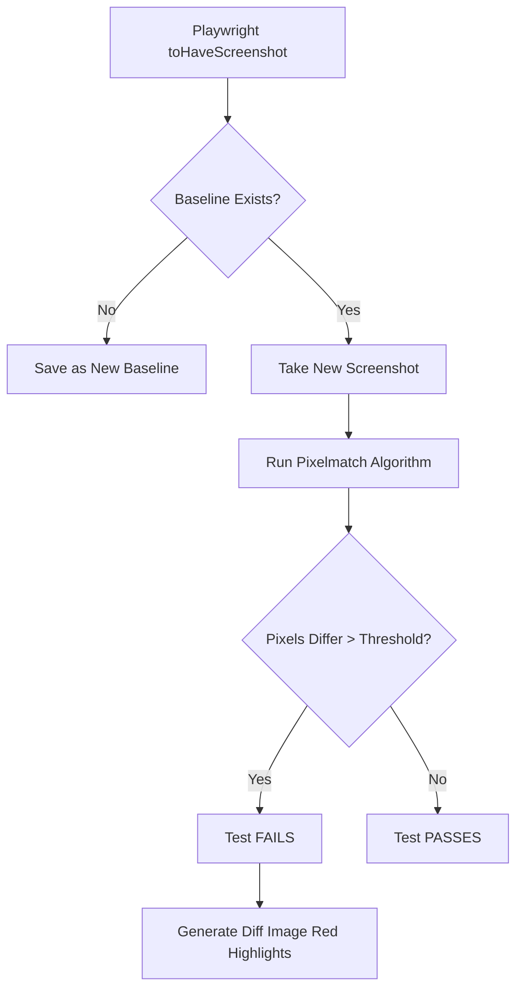

# 29. Visual Regression Testing — `toHaveScreenshot()` in Enterprise Apps

**Navigation**: [← Chapter 28: Test Data Lifecycle](./28_Test_Data_Lifecycle_and_Cleanup.md) | [Index](../00_INDEX.md) | [→ Chapter 30: Database Verification](./30_Database_Verification_Direct_SQL.md)

**Cross-links:**
- [`17_D365_Advanced_Timing_Patterns.md`](../03_D365_And_Patterns/17_D365_Advanced_Timing_Patterns.md) — Wait for stable state before screenshotting
- [`25_CICD_Integration_GitHub_Azure.md`](./25_CICD_Integration_GitHub_Azure.md) — Storing snapshots in CI
- [`26_Flakiness_Diagnosis_and_Fixing.md`](./26_Flakiness_Diagnosis_and_Fixing.md) — Animation flakiness in screenshots

---

## 5W1H

- **WHAT**: Pixel-by-pixel comparison of browser screenshots against approved baseline images — catching unintended UI regressions that functional tests completely miss.
- **WHY**: A functional test verifies that a button *exists* and *clicks*. Visual regression verifies that the button still *looks right* — correct colour, position, size, text, and spacing. In D365 and enterprise portals, unintended CSS changes routinely break UI without breaking any functional assertion.
- **WHO**: SDETs responsible for UI stability. Particularly valuable when a designer or frontend developer makes a "small CSS change" that breaks the entire CRM's data grid layout.
- **WHEN**: After functional coverage is solid. Don't add visual tests before the UI is stable — changing UI invalidates screenshots constantly.
- **HOW**: `expect(page).toHaveScreenshot()` with masking for dynamic content, threshold for minor rendering differences, and baseline management strategy.

---

## 1. How Screenshot Comparison Works — The Internals

### The Comparison Flow Visualised



### The Pixelmatch Algorithm — What Actually Happens

Playwright uses the [pixelmatch](https://github.com/mapbox/pixelmatch) library for comparison. Understanding the algorithm prevents confusion about thresholds:

```
For each pixel at (x, y):
  1. Get RGB values from baseline: (r1, g1, b1)
  2. Get RGB values from new screenshot: (r2, g2, b2)
  3. Convert both to YIQ color space (perceptual color model)
     YIQ weights: Y = 0.299R + 0.587G + 0.114B (human eye sensitivity)
  4. Calculate YIQ delta: abs(Y1 - Y2)
  5. If YIQ delta > threshold (e.g., 0.1):
     → pixel is counted as DIFFERENT
     → diff image shows this pixel in red
  6. Total diffPixels / totalPixels = diffPixelRatio

maxDiffPixelRatio:  0.002 = 0.2% pixels allowed to differ
threshold:          0.1   = color distance per pixel (0 = exact, 1 = anything)
maxDiffPixels:      500   = absolute pixel count alternative

Playwright fails the test if EITHER limit is exceeded.
```

**Why YIQ instead of RGB delta?**
Human vision is most sensitive to brightness (Y channel) and less sensitive to color (I, Q channels). Two pixels that are both "dark blue" might differ significantly in RGB space but look identical to humans. YIQ prevents false failures from sub-pixel rendering differences.

```typescript
// The full threshold parameter set:
await expect(page).toHaveScreenshot('form.png', {
  // Pixel ratio threshold (fraction of total pixels)
  maxDiffPixelRatio: 0.002,       // 0.2% of pixels can differ

  // Absolute pixel count threshold (alternative — use ONE of these two)
  // maxDiffPixels: 50,            // max 50 different pixels

  // Per-pixel color sensitivity (0 = exact match, 1 = any color counts as match)
  threshold: 0.1,                  // 10% brightness difference per pixel

  // Scale factor (for high-DPI/Retina displays)
  // scale: 'css',                 // compare at CSS pixel size (default)
  // scale: 'device',              // compare at device pixel size (2x on Retina)

  // Animation handling
  animations: 'disabled',          // freeze CSS animations before capture

  // Caret handling (text cursor blinking)
  caret: 'hide',                   // hide text cursor (default)
  // caret: 'initial',             // don't modify caret

  // Style tag injected before screenshot (for custom overrides)
  style: `
    * { animation: none !important; transition: none !important; }
    .dynamic-timestamp { visibility: hidden !important; }
  `,
});
```

---

## 2. The Basic `toHaveScreenshot()` Call

```typescript
// tests/specs/visual/citation-form.visual.spec.ts

import { test, expect } from '../../fixtures';
import { CitationDetailPage } from '../../pages/CitationDetailPage';

test.describe('Visual regression @visual @citations', () => {

  test('Citation detail form layout is correct', async ({ page, testCitation }) => {
    const citationDetail = new CitationDetailPage(page);

    // Navigate to the citation
    await citationDetail.goto(testCitation.citationId);

    // Wait for the page to be fully stable BEFORE screenshotting
    // D365: wait for spinners and OData to complete
    await expect(page.locator('.ms-Spinner')).toHaveCount(0, { timeout: 45_000 });
    await expect(citationDetail.citationIdField).toHaveText(testCitation.citationId, { timeout: 30_000 });

    // Take the screenshot and compare to baseline
    await expect(page).toHaveScreenshot('citation-detail-form.png', {
      // Allow up to 0.2% pixel difference (for anti-aliasing, font rendering)
      maxDiffPixelRatio: 0.002,
    });
  });

});
```

**Where is `citation-detail-form.png` stored?**

Playwright creates a `__screenshots__` directory next to your spec file:
```
tests/specs/visual/
├── citation-form.visual.spec.ts
└── citation-form.visual.spec.ts-snapshots/
    ├── citation-detail-form-chromium-linux.png   ← CI baseline (Linux + Chromium)
    ├── citation-detail-form-chromium-darwin.png  ← macOS baseline
    └── citation-detail-form-chromium-win32.png   ← Windows baseline
```

**Why separate baselines per OS?** Font rendering differs between Linux, macOS, and Windows. A snapshot taken on Windows will always fail on Linux if you use the same file.

**Convention:** Use Linux baselines as the CI standard. Generate and update baselines on Linux (or a Linux Docker container) to match CI.

---

## 3. Masking Dynamic Content — The Critical Skill

The biggest challenge in enterprise visual testing: **dynamic content that changes every run**.

```typescript
// D365 Citation Detail — things that CHANGE every run:
// - createdAt timestamp: "05/28/2026 09:13:22"
// - modifiedAt timestamp: "05/28/2026 09:13:45"
// - User avatar / profile picture (might differ per test account)
// - Loading spinners (must wait for them to hide)
// - Breadcrumb with session-specific paths
// - Any auto-generated reference numbers

await expect(page).toHaveScreenshot('citation-detail.png', {
  maxDiffPixelRatio: 0.002,

  // Mask dynamic areas — they're replaced with a solid block in the diff
  mask: [
    // Timestamp fields
    page.locator('[data-automation-key="createdon"]'),
    page.locator('[data-automation-key="modifiedon"]'),

    // User-specific content
    page.locator('.ms-Persona-imageArea'),        // profile pictures
    page.locator('.ms-BreadcrumbItem'),           // breadcrumb (session-specific)

    // Any auto-generated IDs that change per run
    page.locator('[data-automation-key="ticketnumber"]'),
  ],

  // Color of the mask (default: magenta — visible in diff image)
  maskColor: '#FF00FF',
});
```

### Masking a Specific Region (Without a Locator)

```typescript
// When a dynamic element doesn't have a good selector, mask by position
await expect(page).toHaveScreenshot('dashboard.png', {
  clip: {
    // Screenshot only this portion (excludes the dynamic header)
    x: 0,
    y: 120,    // skip the top 120px (header with timestamps/user info)
    width: 1920,
    height: 900,
  },
});
```

### Advanced Mask Strategy — Hide via CSS Injection

When you have many dynamic elements that are hard to locate:

```typescript
// Inject CSS to hide all dynamic content before screenshotting
await page.addStyleTag({
  content: `
    /* Hide all timestamps */
    [data-automation-key="createdon"],
    [data-automation-key="modifiedon"],
    [data-automation-key="overriddencreatedon"] {
      visibility: hidden !important;
    }

    /* Hide user-specific content */
    .ms-Persona-imageArea,
    .ms-Persona-initials {
      filter: blur(10px) !important;
    }

    /* Stabilize any pulsing/animated elements */
    .ms-Spinner,
    [class*="shimmer"],
    [class*="skeleton"] {
      animation: none !important;
      background: #e1e1e1 !important;
    }
  `
});

await expect(page).toHaveScreenshot('form-stable.png', {
  animations: 'disabled',
  maxDiffPixelRatio: 0.001,  // tighter threshold when we control the content
});
```

---

## 4. Component-Level Screenshots (Safer Than Full-Page)

Instead of screenshotting the full page (which catches irrelevant changes), screenshot specific components:

```typescript
test('Search results grid layout', async ({ page, citationsClient, account }) => {
  // Setup: create a known citation so the grid has consistent data
  await citationsClient.create(PayloadsCitation.pending({ customerId: account.userId }));

  await masterSearch.goto();
  await masterSearch.searchPanel.searchByUser(account.userId);
  await masterSearch.resultsGrid.waitForResults();

  // Screenshot ONLY the results grid, not the entire page
  const gridLocator = page.locator('.ms-DetailsList');
  await expect(gridLocator).toHaveScreenshot('search-results-grid.png', {
    maxDiffPixelRatio: 0.001,
    mask: [
      gridLocator.locator('[data-automation-key="createdon"]'),
      gridLocator.locator('[data-automation-key="ticketnumber"]'),
    ],
  });
});

test('Citation status badge - PENDING', async ({ page, testCitation }) => {
  await citationDetail.goto(testCitation.citationId);

  // Only the status badge — tiny, stable, meaningful
  const badge = page.locator('.citation-status-badge');
  await expect(badge).toBeVisible();
  await expect(badge).toHaveScreenshot('status-badge-pending.png');
});
```

### What to Screenshot at Component Level

```typescript
// ✅ Good component targets — isolated, meaningful, stable:
await expect(page.locator('.status-badge')).toHaveScreenshot('status-pending.png');
await expect(page.locator('.payment-summary-card')).toHaveScreenshot('payment-summary.png');
await expect(page.locator('.error-notification')).toHaveScreenshot('error-state.png');
await expect(page.locator('.ms-DetailsList')).toHaveScreenshot('data-grid.png');
await expect(page.locator('nav[aria-label="Main navigation"]')).toHaveScreenshot('nav.png');

// ❌ Bad targets — too large, too many dynamic parts:
await expect(page).toHaveScreenshot('full-page.png');  // catches everything including irrelevant
await expect(page.locator('body')).toHaveScreenshot('body.png');  // same problem
```

---

## 5. Threshold Configuration in `playwright.config.ts`

```typescript
export default defineConfig({
  // ...
  expect: {
    toHaveScreenshot: {
      // Global defaults — override per-test as needed
      maxDiffPixelRatio: 0.002,     // 0.2% pixel difference allowed globally
      threshold: 0.2,               // Per-pixel colour difference threshold (0-1)
      animations: 'disabled',       // Disable CSS animations before screenshotting (key!)
    },
  },
  // ...
});
```

**Why `animations: 'disabled'`?** CSS animations (fade-ins, slide-ins, spinners) make screenshots non-deterministic. Playwright freezes all CSS animations before capturing when this is set.

### Threshold Tuning Guide

```
maxDiffPixelRatio: 0.0001  → Extremely strict (exact match minus 0.01%)
                             Use for: tiny status badges, icon-only components
                             Risk: flaky on any font rendering difference

maxDiffPixelRatio: 0.002   → Standard enterprise threshold (0.2%)
                             Use for: most form components, data grids
                             Covers: sub-pixel anti-aliasing, minor font hinting

maxDiffPixelRatio: 0.01    → Loose (1% difference allowed)
                             Use for: complex pages with many text elements
                             Risk: might miss real regressions in text-heavy areas

threshold: 0.1             → 10% color distance per pixel
                             Good balance: catches real color changes, ignores sub-pixel noise

threshold: 0.3             → Very loose per-pixel comparison
                             Use for: pages with gradients, shadow effects
                             Risk: might miss subtle color changes
```

---

## 6. D365-Specific Visual Testing Challenges

D365's Fluent UI has several visual testing pitfalls:

```typescript
// Challenge 1: Command Bar is user-role-dependent
// Different roles see different buttons → screenshot differs per account
// Solution: mask the entire command bar
await expect(page).toHaveScreenshot('d365-form.png', {
  mask: [
    page.locator('.ms-CommandBar'),  // entire command bar
    page.locator('.ms-CommandBar-overflowMenu'),
  ],
});

// Challenge 2: Fluent UI Tooltips appear on hover
// Solution: move mouse away from interactive elements before screenshotting
await page.mouse.move(0, 0);  // move to top-left corner
await page.waitForTimeout(300);  // wait for tooltip to hide
await expect(page).toHaveScreenshot('d365-grid.png');

// Challenge 3: Focus rings (accessibility outlines) show when keyboard-navigating
// Solution: ensure mouse is used for navigation (not keyboard) in visual tests
// Or: add CSS to hide focus rings for visual tests
await page.addStyleTag({
  content: '*:focus { outline: none !important; }'
});
// ⚠ Only in visual tests — never in functional tests (breaks accessibility)

// Challenge 4: D365 Two-Phase Render — shell loads, then data loads
// Solution: wait for actual data, not just DOM ready
await expect(page.locator('[data-id="citation_status"] .ms-TextField-field'))
  .not.toHaveText('', { timeout: 30_000 });  // wait for non-empty field
// THEN screenshot

// Challenge 5: Fluent UI panel animations (slide-in/slide-out)
// Even with animations: 'disabled', Fluent UI uses requestAnimationFrame
// Solution: wait for panel to fully open before screenshotting
await expect(page.locator('[data-id="editDialog"][aria-hidden="false"]'))
  .toBeVisible({ timeout: 10_000 });
await page.waitForFunction(() => {
  const panel = document.querySelector('.ms-Panel-main');
  if (!panel) return false;
  const transform = window.getComputedStyle(panel).transform;
  return transform === 'none' || transform === 'matrix(1, 0, 0, 1, 0, 0)';
});
// THEN screenshot
```

---

## 7. Snapshot Naming Strategy

```typescript
// Bad: vague names
await expect(page).toHaveScreenshot('test.png');
await expect(page).toHaveScreenshot('screenshot1.png');

// Good: descriptive, context-specific names
await expect(page).toHaveScreenshot('citation-detail-pending-status.png');
await expect(badge).toHaveScreenshot('status-badge-overdue-warning.png');
await expect(grid).toHaveScreenshot('search-results-3-citations.png');

// Pattern: [component]-[state]-[variant].png
// Examples:
//   payment-form-empty.png
//   payment-form-validation-errors.png
//   payment-form-processing.png
//   payment-form-success.png
//   nav-admin-role.png
//   nav-customer-role.png
//   nav-supervisor-role.png
```

### Viewport Standardization

```typescript
// playwright.config.ts — fix viewport so screenshots are consistent
export default defineConfig({
  use: {
    viewport: { width: 1920, height: 1080 },  // standard enterprise desktop
    // All screenshots taken at this size
  },

  // For responsive testing, create separate projects:
  projects: [
    {
      name: 'visual-desktop',
      use: { viewport: { width: 1920, height: 1080 } },
      testMatch: '**/*.visual.spec.ts',
    },
    {
      name: 'visual-laptop',
      use: { viewport: { width: 1366, height: 768 } },
      testMatch: '**/*.visual.spec.ts',
    },
  ],
});
```

---

## 8. The Visual Test Fixture — Reusable Stability Helper

```typescript
// fixtures/visual.fixture.ts

import { test as base, expect } from '@playwright/test';
import type { Page, Locator } from '@playwright/test';

interface VisualFixtures {
  /**
   * Takes a stable screenshot of a page or component.
   * Automatically: moves mouse away, waits for spinners, disables animations.
   */
  screenshotStable: (
    target: Page | Locator,
    name: string,
    options?: {
      mask?:              Locator[];
      maxDiffPixelRatio?: number;
      waitForSelector?:   string;   // wait for this to be visible before screenshotting
    }
  ) => Promise<void>;
}

export const test = base.extend<VisualFixtures>({
  screenshotStable: async ({ page }, use) => {
    const helper = async (
      target: Page | Locator,
      name:   string,
      options: {
        mask?:              Locator[];
        maxDiffPixelRatio?: number;
        waitForSelector?:   string;
      } = {}
    ): Promise<void> => {
      // 1. Wait for D365 spinners to disappear
      await expect(page.locator('.ms-Spinner')).toHaveCount(0, { timeout: 30_000 });
      await expect(page.locator('[class*="shimmer"]')).toHaveCount(0, { timeout: 15_000 });

      // 2. Wait for custom content selector if specified
      if (options.waitForSelector) {
        await expect(page.locator(options.waitForSelector)).toBeVisible({ timeout: 20_000 });
      }

      // 3. Move mouse to safe position (avoid hover states and tooltips)
      await page.mouse.move(5, 5);  // top-left, out of the way
      await page.waitForTimeout(150);  // let tooltip fade out

      // 4. Inject stability CSS
      await page.addStyleTag({
        content: `
          * { animation: none !important; transition: none !important; }
          .ms-Spinner { display: none !important; }
          [class*="shimmer"] { animation: none !important; background: #f0f0f0 !important; }
        `
      });

      // 5. Take the screenshot
      await expect(target).toHaveScreenshot(name, {
        animations:        'disabled',
        caret:             'hide',
        maxDiffPixelRatio: options.maxDiffPixelRatio ?? 0.002,
        mask:              options.mask ?? [],
      });
    };

    await use(helper);
  },
});

// Usage in tests:
test('Citation form stable screenshot', async ({ page, screenshotStable, testCitation }) => {
  await page.goto(`/citations/${testCitation.citationId}`);

  await screenshotStable(page.locator('.citation-form'), 'citation-form-stable.png', {
    mask: [
      page.locator('[data-automation-key="createdon"]'),
      page.locator('[data-automation-key="modifiedon"]'),
    ],
    waitForSelector: '[data-testid="citation-status"]',
  });
});
```

---

## 9. Updating Baselines — The Team Workflow

```bash
# 1. Developer makes a legitimate UI change
# 2. Visual tests fail in CI (expected — baseline is stale)
# 3. SDET reviews the diff images in the Playwright HTML report
# 4. Confirms the change is intentional
# 5. Updates baselines locally:
npx playwright test --update-snapshots --grep "@visual"

# 6. Reviews all updated .png files in git diff
git diff --stat  # shows which baselines changed
# Expected: only the files related to the intentional change

# 7. If more files changed than expected → investigate (something else changed)
# 8. Commits the updated baselines
git add tests/**/*-snapshots/*.png
git commit -m "Visual baselines: update citation form layout (TICKET-1234)"

# 9. CI re-runs → visual tests pass with new baselines
```

**The baseline review step is critical.** Blindly running `--update-snapshots` is the same as disabling the visual tests. Always look at the diff images before accepting.

### The Golden Rule: Baselines Live in Git

```
❌ Bad: .gitignore contains *.png (baselines not tracked)
  → Every CI run generates its own baselines → visual tests never actually compare

✅ Good: *.png files IN the snapshot directories are committed
❌ Bad: ALL *.png files committed (test artifacts too)

# .gitignore — include snapshots, exclude test artifacts
test-results/**/*.png    ← IGNORE (generated diff images)
playwright-report/**     ← IGNORE (HTML report)
# DO NOT IGNORE tests/**/*-snapshots/*.png ← these are the baselines
```

---

## 10. CI Integration — Linux-Only Baselines

```yaml
# .github/workflows/playwright.yml (visual tests section)

visual-tests:
  runs-on: ubuntu-latest   # ← MUST match the OS used to generate baselines
  steps:
    - uses: actions/checkout@v4
    - uses: actions/setup-node@v4
      with:
        node-version: '20'
        cache: 'npm'
    - run: npm ci
    - run: npx playwright install chromium --with-deps

    - name: Run visual regression tests
      run: npx playwright test --grep "@visual" --reporter=html
      env:
        CI: true

    - name: Upload visual diff report (always — check failures)
      uses: actions/upload-artifact@v4
      if: always()
      with:
        name: visual-regression-report
        path: |
          playwright-report/
          test-results/          # ← contains the diff .png files
        retention-days: 30
```

### Generating Linux Baselines from Windows (the Docker approach)

```bash
# When your team uses Windows locally but CI is Linux:
# Run baseline generation in a Docker container matching CI

docker run --rm \
  -v "$(pwd):/work" \
  -w /work \
  mcr.microsoft.com/playwright:v1.44.0-jammy \
  npx playwright test --update-snapshots --grep "@visual"

# Now the baselines in tests/**/*-snapshots/ are Linux-generated
# Commit these and CI will pass
```

---

## 11. Real-World War Story: The CSS Variable Incident

**Situation**: A designer changes `--primary-color: #0078d4` to `--primary-color: #0079d3` — a 1-digit hex difference. 40 visual tests fail in CI. The designer insists "it's the same blue."

**The diagnosis**:
```
pixelmatch found 2,847 pixels different in citation-detail-form.png
YIQ delta: 0.12 (above 0.1 threshold)
Affected area: all primary buttons, command bar, highlighted rows
```

**Why it matters**: The change was intentional for the new brand style guide. But it affected 40 baseline images — which means 40 forms, 40 grids, 40 buttons.

**The lesson**:
```typescript
// ✅ Isolate color from layout — screenshot components separately
// If color changes, only badge/button screenshots need updating
// Layout screenshots (grid structure, form layout) are unaffected

// Instead of: one full-page screenshot that includes both layout AND color
// Use:
await expect(page.locator('.citation-form-layout')).toHaveScreenshot('form-layout.png');
// → Tests layout positioning (column widths, row heights, spacing)

await expect(page.locator('.status-badge')).toHaveScreenshot('status-badge-color.png');
// → Tests color appearance

// When CSS variable changes → only color screenshots need updating
// Layout screenshots stay the same → fewer false positives
```

---

## 12. Visual Tests vs Functional Tests — When to Use Each

```
FUNCTIONAL TEST:                          VISUAL REGRESSION TEST:
"The Save button exists"                  "The Save button is 32px tall, blue,
"Clicking Save shows success message"      in the top-right corner of the form"
"The status field says PENDING"           "The PENDING status badge has the
                                           correct yellow color and padding"

USE FUNCTIONAL TESTS FOR:                USE VISUAL TESTS FOR:
- Business logic verification            - Layout regression (spacing breaks)
- API response validation                - Color/brand changes
- Data correctness                       - CSS regression from framework updates
- User workflow testing                  - Component visual states (hover, focus, disabled)
- Error handling                         - Responsive breakpoints
- Permissions/access control             - Print stylesheet verification
                                         - Dark mode vs light mode
```

**The 80/20 rule for visual tests:**
- 80% of your testing budget: functional tests
- 20%: visual regression on critical, stable UI components (navigation, forms, status badges, data grids)
- 0%: visual tests on unstable, frequently-changing UI

---

## 🏋️ Practice Challenges

### Challenge 1 [MCQ] — Why Separate OS Baselines?

Why does Playwright store separate screenshots per OS (e.g., `screenshot-chromium-linux.png`, `screenshot-chromium-win32.png`)?

A) Each OS has different screen resolutions
B) Font rendering, sub-pixel anti-aliasing, and default system font metrics differ between Linux, macOS, and Windows — the same page looks subtly different
C) Playwright uses different Chromium versions per OS
D) CI runs on Linux; local runs on Windows — tests would always fail

<details><summary>Answer</summary>

**B** — OS-level font rendering is different. Linux uses FreeType, macOS uses CoreText, Windows uses DirectWrite. Even with the same font file, the rendered pixels differ slightly — enough to fail a pixel-perfect comparison. Playwright solves this by maintaining separate baseline files per OS. In practice, use Linux as the CI baseline standard and run `--update-snapshots` on Linux (or Docker) to generate/update baselines.
</details>

---

### Challenge 2 [MCQ] — Animations Flag

Your visual tests are failing intermittently because a CSS slide-in animation sometimes captures mid-animation. Which TWO approaches fix this correctly?

A) Add `await page.waitForTimeout(2000)` before every screenshot
B) Set `animations: 'disabled'` in playwright.config.ts `toHaveScreenshot` defaults
C) Use `page.addStyleTag({ content: '* { animation-duration: 0s !important; }' })`
D) Screenshot a component instead of the full page
E) Increase `maxDiffPixelRatio` to 0.05

<details><summary>Answer</summary>

**B and C** are correct.

**B** — `animations: 'disabled'` tells Playwright to freeze CSS animations before capturing. This is the official solution and should be in your global config.

**C** — Injecting `animation-duration: 0s` via CSS is a belt-and-suspenders approach that works for animations Playwright's built-in freezing might miss (e.g., animations triggered by JavaScript, not CSS transitions).

**A** is the anti-pattern (waitForTimeout is never the answer). **D** helps with scope but doesn't fix the animation problem. **E** loosens the threshold but masks the real problem.
</details>

---

### Challenge 3 [Write It Yourself]

Write a `screenshotComponent` helper that:
1. Waits for a locator to be stable (no animation, no layout shift)
2. Moves the mouse away (avoids hover states)
3. Takes a component-level screenshot with dynamic elements masked

<details><summary>Answer</summary>

```typescript
// utils/visual.utils.ts

import { type Locator, type Page, expect } from '@playwright/test';

interface ScreenshotOptions {
  name:               string;
  maskLocators?:      Locator[];
  maxDiffPixelRatio?: number;
  stabilizeWaitMs?:   number;  // extra wait after mouse move (default: 150ms)
}

export async function screenshotComponent(
  page:      Page,
  component: Locator,
  options:   ScreenshotOptions
): Promise<void> {
  // 1. Ensure the component is visible and stable
  await expect(component).toBeVisible({ timeout: 15_000 });

  // 2. Wait for D365 spinners to settle
  await expect(page.locator('.ms-Spinner')).toHaveCount(0, { timeout: 15_000 });

  // 3. Move mouse away to avoid hover states and tooltips
  await page.mouse.move(0, 0);
  await page.waitForTimeout(options.stabilizeWaitMs ?? 150);

  // 4. Inject animation-killer CSS
  await page.addStyleTag({
    content: `* { animation: none !important; transition: none !important; }`
  });

  // 5. Take the screenshot
  await expect(component).toHaveScreenshot(options.name, {
    maxDiffPixelRatio: options.maxDiffPixelRatio ?? 0.002,
    mask:              options.maskLocators ?? [],
    animations:        'disabled',
    caret:             'hide',
  });
}

// Usage:
await screenshotComponent(page, page.locator('.citation-form'), {
  name: 'citation-form.png',
  maskLocators: [
    page.locator('[data-automation-key="createdon"]'),
    page.locator('.ms-Persona-imageArea'),
  ],
});
```
</details>

---

### Challenge 4 [Spot the Bug]

What is wrong with this visual test?

```typescript
test('Citation status badge', async ({ page }) => {
  await page.goto('/citations/CIT-001');
  await expect(page.locator('.status-badge')).toHaveScreenshot('badge.png');
});
```

<details><summary>Answer — 4 issues</summary>

**Issue 1: Hardcoded citation ID**
`CIT-001` must exist in the test environment. If it doesn't, the test fails. If another test modified it, the visual state is wrong. Fix: use a fixture that creates a citation with a known status.

**Issue 2: No wait for page stability**
The screenshot is taken immediately after `goto()`. In D365, the page does a two-phase render — the status badge might be empty when the screenshot fires. Fix: `await expect(page.locator('.status-badge')).not.toHaveText('', { timeout: 30_000 })` before screenshotting.

**Issue 3: No spinner wait**
D365 Fluent UI shows `.ms-Spinner` during data loading. If it's visible when the screenshot fires, the baseline will include it. Fix: `await expect(page.locator('.ms-Spinner')).toHaveCount(0)`.

**Issue 4: No animation handling**
If the badge has a fade-in animation, the screenshot might capture it mid-animation. Fix: add `animations: 'disabled'` or inject `* { animation: none !important; }`.

**Fixed version:**
```typescript
test('Citation status badge shows PENDING correctly', async ({ page, citationsClient, account }) => {
  const citation = await citationsClient.create(PayloadsCitation.pending({ customerId: account.userId }));
  await page.goto(`/citations/${citation.citationId}`);

  await expect(page.locator('.ms-Spinner')).toHaveCount(0, { timeout: 30_000 });
  await expect(page.locator('.status-badge')).not.toHaveText('', { timeout: 20_000 });
  await page.mouse.move(0, 0);

  await expect(page.locator('.status-badge')).toHaveScreenshot('status-badge-pending.png', {
    animations: 'disabled',
    maxDiffPixelRatio: 0.001,
  });
});
```
</details>

---

### Challenge 5 [MCQ] — Screenshot Baseline Update Strategy

Your team ships a UI redesign that changes the primary color scheme (blue to green) across 47 components. 312 visual regression tests fail with pixel differences. How should you handle the baseline updates?

A) Delete all `.png` baselines and re-run tests — they will auto-regenerate
B) Run `npx playwright test --update-snapshots` on the CI machine that generates the official baselines, review the diff report, get design approval on the changes, then commit the new baselines
C) Manually inspect each of the 312 screenshots and approve individually
D) Increase the pixel threshold to 20% to ignore the color changes

<details><summary>Answer</summary>

**B** — The correct process has four required steps:

**Step 1 — Use the official CI environment to regenerate**: Run `--update-snapshots` on the same OS and browser version that the CI pipeline uses. Baselines generated on Windows Chrome 120 will produce false positives when compared on Linux Chrome 120 due to sub-pixel rendering differences. The baseline must be generated in the canonical environment.

**Step 2 — Review the diff report**: Playwright's HTML report shows side-by-side before/after for every changed screenshot. The SDET lead reviews: are ALL 312 changes expected (color only), or did some test catch an unintended layout regression?

**Step 3 — Design team approval**: Visual regression baselines are design artifacts. The design team signs off that the new screenshots match the intended redesign. This step is often skipped and causes "approved" screenshots to contain bugs.

**Step 4 — Commit as a separate PR**: The baseline update PR is separate from the feature PR. Code reviewers can diff the PNG files (GitHub renders visual diffs for images). This gives full audit trail: who approved which visual change and when.

Option A skips review entirely — you'll auto-approve regressions you didn't intend. Option D is the worst choice: a 20% threshold would pass a button that's the wrong size, not just the wrong color.

</details>

---
**Navigation**: [← Chapter 28: Test Data Lifecycle](./28_Test_Data_Lifecycle_and_Cleanup.md) | [Index](../00_INDEX.md) | [→ Chapter 30: Database Verification](./30_Database_Verification_Direct_SQL.md)
