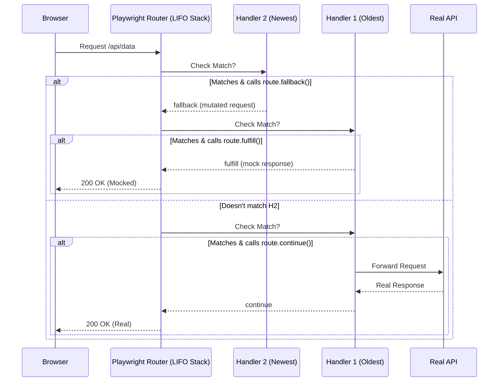

# 31. API Mocking with `page.route()` — Isolating Frontend Behaviour

**Navigation**: [← Chapter 30: Database Verification](./30_Database_Verification_Direct_SQL.md) | [Index](../00_INDEX.md) | [→ Chapter 32: SDET Interview Prep](../06_SDET_to_SDE_Bridge/32_SDET_Interview_Prep.md)

**Cross-links:**

- [`08_Browser_Internals_for_SDETs.md`](../02_Core_Architecture/08_Browser_Internals_for_SDETs.md) — Network layer in the browser
- [`15_CrossSite_Pattern5_UI_API_Side_Effects.md`](../03_D365_And_Patterns/15_CrossSite_Pattern5_UI_API_Side_Effects.md) — Network interception for side-effect verification
- [`26_Flakiness_Diagnosis_and_Fixing.md`](./26_Flakiness_Diagnosis_and_Fixing.md) — Mocking to remove third-party flakiness

---

## 5W1H

- **WHAT**: Intercepting browser network requests and returning controlled mock responses — without touching the real backend. The frontend believes it's talking to the server; it's actually talking to your test code.
- **WHY**: Three critical use cases: (1) Test how the UI behaves when the API returns an error — you can't make the real API return 500 on demand. (2) Remove flakiness caused by slow/unreliable third-party services. (3) Test edge cases (empty states, maximum limits, malformed responses) without complex backend setup.
- **WHO**: SDETs testing frontend behaviour in isolation. When you want to test the UI's error handling, empty state, or loading state — without a real backend.
- **WHEN**: For frontend-focused tests. NOT for integration tests where the real API integration matters. Don't mock what you're trying to test.
- **HOW**: `page.route(pattern, handler)` intercepts matching requests. You control the response: status, headers, body, or delay.

---

## 1. The Core `page.route()` API

```typescript
// Basic structure:
await page.route(
  urlPattern, // string, regex, or predicate function
  handler, // async (route, request) => { route.fulfill(...) | route.abort() | route.continue() }
);

// Three handler options:
// route.fulfill()   → return a mock response (intercept the request)
// route.abort()     → simulate network failure (connection refused)
// route.continue()  → let the request go through to the real server (passthrough)
// route.fallback()  → try the real server, use mock only if it fails
```

---

## 2. The Four Core Mocking Scenarios

### Scenario A: Mock a Successful Response

```typescript
// Test: the UI correctly shows a citation's details

test("Citation detail shows correct data from API", async ({ page }) => {
  // Mock BEFORE navigating — route must be registered before the request fires
  await page.route("**/api/v2/citations/CIT-TEST-001", async (route) => {
    await route.fulfill({
      status: 200,
      contentType: "application/json",
      body: JSON.stringify({
        citationId: "CIT-TEST-001",
        customerId: "USR-001",
        status: "PAID",
        amount: 150.0,
        citationType: "PARKING",
        issueDate: "2026-01-15",
        // Note: data is CONTROLLED — no DB dependency, no API dependency
      }),
    });
  });

  await page.goto("/citations/CIT-TEST-001");

  // Now we're testing the UI's rendering of the data — not the API itself
  await expect(page.locator('[data-testid="citation-status"]')).toHaveText(
    "PAID",
  );
  await expect(page.locator('[data-testid="citation-amount"]')).toHaveText(
    "£150.00",
  );
});
```

### Scenario B: Mock an Error State — Testing Error Handling UI

```typescript
// The REAL API might never return 500 in testing — mocking lets you test error UI

test("Citation detail shows error message when API returns 500", async ({
  page,
}) => {
  await page.route("**/api/v2/citations/**", async (route) => {
    await route.fulfill({
      status: 500,
      contentType: "application/json",
      body: JSON.stringify({
        error: "Internal Server Error",
        message: "Database connection failed",
      }),
    });
  });

  await page.goto("/citations/CIT-001");

  // Verify the UI handles the error gracefully — no blank screen, no crash
  await expect(page.locator('[data-testid="error-banner"]')).toBeVisible({
    timeout: 10_000,
  });
  await expect(page.locator('[data-testid="error-banner"]')).toContainText(
    "Something went wrong",
  );
  // Verify no unhandled JS errors:
  const errorMessages: string[] = [];
  page.on("pageerror", (err) => errorMessages.push(err.message));
  expect(errorMessages).toHaveLength(0);
});

// Other critical error states to test:
const errorScenarios = [
  { status: 401, name: "unauthorized", expectedText: "Please log in again" },
  {
    status: 403,
    name: "forbidden",
    expectedText: "You do not have permission",
  },
  { status: 404, name: "not-found", expectedText: "Citation not found" },
  { status: 429, name: "rate-limited", expectedText: "Too many requests" },
  {
    status: 503,
    name: "unavailable",
    expectedText: "Service temporarily unavailable",
  },
];

for (const scenario of errorScenarios) {
  test(`UI shows correct message for ${scenario.status} ${scenario.name}`, async ({
    page,
  }) => {
    await page.route("**/api/v2/citations/**", async (route) => {
      await route.fulfill({
        status: scenario.status,
        contentType: "application/json",
        body: JSON.stringify({ error: scenario.name }),
      });
    });

    await page.goto("/citations/CIT-001");
    await expect(page.locator('[data-testid="error-banner"]')).toContainText(
      scenario.expectedText,
    );
  });
}
```

### Scenario C: Mock Network Failure / Timeout

```typescript
// Test: UI shows a timeout message when the API is unreachable

test("UI shows timeout message when API does not respond", async ({ page }) => {
  await page.route("**/api/v2/citations/**", async (route) => {
    // Simulate network error (connection refused)
    await route.abort("connectionrefused");
    // Other abort reasons: 'failed', 'timedout', 'accessdenied', 'addressunreachable'
  });

  await page.goto("/citations/CIT-001");
  await expect(page.locator('[data-testid="network-error"]')).toBeVisible({
    timeout: 15_000,
  });
  await expect(page.locator('[data-testid="retry-button"]')).toBeVisible();
});

// Test: UI shows loading state during slow API response
test("Loading spinner shows during slow API call", async ({ page }) => {
  await page.route("**/api/v2/citations/**", async (route) => {
    // Delay the response by 3 seconds
    await new Promise((resolve) => setTimeout(resolve, 3000));
    await route.fulfill({
      status: 200,
      body: JSON.stringify({ citationId: "CIT-001", status: "PENDING" }),
    });
  });

  await page.goto("/citations/CIT-001");

  // During the 3s delay, the loading spinner should be visible
  await expect(page.locator('[data-testid="loading-spinner"]')).toBeVisible();

  // After the response arrives, spinner should hide
  await expect(page.locator('[data-testid="loading-spinner"]')).toBeHidden({
    timeout: 10_000,
  });
  await expect(page.locator('[data-testid="citation-status"]')).toBeVisible();
});
```

### Scenario D: Mock Empty and Edge Case States

```typescript
// Test empty states — the real DB might always have test data

test("Citations list shows empty state when no citations exist", async ({
  page,
}) => {
  await page.route("**/api/v2/citations?userId=**", async (route) => {
    await route.fulfill({
      status: 200,
      body: JSON.stringify({
        data: [],
        pagination: { total: 0, page: 1, pageSize: 20, totalPages: 0 },
      }),
    });
  });

  await page.goto("/citations");
  await expect(page.locator('[data-testid="empty-state"]')).toBeVisible();
  await expect(page.locator('[data-testid="empty-state"]')).toContainText(
    "No citations found",
  );
  // Verify the "Create Citation" button is shown in the empty state:
  await expect(
    page.locator('[data-testid="create-first-citation"]'),
  ).toBeVisible();
});

// Test maximum data — the UI pagination works at scale
test("Citations list handles maximum page size (1000 items)", async ({
  page,
}) => {
  const oneThousandCitations = Array.from({ length: 1000 }, (_, i) => ({
    citationId: `CIT-${String(i).padStart(6, "0")}`,
    status: i % 3 === 0 ? "PAID" : "PENDING",
    amount: 150 + i,
  }));

  await page.route("**/api/v2/citations**", async (route) => {
    await route.fulfill({
      status: 200,
      body: JSON.stringify({
        data: oneThousandCitations,
        pagination: { total: 1000, page: 1, pageSize: 1000, totalPages: 1 },
      }),
    });
  });

  await page.goto("/citations");
  // UI should render without hanging or crashing
  await expect(page.locator('[data-testid="citations-count"]')).toHaveText(
    "1,000 citations",
  );
});
```

---

## 3. URL Pattern Matching

```typescript
// String with glob wildcard:
await page.route("**/api/v2/citations/**", handler);
// Matches: https://api.company.com/api/v2/citations/CIT-001
//          https://api.company.com/api/v2/citations/CIT-002?include=notifications
//          https://staging-api.company.com/api/v2/citations/search

// Regex — more precise:
await page.route(/\/api\/v2\/citations\/CIT-\d+$/, handler);
// Matches: /api/v2/citations/CIT-001
// Does NOT match: /api/v2/citations/search  (no ID at the end)

// Predicate function — most control:
await page.route(
  (url) =>
    url.pathname.startsWith("/api/v2/citations") &&
    url.searchParams.has("userId"),
  handler,
);
// Matches only requests with a userId query parameter
```

### Route Priority and Order — How Playwright Picks the Handler

When multiple `page.route()` calls match the same URL, the LAST registered handler wins:

```typescript
// Handler 1: catch-all mock
await page.route("**/api/**", (route) => route.fulfill({ status: 500 }));

// Handler 2: specific override (registered AFTER handler 1)
await page.route("**/api/v2/citations/CIT-001", (route) =>
  route.fulfill({
    status: 200,
    body: JSON.stringify({ citationId: "CIT-001", status: "PAID" }),
  }),
);

// Request to /api/v2/citations/CIT-001:
//   → Handler 2 wins (registered last, more specific)
// Request to /api/v2/users/USR-001:
//   → Handler 1 wins (only match)

// Pattern: register catch-all first, then specific overrides
// This lets you mock "everything returns 500 except these specific endpoints"
```

There is no `page.isRouted(url)` API to ask Playwright "is this URL currently being intercepted?" This is deliberate — a route handler only runs when a matching request actually fires, not when you register the pattern. If you want to be sure your mock is wired up, assert on the *effect*:

```typescript
let mockHit = false;
await page.route('**/api/v2/citations/CIT-001', async (route) => {
  mockHit = true;                                            // record that the handler ran
  await route.fulfill({ status: 200, body: JSON.stringify({ citationId: 'CIT-001' }) });
});
await page.goto('/citations/CIT-001');
await expect(page.locator('[data-testid="citation-status"]')).toBeVisible();
expect(mockHit, 'Mock handler must have been invoked').toBe(true);
// If mockHit is false: the pattern didn't match the actual request URL — check for
// trailing slashes, query params, or a different origin (staging vs local).
```

A closure boolean is the honest "isRouted" — it tells you the handler *ran*, which is what you actually care about. Registering a route the browser never triggers is a silent no-op; this pattern catches that immediately.

---

## 4a. `route.fetch()` — Modify-Then-Pass-Through

Instead of fully mocking, you can let the real request go through and modify the response:

```typescript
// Pattern: augment real API responses with test-controlled fields
test("UI shows test badge when test flag is set in API response", async ({
  page,
}) => {
  await page.route("**/api/v2/citations/**", async (route) => {
    const response = await route.fetch();
    const body = (await response.json()) as Record<string, unknown>;
    body["isTestRecord"] = true;
    body["testEnv"] = "staging";
    await route.fulfill({
      response,
      body: JSON.stringify(body),
      contentType: "application/json",
    });
  });
  await page.goto("/citations/CIT-001");
  await expect(page.locator('[data-testid="test-badge"]')).toBeVisible();
});
```

---

## 4b. Request Inspection — Reading What the UI Sent

```typescript
// Verify that the UI sends the correct request payload
test('Clicking "Pay" sends the correct PATCH request', async ({ page }) => {
  let capturedRequest: { url: string; method: string; body: unknown } | null =
    null;

  await page.route("**/api/v2/citations/*/status", async (route, request) => {
    // Capture the request details
    capturedRequest = {
      url: request.url(),
      method: request.method(),
      body: request.postDataJSON(), // parse JSON body
    };

    // Let the request go through to the real API
    // OR: fulfill with a mock if you want to isolate
    await route.fulfill({
      status: 200,
      body: JSON.stringify({ citationId: "CIT-001", status: "PAID" }),
    });
  });

  await citationDetail.goto("CIT-001");
  await citationDetail.payButton.click();

  // Verify what the UI sent:
  expect(capturedRequest).not.toBeNull();
  expect(capturedRequest!.method).toBe("PATCH");
  expect(capturedRequest!.body).toMatchObject({ status: "PAID" });
  expect(capturedRequest!.url).toContain("/CIT-001/status");
});
```

---

## 5. HAR Recording — Record Once, Replay Always

HAR (HTTP Archive) files record real API responses for later replay:

```typescript
// playwright.config.ts — enable HAR recording for a project
projects: [
  {
    name: "record-mode",
    use: {
      recordHar: {
        path: "fixtures/api-responses.har",
        mode: "minimal", // only record URLs matched by page.route()
        urlFilter: "**/api/**",
      },
    },
  },
  {
    name: "replay-mode",
    use: {
      // Replay from the HAR file — no real network needed
      har: {
        path: "fixtures/api-responses.har",
        mode: "replay",
        urlFilter: "**/api/**",
      },
    },
  },
];
```

**Workflow:**

1. Run in `record-mode` against staging → HAR file is saved
2. Commit the HAR file to git
3. Run in `replay-mode` in CI → no network dependency, fast and stable
4. Regenerate HAR when the API contract changes

---

## 6a. Context-Level Routing — All Pages at Once

`context.route()` intercepts matching requests from ALL pages in the context. Use this when you have multiple pages/tabs that need the same mock:

```typescript
test("All pages in session see consistent mock data", async ({
  page,
  context,
}) => {
  // context.route() — applies to every page in this BrowserContext
  await context.route("**/api/v2/featureFlags", async (route) => {
    await route.fulfill({
      status: 200,
      body: JSON.stringify({
        newCheckoutFlow: true,
        betaDashboard: false,
        maintenanceMode: false,
      }),
    });
  });

  // Both pages see the same feature flags
  await page.goto("/dashboard");
  const [newTab] = await Promise.all([
    context.waitForEvent("page"),
    page.click("#open-settings"),
  ]);
  await newTab.waitForLoadState("domcontentloaded");

  // Feature flag mock applies to both pages
  await expect(
    page.locator('[data-testid="new-checkout-badge"]'),
  ).toBeVisible();
  await expect(
    newTab.locator('[data-testid="beta-dashboard-disabled"]'),
  ).toBeVisible();
});
```

---

## 6b. Route Cleanup — `page.unroute()`

Remove a route handler after you're done with it (within a test):

```typescript
test("Route a specific endpoint, then restore to real API", async ({
  page,
}) => {
  const mockHandler = async (route: Route) => {
    await route.fulfill({ status: 200, body: JSON.stringify({ count: 0 }) });
  };

  // Register mock
  await page.route("**/api/v2/citations/count", mockHandler);

  await page.goto("/citations");
  await expect(page.locator('[data-testid="count-badge"]')).toHaveText("0");

  // Remove the mock — subsequent requests go to real API
  await page.unroute("**/api/v2/citations/count", mockHandler);

  // Now reload — real API is called
  await page.reload();
  const realCount = await page
    .locator('[data-testid="count-badge"]')
    .textContent();
  expect(Number(realCount)).toBeGreaterThan(0); // real data from API
});

// Clean up ALL routes:
await page.unrouteAll({ behavior: "wait" }); // wait for in-flight routes to complete
await page.unrouteAll({ behavior: "ignoreErrors" }); // don't fail if routes were already removed
```

---

## 6c. Internal Route Priority — The Routing Lifecycle

Behind the scenes, Playwright maintains a stack of handlers.

### The Routing Lifecycle Visualised



1. **Registration Order**: When you define a route, it is pushed to the bottom of the stack.
2. **Matching**: When a request occurs, Playwright iterates from the **bottom (newest) to the top (oldest)**.
3. **Execution**: The first handler that is invoked (and calls `route.fulfill`, `route.abort`, `route.continue`, or `route.fallback`) stops the propagation.
4. **`route.fallback()`**: If you want a handler to inspect a request but let others potentially match, call `route.fallback()` instead of `fulfill`.

---

## 7. Removing Third-Party Flakiness

Notification services, email providers, SMS gateways — these are out of your control:

```typescript
// Normally: test waits for a real email to be sent (flaky — can take 1-30s)
// With mocking: instant, deterministic

test("Payment confirmation email is triggered", async ({ page }) => {
  let notificationCallMade = false;

  // Mock the external email service API
  await page.route("**/notifications.sendgrid.com/**", async (route) => {
    notificationCallMade = true; // capture that the call was made
    await route.fulfill({
      status: 202,
      body: JSON.stringify({ accepted: true }),
    });
  });

  await citationDetail.goto("CIT-001");
  await citationDetail.payButton.click();
  await expect(page.locator('[data-testid="payment-success"]')).toBeVisible();

  // Verify the email service was called
  expect(notificationCallMade).toBe(true);
  // You've verified the call was made — without waiting for the real email
});
```

---

## 7. When NOT to Mock — The Critical Rule

```
DO mock when:
  ✅ Testing UI error handling (500, 401, 403, 404)
  ✅ Testing UI empty states
  ✅ Testing UI loading/timeout states
  ✅ Removing third-party service flakiness
  ✅ Testing edge cases impossible to reproduce with real data
  ✅ Isolating frontend performance (no network time)

DO NOT mock when:
  ❌ Testing that the API actually saves data correctly
  ❌ Testing cross-service integration (notification service receives the event)
  ❌ Testing authentication flows (real auth must be tested end-to-end)
  ❌ Testing the API contract itself
  ❌ Regression testing after a backend change

The Rule:
  If the bug you're protecting against could live in the BACKEND — don't mock.
  If the bug you're protecting against could live in the FRONTEND — mock away.
```

---

## 🏋️ Practice Challenges

### Challenge 1 [MCQ] — Mock or Not?

Which scenario should use `page.route()` mocking?

A) Testing that creating a citation in D365 sends a notification to the IVR system  
B) Testing that the UI displays a "Your session has expired" banner when the API returns 401  
C) Testing that the citation payment is recorded in the database  
D) Testing the full end-to-end flow: admin creates → customer pays → supervisor reviews

<details><summary>Answer</summary>

**B** — 401 handling is purely a frontend concern. The real API will never return 401 in a properly authenticated test. Mocking lets you test: "when the frontend receives a 401, does it show the correct message?" This cannot easily be tested with a real API.

A) Integration test — mocking hides whether the real IVR notification was triggered.  
C) DB verification — DB is ground truth, mocking defeats the purpose.  
D) E2E test — mocking any layer breaks the integration chain.

</details>

---

### Challenge 2 [Write It Yourself]

Write a `mockCitationApi` helper that accepts an array of citation fixtures and mocks the `/api/v2/citations` list endpoint to return them. Also mocks the individual GET for each citation by ID. Should be reusable across multiple tests.

<details><summary>Answer</summary>

```typescript
// utils/api-mocks.utils.ts

import { type Page } from "@playwright/test";
import type { CitationApiResponse } from "../types/api-responses.types";

export async function mockCitationApi(
  page: Page,
  citations: Partial<CitationApiResponse>[],
): Promise<void> {
  // Fill in defaults for any partial fixture
  const fullCitations: CitationApiResponse[] = citations.map(
    (c, i) =>
      ({
        citationId:
          c.citationId ?? `CIT-MOCK-${String(i + 1).padStart(3, "0")}`,
        customerId: c.customerId ?? "USR-001",
        status: c.status ?? "PENDING",
        amount: c.amount ?? 150.0,
        citationType: c.citationType ?? "PARKING",
        issueDate: c.issueDate ?? "2026-01-01",
        createdAt: c.createdAt ?? new Date().toISOString(),
        updatedAt: c.updatedAt ?? new Date().toISOString(),
        ...c,
      }) as CitationApiResponse,
  );

  // Mock the list endpoint
  await page.route("**/api/v2/citations?**", async (route) => {
    await route.fulfill({
      status: 200,
      contentType: "application/json",
      body: JSON.stringify({
        data: fullCitations,
        pagination: {
          total: fullCitations.length,
          page: 1,
          pageSize: 20,
          totalPages: 1,
        },
      }),
    });
  });

  // Mock individual GET by ID
  for (const citation of fullCitations) {
    await page.route(
      `**/api/v2/citations/${citation.citationId}`,
      async (route) => {
        await route.fulfill({
          status: 200,
          contentType: "application/json",
          body: JSON.stringify(citation),
        });
      },
    );
  }

  // Mock 404 for any other citation ID
  await page.route("**/api/v2/citations/**", async (route) => {
    await route.fulfill({
      status: 404,
      body: JSON.stringify({ error: "Not found" }),
    });
  });
}

// Usage:
await mockCitationApi(page, [
  { citationId: "CIT-001", status: "PENDING", amount: 150 },
  { citationId: "CIT-002", status: "PAID", amount: 200 },
]);
await page.goto("/citations");
// UI sees exactly 2 citations — instantly, with no DB or API dependency
```

</details>

---

### Challenge 3 [Route Priority]

You register two routes:

```typescript
await page.route("**/api/**", (route) => route.fulfill({ status: 503 }));
await page.route("**/api/v2/citations/CIT-SPECIFIC", (route) =>
  route.fulfill({
    status: 200,
    body: JSON.stringify({ citationId: "CIT-SPECIFIC", status: "PAID" }),
  }),
);
```

What happens when the page requests `/api/v2/citations/CIT-SPECIFIC`? What about `/api/v2/users/USR-001`? And what happens if you reverse the registration order?

<details><summary>Answer</summary>

**With the order shown:**

- `/api/v2/citations/CIT-SPECIFIC` → **200 PAID** (second handler wins — registered last, most specific match)
- `/api/v2/users/USR-001` → **503** (only the first catch-all matches)

**If registration order is reversed:**

```typescript
await page.route('**/api/v2/citations/CIT-SPECIFIC', ...);
await page.route('**/api/**', ...);
```

- `/api/v2/citations/CIT-SPECIFIC` → **503** (the catch-all is now registered LAST and wins)
- `/api/v2/users/USR-001` → **503** (unchanged)

**Key rule**: Always register catch-all/fallback routes FIRST, specific overrides AFTER. This is the opposite of middleware ordering in Express (where more specific routes come first).

</details>

---

### Challenge 4 [HAR Strategy]

Your team recorded a HAR file 3 months ago. The API has since added a new required field `riskScore` to citation objects. The UI now shows a "Risk Assessment" badge when `riskScore > 75`. Tests in HAR replay mode are failing because the HAR responses don't have `riskScore`. What is the best strategy to fix this?

<details><summary>Answer</summary>

**Options (best to worst):**

**Option 1 (Best): Regenerate the HAR file**

```bash
# Re-record against current staging:
npx playwright test --project=record-mode
git add fixtures/api-responses.har
git commit -m "Regenerate HAR: add riskScore field"
```

Pros: HAR always reflects the real API. Cons: requires real API access.

**Option 2: Use `route.fetch()` to augment HAR responses**

```typescript
// After HAR replay, overlay the missing field:
await page.route("**/api/v2/citations/**", async (route) => {
  const response = await route.fetch(); // uses HAR for this request
  const body = (await response.json()) as Record<string, unknown>;
  body["riskScore"] = 82; // inject the new field
  await route.fulfill({ response, body: JSON.stringify(body) });
});
```

Pros: works without re-recording. Cons: hardcoded test data, may drift from real values.

**Option 3 (Worst): Edit the HAR file manually**
HAR files are JSON but large and complex. Manual edits are error-prone and don't scale. Avoid.

**Best practice**: Treat HAR files like snapshots. Regenerate them on a schedule (weekly in CI) and on any API contract change.

</details>

### Challenge 5 [Spot the Bug — Route Handler Ordering]

```typescript
test("Shows error banner on API failure", async ({ page }) => {
  // Intercept ALL citation API calls and return 500
  await page.route("**/api/v2/citations/**", async (route) => {
    await route.fulfill({
      status: 500,
      body: JSON.stringify({ error: "Internal Server Error" }),
    });
  });

  // Also intercept the specific CREATE call and return 201
  await page.route("**/api/v2/citations", async (route) => {
    await route.fulfill({
      status: 201,
      body: JSON.stringify({ citationId: "CIT-MOCK-001", status: "PENDING" }),
    });
  });

  await page.goto("/citations/new");
  await page.getByRole("button", { name: "Create Citation" }).click();

  // Expect: create succeeds (201), but fetching the list fails (500)
  await expect(page.locator(".error-banner")).toBeVisible();
});
```

The test always shows a 500 error even for the CREATE call. Why, and what is the fix?

<details><summary>Answer</summary>

**Route handler ordering**: Playwright matches `page.route()` handlers in **LIFO order** (last registered = first matched). The second `await page.route(...)` call was registered AFTER the first, so it is checked first for every request.

But wait — the specific route `**/api/v2/citations` also matches `**/api/v2/citations/**` because `**` is a glob that matches zero or more path segments. The real bug is the opposite: the FIRST registered handler (`**/api/v2/citations/**`) ALSO matches `POST /api/v2/citations` (with no trailing segment) because `**` at the end matches empty strings in some glob implementations.

The actual issue: the wildcard pattern `**/api/v2/citations/**` matches BOTH `/api/v2/citations` AND `/api/v2/citations/CIT-001`. Since the 500 handler was registered first (and checked last in LIFO), whether the 201 fires depends on which pattern is more specific — which glob matching makes ambiguous.

The correct fix — use `route.request().method()` and `route.request().url()` to be explicit:

```typescript
test("Shows error banner on API failure", async ({ page }) => {
  await page.route("**/api/v2/citations**", async (route) => {
    const method = route.request().method();
    const url = route.request().url();

    if (method === "POST" && url.endsWith("/citations")) {
      // CREATE call — return success
      await route.fulfill({
        status: 201,
        contentType: "application/json",
        body: JSON.stringify({ citationId: "CIT-MOCK-001", status: "PENDING" }),
      });
    } else {
      // All other citation calls — return 500
      await route.fulfill({
        status: 500,
        contentType: "application/json",
        body: JSON.stringify({ error: "Internal Server Error" }),
      });
    }
  });

  await page.goto("/citations/new");
  await page.getByRole("button", { name: "Create Citation" }).click();
  await expect(page.locator(".error-banner")).toBeVisible();
});
```

**Rule**: When you need different responses for the same URL pattern based on method or path specifics, use a SINGLE route handler with conditional logic inside it — never rely on multiple overlapping route patterns.

</details>

---

**Navigation**: [← Chapter 30: Database Verification](./30_Database_Verification_Direct_SQL.md) | [Index](../00_INDEX.md) | [→ Chapter 32: SDET Interview Prep](../06_SDET_to_SDE_Bridge/32_SDET_Interview_Prep.md)


---

## Reality Check

**"Mocking API responses makes tests deterministic"**→ Mocking makes tests deterministic against KNOWN responses. It does NOT test: actual API response format changes (your mock is now wrong), error response handling (your mock always succeeds), and performance characteristics (your mock responds instantly but the real API takes 2 seconds). Complement mocked tests with a smaller suite of unmocked tests that hit real APIs.

**"page.route intercepts all network traffic"**→ page.route intercepts requests from the PAGE context (fetch, XHR, image loads). It does NOT intercept: requests from Service Workers, requests from Web Workers in some configurations, or requests made by the browser itself (favicon, prefetch). Also, route handlers run in Node.js context, not browser context — you cannot access page DOM from a route handler.

**"Mocking should return minimal data"**→ Returning minimal mock data (only the fields your test uses) can cause the application to crash on unmocked fields that it references. Return REALISTIC mock data with all fields the application expects, then override specific fields for your test scenario. Use a factory function that generates complete response objects.

**"Mock all external APIs by default"**→ Mock external APIs that are: slow (adds test execution time), flaky (reduces test reliability), rate-limited (causes CI failures), or require authentication (test credentials management). Do NOT mock your OWN APIs between frontend and backend — those test the real integration contract. The boundary for mocking is the boundary of your system.

**"page.route and page.unroute are always paired"**→ If you set up a route in a test and forget to unroute, subsequent tests in the same page context inherit the route handler, causing mysterious test interference. Use test fixtures that automatically clean up routes: create the route in beforeEach and unroute in afterEach, or use page.unrouteAll as cleanup.
