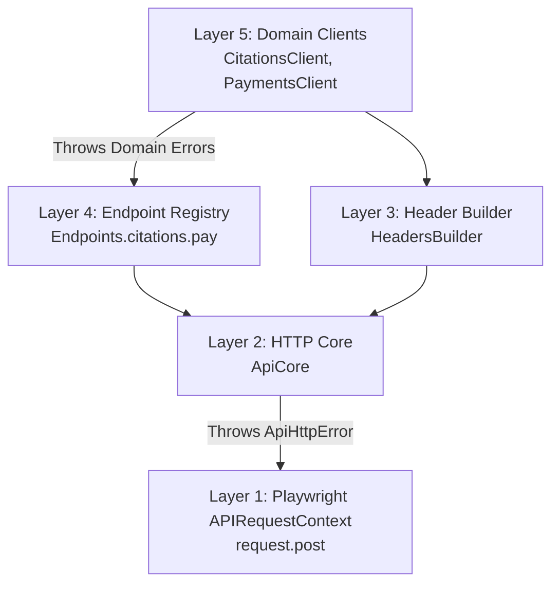
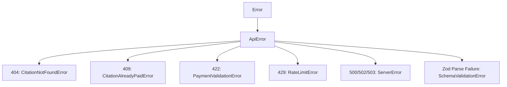
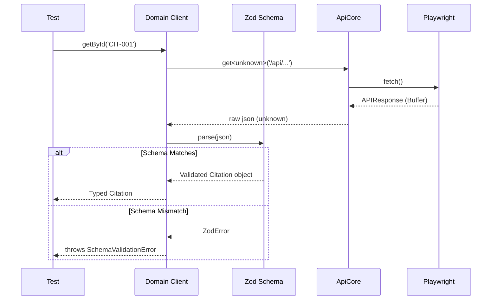

# 44. Building an Enterprise API Client Library from Scratch

**Navigation**: [← Chapter 43: Real-World War Stories](./43_Real_World_SDET_War_Stories.md) | [Index](../00_INDEX.md) | [→ Chapter 45: Complete Playwright API Reference](./45_AI_Agents_MCP_And_Playwright.md)

**Cross-links:**
- [`23_APIUtils_HTTP_Library.md`](../04_Enterprise_Architecture/23_APIUtils_HTTP_Library.md) — The foundational APIUtils pattern this chapter builds on
- [`22_Headers_Payloads_Endpoints_Factory.md`](../04_Enterprise_Architecture/22_Headers_Payloads_Endpoints_Factory.md) — The factory layer
- [`27_Advanced_TypeScript_for_SDETs.md`](./27_Advanced_TypeScript_for_SDETs.md) — Generics and conditional types used here

---

## 5W1H

- **WHAT**: A layered, typed, production-grade HTTP client library for test automation — from raw `APIRequestContext` to domain-specific, fully typed client methods with error handling, schema validation, retry logic, request logging, and interceptors.
- **WHY**: Every time an SDET writes `await request.post('/api/...')` directly in a test file, they are: (a) duplicating auth header logic, (b) creating untypable response handling, (c) making the test brittle to URL changes, (d) hiding what the test is actually verifying. A proper library separates concerns and makes tests read like requirements.
- **WHO**: SDETs who have seen `request.get(...)` scattered across 50 test files and understand that it's technical debt, but haven't built the alternative yet.
- **WHEN**: The moment you write the same `Authorization: Bearer ${token}` header in a second test file.
- **HOW**: By building the library layer by layer — each layer solving a specific problem.

---

## 1. The Architecture — 5 Layers



```
Layer 5: Domain Clients
  CitationsClient, UsersClient, PaymentsClient, NotificationsClient
  → Business-language methods: citationsClient.pay(id, amount)
  → Throws typed domain errors: PaymentAlreadyProcessedError
  → Returns typed domain objects: Citation, Payment, Notification

Layer 4: Endpoint Registry
  Endpoints.citations.pay(id)  →  '/api/v2/citations/{id}/payments'
  → Function-based (not string constants) for type safety
  → Parameterized: no string concatenation in tests

Layer 3: Header Builder
  HeadersBuilder.new().withBearer(token).withCorrelationId(testId).build()
  → Composable, immutable
  → Sensitive values masked in logs

Layer 2: HTTP Core (ApiCore)
  apiCore.post<Citation>(url, body, headers)
  → Generic type parameter for response body
  → Normalized error handling (all errors same shape)
  → Automatic JSON serialization
  → Request/response logging with timing

Layer 1: Playwright APIRequestContext
  request.post(url, { data, headers })
  → The actual HTTP engine provided by Playwright
  → Fixture-injected — no global state
```

**Why this layer separation?**
```
Problem: You change the API path from /api/v1/citations to /api/v2/citations
With no library:    Update 50 test files manually
With Layer 4:       Update Endpoints.citations.list() once → all tests get the fix

Problem: Your API adds a required header x-tenant-id
With no library:    Update every test that calls the API
With Layer 3:       Update HeadersBuilder.withTenantId() once → all clients use it

Problem: You need to add retry logic for 503 responses
With no library:    Add retry to every API call in every test
With Layer 2:       Add retry middleware to ApiCore → all calls retry automatically

Problem: You need to trace every API call in CI for debugging
With no library:    Wrap every test.step manually
With interceptors:  Add a logging interceptor in one place → all calls logged
```

---

## 2. Layer 1 — Understanding Playwright's APIRequestContext

Before building abstractions, understand what you're wrapping.

```typescript
// What Playwright's APIRequestContext provides:
import { type APIRequestContext } from '@playwright/test';

// In a fixture:
async ({ request }, use) => {
  // request IS the APIRequestContext — a fetch-like HTTP client
  // It manages cookies, sessions, and headers per context

  const response = await request.get('https://api.example.com/data');
  // Returns: APIResponse (not a fetch Response)

  const status:  number          = response.status();
  const headers: Record<string, string> = response.headers();
  const body:    Buffer          = await response.body();
  const text:    string          = await response.text();
  const json:    unknown         = await response.json();  // typed as unknown!
  const ok:      boolean         = response.ok();  // status 200-299

  // URL and request info:
  const url: string = response.url();
};

// Key differences from fetch():
// 1. response.json() returns `unknown`, not `any` — forces you to type it
// 2. response.headers() returns all headers as a plain object (lowercase keys)
// 3. Playwright handles cookie jar automatically (within the same context)
// 4. Supports: get, post, put, patch, delete, head, fetch
// 5. Global request: doesn't share cookies with page (use page.request for that)
```

---

## 3. Layer 2 — The HTTP Core

```typescript
// lib/core/ApiCore.ts

import type { APIRequestContext, APIResponse } from '@playwright/test';

// ─── Types ────────────────────────────────────────────────────────────────────

export interface ApiCoreConfig {
  baseUrl:          string;
  defaultTimeoutMs: number;
  logRequests:      boolean;
  maskHeaders:      string[];  // Headers whose values are masked in logs: ['Authorization', 'x-api-key']
}

export interface RequestOptions {
  headers?:   Record<string, string>;
  params?:    Record<string, string | number | boolean>;
  timeoutMs?: number;
  // No body here — use post/put/patch methods which add the body
}

export interface ApiResponse<T> {
  status:  number;
  ok:      boolean;
  headers: Record<string, string>;
  body:    T;
  url:     string;
  durationMs: number;
}

export class ApiHttpError extends Error {
  constructor(
    public readonly status:  number,
    public readonly url:     string,
    public readonly body:    unknown,
    message: string
  ) {
    super(message);
    this.name = 'ApiHttpError';
  }
}

// ─── ApiCore ─────────────────────────────────────────────────────────────────

export class ApiCore {
  constructor(
    private readonly ctx:    APIRequestContext,
    private readonly config: ApiCoreConfig
  ) {}

  // ── Core generic request method ──────────────────────────────────────────

  async request<T>(
    method:  'GET' | 'POST' | 'PUT' | 'PATCH' | 'DELETE' | 'HEAD',
    path:    string,
    options: RequestOptions & { body?: unknown } = {}
  ): Promise<ApiResponse<T>> {
    const url     = this.buildUrl(path, options.params);
    const headers = options.headers ?? {};
    const start   = Date.now();

    if (this.config.logRequests) {
      this.logRequest(method, url, headers, options.body);
    }

    let raw: APIResponse;
    try {
      raw = await this.ctx.fetch(url, {
        method,
        headers,
        data:    options.body !== undefined ? options.body : undefined,
        timeout: options.timeoutMs ?? this.config.defaultTimeoutMs,
      });
    } catch (error) {
      const msg = error instanceof Error ? error.message : String(error);
      throw new ApiHttpError(0, url, null, `Network error: ${msg}`);
    }

    const durationMs = Date.now() - start;
    const responseHeaders = raw.headers();

    let body: T;
    const contentType = responseHeaders['content-type'] ?? '';
    if (contentType.includes('application/json')) {
      body = await raw.json() as T;
    } else if (contentType.includes('text/')) {
      body = await raw.text() as unknown as T;
    } else {
      body = await raw.body() as unknown as T;
    }

    if (this.config.logRequests) {
      this.logResponse(raw.status(), url, durationMs, body);
    }

    return {
      status:     raw.status(),
      ok:         raw.ok(),
      headers:    responseHeaders,
      body,
      url,
      durationMs,
    };
  }

  // ── Convenience methods ───────────────────────────────────────────────────

  get<T>(path: string, opts?: RequestOptions): Promise<ApiResponse<T>> {
    return this.request<T>('GET', path, opts);
  }

  post<T>(path: string, body: unknown, opts?: RequestOptions): Promise<ApiResponse<T>> {
    return this.request<T>('POST', path, { ...opts, body });
  }

  put<T>(path: string, body: unknown, opts?: RequestOptions): Promise<ApiResponse<T>> {
    return this.request<T>('PUT', path, { ...opts, body });
  }

  patch<T>(path: string, body: unknown, opts?: RequestOptions): Promise<ApiResponse<T>> {
    return this.request<T>('PATCH', path, { ...opts, body });
  }

  delete<T = void>(path: string, opts?: RequestOptions): Promise<ApiResponse<T>> {
    return this.request<T>('DELETE', path, opts);
  }

  // ── Helpers ───────────────────────────────────────────────────────────────

  private buildUrl(path: string, params?: Record<string, string | number | boolean>): string {
    const base = this.config.baseUrl.replace(/\/$/, '');
    const normalizedPath = path.startsWith('/') ? path : `/${path}`;
    const url = `${base}${normalizedPath}`;

    if (!params || Object.keys(params).length === 0) return url;

    const qs = new URLSearchParams(
      Object.entries(params).map(([k, v]) => [k, String(v)])
    );
    return `${url}?${qs.toString()}`;
  }

  private logRequest(method: string, url: string, headers: Record<string, string>, body: unknown): void {
    const maskedHeaders = this.maskSensitiveHeaders(headers);
    const bodyStr = body ? `\n  Body: ${JSON.stringify(body).substring(0, 200)}` : '';
    console.log(`→ ${method} ${url}\n  Headers: ${JSON.stringify(maskedHeaders)}${bodyStr}`);
  }

  private logResponse(status: number, url: string, durationMs: number, body: unknown): void {
    const bodyStr = typeof body === 'object' ? JSON.stringify(body).substring(0, 200) : String(body);
    const icon = status < 400 ? '←' : '✗';
    console.log(`${icon} ${status} ${url} (${durationMs}ms)\n  Body: ${bodyStr}`);
  }

  private maskSensitiveHeaders(headers: Record<string, string>): Record<string, string> {
    const result = { ...headers };
    for (const key of this.config.maskHeaders) {
      const lowerKey = key.toLowerCase();
      if (result[lowerKey]) {
        result[lowerKey] = '***MASKED***';
      }
    }
    return result;
  }
}
```

---

## 4. Layer 3 — The Header Builder

```typescript
// lib/headers/HeadersBuilder.ts

export class HeadersBuilder {
  private readonly _headers: Record<string, string> = {};

  private constructor() {}

  /** Start building a new headers object */
  static new(): HeadersBuilder {
    return new HeadersBuilder();
  }

  /** Add Bearer token authorization */
  withBearer(token: string): this {
    this._headers['Authorization'] = `Bearer ${token}`;
    return this;
  }

  /** Add API key authentication */
  withApiKey(key: string, headerName = 'x-api-key'): this {
    this._headers[headerName] = key;
    return this;
  }

  /** Add content-type header */
  withContentType(type: 'application/json' | 'multipart/form-data' | string = 'application/json'): this {
    this._headers['Content-Type'] = type;
    return this;
  }

  /** Add accept header */
  withAccept(type = 'application/json'): this {
    this._headers['Accept'] = type;
    return this;
  }

  /** Add correlation ID for request tracing */
  withCorrelationId(id: string): this {
    this._headers['x-correlation-id'] = id;
    return this;
  }

  /** Mark request as coming from the test suite */
  withTestMetadata(testId: string, workerIndex: number): this {
    this._headers['x-test-id']          = testId;
    this._headers['x-test-worker']      = String(workerIndex);
    this._headers['x-test-client']      = 'playwright-automation';
    return this;
  }

  /** Add tenant ID for multi-tenant systems */
  withTenantId(tenantId: string): this {
    this._headers['x-tenant-id'] = tenantId;
    return this;
  }

  /** Add arbitrary header */
  with(name: string, value: string): this {
    this._headers[name.toLowerCase()] = value;
    return this;
  }

  /** Merge another headers object */
  merge(additional: Record<string, string>): this {
    Object.assign(this._headers, additional);
    return this;
  }

  /** Build and return the headers object (immutable copy) */
  build(): Record<string, string> {
    return { ...this._headers };
  }
}

// ─── Pre-configured header factories for your specific system ────────────────

export class HeadersCrm {
  /** Standard authenticated CRM API headers */
  static auth(accessToken: string, testId?: string): Record<string, string> {
    const builder = HeadersBuilder.new()
      .withBearer(accessToken)
      .withContentType()
      .withAccept()
      .withTenantId(process.env.CRM_TENANT_ID ?? 'default');

    if (testId) {
      builder.withCorrelationId(`test-${testId}`);
    }

    return builder.build();
  }

  /** Unauthenticated headers for public endpoints */
  static public(): Record<string, string> {
    return HeadersBuilder.new().withContentType().withAccept().build();
  }

  /** File upload headers (no content-type — let browser set it with boundary) */
  static fileUpload(accessToken: string): Record<string, string> {
    return HeadersBuilder.new().withBearer(accessToken).withAccept().build();
  }
}
```

---

## 5. Layer 4 — The Endpoint Registry

```typescript
// lib/endpoints/Endpoints.ts

// ─── Parameter types ──────────────────────────────────────────────────────────

export interface CitationSearchParams {
  customerId?: string;
  status?:     'PENDING' | 'PAID' | 'OVERDUE' | 'DISPUTED' | 'CANCELLED';
  from?:       string;  // ISO date: '2026-01-01'
  to?:         string;
  page?:       number;
  limit?:      number;
}

export interface UserSearchParams {
  email?:  string;
  name?:   string;
  role?:   string;
  page?:   number;
  limit?:  number;
}

// ─── Endpoint registry ────────────────────────────────────────────────────────

export const Endpoints = {
  citations: {
    list:         (params?: CitationSearchParams) => buildUrl('/api/v2/citations', params),
    getById:      (id: string)                    => `/api/v2/citations/${encodeURIComponent(id)}`,
    create:       ()                              => '/api/v2/citations',
    update:       (id: string)                    => `/api/v2/citations/${encodeURIComponent(id)}`,
    updateStatus: (id: string)                    => `/api/v2/citations/${encodeURIComponent(id)}/status`,
    delete:       (id: string)                    => `/api/v2/citations/${encodeURIComponent(id)}`,
    payments: {
      create:     (citationId: string)            => `/api/v2/citations/${encodeURIComponent(citationId)}/payments`,
      getById:    (citationId: string, pid: string) =>
                  `/api/v2/citations/${encodeURIComponent(citationId)}/payments/${encodeURIComponent(pid)}`,
      list:       (citationId: string)            => `/api/v2/citations/${encodeURIComponent(citationId)}/payments`,
    },
    disputes: {
      create:     (citationId: string)            => `/api/v2/citations/${encodeURIComponent(citationId)}/disputes`,
      getById:    (citationId: string, did: string) =>
                  `/api/v2/citations/${encodeURIComponent(citationId)}/disputes/${encodeURIComponent(did)}`,
    },
  },
  users: {
    list:         (params?: UserSearchParams)     => buildUrl('/api/v2/users', params),
    getById:      (id: string)                    => `/api/v2/users/${encodeURIComponent(id)}`,
    create:       ()                              => '/api/v2/users',
    update:       (id: string)                    => `/api/v2/users/${encodeURIComponent(id)}`,
    delete:       (id: string)                    => `/api/v2/users/${encodeURIComponent(id)}`,
    roles: {
      list:       (userId: string)                => `/api/v2/users/${encodeURIComponent(userId)}/roles`,
      assign:     (userId: string)                => `/api/v2/users/${encodeURIComponent(userId)}/roles`,
    },
  },
  notifications: {
    getForUser:   (userId: string)                => `/api/v2/notifications?userId=${encodeURIComponent(userId)}`,
    getById:      (id: string)                    => `/api/v2/notifications/${encodeURIComponent(id)}`,
    markRead:     (id: string)                    => `/api/v2/notifications/${encodeURIComponent(id)}/read`,
  },
  reports: {
    generate:     ()                              => '/api/v2/reports',
    getById:      (id: string)                    => `/api/v2/reports/${encodeURIComponent(id)}`,
    download:     (id: string)                    => `/api/v2/reports/${encodeURIComponent(id)}/download`,
  },
  health:         ()                              => '/api/health',
  version:        ()                              => '/api/version',
} as const;

// ─── URL builder utility ──────────────────────────────────────────────────────

function buildUrl(base: string, params?: Record<string, unknown>): string {
  if (!params) return base;

  const validParams = Object.entries(params)
    .filter(([, v]) => v !== undefined && v !== null && v !== '')
    .map(([k, v]) => [k, String(v)]);

  if (validParams.length === 0) return base;
  return `${base}?${new URLSearchParams(validParams).toString()}`;
}
```

---

## 6. Layer 5 — Domain Clients

### The Error Hierarchy First



```typescript
// lib/errors/ApiErrors.ts

export class ApiError extends Error {
  constructor(
    public readonly operation: string,
    public readonly status:    number,
    public readonly url:       string,
    public readonly body:      unknown,
    message: string
  ) {
    super(`[${operation}] HTTP ${status} at ${url}: ${message}`);
    this.name = 'ApiError';
  }

  /** Format for structured logging */
  toJson(): Record<string, unknown> {
    return {
      name:      this.name,
      operation: this.operation,
      status:    this.status,
      url:       this.url,
      body:      this.body,
      message:   this.message,
    };
  }
}

// Domain-specific error classes — each maps to a specific HTTP error scenario
export class CitationNotFoundError extends ApiError {
  constructor(id: string, url: string) {
    super('citations.getById', 404, url, null, `Citation '${id}' not found`);
    this.name = 'CitationNotFoundError';
  }
}

export class CitationAlreadyPaidError extends ApiError {
  constructor(id: string, url: string, body: unknown) {
    super('citations.pay', 409, url, body, `Citation '${id}' has already been paid`);
    this.name = 'CitationAlreadyPaidError';
  }
}

export class PaymentValidationError extends ApiError {
  constructor(url: string, public readonly validationErrors: string[]) {
    super('citations.pay', 422, url, validationErrors, `Payment validation failed: ${validationErrors.join(', ')}`);
    this.name = 'PaymentValidationError';
  }
}

export class RateLimitError extends ApiError {
  constructor(url: string, public readonly retryAfterSeconds: number) {
    super('api', 429, url, null, `Rate limited. Retry after ${retryAfterSeconds}s`);
    this.name = 'RateLimitError';
  }
}

export class ServerError extends ApiError {
  constructor(operation: string, url: string, body: unknown) {
    super(operation, 500, url, body, 'Internal server error');
    this.name = 'ServerError';
  }
}

// ─── Error factory ────────────────────────────────────────────────────────────

/** Maps HTTP status codes to specific error classes */
export function createApiError(
  operation: string,
  status:    number,
  url:       string,
  body:      unknown,
  context?:  { id?: string }
): ApiError {
  const bodyObj = body as Record<string, unknown> | null;

  switch (status) {
    case 404: return new CitationNotFoundError(context?.id ?? 'unknown', url);
    case 409: return new CitationAlreadyPaidError(context?.id ?? 'unknown', url, body);
    case 422: {
      const errors = (bodyObj?.errors as string[]) ?? [String(body)];
      return new PaymentValidationError(url, errors);
    }
    case 429: {
      const retryAfter = parseInt(String(bodyObj?.retryAfter ?? 60), 10);
      return new RateLimitError(url, retryAfter);
    }
    case 500:
    case 502:
    case 503:
      return new ServerError(operation, url, body);
    default:
      return new ApiError(operation, status, url, body, `Unexpected status ${status}`);
  }
}
```

### The CitationsClient — Full Implementation

```typescript
// lib/clients/CitationsClient.ts

import type { ApiCore } from '../core/ApiCore';
import { Endpoints }    from '../endpoints/Endpoints';
import { createApiError, CitationNotFoundError } from '../errors/ApiErrors';
import type { Citation, CreateCitationPayload, UpdateCitationStatusPayload, PayCitationPayload, Payment } from '../types/domain';

export class CitationsClient {
  constructor(
    private readonly api:     ApiCore,
    private readonly getHeaders: () => Record<string, string>
    // ↑ lazy function — called per request (ensures fresh auth token)
  ) {}

  // ── Read operations ───────────────────────────────────────────────────────

  async getById(id: string): Promise<Citation> {
    const url      = Endpoints.citations.getById(id);
    const response = await this.api.get<Citation>(url, { headers: this.getHeaders() });

    if (response.status === 404) throw new CitationNotFoundError(id, url);
    if (!response.ok) throw createApiError('citations.getById', response.status, url, response.body);

    return response.body;
  }

  async getAll(params?: Parameters<typeof Endpoints.citations.list>[0]): Promise<Citation[]> {
    const url      = Endpoints.citations.list(params);
    const response = await this.api.get<{ data: Citation[]; total: number }>(url, {
      headers: this.getHeaders(),
    });

    if (!response.ok) throw createApiError('citations.list', response.status, url, response.body);
    return response.body.data;
  }

  async search(params: Parameters<typeof Endpoints.citations.list>[0]): Promise<Citation[]> {
    return this.getAll(params);
  }

  // ── Write operations ──────────────────────────────────────────────────────

  async create(payload: CreateCitationPayload): Promise<Citation> {
    const url      = Endpoints.citations.create();
    const response = await this.api.post<Citation>(url, payload, { headers: this.getHeaders() });

    if (!response.ok) throw createApiError('citations.create', response.status, url, response.body);
    if (response.status !== 201) {
      console.warn(`citations.create: expected 201, got ${response.status}`);
    }

    return response.body;
  }

  async updateStatus(id: string, payload: UpdateCitationStatusPayload): Promise<Citation> {
    const url      = Endpoints.citations.updateStatus(id);
    const response = await this.api.patch<Citation>(url, payload, { headers: this.getHeaders() });

    if (response.status === 404) throw new CitationNotFoundError(id, url);
    if (!response.ok) throw createApiError('citations.updateStatus', response.status, url, response.body);

    return response.body;
  }

  async delete(id: string): Promise<void> {
    const url      = Endpoints.citations.delete(id);
    const response = await this.api.delete(url, { headers: this.getHeaders() });

    if (response.status === 404) {
      // Idempotent delete — 404 means already gone, that's fine
      return;
    }
    if (!response.ok) throw createApiError('citations.delete', response.status, url, response.body);
  }

  // ── Payment operations ────────────────────────────────────────────────────

  async pay(citationId: string, payload: PayCitationPayload): Promise<Payment> {
    const url      = Endpoints.citations.payments.create(citationId);
    const response = await this.api.post<Payment>(url, payload, { headers: this.getHeaders() });

    if (!response.ok) {
      throw createApiError('citations.pay', response.status, url, response.body, { id: citationId });
    }

    return response.body;
  }

  async getPayments(citationId: string): Promise<Payment[]> {
    const url      = Endpoints.citations.payments.list(citationId);
    const response = await this.api.get<Payment[]>(url, { headers: this.getHeaders() });

    if (!response.ok) throw createApiError('citations.payments.list', response.status, url, response.body);
    return response.body;
  }

  // ── Bulk operations ───────────────────────────────────────────────────────

  /**
   * Creates multiple citations in parallel (concurrent API calls).
   * Returns all created citations, or throws if any individual creation fails.
   */
  async bulkCreate(payloads: CreateCitationPayload[]): Promise<Citation[]> {
    const results = await Promise.allSettled(
      payloads.map(p => this.create(p))
    );

    const failures = results
      .filter((r): r is PromiseRejectedResult => r.status === 'rejected')
      .map(r => r.reason);

    if (failures.length > 0) {
      const messages = failures.map(e => e?.message ?? String(e)).join('\n  ');
      throw new Error(`bulkCreate: ${failures.length}/${payloads.length} citations failed:\n  ${messages}`);
    }

    return results
      .filter((r): r is PromiseFulfilledResult<Citation> => r.status === 'fulfilled')
      .map(r => r.value);
  }

  /**
   * Deletes all citations matching the given parameters.
   * Returns the number of deleted records.
   */
  async bulkDelete(params: Parameters<typeof Endpoints.citations.list>[0]): Promise<number> {
    const citations = await this.getAll(params);
    const results   = await Promise.allSettled(citations.map(c => this.delete(c.citationId)));
    const failed    = results.filter(r => r.status === 'rejected');

    if (failed.length > 0) {
      console.warn(`bulkDelete: ${failed.length}/${citations.length} deletions failed`);
    }

    return citations.length - failed.length;
  }

  /**
   * Waits for a citation to reach the expected status via polling.
   * This is the correct alternative to for-loops with waitForTimeout.
   */
  async waitForStatus(
    id:             string,
    expectedStatus: Citation['status'],
    timeoutMs:      number = 120_000
  ): Promise<Citation> {
    const { expect } = await import('@playwright/test');
    let lastCitation: Citation | null = null;

    await expect.poll(
      async () => {
        lastCitation = await this.getById(id);
        if (['FAILED', 'CANCELLED'].includes(lastCitation.status) && lastCitation.status !== expectedStatus) {
          throw new Error(`Citation ${id} reached terminal status '${lastCitation.status}', expected '${expectedStatus}'`);
        }
        return lastCitation.status;
      },
      {
        message:   `Citation ${id} never reached status '${expectedStatus}'`,
        timeout:   timeoutMs,
        intervals: [1000, 2000, 5000, 10000],
      }
    ).toBe(expectedStatus);

    return lastCitation!;
  }
}
```

---

## 7. Response Schema Validation with Zod

Raw API responses are `unknown` in TypeScript. Adding runtime schema validation catches API contract violations immediately.

### The Typed Response Chain



```typescript
// npm install zod
import { z } from 'zod';

// ─── Define schemas ───────────────────────────────────────────────────────────

export const CitationStatusEnum = z.enum(['PENDING', 'PAID', 'OVERDUE', 'DISPUTED', 'CANCELLED']);

export const CitationSchema = z.object({
  citationId:   z.string().regex(/^CIT-[A-Z0-9]+$/, 'citationId must start with CIT-'),
  customerId:   z.string().min(1),
  status:       CitationStatusEnum,
  amount:       z.number().positive('amount must be positive'),
  type:         z.string(),
  issueDate:    z.string().datetime({ offset: true }),  // ISO 8601 with timezone
  dueDate:      z.string().datetime({ offset: true }).nullable(),
  officerId:    z.string().nullable().optional(),
  notes:        z.string().nullable().optional(),
  createdAt:    z.string().datetime({ offset: true }),
  updatedAt:    z.string().datetime({ offset: true }),
}).strict();  // .strict() = fail on unknown fields (catches extra fields)

export type Citation = z.infer<typeof CitationSchema>;

export const CreateCitationPayloadSchema = z.object({
  customerId: z.string(),
  amount:     z.number().positive(),
  type:       z.string(),
  issueDate:  z.string().optional(),
  notes:      z.string().optional(),
}).passthrough();  // allow extra fields (payloads can be extended)

export type CreateCitationPayload = z.infer<typeof CreateCitationPayloadSchema>;

// ─── Validated response helper ────────────────────────────────────────────────

export class SchemaValidationError extends Error {
  constructor(
    public readonly operation: string,
    public readonly issues:    z.ZodIssue[],
    public readonly rawBody:   unknown
  ) {
    const formatted = issues.map(i => `  ${i.path.join('.')}: ${i.message}`).join('\n');
    super(`[${operation}] API response schema validation failed:\n${formatted}\nRaw body: ${JSON.stringify(rawBody).substring(0, 500)}`);
    this.name = 'SchemaValidationError';
  }
}

export function parseResponse<T>(
  schema:    z.ZodSchema<T>,
  body:      unknown,
  operation: string
): T {
  const result = schema.safeParse(body);
  if (!result.success) {
    throw new SchemaValidationError(operation, result.error.issues, body);
  }
  return result.data;
}

// ─── Usage in CitationsClient ─────────────────────────────────────────────────

// In CitationsClient.create():
async create(payload: CreateCitationPayload): Promise<Citation> {
  const url      = Endpoints.citations.create();
  const response = await this.api.post<unknown>(url, payload, { headers: this.getHeaders() });

  if (!response.ok) throw createApiError('citations.create', response.status, url, response.body);

  // Validate the response matches the expected schema
  return parseResponse(CitationSchema, response.body, 'citations.create');
  //                   ↑ If the API returns unexpected shape, test fails HERE
  //                     with a clear "schema validation failed" message
}
```

---

## 8. Retry Middleware

```typescript
// lib/core/retry.ts

export interface RetryConfig {
  maxAttempts:      number;
  retryableStatuses: number[];  // HTTP status codes to retry on
  baseDelayMs:      number;     // Initial delay
  maxDelayMs:       number;     // Maximum delay (for exponential backoff)
  onRetry?:         (attempt: number, error: unknown, delayMs: number) => void;
}

export const DEFAULT_RETRY_CONFIG: RetryConfig = {
  maxAttempts:      3,
  retryableStatuses: [429, 503, 502, 504],
  baseDelayMs:      500,
  maxDelayMs:       30_000,
};

export async function withRetry<T>(
  operation: string,
  fn:        () => Promise<T>,
  config:    RetryConfig = DEFAULT_RETRY_CONFIG
): Promise<T> {
  let lastError: unknown;

  for (let attempt = 1; attempt <= config.maxAttempts; attempt++) {
    try {
      const result = await fn();

      // Check if result is an ApiResponse with a retryable status
      if (
        result !== null &&
        typeof result === 'object' &&
        'status' in result &&
        typeof (result as { status: number }).status === 'number' &&
        config.retryableStatuses.includes((result as { status: number }).status)
      ) {
        const status = (result as { status: number }).status;
        const delay  = calculateDelay(attempt, config);

        config.onRetry?.(attempt, `HTTP ${status}`, delay);

        if (attempt < config.maxAttempts) {
          await sleep(delay);
          continue;
        }
      }

      return result;

    } catch (error) {
      lastError = error;

      // Only retry on retryable errors
      const isRetryable = error instanceof ApiHttpError &&
        config.retryableStatuses.includes(error.status);

      if (!isRetryable || attempt >= config.maxAttempts) {
        throw error;
      }

      const delay = calculateDelay(attempt, config);
      config.onRetry?.(attempt, error, delay);
      await sleep(delay);
    }
  }

  throw lastError;
}

function calculateDelay(attempt: number, config: RetryConfig): number {
  // Exponential backoff with jitter
  const exponential = config.baseDelayMs * Math.pow(2, attempt - 1);
  const jitter      = Math.random() * 0.1 * exponential;  // ±10% jitter
  return Math.min(exponential + jitter, config.maxDelayMs);
}

function sleep(ms: number): Promise<void> {
  return new Promise(resolve => setTimeout(resolve, ms));
}

// ─── Usage in domain client ───────────────────────────────────────────────────

// In CitationsClient:
async createWithRetry(payload: CreateCitationPayload): Promise<Citation> {
  return withRetry(
    'citations.create',
    () => this.create(payload),
    {
      maxAttempts:      3,
      retryableStatuses: [503, 429],
      baseDelayMs:      1000,
      maxDelayMs:       10_000,
      onRetry: (attempt, error, delay) => {
        console.warn(`[CitationsClient] create retry ${attempt}: ${error}. Waiting ${delay}ms`);
      },
    }
  );
}
```

---

## 9. Fixture Integration — Wiring the Library

```typescript
// fixtures/index.ts — Complete fixture wiring

import { test as base, type TestInfo } from '@playwright/test';
import { ApiCore }              from '../lib/core/ApiCore';
import { CitationsClient }      from '../lib/clients/CitationsClient';
import { UsersClient }          from '../lib/clients/UsersClient';
import { NotificationsClient }  from '../lib/clients/NotificationsClient';
import { HeadersCrm }           from '../lib/headers/HeadersBuilder';

// ─── Types ────────────────────────────────────────────────────────────────────

interface TestFixtures {
  apiCore:               ApiCore;
  citationsClient:       CitationsClient;
  usersClient:           UsersClient;
  notificationsClient:   NotificationsClient;
}

interface WorkerFixtures {
  account: { userId: string; accessToken: string; refreshToken: string };
}

// ─── Fixtures ─────────────────────────────────────────────────────────────────

export const test = base.extend<TestFixtures, WorkerFixtures>({

  // Worker-scoped: login once per worker
  account: [
    async ({ browser }, use) => {
      const context = await browser.newContext();
      const page    = await context.newPage();
      const request = context.request;

      const loginResponse = await request.post(`${process.env.AUTH_URL}/token`, {
        data: {
          grant_type: 'password',
          username:   process.env.TEST_USER_EMAIL!,
          password:   process.env.TEST_USER_PASSWORD!,
          client_id:  process.env.OAUTH_CLIENT_ID!,
        },
        headers: { 'Content-Type': 'application/x-www-form-urlencoded' },
      });

      if (!loginResponse.ok()) {
        throw new Error(`Login failed: ${loginResponse.status()} — ${await loginResponse.text()}`);
      }

      const tokens = await loginResponse.json() as {
        access_token:  string;
        refresh_token: string;
        user_id:       string;
      };

      await context.close();

      await use({
        userId:       tokens.user_id,
        accessToken:  tokens.access_token,
        refreshToken: tokens.refresh_token,
      });
    },
    { scope: 'worker' }
  ],

  // Test-scoped: ApiCore (wraps Playwright's request context)
  apiCore: async ({ request }, use, testInfo) => {
    const core = new ApiCore(request, {
      baseUrl:          process.env.CRM_API_URL!,
      defaultTimeoutMs: 30_000,
      logRequests:      process.env.LOG_API_REQUESTS === 'true',
      maskHeaders:      ['authorization', 'x-api-key'],
    });
    await use(core);
  },

  // Test-scoped: CitationsClient
  citationsClient: async ({ apiCore, account }, use, testInfo) => {
    // getHeaders is lazy: called per request, ensuring token is always current
    const getHeaders = () => HeadersCrm.auth(account.accessToken, testInfo.testId);
    await use(new CitationsClient(apiCore, getHeaders));
  },

  // Test-scoped: UsersClient
  usersClient: async ({ apiCore, account }, use, testInfo) => {
    const getHeaders = () => HeadersCrm.auth(account.accessToken, testInfo.testId);
    await use(new UsersClient(apiCore, getHeaders));
  },

  // Test-scoped: NotificationsClient
  notificationsClient: async ({ apiCore, account }, use, testInfo) => {
    const getHeaders = () => HeadersCrm.auth(account.accessToken, testInfo.testId);
    await use(new NotificationsClient(apiCore, getHeaders));
  },
});

export { expect } from '@playwright/test';
```

---

## 10. What Tests Look Like With the Library

```typescript
// tests/specs/citations/payment.spec.ts
// Import from YOUR fixtures, not from @playwright/test
import { test, expect } from '../../fixtures';
import { PayloadsCitation }           from '../../data/payloads/PayloadsCitation';
import { CitationAlreadyPaidError }   from '../../lib/errors/ApiErrors';

test.describe('Citation Payment', () => {

  test('Full payment flow — API + UI + DB verified', async ({
    page, citationsClient, notificationsClient, dbClient, account
  }) => {
    const testStart = new Date();
    let citation: Citation;

    await test.step('API: Create pending citation', async () => {
      citation = await citationsClient.create(
        PayloadsCitation.parking({ customerId: account.userId })
      );
      expect(citation.status).toBe('PENDING');
      expect(citation.customerId).toBe(account.userId);
    });

    await test.step('UI: Submit payment', async () => {
      const citationPage = new CitationDetailPage(page);
      await citationPage.goto(citation.citationId);
      await citationPage.payNow(citation.amount);
    });

    await test.step('API: Wait for citation to reach PAID', async () => {
      // The RIGHT way — uses expect.poll internally
      const paidCitation = await citationsClient.waitForStatus(citation.citationId, 'PAID', 120_000);
      expect(paidCitation.amount).toBe(citation.amount);
    });

    await test.step('API: Notification was sent', async () => {
      await expect.poll(
        async () => {
          const notifs = await notificationsClient.getForUser(account.userId, { after: testStart });
          return notifs.some(n => n.type === 'PAYMENT_CONFIRMED' && n.metadata?.citationId === citation.citationId);
        },
        { message: 'Payment confirmation notification never sent', timeout: 60_000 }
      ).toBe(true);
    });

    await test.step('DB: Citation and payment recorded correctly', async () => {
      const row = await dbClient.queryOne<{ status: string; paid_at: Date }>(
        'SELECT status, paid_at FROM citations WHERE citation_id = $1',
        [citation.citationId]
      );
      expect(row?.status).toBe('PAID');
      expect(row?.paid_at.getTime()).toBeGreaterThan(testStart.getTime());
    });
  });

  test('Paying an already-paid citation returns 409', async ({ citationsClient, account }) => {
    // Create + pay a citation
    const citation = await citationsClient.create(
      PayloadsCitation.parking({ customerId: account.userId })
    );
    await citationsClient.pay(citation.citationId, { amount: citation.amount });
    await citationsClient.waitForStatus(citation.citationId, 'PAID');

    // Attempt to pay again — should get CitationAlreadyPaidError
    await expect(
      citationsClient.pay(citation.citationId, { amount: citation.amount })
    ).rejects.toThrow(CitationAlreadyPaidError);
  });
});
```

**The test reads like requirements**:
- "Create pending citation" — plain English
- "Wait for PAID" — no implementation detail (no for-loops, no waits)
- Error cases are domain exceptions, not HTTP status codes
- Every assertion checks business values, not HTTP plumbing

---

## 🏋️ Practice Questions

### Q1. [Write It] — BulkOperationsClient

Write a `BulkCitationsHelper` class that extends CitationsClient's capabilities with:
1. `createAndPay(payload, paymentAmount): Promise<{ citation: Citation, payment: Payment }>` — creates a citation and immediately submits payment, returning both
2. `cleanupByCustomer(customerId): Promise<number>` — deletes all citations for a customer (using bulkDelete), returns count
3. `verifyAllStatus(ids: string[], expectedStatus: string): Promise<void>` — verifies all citations in the list have the expected status using parallel API calls

<details><summary>Answer</summary>

```typescript
export class BulkCitationsHelper {
  constructor(private readonly citations: CitationsClient) {}

  async createAndPay(
    payload:       CreateCitationPayload,
    paymentAmount: number
  ): Promise<{ citation: Citation; payment: Payment }> {
    const citation = await this.citations.create(payload);
    const payment  = await this.citations.pay(citation.citationId, { amount: paymentAmount });
    return { citation, payment };
  }

  async cleanupByCustomer(customerId: string): Promise<number> {
    return this.citations.bulkDelete({ customerId });
  }

  async verifyAllStatus(ids: string[], expectedStatus: Citation['status']): Promise<void> {
    // Fetch all citations in parallel
    const results = await Promise.allSettled(
      ids.map(id => this.citations.getById(id))
    );

    const failures: string[] = [];

    results.forEach((result, idx) => {
      if (result.status === 'rejected') {
        failures.push(`${ids[idx]}: fetch failed — ${result.reason}`);
      } else if (result.value.status !== expectedStatus) {
        failures.push(`${ids[idx]}: expected '${expectedStatus}', got '${result.value.status}'`);
      }
    });

    if (failures.length > 0) {
      throw new Error(`verifyAllStatus failed for ${failures.length}/${ids.length} citations:\n${failures.join('\n')}`);
    }
  }
}
```
</details>

---

### Q2. [MCQ] — Error Handling Design

Which approach is BEST for handling a 404 response from `GET /api/citations/{id}`?

A) `if (!response.ok()) return null;`  
B) `if (response.status() === 404) throw new Error('Not found');`  
C) `if (response.status() === 404) throw new CitationNotFoundError(id, url);`  
D) `expect(response.status()).toBe(200); // let it fail as an assertion`

<details><summary>Answer</summary>

**C** — `throw new CitationNotFoundError(id, url)`.

Why C is best:
- The error message tells you WHICH citation was not found and WHERE the call went
- Tests can use `catch (e) { if (e instanceof CitationNotFoundError) { ... } }` to handle expected 404s gracefully
- The error is part of your domain language, not generic HTTP

Why not A: Returning `null` forces every caller to null-check. Easy to forget. Silences real errors.
Why not B: Generic `Error('Not found')` loses the citation ID and URL — harder to debug.
Why not D: A test assertion failure gives no information about why the citation wasn't found.
</details>

---

### Q3. [Design Question] — When to Add Zod Validation

Your API client has 50 methods. Adding Zod schemas to all of them would take 3 weeks. Prioritize: which 10 should get Zod validation first and why?

<details><summary>Answer</summary>

**Priority order** (highest to lowest):

1. **Create/POST responses** — These return newly created data. Schema drift here causes cascading failures across the test suite because `citationId`, `customerId`, etc. are used in subsequent steps.

2. **The core entity `getById`** — `citationsClient.getById()`, `usersClient.getById()`. All tests depend on these. Schema failures here are caught early.

3. **Status enum fields** — Any field that is an enum (status, type, channel). If the API adds a new status like 'IN_REVIEW', unvalidated code silently treats it as an unknown string. Zod catches this immediately.

4. **Financial fields** — `amount`, `balance`, `total`. Type coercion bugs (string "150.99" vs number 150.99) are subtle and cause test failures that look like logic errors.

5. **Timestamp fields** — `createdAt`, `updatedAt`, `processedAt`. These are often compared to `new Date()` in assertions. Schema validation catches format changes (epoch vs ISO string) early.

**Skip for now:**
- Simple string fields (name, description) — low value
- List responses — validate the individual item schema; the list wrapper rarely changes
- Error response bodies — these already fail on `response.ok === false`

The 20/80 rule: 20% of fields carry 80% of the validation value. Start with IDs, statuses, amounts, and timestamps.
</details>

---

**Navigation**: [← Chapter 43: Real-World War Stories](./43_Real_World_SDET_War_Stories.md) | [Index](../00_INDEX.md) | [→ Chapter 45: Complete Playwright API Reference](./45_AI_Agents_MCP_And_Playwright.md)

## 🏋️ Practice Challenges

### Challenge 1 [MCQ] — Why hide raw Playwright `request` behind a facade?

What is the primary architectural benefit of wrapping Playwright's `APIRequestContext` inside an `ApiClient` class instead of calling `request.post()` directly in spec files?

A) It speeds up the test execution because classes run faster than raw function calls.
B) It centralizes endpoint URLs, payload construction, header injection, and response parsing, keeping spec files strictly focused on business logic assertions.
C) It prevents Playwright from logging the API calls.
D) It allows the tests to bypass network proxies.

<details><summary>Answer</summary>

**B** — Centralization and Separation of Concerns. 
When URLs or headers change, you update one class, not 50 spec files. Specs remain readable, containing only the *intent* of the test.

</details>

---

### Challenge 2 [Spot the Bug — Silent failure in API Error Wrapper]

```typescript
class ApiClient {
  async get(url: string) {
    const response = await this.request.get(url);
    if (!response.ok()) {
      console.error(`API failed: ${response.status()}`);
      return null;
    }
    return response.json();
  }
}

// In test:
const data = await client.get('/api/config');
expect(data.theme).toBe('dark');
```

What is the danger of this error handling pattern?

<details><summary>Answer</summary>

**Bug**: Returning `null` on an HTTP error is a classic anti-pattern. 
If the API returns a 500 Internal Server Error, `data` becomes `null`. The test then attempts `data.theme`, throwing `TypeError: Cannot read properties of null (reading 'theme')`. 

The test fails with a generic JavaScript error instead of telling the developer *why* it failed (the 500 error).

**Fix**: Throw a descriptive error containing the HTTP status and response body.
```typescript
    if (!response.ok()) {
      const body = await response.text();
      throw new Error(`API GET ${url} failed with ${response.status()}: ${body}`);
    }
```
This forces the test to fail immediately at the API step, putting the exact HTTP error in the CI logs.

</details>

---

### Challenge 3 [Write It Yourself — Generic Retry Interceptor]

Write a `requestWithRetry` wrapper method inside your `ApiClient` that takes a closure (e.g., `() => this.request.get(url)`), executes it, and if it returns a 502, 503, or 504 status code, retries it up to 3 times with a 1-second delay.

<details><summary>Answer</summary>

```typescript
  private async requestWithRetry(
    operation: () => Promise<APIResponse>, 
    maxRetries = 3
  ): Promise<APIResponse> {
    for (let attempt = 1; attempt <= maxRetries; attempt++) {
      const response = await operation();
      
      // If success or a non-retryable error (like 400 or 404), return immediately
      if (![502, 503, 504].includes(response.status())) {
        return response;
      }
      
      if (attempt === maxRetries) {
        return response; // Out of retries, return the failing response
      }
      
      console.warn(`Attempt ${attempt} failed with ${response.status()}. Retrying...`);
      // Wait 1 second before next attempt (using a standard Promise-based delay)
      await new Promise(resolve => setTimeout(resolve, 1000));
    }
    throw new Error('Unreachable');
  }

  // Usage:
  async get(url: string) {
    const response = await this.requestWithRetry(() => this.request.get(url));
    // ... proceed with response.ok() check
  }
```

</details>

---

### Challenge 4 [Architecture — Centralizing Auth Headers]

Where is the most secure and maintainable place to inject an Authorization token into the `ApiClient` so that every method (`get`, `post`, `put`) uses it automatically?

A) Pass the token as a parameter to every method: `client.get('/url', token)`.
B) Pass the token into the `ApiClient` constructor and store it as a private readonly class property.
C) Read the token from `process.env.TOKEN` inside the `get()` method.
D) Put the token in a global variable.

<details><summary>Answer</summary>

**B** — Passing the token into the constructor via a Playwright fixture.

```typescript
// Client class
export class ApiClient {
  constructor(private request: APIRequestContext, private token: string) {}
  
  async get(url: string) {
    return this.request.get(url, { headers: { Authorization: `Bearer ${this.token}` } });
  }
}

// Fixture setup
export const test = base.extend<{ apiClient: ApiClient }>({
  apiClient: async ({ request, loginToken }, use) => {
    // Inject the isolated, test-specific token into the client
    const client = new ApiClient(request, loginToken);
    await use(client);
  }
});
```

This ensures the client is perfectly encapsulated, thread-safe (no global variables), and DRY (don't repeat the header in every test).

</details>

---

### Challenge 5 [Spot the Bug — Generics turning into `any`]

```typescript
class ApiClient {
  async get<T>(url: string): Promise<T> {
    const response = await this.request.get(url);
    return response.json();
  }
}

// In test:
const user = await client.get<User>('/api/users/1');
```

While this looks like excellent TypeScript, what false sense of security does `response.json()` returning `T` give you at runtime?

<details><summary>Answer</summary>

**Bug**: TypeScript types are erased at compile time. `response.json()` returns an `any` at runtime. By casting it to `Promise<T>`, you are telling TypeScript "trust me, the API returned the `User` shape." 

If the API actually returned `{ error: "User not found" }`, TypeScript won't catch it, and the test will crash later when you try to access `user.firstName`.

**SDE Fix**: To achieve true runtime type safety, you must parse the response through a schema validator like Zod.

```typescript
import { z } from 'zod';

class ApiClient {
  async get<T>(url: string, schema: z.ZodSchema<T>): Promise<T> {
    const response = await this.request.get(url);
    const json = await response.json();
    
    // Throws a clear runtime error if the API payload doesn't match the expected type
    return schema.parse(json); 
  }
}

// In test:
const user = await client.get('/api/users/1', UserSchema);
```
</details>

---
**Navigation**: [← Chapter 43: Real-World War Stories](./43_Real_World_SDET_War_Stories.md) | [Index](../00_INDEX.md) | [→ Chapter 45: Complete Playwright API Reference](./45_AI_Agents_MCP_And_Playwright.md)
