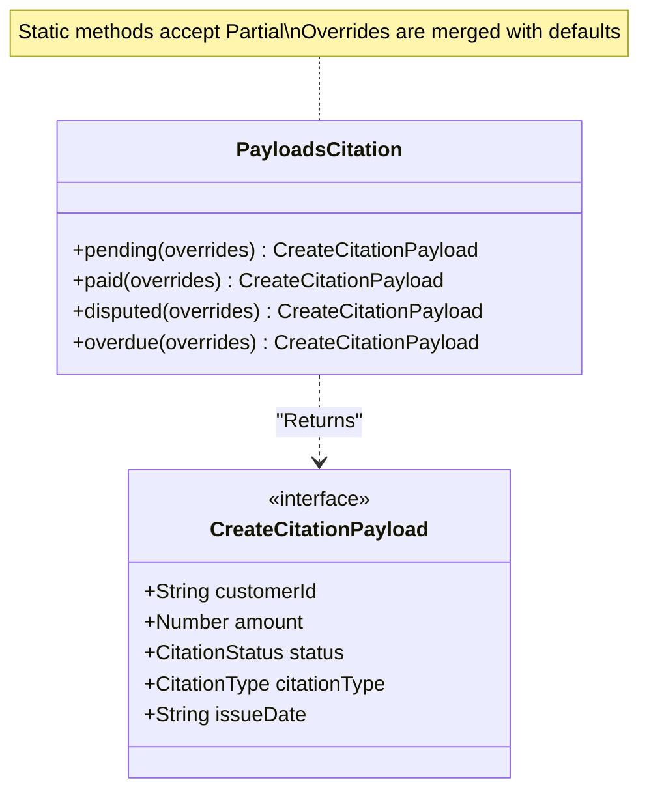
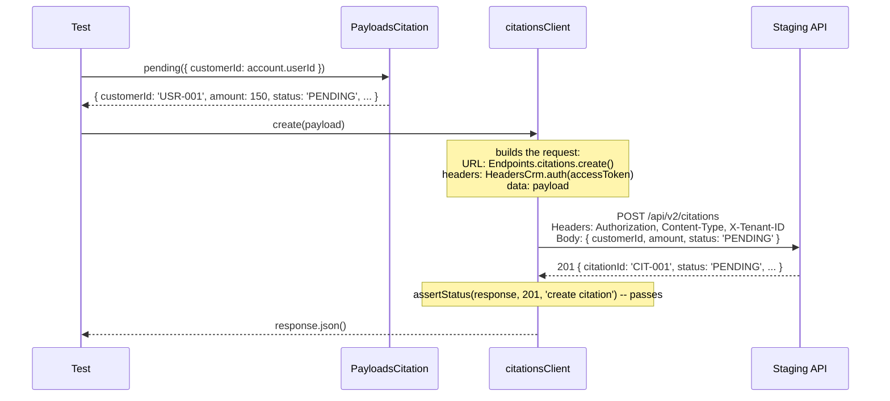

# 22. Headers, Payloads & Endpoints — The Factory Pattern in Depth

**Navigation**: [← Chapter 21: Enterprise Project Structure](./21_Enterprise_Project_Structure.md) | [Index](../00_INDEX.md) | [→ Chapter 23: APIUtils — Your HTTP Library](./23_APIUtils_HTTP_Library.md)

**Cross-links:**

- [`21_Enterprise_Project_Structure.md`](./21_Enterprise_Project_Structure.md) — Why the folders exist
- [`23_APIUtils_HTTP_Library.md`](./23_APIUtils_HTTP_Library.md) — How headers + payloads combine in a client
- [`04_JS_TS_For_Automation.md`](../01_Foundations/04_JS_TS_For_Automation.md) — TypeScript static classes, enums

---

## 5W1H

- **WHAT**: A deep dive into the three "data layer" files every enterprise test suite needs — `HeadersXxx.ts`, `PayloadsXxx.ts`, and `endpoints.ts` — and exactly how they combine to produce a clean API call.
- **WHY**: Every API call needs a URL + headers + body. If any of these are scattered across files, you get drift, duplication, and silent failures when something changes. Centralising them means one change propagates everywhere.
- **WHO**: Any SDET writing 10+ API tests against the same service.
- **WHEN**: Before writing your first test. Set up this layer first — it makes every subsequent test trivially easy to write.
- **HOW**: Static factory classes for headers and payloads. Function-returning endpoints. They compose in the client layer, invisible to the test.

---

## 1. The Three Layers — A Mental Model

```
Test Script (spec file)
   ↑ calls
API Client (CitationsApiClient.ts)
   ↑ composes from
   ├── Endpoints.ts      → WHAT URL to hit
   ├── HeadersXxx.ts     → WHAT metadata to send with every request
   └── PayloadsXxx.ts    → WHAT data to send in the body
```

The test only talks to the **Client**. It never sees URLs, headers, or raw JSON.

---

## 2. `endpoints.ts` — Deep Dive

### Why Functions Instead of String Constants?

```typescript
// ❌ String constant — looks simple, breaks silently
const CITATIONS_URL = `${process.env.API_BASE_URL}/api/v2/citations`;
const CITATION_BY_ID = `${process.env.API_BASE_URL}/api/v2/citations/${id}`; // ← ERROR: `id` is not defined at this module-top scope
```

`id` is not in scope when the constant is defined — it would need to be `undefined` or use a function:

```typescript
// ❌ Template literal works but creates a CONSTANT with the current URL
// What if API_BASE_URL is undefined when this module loads? → 'undefined/api/v2/citations'
const CITATIONS_URL = `${process.env.API_BASE_URL}/api/v2/citations`;
// Printed in error: "undefined/api/v2/citations" — hard to debug

// ✅ Function — evaluates process.env.API_BASE_URL LAZILY at call time
const CITATIONS_URL = () => `${process.env.API_BASE_URL}/api/v2/citations`;
// If env var is missing, error message shows exactly what went wrong:
// "URL: undefined/api/v2/citations" appears at the exact test step, not module load time
```

### The Full `endpoints.ts`

```typescript
// config/endpoints.ts
import { config } from "./environments";

export const Endpoints = {
  // ─── Citation Service ───────────────────────────────────────────────────────
  citations: {
    // No parameters — POST to the collection
    create: () => `${config.apiBaseUrl}/api/v2/citations`,

    // ID parameter — required by TypeScript, checked at compile time
    getById: (citationId: string) =>
      `${config.apiBaseUrl}/api/v2/citations/${citationId}`,

    // Update is same path as getById (REST: same resource, different method)
    update: (citationId: string) =>
      `${config.apiBaseUrl}/api/v2/citations/${citationId}`,

    delete: (citationId: string) =>
      `${config.apiBaseUrl}/api/v2/citations/${citationId}`,

    // Query parameters — encoded in the URL
    search: (filters: {
      userId?: string;
      status?: string;
      dateFrom?: string;
    }) => {
      const params = new URLSearchParams();
      if (filters.userId) params.set("userId", filters.userId);
      if (filters.status) params.set("status", filters.status);
      if (filters.dateFrom) params.set("dateFrom", filters.dateFrom);
      return `${config.apiBaseUrl}/api/v2/citations/search?${params.toString()}`;
    },
  },

  // ─── Notification Service (separate microservice, different base URL) ────────
  notifications: {
    byUser: (userId: string) =>
      `${config.notificationServiceUrl}/api/notifications?userId=${userId}`,

    send: () => `${config.notificationServiceUrl}/api/notifications`,

    getById: (notifId: string) =>
      `${config.notificationServiceUrl}/api/notifications/${notifId}`,
  },

  // ─── IVR / Transit System (legacy — different URL pattern) ──────────────────
  ivr: {
    triggerAlert: () => `${config.ivrServiceUrl}/ivr/v1/alerts`,

    getAlertsByAccount: (transitAccountId: string) =>
      `${config.ivrServiceUrl}/ivr/v1/alerts?accountId=${transitAccountId}`,
  },

  // ─── User Service ────────────────────────────────────────────────────────────
  users: {
    create: () => `${config.apiBaseUrl}/api/v1/users`,

    getById: (userId: string) => `${config.apiBaseUrl}/api/v1/users/${userId}`,

    updateRole: (userId: string) =>
      `${config.apiBaseUrl}/api/v1/users/${userId}/role`,
  },
} as const;

// ── Usage examples: ──────────────────────────────────────────────────────────
// Endpoints.citations.create()                         → full POST URL
// Endpoints.citations.getById('CIT-001')               → full GET URL
// Endpoints.citations.search({ status: 'PENDING' })    → full search URL with params
// Endpoints.notifications.byUser(account.userId)       → notification query URL
```

---

## 3. `HeadersXxx.ts` — Deep Dive

### Naming Convention: `HeadersServiceName.ts`

One header file per service (or per auth mechanism if they differ):

```
data/headers/
├── HeadersCrm.ts          ← for the CRM (D365 API, Bearer token)
├── HeadersNotifications.ts ← for the Notifications service (API key auth)
├── HeadersIvr.ts          ← for the IVR system (Basic auth)
└── HeadersPublic.ts       ← for unauthenticated endpoints
```

### Why One File Per Service?

Because **different services have different auth mechanisms**. The CRM uses Bearer tokens. The Notification service uses an API key. The IVR uses HTTP Basic auth. If you have one `Headers.ts` file, it becomes a mess of optional parameters.

```typescript
// data/headers/HeadersCrm.ts
// Covers: Citation API, User API, Account API (all under the same auth system)

export class HeadersCrm {
  /**
   * Standard auth headers for most CRM API calls.
   * @param accessToken - From the `account` fixture, NOT hardcoded.
   */
  static auth(accessToken: string): Record<string, string> {
    return {
      Authorization: `Bearer ${accessToken}`,
      "Content-Type": "application/json",
      Accept: "application/json",
      "X-Tenant-ID": process.env.TENANT_ID!,
      "X-Request-Source": "playwright-tests", // ← helps ops filter test traffic in logs
    };
  }

  /**
   * For GET requests — no Content-Type needed (no body being sent).
   */
  static authGet(accessToken: string): Record<string, string> {
    const headers = HeadersCrm.auth(accessToken);
    const { "Content-Type": _, ...rest } = headers; // remove Content-Type for GETs
    return rest;
  }

  /**
   * For file upload endpoints — browser sets Content-Type with boundary automatically.
   */
  static authMultipart(accessToken: string): Record<string, string> {
    return {
      Authorization: `Bearer ${accessToken}`,
      "X-Tenant-ID": process.env.TENANT_ID!,
      // NO Content-Type — FormData sets it with the multipart boundary
    };
  }

  /**
   * For service-to-service calls that use API key instead of user token.
   */
  static apiKey(): Record<string, string> {
    return {
      "X-API-Key": process.env.CRM_SERVICE_API_KEY!,
      "Content-Type": "application/json",
      "X-Tenant-ID": process.env.TENANT_ID!,
    };
  }
}
```

```typescript
// data/headers/HeadersNotifications.ts
// The Notifications service uses a different auth system

export class HeadersNotifications {
  static auth(): Record<string, string> {
    return {
      "X-Service-Key": process.env.NOTIFICATION_SERVICE_KEY!, // API key, NOT Bearer
      "Content-Type": "application/json",
      Accept: "application/json",
    };
  }
}
```

```typescript
// data/headers/HeadersIvr.ts
// The IVR system is a legacy service that uses HTTP Basic auth

export class HeadersIvr {
  static auth(): Record<string, string> {
    const credentials = Buffer.from(
      `${process.env.IVR_USERNAME}:${process.env.IVR_PASSWORD}`,
    ).toString("base64");

    return {
      Authorization: `Basic ${credentials}`,
      "Content-Type": "application/json",
    };
  }
}
```

### Multi-Environment Header Strategy

In enterprise environments, headers often differ between `local`, `staging`, and `prod`. For example, `local` might require an `X-Bypass-Rate-Limit` header, while `prod` strictly forbids it.

Instead of `if (env === 'local')` statements cluttering your spec files, handle environment-specific headers inside the factory:

```typescript
// data/headers/HeadersCrm.ts
import { currentEnv } from "../../config/environments";

export class HeadersCrm {
  static auth(accessToken: string): Record<string, string> {
    const baseHeaders = {
      Authorization: `Bearer ${accessToken}`,
      "Content-Type": "application/json",
      "X-Tenant-ID": process.env.TENANT_ID!,
    };

    // Environment-specific header injection
    if (currentEnv === "local" || currentEnv === "dev") {
      return {
        ...baseHeaders,
        "X-Bypass-Rate-Limit": "true", // Only allowed in lower environments
        "X-Mock-External-Systems": "true",
      };
    }

    return baseHeaders;
  }
}
```

This ensures your tests seamlessly transition between environments without modifying test logic.

---

## 4. `PayloadsXxx.ts` — Deep Dive

### The Payload Factory Architecture Visualised



**How to read this diagram.** `PayloadsCitation` offers one static method per status (`pending`, `paid`, `disputed`, `overdue`), and each returns a `CreateCitationPayload`. Notice the note on the class: the methods accept a partial payload, and those overrides are merged with the defaults.

### The Override Pattern — The Key to Flexibility

Every payload factory method accepts `Partial<TheInterface>`. This means:

- Call with no args → get sensible test defaults
- Call with overrides → get defaults PLUS your specific values

```typescript
// data/payloads/PayloadsCitation.ts

import { CitationStatus, CitationType } from "../enums/citation.enums";
import { DateUtils } from "../../utils/date.utils";

// ── 1. The TypeScript interface (single source of truth for the API contract) ──

export interface CreateCitationPayload {
  customerId: string;
  amount: number;
  status: CitationStatus;
  citationType: CitationType;
  issueDate: string;
  dueDate?: string;
  notes?: string;
  registrationPlate?: string;
  locationCode?: string;
  officerId?: string;
}

export interface UpdateCitationPayload {
  status?: CitationStatus;
  amount?: number;
  notes?: string;
  dueDate?: string;
}

// ── 2. The factory class ──────────────────────────────────────────────────────

export class PayloadsCitation {
  /**
   * Standard PENDING citation for happy-path tests.
   * Always override `customerId` with the actual test user's ID.
   *
   * Example:
   *   PayloadsCitation.pending({ customerId: account.userId })
   */
  static pending(
    overrides: Partial<CreateCitationPayload> = {},
  ): CreateCitationPayload {
    return {
      customerId: overrides.customerId ?? "TEST-CUSTOMER-001",
      amount: 150.0,
      status: CitationStatus.PENDING,
      citationType: CitationType.PARKING,
      issueDate: DateUtils.today(),
      dueDate: DateUtils.daysFromNow(30),
      ...overrides, // ← spread LAST so overrides win
    };
  }

  /**
   * An already-PAID citation — for testing payment-related workflows.
   */
  static paid(
    overrides: Partial<CreateCitationPayload> = {},
  ): CreateCitationPayload {
    return PayloadsCitation.pending({
      status: CitationStatus.PAID,
      amount: 200.0,
      ...overrides,
    });
  }

  /**
   * A DISPUTED citation — for testing dispute workflows.
   */
  static disputed(
    overrides: Partial<CreateCitationPayload> = {},
  ): CreateCitationPayload {
    return PayloadsCitation.pending({
      status: CitationStatus.DISPUTED,
      notes: "Auto-test: customer disputes this citation",
      ...overrides,
    });
  }

  /**
   * An OVERDUE citation — for testing collection workflows.
   * Note: issueDate in the past, dueDate already passed.
   */
  static overdue(
    overrides: Partial<CreateCitationPayload> = {},
  ): CreateCitationPayload {
    return PayloadsCitation.pending({
      status: CitationStatus.OVERDUE,
      issueDate: DateUtils.daysAgo(60),
      dueDate: DateUtils.daysAgo(30),
      amount: 300.0, // overdue usually has penalty amount
      ...overrides,
    });
  }

  /**
   * For UPDATE (PATCH) calls — only the fields being changed.
   */
  static updateStatus(
    status: CitationStatus,
    notes?: string,
  ): UpdateCitationPayload {
    return { status, ...(notes ? { notes } : {}) };
  }
}
```

### The `...overrides` Spread — Why It Must Come Last

```typescript
// Wrong order:
return {
  ...overrides, // ← spread first
  status: CitationStatus.PENDING, // ← this OVERWRITES the override!
};
// If caller passes { status: CitationStatus.PAID }, it gets PENDING anyway.

// Correct order:
return {
  status: CitationStatus.PENDING, // ← default
  ...overrides, // ← override wins if provided
};
```

**The rule:** Defaults first, `...overrides` last. The later spread always wins in JavaScript.

---

## 5. How All Three Combine in the Client

```typescript
// clients/CitationsApiClient.ts — where headers + payloads + endpoints meet

import { type APIRequestContext } from "@playwright/test";
import { Endpoints } from "../config/endpoints";
import { HeadersCrm } from "../data/headers/HeadersCrm";
import type {
  CreateCitationPayload,
  UpdateCitationPayload,
} from "../data/payloads/PayloadsCitation";
import type { CitationApiResponse } from "../types/api-responses.types";

export class CitationsApiClient {
  // Constructor: the two things that vary per test — request context and token
  constructor(
    private readonly request: APIRequestContext,
    private readonly accessToken: string,
  ) {}

  // CREATE: POST to /api/v2/citations
  async create(payload: CreateCitationPayload): Promise<CitationApiResponse> {
    const response = await this.request.post(
      Endpoints.citations.create(), // ← from endpoints.ts
      {
        headers: HeadersCrm.auth(this.accessToken), // ← from HeadersCrm.ts
        data: payload, // ← from PayloadsCitation factory
      },
    );

    this.assertStatus(response, 201, "create citation");
    return response.json() as Promise<CitationApiResponse>;
  }

  // READ: GET /api/v2/citations/:id
  async getById(citationId: string): Promise<CitationApiResponse> {
    const response = await this.request.get(
      Endpoints.citations.getById(citationId), // ← function call, not string concat
      { headers: HeadersCrm.authGet(this.accessToken) }, // ← GET-specific headers
    );

    this.assertStatus(response, 200, `get citation ${citationId}`);
    return response.json() as Promise<CitationApiResponse>;
  }

  // UPDATE: PATCH /api/v2/citations/:id
  async updateStatus(
    citationId: string,
    payload: UpdateCitationPayload,
  ): Promise<CitationApiResponse> {
    const response = await this.request.patch(
      Endpoints.citations.update(citationId),
      {
        headers: HeadersCrm.auth(this.accessToken),
        data: payload,
      },
    );

    this.assertStatus(response, 200, `update citation ${citationId}`);
    return response.json() as Promise<CitationApiResponse>;
  }

  // DELETE: DELETE /api/v2/citations/:id
  async delete(citationId: string): Promise<void> {
    const response = await this.request.delete(
      Endpoints.citations.delete(citationId),
      { headers: HeadersCrm.auth(this.accessToken) },
    );

    this.assertStatus(response, 204, `delete citation ${citationId}`);
  }

  // PRIVATE: centralised status checking so every method doesn't repeat try/catch
  private assertStatus(
    response: { ok(): boolean; status(): number; statusText(): string },
    expectedStatus: number,
    operation: string,
  ): void {
    if (response.status() !== expectedStatus) {
      throw new Error(
        `${operation} failed:\n` +
          `  Expected: ${expectedStatus}\n` +
          `  Got: ${response.status()} ${response.statusText()}`,
      );
    }
  }
}
```

---

## 6. The Complete Call Chain (Traced)

When a test calls:

```typescript
const citation = await citationsClient.create(
  PayloadsCitation.pending({ customerId: account.userId }),
);
```

Here is exactly what happens, step by step — four collaborators, each with exactly one job:



**How to read this diagram.** Read it top to bottom: the test asks the factory for a payload, hands it to the client, and the client builds the URL, headers and body and POSTs to the staging API. Notice that the client asserts the 201 status itself and returns only `response.json()`, so the test never touches URLs or headers.

**The test spec file sees:** `await citationsClient.create(PayloadsCitation.pending({ customerId: account.userId }))`.
**The test spec file does NOT see:** any URL, any header key-value pairs, any JSON construction.

---

## 🏋️ Practice Challenges

### Challenge 1 [MCQ] — Override Pattern

```typescript
const payload = PayloadsCitation.pending({
  customerId: "USR-999",
  status: CitationStatus.PAID,
});
```

What is `payload.status`?

A) `CitationStatus.PENDING` (the default wins)  
B) `CitationStatus.PAID` (the override wins)  
C) TypeScript compile error — cannot override status  
D) `undefined`

<details><summary>Answer</summary>

**B** — The override wins because of `...overrides` at the END of the object:

```typescript
return {
  status: CitationStatus.PENDING, // default
  ...overrides, // { customerId: 'USR-999', status: CitationStatus.PAID } — overrides status
};
// Result: status = CitationStatus.PAID
```

</details>

---

### Challenge 2 [Spot the Bug — Headers]

```typescript
// data/headers/HeadersCrm.ts
export class HeadersCrm {
  private static readonly token = process.env.ADMIN_ACCESS_TOKEN; // ← evaluated at module load

  static auth(): Record<string, string> {
    return {
      Authorization: `Bearer ${HeadersCrm.token}`,
      "Content-Type": "application/json",
    };
  }
}
```

**Two bugs. Find them.**

<details><summary>Answer</summary>

**Bug 1 — Token is read at MODULE LOAD TIME, not at call time:**
`private static readonly token = process.env.ADMIN_ACCESS_TOKEN` runs when the module is first imported. If your fixtures refresh the token after module load (e.g., the initial token expired), `HeadersCrm.token` is stale. The token must be passed as a parameter so it's always current.

**Bug 2 — No `accessToken` parameter means you cannot use different tokens for different roles:**
If a test needs an Admin token AND a Customer token (dual context), both would use the same hardcoded token. The parameter-accepting pattern `static auth(accessToken: string)` is essential for multi-role tests.

Fix:

```typescript
static auth(accessToken: string): Record<string, string> {
  return {
    'Authorization': `Bearer ${accessToken}`,  // always current, any role
    'Content-Type': 'application/json',
    'X-Tenant-ID': process.env.TENANT_ID!,    // this CAN be static — it doesn't change per request
  };
}
```

</details>

---

### Challenge 3 [Write It Yourself]

Write a `PayloadsNotification` factory class with:

- `sendEmail(userId: string, template: 'CITATION_CREATED' | 'PAYMENT_RECEIVED')` — creates an email notification payload
- `sendSms(userId: string, message: string)` — creates an SMS notification payload

Use the `NotificationType` enum for the `type` field.

<details><summary>Answer</summary>

```typescript
// data/payloads/PayloadsNotification.ts

import { NotificationType } from "../enums/citation.enums";

export interface SendNotificationPayload {
  userId: string;
  type: NotificationType;
  channel: "email" | "sms" | "push";
  template?: string;
  message?: string;
  metadata?: Record<string, string>;
}

export class PayloadsNotification {
  static sendEmail(
    userId: string,
    template: "CITATION_CREATED" | "PAYMENT_RECEIVED",
  ): SendNotificationPayload {
    return {
      userId,
      type: NotificationType[template], // map string literal to enum value
      channel: "email",
      template,
    };
  }

  static sendSms(userId: string, message: string): SendNotificationPayload {
    return {
      userId,
      type: NotificationType.CITATION_CREATED, // adjust to match your use case
      channel: "sms",
      message,
    };
  }
}

// Usage:
// notificationsClient.send(PayloadsNotification.sendEmail(account.userId, 'CITATION_CREATED'))
// notificationsClient.send(PayloadsNotification.sendSms(account.userId, 'Your citation is ready.'))
```

</details>

---

### Challenge 4 [MCQ] — Why `authGet` Removes `Content-Type`

`HeadersCrm.authGet()` deliberately removes `Content-Type: application/json` for GET requests. Why?

A) GET requests are faster without headers so omitting Content-Type improves performance  
B) RFC 7231 specifies that GET requests have no defined body semantics — some servers reject GET requests that include `Content-Type` because it implies a body exists  
C) Playwright automatically adds the correct Content-Type for GET requests  
D) Content-Type only applies to HTML responses, not JSON

<details><summary>Answer</summary>

**B** — RFC 7231 Section 4.3.1 specifies that a GET request "SHOULD NOT include a body." Some strict REST frameworks (Spring Boot, ASP.NET, Django REST) will return `400 Bad Request` or ignore the body if they see `Content-Type: application/json` on a GET — because `Content-Type` signals that a body is present. Sending it on a bodyless request is at minimum ambiguous and at worst rejected.

The practical rule:

- `POST`, `PUT`, `PATCH` — always send `Content-Type: application/json` (body is present)
- `GET`, `DELETE` (no body) — omit `Content-Type` to be RFC-compliant
- `DELETE` with a body — include `Content-Type` only if the API explicitly documents that it reads the DELETE body (rare)

The `authGet()` pattern makes this distinction automatic:

```typescript
static authGet(accessToken: string): Record<string, string> {
  const headers = HeadersCrm.auth(accessToken);    // start from full headers
  const { 'Content-Type': _, ...rest } = headers;  // destructure out Content-Type
  return rest;                                      // return everything else
}
```

</details>

---

### Challenge 5 [Spot the Bug — Endpoint Versioning]

Your team is migrating citations from `/api/v1/citations` to `/api/v2/citations`. During the transition, some tests still need v1 (legacy validation scenarios), and new tests use v2 (new fields). A junior SDET writes:

```typescript
// config/endpoints.ts
export const Endpoints = {
  citations: {
    create: () => `${config.apiBaseUrl}/api/v2/citations`, // ← upgraded to v2
    // ... other methods
  },
} as const;
```

```typescript
// tests/specs/legacy/citation-v1-validation.spec.ts
const response = await request.post(Endpoints.citations.create(), { ... });
// ← This test was written for v1 — it now hits v2 accidentally
// The v2 endpoint requires a new required field that v1 didn't need
// Test fails with 422 "Missing required field: locationCode"
```

How do you restructure `endpoints.ts` to support BOTH versions without breaking existing tests?

<details><summary>Answer</summary>

Add versioned sub-namespaces under each resource, with a sensible default pointing to the current stable version:

```typescript
// config/endpoints.ts
export const Endpoints = {
  citations: {
    // ── v1 (legacy) — kept for backward-compat tests during migration ──────────
    v1: {
      create: () => `${config.apiBaseUrl}/api/v1/citations`,
      getById: (id: string) => `${config.apiBaseUrl}/api/v1/citations/${id}`,
    },

    // ── v2 (current) — new tests use this ─────────────────────────────────────
    v2: {
      create: () => `${config.apiBaseUrl}/api/v2/citations`,
      getById: (id: string) => `${config.apiBaseUrl}/api/v2/citations/${id}`,
      search: (filters: { status?: string }) => {
        const params = new URLSearchParams(filters as Record<string, string>);
        return `${config.apiBaseUrl}/api/v2/citations/search?${params}`;
      },
    },

    // ── Convenience aliases pointing to the CURRENT stable version ─────────────
    // Existing tests that used Endpoints.citations.create() still work unchanged.
    // When v3 ships: change ONLY these two lines — all existing callers update.
    create: () => Endpoints.citations.v2.create(),
    getById: (id: string) => Endpoints.citations.v2.getById(id),
  },
} as const;

// Usage:
// New tests:    Endpoints.citations.v2.create()          → /api/v2/citations
// Legacy tests: Endpoints.citations.v1.create()          → /api/v1/citations
// Unchanged:    Endpoints.citations.create()             → /api/v2/citations (via alias)
//
// When v3 ships: change the aliases to point to v3. Zero test files need updating.
```

**The key insight**: the convenience aliases (`Endpoints.citations.create`) let existing tests continue without modification. The explicit `v1`/`v2` namespaces let you target specific versions when needed. This is the strangler-fig migration pattern applied to test infrastructure.

**Verified, not assumed — the alias referencing `Endpoints` from inside `Endpoints`'s own definition looks like it shouldn't work, but does.** `create: () => Endpoints.citations.v2.create()` reads the `Endpoints` binding from within the object literal that is still being constructed to produce `Endpoints` itself. Compiled and ran this exact shape rather than trusting it by inspection: it typechecks clean and, at runtime, `Endpoints.citations.create()` correctly returns the v2 URL. The reason it works: the arrow function's body isn't evaluated when the object literal is built — only when something later *calls* `.create()`. By the time any caller does that, the `const Endpoints = {...}` assignment has already completed, so the closure's lookup of `Endpoints` resolves fine. This is safe specifically because it's a function wrapping the reference, not a direct value copy — `create: Endpoints.citations.v2.create` (no arrow, no parens) would fail, since that tries to read `Endpoints` immediately, before the assignment finishes.

</details>

---

**Navigation**: [← Chapter 21: Enterprise Project Structure](./21_Enterprise_Project_Structure.md) | [Index](../00_INDEX.md) | [→ Chapter 23: APIUtils — Your HTTP Library](./23_APIUtils_HTTP_Library.md)


---

## Reality Check

**"Hardcoding API endpoints in tests is acceptable for small suites"**→ Even small suites grow. Hardcoded endpoints become a search-and-replace nightmare when API versioning changes from /api/v1/ to /api/v2/. Centralize endpoints in a constants file or factory from day one — the 10-minute investment prevents hours of find-and-replace across 50 test files.

**"Factory pattern for test data is over-engineering"**→ Test data factories (Builder or Factory pattern) prevent: duplicate test data definitions across test files, inconsistent test data (one test uses status=1, another uses status=active for the same thing), and test failures from unexpected data dependencies. A UserFactory.create({ role: 'admin' }) is clearer and more maintainable than 15 lines of JSON payload repeated in every test file.

**"Headers are set-and-forget configuration"**→ Headers change: authentication tokens expire, API keys rotate, content-type requirements change between endpoints, and custom headers for tracing or feature flags vary per request. Centralize header construction in a request helper that: generates fresh auth tokens, adds required tracing headers, and sets content-type based on the request payload.

**"One payload shape per endpoint"**→ Endpoints often accept different payload shapes: create (all fields), partial update (subset of fields), and validation test (intentionally invalid fields). Build payload factories with override capability: createUserPayload({ email: 'invalid' }) for testing validation, createUserPayload() for happy path. Testing only the happy path payload shape misses validation edge cases.

**"Test data should mirror production data"**→ Production data has: personally identifiable information (PII) that must not appear in test code, extreme edge cases (100-character names, emoji in text fields, null bytes in strings), and volume that test environments cannot replicate. Use realistic PATTERNS (valid email format, reasonable name length) with synthetic VALUES (generated strings, test domain emails). Never copy production data into test fixtures.
