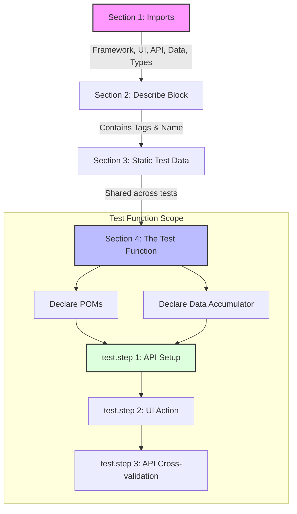
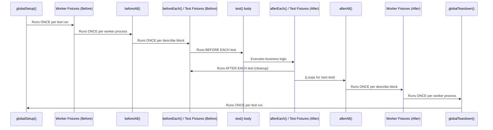

# 24. Test Script Architecture — POMs Before Steps, Data Never Exposed

**Navigation**: [← Chapter 23: APIUtils — Your HTTP Library](./23_APIUtils_HTTP_Library.md) | [Index](../00_INDEX.md)

**Cross-links:**

- [`07_test_step_E2E_Architecture.md`](../02_Test_Architecture/07_test_step_E2E_Architecture.md) — The Data Accumulator pattern
- [`05_POM_Architecture_Deep_Dive.md`](../02_Test_Architecture/05_POM_Architecture_Deep_Dive.md) — POM internals
- [`21_Enterprise_Project_Structure.md`](./21_Enterprise_Project_Structure.md) — Where each file lives

---

## The Question This Chapter Answers

Your test is set up like this. You see it in the codebase. It looks a specific way and you want to know **why each part is placed where it is**:

```typescript
test("Verify citation flow", async ({ page, account, citationsClient }) => {
  //                                    ↑ fixture params

  // ─── POMs are created HERE — at the TOP of the test function body ───────
  const masterSearchPage = new MasterSearchPage(page);
  const citationDetailPage = new CitationDetailPage(page);
  //                                                ↑ ALL POMs declared BEFORE any step

  // ─── Data accumulator declared HERE — typed, all null ───────────────────
  const data = {
    citationId: null as string | null,
    finalStatus: null as string | null,
  };

  // ─── Steps come AFTER ────────────────────────────────────────────────────
  await test.step("Navigate to Master Search", async () => {
    await masterSearchPage.goto();
  });

  await test.step("Search for customer and open citation", async () => {
    await masterSearchPage.searchPanel.searchByTransitAccount(account.userId);
    await masterSearchPage.resultsGrid.waitForResults();
    data.citationId = await masterSearchPage.resultsGrid.getFirstRowId();
  });

  await test.step("API: Verify citation is PENDING", async () => {
    const citation = await citationsClient.getById(data.citationId!);
    expect(citation.status).toBe("PENDING");
  });
});
```

**Why is `masterSearchPage` declared BEFORE `await test.step(...)`? Why not inside the step?**

This chapter explains every structural decision in an enterprise test.

---

## 1. Why POMs Are Created at the TOP of the Test Body

### The Technical Reason — TypeScript Scope

```typescript
test("example", async ({ page }) => {
  // If you declare inside step 1:
  await test.step("Step 1: Navigate", async () => {
    const masterPage = new MasterSearchPage(page); // ← inside step 1's closure
    await masterPage.goto();
  });

  await test.step("Step 2: Search", async () => {
    await masterPage.searchPanel.searchById("CIT-001");
    //    ↑ TypeScript ERROR: Cannot find name 'masterPage'
    //    It was declared in a different closure (step 1's inner function)
  });
});
```

`masterPage` is scoped to `step 1`'s async arrow function `async () => { ... }`. It doesn't exist in `step 2`'s scope. TypeScript correctly rejects this.

**Solution: Hoist to the test function's outer scope:**

```typescript
test("example", async ({ page }) => {
  // Declared in the TEST function's scope — accessible from ALL steps
  const masterPage = new MasterSearchPage(page);

  await test.step("Step 1: Navigate", async () => {
    await masterPage.goto(); // ✅ works — masterPage is in the enclosing scope
  });

  await test.step("Step 2: Search", async () => {
    await masterPage.searchPanel.searchById("CIT-001"); // ✅ works
  });
});
```

JavaScript closures: inner functions (steps) can READ variables from their outer function (the test). This is why POMs declared in the test body are accessible to all steps inside it.

### The Practical Reason — You Read Tests Like a Map

When another SDET opens your test, the first thing they want to know is:
**"What pages does this test interact with?"**

Placing all POMs at the top answers that in 3 lines:

```typescript
test('Citation dispute flow', async ({ page, account, citationsClient }) => {
  // ── What pages this test touches: ──────────────────────────────────────
  const masterSearchPage = new MasterSearchPage(page);
  const citationDetailPage = new CitationDetailPage(page);
  const disputeFormPage = new DisputeFormPage(page);
  // ───────────────────────────────────────────────────────────────────────
  // At a glance: this test touches 3 pages.
  // The reader knows the scope before reading a single step.
```

If POMs were created inside steps, you'd have to scan every step body to discover which pages are involved.

### The "Why Not Inside the Step?" Answer

```
Question: "Why not create the POM inside the step that first uses it?"

Answer:
  1. It won't compile — the POM won't be in scope for other steps
  2. It separates "what" (POM = the page/component) from "how" (steps = the actions)
  3. It mirrors how a real user thinks: "I'm on the Master Search page. I do these things."
     Not: "I go to step 3, create a master search object, use it, then never see it again."
```

---

## 2. Why the Data Accumulator Is Also at the Top

```typescript
test('create citation and verify', async ({ page, citationsClient, account }) => {
  // POMs:
  const masterSearchPage = new MasterSearchPage(page);

  // Data accumulator — all null initially
  const data = {
    citationId: null as string | null,
    citationStatus: null as string | null,
    notificationId: null as string | null,
  };
  // Why all null? Because nothing has happened yet.
  // The steps FILL IN this data as they progress.

  await test.step('Create citation via API', async () => {
    const citation = await citationsClient.create(
      PayloadsCitation.pending({ customerId: account.userId })
    );
    data.citationId = citation.citationId;  // ← step 1 fills it in
  });

  await test.step('Find citation in UI', async () => {
    await masterSearchPage.searchPanel.searchByCitationId(data.citationId!);
    //                                                     ↑ used by step 2
    // The ! is a TypeScript non-null assertion — we know step 1 ran and set it.
    // Step 1's own assertion `expect(data.citationId).not.toBeNull()` guards this.
  });
```

**Why not use `let` variables instead of an object?**

```typescript
// ❌ let variables — TypeScript "possibly unassigned" problem
let citationId: string;

await test.step("Create", async () => {
  citationId = "CIT-001"; // assigned in a closure
});

await test.step("Find", async () => {
  masterSearchPage.searchByCitationId(citationId);
  //                                   ↑ TypeScript: Variable 'citationId' is used before being assigned
  //   The compiler can't prove step 1 runs before step 2 at compile time.
});

// ✅ Object property — no "possibly unassigned" error
const data = { citationId: null as string | null };
// TypeScript knows: data exists (it's const), data.citationId is string | null (explicit type).
// No ambiguity.
data.citationId = "CIT-001";
masterSearchPage.searchByCitationId(data.citationId!); // ! is intentional: "I know this was set"
```

---

## 3. The Complete Anatomy of an Enterprise Test

### Visualising the Test Structure



**How to read this diagram.** Read it top to bottom as the four sections of a spec file: imports, the describe block with its tags and name, shared static test data, and finally the test function. Inside the test function box, the POMs and the data accumulator are declared first, then three `test.step` blocks run in order (API setup, UI action, API cross-validation). Notice that steps 1 to 3 all sit inside the single test function scope.

```typescript
// tests/specs/citations/dispute-flow.spec.ts
//
// ANATOMY GUIDE:
// Section 1: Imports          — only fixtures, POMs, payloads, enums
// Section 2: Test description  — describes, tags, and human-readable test name
// Section 3: Static test data  — data that never changes across test runs
// Section 4: Test body         — POMs, accumulator, then steps
// Section 5: Steps             — each step is one business action

// ─── SECTION 1: IMPORTS ─────────────────────────────────────────────────────
// Rule: never import from @playwright/test directly — always from your fixtures file
import { test, expect } from "../../fixtures";

// Page objects — UI layer
import { MasterSearchPage } from "../../pages/MasterSearchPage";
import { CitationDetailPage } from "../../pages/CitationDetailPage";

// Business data — not raw strings
import { PayloadsCitation } from "../../data/payloads/PayloadsCitation";
import { CitationStatus } from "../../data/enums/citation.enums";

// Types — for TypeScript to understand the accumulator
import type { CitationApiResponse } from "../../types/api-responses.types";

// ─── SECTION 2: DESCRIBE + TAGS ─────────────────────────────────────────────
// Tags like @smoke, @citations, @regression allow filtering:
//   npx playwright test --grep "@smoke"        → only smoke tests
//   npx playwright test --grep-invert "@slow"  → skip slow tests in CI
test.describe("Citation Dispute Flow @citations @regression", () => {
  // ─── SECTION 3: STATIC TEST DATA ──────────────────────────────────────────
  // Why here (inside describe, outside test)?
  // → Shared by all tests in this describe block
  // → Does NOT change between test runs (unlike data generated at test time)
  // → Visible to all tests without being a module-level variable
  const disputeReason = "Vehicle not present at location";
  const expectedResolutionDays = 30;

  // ─── SECTION 4: THE TEST ────────────────────────────────────────────────
  test("Customer disputes citation → Admin reviews → Status updates → Customer notified", async ({
    page,
    account,
    citationsClient,
    notificationsClient,
  }) => {
    // ── POMs: declared at TOP of test body ───────────────────────────────
    // Why? Scope + readability (see Section 1 of this chapter)
    const masterSearch = new MasterSearchPage(page);
    const citationDetail = new CitationDetailPage(page);

    // ── Data accumulator: one object, typed, all null initially ──────────
    // Why an object and not `let` vars? TypeScript scope (see Section 2)
    const data = {
      createdCitation: null as CitationApiResponse | null,
      disputeReference: null as string | null,
      resolvedStatus: null as string | null,
    };

    // ── STEPS ─────────────────────────────────────────────────────────────

    // ── Step 1: Setup via API (faster than UI setup) ──────────────────────
    // Why API for setup? UI setup is slow and tested elsewhere.
    // This test is about the DISPUTE flow, not the CREATION flow.
    await test.step("Setup: Create a PENDING citation via API", async () => {
      data.createdCitation = await citationsClient.create(
        PayloadsCitation.pending({ customerId: account.userId }),
      );
      expect(data.createdCitation.citationId).toMatch(/^CIT-/);
      expect(data.createdCitation.status).toBe(CitationStatus.PENDING);
    });

    // ── Step 2: UI action ─────────────────────────────────────────────────
    // Now we use the UI — the customer disputes through the portal
    await test.step("Navigate to Master Search in CRM", async () => {
      await masterSearch.goto();
      // D365-specific wait (see Chapter 17):
      await expect(masterSearch.searchPanel.tabCustomerSearch).toBeVisible({
        timeout: 30_000,
      });
    });

    await test.step(`Find citation ${data.createdCitation!.citationId} in CRM`, async () => {
      await masterSearch.searchPanel.searchByCitationId(
        data.createdCitation!.citationId,
      );
      await masterSearch.resultsGrid.waitForResults();
      await masterSearch.resultsGrid.clickRowByIndex(0);
    });

    await test.step("Open citation and submit dispute", async () => {
      await citationDetail.waitForLoad();
      await citationDetail.disputeButton.click();
      await citationDetail.disputeReasonInput.fill(disputeReason);
      await citationDetail.submitDisputeButton.click();
      await expect(citationDetail.disputeConfirmationBanner).toBeVisible({
        timeout: 10_000,
      });
      data.disputeReference = await citationDetail.getDisputeReference();
    });

    // ── Step 3: API cross-validation (verify backend agrees with UI) ──────
    await test.step("API: Confirm citation status is now DISPUTED", async () => {
      // The status change may be async — use polling
      const updated = await citationsClient.waitForStatus(
        data.createdCitation!.citationId,
        CitationStatus.DISPUTED,
      );
      data.resolvedStatus = updated.status;
      expect(updated.status).toBe(CitationStatus.DISPUTED);
    });

    await test.step("Notifications: DISPUTE_CREATED notification was sent", async () => {
      await notificationsClient.pollForNotification(
        account.userId,
        "DISPUTE_CREATED",
      );
      // pollForNotification throws if the notification doesn't arrive within timeout
    });

    // ── Step 4: Final cross-validation ──────────────────────────────────
    await test.step("Verify: dispute reference is in the API response", async () => {
      const citation = await citationsClient.getById(
        data.createdCitation!.citationId,
      );
      expect(citation.disputeReference).toBe(data.disputeReference);
    });
  }); // end test
}); // end describe
```

---

## 4. Why Data NEVER Goes in the Script File

### The Rule

```typescript
// ❌ NEVER in a spec file:
const adminEmail = "admin@company.com"; // hardcoded credential
const adminPassword = "Admin@123!"; // hardcoded credential
const apiKey = "sk-live-abc123xyz789"; // hardcoded secret
const crmUrl = "https://crm.company.com"; // hardcoded URL
```

```typescript
// ✅ ALWAYS in environment variables + fixtures:
// .env.local (never committed to Git):
//   ADMIN_EMAIL=admin@company.com
//   ADMIN_PASSWORD=Admin@123!
//   CRM_API_KEY=sk-live-abc123xyz789
//   CRM_URL=https://crm.company.com

// In fixtures/index.ts:
export const test = base.extend<{}, { account: AuthAccount }>({
  account: [
    async ({}, use) => {
      await use({
        email: process.env.ADMIN_EMAIL!,
        accessToken: process.env.ADMIN_ACCESS_TOKEN!,
        // ...other fields
      });
    },
    { scope: 'worker' },
  ],
});

// In a test file:
test('example', async ({ account }) => {
  // Test receives account.email — the plaintext value never appears in the source tree.
});
```

**Why?**

| Reason                      | Consequence of NOT following it                              |
| --------------------------- | ------------------------------------------------------------ |
| **Security**                | Credentials in Git → breach, credential rotation headaches   |
| **Environment flexibility** | Hardcoded staging URL breaks when running locally            |
| **Token rotation**          | Hardcoded tokens expire → tests fail mysteriously at 2 AM    |
| **Auditability**            | Can't tell which tests used which credentials                |
| **Multi-role testing**      | Can't swap from ADMIN to CUSTOMER token without code changes |

---

## 5. The `test.step()` Naming Convention

Step names are what appear in the Playwright HTML report. They should be:

```typescript
// ❌ Vague steps — useless in failure reports
await test.step('step 1', async () => { ... });
await test.step('do thing', async () => { ... });
await test.step('check', async () => { ... });

// ✅ Descriptive steps — tells you exactly what failed
await test.step('Navigate to Master Search → CRM portal', async () => { ... });
await test.step('Search for customer by transit account: TA-12345', async () => { ... });
await test.step('API: Verify citation CIT-001 has status PENDING', async () => { ... });
await test.step('Notifications: DISPUTE_CREATED email sent within 30s', async () => { ... });
```

**Why include data in step names?**

```typescript
// Bad: when this fails, you see "Search for customer" — but WHICH customer?
await test.step("Search for customer", async () => {
  await masterSearch.searchPanel.searchByEmail(data.email!);
});

// Better: the step name includes the runtime value
await test.step(`Search for customer by email: ${data.email ?? "not set yet"}`, async () => {
  await masterSearch.searchPanel.searchByEmail(data.email!);
});
// In the failure report: "Search for customer by email: john.smith@company.com"
// You can immediately reproduce the failure without digging into the data accumulator.
```

---

## 6. The Correct Import Order (Convention)

```typescript
// Enterprise convention: imports in this order, separated by blank lines

// 1. Framework imports (always first)
import { test, expect } from "../../fixtures"; // YOUR fixtures wrapper

// 2. Page Object Models (UI layer)
import { MasterSearchPage } from "../../pages/MasterSearchPage";
import { CitationDetailPage } from "../../pages/CitationDetailPage";

// 3. API clients (if used directly in test — not via fixtures)
// Usually not needed here since clients come through fixtures

// 4. Data layer (payloads, enums)
import { PayloadsCitation } from "../../data/payloads/PayloadsCitation";
import {
  CitationStatus,
  NotificationType,
} from "../../data/enums/citation.enums";

// 5. TypeScript types (interfaces/types only, not runtime values)
import type { CitationApiResponse } from "../../types/api-responses.types";

// 6. Utilities (date utils, string utils, etc.)
import { DateUtils } from "../../utils/date.utils";
```

**Why this order?** It matches the "layer" model — framework → UI → API → data → types → utils. When scanning imports, you immediately understand the test's dependencies.

---

## 7. The Full Enterprise Test — Annotated Reference

```typescript
// tests/specs/citations/create-and-notify.spec.ts

// ── Imports: framework → UI → data → types ───────────────────────────────────
import { test, expect } from "../../fixtures";
import { MasterSearchPage } from "../../pages/MasterSearchPage";
import { PayloadsCitation } from "../../data/payloads/PayloadsCitation";
import { CitationStatus } from "../../data/enums/citation.enums";
import type { CitationApiResponse } from "../../types/api-responses.types";

// ── Describe: name + tags ─────────────────────────────────────────────────────
test.describe("Create citation and verify notification @citations @smoke", () => {
  // ── Test: business description as the name ────────────────────────────────
  test("Agent creates PARKING citation → customer receives email notification within 30s", async ({
    page,
    account,
    citationsClient,
    notificationsClient,
  }) => {
    //        ↑ page   ↑ auth    ↑ HTTP client   ↑ notifications client
    //        Playwright built-in  ←── your custom fixtures ──────────────────────►

    // ── POMs: ALL declared here, BEFORE any step ──────────────────────────
    const masterSearch = new MasterSearchPage(page);
    // ↑ Why here? See Section 1 of this chapter.
    // ↑ masterSearch is in scope for ALL test.step() callbacks below.
    // ↑ If it were inside a step, other steps couldn't use it.

    // ── Accumulator: typed, all null, declared here ────────────────────────
    const data = {
      citation: null as CitationApiResponse | null,
    };
    // ↑ Why an object and not `let`? See Section 2 of this chapter.

    // ── Steps: sequential business actions ────────────────────────────────

    await test.step("Create PENDING citation via API (fast setup)", async () => {
      // Using API for setup — not UI — because UI creation is tested separately.
      // This test is about NOTIFICATION DELIVERY, not about the creation UI.
      data.citation = await citationsClient.create(
        PayloadsCitation.pending({ customerId: account.userId }),
        // ↑ Why PayloadsCitation.pending()? See Chapter 22.
        // ↑ No JSON here — business intent only.
      );
      // Assert the setup worked before proceeding
      expect(data.citation.status).toBe(CitationStatus.PENDING);
    });

    await test.step("Confirm citation visible in CRM Master Search", async () => {
      await masterSearch.goto();
      await masterSearch.searchPanel.searchByCitationId(
        data.citation!.citationId,
      );
      // ↑ data.citation! — non-null assertion, safe because step 1 asserted it
      await masterSearch.resultsGrid.waitForResults();
      await expect(masterSearch.resultsGrid.rows.first()).toContainText(
        data.citation!.citationId,
      );
    });

    await test.step("Notification: CITATION_CREATED email delivered within 30s", async () => {
      // Polling — the notification service is async (it may take a few seconds)
      const notification = await notificationsClient.pollForNotification(
        account.userId,
        "CITATION_CREATED",
        30_000, // 30 second timeout
      );
      // Business assertions — not HTTP assertions
      expect(notification.channel).toBe("email");
      expect(notification.status).toBe("delivered");
      expect(notification.referenceId).toBe(data.citation!.citationId);
    });
  }); // end test
}); // end describe
```

---

## 8. The Test Lifecycle & Hooks Architecture

Understanding the order in which setup, teardown, and hooks execute is critical for preventing flaky tests, data collisions, and stale state.

### The Execution Order Visualised



### Global Setup vs. Hooks vs. Fixtures

Enterprise suites separate setup logic by scope for a reason each layer earns:

1. **`globalSetup`** runs *once* in the main Playwright process, before any workers exist. This is the only phase where "once for the entire run" is literally true. Use it for work that must not be duplicated per worker: seeding a shared test database, calling a remote provisioning API, writing a `storageState.json` that every worker will load. Any state it produces has to be persisted somewhere workers can read — usually a file on disk — because worker processes do not inherit `globalSetup`'s memory.

2. **`beforeAll` / `afterAll`** is the phase most testers coming from Jest or Mocha get wrong. In Playwright, `beforeAll` runs once *per worker process per describe block*, **not** once per describe block. If your suite runs with `workers: 4`, `beforeAll` in a shared describe runs **four times** — one per worker — because each worker is a separate Node.js process with its own module heap, its own imports, and its own hooks (the same worker-process isolation [Ch09 §1](../02_Test_Architecture/09_Parallel_Execution_Workers.md#1-the-worker-model--what-actually-happens) establishes for the whole test file — this is that same fact showing up specifically for hooks). A `beforeAll` that inserts a row with a fixed ID will race four inserts of the same ID. That is what "cross-test contamination" means here: not tests interfering with each other, but the *hook itself* running more times than the author expected. If you need something to happen exactly once, `globalSetup` is the only phase that guarantees it. If per-worker is what you want (a database connection pool, a browser context), `beforeAll` is fine — but generate unique IDs and treat the setup as parallel-safe. [Ch26 Challenge 2](../06_CI_CD_And_Reliability/26_Flakiness_Diagnosis_and_Fixing.md#challenge-2-spot-the-bug--data-pollution) works through exactly this mistake — fixtures destructured into a `beforeAll` that can't actually receive them.

3. **`beforeEach` / `afterEach`** runs before/after every test. It works, but test-scoped **fixtures** are strictly better for setup that owns a resource: the fixture's teardown after `await use(...)` runs even when the test throws mid-body, and even when a `beforeEach` in the same test errored (a hook throw skips subsequent `beforeEach` and the test, but fixtures already partway set up still tear down). `afterEach` runs unconditionally too, but it has no built-in link to the resource it should clean up — you have to remember which variable holds what.

```typescript
// ❌ Bad: cleanup in afterEach can fail if the test crashed mid-way
test.afterEach(async ({ page }) => {
  await api.deleteUser(createdUserId); // Might be undefined if test failed!
});

// ✅ Good: Test-scoped fixture handles its own lifecycle
test("My test", async ({ customerUser }) => {
  // customerUser is injected, used, and automatically deleted by the fixture's teardown
});
```

---

## 🏋️ Practice Challenges

### Challenge 1 [MCQ] — Scope Question

```typescript
test("example", async ({ page }) => {
  await test.step("Step 1", async () => {
    const form = new CitationFormPage(page);
    await form.goto();
  });

  await test.step("Step 2", async () => {
    await form.fillCitationId("CIT-001"); // ← what happens?
  });
});
```

What happens on the `await form.fillCitationId(...)` line?

A) It works — `form` is in the test function's scope  
B) TypeScript compile error — `form` is not defined in this scope  
C) Runtime error — `form` is undefined  
D) It works — `test.step` shares scope with the test function

<details><summary>Answer</summary>

**B** — TypeScript compile error. `form` is declared inside the `async () => { ... }` callback of Step 1. That callback is a separate function scope (a closure). Step 2's callback is a DIFFERENT function scope. TypeScript correctly identifies that `form` is not in scope for Step 2.

Fix: move `const form = new CitationFormPage(page)` to the test function body (before any steps).

</details>

---

### Challenge 2 [Spot the Bug]

```typescript
test("lookup customer", async ({ page, account }) => {
  const data = { customerId: null as string | null };
  const masterSearch = new MasterSearchPage(page);

  await test.step("Search customer", async () => {
    await masterSearch.searchPanel.searchByEmail(account.email);
    await masterSearch.resultsGrid.waitForResults();
    data.customerId = await masterSearch.resultsGrid.getFirstRowId();
    // ← No assertion that data.customerId is not null
  });

  await test.step("Open customer record", async () => {
    await masterSearch.resultsGrid.clickRowByIndex(0);
    const detail = new CustomerDetailPage(page);
    await detail.waitForLoad();
    await expect(detail.customerId).toHaveText(data.customerId!, {
      timeout: 20000,
    });
    // ↑ If data.customerId is null (no results found), this gives a confusing error
  });
});
```

<details><summary>Answer</summary>

The bug is **missing validation after `getFirstRowId()`**. If the search returns no results, `data.customerId` stays `null`. Step 2 then tries `toHaveText(null!, ...)` — the `!` bypasses TypeScript's null check, and the assertion message will be something like `Expected "CUSTOMER-123" to equal null` — confusing.

Fix: Add an assertion in step 1:

```typescript
await test.step("Search customer", async () => {
  await masterSearch.searchPanel.searchByEmail(account.email);
  await masterSearch.resultsGrid.waitForResults(1); // at least 1 row
  data.customerId = await masterSearch.resultsGrid.getFirstRowId();
  expect(
    data.customerId,
    "Customer must appear in search results",
  ).not.toBeNull();
  // ↑ Clear failure message if search returns no results
});
```

</details>

---

### Challenge 3 [Write It Yourself]

Write a complete test for this business scenario using the architecture from this chapter:

**Scenario:** "Admin creates a new SUPERVISOR user via API → the new supervisor logs into the portal → the supervisor's dashboard shows 0 assigned citations"

Use:

- `account` fixture (admin)
- A `UsersApiClient` with a `create(payload)` method
- `PayloadsUser.newSupervisor(email, teamId)` from Chapter 21
- `SupervisorDashboardPage` POM (assume it exists with `goto()`, `waitForLoad()`, `assignedCitationsCount` locator)
- Typed data accumulator

<details><summary>Answer</summary>

```typescript
import { test, expect } from "../../fixtures";
import { SupervisorDashboardPage } from "../../pages/SupervisorDashboardPage";
import { PayloadsUser } from "../../data/payloads/PayloadsUser";
import { StringUtils } from "../../utils/string.utils";
import type { CreateUserResponse } from "../../types/api-responses.types";

test.describe("New supervisor onboarding @users @smoke", () => {
  test("Admin creates supervisor → supervisor dashboard shows 0 assigned citations", async ({
    page,
    account,
    usersClient,
  }) => {
    // ── POMs: declared at top of test body ─────────────────────────────
    const supervisorDashboard = new SupervisorDashboardPage(page);

    // ── Accumulator ────────────────────────────────────────────────────
    const data = {
      newSupervisor: null as CreateUserResponse | null,
    };

    // ── Steps ──────────────────────────────────────────────────────────

    await test.step("Create new supervisor user via API", async () => {
      const payload = PayloadsUser.newSupervisor(
        StringUtils.randomEmail("supervisor"),
        "TEAM-001", // team ID — from env or config, not hardcoded in real tests
      );
      data.newSupervisor = await usersClient.create(payload);
      expect(data.newSupervisor.userId).toMatch(/^USR-/);
      expect(data.newSupervisor.role).toBe("SUPERVISOR");
    });

    await test.step(`Login as new supervisor: ${data.newSupervisor?.email}`, async () => {
      // In a real test, supervisor would use their own storageState or login flow
      // Here: navigate to dashboard (assume supervisor is already authenticated)
      await supervisorDashboard.goto();
      await supervisorDashboard.waitForLoad();
    });

    await test.step("Dashboard shows 0 assigned citations for new supervisor", async () => {
      await expect(supervisorDashboard.assignedCitationsCount).toHaveText("0", {
        timeout: 15_000,
      });
    });
  });
});
```

</details>

---

## Summary — The Enterprise Test Architecture Rules

| Rule                                                     | Reason                                                          |
| -------------------------------------------------------- | --------------------------------------------------------------- |
| Import from `../../fixtures`, not `@playwright/test`     | Your custom test object has fixtures baked in                   |
| Declare ALL POMs at top of test body                     | TypeScript scope: steps (closures) need outer-scope variables   |
| Use a typed data accumulator object                      | `let` creates "possibly unassigned" errors across step closures |
| Name steps as business actions, not technical operations | Failure reports should be readable by QA leads, not just coders |
| Never put URLs, credentials, or tokens in spec files     | Security, environment flexibility, token rotation               |
| Use enums, not magic strings                             | Compile-time typo detection, autocomplete                       |
| Use payload factories with overrides                     | Readable defaults, composable with real test data               |
| Assertions inside steps, not after them                  | Step-level failure isolation: you know WHICH step failed        |

---

**Navigation**: [← Chapter 23: APIUtils — Your HTTP Library](./23_APIUtils_HTTP_Library.md) | [Index](../00_INDEX.md)

---

### Challenge 4 [MCQ] — The Non-Null Assertion Operator `!`

```typescript
await test.step("Create citation via API", async () => {
  data.citation = await citationsClient.create(
    PayloadsCitation.pending({ customerId: account.userId }),
  );
  // ← NO assertion that data.citation is valid
});

await test.step("Verify citation in UI", async () => {
  await masterSearch.searchPanel.searchByCitationId(data.citation!.citationId);
  //                                                             ↑
  //                           Non-null assertion: "Trust me TypeScript, this is not null"
});
```

When is the `!` (non-null assertion) safe, and when is it masking a bug?

- A) `!` is always safe — TypeScript checks it at compile time so it can never be null at runtime
- B) `!` is safe when a prior step's assertion guarantees the value is set; it masks a bug when the prior step has no assertion
- C) `!` should never be used — always use `??` to provide a default instead
- D) `!` is safe after `await` calls because async functions always return defined values

<details><summary>Answer</summary>

**B** — The non-null assertion `!` is a compile-time override. It tells TypeScript "I know this isn't null" but TypeScript does NOT check this at runtime. If the value IS null, you get a runtime `TypeError: Cannot read properties of null`.

The `!` is **safe** when a prior step's assertion explicitly validated the value:

```typescript
await test.step('Create citation', async () => {
  data.citation = await citationsClient.create(...);
  expect(data.citation.citationId, 'Citation must be created').toMatch(/^CIT-/);
  //                                ↑ If citationId is null/undefined, THIS step fails with a clear message
  // Because this assertion runs, data.citation is proven non-null before step ends.
});

// Now safe to use !:
await test.step('Verify in UI', async () => {
  await masterSearch.searchPanel.searchByCitationId(data.citation!.citationId);
  // ^ Safe: step 1's assertion proved citationId is a CIT-* string
});
```

The `!` is **masking a bug** when:

```typescript
await test.step('Create citation', async () => {
  data.citation = await citationsClient.create(...);
  // ← No assertion. If API returns null/error body, data.citation is wrong.
  // Error is swallowed by the missing assertion.
});

await test.step('Verify in UI', async () => {
  await masterSearch.searchPanel.searchByCitationId(data.citation!.citationId);
  // ^ Throws: TypeError: Cannot read properties of null (reading 'citationId')
  // The error appears in STEP 2, but the REAL bug is in STEP 1.
  // Misleading failure attribution.
});
```

**Rule**: Every time you use `!` on a data accumulator property, there must be an `expect(...)` assertion in the step that set that property.

</details>

---

### Challenge 5 [Spot the Bug — Step Naming and Data Exposure]

```typescript
const adminEmail = "admin@acme-company.com";
const adminPassword = "SecurePass@2024!";

test.describe("Admin authentication", () => {
  test("Admin can log in and see dashboard", async ({ page }) => {
    const loginPage = new LoginPage(page);
    const dashboard = new DashboardPage(page);

    await test.step("Login with admin credentials", async () => {
      await loginPage.goto();
      await loginPage.emailInput.fill(adminEmail);
      await loginPage.passwordInput.fill(adminPassword);
      await loginPage.submitButton.click();
    });

    await test.step("check dashboard", async () => {
      await expect(dashboard.header).toBeVisible();
    });
  });
});
```

Three violations of enterprise test architecture. Find them all.

<details><summary>Answer</summary>

**Violation 1 — Credentials hardcoded in the spec file**
`adminEmail` and `adminPassword` are string constants in the test file. This means they are committed to Git, visible in code reviews, and invalidated every time credentials rotate. Enterprise fix:

```typescript
// .env.local (never committed):
// ADMIN_EMAIL=admin@acme-company.com
// ADMIN_PASSWORD=SecurePass@2024!

// In fixtures:
account: async ({}, use) => {
  await use({
    email: process.env.ADMIN_EMAIL!,
    password: process.env.ADMIN_PASSWORD!,
  });
};

// In test: async ({ account }) => { ... account.email ... }
```

**Violation 2 — Vague step name: `'check dashboard'`**
In the Playwright HTML report, a failed step shows only its name. `'check dashboard'` tells you nothing about what was checked, which element, or what the expected state was. Enterprise fix:

```typescript
await test.step("Dashboard: header element is visible after admin login", async () => {
  await expect(dashboard.header).toBeVisible({ timeout: 15_000 });
});
```

The step name should read like a test case description: readable by a QA lead who doesn't know the codebase.

**Violation 3 — `DashboardPage` POM created outside the test function**
Wait — actually `dashboard` IS declared inside the test function. But `loginPage` and `dashboard` are both declared before any steps, which is correct. The real third violation is **no assertion after the login step** — if the login fails silently (submit button clicks but auth fails), the test proceeds to "check dashboard" with a failing auth state. Add:

```typescript
await test.step("Login with admin credentials", async () => {
  await loginPage.goto();
  await loginPage.emailInput.fill(account.email);
  await loginPage.passwordInput.fill(account.password);
  await loginPage.submitButton.click();
  // Assert the login succeeded before continuing:
  await expect(page).toHaveURL(/\/dashboard/, { timeout: 15_000 });
  // Without this, a login failure surfaces in step 2 as "header not visible" — wrong attribution.
});
```

Summary of fixes: move credentials to environment variables + fixtures, rename steps to be business-descriptive, add end-of-step assertions to validate state before the next step depends on it.

</details>

---

**Navigation**: [← Chapter 23: APIUtils — Your HTTP Library](./23_APIUtils_HTTP_Library.md) | [Index](../00_INDEX.md)


---

## Reality Check

**"Arrange-Act-Assert is enough structure for test scripts"**→ AAA structures individual tests but does not address: how tests share setup code (fixtures vs beforeEach), how tests share data (factory functions vs inline data), and how tests share assertions (custom matchers vs utility functions). Test script architecture is about the patterns BETWEEN tests, not just within them.

**"beforeAll should set up data, afterAll should clean it up"**→ beforeAll runs once per worker, not once per suite. In parallel execution with 4 workers, beforeAll runs 4 times — potentially creating duplicate data or racing on shared resources. Use globalSetup for truly one-time setup. Use beforeAll only for worker-scoped resources (database connections, browser contexts).

**"Test independence means no shared state at all"**→ Tests should be independently RUNNABLE, not independently ISOLATED. Sharing read-only reference data (list of countries, configuration values) between tests is fine and efficient. Sharing MUTABLE state (a user that test A modifies and test B reads) creates order dependencies. The boundary is mutability, not sharing.

**"Descriptive test names are enough documentation"**→ A test named should display error when payment fails does not explain: what kind of payment failure (declined card, network timeout, insufficient funds), what error is displayed (toast, inline message, error page), or what the preconditions are (logged in, cart has items). Test names should be specific enough that a failure report tells you exactly what scenario broke without reading the test code.

**"Test files should mirror the application structure"**→ Test files should mirror USER JOURNEYS, not application structure. The application has: LoginPage, ProductPage, CartPage, CheckoutPage. Tests should be: purchase-flow.spec.ts, return-flow.spec.ts, account-management.spec.ts. Users do not think in pages — they think in goals. Test organization should reflect goals, not implementation.
