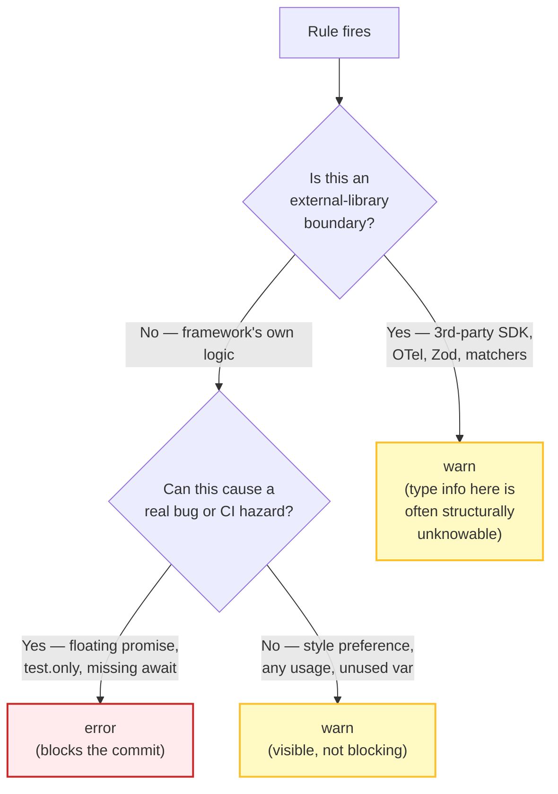
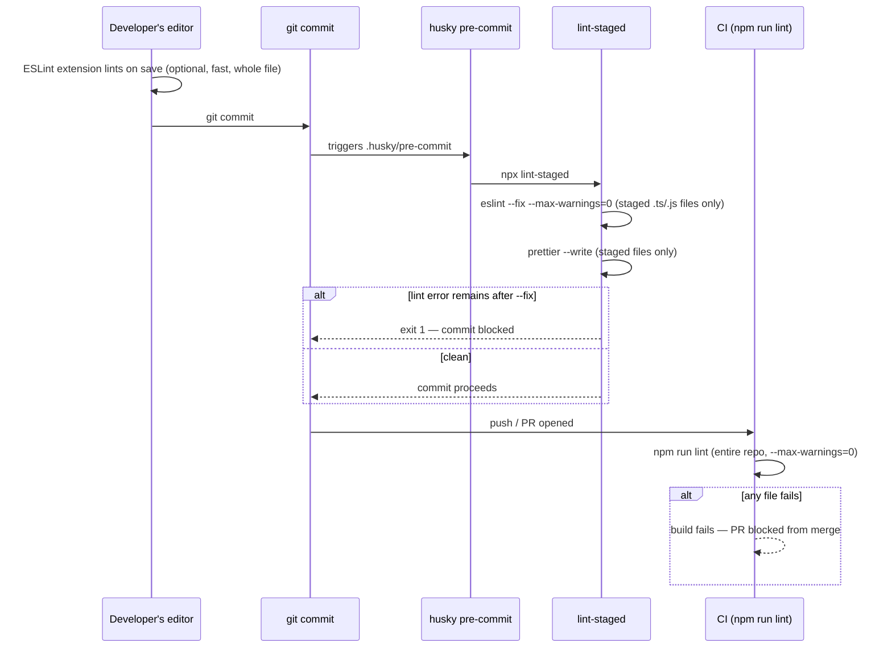

# 63. Static Analysis — ESLint for TypeScript & Playwright

**Navigation**: [← Chapter 62: Enterprise Test Operations](../06_CI_CD_And_Reliability/62_Enterprise_Test_Operations.md) | [Index](../00_INDEX.md) | [→ Chapter 64: Dynamic Locators & Data Structures](../02_Test_Architecture/64_Dynamic_Locators_And_Data_Structures_In_POMs.md)

**Cross-links:**

- [`framework/.eslintrc.cjs`](../framework/.eslintrc.cjs) — the real, live config this chapter is built from
- [`framework/CONTRIBUTING.md`](../framework/CONTRIBUTING.md) — the team-facing summary of these rules
- [`36_TypeScript_Type_System_Mastery.md`](../08_SDET_to_SDE_Bridge/36_TypeScript_Type_System_Mastery.md) — the type system these rules reason about
- [`26_Flakiness_Diagnosis_and_Fixing.md`](../06_CI_CD_And_Reliability/26_Flakiness_Diagnosis_and_Fixing.md) — several flakiness types this chapter's rules prevent structurally
- [`25_CICD_Integration_GitHub_Azure.md`](../06_CI_CD_And_Reliability/25_CICD_Integration_GitHub_Azure.md) — where `npm run lint` sits in the pipeline

---

## 5W1H

- **WHAT**: How ESLint, `typescript-eslint`, and `eslint-plugin-playwright` catch bugs that `tsc` compiles clean and Prettier doesn't even look at — and the actual mechanism (a real TypeScript type checker running inside the linter) that makes it possible.
- **WHY**: `npx tsc --noEmit` proves your code is *type-correct*. It says nothing about whether you forgot to `await` a `page.click()`, left a `test.only` in the diff, or wrote `a == b` instead of `a === b`. Those are exactly the bugs that produce flaky, silently-wrong tests — the kind [Ch26](../06_CI_CD_And_Reliability/26_Flakiness_Diagnosis_and_Fixing.md) spends 900 lines diagnosing after the fact. Static analysis catches them before the test ever runs.
- **WHO**: Every SDET committing to this framework — the pre-commit hook runs this on every commit, not just on request.
- **WHEN**: On every keystroke (editor), every commit (`husky` + `lint-staged`), and every PR (`npm run lint` in CI).
- **HOW**: `@typescript-eslint/parser` replaces ESLint's default parser with one backed by a real `ts.Program`, so rules can call the actual TypeScript type checker — not just pattern-match syntax.

---

## 1. The Problem — What `tsc` Doesn't Catch

Start from what you already trust: `tsc --noEmit` type-checks the file below and reports **zero errors**.

```typescript
export async function fetchUser(id: string): Promise<any> {
  const res = await fetch(`/api/users/${id}`);
  return res.json();
}

export function loadUser(id: string): void {
  fetchUser(id); // not awaited — fire and forget
}

export function badCompare(a: any, b: any): boolean {
  return a == b; // loose equality
}
```

It's valid TypeScript. `loadUser` returns `void`, so not returning the promise from `fetchUser` isn't a type error — a function is allowed to ignore a value. But it's a real bug: `loadUser`'s caller thinks the user is loaded when it returns; it isn't. If this were a Playwright helper, the next line of the test would run before the API call resolved — a Type-1 timing flake by the [Ch26](../06_CI_CD_And_Reliability/26_Flakiness_Diagnosis_and_Fixing.md) taxonomy, except now it's baked into a helper function, not a spec, so it produces flake in *every test that calls it*.

`tsc` can't flag this because "did you intend to discard this value" is not a type question — the type is valid either way. It needs a different kind of tool: one that understands not just "is this code well-typed" but "is this a pattern that's almost always a mistake." That's what a linter is for, and it's a separate concern from formatting, which is why this framework runs two tools, not one.

## 2. Two Tools, One Job Each — Why ESLint and Prettier Don't Overlap

The framework's `package.json` has both:

```json
"lint": "eslint . --ext .ts,.tsx,.js,.cjs --max-warnings=0",
"format": "prettier --write \"**/*.{ts,json,md,yml,yaml}\""
```

It would be possible to make ESLint enforce indentation, quote style, and line length too — plugins for that exist. This config deliberately doesn't. The `.eslintrc.cjs` file says why in its own header comment:

```javascript
/**
 * - Prettier owns formatting; ESLint owns correctness.
 */
```

That's not just a convention — it's mechanically enforced by the last line of `extends`:

```javascript
extends: [
  'eslint:recommended',
  'plugin:@typescript-eslint/recommended',
  'plugin:@typescript-eslint/recommended-requiring-type-checking',
  'plugin:playwright/recommended',
  'plugin:import/recommended',
  'plugin:import/typescript',
  'prettier', // ← eslint-config-prettier
],
```

`'prettier'` here is `eslint-config-prettier`. Rather than adding rules, it's a config whose entire job is turning formatting rules *off*, so ESLint never fights Prettier over a decision Prettier already made. Confirmed by loading it directly:

```javascript
const p = require('eslint-config-prettier');
Object.keys(p.rules).length
// → 178
[...new Set(Object.values(p.rules))]
// → [0, 'off']
```

178 rules, every one set to `0`/`off` — nothing added, nothing changed, only disabled. A sample of what's in that list: `curly`, `@typescript-eslint/quotes`, `@typescript-eslint/lines-around-comment` — all formatting decisions (brace placement, quote character, blank-line rules) that Prettier already makes deterministically. If ESLint also had opinions on them, a `--fix` from one tool could get flagged as a violation by the other.

**The `extends` order matters, and it produces one genuine gotcha in this exact config.** `curly` is in that turned-off list — `eslint-config-prettier` disables it because Prettier reformats brace style anyway. But look further down the same `.eslintrc.cjs`, in the `rules:` block:

```javascript
rules: {
  curly: ['warn', 'multi-line'],
  ...
```

`curly` comes back **on**. This isn't a contradiction — it's ESLint's config resolution order: `extends` entries apply first, top to bottom, and the file's own `rules:` block is applied last and wins. `eslint-config-prettier` turns `curly` off; the framework's own `rules:` block, evaluated after, turns it back on as a `warn`. The rule reads top-to-bottom like a diff, not like a single set union — the last assignment to a given rule name always wins, regardless of which `extends` entry it came from.

## 3. How Type-Aware Linting Actually Works

`no-floating-promises` — the rule that caught the missing `await` in Section 1 — has to answer a question ESLint's default parser cannot: *"is the type of this expression a Promise?"* ESLint's default parser, `espree`, only ever sees syntax. It has no idea what `fetchUser` returns; it just sees a function call.

The config's `parserOptions` is what changes that:

```javascript
parser: '@typescript-eslint/parser',
parserOptions: {
  project: ['./tsconfig.json'],
  tsconfigRootDir: __dirname,
},
```

Setting `project` tells `@typescript-eslint/parser` to do more than tokenize — it spins up a real `ts.Program` using the project's actual `tsconfig.json`, the same compiler host `tsc` itself uses, and exposes its `TypeChecker` to every rule through `parserServices`. This isn't a re-implementation of TypeScript's type system for linting purposes — it's the same one.

Reading the actual rule source confirms this rather than assuming it (`node_modules/@typescript-eslint/eslint-plugin/dist/rules/no-floating-promises.js`):

```javascript
const type = checker.getTypeAtLocation(node);
...
// Modified from tsutils.isThenable() to only consider thenables which can be
// rejected/caught
```

`checker` here is the real `ts.TypeChecker`. The rule calls `getTypeAtLocation` on the expression-statement's node, then checks whether the resulting type is "thenable" (structurally has a callable `.then`). That is exactly how `tsc` itself would answer "what type is this," reused for a correctness check `tsc` doesn't perform. This is also why type-aware rules are slower than syntax-only ones — each one triggers real type resolution — and why they're scoped narrowly in `parserOptions.project` rather than turned on repo-wide by default in most starter configs.

This is the mechanical reason `extends` lists `'plugin:@typescript-eslint/recommended-requiring-type-checking'` as a *separate* entry from `'plugin:@typescript-eslint/recommended'` — the first group needs the type checker wired up via `project`; the second doesn't and would still work even with `espree`.

## 4. Running It for Real

The two files below were run against this exact framework config to produce the outputs that follow — not paraphrased, not hypothetical.

**File 1** — the Section-1 example, saved as `utilities/_demo.ts`:

```typescript
export async function fetchUser(id: string): Promise<any> {
  const res = await fetch(`/api/users/${id}`);
  return res.json();
}

export function loadUser(id: string): void {
  fetchUser(id);
}

export function badCompare(a: any, b: any): boolean {
  return a == b;
}
```

```text
$ npx eslint utilities/_demo.ts

  1:54  warning  Unexpected any. Specify a different type                    @typescript-eslint/no-explicit-any
  7:3   error    Promises must be awaited, end with a call to .catch, ...    @typescript-eslint/no-floating-promises
  10:31 warning  Unexpected any. Specify a different type                    @typescript-eslint/no-explicit-any
  10:39 warning  Unexpected any. Specify a different type                    @typescript-eslint/no-explicit-any
  11:12 error    Expected '===' and instead saw '=='                        eqeqeq

✖ 5 problems (2 errors, 3 warnings)
```

Every line maps to a rule from Section 2's config, and each is telling you something `tsc` stayed silent on: the discarded promise, the `any` types masking real shapes, the loose equality.

**File 2** — a Playwright spec, saved as `tests/_demo.spec.ts`:

```typescript
import { test, expect } from "@playwright/test";

test.only("demo: waits and awaits", async ({ page }) => {
  await page.goto("https://example.com");
  page.click("#submit");
  await page.waitForTimeout(3000);
  expect(page.locator("#result")).toBeVisible();
});
```

```text
$ npx eslint tests/_demo.spec.ts

  3:6  error    Unexpected focused test                                     playwright/no-focused-test
  5:3  error    Promises must be awaited, ...                               @typescript-eslint/no-floating-promises
  5:3  warning  Prefer locator methods instead of page methods              playwright/prefer-locator
  6:9  warning  Unexpected use of page.waitForTimeout()                     playwright/no-wait-for-timeout
  7:3  error    Promises must be awaited, ...                               @typescript-eslint/no-floating-promises
  7:3  error    'toBeVisible' must be awaited or returned                   playwright/missing-playwright-await

✖ 6 problems (4 errors, 2 warnings)
  1 error and 0 warnings potentially fixable with the `--fix` option.
```

Two things worth noticing here. First, `page.click("#submit")` on line 5 trips **both** a generic TypeScript rule (`no-floating-promises` — `page.click` returns a `Promise<void>`, same mechanism as Section 3) *and* a Playwright-specific one (`prefer-locator`) — the two plugins are answering different questions about the same line. Second, `test.only` — the single most common way to accidentally ship a PR that only ran one test in CI — is caught as a hard `error`, not a style nit. That is deliberate framework policy, covered next.

## 5. Reading the Config as a Policy Document, Not a Rule Dump

A `.eslintrc.cjs` file with 60+ rule entries looks arbitrary until you sort them by *why*, which this framework's own comments already do. Three tiers, by severity:



**Tier 1 — real bugs, `error`, blocks `--max-warnings=0` from mattering because these fail outright:**

```javascript
'@typescript-eslint/no-floating-promises': 'error',
'@typescript-eslint/no-misused-promises': 'error',
'@typescript-eslint/await-thenable': 'error',
'playwright/no-focused-test': 'error',
'playwright/missing-playwright-await': 'error',
'playwright/no-page-pause': 'error',
'playwright/no-eval': 'error',
'playwright/valid-expect': 'error',
eqeqeq: ['error', 'always'],
'no-debugger': 'error',
```

Every one of these is a category the demos in Section 4 hit. Notice what they have in common: each describes a pattern that is *almost never* intentional. Nobody means to leave `test.only` in a PR; nobody means to call `page.pause()` in CI. That's the bar this config uses for `error` — not "stylistically wrong" but "if this fires, the author almost certainly didn't mean it."

**Tier 2 — type-aware rules at external-library boundaries, deliberately `warn` not `error`.** The config's own header comment explains this one directly:

```javascript
/**
 * - Permit pragmatic patterns at external-library boundaries (OTel, Zod, Playwright
 *   matcher declaration merging) — type-aware "no-unsafe-*" rules warn there, not error.
 */
```

```javascript
'@typescript-eslint/no-unsafe-assignment': 'warn',
'@typescript-eslint/no-unsafe-member-access': 'warn',
'@typescript-eslint/no-unsafe-call': 'warn',
```

These rules ask "does the type checker actually know what this is, or has it fallen back to `any` because a third-party library's types are loose at this boundary?" A Zod schema's `.parse()` result, or a `declare global` matcher augmentation, can legitimately have TypeScript-inferred types that are technically `any` even though the *code* is correct — the type information genuinely isn't available there, not because someone was careless. Blocking a commit for that would train the team to reach for `eslint-disable` instead of reading the warning, which defeats the rule. `warn` keeps it visible without making it a false-positive gate.

**Tier 3 — rules turned fully `off`, each with a documented reason, not a silent omission:**

```javascript
// The next three are turned off intentionally:
//   no-skipped-test: `test.fixme` is the project's standard way to mark a
//     test as known-broken (e.g. an OrangeHRM-demo limitation). Failing
//     the suite when fixmes exist would defeat their purpose.
//   expect-expect: POMs encapsulate assertions in `expectLoaded`,
//     `expectAllWidgetsVisible`, etc. Lint cannot tell those are real
//     assertions, so the rule produces false positives at scale.
'playwright/no-skipped-test': 'off',
'playwright/expect-expect': 'off',
'playwright/no-conditional-in-test': 'off',
'playwright/no-conditional-expect': 'off',
```

`expect-expect` exists to catch tests with no assertions — a real problem in general. But this framework's Page Object Model wraps assertions inside named methods like `expectLoaded()`, so the linter, which only sees "does this test body contain a call matching `expect(...)`," can't tell that an assertion happened one layer down. Turning the rule off here isn't lowering the bar; keeping it on would just produce noise the team learns to ignore, which is worse than not having the rule.

The pattern across all three tiers is the same question, asked at config-write time instead of code-review time: *does firing on this pattern, in this codebase, on average catch more real bugs than it produces false positives?* `error` when the answer is "yes, and it's obviously a mistake." `warn` when the answer is "usually yes, but let a human confirm." `off` when the answer is "no, this codebase's structure makes the rule wrong more than it's right."

## 6. Overrides — the Same Rule, Different File, Different Answer

Even within one framework, "is this a mistake" isn't constant across every file. The config's `overrides` block changes rules per file-glob rather than writing three separate configs:

```javascript
overrides: [
  {
    // Test specs — relax matcher/dynamic-data rules.
    files: ['**/tests/**/*.ts', '**/*.spec.ts'],
    rules: {
      '@typescript-eslint/no-non-null-assertion': 'off',
      '@typescript-eslint/no-unsafe-assignment': 'off',
      ...
    },
  },
  {
    // Plain JS/CJS files — outside the TS project; turn off all type-aware rules.
    files: ['scripts/**/*.js', '*.config.js', '*.config.cjs', '.eslintrc.cjs'],
    parserOptions: { project: null, program: null },
    extends: ['plugin:@typescript-eslint/disable-type-checked'],
    ...
  },
],
```

The second override answers a question the earlier sections raise directly: what happens to type-aware rules on a file that isn't part of the `tsconfig.json` project at all — `.eslintrc.cjs` itself, for instance? There's no `ts.Program` covering it, so `checker.getTypeAtLocation` has nothing to call. Rather than let that fail confusingly, the override explicitly extends `disable-type-checked`, which turns off every rule that would otherwise assume type info exists. This is the direct, config-level answer to Section 3's mechanism: no `project` coverage means no type checker means no type-aware rules — made explicit instead of silently broken.

## 7. Where the Check Actually Runs — Three Layers, Different Scope



Three layers, three different scopes, verified directly from the repo's own config rather than assumed:

**Editor** — fast feedback, whole file, but optional; nothing stops a developer from ignoring red squiggles.

**Pre-commit** (`.husky/pre-commit` → `npx lint-staged`, confirmed by reading both files) — mandatory, but scoped only to staged files, via `package.json`'s `lint-staged` block:

```json
"lint-staged": {
  "*.{ts,tsx,js,cjs}": ["eslint --fix --max-warnings=0", "prettier --write"],
  "*.{json,md,yml,yaml}": ["prettier --write"]
}
```

Notice `--fix` runs here, not in CI. Auto-fixable violations (import ordering, some formatting-adjacent rules) get silently corrected before the commit even lands — Section 4's `1 error and 0 warnings potentially fixable` line is exactly the class of issue this layer resolves without a human doing anything. What survives `--fix` and still errors blocks the commit outright.

**CI** (`npm run lint`, no `--fix`) — the full repository, not just this PR's changed files. This catches the case pre-commit structurally can't: a rule change or a new file created by a merge that never went through anyone's local `git commit`. `--max-warnings=0` here means even `warn`-level rules fail the build — locally a `warn` is a nudge, in CI it's a gate, using the identical rule set both times.

The three layers aren't redundant — each closes a gap the other two leave open: the editor catches it before a diff exists, pre-commit catches it before a commit exists, CI catches everything else before a merge exists.

## Section Challenge

<details>
<summary><strong>Q1.</strong> A teammate adds a new utility file under <code>scripts/db-seed.js</code> (plain JS, matched by the second <code>overrides</code> entry in Section 6). They write <code>const id = user.profile.id;</code> where <code>user</code> is typed <code>any</code> from a loosely-typed JSON import. Will <code>@typescript-eslint/no-unsafe-member-access</code> fire on this line? Why or why not?</summary>

No. That override sets `parserOptions: { project: null, program: null }` and extends `plugin:@typescript-eslint/disable-type-checked` for anything matching `scripts/**/*.js`, `*.config.js`, `*.config.cjs`, and `.eslintrc.cjs`. With no `project` pointing `@typescript-eslint/parser` at a `ts.Program`, there is no `TypeChecker` available to any rule in that file — and `disable-type-checked` explicitly turns off every rule (including `no-unsafe-member-access`) that depends on one. The file is still linted for syntax-level issues (`no-console`, `eqeqeq`, etc.), just not for anything that requires knowing `user`'s type, because outside the `tsconfig.json` project there genuinely is no type to know.

</details>

<details>
<summary><strong>Q2.</strong> This line survives ESLint with zero errors: <code>await Promise.all([page.click("#save"), page.waitForResponse("/api/save")]);</code>. But <code>fetchUser(id);</code> from Section 1, called without <code>await</code> and without being passed to anything, gets flagged by <code>no-floating-promises</code>. Both are unawaited-looking Promise usages on their face — why does only one fire?</summary>

`no-floating-promises` doesn't flag "a Promise exists here" — it flags a Promise-typed **expression statement** whose value is discarded with no `await`, `.then`/`.catch`, `void` operator, or return. In the `Promise.all([...])` line, the array's two promise-returning calls are each *arguments to* `Promise.all`, not bare expression statements — they're being consumed, and the resulting combined promise from `Promise.all` itself *is* awaited. `fetchUser(id);` in Section 1, by contrast, is a bare expression statement: the call happens, its returned `Promise<any>` is never captured, awaited, or chained, and the statement ends. The rule specifically targets that last pattern — a Promise value produced and then dropped on the floor with no one ever checking whether it resolved or rejected.

</details>

<details>
<summary><strong>Q3.</strong> Your PR passes locally — <code>git commit</code> succeeds with no errors — but the same PR fails in CI on <code>npm run lint</code>, reporting a violation in a file you didn't touch. What's the most likely mechanical reason, given how the three enforcement layers in Section 7 actually scope their checks?</summary>

`lint-staged` in the pre-commit hook only lints **staged files** — files you actually changed in this commit. `npm run lint` in CI runs `eslint .` with no file filter — the entire repository. If a rule was added or tightened in `.eslintrc.cjs` (by a teammate, in a commit that landed on `main` after your branch diverged) and an *existing, untouched* file now violates it, your local pre-commit hook never re-lints that file because you never staged it — only CI's full-repo sweep catches it. This is exactly the gap Section 7 calls out: pre-commit closes the "before a commit exists" gap for changed files, but only a full-repo CI run closes the gap for files nobody touched in this PR but that the config now treats differently.

</details>

---

## Chapter Summary

| Concept | What it actually does | Where it lives in this repo |
|---|---|---|
| `eslint-config-prettier` | Turns off 178 formatting rules (verified count), changes nothing else | Last entry in `extends`, `.eslintrc.cjs` |
| `parserOptions.project` | Wires `@typescript-eslint/parser` to a real `ts.Program`, enabling type-aware rules | `.eslintrc.cjs` top-level `parserOptions` |
| Type-aware rules | Call `checker.getTypeAtLocation()` — the same checker `tsc` uses — not a re-implementation | Confirmed by reading `no-floating-promises.js` |
| Error tier | Patterns that are almost never intentional (`test.only`, floating promises) | `error`-level rules, Section 5 |
| Warn tier | Type-aware rules at external-library boundaries, where types are structurally loose | `no-unsafe-*` rules, Section 5 |
| Off tier | Rules whose false-positive rate exceeds their catch rate in this codebase's structure | `expect-expect`, `no-skipped-test`, Section 5 |
| `overrides` | Same rule set, different answer per file glob — tests relax `no-unsafe-*`; plain JS drops type-awareness entirely | `overrides` block, Section 6 |
| Three enforcement layers | Editor (optional) → pre-commit (staged files, mandatory) → CI (whole repo, mandatory) | `.husky/pre-commit`, `lint-staged` config, CI workflow |

## Where We Go Next

Static analysis catches *patterns* that are almost always mistakes — it can't catch a test that's logically wrong but syntactically fine, and it can't tell you *why* a passing test still isn't trustworthy. For the next layer of that problem — diagnosing tests that pass and fail non-deterministically for reasons no linter can see — see [Chapter 26: Flakiness Diagnosis & Fixing](../06_CI_CD_And_Reliability/26_Flakiness_Diagnosis_and_Fixing.md). For the type system these rules reason about in the first place, see [Chapter 36: TypeScript Type System Mastery](../08_SDET_to_SDE_Bridge/36_TypeScript_Type_System_Mastery.md).

---

## Reality Check

**"ESLint with `typescript-eslint` duplicates what `tsc` already checks"** → They answer different questions. `tsc` asks "is this program type-correct" — every type-aware ESLint rule in this config still needs `tsc` to have succeeded first, because it reuses `tsc`'s own checker. ESLint's rules ask "even though this is type-correct, is it a pattern that's almost always a bug" — a discarded `Promise<any>`, `a == b`, `test.only`. A file can pass `tsc --noEmit` with zero errors and still fail `npm run lint` with several, as Section 1's demo showed directly.

**"Type-aware linting is just slower ESLint — turn it off for speed"** → It is slower, because each type-aware rule triggers real calls into a `ts.Program`'s type checker rather than pattern-matching an AST. But the rules it enables — `no-floating-promises` above all — are exactly the ones this framework treats as `error`, not `warn`. Turning off `parserOptions.project` to save CI seconds silently disables the rule category most likely to catch a real, production-shaped bug: a Playwright action or assertion whose promise nobody awaited.

**"`--fix` will clean up any lint error eventually"** → `--fix` only resolves rules with a mechanically unambiguous correction — reordering imports, adjusting whitespace the AST can rewrite deterministically. It cannot fix `no-floating-promises`: the tool has no way to know whether the correct fix is `await fetchUser(id)`, `void fetchUser(id)` (explicitly discard), or `fetchUser(id).catch(handleError)` (handle failure) — those have different runtime behavior, and picking wrong could hide a real error path. Section 4's demo output says exactly this: `1 error and 0 warnings potentially fixable` — the `no-floating-promises` error was not among the fixable ones.

**"A `warn` in this config is basically a suggestion, safe to ignore"** → Locally, yes — `eslint` without `--max-warnings=0` exits `0` even with warnings present. But both the pre-commit hook (`eslint --fix --max-warnings=0` in `lint-staged`) and CI (`npm run lint` → same flag) run with `--max-warnings=0`, which turns every `warn` into a build-blocking failure. The severity label describes how loudly the editor should complain, not whether the commit or the PR will actually go through.

---

**Navigation**: [← Chapter 62: Enterprise Test Operations](../06_CI_CD_And_Reliability/62_Enterprise_Test_Operations.md) | [Index](../00_INDEX.md) | [→ Chapter 64: Dynamic Locators & Data Structures](../02_Test_Architecture/64_Dynamic_Locators_And_Data_Structures_In_POMs.md)
