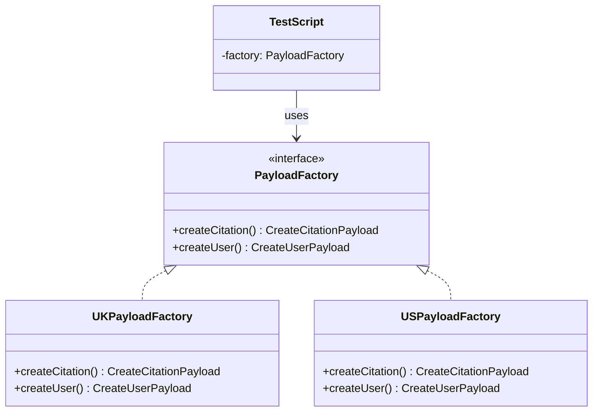
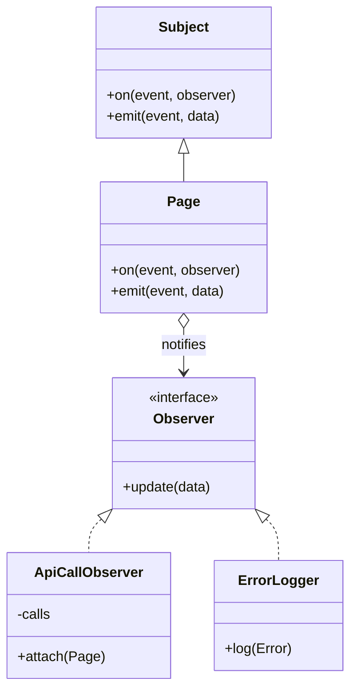
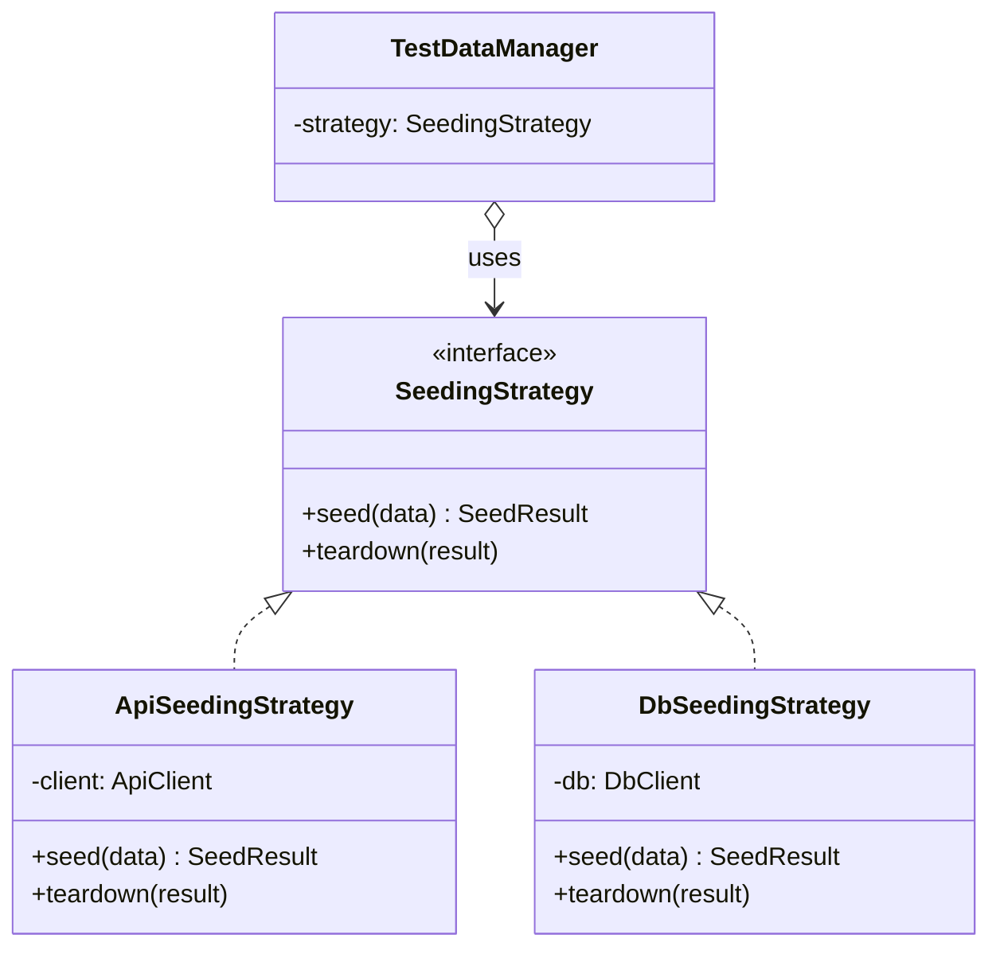
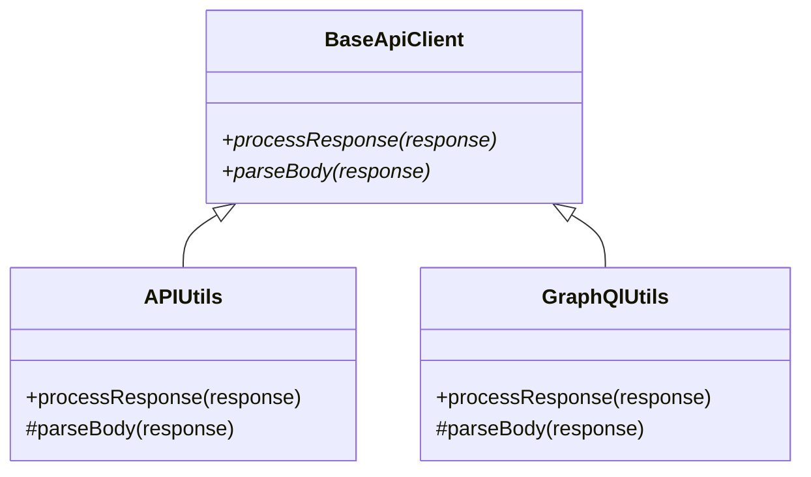
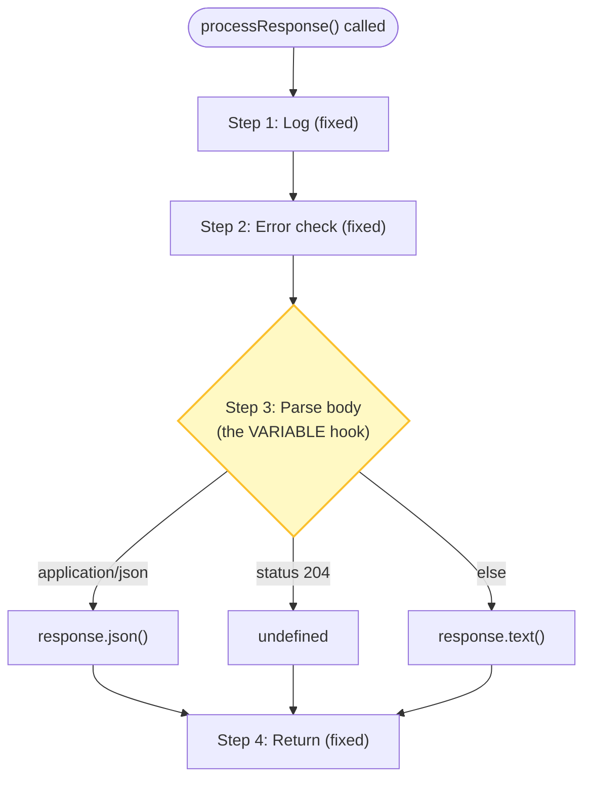
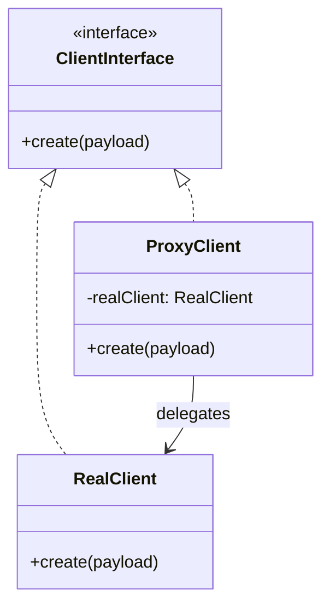
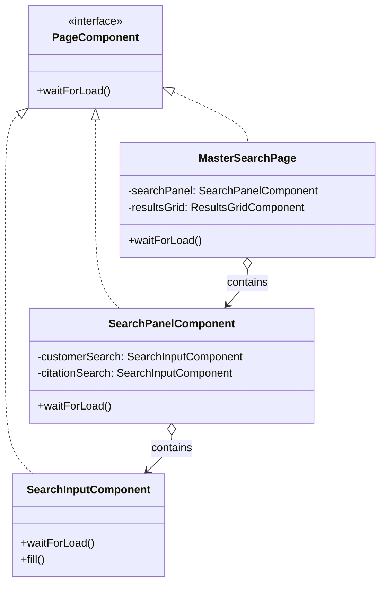

# 35. OOP Design Patterns Deep-Dive for SDETs

**Navigation**: [← Chapter 34: Algorithms in Test Automation](./34_Algorithms_in_Test_Automation.md) | [Index](../00_INDEX.md) | [→ Chapter 36: TypeScript Type System Mastery](./36_TypeScript_Type_System_Mastery.md)

**Cross-references (read these alongside):**

- [`../../06_OOP_Design/01_OOPS_Principles.md`](../../06_OOP_Design/01_OOPS_Principles.md) — SOLID, encapsulation, polymorphism — all in your POM
- [`../../06_OOP_Design/02_Design_Patterns.md`](../../06_OOP_Design/02_Design_Patterns.md) — Full GoF catalogue with Java examples; map each to TypeScript test code
- [`../../06_OOP_Design/08_Design_Patterns_Java.md`](../../06_OOP_Design/08_Design_Patterns_Java.md) — Java implementations of the same patterns
- [`../../06_OOP_Design/07_LLD_Solved_Problems.md`](../../06_OOP_Design/07_LLD_Solved_Problems.md) — Low-level design problems: same design skills needed for framework architecture

---

## Why OOP Patterns Matter for SDETs

```
"Design patterns are for architects. I just write tests."

Wrong.

Your test framework ALREADY uses design patterns — you just haven't named them.
When you name them, you can:
  1. Explain your framework in interviews without hand-waving
  2. Recognise when a pattern is being violated → know how to fix it
  3. Extend the framework correctly (add new patterns instead of hacking old ones)
  4. Read production code faster — same patterns appear there

This chapter gives every pattern a test-framework anchor.
When you see "Factory" in your OOP guide, you'll see PayloadsCitation.
When you see "Observer", you'll see page.on('pageerror').
They are the same concept.
```

---

## 0. War Stories — When OOP Patterns (or Their Absence) Made the Difference

### The 4000-line POM that broke on every sprint

One engineer built the entire CRM test suite using one class: `CRMPage`. It handled navigation, search, data entry, table parsing, modal interactions, and pagination. After 8 months it was 4,000 lines. When the CRM's search component was redesigned, 4 engineers touched the same file for 3 weeks.

This is the God Object anti-pattern. Ch18 (Mega POM) calls it the "18-month trap" — it always looks manageable at 600 lines.

The fix was the **Single Responsibility Principle** (SRP) and the **Component POM** pattern: `CitationSearchForm`, `CitationResultsGrid`, `CitationDetailModal` — each class responsible for one UI component. When the search component changed, only one class changed. The refactor took 2 weeks. The payoff: every subsequent search change took 20 minutes instead of a sprint.

### The factory that made bad test data for 6 months

A team built a `CitationFactory` that created test citations with hardcoded `status: 'PENDING'`. When the product added a `DRAFT` state (the state before `PENDING`), 40 tests started using the wrong initial state. The factory was a single function, not a class, so there was no good place to add state-specific overrides.

The fix was the **Builder Pattern**: a `CitationBuilder` class with chainable methods that let tests specify exactly what they need:

```typescript
const citation = new CitationBuilder()
  .withStatus('DRAFT')
  .withAmount(150)
  .withOwner(testUser)
  .build();
```

Now adding new states required adding one method, not touching every test.

### The Observer that caught a production regression nobody else noticed

An engineer added `page.on('pageerror', err => errors.push(err))` to the base fixture — a classic **Observer Pattern**. Three weeks later, a React rendering error appeared in the console on every page load. It didn't cause any test assertion to fail (the page rendered correctly despite the error). Without the Observer, it would have shipped to production.

The Observer Pattern is the "why" behind `page.on('console')`, `page.on('requestfailed')`, and `ws.on('framereceived')` — all of which appear in the Playwright API for exactly this reason. The conceptual link between GoF Observer and Playwright's event emitters is the point of this chapter.

---

## 1. SOLID Principles → Applied to POM Design

From [`../../06_OOP_Design/01_OOPS_Principles.md`](../../06_OOP_Design/01_OOPS_Principles.md):

### S — Single Responsibility Principle

```
"A class should have only one reason to change."

VIOLATION in test code:
  class CitationsPage {
    // Navigation
    async goto() { await this.page.goto('/citations'); }

    // Search
    async searchById(id: string) { ... }

    // Results
    async getFirstResult() { ... }

    // API calls
    async createCitationViaAPI(payload) { ... }  // ← WRONG: this belongs in a client class

    // Assertions
    expect(await this.getStatus()).toBe('PENDING');  // ← WRONG: assertions in POM
  }

WHY IT'S WRONG:
  If the API contract changes → CitationsPage must change (reason 1).
  If the UI changes → CitationsPage must change (reason 2).
  Two reasons to change = SRP violation.

CORRECT SEPARATION:
  CitationsPage:      only knows about the UI (HTML, selectors, navigation)
  CitationsApiClient: only knows about the API (HTTP, endpoints, headers)
  Test script:        only knows about assertions (expect, business rules)
```

```typescript
// SOLID CitationsPage — one reason to change (UI changes only)
class CitationsPage {
  readonly page: Page;
  readonly searchInput: Locator;
  readonly resultsGrid: Locator;
  readonly statusBadge: Locator;

  constructor(page: Page) {
    this.page = page;
    this.searchInput = page.locator('[data-testid="citation-search"]');
    this.resultsGrid = page.locator(".citations-grid");
    this.statusBadge = page.locator('[data-testid="status-badge"]');
  }

  async goto(): Promise<void> {
    await this.page.goto("/citations");
    await expect(this.searchInput).toBeVisible({ timeout: 15_000 });
  }

  async searchById(citationId: string): Promise<void> {
    await this.searchInput.fill(citationId);
    await this.searchInput.press("Enter");
  }
  // NO API calls. NO assertions. UI interaction only.
}
```

### O — Open/Closed Principle

```
"Open for extension, closed for modification."

In your test framework:
  APIUtils is CLOSED for modification (you don't change its core get/post/patch/delete).
  It is OPEN for extension: CitationsApiClient extends it by adding citation-specific methods
  WITHOUT touching APIUtils itself.

  Similarly:
  PayloadsCitation.pending() is CLOSED — you don't change the default payload structure.
  It is OPEN — you EXTEND by calling pending({ status: 'PAID' }) to specialise it.
  The override pattern IS the Open/Closed Principle.
```

```typescript
// Open/Closed in payload factories:
// CLOSED: the base factory method — don't touch it
static pending(overrides: Partial<CreateCitationPayload> = {}): CreateCitationPayload {
  return { status: 'PENDING', amount: 150, citationType: 'PARKING', ...overrides };
}

// OPEN: extend by composition, not modification
static urgentParking(overrides: Partial<CreateCitationPayload> = {}): CreateCitationPayload {
  // Extends pending() without touching it
  return PayloadsCitation.pending({ citationType: 'URGENT_PARKING', amount: 500, ...overrides });
}
// If CitationTypes enum gains 'URGENT_PARKING', you add urgentParking() here.
// You do NOT modify pending(). Existing tests of pending() are unaffected.
```

### L — Liskov Substitution Principle

```
"Subclasses must be substitutable for their base class."

In test code: if BasePage has a goto() method,
every subclass (LoginPage, CitationsPage, AdminDashboard) must implement goto()
in a way that callers can use them interchangeably.

VIOLATION:
  class D365Page extends BasePage {
    async goto() { throw new Error("D365 doesn't have a direct URL — use the menu."); }
  }
  // Test code: const page = new D365Page(); await page.goto();
  // Blows up at runtime. LSP violated.

CORRECT:
  class D365Page extends BasePage {
    async goto(): Promise<void> {
      await this.page.goto('/');
      await this.navigateViaMenu('Citations');  // D365-specific implementation
    }
  }
  // Test code: const page = new D365Page(); await page.goto();
  // Works. The caller doesn't know D365's navigation is different.
```

### I — Interface Segregation Principle

```
"Clients should not be forced to depend on interfaces they don't use."

In test code: don't put everything in one fixture.

VIOLATION: One monster fixture
  type AllFixtures = {
    page: Page;
    account: AuthAccount;
    citationsClient: CitationsApiClient;
    notificationsClient: NotificationsClient;
    dbClient: DbClient;
    visualAssertions: VisualUtils;
    seedManager: SeedManager;
    // ... 10 more
  };
  // Every test receives ALL of these, even if it only uses page + account.

CORRECT: Segregated fixtures
  // Each fixture only provides what it needs.
  // Tests declare only what they actually use.
  test('Simple navigation test', async ({ page }) => { ... });
  //                                              ↑ only page — no unused fixtures

  test('Citation API test', async ({ citationsClient, account }) => { ... });
  //                                  ↑ only what this test needs
```

### D — Dependency Inversion Principle

```
"Depend on abstractions, not concretions."

In test code:
  CitationsApiClient depends on APIUtils (abstraction) — not on raw request.post() (concretion).
  Tests depend on citationsClient fixture (abstraction) — not on specific HTTP calls.

  If tomorrow you switch from Playwright's APIRequestContext to axios:
    - APIUtils changes internally
    - CitationsApiClient changes nothing (it calls this.api.post() — same interface)
    - Tests change nothing (they call citationsClient.create() — same interface)

  ONLY the lowest layer changes. Everything above it is insulated.
  This IS dependency inversion: high-level tests depend on high-level abstractions,
  not on the low-level HTTP library.
```

---

## 2. Factory Pattern — Your Payload Builders

**GoF definition**: "Define an interface for creating an object, but let subclasses decide which class to instantiate."



**In test code — already implemented:**

```typescript
// Abstract factory: CitationPayloadFactory (conceptual)
// Concrete factories: PayloadsCitation (for the citation API)
//                     PayloadsNotification (for the notification API)
//                     PayloadsUser (for the user API)

// The client code (test) doesn't know HOW the object is built:
const payload = PayloadsCitation.pending({ customerId: account.userId });
// Test doesn't know: what the default amount is, what the default type is,
// what date format to use, how to construct the object.
// Factory knows. Test doesn't need to.

// WHY THIS MATTERS FOR SDE INTERVIEWS:
// "Implement a factory for test data objects" is a common LLD question.
// Your answer: static factory methods per data type, with override pattern,
// returning a typed interface. This is exactly what you wrote.
```

**The Abstract Factory — when you need families of related objects:**

```typescript
// Scenario: You test in 3 environments (UK, US, EU).
// Each environment needs DIFFERENT default payloads (currency, date format, amount).

// Abstract factory interface:
interface PayloadFactory {
  createCitation(
    overrides?: Partial<CreateCitationPayload>,
  ): CreateCitationPayload;
  createUser(overrides?: Partial<CreateUserPayload>): CreateUserPayload;
}

// Concrete factories per environment:
class UKPayloadFactory implements PayloadFactory {
  createCitation(overrides = {}): CreateCitationPayload {
    return {
      amount: 150,
      currency: "GBP",
      dateFormat: "DD/MM/YYYY",
      ...overrides,
    };
  }
  createUser(overrides = {}): CreateUserPayload {
    return { locale: "en-GB", timezone: "Europe/London", ...overrides };
  }
}

class USPayloadFactory implements PayloadFactory {
  createCitation(overrides = {}): CreateCitationPayload {
    return {
      amount: 200,
      currency: "USD",
      dateFormat: "MM/DD/YYYY",
      ...overrides,
    };
  }
  createUser(overrides = {}): CreateUserPayload {
    return { locale: "en-US", timezone: "America/New_York", ...overrides };
  }
}

// In fixtures: inject the right factory based on TEST_ENV
const factory: PayloadFactory =
  process.env.TEST_ENV === "us"
    ? new USPayloadFactory()
    : new UKPayloadFactory();

// Tests use factory.createCitation() — never know which environment they're in
```

---

## 3. Observer Pattern — Playwright's Event System

**GoF definition**: "Define a one-to-many dependency between objects so that when one object changes state, all its dependents are notified automatically."



**In Playwright — `page.on()` IS the Observer pattern:**

```typescript
// Subject: the Page object (emits events)
// Observer: your callback function (receives events)

// Register observers:
page.on("pageerror", (error: Error) => {
  console.error(`[JS ERROR] ${error.message}`);
  // You are OBSERVING unhandled JS errors
});

page.on("response", (response: Response) => {
  if (!response.ok()) {
    console.warn(`[HTTP ERROR] ${response.status()} ${response.url()}`);
  }
  // You are OBSERVING every HTTP response
});

page.on("console", (msg: ConsoleMessage) => {
  if (msg.type() === "error") console.error(`[CONSOLE] ${msg.text()}`);
  // You are OBSERVING console output
});

// Subject (page) emits events. Multiple observers can subscribe.
// None of the observers know about each other.
// When you add a new observer, the subject (page) doesn't change.
// This IS the Observer pattern.
```

**Building your own Observer for test metrics:**

```typescript
// Scenario: You want to count API calls during a test and assert on them
class ApiCallObserver {
  private calls: { url: string; method: string; duration: number }[] = [];

  attach(page: Page): void {
    const requestStartTimes = new Map<string, number>();

    // Subject: page. This observer tracks network timing.
    page.on("request", (req) => {
      if (req.url().includes("/api/")) {
        requestStartTimes.set(req.url(), Date.now());
      }
    });

    page.on("response", (res) => {
      const start = requestStartTimes.get(res.url());
      if (start) {
        this.calls.push({
          url: res.url(),
          method: res.request().method(),
          duration: Date.now() - start,
        });
      }
    });
  }

  assertCallCount(pattern: string, expected: number): void {
    const matching = this.calls.filter((c) => c.url.includes(pattern));
    expect(matching.length).toBe(expected);
  }

  assertAllCallsUnder(maxDurationMs: number): void {
    for (const call of this.calls) {
      expect(call.duration, `${call.method} ${call.url} too slow`).toBeLessThan(
        maxDurationMs,
      );
    }
  }
}

// Usage:
const observer = new ApiCallObserver();
observer.attach(page);
await citationDetail.goto("CIT-001");
observer.assertCallCount("/api/v2/citations", 1); // exactly 1 citation API call
observer.assertAllCallsUnder(500); // all calls under 500ms (performance assertion)
```

---

## 4. Strategy Pattern — Seeding Strategies and Wait Strategies

**GoF definition**: "Define a family of algorithms, encapsulate each one, and make them interchangeable."



**In test code — seeding strategies (Ch28):**

```typescript
// Strategy interface:
interface SeedingStrategy {
  seed(data: unknown): Promise<SeedResult>;
  teardown(result: SeedResult): Promise<void>;
}

// Concrete strategy A: API seeding
class ApiSeedingStrategy implements SeedingStrategy {
  constructor(private readonly client: CitationsApiClient) {}

  async seed(payload: CreateCitationPayload): Promise<SeedResult> {
    const citation = await this.client.create(payload);
    return { id: citation.citationId, data: citation };
  }

  async teardown(result: SeedResult): Promise<void> {
    await this.client.delete(result.id);
  }
}

// Concrete strategy B: Database seeding (faster for bulk)
class DbSeedingStrategy implements SeedingStrategy {
  constructor(private readonly db: DbClient) {}

  async seed(row: CitationDbRow): Promise<SeedResult> {
    await this.db.execute('INSERT INTO citations VALUES ($1, $2, ...)', [row.citation_id, ...]);
    return { id: row.citation_id, data: row };
  }

  async teardown(result: SeedResult): Promise<void> {
    await this.db.execute('DELETE FROM citations WHERE citation_id = $1', [result.id]);
  }
}

// Context: the fixture picks the right strategy
const strategy: SeedingStrategy = process.env.SEED_MODE === 'db'
  ? new DbSeedingStrategy(dbClient)
  : new ApiSeedingStrategy(citationsClient);

const result = await strategy.seed(PayloadsCitation.pending({ customerId: account.userId }));
// Test runs...
await strategy.teardown(result);
// Switching strategies: change SEED_MODE env var. Zero test code changes.
```

**Strategy for wait conditions (D365 vs JSP vs ASPX):**

```typescript
// Different apps need different wait strategies
interface WaitStrategy {
  waitForPageReady(page: Page): Promise<void>;
}

class D365WaitStrategy implements WaitStrategy {
  async waitForPageReady(page: Page): Promise<void> {
    await expect(page.locator(".ms-Spinner")).toHaveCount(0, {
      timeout: 45_000,
    });
    await expect(page.locator("[data-automation-key]").first()).toBeVisible({
      timeout: 30_000,
    });
  }
}

class JspWaitStrategy implements WaitStrategy {
  async waitForPageReady(page: Page): Promise<void> {
    await page.waitForLoadState("networkidle", { timeout: 15_000 });
    await expect(page.locator("#mainContent")).toBeVisible({ timeout: 10_000 });
  }
}

class AspxWaitStrategy implements WaitStrategy {
  async waitForPageReady(page: Page): Promise<void> {
    await page.waitForFunction(() => document.readyState === "complete", {
      timeout: 20_000,
    });
    await expect(page.locator('form[runat="server"]').first()).toBeVisible({
      timeout: 10_000,
    });
  }
}

// Base POM uses the strategy:
abstract class BasePage {
  constructor(
    protected page: Page,
    private waitStrategy: WaitStrategy,
  ) {}

  async waitForLoad(): Promise<void> {
    await this.waitStrategy.waitForPageReady(this.page);
    // Every page implementation calls the strategy — different behaviour, same interface
  }
}
```

---

## 5. Template Method Pattern — APIUtils Base Flow

**GoF definition**: "Define the skeleton of an algorithm in the base class, letting subclasses fill in the specific steps."



**In `APIUtils` — already implemented:**

```typescript
// The TEMPLATE METHOD is processResponse():
private async processResponse<T>(response, method, url, options): Promise<ApiResponse<T>> {
  // FIXED SKELETON (the template):
  const status = response.status();

  // Step 1: Log (fixed)
  if (process.env.PLAYWRIGHT_API_LOGGING === 'true') {
    console.log(`[APIUtils] ${method} ${url} → ${status}`);
  }

  // Step 2: Error check (fixed)
  if (!response.ok() && !options.ignoreStatuses?.includes(status)) {
    const body = await response.text();
    throw new Error(`${method} ${url} → ${status}: ${body}`);
  }

  // Step 3: Parse body (the VARIABLE step — depends on content type)
  const contentType = response.headers()['content-type'] ?? '';
  let body: T;
  if (contentType.includes('application/json')) {
    body = await response.json() as T;           // ← JSON subcase
  } else if (status === 204) {
    body = undefined as T;                        // ← No Content subcase
  } else {
    body = await response.text() as T;            // ← Plain text subcase
  }

  // Step 4: Return (fixed)
  return { status, body, headers: response.headers(), ok: response.ok() };
}
```

The template is: **log → validate → parse → return**. The parsing step is the "variable" hook that different content types override. All callers of `get/post/patch/delete` go through the same template — consistent, impossible to forget error handling.

The class diagram above shows *who* has the hook; this shows *where it fires* in the fixed sequence:



---

## 6. Proxy Pattern — `page.route()` and the Managed Client

**GoF definition**: "Provide a surrogate or placeholder for another object to control access to it."



```typescript
// page.route() IS a proxy:
await page.route("**/api/v2/citations/**", async (route) => {
  // The route IS the proxy — it intercepts requests BEFORE they reach the real server
  // You control: forward to real server (route.continue())
  //              return mock (route.fulfill())
  //              abort (route.abort())
  await route.fulfill({ status: 200, body: JSON.stringify(mockCitation) });
});
// The browser (client) doesn't know it's talking to a proxy.
// The real server (target) doesn't receive the intercepted requests.
```

**Managed client as a proxy:**

```typescript
// ❌ BROKEN — the spread silently discards every method except `create`.
// In the fixture, we wrapped CitationsApiClient with a proxy
// that auto-registers for cleanup:
citationsClient: async ({ request, account, testDataManager }, use) => {
  const realClient = new CitationsApiClient(request, account.accessToken);

  // This IS a proxy — same interface, adds cleanup registration
  const proxiedClient = {
    ...realClient, // ← the bug lives here
    create: async (
      payload: CreateCitationPayload,
    ): Promise<CitationApiResponse> => {
      const citation = await realClient.create(payload); // delegates to real client
      testDataManager.track("citation", citation, () =>
        realClient.delete(citation.citationId),
      );
      return citation; // same return type as real client
    },
  };

  await use(proxiedClient as CitationsApiClient);
};
```

**Why that proxy is broken — object spread does not copy prototype methods.**
`{ ...instance }` copies only the instance's **own enumerable** properties. Class
methods live on `CitationsApiClient.prototype`, not on the instance, so they are not
own properties and the spread drops all of them. The `as CitationsApiClient` cast is
what makes this dangerous: it tells TypeScript to stop checking precisely where the
object stopped satisfying the interface, so nothing fails at compile time. Verified
against the shape above:

```js
class CitationsApiClient {
  constructor(token) { this.token = token; }
  async create(p) { /* … */ }
  async delete(id) { /* … */ }
  async getById(id) { /* … */ }
}
const real = new CitationsApiClient("tok");
const proxied = { ...real, create: async (p) => real.create(p) };

Object.keys(real);      // → [ 'token' ]              ← methods are NOT own properties
Object.keys(proxied);   // → [ 'token', 'create' ]
typeof proxied.create;  // → 'function'   (we defined it explicitly)
typeof proxied.delete;  // → 'undefined'  ← LOST
typeof proxied.getById; // → 'undefined'  ← LOST

proxied.delete("CIT-001");
// → TypeError: proxied.delete is not a function
```

So `create()` works, and the first test that calls `citationsClient.getById()` or
`.delete()` dies with `is not a function` — a failure that looks like a fixture-wiring
problem and has nothing obviously to do with the Proxy pattern.

**The fix — wrap the instance, don't copy it.** Keep the real object (prototype chain
intact) and replace just the one method:

```typescript
// ✅ CORRECT — prototype chain preserved; only `create` is decorated.
citationsClient: async ({ request, account, testDataManager }, use) => {
  const client = new CitationsApiClient(request, account.accessToken);

  const originalCreate = client.create.bind(client);
  client.create = async (
    payload: CreateCitationPayload,
  ): Promise<CitationApiResponse> => {
    const citation = await originalCreate(payload);
    testDataManager.track("citation", citation, () =>
      client.delete(citation.citationId),
    );
    return citation;
  };

  await use(client); // no cast needed — it IS a CitationsApiClient
};
```

Note that the cast disappears. Needing `as SomeClass` to make a "proxy" typecheck is
itself the smell: a real proxy satisfies the interface structurally, so it shouldn't
need to be forced. [Ch28 §Managed client](../05_Advanced_Topics/28_Test_Data_Lifecycle_and_Cleanup.md)
builds the same decorated client for test-data cleanup and hit this identical trap —
if you are implementing auto-tracking, read both.

If you genuinely need to leave the original object untouched, use the language's own
`Proxy`, which forwards everything it doesn't intercept:

```typescript
const proxiedClient = new Proxy(realClient, {
  get(target, prop, receiver) {
    if (prop === "create") {
      return async (payload: CreateCitationPayload) => {
        const citation = await target.create(payload);
        testDataManager.track("citation", citation, () =>
          target.delete(citation.citationId),
        );
        return citation;
      };
    }
    return Reflect.get(target, prop, receiver); // everything else passes through
  },
});
```

That is the GoF Proxy pattern implemented with the runtime's actual proxy primitive —
`delete`, `getById`, and any method added later keep working without the wrapper being
updated. Tests call `citationsClient.create()` thinking it's the real client; the
cleanup tracking is added transparently, and no method is silently lost.

---

## 7. Composite Pattern — The POM Hierarchy

**GoF definition**: "Compose objects into tree structures to represent part-whole hierarchies."



```typescript
// Component (leaf and composite have the same interface):
interface PageComponent {
  waitForLoad(): Promise<void>;
}

// LEAF — a simple, atomic component
class SearchInputComponent implements PageComponent {
  constructor(private readonly locator: Locator) {}

  async waitForLoad(): Promise<void> {
    await expect(this.locator).toBeVisible({ timeout: 10_000 });
  }

  async fill(value: string): Promise<void> {
    await this.locator.fill(value);
  }
}

// COMPOSITE — contains children, delegates to them
class SearchPanelComponent implements PageComponent {
  readonly customerSearch: SearchInputComponent;
  readonly citationSearch: SearchInputComponent;
  readonly searchButton: Locator;

  constructor(page: Page) {
    this.customerSearch = new SearchInputComponent(
      page.locator("#customerSearch"),
    );
    this.citationSearch = new SearchInputComponent(
      page.locator("#citationSearch"),
    );
    this.searchButton = page.locator("#searchBtn");
  }

  // Composite's waitForLoad delegates to its children
  async waitForLoad(): Promise<void> {
    await this.customerSearch.waitForLoad(); // delegate to leaf
    await this.citationSearch.waitForLoad(); // delegate to leaf
  }
}

// COMPOSITE OF COMPOSITES — the full page
class MasterSearchPage implements PageComponent {
  readonly searchPanel: SearchPanelComponent; // composite
  readonly resultsGrid: ResultsGridComponent; // composite

  constructor(page: Page) {
    this.searchPanel = new SearchPanelComponent(page);
    this.resultsGrid = new ResultsGridComponent(page);
  }

  async waitForLoad(): Promise<void> {
    await this.searchPanel.waitForLoad(); // delegate
    await this.resultsGrid.waitForLoad(); // delegate
    // The page is loaded when all components are loaded
  }
}
// The test calls masterSearch.waitForLoad() — doesn't know about the component tree.
// The pattern handles the depth of nesting automatically.
```

---

## 🏋️ Practice Challenges

### Challenge 1 [OOP → Test Code]

Your team wants to add a new assertion pattern: every test should automatically verify that no JS console errors occurred during the test. Design a solution using the **Observer** and **Template Method** patterns without modifying any existing test files.

<details><summary>Answer</summary>

```typescript
// Observer: attach to page.on('pageerror') automatically in a base fixture
// Template Method: the base fixture provides the skeleton; tests fill in the test body

// In fixtures/index.ts — add a consoleErrorGuard fixture
export const test = base.extend<{ consoleErrorGuard: void }>({
  // Template Method: this runs for EVERY test (skeleton)
  consoleErrorGuard: [
    async ({ page }, use) => {
      // Observer setup: collect all JS errors
      const jsErrors: string[] = [];
      page.on("pageerror", (err) => jsErrors.push(err.message));

      await use(); // ← test runs here (the "variable" step — different per test)

      // Template step: assert no JS errors (fixed — same for ALL tests)
      if (jsErrors.length > 0) {
        throw new Error(
          `Test produced ${jsErrors.length} unhandled JS error(s):\n` +
            jsErrors.map((e, i) => `  ${i + 1}. ${e}`).join("\n"),
        );
      }
    },
    { auto: true },
  ], // ← auto: true means this fixture runs for EVERY test automatically
  // No test needs to declare it. It's always active.
});
```

</details>

---

### Challenge 2 [SOLID Analysis]

Analyse this class. Which SOLID principle does it violate? How would you fix it?

```typescript
class CitationTestHelper {
  async createAndVerify(
    page: Page,
    request: APIRequestContext,
    token: string,
  ): Promise<string> {
    // Create via API
    const resp = await request.post("/api/v2/citations", {
      headers: { Authorization: `Bearer ${token}` },
      data: { customerId: "USR-001", amount: 150, status: "PENDING" },
    });
    const citation = await resp.json();

    // Verify in UI
    await page.goto(`/citations/${citation.citationId}`);
    await page.waitForSelector(".citation-status");
    const status = await page.locator(".citation-status").textContent();
    if (status !== "PENDING") throw new Error("Wrong status");

    // Send notification
    await request.post("/api/notifications", {
      headers: { Authorization: `Bearer ${token}` },
      data: {
        userId: "USR-001",
        type: "CITATION_CREATED",
        referenceId: citation.citationId,
      },
    });

    return citation.citationId;
  }
}
```

<details><summary>Answer</summary>

**Violates SRP (Single Responsibility) and ISP (Interface Segregation).**

This one class does three completely different things:

1. Creates a citation via API (CitationsApiClient's job)
2. Verifies it in the UI (CitationDetailPage's job)
3. Sends a notification via a different API (NotificationsClient's job)

Three reasons to change: API contract change, UI change, notification service change.

Also violates ISP — takes both `page` AND `request`, forcing callers to provide both even if they only need the API part.

Fix — separate into their proper layers:

```typescript
// Each class does one thing:
const citation = await citationsClient.create(
  PayloadsCitation.pending({ customerId: account.userId }),
);
await citationDetail.goto(citation.citationId);
await expect(citationDetail.statusBadge).toHaveText("PENDING");
await notificationsClient.send(
  PayloadsNotification.citationCreated(account.userId, citation.citationId),
);
// The test script COMPOSES these — test is the only class that knows about all three.
// Each client/POM class has one reason to change.
```

</details>

### Challenge 3 [MCQ] — Strategy Pattern for Reporter Selection

Your SDET framework needs to support multiple output formats: HTML report, JUnit XML (for Azure DevOps), and a Slack webhook notification — each triggered based on the CI environment. Which OOP pattern is most appropriate?

A) Singleton — there should be only one reporter per run
B) Strategy — define a `Reporter` interface and inject the appropriate implementation at runtime based on environment
C) Decorator — wrap the test runner with reporting behaviour
D) Template Method — define the report generation steps in a base class, override specifics per format

<details><summary>Answer</summary>

**B** — The Strategy pattern is the canonical solution for selecting an algorithm (or behavior) at runtime without conditionals scattered through client code:

```typescript
// Interface: defines what every reporter must do
interface TestReporter {
  onTestStart(testName: string): void;
  onTestPass(testName: string, duration: number): void;
  onTestFail(testName: string, error: Error): void;
  onRunComplete(summary: RunSummary): Promise<void>;
}

// Strategy A: HTML reporter
class HtmlReporter implements TestReporter {
  onTestStart(testName: string) {
    /* write to HTML buffer */
  }
  onTestPass(testName: string, duration: number) {
    /* append pass row */
  }
  onTestFail(testName: string, error: Error) {
    /* append fail row with screenshot */
  }
  async onRunComplete(summary: RunSummary) {
    /* write HTML file */
  }
}

// Strategy B: Slack webhook reporter
class SlackReporter implements TestReporter {
  constructor(private webhookUrl: string) {}
  onTestStart() {
    /* no-op: don't spam Slack per test */
  }
  onTestPass() {
    /* no-op */
  }
  onTestFail(testName: string, error: Error) {
    /* post failure immediately */
  }
  async onRunComplete(summary: RunSummary) {
    await fetch(this.webhookUrl, {
      method: "POST",
      body: JSON.stringify({
        text: `${summary.passed}/${summary.total} tests passed`,
      }),
    });
  }
}

// Context: selects strategy based on environment
function createReporter(): TestReporter {
  const env = process.env.CI_SYSTEM;
  if (env === "github-actions") return new HtmlReporter();
  if (env === "azure-devops") return new JUnitReporter("./results/junit.xml");
  if (env === "local-dev") return new SlackReporter(process.env.SLACK_WEBHOOK!);
  return new HtmlReporter(); // default
}

// Test runner uses the interface, not the concrete class:
const reporter = createReporter();
// reporter.onTestStart / onTestPass / onTestFail called uniformly
```

Why not Decorator (C)? Decorator adds behavior on top of an existing object — you'd use it if you wanted HTML reporting AND Slack notifications simultaneously (wrapping one reporter with another). Strategy picks ONE. Template Method (D) is for defining a fixed algorithm skeleton with variable steps — suitable if all reporters share the same report generation sequence.

</details>

---

### Challenge 4 [Spot the Bug — Observer Pattern Leak]

```typescript
// EventBus used by the test framework to coordinate between fixtures
class EventBus {
  private listeners: Map<string, Array<(data: unknown) => void>> = new Map();

  on(event: string, listener: (data: unknown) => void): void {
    if (!this.listeners.has(event)) {
      this.listeners.set(event, []);
    }
    this.listeners.get(event)!.push(listener);
  }

  emit(event: string, data: unknown): void {
    this.listeners.get(event)?.forEach((l) => l(data));
  }
}

// Module-level singleton (shared across all tests in a worker)
export const bus = new EventBus();

// In fixture:
export const test = base.extend<{ trackCitations: void }>({
  trackCitations: async ({}, use) => {
    const collected: string[] = [];
    bus.on("citation:created", (id) => collected.push(id as string));
    await use();
    console.log(`Test collected ${collected.length} citations`);
  },
});
```

What memory and correctness bug exists in this pattern when tests run in sequence?

<details><summary>Answer</summary>

**Memory leak + listener accumulation bug**: The `bus.on()` call adds a listener to the module-level singleton, but there is no corresponding `off()` call when the fixture tears down. Every test that uses `trackCitations` adds another listener for `'citation:created'`.

After 50 tests: the EventBus has 50 listeners for `'citation:created'`. When the 51st test emits a `citation:created` event, all 50 previous test closures receive it — including their `collected` arrays, which are now in closed-over memory of completed tests. This is a **memory leak** (closures are never GC'd because the EventBus holds references).

**Correctness bug**: The 50 old listeners each call `collected.push(id)` on arrays that belong to completed tests. This corrupts the `collected` count in previous tests' teardown logs.

**Fix**: always implement unsubscribe and call it in teardown:

```typescript
class EventBus {
  on(event: string, listener: (data: unknown) => void): () => void {
    // Returns an unsubscribe function
    if (!this.listeners.has(event)) this.listeners.set(event, []);
    this.listeners.get(event)!.push(listener);

    return () => {
      const arr = this.listeners.get(event) ?? [];
      const idx = arr.indexOf(listener);
      if (idx !== -1) arr.splice(idx, 1);
    };
  }
}

// In fixture:
trackCitations: async ({}, use) => {
  const collected: string[] = [];
  const unsubscribe = bus.on('citation:created', (id) => collected.push(id as string));
  await use();
  unsubscribe();  // ← removes the listener after the test completes
  console.log(`Test collected ${collected.length} citations`);
},
```

This is the Observer pattern's mandatory cleanup contract: every `subscribe` must have a corresponding `unsubscribe` in the same lifecycle scope.

</details>

---

### Challenge 5 [Write It Yourself — Command Pattern for API Retry]

Implement a Command pattern that wraps any API call with retry logic. The Command should: store the operation to execute, retry up to N times with exponential backoff, log each attempt, and return the final result or throw after N failures.

<details><summary>Answer</summary>

```typescript
// Command interface
interface ApiCommand<T> {
  execute(): Promise<T>;
  describe(): string; // human-readable name for logging
}

// Invoker with retry logic — knows HOW to retry, not WHAT to execute
class RetryInvoker {
  constructor(
    private maxAttempts: number = 3,
    private baseDelayMs: number = 1000,
  ) {}

  async invoke<T>(command: ApiCommand<T>): Promise<T> {
    let lastError: Error | undefined;

    for (let attempt = 1; attempt <= this.maxAttempts; attempt++) {
      try {
        const result = await command.execute();
        if (attempt > 1) {
          console.log(
            `[RetryInvoker] ${command.describe()} succeeded on attempt ${attempt}`,
          );
        }
        return result;
      } catch (error) {
        lastError = error as Error;
        console.warn(
          `[RetryInvoker] ${command.describe()} attempt ${attempt}/${this.maxAttempts} failed: ${lastError.message}`,
        );

        if (attempt < this.maxAttempts) {
          // Exponential backoff: 1s, 2s, 4s...
          const delay = this.baseDelayMs * Math.pow(2, attempt - 1);
          console.log(`[RetryInvoker] Waiting ${delay}ms before retry...`);
          await new Promise((resolve) => setTimeout(resolve, delay));
        }
      }
    }

    throw new Error(
      `[RetryInvoker] ${command.describe()} failed after ${this.maxAttempts} attempts. Last error: ${lastError?.message}`,
    );
  }
}

// Concrete command for creating a citation
class CreateCitationCommand implements ApiCommand<CitationApiResponse> {
  constructor(
    private client: CitationsApiClient,
    private payload: CreateCitationPayload,
  ) {}

  async execute(): Promise<CitationApiResponse> {
    return this.client.create(this.payload);
  }

  describe(): string {
    return `CreateCitation(customerId=${this.payload.customerId})`;
  }
}

// Usage in fixture:
const invoker = new RetryInvoker(3, 500);
const citation = await invoker.invoke(
  new CreateCitationCommand(
    citationsClient,
    PayloadsCitation.pending({ customerId: account.userId }),
  ),
);

// The Command pattern decouples WHAT (CreateCitationCommand) from HOW (RetryInvoker).
// You can wrap ANY ApiCommand with retry without modifying the client classes.
// This is the SDE architecture insight: retry is a cross-cutting concern,
// not a responsibility of the Citation domain client.
```

</details>

---

**Navigation**: [← Chapter 34: Algorithms in Test Automation](./34_Algorithms_in_Test_Automation.md) | [Index](../00_INDEX.md) | [→ Chapter 36: TypeScript Type System Mastery](./36_TypeScript_Type_System_Mastery.md)


---

## Reality Check

**"Page Object Model is the only design pattern SDETs need"**→ POM is one pattern. Enterprise test frameworks use: Builder pattern (constructing complex test data), Factory pattern (creating page objects based on application state), Strategy pattern (different assertion strategies for different test types), Observer pattern (test event listeners for reporting), and Singleton pattern (shared browser instance). Knowing multiple patterns enables better framework design.

**"Inheritance hierarchies make page objects reusable"**→ Deep inheritance (BasePage → AuthenticatedPage → AdminPage → UserManagementPage) creates fragile hierarchies where changes to BasePage break all descendants. Prefer COMPOSITION: AdminPage has a NavigationComponent and a DataTable, not AdminPage extends AuthenticatedPage. Composition lets you mix and match components without inheritance chain constraints.

**"Design patterns should be applied everywhere"**→ A custom Logger wrapped in a Singleton with a Factory for creating formatter Strategies is over-engineered when console.log suffices. Patterns solve specific problems: use Builder when object construction is complex, Factory when the concrete type varies, and Strategy when behavior varies. A pattern without a problem is unnecessary complexity.

**"OOP is the only paradigm for test automation"**→ Functional programming patterns are equally valid: pure functions for test data transformation, higher-order functions for reusable assertion helpers, and closures for fixture scoping. TypeScript supports both paradigms. A functional approach (composable helper functions) can be simpler than an OOP approach (class hierarchies) for stateless test utilities.

**"SOLID principles from production code apply directly to test code"**→ The Single Responsibility Principle in test code means a test verifies ONE behavior, not ONE assertion. A test for user registration that checks: form validation, submission, confirmation email, and database record verifies one BEHAVIOR (registration) with multiple assertions. Splitting into four tests creates redundant setup and slower execution.
