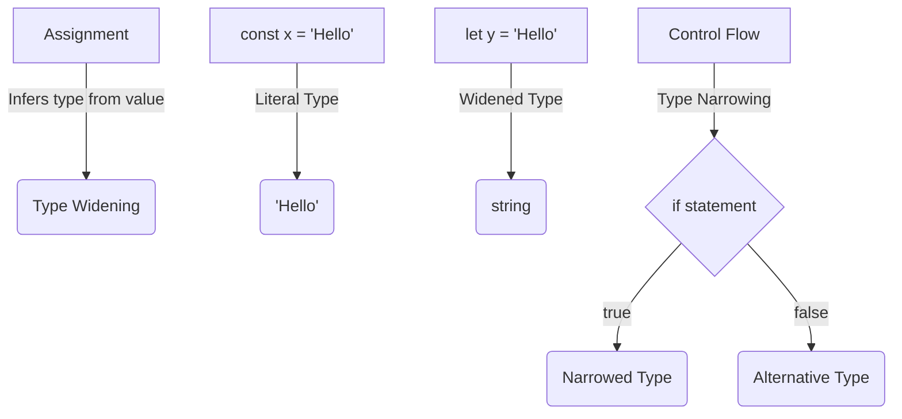

# 36. TypeScript Type System Mastery for SDETs

**Navigation**: [← Chapter 35: OOP Design Patterns](./35_OOP_Design_Patterns_for_SDETs.md) | [Index](../00_INDEX.md)

**Cross-references (read these alongside):**

- [`../../17_TypeScript/02_TS_Advanced_Types.md`](../../17_TypeScript/02_TS_Advanced_Types.md) — Full coverage of conditional types, mapped types, infer — the same features used in your test framework
- [`../../17_TypeScript/03_TS_Patterns_BestPractices.md`](../../17_TypeScript/03_TS_Patterns_BestPractices.md) — TypeScript patterns for production code; identical patterns in test framework
- [`../../17_TypeScript/04_TS_Deep_Reasoning.md`](../../17_TypeScript/04_TS_Deep_Reasoning.md) — The "why" behind TypeScript's design decisions; makes advanced features make sense
- [`../../04_Patterns_Templates`](../../04_Patterns_Templates) — Programming patterns that cross language boundaries

---

## 0. War Stories — When Types Caught Bugs Before the Tests Ran

### Story 1: The `any` escape hatch that hid a schema change

An API client had this:

```typescript
// BAD: response typed as any
const response: any = await apiClient.get('/citations');
const citations = response.body.data;
```

The backend team renamed the response field from `data` to `citations` in a schema migration. The TypeScript code compiled. The tests ran. They failed at runtime with "Cannot read properties of undefined (reading 'length')."

Debugging took 2 hours because the error was at runtime, in the middle of assertions, not at the API call site. The engineer had to trace backwards from the assertion failure to find the field rename.

With a typed response interface:

```typescript
interface CitationsResponse {
  citations: Citation[]; // <-- renamed field
  total: number;
}

const response = await apiClient.get<CitationsResponse>('/citations');
const items = response.body.data; // ← TypeScript error: Property 'data' does not exist
```

The TypeScript error appears the moment someone changes the interface — in the editor, before any test runs. The `any` type moved a 10-second compile error into a 2-hour runtime debugging session.

**Lesson:** Every API response in test code should be typed. `any` is a debt that accrues interest at the worst possible moment.

### Story 2: The impossible test state made possible by a loose type

A test factory had this signature:

```typescript
function createEmployee(role: string, department: string): Employee
```

A test accidentally passed the arguments in the wrong order:
```typescript
const emp = createEmployee('Engineering', 'MANAGER'); // wrong order — no error
```

This created an employee with `role: 'Engineering'` and `department: 'MANAGER'` — both invalid values. The database insertion succeeded (no DB constraints). The test that then asserted on the employee's permissions failed with a confusing error about "MANAGER" not being a valid department.

With branded types:
```typescript
type Role = 'MANAGER' | 'EMPLOYEE' | 'ADMIN';
type Department = 'Engineering' | 'Finance' | 'HR';

function createEmployee(role: Role, department: Department): Employee
// createEmployee('Engineering', 'MANAGER') → TypeScript error: 'Engineering' is not assignable to 'Role'
```

The compile-time error names the exact problem. No debugging needed.

**Lesson:** String parameters in test factories should be typed as string literal unions or enums. Any two `string` parameters of the same semantic shape are a parameter-swap bug waiting to happen.

---

## The Gap Between "Writing TypeScript" and "Mastering TypeScript"

```
Level 1 — TypeScript as typed JavaScript:
  You add types to variables and function params. You suppress `any` errors.
  TypeScript feels like extra boilerplate.

Level 2 — TypeScript as a safety net:
  You use interfaces and enums. TypeScript catches typos and missing fields.
  TypeScript feels useful.

Level 3 — TypeScript as a design tool:
  You use the type system to make impossible states unrepresentable.
  You use generic constraints to enforce calling conventions at compile time.
  You use conditional types to build APIs that are self-documenting.
  TypeScript feels like a superpower.

This chapter bridges Level 2 → Level 3.
The concepts map directly to your TypeScript guide's advanced sections,
anchored with test framework examples you already know.
```

---

## 1. The Type System as a Contract — Making Impossible States Unrepresentable

The most powerful TypeScript skill: design types so that **wrong usage is a compile error**, not a runtime error.

**Problem — impossible state is representable:**

```typescript
// Bad: both fields are optional — but they must BOTH be present or BOTH absent
interface SearchFilter {
  dateFrom?: string;
  dateTo?: string;
}

// This is valid TypeScript but wrong semantically:
const filter: SearchFilter = { dateFrom: "2026-01-01" }; // dateFrom without dateTo
// Runtime: query returns results from Jan 1 to the beginning of time? Or throws?
// The type system didn't stop you. The bug reaches runtime.
```

**Solution — make the impossible state a compile error:**

```typescript
// Discriminated union: either BOTH dates, or NEITHER
type DateFilter =
  | { hasDateFilter: false }
  | { hasDateFilter: true; dateFrom: string; dateTo: string };

// Now this is a compile error:
const bad: DateFilter = { hasDateFilter: true, dateFrom: "2026-01-01" };
// Error: Property 'dateTo' is missing — you MUST provide dateTo when hasDateFilter is true

// This is valid:
const good: DateFilter = {
  hasDateFilter: true,
  dateFrom: "2026-01-01",
  dateTo: "2026-12-31",
};
// And this:
const noFilter: DateFilter = { hasDateFilter: false };
// The impossible state (dateFrom without dateTo) CANNOT be constructed.
```

**Applied to API response types — status-dependent fields:**

```typescript
// A citation's fields depend on its status:
type CitationApiResponse =
  | {
      citationId: string;
      status: "PENDING" | "OVERDUE";
      // No paymentDate — hasn't been paid
    }
  | {
      citationId: string;
      status: "PAID";
      paymentDate: string; // MUST be present when PAID
      paymentReference: string;
    }
  | {
      citationId: string;
      status: "DISPUTED";
      disputeReference: string; // MUST be present when DISPUTED
      disputeReason: string;
    };

// Now the type system enforces your API contract:
function processPayment(citation: CitationApiResponse) {
  if (citation.status === "PAID") {
    citation.paymentDate; // ✅ TypeScript knows this exists (we're in the 'PAID' variant)
    citation.disputeReason; // ❌ TypeScript error: doesn't exist on 'PAID' variant
  }
}
```

---

## 2. Generic Constraints — Enforcing Calling Conventions

From [`../../17_TypeScript/02_TS_Advanced_Types.md`](../../17_TypeScript/02_TS_Advanced_Types.md):

**Generic constraints with `extends`:**

```typescript
// Unconstrained generic — anything goes, type safety is minimal
async function apiGet<T>(url: string): Promise<T> {
  return fetch(url).then((r) => r.json());
}
// Problem: the caller can specify T = string, T = number — nonsense types

// CONSTRAINED generic — T must have at least an 'id' field
async function apiGetById<T extends { id: string }>(url: string): Promise<T> {
  return fetch(url).then((r) => r.json());
}
// Now: T must be an object with an id field.
// The caller can't pass T = string (string has no 'id' field).

// MORE SPECIFIC: only types in a known union
type ApiResponseType =
  | CitationApiResponse
  | UserApiResponse
  | NotificationApiResponse;

async function typedGet<T extends ApiResponseType>(url: string): Promise<T> {
  return fetch(url).then((r) => r.json());
}
// typedGet<CitationApiResponse>(url)  ✅
// typedGet<string>(url)               ❌ TypeScript error: string is not in ApiResponseType
```

**Constraint patterns in test fixtures:**

```typescript
// Generic fixture builder — constrained to only work with entities that have an ID
interface HasId {
  id: string;
}

function createFixture<TCreate, TResponse extends HasId>(
  createFn: (payload: TCreate) => Promise<TResponse>,
  deleteFn: (id: string) => Promise<void>,
) {
  return async function fixture({}, use: (item: TResponse) => Promise<void>) {
    const item = await createFn(/* payload from somewhere */);
    try {
      await use(item);
    } finally {
      await deleteFn(item.id); // T extends HasId → item.id is always string
    }
  };
}
// The constraint `T extends HasId` means:
// If TResponse doesn't have an 'id: string' field, TypeScript rejects it at compile time.
// No need to document "this only works if the response has an id field" — the type says it.
```

---

## 3. Conditional Types — The Type System as a Decision Tree

From [`../../17_TypeScript/02_TS_Advanced_Types.md`](../../17_TypeScript/02_TS_Advanced_Types.md):

Conditional types let you write `if/else` in the type system:

```typescript
// Basic conditional type: T extends U ? X : Y
type IsArray<T> = T extends unknown[] ? "yes" : "no";
type A = IsArray<string[]>; // 'yes'
type B = IsArray<string>; // 'no'
```

**Applied to test framework — typed response based on include parameter:**

```typescript
// Problem: citationsClient.getById() sometimes returns just the citation,
// sometimes includes notifications (depending on an `include` parameter).
// We want the return TYPE to reflect this:

type IncludeOptions = "notifications" | "auditLog" | "payments";

// The response type depends on which includes are requested:
type CitationResponse<Includes extends IncludeOptions[] = []> = CitationBase &
  (Includes extends (infer I)[]
    ? ("notifications" extends I
        ? { notifications: NotificationSummary[] }
        : {}) &
        ("auditLog" extends I ? { auditLog: AuditLogEntry[] } : {}) &
        ("payments" extends I ? { payments: PaymentRecord[] } : {})
    : {});

// Usage:
// Without includes: just CitationBase
const basic = await client.getById<[]>("CIT-001");
basic.notifications; // ❌ TypeScript error: not in the type

// With notifications include:
const withNotifs = await client.getById<["notifications"]>("CIT-001");
withNotifs.notifications; // ✅ TypeScript knows this exists
withNotifs.auditLog; // ❌ TypeScript error: not requested
```

**Simpler version for everyday use — the `format` pattern from Ch27:**

```typescript
// "If you request 'raw', you get ApiResponse<T>. Otherwise you get T."
type GetResult<Format extends "body" | "raw", T> = Format extends "raw"
  ? ApiResponse<T>
  : T;

async function get<T, F extends "body" | "raw" = "body">(
  url: string,
  format?: F,
): Promise<GetResult<F, T>> {
  const response = await request.get(url);
  if (format === "raw") return response as GetResult<F, T>;
  return response.json() as GetResult<F, T>;
}

// Caller gets the RIGHT TYPE automatically:
const body = await get<Citation>("/api/citations/CIT-001"); // Citation
const rawRes = await get<Citation>("/api/citations/CIT-001", "raw"); // ApiResponse<Citation>
```

---

## 4. Mapped Types — Systematic Type Transformations

```typescript
// Mapped types transform every key in a type systematically.

// Problem: You have a CitationApiResponse with 20 fields.
// For assertion purposes, you want a "soft assertion" version
// where every field is optional (so you can assert only what you care about).

type SoftAssertion<T> = {
  [K in keyof T]?: T[K]; // every key, same type, but optional
};

// Usage:
function assertCitation(
  actual: CitationApiResponse,
  expected: SoftAssertion<CitationApiResponse>,
): void {
  for (const key of Object.keys(expected) as (keyof CitationApiResponse)[]) {
    expect(actual[key], `Field: ${key}`).toBe(expected[key]);
  }
}

// Now you can assert partial matches:
assertCitation(citation, {
  status: "PAID",
  amount: 150,
  // Other 18 fields: not specified → not asserted → test doesn't break when they change
});
```

**Readonly mapped type — immutable test fixtures:**

```typescript
// Test fixtures that should NEVER be mutated after creation:
type ImmutableFixture<T> = {
  readonly [K in keyof T]: T[K] extends object ? ImmutableFixture<T[K]> : T[K];
};
// This recursively makes every field readonly — deep immutability.
// If a test accidentally tries to mutate a fixture:
// fixture.amount = 999;  ← TypeScript error: cannot assign to read-only property
```

---

## 5. `infer` — Extracting Types from Other Types

```typescript
// 'infer' lets you capture a type variable inside a conditional type

// Example: extract the element type from an array type
type ArrayElement<T> = T extends (infer E)[] ? E : never;

type CitationList = CitationApiResponse[];
type SingleCitation = ArrayElement<CitationList>; // CitationApiResponse

// Example: extract the return type of a fixture function
type FixtureValue<F> = F extends (
  args: any,
  use: (value: infer V) => Promise<void>,
) => Promise<void>
  ? V
  : never;

// Example: unwrap Promise
type Awaited<T> = T extends Promise<infer U> ? U : T;

// Why this matters in test code:
// When you have a client method and need the type of what it returns:
type GetByIdResult = Awaited<ReturnType<typeof citationsClient.getById>>;
// = CitationApiResponse (the unwrapped type, without Promise<>)

// Now you can type your data accumulator WITHOUT duplicating the interface:
const data = {
  citation: null as GetByIdResult | null,
  // If getById's return type changes, data.citation's type updates automatically
};
```

---

## 6. Template Literal Types — Self-Documenting Endpoint Paths

From [`../../17_TypeScript/02_TS_Advanced_Types.md`](../../17_TypeScript/02_TS_Advanced_Types.md):

```typescript
// Basic template literal type:
type Greeting = `Hello, ${string}!`;
const g1: Greeting = "Hello, World!"; // ✅
const g2: Greeting = "Hi, World!"; // ❌ doesn't start with 'Hello, '

// Applied to API endpoint typing:
type ApiVersion = "v1" | "v2" | "v3";
type ResourceName = "citations" | "users" | "notifications" | "payments";
type ApiPath =
  | `/api/${ApiVersion}/${ResourceName}`
  | `/api/${ApiVersion}/${ResourceName}/${string}`;

// Endpoint building with full type safety:
function buildPath(
  version: ApiVersion,
  resource: ResourceName,
  id?: string,
): ApiPath {
  if (id) return `/api/${version}/${resource}/${id}`;
  return `/api/${version}/${resource}`;
}

buildPath("v2", "citations", "CIT-001"); // ✅ '/api/v2/citations/CIT-001'
buildPath("v4", "citations"); // ❌ TypeScript error: 'v4' is not in ApiVersion
buildPath("v2", "citaions"); // ❌ TypeScript error: 'citaions' is not in ResourceName
// Typos in endpoint paths become COMPILE ERRORS, not 404s at runtime.
```

**HTTP method typing:**

```typescript
type HttpMethod = "GET" | "POST" | "PATCH" | "PUT" | "DELETE";
type EventName = `on${Capitalize<Lowercase<HttpMethod>>}`;
// = 'onGet' | 'onPost' | 'onPatch' | 'onPut' | 'onDelete'

// This pattern appears in Playwright's page.on() typing:
type PlaywrightEventName =
  | "request"
  | "response"
  | "pageerror"
  | "console"
  | "popup";
// Page emits exactly these events — template literal types ensure you don't typo them.
```

---

## 7. TypeScript's Structural Typing — Why It Matters for Test Assertions

```typescript
// TypeScript uses STRUCTURAL typing (duck typing), not nominal typing.
// Two types are compatible if they have the same SHAPE, not the same NAME.

interface CitationApiResponse {
  citationId: string;
  status: string;
  amount: number;
}

interface TestCitationFixture {
  citationId: string;
  status: string;
  amount: number;
  // Extra field:
  isTestData: true;
}

// Both have citationId, status, amount:
function assertCitation(c: CitationApiResponse): void { ... }
const fixture: TestCitationFixture = { citationId: 'CIT-001', status: 'PENDING', amount: 150, isTestData: true };
assertCitation(fixture);  // ✅ TypeScript: fine! TestCitationFixture satisfies CitationApiResponse's shape.
// Extra fields are allowed — structural compatibility only requires the required fields to be present.
```

**Why this matters for tests:**

```typescript
// You can use expect(actual).toMatchObject(expected):
const actual: CitationApiResponse = await citationsClient.getById("CIT-001");
expect(actual).toMatchObject({
  status: "PENDING",
  amount: 150,
  // You don't need to specify ALL fields — structural matching
});
// TypeScript: { status: string, amount: number } is structurally compatible
// with Partial<CitationApiResponse> — no type errors.

// But with strict equality:
expect(actual).toEqual({
  status: "PENDING",
  amount: 150,
  // If citationId, citationType, issueDate etc. are missing → toEqual FAILS
  // because toEqual checks ALL fields
});
// Lesson: use toMatchObject() for partial assertion, toEqual() for complete assertion.
// TypeScript's structural typing makes toMatchObject() naturally type-compatible.
```

---

## 8. The `satisfies` Operator Deep-Dive

```typescript
// Three ways to type an object — their differences matter:

// Option 1: Type annotation (widening)
const config1: EnvironmentConfig = {
  apiUrl: "https://staging.company.com",
  roles: ["ADMIN", "AGENT"] as const,
};
// config1.apiUrl is string (widened from the literal)
// config1.roles is string[] (not the tuple ['ADMIN', 'AGENT'])

// Option 2: `as const` (too narrow — loses the type structure)
const config2 = {
  apiUrl: "https://staging.company.com",
  roles: ["ADMIN", "AGENT"],
} as const;
// config2.apiUrl is 'https://staging.company.com' (literal)
// config2.roles is readonly ['ADMIN', 'AGENT'] (tuple)
// But: TypeScript doesn't validate that it satisfies EnvironmentConfig!

// Option 3: `satisfies` (best of both)
const config3 = {
  apiUrl: "https://staging.company.com",
  roles: ["ADMIN", "AGENT"] as const,
} satisfies EnvironmentConfig;
// config3.apiUrl is 'https://staging.company.com' (keeps the literal)
// config3.roles is readonly ['ADMIN', 'AGENT'] (keeps the tuple)
// AND: TypeScript validates the shape against EnvironmentConfig ✅

// Benefit:
config3.roles.includes("SUPERUSER"); // TypeScript error: 'SUPERUSER' is not in the tuple
config3.roles.includes("ADMIN"); // ✅ TypeScript knows 'ADMIN' is a valid role
```

---

## 9. Type Inference and Control Flow Analysis

**How TypeScript understands your code without annotations:**



**Control Flow Analysis in assertions:**

```typescript
// TypeScript tracks variables through your logic (Control Flow Analysis)

let element: Locator | null = await page.locator(".btn").first();
// Type is: Locator | null

element.click(); // ⠌ TypeScript error: Object is possibly 'null'

if (element) {
  // TypeScript NARROWS the type based on the truthiness check
  element.click(); // ✅ Type is strictly: Locator
}

// Applying this to test code assertions:
const citation = await citationsClient.getById("CIT-001");
// citation.status could be 'PENDING' | 'PAID' | 'DISPUTED'

if (citation.status === "PAID") {
  // Type is narrowed to the 'PAID' variant of the discriminated union
  expect(citation.paymentDate).toBeDefined(); // ✅ Safe to access
} else {
  // Type is narrowed to 'PENDING' | 'DISPUTED'
  // expect(citation.paymentDate).toBeDefined(); // ⠌ Compile error
}

// expect() does NOT narrow types automatically!
expect(citation.status).toBe("PAID");
// citation.paymentDate // ⠌ Still a compile error, expect() doesn't narrow
// To fix this, use a type guard or an invariant assertion function.
```

---

## 10. Variance in Test Automation (Covariance vs Contravariance)

**The CS Concept:** Variance describes how complex types relate to each other when their underlying types have an inheritance relationship.

- **Covariant (out):** You can use a more specific type (return types).
- **Contravariant (in):** You must use a more generic type (function parameters).

```typescript
// Assume: Dog extends Animal
// Covariance: A list of Dogs can be treated as a list of Animals.
// Contravariance: A function that feeds Animals can be used where a function that feeds Dogs is expected.

// In Test Automation: POM Hierarchies and Client Interfaces

class BasePage {}
class AdminPage extends BasePage {
  isAdmin = true;
}

// COVARIANCE: Return types
interface PageFactory {
  createPage(): BasePage;
}

class AdminPageFactory implements PageFactory {
  // ✅ Valid: returning a MORE specific type (Covariant)
  createPage(): AdminPage {
    return new AdminPage();
  }
}

// CONTRAVARIANCE: Function parameters
interface PageVisitor {
  visit(page: AdminPage): void;
}

// ✅ Valid: accepting a LESS specific type (Contravariant)
// If I can visit ANY BasePage, I can certainly visit an AdminPage.
const genericVisitor: PageVisitor = {
  visit(page: BasePage) {
    console.log("Visiting page");
  },
};

// Function parameter strictness matters in hooks:
type TestHook = (context: {
  page: Page;
  context: BrowserContext;
}) => Promise<void>;

// ✅ Valid: Hook only cares about 'page', ignoring 'context' (Contravariance in action)
const simpleHook: TestHook = async ({ page }) => {
  await page.goto("/");
};
```

---

## 11. Utility Types Deep Dive for SDETs

TypeScript provides built-in utilities that transform types. Here's how to use them in your framework:

### `Partial<T>` and `Required<T>`

```typescript
// Partial: Makes all fields optional (good for payload overrides)
type CitationOverrides = Partial<CreateCitationPayload>;

// Required: Makes all fields mandatory (good for strict validation)
type StrictCitation = Required<CitationApiResponse>;
```

### `Pick<T, K>` and `Omit<T, K>`

```typescript
// Pick: Keep only specific fields
type CitationSummary = Pick<CitationApiResponse, "citationId" | "status">;
// Omit: Remove specific fields
type CreatePayload = Omit<CitationApiResponse, "citationId" | "issuedAt">;
// Why? Ensures that if you add 'amount' to CitationApiResponse,
// CreatePayload automatically requires 'amount' too. Keeps APIs in sync.
```

### `Record<K, T>`

```typescript
// Create a dictionary type
type FeatureFlags = Record<"enableNewUI" | "enableBetaApi", boolean>;
// Enforces that exactly those two keys exist, and their values are boolean.
```

### `Extract<T, U>` and `Exclude<T, U>`

```typescript
type AllRoles = "ADMIN" | "AGENT" | "CUSTOMER" | "GUEST";

// Exclude: Remove from a union
type InternalRoles = Exclude<AllRoles, "CUSTOMER" | "GUEST">; // 'ADMIN' | 'AGENT'

// Extract: Keep only types that are assignable to U
type StatusType = "PENDING" | "PAID" | 404 | 500;
type ValidStatuses = Extract<StatusType, string>; // 'PENDING' | 'PAID'
```

---

## 12. Connecting to Your TypeScript Guide

The guide at [`../../17_TypeScript/04_TS_Deep_Reasoning.md`](../../17_TypeScript/04_TS_Deep_Reasoning.md) explains the **"why"** behind TypeScript's design:

```
TypeScript is a PROOF ASSISTANT for JavaScript.
Every type annotation is a claim: "this variable holds a string."
TypeScript verifies your claims are consistent.
If they're not: compile error — before your code runs.

In test automation, TypeScript proves:
  - The payload you build is structurally valid before hitting the API
  - The locator name you reference actually exists in the registry
  - The endpoint you call produces the type your assertion expects
  - The fixture you request is available in this test context

These are compile-time PROOFS, not runtime discoveries.
The stronger your types, the more bugs TypeScript catches for free.
```

**The progression from weak to strong typing in your test framework:**

```typescript
// WEAK (Level 1): everything is any or string
async function callApi(url: string): Promise<any> { ... }
const citation: any = await callApi('/api/v2/citations/CIT-001');
citation.citaton_id;  // typo — TypeScript says nothing. Runtime: undefined.

// MEDIUM (Level 2): basic interface
interface Citation { citationId: string; status: string; amount: number; }
const citation: Citation = await callApi('/api/v2/citations/CIT-001');
citation.citaton_id;  // ❌ TypeScript error — misspelled field caught at compile time ✅

// STRONG (Level 3): discriminated union + generic + conditional return
type GetResult<F extends 'body' | 'raw', T> = F extends 'raw' ? ApiResponse<T> : T;
async function get<T extends ApiResponseType, F extends 'body' | 'raw' = 'body'>(
  url: ApiPath, format?: F
): Promise<GetResult<F, T>> { ... }
// - url: must be a valid API path (template literal type)
// - T: must be a known response type (generic constraint)
// - return type: depends on format (conditional type)
// TypeScript is now proving API contract correctness at compile time.
```

---

## 🏋️ Practice Challenges

### Challenge 1 [Type Design] — Make Impossible States Unrepresentable

The following type allows invalid combinations. Rewrite it using discriminated unions:

```typescript
interface PaginationConfig {
  mode?: "page" | "cursor";
  page?: number; // only valid when mode = 'page'
  pageSize?: number; // only valid when mode = 'page'
  cursor?: string; // only valid when mode = 'cursor'
  limit?: number; // only valid when mode = 'cursor'
}
```

<details><summary>Answer</summary>

```typescript
type PaginationConfig =
  | {
      mode: "page";
      page: number; // required for page mode
      pageSize: number; // required for page mode
      // cursor and limit: not in this variant — TypeScript prevents them
    }
  | {
      mode: "cursor";
      cursor: string; // required for cursor mode
      limit: number; // required for cursor mode
      // page and pageSize: not in this variant
    }
  | {
      mode?: undefined; // no pagination — optional
    };

// Now these are valid:
const paged: PaginationConfig = { mode: "page", page: 1, pageSize: 20 }; // ✅
const cursored: PaginationConfig = { mode: "cursor", cursor: "abc", limit: 20 }; // ✅
const none: PaginationConfig = {}; // ✅

// These are compile errors:
const invalid1: PaginationConfig = { mode: "page", cursor: "abc" }; // ❌ cursor not in page variant
const invalid2: PaginationConfig = { mode: "cursor", page: 1 }; // ❌ page not in cursor variant
```

</details>

---

### Challenge 2 [Mapped Type] — Deep Partial for Assertion Helpers

Write a `DeepPartial<T>` mapped type that makes every field (and nested object field) optional. Then use it to write an `assertResponse<T>` function that asserts only specified fields.

<details><summary>Answer</summary>

```typescript
// DeepPartial: recursively makes all fields optional
type DeepPartial<T> = {
  [K in keyof T]?: T[K] extends object ? DeepPartial<T[K]> : T[K];
};

// Usage:
type CitationAssertion = DeepPartial<CitationApiResponse>;
// All fields optional, and nested objects are also DeepPartial

function assertResponse<T extends object>(
  actual: T,
  expected: DeepPartial<T>,
): void {
  function compare(a: unknown, e: unknown, path: string): void {
    if (e === undefined || e === null) return; // skip undefined expected values
    if (typeof e === "object" && !Array.isArray(e)) {
      for (const key of Object.keys(e as object)) {
        compare(
          (a as Record<string, unknown>)[key],
          (e as Record<string, unknown>)[key],
          `${path}.${key}`,
        );
      }
    } else {
      expect(a, `Assertion failed at ${path}`).toEqual(e);
    }
  }
  compare(actual, expected, "root");
}

// Usage in test:
assertResponse(citation, {
  status: "PAID",
  amount: 150,
  // Nested:
  address: {
    city: "London",
    // postcode: not asserted
  },
});
// Only status, amount, and address.city are checked.
// All other fields are ignored.
```

</details>

### Challenge 3 [MCQ] — `keyof` and Index Signature Types

```typescript
interface CitationApiResponse {
  citationId: string;
  status: "PENDING" | "PAID" | "DISPUTED" | "CANCELLED";
  amount: number;
  issuedAt: string;
  customerId: string;
}

function getField<T, K extends keyof T>(obj: T, field: K): T[K] {
  return obj[field];
}
```

What does `K extends keyof T` guarantee that a plain `string` parameter would not?

A) That `field` is a valid property name of `T` at compile time, so accessing `obj[field]` returns the specific type of that property (e.g., `string`, `number`) not `any`
B) That the function only works with objects that have string keys
C) That the function cannot be called with `undefined` as the field argument
D) That `T[K]` is always a primitive type

<details><summary>Answer</summary>

**A** — `K extends keyof T` constrains `K` to be a union of the literal keys of `T`. The return type `T[K]` is then a **looked-up type** — TypeScript resolves it at the call site based on which key was passed.

```typescript
const citation: CitationApiResponse = {
  citationId: "CIT-001",
  status: "PENDING",
  amount: 150,
  issuedAt: "2024-01-01",
  customerId: "USR-001",
};

const id = getField(citation, "citationId");
//    ↑ TypeScript infers: string (T[K] where K='citationId', T[citationId]=string)

const amt = getField(citation, "amount");
//    ↑ TypeScript infers: number

const status = getField(citation, "status");
//    ↑ TypeScript infers: 'PENDING' | 'PAID' | 'DISPUTED' | 'CANCELLED'

getField(citation, "nonExistentField");
//  ↑ TypeScript error: '"nonExistentField"' is not assignable to parameter of type 'keyof CitationApiResponse'
```

Without `K extends keyof T` (using `string` instead):

```typescript
function getFieldUnsafe(obj: any, field: string): any {
  return obj[field];
}
const id = getFieldUnsafe(citation, "citationId"); // type: any — no completion, no checks
const typo = getFieldUnsafe(citation, "citaitonId"); // ✅ TypeScript: no error. Runtime: undefined
```

**Automation application**: use `keyof` when building assertion helpers that operate on specific response fields — the helper stays type-safe without duplicating field names as strings.

</details>

---

### Challenge 4 [Spot the Bug — Structural Typing Pitfall]

```typescript
interface CreateUserPayload {
  email: string;
  role: "ADMIN" | "AGENT" | "SUPERVISOR";
}

interface CreateCitationPayload {
  email: string;
  role: "PARKING" | "SPEEDING" | "BUS_LANE";
}

async function createUser(payload: CreateUserPayload): Promise<void> {
  await usersClient.create(payload);
}

// In a test:
const citationPayload: CreateCitationPayload = {
  email: "test@example.com",
  role: "PARKING",
};

await createUser(citationPayload); // ← Does TypeScript catch this?
```

TypeScript uses structural typing. Does the call `await createUser(citationPayload)` compile? What is the risk?

<details><summary>Answer</summary>

**No, TypeScript DOES catch this** — but only because the `role` union members don't overlap:

- `CreateUserPayload.role`: `'ADMIN' | 'AGENT' | 'SUPERVISOR'`
- `CreateCitationPayload.role`: `'PARKING' | 'SPEEDING' | 'BUS_LANE'`

TypeScript error: `Type '"PARKING"' is not assignable to type '"ADMIN" | "AGENT" | "SUPERVISOR"'`.

**But consider the dangerous variant** where both interfaces have the same field shape:

```typescript
interface CreateUserPayload {
  name: string;
  email: string;
}

interface SendEmailPayload {
  name: string;
  email: string;
}

async function createUser(payload: CreateUserPayload): Promise<void> { ... }

const emailPayload: SendEmailPayload = { name: 'Test User', email: 'test@example.com' };
await createUser(emailPayload);  // ✅ TypeScript: NO ERROR
// Both interfaces are structurally identical — TypeScript treats them as the same type
```

This is TypeScript's structural typing in action: if two types have the same shape, they're interchangeable — even if they represent completely different domain concepts.

**Fix**: Use branded types (nominal typing) for domain-critical payload types:

```typescript
type Brand<T, B extends string> = T & { readonly __brand: B };

type CreateUserPayload = Brand<
  { name: string; email: string },
  "CreateUserPayload"
>;
type SendEmailPayload = Brand<
  { name: string; email: string },
  "SendEmailPayload"
>;

function createUserPayload(data: {
  name: string;
  email: string;
}): CreateUserPayload {
  return data as CreateUserPayload; // only this factory creates the branded type
}

const emailPayload = createEmailPayload({
  name: "Test",
  email: "test@example.com",
});
await createUser(emailPayload); // ❌ TypeScript error: brands don't match
```

Branded types enforce **nominal typing** in TypeScript's structural system — preventing "accidentally compatible" payloads from being mixed.

</details>

---

### Challenge 5 [Write It Yourself — Recursive Type for Nested API Response]

The citation API returns a nested response where a citation can have sub-citations (appeals). Write a recursive TypeScript type for this structure and a typed recursive function that flattens all citation IDs from the tree.

<details><summary>Answer</summary>

```typescript
// Recursive type: a Citation can optionally have child citations (appeals)
interface Citation {
  citationId: string;
  status: "PENDING" | "PAID" | "DISPUTED" | "CANCELLED";
  amount: number;
  appeals?: Citation[]; // ← recursive: appeals are also Citations
}

// TypeScript supports recursive type aliases and interfaces natively (since TS 3.7)

// Recursive function: flatten all citationIds from the tree
function flattenCitationIds(citation: Citation): string[] {
  const ids: string[] = [citation.citationId];

  if (citation.appeals && citation.appeals.length > 0) {
    for (const appeal of citation.appeals) {
      ids.push(...flattenCitationIds(appeal)); // recursive call
    }
  }

  return ids;
}

// Iterative version using a stack (avoids call stack overflow for deep trees):
function flattenCitationIdsIterative(root: Citation): string[] {
  const ids: string[] = [];
  const stack: Citation[] = [root];

  while (stack.length > 0) {
    const current = stack.pop()!;
    ids.push(current.citationId);

    if (current.appeals) {
      // Push children in reverse order to maintain left-to-right traversal
      stack.push(...[...current.appeals].reverse());
    }
  }

  return ids;
}

// In test:
test("All appeal IDs are unique", async ({ citationsClient }) => {
  const rootCitation = await citationsClient.getWithAppeals("CIT-001");
  const allIds = flattenCitationIds(rootCitation);

  // Set deduplication check
  const uniqueIds = new Set(allIds);
  expect(uniqueIds.size, `Found duplicate citation IDs: ${allIds}`).toBe(
    allIds.length,
  );
});

// TypeScript infers correctly:
const root: Citation = {
  citationId: "CIT-001",
  status: "DISPUTED",
  amount: 150,
  appeals: [
    { citationId: "CIT-002", status: "PENDING", amount: 75 },
    {
      citationId: "CIT-003",
      status: "CANCELLED",
      amount: 75,
      appeals: [{ citationId: "CIT-004", status: "PAID", amount: 75 }],
    },
  ],
};

flattenCitationIds(root);
// Returns: ['CIT-001', 'CIT-002', 'CIT-003', 'CIT-004']
```

**Recursive type gotcha**: TypeScript resolves recursive types lazily, so direct circular references (type A = { child: A }) work fine. However, recursive TYPE ALIASES (not interfaces) had limitations before TS 3.7 — always use interfaces or the newer recursive alias syntax for production framework code.

</details>

---

**Navigation**: [← Chapter 35: OOP Design Patterns](./35_OOP_Design_Patterns_for_SDETs.md) | [Index](../00_INDEX.md)


---

## Reality Check

**"TypeScript type system is just like Java/C# types"**→ TypeScript has STRUCTURAL typing (shape compatibility) while Java and C# have NOMINAL typing (name-based compatibility). In TypeScript, any object with matching properties is assignable to an interface — no explicit implements needed. This means: accidental type compatibility (two unrelated types with the same shape are interchangeable), no runtime type information (typeof returns JavaScript types, not TypeScript types), and branded types needed for nominal behavior.

**"Union types are just overloaded parameters"**→ Union types (string | number | null) represent values that could be ANY of the listed types at runtime. TypeScript requires narrowing (type guards) before using union-typed values. A function accepting string | number cannot call .toUpperCase() without first checking typeof value === 'string'. This forces handling of all possible types, catching errors that untyped JavaScript would surface only at runtime.

**"Template literal types are too complex for test code"**→ Template literal types enable typed endpoint paths: type Endpoint = /api/${string}/${number} ensures API utility functions receive valid URL patterns at compile time. This catches typos like /api/userss/123 during development instead of as 404 errors in test execution. The complexity investment pays for itself in reduced debugging time.

**"Mapped types and conditional types are compiler magic"**→ Mapped types ({[K in keyof T]: Validator<T[K]>}) generate types from other types. In test frameworks: generate validator types from page object types, create mock types from service interfaces, and derive fixture types from test configuration. Understanding mapped types lets you build type-safe test utilities that ADAPT to application type changes automatically.

**"Type narrowing with discriminated unions is over-engineering"**→ A test API response typed as { status: 'success'; data: User } | { status: 'error'; message: string } forces the test code to check status before accessing data or message. Without this, TypeScript allows response.data (which might not exist on error responses), and the test fails at runtime with undefined is not an object. Discriminated unions make impossible states unrepresentable.
