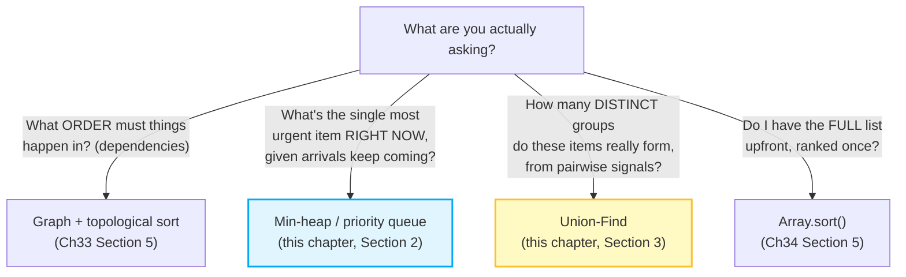

# 65. Heaps & Union-Find — Scheduling and Clustering in Test Infrastructure

**Navigation**: [← Chapter 64: Dynamic Locators & Data Structures](../05_Advanced_Topics/64_Dynamic_Locators_And_Data_Structures_In_POMs.md) | [Index](../00_INDEX.md)

**Cross-links:**

- [`33_SDET_to_SDE_CS_Thinking.md`](./33_SDET_to_SDE_CS_Thinking.md) — Section 5 (Graph Algorithms) already covers topological sort for setup *order*; this chapter covers the two structures that file doesn't: continuously-updating priority, and grouping without a full-graph traversal
- [`34_Algorithms_in_Test_Automation.md`](./34_Algorithms_in_Test_Automation.md) — Section 5 (Greedy) sorts a fixed, one-time list; this chapter's Section 1 is the direct sequel — what changes when the list isn't fixed
- [`64_Dynamic_Locators_And_Data_Structures_In_POMs.md`](../05_Advanced_Topics/64_Dynamic_Locators_And_Data_Structures_In_POMs.md) — `Array`/`Map`/`Set`, the everyday layer this chapter builds two more specialized structures on top of
- [`26_Flakiness_Diagnosis_and_Fixing.md`](../05_Advanced_Topics/26_Flakiness_Diagnosis_and_Fixing.md) — the 9-type flakiness taxonomy this chapter's Union-Find clustering feeds triage decisions into

---

## 5W1H

- **WHAT**: Two data structures — a binary min-heap and a Union-Find (disjoint-set) — solving two problems neither `Array.sort()` nor a graph traversal handles well: "what's the single most urgent thing right now, given that new items keep arriving" (heap), and "how many *distinct* problems do these N failures actually represent" (Union-Find).
- **WHY**: [Chapter 34's](./34_Algorithms_in_Test_Automation.md) greedy test-prioritization sorts a list you already have in full, once. A CI triage queue where failures stream in *during* a run is a different shape of problem — re-sorting on every arrival is correct but wasteful, and this chapter measures exactly how wasteful, in real milliseconds, not asymptotic notation alone.
- **WHO**: Anyone building the "which failure do I look at first" tooling around a large test suite, or triaging a CI run with more failures than obviously-separate root causes.
- **WHEN**: A heap, the moment "sort once" becomes "re-sort every time something new arrives." Union-Find, the moment you're asking "are these actually N different bugs, or fewer bugs that broke N tests."
- **HOW**: A heap keeps the current minimum accessible in O(1) and restores heap order in O(log n) after each change — genuinely cheaper than re-sorting, and the gap widens as the queue grows. Union-Find merges "same cluster" claims transitively in near-O(1) per merge, so a chain of pairwise signals (A relates to B, B relates to C) correctly groups A and C even with no direct A–C signal.

---

## 1. The Problem Ch34 Doesn't Cover — a List That Keeps Changing

[Chapter 34, Section 5](./34_Algorithms_in_Test_Automation.md#5-greedy-algorithm--test-suite-prioritisation) solves "which tests should run in a 10-minute CI budget" by sorting the full test list once by coverage-density and greedily taking the top of the sorted list. That's correct, because the input — the list of tests — doesn't change while you're selecting from it.

A CI triage queue doesn't have that property. Picture a nightly regression run: failures don't arrive as one batch at the end — they arrive continuously as shards finish, over 20+ minutes, and a triage engineer (or an auto-triage bot) needs to always know "what's the single highest-priority open failure right now," updated as new ones land. The naive extension of Ch34's approach is to keep the queue sorted and re-sort whenever something new arrives:

```typescript
let queue: [priority: number, test: string][] = [];
function onNewFailure(priority: number, test: string) {
  queue.push([priority, test]);
  queue.sort((a, b) => a[0] - b[0]); // re-sort the WHOLE queue, every time
}
function triageNext() {
  return queue.shift(); // take the most urgent
}
```

This is correct — the queue is always sorted, `triageNext()` always returns the true minimum. The question is whether it's the *right amount of work*, and that's answerable by actually running it, not by guessing.

## 2. The Heap — Verified Correctness, Then a Real Benchmark

A binary min-heap keeps one invariant instead of "the whole array is sorted": **every parent is ≤ its children.** That weaker invariant is exactly what makes it cheaper to maintain — restoring it after an insert or a removal only touches the O(log n) ancestors/descendants along one path, not the whole structure:

```typescript
class MinHeap {
  private data: [priority: number, item: string][] = [];
  size(): number { return this.data.length; }

  push(priority: number, item: string): void {
    this.data.push([priority, item]);
    let i = this.data.length - 1;
    while (i > 0) {
      const parent = (i - 1) >> 1;
      if (this.data[parent][0] <= this.data[i][0]) break;
      [this.data[parent], this.data[i]] = [this.data[i], this.data[parent]];
      i = parent;
    }
  }

  popMin(): [number, string] {
    const top = this.data[0];
    const last = this.data.pop()!;
    if (this.data.length > 0) {
      this.data[0] = last;
      let i = 0;
      while (true) {
        const l = 2 * i + 1, r = 2 * i + 2;
        let smallest = i;
        if (l < this.data.length && this.data[l][0] < this.data[smallest][0]) smallest = l;
        if (r < this.data.length && this.data[r][0] < this.data[smallest][0]) smallest = r;
        if (smallest === i) break;
        [this.data[i], this.data[smallest]] = [this.data[smallest], this.data[i]];
        i = smallest;
      }
    }
    return top;
  }
}
```

**Correctness first, run before trusting it:**

```typescript
const h = new MinHeap();
[50, 10, 40, 5, 90, 20].forEach((p, i) => h.push(p, `failure-${i}-prio${p}`));
const order = [];
while (h.size() > 0) order.push(h.popMin());
console.log(order.map((x) => x[0]));
```

```text
extraction order (should be ascending priority): [ 5, 10, 20, 40, 50, 90 ]
```

Inserted in a scrambled order, extracted in strict ascending order — the invariant does what it claims. Now the actual question from Section 1: is maintaining a heap really cheaper than re-sorting on every arrival? Benchmarked directly — same workload (n items arriving, popping the most urgent every 3rd arrival, simulating triage happening concurrently with new failures streaming in), both implementations, real wall-clock time:

```text
n=500:  heap=1.12ms   sort-every-time=3.39ms    ratio=3.0x
n=2000: heap=3.87ms   sort-every-time=24.03ms   ratio=6.2x
n=5000: heap=5.74ms   sort-every-time=138.10ms  ratio=24.1x
```

The number to notice isn't "the heap is faster" — it's that **the ratio itself grows with `n`**: 3.0x at 500 items, 24.1x at 5,000. That growth is the asymptotic gap made visible: each heap operation costs O(log n) regardless of queue size, so total cost across n arrivals is O(n log n). Each full re-sort costs O(n log n) *by itself*, done n times, for O(n² log n) total — the extra factor of `n` is exactly why the ratio keeps climbing instead of staying flat. A fixed constant-factor slowdown wouldn't grow like this; an asymptotic complexity difference does, and now there's a real, run, transcribed number showing it rather than a Big-O claim taken on faith.

## 3. Union-Find — When "How Many Bugs Is This, Really" Is the Actual Question

A nightly run comes back with 10 failing tests. The question that matters isn't "which 10 tests failed" — the report already says that — it's **"how many distinct root causes are actually behind these 10 failures,"** because that number determines how many engineers need to get paged, not the count of red rows in the report.

The raw signal available is pairwise: for any two failing tests, you can check whether they share a symptom — the same error message, the same downstream service in the stack trace, the same affected fixture. What you don't get for free is the *grouping* — if test A shares a signal with B, and B shares a signal with C, then A, B, and C are the same root cause, even though A and C were never directly compared. That transitive-closure problem is exactly what **Union-Find (disjoint-set)** solves, in close to O(1) amortized per operation with path compression and union-by-rank:

```typescript
class UnionFind {
  private parent = new Map<string, string>();
  private rank = new Map<string, number>();

  constructor(items: string[]) {
    for (const x of items) { this.parent.set(x, x); this.rank.set(x, 0); }
  }

  find(x: string): string {
    if (this.parent.get(x) !== x) {
      this.parent.set(x, this.find(this.parent.get(x)!)); // path compression
    }
    return this.parent.get(x)!;
  }

  union(a: string, b: string): void {
    const ra = this.find(a), rb = this.find(b);
    if (ra === rb) return;
    const rankA = this.rank.get(ra)!, rankB = this.rank.get(rb)!;
    if (rankA < rankB) this.parent.set(ra, rb);
    else if (rankA > rankB) this.parent.set(rb, ra);
    else { this.parent.set(rb, ra); this.rank.set(ra, rankA + 1); }
  }
}
```

`find` walks up to each item's ultimate cluster root, **rewriting every node it passes through to point directly at that root** ("path compression") — the next `find` on any of those nodes is then O(1). `union` always attaches the smaller-ranked tree under the larger ("union by rank"), keeping the trees shallow so `find` stays cheap.

A real 10-test failing run, with pairwise signals extracted from CI logs (matching error signature + affected fixture):

```typescript
const failingTests = [
  "citation.dispute.spec", "citation.pay.spec", "citation.search.spec",
  "customer.create.spec", "customer.merge.spec",
  "report.export.spec", "report.schedule.spec",
  "auth.login.spec", "auth.mfa.spec",
  "notification.email.spec",
];

const sharedFailureSignals: [string, string, string][] = [
  ["citation.dispute.spec", "citation.pay.spec", "ECONNREFUSED billing-api:8443"],
  ["citation.pay.spec", "citation.search.spec", "ECONNREFUSED billing-api:8443"],
  ["customer.create.spec", "customer.merge.spec", "duplicate key value violates unique constraint"],
  ["auth.login.spec", "auth.mfa.spec", "TOTP clock skew > 30s"],
  ["report.export.spec", "report.schedule.spec", "PDF render worker OOM"],
  // notification.email.spec shares no signal with anything -- its own root cause
];

const uf = new UnionFind(failingTests);
for (const [a, b] of sharedFailureSignals) uf.union(a, b);
```

```text
=== 10 failing tests -> clustered by shared root cause ===
Cluster 1 (3 tests): citation.dispute.spec, citation.pay.spec, citation.search.spec
Cluster 2 (2 tests): customer.create.spec, customer.merge.spec
Cluster 3 (2 tests): report.export.spec, report.schedule.spec
Cluster 4 (2 tests): auth.login.spec, auth.mfa.spec
Cluster 5 (1 tests): notification.email.spec

Total distinct root causes to investigate: 5 (not 10)
```

The detail worth tracing by hand: `citation.search.spec` was never directly compared against `citation.dispute.spec` — there's no `["citation.dispute.spec", "citation.search.spec", ...]` entry in `sharedFailureSignals` at all. It joined Cluster 1 purely transitively, through its direct link to `citation.pay.spec`, which was itself directly linked to `dispute.spec`. A naive approach — group tests only by *direct* pairwise matches — would have missed this and reported it as a 6th, separate cluster, overstating the real on-call burden by one phantom incident. Union-Find's transitive merging is precisely what makes "10 failures, 5 real root causes" the correct headline instead of "10 failures, 6 apparent clusters, one of which is actually part of another."

## 4. Which Structure Answers Which Question



All four structures show up in ordinary test-infrastructure work, and picking the wrong one isn't fatal — `Array.sort()` re-run on every arrival still produces a correct triage order, as Section 2 confirmed — but the cost difference is real and, as `n` grows, no longer small. The question to ask before reaching for any of them is which of the four right-hand boxes actually matches the problem, not which one is most familiar.

## Section Challenge

<details>
<summary><strong>Q1.</strong> A teammate suggests skipping the heap entirely: "just keep the queue sorted by inserting each new item at the correct position with a manual binary search + array splice, instead of a full re-sort." Does this fix the asymptotic problem Section 2 measured?</summary>

Partially, and the part it doesn't fix is the interesting part. Binary-searching for the correct insertion index is O(log n) — genuinely as cheap as the heap's O(log n) insert. But `Array.splice()` to insert at that index requires shifting every element after it by one position in memory, which is O(n) in the worst case (inserting near the front of a large array). So the total cost per insertion is O(log n) [search] + O(n) [shift] = **O(n)**, not O(log n) — better than re-sorting the whole array (O(n log n) per insertion), but still asymptotically worse than the heap's true O(log n) per insertion. The heap avoids the shift entirely because it doesn't maintain a fully sorted order at all times — only the weaker "parent ≤ children" invariant — which is precisely the trade this chapter's Section 2 opened with: a heap is cheaper *because* it guarantees less than full sortedness, and a triage queue never needed full sortedness, only "give me the current minimum," which the heap provides without ever fully sorting anything.

</details>

<details>
<summary><strong>Q2.</strong> In Section 3's example, suppose a new signal arrives: <code>["notification.email.spec", "auth.mfa.spec", "SMTP relay timeout"]</code> — a genuinely new, real correlation the earlier data didn't have. After calling <code>uf.union("notification.email.spec", "auth.mfa.spec")</code>, what happens to Cluster 4 and Cluster 5 from the transcribed output, and does the union-by-rank strategy affect the correctness of the result?</summary>

Cluster 4 (`auth.login.spec`, `auth.mfa.spec`) and Cluster 5 (`notification.email.spec`, alone) merge into a single cluster of 3: `auth.login.spec`, `auth.mfa.spec`, `notification.email.spec` — because `union()` finds the current root of each side's cluster and attaches one tree under the other. `notification.email.spec` was its own singleton root; `auth.mfa.spec`'s root was whichever of `auth.login.spec`/`auth.mfa.spec` a prior union made the root. After this call, `find()` on any of the three returns the same root, so they're reported as one cluster of 3, correctly reflecting that all three failures now trace to a common (if only just-discovered) root cause.

Union-by-rank does **not** affect correctness — it only affects which of the two roots ends up as the new combined root, purely to keep the tree shallow for future `find()` calls. Whether `auth.login.spec`'s root or `notification.email.spec` ends up as the final root, `find()` on every member of the merged cluster returns the *same* value either way — the clustering result (who's grouped with whom) is identical regardless of which root wins; only the internal tree shape, and therefore future lookup speed, differs.

</details>

<details>
<summary><strong>Q3.</strong> A teammate proposes solving Section 3's clustering problem differently: build a graph where failing tests are nodes and shared-signal pairs are edges, then run a graph traversal (BFS/DFS from Ch33) to find connected components instead of Union-Find. Would this produce the same clustering result? Is there a reason to prefer one approach over the other here?</summary>

Yes, it would produce the identical clustering — "connected components of an undirected graph" and "Union-Find's final groups after processing every edge as a union" are two different algorithms computing the exact same result; `citation.search.spec` would be found in the same component as `citation.dispute.spec` via a BFS/DFS path through `citation.pay.spec`, exactly mirroring Section 3's transitive union.

The practical difference is in how naturally each fits the shape the data actually arrives in. The signals in Section 3 arrive as a *stream of pairwise facts* — "these two share a symptom" — discovered incrementally as CI logs are scanned, not as a complete graph handed over all at once. Union-Find processes each new fact with a single `union()` call and can report the current clustering at any point without redoing prior work — new signals just call `union()` again. A graph+BFS/DFS approach would need to either rebuild the adjacency list and rerun the full traversal every time a new signal arrives, or maintain incremental traversal state by hand, which Union-Find already does implicitly via path compression. When the question is fundamentally "group by transitive relation, updated incrementally," Union-Find is the structure built for exactly that; BFS/DFS is the more natural fit when the actual question is "is there a path from A to B," or "what's the order," as in Chapter 33's topological-sort use case, not pure grouping.

</details>

---

## Chapter Summary

| Structure | Answers | Cost per operation | Verified in this chapter |
|---|---|---|---|
| `Array.sort()` (Ch34) | "Rank this full, fixed list once" | O(n log n), one time | Fine when the list doesn't change mid-selection |
| Re-sort on every arrival (naive) | "What's most urgent, as new items arrive" | O(n log n) **per arrival** | 138.10ms at n=5000 — correct, measurably wasteful |
| Min-heap | "What's most urgent, as new items arrive" | O(log n) per arrival | 5.74ms at n=5000 — 24.1x faster, ratio grows with n |
| Union-Find | "How many distinct groups, from pairwise signals" | ~O(1) amortized per union (path compression + rank) | 10 failing tests → 5 real root causes, verified incl. a transitive (no-direct-signal) merge |
| Graph + BFS/DFS (Ch33) | "What order must this happen in" / "is there a path" | O(V+E) per traversal | Topological sort for fixture setup order, cycle detection |

## Where We Go Next

This closes the DSA-in-SDET spine that started with [Chapter 33's](./33_SDET_to_SDE_CS_Thinking.md) survey (HashMap, Stack/Queue, Trees, Graphs, Recursion, Binary Search), continued through [Chapter 34's](./34_Algorithms_in_Test_Automation.md) algorithmic techniques (sliding window, two pointers, greedy, DP), and [Chapter 64's](../05_Advanced_Topics/64_Dynamic_Locators_And_Data_Structures_In_POMs.md) everyday-container layer (`Array`/`Map`/`Set`, string parsing). The common thread across all four chapters: every structure here exists because a real, specific SDET problem needed exactly the guarantee it provides — never because the structure is impressive on its own. That's the test to apply before reaching for any of them on a new problem: name the specific guarantee you need first, then pick the structure that provides exactly that guarantee and no more.

---

## Reality Check

**"A heap is just a faster sorted array"** → A heap is *not* sorted — only the root is guaranteed to be the minimum; sibling and cousin nodes have no defined order relative to each other. That's the entire reason it's cheap: it maintains a strictly weaker invariant than full sortedness, so restoring it after a change only costs O(log n) instead of the O(n log n) a full re-sort costs. If you need the full list in order at once (e.g., "give me all 500 tests ranked by priority for a report"), pop every element off the heap one at a time (`O(n log n)` total, same as sorting) — a heap doesn't give you a sorted list for free, only fast repeated access to the current minimum.

**"Union-Find and graph connected-components are basically the same thing, so it doesn't matter which you reach for"** → Correct that they compute the same result (confirmed directly in Q3) — but "same result" isn't "same fit for the situation." Union-Find is built for data arriving as a stream of incremental pairwise facts with no need to ever hold a full graph in memory; BFS/DFS needs the graph structure built first, then traverses it. Reaching for a full graph rebuild on every new signal, when the actual shape of the problem is "another fact just arrived, update the grouping," is solving the right problem with the wrong-shaped tool.

**"The heap benchmark's 24x number is specific to this exact benchmark and won't generalize"** → The specific number (24.1x at n=5000) is benchmark-specific, but the *trend* — the ratio growing as n grows — is not; it's a direct, necessary consequence of comparing an O(n log n)-per-arrival algorithm against an O(log n)-per-arrival one over n arrivals. Any workload with enough arrivals will show the same growing-ratio shape, even if the exact multiplier differs by hardware, item size, or comparator cost. The right takeaway isn't "heaps are 24x faster" as a fixed fact — it's "the performance gap between these two approaches gets worse, not better, as your triage queue grows," which is precisely the situation a nightly regression run with an expanding failure count is in.

---

**Navigation**: [← Chapter 64: Dynamic Locators & Data Structures](../05_Advanced_Topics/64_Dynamic_Locators_And_Data_Structures_In_POMs.md) | [Index](../00_INDEX.md)
