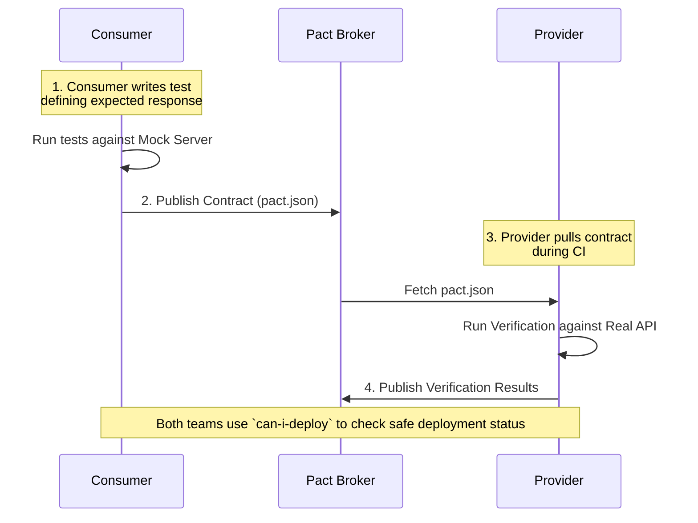

# 38. Contract Testing with Pact — Preventing API Breaking Changes

**Navigation**: [← Chapter 37: Performance Testing](./37_Performance_Testing_Lighthouse_k6.md) | [Index](../00_INDEX.md) | [→ Chapter 39: Accessibility Testing](./39_Accessibility_Testing_axe_core.md)

**Open-Source Tools Referenced:**
- **Pact** — https://github.com/pact-foundation/pact-js (MIT License) — the consumer-driven contract testing framework
- **Pact Broker** — https://github.com/pact-foundation/pact_broker (MIT License) — contract registry
- **PactFlow** — https://pactflow.io — managed Pact Broker (free tier + paid)

**Online References:**
- https://docs.pact.io/ — Official Pact documentation
- https://martinfowler.com/bliki/ConsumerDrivenContracts.html — Martin Fowler's original article
- https://docs.pact.io/consumer — Consumer test guide
- https://docs.pact.io/provider — Provider verification guide

**Cross-references (this repo):**
- [`../../06_OOP_Design/03_System_Design.md`](../../../06_OOP_Design/03_System_Design.md) — Microservices architecture that makes contract testing necessary
- [`../../22_Advanced_API_Testing/01_API_Testing_Foundations.md`](../../../22_Advanced_API_Testing/01_API_Testing_Foundations.md) — REST fundamentals that Pact tests are built on

---

## 5W1H

- **WHAT**: Contract testing verifies that a consumer (your test suite / frontend) and a provider (the API) agree on the exact shape of data exchanged — without needing the provider to be running when the consumer test runs.
- **WHY**: In a microservices world, Service A's team changes a response field from `citationId` to `citation_id`. Every consumer that expected `citationId` silently breaks — but their integration tests all pass because they mock the API. Pact catches this at the PR level, before deployment.
- **WHO**: SDETs on teams with multiple backend services or with a separate frontend team. Critical when services are owned by different teams.
- **WHEN**: When you have at least 2 teams exchanging data via API and no single owner can see all consumers.
- **HOW**: Consumer writes a "contract" (a pact file) describing what it sends and expects. Provider runs a "verification" against that contract using the real server. Both are in CI. If they disagree → build fails.

---

## 1. The Problem Pact Solves — A Real Scenario

**The Contract Testing Workflow:**


```
The situation without Pact:

Team A (Consumer — your test team) writes:
  const id = response.body.citationId;  // expects 'citationId'

Team B (Provider — backend API team) refactors:
  // Changes the field name to match their DB column
  return { citation_id: citation.id };  // now 'citation_id' (snake_case)

Team A's tests all pass — because they mock the API:
  await page.route('**/api/v2/citations/**', route =>
    route.fulfill({ body: JSON.stringify({ citationId: 'CIT-001' }) })  // their mock
  );
  // Their mock still uses 'citationId' — nobody updated it

Team B's tests all pass — they test their own API which returns 'citation_id'

Production: consumer calls real API → gets 'citation_id' → code reads 'citationId' → undefined
Result: PRODUCTION INCIDENT on day 1 of the new API version.

With Pact:
  Consumer test writes a contract: "I expect { citationId: string } in the response"
  Provider verification: "let me check if my real server returns { citationId: string }"
  Provider test FAILS at Team B's PR → caught before merge → caught before production
```

---

## 2. Installation

```bash
# Consumer side (your test project):
npm install --save-dev @pact-foundation/pact

# For TypeScript support (included in the package since v10):
# Pact v10+ is fully TypeScript-native
# Docs: https://docs.pact.io/implementation_guides/javascript/readme#pact-js-v10

# Check current version:
npm show @pact-foundation/pact version
```

---

## 3. Consumer Test — Defining the Contract

The consumer test defines what your code SENDS and what it EXPECTS BACK:

```typescript
// tests/contracts/citation-consumer.pact.spec.ts
// This test:
//  1. Starts a local mock server
//  2. Runs your real client code against it
//  3. Verifies your client handles the response correctly
//  4. Records the interaction as a "pact" (JSON contract file)

import { PactV3, MatchersV3 } from '@pact-foundation/pact';
import path from 'path';

// Matchers: https://docs.pact.io/consumer/matching
const { like, eachLike, regex, timestamp, string, integer, decimal } = MatchersV3;

// Create a Pact between your consumer and the provider
const provider = new PactV3({
  consumer: 'PlaywrightTestSuite',         // your consumer's name
  provider: 'CitationManagementService',   // the API you're calling
  dir: path.resolve(__dirname, '../../pacts'),  // where to save the contract file
  logLevel: 'warn',
});

describe('Citation Management Service — Consumer Contract', () => {

  // Contract 1: GET a citation by ID
  test('GET /api/v2/citations/:id → returns citation details', async () => {
    await provider
      .addInteraction({
        states: [{ description: 'citation CIT-001 exists' }],
        uponReceiving: 'a request for citation CIT-001',

        withRequest: {
          method: 'GET',
          path: '/api/v2/citations/CIT-001',
          headers: {
            Accept: 'application/json',
            Authorization: regex({ generate: 'Bearer test-token', matcher: '^Bearer .+$' }),
          },
        },

        willRespondWith: {
          status: 200,
          headers: { 'Content-Type': 'application/json' },
          body: {
            // Use matchers — not exact values.
            // like() means "I care about the TYPE and structure, not the exact value"
            // This makes the contract stable even when test data changes.
            citationId: like('CIT-001'),       // string — must exist, exact value doesn't matter
            customerId: like('USR-001'),        // string — must exist
            status: regex({
              generate: 'PENDING',
              matcher: '^(PENDING|PAID|OVERDUE|DISPUTED|CANCELLED)$',  // only valid statuses
            }),
            amount:    decimal(150.00),         // number
            issueDate: timestamp('yyyy-MM-dd', '2026-01-15'),  // ISO date string
            // Optional field — use like() so contract still passes if it changes
            notes: like('Sample note'),
          },
        },
      })
      .executeTest(async (mockServer) => {
        // Your REAL client code runs against the mock server:
        const client = new CitationsApiClient(
          mockServer.url,
          'test-token'
        );
        const citation = await client.getById('CIT-001');

        // Assert your client handles the response correctly:
        expect(citation.citationId).toBe('CIT-001');
        expect(['PENDING','PAID','OVERDUE','DISPUTED','CANCELLED']).toContain(citation.status);
        expect(typeof citation.amount).toBe('number');
      });
  });

  // Contract 2: POST to create a citation
  test('POST /api/v2/citations → creates a new citation', async () => {
    await provider
      .addInteraction({
        states: [{ description: 'user USR-001 exists and can create citations' }],
        uponReceiving: 'a request to create a PENDING citation',

        withRequest: {
          method: 'POST',
          path: '/api/v2/citations',
          headers: {
            'Content-Type': 'application/json',
            Authorization: regex({ generate: 'Bearer test-token', matcher: '^Bearer .+$' }),
          },
          body: {
            customerId: like('USR-001'),
            amount:     decimal(150),
            status:     'PENDING',
            // 'citationType' is required by our client — contract verifies the provider accepts it
            citationType: like('PARKING'),
          },
        },

        willRespondWith: {
          status: 201,
          headers: {
            'Content-Type': 'application/json',
            'Location': regex({
              generate: '/api/v2/citations/CIT-001',
              matcher: '^/api/v2/citations/.+$',  // any valid citation path
            }),
          },
          body: {
            citationId: like('CIT-001'),    // a string ID is returned
            status:     like('PENDING'),
            amount:     decimal(150),
          },
        },
      })
      .executeTest(async (mockServer) => {
        const client = new CitationsApiClient(mockServer.url, 'test-token');
        const citation = await client.create({
          customerId: 'USR-001',
          amount: 150,
          status: 'PENDING',
          citationType: 'PARKING',
        });

        expect(citation.citationId).toBeTruthy();
        expect(citation.status).toBe('PENDING');
      });
  });

  // Contract 3: 404 response when citation doesn't exist
  test('GET /api/v2/citations/:id → 404 when citation not found', async () => {
    await provider
      .addInteraction({
        states: [{ description: 'citation CIT-NONEXISTENT does not exist' }],
        uponReceiving: 'a request for a non-existent citation',
        withRequest: {
          method: 'GET',
          path: '/api/v2/citations/CIT-NONEXISTENT',
          headers: { Authorization: regex({ generate: 'Bearer t', matcher: '^Bearer .+$' }) },
        },
        willRespondWith: {
          status: 404,
          body: {
            error: like('Citation not found'),
            code:  like('CITATION_NOT_FOUND'),
          },
        },
      })
      .executeTest(async (mockServer) => {
        const client = new CitationsApiClient(mockServer.url, 'test-token');
        await expect(client.getById('CIT-NONEXISTENT')).rejects.toThrow(/404/);
      });
  });
});
```

After running the consumer tests, Pact creates a contract file:
```
pacts/
└── PlaywrightTestSuite-CitationManagementService.json
```

---

## 4. The Pact File — What Gets Generated

```json
{
  "consumer": { "name": "PlaywrightTestSuite" },
  "provider": { "name": "CitationManagementService" },
  "interactions": [
    {
      "description": "a request for citation CIT-001",
      "providerStates": [{ "name": "citation CIT-001 exists" }],
      "request": {
        "method": "GET",
        "path": "/api/v2/citations/CIT-001",
        "headers": { "Authorization": { "regex": "^Bearer .+$" } }
      },
      "response": {
        "status": 200,
        "body": {
          "citationId": { "type": "Type", "value": "CIT-001" },
          "status": { "regex": "^(PENDING|PAID|OVERDUE|DISPUTED|CANCELLED)$" }
        }
      }
    }
  ],
  "metadata": {
    "pactSpecification": { "version": "3.0.0" },
    "pact-js": { "version": "14.x.x" }
  }
}
```

---

## 5. Provider Verification — The API Team Runs This

The backend team (Java/Spring Boot) verifies their API satisfies the contract:

```typescript
// If your backend has a TypeScript test runner too:
// tests/contracts/citation-provider.pact.spec.ts

import { Verifier } from '@pact-foundation/pact';

test('CitationManagementService satisfies PlaywrightTestSuite contract', async () => {
  await new Verifier({
    provider: 'CitationManagementService',
    providerBaseUrl: process.env.PROVIDER_BASE_URL ?? 'http://localhost:8080',

    // Load pact files from Pact Broker (or local files):
    pactUrls: [`${__dirname}/../../pacts/PlaywrightTestSuite-CitationManagementService.json`],
    // OR from Pact Broker:
    // pactBrokerUrl: process.env.PACT_BROKER_URL,
    // consumerVersionSelectors: [{ mainBranch: true }, { deployedOrReleased: true }],

    // Provider states: set up the DB for each interaction
    stateHandlers: {
      'citation CIT-001 exists': async () => {
        // Set up: insert CIT-001 into test DB
        await db.query("INSERT INTO citations (citation_id, status) VALUES ('CIT-001', 'PENDING')");
      },
      'citation CIT-NONEXISTENT does not exist': async () => {
        // Set up: ensure CIT-NONEXISTENT is deleted
        await db.query("DELETE FROM citations WHERE citation_id = 'CIT-NONEXISTENT'");
      },
      'user USR-001 exists and can create citations': async () => {
        await db.query("INSERT INTO users (user_id, role) VALUES ('USR-001', 'CUSTOMER') ON CONFLICT DO NOTHING");
      },
    },

    publishVerificationResult: process.env.CI === 'true',
    providerVersion: process.env.GIT_COMMIT ?? 'local',
  }).verifyProvider();
});
```

---

## 6. Pact Broker — Sharing Contracts Between Teams

The [Pact Broker](https://github.com/pact-foundation/pact_broker) is the registry where contracts are shared:

```bash
# Run locally with Docker:
docker run --rm -it \
  -e PACT_BROKER_DATABASE_URL=sqlite:////tmp/pact_broker_app.sqlite \
  -p 9292:9292 \
  pactfoundation/pact-broker
# → Web UI at http://localhost:9292

# Publish consumer contracts after test run:
npx pact-broker publish ./pacts \
  --consumer-app-version $(git rev-parse HEAD) \
  --branch $(git rev-parse --abbrev-ref HEAD) \
  --broker-base-url http://localhost:9292

# Check if it's safe to deploy (can-i-deploy):
npx pact-broker can-i-deploy \
  --pacticipant PlaywrightTestSuite \
  --version $(git rev-parse HEAD) \
  --to-environment staging \
  --broker-base-url http://localhost:9292
# Exits 0 if all contracts verified → safe to deploy
# Exits 1 if any contract fails → DO NOT deploy
```

### CI Workflow with Pact

```yaml
# Consumer CI (your test pipeline):
- name: Run consumer contract tests
  run: npx jest tests/contracts/citation-consumer.pact.spec.ts

- name: Publish pacts to broker
  run: |
    npx pact-broker publish ./pacts \
      --consumer-app-version ${{ github.sha }} \
      --branch ${{ github.ref_name }} \
      --broker-base-url ${{ secrets.PACT_BROKER_URL }} \
      --broker-token ${{ secrets.PACT_BROKER_TOKEN }}

# Provider CI (backend team's pipeline — triggered automatically):
# Pact Broker sends a webhook when a new pact is published
# → triggers provider verification job
# → posts result back to Pact Broker

# Can-i-deploy check before staging deployment:
- name: Can I deploy to staging?
  run: |
    npx pact-broker can-i-deploy \
      --pacticipant PlaywrightTestSuite \
      --version ${{ github.sha }} \
      --to-environment staging \
      --broker-base-url ${{ secrets.PACT_BROKER_URL }} \
      --broker-token ${{ secrets.PACT_BROKER_TOKEN }}
```

---

## 6b. Pact Versioning Strategy

A solid versioning strategy is critical for `can-i-deploy` to work. If you don't version correctly, Pact Broker doesn't know which version of the consumer is compatible with which version of the provider.

**Best Practice: Use Git Commit SHAs**

Do NOT use semantic versioning (like `1.0.4`) for Pact versions unless you perfectly bump versions on every single commit. Use the Git commit SHA.

```bash
# BAD versioning (hard to map back to code):
--consumer-app-version 1.0.0
--consumer-app-version v2-beta

# GOOD versioning (absolute traceability):
--consumer-app-version $(git rev-parse HEAD)
```

**Branch Tagging:**
Always tag your contracts with the branch name and the environment they are deployed to.

```bash
# 1. On consumer PR build:
--consumer-app-version 3a9f8b2 \
--branch feature/new-search \ # marks it as a work-in-progress branch

# 2. When consumer is deployed to Staging:
npx pact-broker record-deployment \
  --pacticipant PlaywrightTestSuite \
  --version 3a9f8b2 \
  --environment staging

# 3. Provider checks if it can deploy to Staging:
npx pact-broker can-i-deploy \
  --pacticipant CitationManagementService \
  --version 8c4f1a9 \
  --to-environment staging
# The broker checks: "Has provider 8c4f1a9 verified the contract from consumer 3a9f8b2?"
```

---

## 7. What Pact Does NOT Replace

```
Pact replaces:     E2E tests that only verify the API contract shape
Pact does NOT replace:
  → Functional E2E tests (UI + API integration)
  → Business logic tests (what the API DOES with the data)
  → Load tests (how the API performs)
  → Security tests (auth, input validation)

The test pyramid with contract testing:
  ╔══════════════════╗
  ║  E2E tests (few) ║  ←  Full UI+API integration
  ╠══════════════════╣
  ║  Contract tests  ║  ←  API shape agreement (Pact)
  ╠══════════════════╣
  ║  Unit/API tests  ║  ←  Logic, edge cases
  ╚══════════════════╝ 
```

---

## 8. Bi-Directional Contract Testing (BDCT)

Traditional Pact requires the provider team to run Pact verification. BDCT removes that dependency — the provider uploads an OpenAPI spec instead:

```
Traditional Pact flow:
  Consumer writes contract → Provider runs Pact verifier → Both results in Pact Broker
  Problem: Provider team must adopt Pact tooling (friction for backend teams)

BDCT flow:
  Consumer writes contract → uploads to PactFlow
  Provider uploads OpenAPI spec → PactFlow compares them
  PactFlow detects mismatches automatically (no provider-side Pact code required)

  When to use BDCT:
  → Provider team already has an OpenAPI spec (Swagger)
  → Provider team is a different department and won't adopt Pact tooling
  → You want zero-friction adoption for backend teams
```

```bash
# BDCT: Upload your OpenAPI spec to PactFlow (provider side):
npx pactflow publish-provider-contract \
  openapi.yaml \
  --provider CitationManagementService \
  --provider-app-version $(git rev-parse HEAD) \
  --branch main \
  --content-type application/yaml \
  --broker-base-url $PACT_BROKER_URL \
  --broker-token $PACT_BROKER_TOKEN

# PactFlow will compare the consumer contracts against this OpenAPI spec
# and report mismatches — no Pact code needed on the provider side
```

---

## 9. Schema Evolution — Breaking vs Non-Breaking Changes

Not all API changes break contracts. Know the difference before escalating:

```
NON-BREAKING changes (safe — existing consumers still work):
  ✅ Add a new OPTIONAL field to the response
     { citationId, status }  →  { citationId, status, tags: [] }
     Consumers that don't read 'tags' are unaffected

  ✅ Add a new OPTIONAL query parameter
     GET /citations?page=1  →  GET /citations?page=1&include=audit

  ✅ Add a new valid enum value (if consumer uses regex matcher)
     status: 'PENDING|PAID'  →  status: 'PENDING|PAID|ARCHIVED'
     Only breaks if consumer uses exact match (not regex matcher)

  ✅ Relax validation (accept more inputs)

BREAKING changes (fail existing consumer contracts):
  ❌ Rename a field
     citationId  →  citation_id  (consumers reading 'citationId' get undefined)

  ❌ Change a field's type
     amount: 150.00 (number)  →  amount: '150.00' (string)

  ❌ Remove a field
     { citationId, status, notes }  →  { citationId, status }
     Consumers that read 'notes' get undefined

  ❌ Make an optional field required on REQUEST
  ❌ Remove a valid enum value
  ❌ Change HTTP status codes (200 → 204)
  ❌ Change the URL path structure
```

```typescript
// How to make your consumer contract RESILIENT to non-breaking provider changes:
// Use matchers instead of exact values:

// ❌ Fragile — breaks if provider adds new enum values:
body: { status: 'PENDING' }

// ✅ Resilient — only validates the values your consumer cares about:
body: {
  status: regex({
    generate: 'PENDING',
    matcher: '^(PENDING|PAID|OVERDUE|DISPUTED|CANCELLED)$',
    // If provider adds 'ARCHIVED', the regex doesn't match → your contract BREAKS
    // To allow future values:
    // matcher: '^[A-Z_]+$'  — more permissive, allows any uppercase status
  }),
}

// ❌ Fragile — breaks if response adds new fields (it shouldn't, but TypeScript strict mode might flag):
body: { citationId: 'CIT-001', status: 'PENDING' }  // exact match

// ✅ Resilient — use like() which validates TYPE, not exact content:
body: {
  citationId: like('CIT-001'),   // any string is OK
  status:     like('PENDING'),   // any string is OK (add regex if you want type-safety)
  // Don't include optional fields unless your consumer uses them
}
```

---

## 10. Pending Pacts — Preventing Blocking on Unverified Contracts

When a new consumer publishes a contract that the provider hasn't verified yet, it shouldn't block provider CI:

```typescript
// Provider verification — enable pending pacts:
await new Verifier({
  provider: 'CitationManagementService',
  providerBaseUrl: 'http://localhost:8080',
  pactBrokerUrl: process.env.PACT_BROKER_URL,
  consumerVersionSelectors: [
    { mainBranch: true },        // contracts from consumer's main branch
    { deployedOrReleased: true }, // contracts from currently-deployed consumer versions
  ],

  // ← KEY: Pending pacts won't fail provider CI
  // They're reported as warnings until the provider verifies them for the first time
  enablePending: true,

  // Work in progress pacts — allow consumer to publish contracts from feature branches
  // without blocking provider CI (they're tracked but non-blocking)
  includeWipPactsSince: '2026-01-01',

  publishVerificationResult: process.env.CI === 'true',
  providerVersion: process.env.GIT_COMMIT ?? 'local',
}).verifyProvider();

/*
Workflow:
  1. Consumer team publishes new contract from feature branch → "pending" status
  2. Provider CI runs verification → pending contract fails → WARNING only (not blocking)
  3. Provider team sees the warning and adapts their API
  4. Once provider verifies it for the first time → contract becomes "non-pending"
  5. Future provider failures against this contract → BUILD FAILURE (blocking)
*/
```

---

## 🏋️ Practice Challenge

### Challenge 1 [Write It Yourself]

Write a Pact consumer test for the notification API: `GET /api/v1/notifications?userId=USR-001&type=CITATION_CREATED`. The response should contain an array of notifications, each with: `notificationId`, `type` (one of the NotificationType enum values), `status` ('queued' | 'sent' | 'delivered' | 'failed'), `createdAt` (ISO timestamp), and optionally `referenceId`.

<details><summary>Answer</summary>

```typescript
test('GET /api/v1/notifications → returns notifications for user', async () => {
  await provider
    .addInteraction({
      states: [{ description: 'USR-001 has at least one CITATION_CREATED notification' }],
      uponReceiving: 'a request for CITATION_CREATED notifications for USR-001',
      withRequest: {
        method: 'GET',
        path: '/api/v1/notifications',
        query: { userId: 'USR-001', type: 'CITATION_CREATED' },
        headers: {
          Authorization: regex({ generate: 'Bearer t', matcher: '^Bearer .+$' }),
        },
      },
      willRespondWith: {
        status: 200,
        headers: { 'Content-Type': 'application/json' },
        body: {
          data: eachLike({  // at least one element matching this shape
            notificationId: like('NOTIF-001'),
            type: regex({
              generate: 'CITATION_CREATED',
              matcher: '^(CITATION_CREATED|PAYMENT_RECEIVED|DISPUTE_SUBMITTED|ACCOUNT_SUSPENDED)$',
            }),
            status: regex({
              generate: 'delivered',
              matcher: '^(queued|sent|delivered|failed)$',
            }),
            createdAt: timestamp('yyyy-MM-dd\'T\'HH:mm:ss.SSS\'Z\'', '2026-01-15T10:30:00.000Z'),
            // referenceId is optional — use like() for optionals
            referenceId: like('CIT-001'),
          }),
          pagination: like({ total: 1, page: 1, pageSize: 20 }),
        },
      },
    })
    .executeTest(async (mockServer) => {
      const client = new NotificationsApiClient(mockServer.url, 'test-token');
      const result = await client.search({ userId: 'USR-001', type: 'CITATION_CREATED' });

      expect(result.data.length).toBeGreaterThan(0);
      expect(['queued','sent','delivered','failed']).toContain(result.data[0].status);
    });
});
```
</details>

---

**Key References:**
- [docs.pact.io](https://docs.pact.io/) — Complete Pact documentation
- [github.com/pact-foundation/pact-js](https://github.com/pact-foundation/pact-js) — Pact JS (MIT)
- [Martin Fowler — Consumer-Driven Contracts](https://martinfowler.com/bliki/ConsumerDrivenContracts.html)
- [PactFlow — managed broker](https://pactflow.io) — free tier available

---

### Challenge 2 [Breaking Change Classification]

Your provider team is making these API changes to `GET /api/v2/citations/:id`. Classify each as BREAKING or NON-BREAKING and explain why:

1. Adding a new field: `{ ...existing fields..., auditTrail: [] }`
2. Renaming `issueDate` to `issuedAt`
3. Changing `amount` from `number` to `string` (e.g., `'150.00'`)
4. Adding a new optional query parameter `?include=payments`
5. Removing the `notes` field
6. Adding a new valid status value `'ARCHIVED'` to the `status` enum
7. Changing the response status from `200` to `204 No Content` on successful GET

<details><summary>Answer</summary>

| Change | Breaking? | Why |
|---|---|---|
| 1. Add `auditTrail` field | ✅ NON-BREAKING | Consumers that don't read this field are unaffected |
| 2. Rename `issueDate` → `issuedAt` | ❌ BREAKING | All consumers reading `issueDate` get `undefined` |
| 3. `amount`: number → string | ❌ BREAKING | Type mismatch — code doing `amount * taxRate` breaks |
| 4. New optional query param | ✅ NON-BREAKING | Existing consumers don't send it; API ignores its absence |
| 5. Remove `notes` field | ❌ BREAKING | Consumers reading `notes` get `undefined` |
| 6. Add `'ARCHIVED'` enum value | ⚠ DEPENDS | Non-breaking if consumer uses regex matcher. Breaking if consumer uses switch/exhaustive match |
| 7. `200` → `204 No Content` | ❌ BREAKING | Consumers that read the response body get nothing. Pact contract explicitly includes `status: 200` |

With Pact: changes 2, 3, 5, and 7 immediately fail provider verification. Change 6 fails if the consumer used an exact regex. Change 1 and 4 pass silently.
</details>

---

### Challenge 3 [Architecture Decision]

Your backend team says: "We already have an OpenAPI (Swagger) spec for the Citations API. Why do we need Pact? Can't you just validate your client against the spec?"

<details><summary>Answer</summary>

**OpenAPI spec validation** tells you: "Does the response match the API definition?"
**Pact** tells you: "Does the API match what EACH CONSUMER actually uses?"

The distinction matters in practice:

1. **Unused fields**: The OpenAPI spec may define 30 response fields. Your consumer only uses 5. If the provider changes field 23 (which you never read), OpenAPI spec validation says "BREAKING" but Pact says "fine — your consumer doesn't use that field."

2. **Consumer-specific validation**: Different consumers may care about different fields. Consumer A uses `citationId`. Consumer B uses `citationId` AND `auditTrail`. Pact tracks this per-consumer. OpenAPI spec treats all consumers identically.

3. **Change safety**: Before the provider deploys, they can run `can-i-deploy` against Pact Broker and know definitively: "ALL currently-deployed consumers have verified contracts against this version." OpenAPI spec validation can't answer that question.

**The best answer**: Use BOTH. Validate your client against the OpenAPI spec for completeness, AND use Pact for consumer-specific regression detection and `can-i-deploy` safety gates.

If the team is resistant to adopting Pact tooling on the provider side, use BDCT (Section 8) — the provider just uploads their OpenAPI spec; no Pact code required.
</details>

---

**Key References:**
- [docs.pact.io](https://docs.pact.io/) — Complete Pact documentation
- [github.com/pact-foundation/pact-js](https://github.com/pact-foundation/pact-js) — Pact JS (MIT)
- [Martin Fowler — Consumer-Driven Contracts](https://martinfowler.com/bliki/ConsumerDrivenContracts.html)
- [PactFlow — managed broker](https://pactflow.io) — free tier available

---
**Navigation**: [← Chapter 37: Performance Testing](./37_Performance_Testing_Lighthouse_k6.md) | [Index](../00_INDEX.md) | [→ Chapter 39: Accessibility Testing](./39_Accessibility_Testing_axe_core.md)

### Challenge 4 [Spot the Bug — Over-specification in Consumer Contract]

```typescript
// In the Consumer test:
provider.addInteraction({
  state: 'a citation CIT-001 exists',
  uponReceiving: 'a request to get the citation',
  withRequest: {
    method: 'GET',
    path: '/api/v1/citations/CIT-001',
  },
  willRespondWith: {
    status: 200,
    headers: { 'Content-Type': 'application/json' },
    body: {
      citationId: 'CIT-001',
      amount: 150.00,
      status: 'PENDING',
      timestamp: '2023-10-15T08:30:00Z',  // ← Exact timestamp string
      internalDbId: 99482,                 // ← Field our frontend doesn't even use
    }
  }
});
```

What are two major anti-patterns in this consumer contract?

<details><summary>Answer</summary>

**1. Exact Value Matching for Dynamic Data (Timestamp)**: The provider likely generates a dynamic timestamp. If the contract demands exactly `2023-10-15T08:30:00Z`, the provider verification will fail unless the provider mocks its clock perfectly.
*Fix*: Use Pact matchers: `timestamp: Matchers.iso8601DateTime()`

**2. Including Unused Fields (`internalDbId`)**: Contract testing is about the *Consumer-Driven* contract. If the consumer (frontend) doesn't use `internalDbId`, it shouldn't be in the contract. Including it means the provider team cannot remove or rename `internalDbId` without breaking the contract, unnecessarily tightly coupling the two systems.
*Fix*: Remove fields the consumer doesn't actively parse.

**SDE Principle**: Postel's Law (Robustness Principle). Be conservative in what you send, be liberal in what you accept. Contracts should only specify the minimum viable schema needed by the consumer.

</details>

---

### Challenge 5 [MCQ — Provider Verification Workflow]

When the Provider runs its verification pipeline against the Pact broker, and the verification fails because a field type changed from `number` to `string`, what is the correct SDET interpretation of this failure?

A) The Provider introduced a bug and must fix their code to revert to `number`.
B) The Consumer's contract is outdated and the Consumer team must update their tests to expect `string`.
C) The Provider has successfully detected that deploying their code would break the Consumer. The deployment must be blocked until the Consumer is updated to handle `string`.
D) Pact is misconfigured because field types should not break contracts.

<details><summary>Answer</summary>

**C** — The Provider has successfully detected a breaking change *before* it reaches production.

This is the entire point of Contract Testing. The Provider's code might be functionally "correct" according to their new design (changing amount to string), but the Contract proves that the existing Consumer in production will crash if this is deployed.

The fix isn't always "revert the Provider." The fix is a team conversation:
1. Provider says: "We need to change to string for precision."
2. Consumer says: "Okay, we will deploy an update that accepts string."
3. Once Consumer deploys, the contract updates.
4. Provider can now deploy safely.

</details>

---

**Key References:**
- [docs.pact.io](https://docs.pact.io/) — Complete Pact documentation
- [github.com/pact-foundation/pact-js](https://github.com/pact-foundation/pact-js) — Pact JS (MIT)
- [Martin Fowler — Consumer-Driven Contracts](https://martinfowler.com/bliki/ConsumerDrivenContracts.html)
- [PactFlow — managed broker](https://pactflow.io) — free tier available

---
**Navigation**: [← Chapter 37: Performance Testing](./37_Performance_Testing_Lighthouse_k6.md) | [Index](../00_INDEX.md) | [→ Chapter 39: Accessibility Testing](./39_Accessibility_Testing_axe_core.md)
