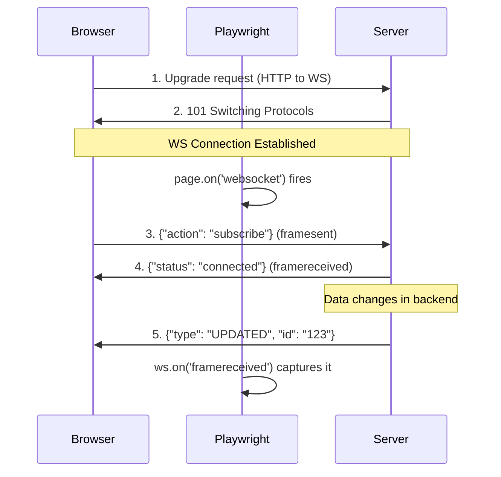

# 41. GraphQL & WebSocket Testing with Playwright

**Navigation**: [← Chapter 40: Security Testing](./40_Security_Testing_OWASP.md) | [Index](../00_INDEX.md)

**Open-Source Tools Referenced:**

- **graphql-request** — https://github.com/jasonkuhrt/graphql-request (MIT) — minimal GraphQL client
- **graphql** — https://github.com/graphql/graphql-js (MIT) — the GraphQL reference implementation
- **@graphql-codegen/cli** — https://github.com/dotansimha/graphql-code-generator (MIT) — auto-generate TypeScript types from schema
- **Faker.js** — https://github.com/faker-js/faker (MIT) — realistic test data generation

**Online References:**

- https://graphql.org/learn/ — GraphQL official spec
- https://spec.graphql.org/ — GraphQL specification (the actual spec, not just docs)
- https://playwright.dev/docs/network — Playwright network interception
- https://developer.mozilla.org/en-US/docs/Web/API/WebSockets_API — MDN WebSocket API

**Cross-references (this repo):**

- [`Ch04 JS/TS for Automation`](../01_Foundations/04_JS_TS_For_Automation.md) — Promises, async/await — critical for WebSocket event handling
- [`31_API_Mocking_page_route.md`](../05_Advanced_Topics/31_API_Mocking_page_route.md) — `page.route()` used for GraphQL mocking

---

## 5W1H — GraphQL

- **WHAT**: GraphQL is a query language for APIs where the _client_ specifies exactly what data it needs, rather than the server defining fixed endpoints. One URL (`/graphql`), many operations.
- **WHY**: Many modern enterprise apps (Shopify, GitHub, Atlassian) use GraphQL. D365's newer APIs expose GraphQL. The testing approach is fundamentally different from REST — you test operations, not URLs.
- **HOW**: Send a `POST` to `/graphql` with a `query` or `mutation` in the body. Parse the `data` and `errors` from the response.

## 5W1H — WebSockets

- **WHAT**: WebSocket is a persistent, bidirectional connection between browser and server — real-time data without polling. Used for live notifications, chat, collaborative editing, live dashboard updates.
- **WHY**: If your CRM has "live updates" (e.g., citation status changes appear instantly without refresh), it's using WebSockets. Playwright can intercept and assert on WebSocket messages.
- **HOW**: `page.on('websocket', handler)` captures WebSocket connections. `ws.on('framereceived', handler)` captures incoming messages.

---

## War Stories — Before You Start

### GraphQL: the test that passed on every query but missed the schema change

We had a GraphQL test that sent a `GetCitation` query and asserted the `status` field. The team changed the field name from `status` to `citationStatus` in the schema. Our test should have failed immediately.

It didn't. It returned `null` for `citationStatus` (the field didn't exist under the old name), but we hadn't asserted that the field was non-null — just that the response contained the key. The test kept passing. Production had the bug for two weeks: the frontend was reading `citation.status` (undefined) instead of `citation.citationStatus`.

**Fix:** Every field you test in a GraphQL response should assert a specific non-null value, not just presence. And run `graphql-codegen` to generate TypeScript types from your schema — type-checking catches renamed fields at compile time, not at runtime.

### WebSocket: the race condition between connection and first message

We wrote a test to verify that a new notification arrived via WebSocket when an admin created a record. The test set up the WebSocket listener after clicking "Create." The notification arrived during the 40ms it took for Playwright to register the listener. The test received zero messages, timed out after 10 seconds, and failed 60% of the time.

The fix: set up the WebSocket listener BEFORE triggering the action, not after:

```typescript
// WRONG — race condition
await adminPage.click('button[name="createRecord"]');
page.on('websocket', ws => { /* already missed the connection */ });

// CORRECT — listener first
const wsPromise = page.waitForEvent('websocket');
await adminPage.click('button[name="createRecord"]');
const ws = await wsPromise;
```

We still missed messages occasionally because the WebSocket connected before the `framereceived` listener was attached. The deeper fix is in Section 5 of this chapter.

### WebSocket: the test that never reconnected

Our chat feature auto-reconnects on network interruption. We wrote a test that dropped the WebSocket mid-test using `page.route('**', route => route.abort())` to simulate network loss, then waited for reconnect. The test timed out every time.

Root cause: `page.route` aborts HTTP requests but doesn't affect WebSocket connections (which use a different protocol stack). We needed `context.route('ws://**', ...)` — which in older Playwright versions didn't exist.

The actual fix: use `context.setOffline(true)` to simulate network drop, which does affect WebSockets. Then `context.setOffline(false)` to restore, then wait for the reconnect message.

---

## PART 1 — GraphQL Testing

### 1. Understanding GraphQL vs REST

```
REST:
  GET  /api/v2/citations/CIT-001         → returns ALL citation fields (overfetch)
  GET  /api/v2/users/USR-001             → separate request (underfetch → N+1 problem)

GraphQL (one request, client specifies fields):
  POST /graphql
  {
    "query": "query GetCitation($id: ID!) {
      citation(id: $id) {
        citationId
        status
        amount
        customer {       ← nested — no second request needed
          userId
          name
          email
        }
      }
    }",
    "variables": { "id": "CIT-001" }
  }

Testing difference:
  REST:  assert on specific endpoint's response structure
  GraphQL: assert on operation name + variables + response data shape
           Also: assert on 'errors' array (GraphQL returns 200 even for errors!)
```

### 2. The Critical GraphQL Testing Difference — Errors in 200 Responses

```typescript
// GraphQL ALWAYS returns HTTP 200, even for errors.
// The error information is in the response body under 'errors'.

// A broken response looks like:
{
  "data": null,                          // ← data is null
  "errors": [                            // ← errors are HERE
    {
      "message": "Citation not found",
      "locations": [{ "line": 2, "column": 3 }],
      "path": ["citation"],
      "extensions": { "code": "NOT_FOUND" }
    }
  ]
}

// A working response:
{
  "data": {
    "citation": { "citationId": "CIT-001", "status": "PENDING" }
  }
  // no 'errors' field — or errors: []
}

// WRONG assertion (passes even on error):
expect(response.status()).toBe(200);  // ← always true, tells you nothing

// CORRECT assertion:
const body = await response.json();
expect(body.errors, `GraphQL errors: ${JSON.stringify(body.errors)}`).toBeUndefined();
expect(body.data).not.toBeNull();
expect(body.data.citation).toBeDefined();
```

### 3. GraphQL Test Client

```typescript
// clients/GraphQLClient.ts
// A typed GraphQL client for test automation

export interface GraphQLResponse<T = unknown> {
  data: T | null;
  errors?: GraphQLError[];
}

export interface GraphQLError {
  message: string;
  path?: string[];
  extensions?: { code?: string; [key: string]: unknown };
}

export class GraphQLClient {
  private readonly endpoint: string;
  private readonly token: string;

  constructor(baseUrl: string, token: string) {
    this.endpoint = `${baseUrl}/graphql`;
    this.token = token;
  }

  async query<T>(
    query: string,
    variables: Record<string, unknown> = {},
  ): Promise<GraphQLResponse<T>> {
    const response = await fetch(this.endpoint, {
      method: "POST",
      headers: {
        "Content-Type": "application/json",
        Authorization: `Bearer ${this.token}`,
        Accept: "application/json",
      },
      body: JSON.stringify({ query, variables }),
    });

    if (!response.ok) {
      throw new Error(
        `GraphQL HTTP error: ${response.status} ${await response.text()}`,
      );
    }

    const result = (await response.json()) as GraphQLResponse<T>;
    return result;
  }

  // Throws if any GraphQL errors are present — use for "must succeed" calls
  async mustQuery<T>(
    query: string,
    variables?: Record<string, unknown>,
  ): Promise<T> {
    const result = await this.query<T>(query, variables);
    if (result.errors?.length) {
      throw new Error(
        `GraphQL query failed:\n${result.errors.map((e) => `  ${e.message} (${e.extensions?.code})`).join("\n")}`,
      );
    }
    if (result.data === null) {
      throw new Error("GraphQL query returned null data with no errors");
    }
    return result.data!;
  }

  // Use Playwright's request object instead of fetch (better for fixture integration)
  static fromRequest(
    request: APIRequestContext,
    baseUrl: string,
    token: string,
  ): GraphQLClient {
    // Returns a client that uses Playwright's request interceptor
    // This means page.route() can mock GraphQL responses in UI tests
    return new GraphQLClient(baseUrl, token); // simplified — full impl uses request
  }
}
```

### 4. Writing GraphQL Tests

```typescript
// tests/specs/graphql/citations.graphql.spec.ts

// Define queries as named constants (not inline strings)
// This mirrors production code — queries are usually in .graphql files
const GET_CITATION = `
  query GetCitation($id: ID!) {
    citation(id: $id) {
      citationId
      status
      amount
      issueDate
      customer {
        userId
        name
      }
    }
  }
`;

const CREATE_CITATION = `
  mutation CreateCitation($input: CreateCitationInput!) {
    createCitation(input: $input) {
      citationId
      status
      amount
    }
  }
`;

const SEARCH_CITATIONS = `
  query SearchCitations($filter: CitationFilter!, $pagination: PaginationInput) {
    citations(filter: $filter, pagination: $pagination) {
      nodes {
        citationId
        status
        amount
      }
      totalCount
      pageInfo {
        hasNextPage
        endCursor
      }
    }
  }
`;

test.describe("GraphQL API Tests @graphql", () => {
  test("Query: GetCitation returns correct structure", async ({ account }) => {
    const client = new GraphQLClient(
      process.env.API_BASE_URL!,
      account.accessToken,
    );

    const data = await client.mustQuery<{
      citation: {
        citationId: string;
        status: string;
        amount: number;
        customer: { userId: string; name: string };
      };
    }>(GET_CITATION, { id: "CIT-001" });

    // Assert data shape:
    expect(data.citation.citationId).toBe("CIT-001");
    expect(["PENDING", "PAID", "OVERDUE", "DISPUTED"]).toContain(
      data.citation.status,
    );
    expect(typeof data.citation.amount).toBe("number");
    expect(data.citation.customer.userId).toBeTruthy();
  });

  test("Mutation: CreateCitation returns new citation", async ({ account }) => {
    const client = new GraphQLClient(
      process.env.API_BASE_URL!,
      account.accessToken,
    );

    const data = await client.mustQuery<{
      createCitation: { citationId: string; status: string; amount: number };
    }>(CREATE_CITATION, {
      input: {
        customerId: account.userId,
        amount: 150,
        citationType: "PARKING",
        status: "PENDING",
      },
    });

    expect(data.createCitation.citationId).toMatch(/^CIT-/);
    expect(data.createCitation.status).toBe("PENDING");
    expect(data.createCitation.amount).toBe(150);
  });

  test("Query: Non-existent citation returns GraphQL error (not HTTP error)", async ({
    account,
  }) => {
    const client = new GraphQLClient(
      process.env.API_BASE_URL!,
      account.accessToken,
    );

    // Use query() not mustQuery() — we EXPECT an error
    const result = await client.query(GET_CITATION, { id: "CIT-NONEXISTENT" });

    // HTTP: 200 (always for GraphQL)
    // Body: errors array with code NOT_FOUND
    expect(result.errors).toBeDefined();
    expect(result.errors!.length).toBeGreaterThan(0);
    expect(result.errors![0].extensions?.code).toBe("NOT_FOUND");
    expect(result.data).toBeNull();
  });

  test("Query: Pagination with cursor works correctly", async ({ account }) => {
    const client = new GraphQLClient(
      process.env.API_BASE_URL!,
      account.accessToken,
    );

    // First page
    const page1 = await client.mustQuery<{
      citations: {
        nodes: { citationId: string }[];
        pageInfo: { hasNextPage: boolean; endCursor: string };
        totalCount: number;
      };
    }>(SEARCH_CITATIONS, {
      filter: { customerId: account.userId },
      pagination: { first: 5 },
    });

    expect(page1.citations.nodes).toHaveLength(5);
    expect(page1.citations.pageInfo.hasNextPage).toBe(true);
    const cursor = page1.citations.pageInfo.endCursor;

    // Second page using cursor
    const page2 = await client.mustQuery<{
      citations: { nodes: { citationId: string }[] };
    }>(SEARCH_CITATIONS, {
      filter: { customerId: account.userId },
      pagination: { first: 5, after: cursor },
    });

    // No overlap between pages
    const page1Ids = new Set(page1.citations.nodes.map((n) => n.citationId));
    const page2Ids = page2.citations.nodes.map((n) => n.citationId);
    page2Ids.forEach((id) => expect(page1Ids.has(id)).toBe(false));
  });
});
```

### 4b. GraphQL Subscriptions (via WebSockets)

GraphQL `subscription` operations allow the server to push updates to the client. Under the hood, this is almost always implemented via WebSockets (e.g., using `graphql-ws` protocol).

```typescript
// Testing a GraphQL subscription means testing the underlying WebSocket connection.
// The payload format follows the graphql-ws specification.

test("GraphQL Subscription: Citation updates are received live", async ({
  page,
  citationsClient,
}) => {
  const receivedData: any[] = [];

  // Intercept the WebSocket connection to the GraphQL endpoint
  page.on("websocket", (ws) => {
    ws.on("framereceived", (frame) => {
      if (frame.text) {
        const msg = JSON.parse(frame.text);
        // In graphql-ws, data payloads have type: 'next'
        if (msg.type === "next" && msg.payload?.data?.citationUpdated) {
          receivedData.push(msg.payload.data.citationUpdated);
        }
      }
    });
  });

  await page.goto("/dashboard");

  // Wait for the GQL subscription to be initialized by the client
  await page.waitForTimeout(1000);

  // Trigger the mutation via API
  await citationsClient.updateStatus("CIT-001", { status: "PAID" });

  // Assert that the subscription pushed the correct data to the client
  await expect
    .poll(() => receivedData.find((d) => d.citationId === "CIT-001"), {
      timeout: 10_000,
    })
    .toBeTruthy();

  const update = receivedData.find((d) => d.citationId === "CIT-001");
  expect(update.status).toBe("PAID");
});
```

---

### 5. Mocking GraphQL in UI Tests

```typescript
// UI tests that depend on a GraphQL backend — mock it with page.route()

test("Citations list renders correctly", async ({ page }) => {
  // Mock the GraphQL endpoint (it's always the same URL)
  await page.route("**/graphql", async (route, request) => {
    const body = request.postDataJSON() as {
      query: string;
      variables: Record<string, unknown>;
    };

    // Route to the right mock based on operation name
    if (body.query.includes("GetCitation")) {
      await route.fulfill({
        status: 200,
        contentType: "application/json",
        body: JSON.stringify({
          data: {
            citation: { citationId: "CIT-001", status: "PENDING", amount: 150 },
          },
        }),
      });
    } else if (body.query.includes("SearchCitations")) {
      await route.fulfill({
        status: 200,
        contentType: "application/json",
        body: JSON.stringify({
          data: {
            citations: {
              nodes: [
                { citationId: "CIT-001", status: "PENDING", amount: 150 },
                { citationId: "CIT-002", status: "PAID", amount: 200 },
              ],
              totalCount: 2,
              pageInfo: { hasNextPage: false, endCursor: null },
            },
          },
        }),
      });
    } else {
      await route.continue(); // let unknown operations through to real server
    }
  });

  await page.goto("/citations");
  await expect(page.locator('[data-testid="citation-row"]')).toHaveCount(2);
});
```

---

## PART 2 — WebSocket Testing

### 6. Capturing WebSocket Messages



```typescript
// tests/specs/websocket/live-updates.spec.ts

test("Live citation status update received via WebSocket", async ({
  page,
  citationsClient,
  account,
}) => {
  const receivedMessages: unknown[] = [];

  // Register WebSocket listener BEFORE navigating (race condition!)
  page.on("websocket", (ws) => {
    console.log(`[WS] Connection opened: ${ws.url()}`);

    ws.on("framesent", (frame) => {
      console.log(`[WS] Sent: ${frame.text ?? "[binary]"}`);
    });

    ws.on("framereceived", (frame) => {
      console.log(`[WS] Received: ${frame.text}`);
      if (frame.text) {
        try {
          receivedMessages.push(JSON.parse(frame.text));
        } catch {
          receivedMessages.push(frame.text);
        }
      }
    });

    ws.on("close", () => {
      console.log(`[WS] Connection closed`);
    });
  });

  // Navigate — WebSocket connection is established by the app
  await page.goto("/citations/CIT-001");
  await page.waitForLoadState("networkidle");

  // Trigger an action that should generate a WebSocket notification
  await citationsClient.updateStatus("CIT-001", { status: "PAID" });

  // Wait for the WebSocket message to arrive
  await expect
    .poll(
      () =>
        receivedMessages.some(
          (msg: any) =>
            msg?.type === "CITATION_STATUS_UPDATED" &&
            msg?.citationId === "CIT-001",
        ),
      {
        message: "Waiting for CITATION_STATUS_UPDATED WebSocket message",
        timeout: 15_000,
        intervals: [500, 1000, 2000],
      },
    )
    .toBeTruthy();

  // Find the specific message and assert on it
  const updateMsg = receivedMessages.find(
    (msg: any) => msg?.type === "CITATION_STATUS_UPDATED",
  ) as { type: string; citationId: string; newStatus: string };

  expect(updateMsg.citationId).toBe("CIT-001");
  expect(updateMsg.newStatus).toBe("PAID");
});
```

### 7. WebSocket Message Ordering and Race Conditions

```typescript
// Test that messages arrive in the correct order
test("WebSocket messages arrive in chronological order", async ({
  page,
  citationsClient,
  account,
}) => {
  const messages: Array<{
    type: string;
    timestamp: number;
    citationId: string;
  }> = [];

  page.on("websocket", (ws) => {
    ws.on("framereceived", (frame) => {
      if (frame.text) {
        const msg = JSON.parse(frame.text);
        if (msg.type?.startsWith("CITATION_")) {
          messages.push(msg);
        }
      }
    });
  });

  await page.goto("/dashboard");

  // Perform actions in order
  const citation = await citationsClient.create(
    PayloadsCitation.pending({ customerId: account.userId }),
  );
  await citationsClient.updateStatus(citation.citationId, { status: "PAID" });

  // Wait for both messages
  await expect
    .poll(() => messages.length >= 2, { timeout: 15_000 })
    .toBeTruthy();

  // Verify ordering: CREATED must come before PAID
  const createMsg = messages.find((m) => m.type === "CITATION_CREATED");
  const paidMsg = messages.find(
    (m) =>
      m.type === "CITATION_STATUS_UPDATED" &&
      m.citationId === citation.citationId,
  );

  expect(createMsg).toBeDefined();
  expect(paidMsg).toBeDefined();

  // Timestamps must be in order (if your WS messages include timestamps)
  if (createMsg?.timestamp && paidMsg?.timestamp) {
    expect(createMsg.timestamp).toBeLessThan(paidMsg.timestamp);
  }
});

// Test WebSocket reconnection (resilience)
test("Application reconnects WebSocket after network interruption", async ({
  page,
  context,
}) => {
  const connectionEvents: string[] = [];

  page.on("websocket", (ws) => {
    connectionEvents.push("connected");
    ws.on("close", () => connectionEvents.push("disconnected"));
    ws.on("framereceived", (frame) => {
      if (frame.text?.includes("connected"))
        connectionEvents.push("reconnected");
    });
  });

  await page.goto("/dashboard");
  expect(connectionEvents).toContain("connected");

  // Simulate network interruption using Playwright's network conditions
  await context.setOffline(true); // ← go offline
  await page.waitForTimeout(2000); // wait for disconnect to be detected
  await context.setOffline(false); // ← come back online

  // App should automatically reconnect within 10 seconds
  await expect
    .poll(() => connectionEvents.filter((e) => e === "connected").length >= 2, {
      message: "Waiting for WebSocket reconnection after network restore",
      timeout: 15_000,
    })
    .toBeTruthy();
});
```

### 8. Generating Realistic Test Data with Faker.js

```typescript
// For GraphQL tests that need realistic data volumes — use Faker.js
// Source: https://github.com/faker-js/faker (MIT)

import { faker } from "@faker-js/faker";

// Install: npm install --save-dev @faker-js/faker

// Generate a realistic citation payload:
function generateCitationInput() {
  return {
    customerId: faker.string.uuid(),
    amount: faker.number.float({ min: 50, max: 500, fractionDigits: 2 }),
    citationType: faker.helpers.arrayElement([
      "PARKING",
      "BUS_LANE",
      "SPEEDING",
      "NO_PERMIT",
    ]),
    vehicleReg: faker.vehicle.vrm(), // UK-style registration plate
    location: faker.location.streetAddress(),
    issueDate: faker.date.recent({ days: 30 }).toISOString().split("T")[0],
    notes: faker.lorem.sentence(),
  };
}

// Generate 100 citations for performance/pagination testing
test("GraphQL pagination handles 100 citations correctly", async ({
  account,
}) => {
  const client = new GraphQLClient(
    process.env.API_BASE_URL!,
    account.accessToken,
  );

  // Create 100 citations with realistic varied data
  const payloads = Array.from({ length: 100 }, () => generateCitationInput());
  // Bulk create via API (not one-by-one — too slow)
  // Your real implementation would batch these

  // Then verify pagination: 10 pages × 10 results = 100 total
  const allIds = new Set<string>();
  let cursor: string | null = null;

  for (let page = 0; page < 10; page++) {
    const result = await client.mustQuery<{
      citations: {
        nodes: { citationId: string }[];
        pageInfo: { hasNextPage: boolean; endCursor: string };
      };
    }>(SEARCH_CITATIONS, {
      filter: { customerId: account.userId },
      pagination: { first: 10, ...(cursor ? { after: cursor } : {}) },
    });

    result.citations.nodes.forEach((n) => allIds.add(n.citationId));
    cursor = result.citations.pageInfo.endCursor;
    if (!result.citations.pageInfo.hasNextPage) break;
  }

  expect(allIds.size).toBe(100); // 100 unique IDs, no duplicates across pages
});
```

---

## 🏋️ Practice Challenges

### Challenge 1 [MCQ] — GraphQL Error Handling

After calling `createCitation` mutation, the response is:

```json
{
  "data": { "createCitation": null },
  "errors": [
    {
      "message": "Validation failed",
      "extensions": { "code": "VALIDATION_ERROR" }
    }
  ]
}
```

What is the HTTP status code? What is the correct assertion?

<details><summary>Answer</summary>

**HTTP 200** — GraphQL always returns 200, even for errors. The error is in the body.

Correct assertions:

```typescript
// Using query() (not mustQuery() since we expect an error):
const result = await client.query(CREATE_CITATION, { input: invalidPayload });

expect(result.errors).toBeDefined();
expect(result.errors![0].extensions?.code).toBe("VALIDATION_ERROR");
expect(result.data?.createCitation).toBeNull();

// WRONG — this would always pass:
expect(httpStatus).toBe(200); // always true, tells you nothing
```

</details>

### Challenge 2 [Design] — WebSocket Test Fixture

Design a `webSocketMessages` fixture that:

1. Subscribes to all WebSocket messages for the duration of a test
2. Provides `waitForMessage(predicate, timeout)` — polls until a message matching the predicate arrives
3. Provides `getAll()` — returns all received messages so far
4. Automatically cleans up listener after test

<details><summary>Answer</summary>

```typescript
// fixtures/websocket.fixture.ts

interface WsMessage {
  type: string;
  [key: string]: unknown;
}

interface WebSocketFixture {
  waitForMessage: (
    predicate: (msg: WsMessage) => boolean,
    timeout?: number,
  ) => Promise<WsMessage>;
  getAll: () => WsMessage[];
}

export const test = base.extend<{ webSocketMessages: WebSocketFixture }>({
  webSocketMessages: async ({ page }, use) => {
    const received: WsMessage[] = [];
    const handlers: Array<() => void> = [];

    page.on("websocket", (ws) => {
      const handler = (frame: { text?: string }) => {
        if (frame.text) {
          try {
            received.push(JSON.parse(frame.text));
          } catch {}
        }
      };
      ws.on("framereceived", handler);
      handlers.push(() => ws.removeListener("framereceived", handler));
    });

    const fixture: WebSocketFixture = {
      getAll: () => [...received],

      waitForMessage: async (predicate, timeout = 15_000) => {
        let found: WsMessage | undefined;
        await expect
          .poll(
            () => {
              found = received.find(predicate);
              return !!found;
            },
            { timeout, intervals: [200, 500, 1000, 2000] },
          )
          .toBeTruthy();
        return found!;
      },
    };

    await use(fixture);
    handlers.forEach((cleanup) => cleanup());
  },
});

// Usage:
test("Citation update arrives via WebSocket", async ({
  page,
  webSocketMessages,
  citationsClient,
}) => {
  await page.goto("/dashboard");
  await citationsClient.updateStatus("CIT-001", { status: "PAID" });
  const msg = await webSocketMessages.waitForMessage(
    (m) => m.type === "CITATION_STATUS_UPDATED",
  );
  expect(msg.newStatus).toBe("PAID");
});
```

</details>

---

**Key References:**

- [graphql.org/learn](https://graphql.org/learn/) — Official GraphQL tutorial
- [github.com/jasonkuhrt/graphql-request](https://github.com/jasonkuhrt/graphql-request) — graphql-request (MIT)
- [github.com/faker-js/faker](https://github.com/faker-js/faker) — Faker.js (MIT)
- [playwright.dev/docs/network](https://playwright.dev/docs/network) — Playwright network + WebSocket docs
- [MDN WebSocket API](https://developer.mozilla.org/en-US/docs/Web/API/WebSockets_API)

---

**Navigation**: [← Chapter 40: Security Testing](./40_Security_Testing_OWASP.md) | [Index](../00_INDEX.md)

### Challenge 3 [Spot the Bug — GraphQL Aliases]

```typescript
const query = `
  query GetComparedCitations {
    firstCitation: getCitation(id: "CIT-001") { amount }
    secondCitation: getCitation(id: "CIT-002") { amount }
  }
`;

test("Compare citation amounts", async ({ request }) => {
  const response = await request.post("/graphql", { data: { query } });
  const json = await response.json();

  // Bug is on this line:
  expect(json.data.getCitation[0].amount).toBeGreaterThan(
    json.data.getCitation[1].amount,
  );
});
```

What is the property access error in this test?

<details><summary>Answer</summary>

**Bug**: In GraphQL, when you use **aliases** (`firstCitation: getCitation(...)`), the response JSON keys match the _aliases_, not the original resolver names.

The API response looks like this:

```json
{
  "data": {
    "firstCitation": { "amount": 150 },
    "secondCitation": { "amount": 75 }
  }
}
```

There is no `json.data.getCitation` array. The test will crash with `Cannot read properties of undefined (reading '0')`.

**Fix**: Assert on the alias names:

```typescript
expect(json.data.firstCitation.amount).toBeGreaterThan(
  json.data.secondCitation.amount,
);
```

**SDE Insight**: Aliases are a powerful GraphQL feature to fetch the same entity multiple times in one round-trip, but your test assertions must dynamically map to the requested alias shape.

</details>

---

### Challenge 4 [Write It Yourself — WebSocket Connection Waiting]

Write a Playwright test snippet that connects to `wss://api.example.com/stream`, sends a JSON payload `{"action": "subscribe", "channel": "citations"}`, and successfully waits for the server to reply with a frame containing `"status": "connected"`.

<details><summary>Answer</summary>

```typescript
test("WebSocket subscription flow", async ({ page }) => {
  // 1. Wait for the WebSocket connection to be established by the browser
  const wsPromise = page.waitForEvent("websocket");

  // (Assuming the app initiates the WS connection on page load)
  await page.goto("/live-dashboard");
  const ws = await wsPromise;

  // 2. Wait for the specific response frame from the server
  const frameReceivedPromise = ws.waitForEvent("framereceived", {
    predicate: (frame) => {
      const payload = frame.payload().toString();
      return payload.includes('"status": "connected"');
    },
  });

  // (Assuming the browser sends the subscribe message automatically,
  // or we inject JS to send it. For direct testing, you might use a Node WS client,
  // but in Playwright we intercept browser WS traffic).

  // 3. Await the specific frame
  const frame = await frameReceivedPromise;
  expect(frame.payload().toString()).toContain("connected");
});
```

**Note**: Playwright's `ws.waitForEvent` allows you to test real-time browser behaviors without manually adding `setTimeout` loops.

</details>

---

### Challenge 5 [MCQ — Over-fetching vs Under-fetching]

Why did modern enterprise teams move from REST to GraphQL for mobile and frontend aggregation layers, and how does this impact SDET API tests?

A) GraphQL is faster because it uses WebSockets instead of HTTP.
B) GraphQL solves over-fetching (getting 50 fields when the UI only needs 3) and under-fetching (requiring 4 separate REST calls to render one page). SDETs now test specific field projections rather than static JSON shapes.
C) GraphQL automatically encrypts payloads, making it more secure than REST.
D) GraphQL runs entirely in the browser, eliminating the need for backend testing.

<details><summary>Answer</summary>

**B** — GraphQL solves the data-fetching efficiency problem.

In REST, `/api/users/1` returns a fixed schema. If the mobile app only needs `firstName`, it still downloads 5KB of unused data (Over-fetching). If the app also needs the user's citations, it must make a second call to `/api/users/1/citations` (Under-fetching).

GraphQL allows the client to declare exactly what it needs in a single request:

```graphql
query {
  user(id: 1) {
    firstName
    citations {
      amount
    }
  }
}
```

**SDET Impact**: Instead of writing one test per endpoint, SDETs write tests that validate the _Graph Resolver_ boundaries, ensuring that deeply nested queries don't crash the database (N+1 query problems) and that authorization is enforced per-field, not just per-endpoint.

</details>

---

**Key References:**

- [GraphQL Official Docs](https://graphql.org/learn/)
- [Playwright WebSocket Testing](https://playwright.dev/docs/network#websockets)
- [Apollo Client Testing](https://www.apollographql.com/docs/react/development-testing/testing/)

---

**Navigation**: [← Chapter 40: Security Test Automation](./40_Security_Testing_OWASP.md) | [Index](../00_INDEX.md) | [→ Chapter 42: Polling & Async Data](../05_Advanced_Topics/42_Polling_Async_Data_Patterns.md)


---

## Reality Check

**"Testing GraphQL is the same as testing REST"** → GraphQL uses a single endpoint (POST /graphql) — you can't test routes by URL. Testing requires: asserting on the `operationName` and `query` in the request body, not the URL path. GraphQL errors can come with HTTP 200 (partial success — some resolvers failed, others succeeded): always check `response.errors` even for 200 responses. GraphQL introspection (enabled by default in development): `{__schema { types { name }}}` returns the full schema — useful for test data discovery but disable in production to prevent schema enumeration by attackers.

**"WebSocket connections are just HTTP connections that stay open"** → WebSockets start as HTTP (the upgrade handshake), then switch to a binary-framed persistent TCP connection. Key differences: bidirectional (server pushes without client request), stateful (the connection persists), messages are not request/response pairs, no standard message format (JSON, MessagePack, Protocol Buffers — whatever the app uses). Testing WebSockets in Playwright: `page.on('websocket', ws => ...)` intercepts WebSocket connections; `ws.on('framesent', ...)` and `ws.on('framereceived', ...)` capture messages. Asserting WebSocket messages requires waiting for the specific message with `ws.waitForEvent('framereceived')`.

**"Mocking GraphQL is complex because of query variability"** → Playwright's `page.route('/graphql', ...)` can inspect the request body (JSON with `query` and `variables`) and return mock responses. Complexity: clients may send slightly different whitespace/formatting — compare by `operationName` (if present) rather than exact query string. Libraries like `msw` (Mock Service Worker) handle GraphQL mocking idiomatically: `graphql.query('GetUser', (req, res, ctx) => res(ctx.data({...})))`. For GraphQL mocking at scale: a mock GraphQL server (graphql-tools, faker-js for data generation) is more maintainable than per-test route interception.

**"Subscription testing requires a real WebSocket server"** → GraphQL subscriptions use WebSockets. For testing: you can mock the WebSocket connection using Playwright's route interception + WebSocket mock server (`ws` library in Node.js) — the test controls what subscription data gets pushed. The mock server connects on the Playwright-intercepted WebSocket endpoint, sends fake subscription events, and your test asserts on what the UI does with those events. This isolates the subscription behavior from the real backend and makes tests deterministic.

**"HTTP/2 and HTTP/3 tests are the same as HTTP/1.1 tests"** → From the test perspective, the request/response semantics are the same. But: HTTP/2 multiplexing means multiple requests share one TCP connection — if a test expects exactly one connection, HTTP/2 breaks that assumption. HTTP/2 server push (deprecated in Chrome): the server can push resources before the client requests them — tests checking network waterfalls may see unexpected pre-pushed resources. HTTP/3 (QUIC) uses UDP — some network mocking techniques that work for TCP may not apply. Playwright handles the protocol differences transparently for most tests, but performance and network-level assertions require understanding which protocol is in use.
