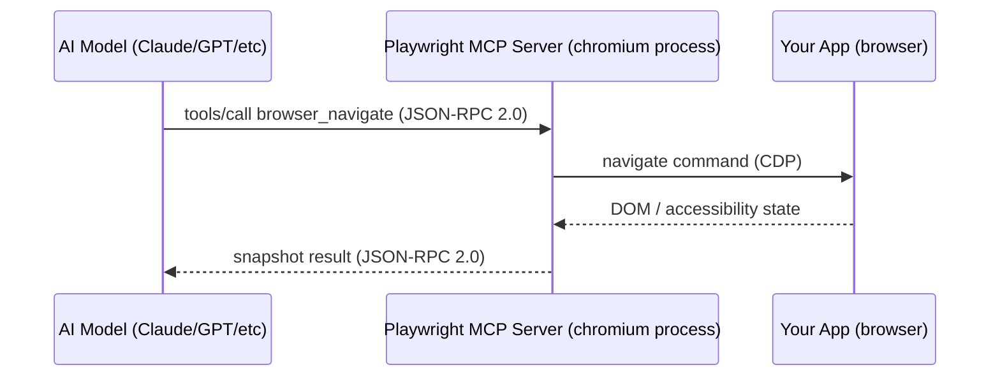

# Chapter 45 — AI Agents, MCP, and Playwright

**Navigation**: [← Enterprise API Client Library](../05_Enterprise_Framework/44_Enterprise_API_Client_Library.md) | [Index](../00_INDEX.md)

---

> **Prerequisites**: Ch01 Playwright Basics, Ch05 POM Architecture, Ch06 Custom Fixtures. AI tools amplify what you already know — they do not substitute for it.

---

## Why this chapter exists

In 2024 our team piloted AI-assisted test generation on a sprint. By the end of the sprint we had 140 new test files, CI was red on 90 of them, and three engineers spent two days deleting generated code that confidently called non-existent page methods.

We had given the AI a prompt and a screenshot. The AI had no access to the real DOM, couldn't run the tests, couldn't see the framework fixtures, and didn't know that our OrangeHRM locators break if you use `getByText` instead of `getByRole`. It hallucinated with complete confidence.

MCP (Model Context Protocol) is the fix. It gives AI models structured, real-time access to a running browser — so instead of guessing locators from a screenshot, the AI can click, read the accessibility tree, and generate tests from what's actually there.

This chapter covers: what MCP is under the hood, how to run the Playwright MCP server, how to wire it into a real workflow, and — critically — the seven failure modes we hit before we learned where AI helps and where it hurts.

---

## Table of Contents

1. [What MCP Is (and the Problem It Solves)](#1-what-mcp-is-and-the-problem-it-solves)
2. [Running the Playwright MCP Server](#2-running-the-playwright-mcp-server)
3. [Workflow 1 — AI-Assisted Locator Discovery](#3-workflow-1--ai-assisted-locator-discovery)
4. [Workflow 2 — AI-Assisted Test Scaffolding](#4-workflow-2--ai-assisted-test-scaffolding)
5. [Workflow 3 — AI-Assisted Flakiness Debugging](#5-workflow-3--ai-assisted-flakiness-debugging)
6. [Workflow 4 — Selector Healing After UI Changes](#6-workflow-4--selector-healing-after-ui-changes)
7. [The Seven Failure Modes (War Stories)](#7-the-seven-failure-modes-war-stories)
8. [Decision Framework — When to Use AI, When Not To](#8-decision-framework--when-to-use-ai-when-not-to)
9. [Integrating MCP Into Your CI Pipeline](#9-integrating-mcp-into-your-ci-pipeline)
10. [Practice Challenges](#10-practice-challenges)

---

## 1. What MCP Is (and the Problem It Solves)

### The old way: paste-and-pray

Before MCP, AI-assisted test writing looked like this:

1. Take a screenshot of the page
2. Paste it into Claude or ChatGPT
3. Ask it to write a Playwright test
4. Copy the generated code
5. Run it
6. Fix 60% of it because the locators are wrong, the waits are missing, and it calls `page.fill` on a custom React Select component that doesn't accept keyboard input

The root problem: the AI was guessing. It had a static image, not a live DOM. It didn't know your project's fixture setup. It didn't know that your `EmployeeSearchForm` uses a custom `waitForSearchSettled()` method instead of `waitForLoadState('networkidle')`.

### What MCP fixes

**MCP (Model Context Protocol)** is an open standard that defines how AI models communicate with external tool servers. Instead of a static prompt, the AI gets:

- A live connection to a running browser
- The ability to call `snapshot()` (accessibility tree), `click()`, `fill()`, `navigate()` as actual tool calls
- Real error output from real test runs
- Access to your file system (your POMs, fixtures, types)

The architecture — three collaborators, two different protocols (JSON-RPC between AI and MCP server, CDP between MCP server and the real browser):



The AI sends tool calls like:
```json
{ "method": "tools/call", "params": { "name": "browser_navigate", "arguments": { "url": "http://localhost:4200/pim" } } }
```

The MCP server executes them on the real browser and returns real results:
```json
{ "result": { "snapshot": "- navigation\n  - link 'PIM' [focused]\n- main\n  - heading 'Employee Management' [level 1]\n  - button 'Add Employee'" } }
```

Now the AI is working with what's actually there. No hallucination about locators that don't exist.

---

## 2. Running the Playwright MCP Server

### Install

```bash
npm install -D @playwright/mcp
```

### Basic startup

```bash
# Headed (you can see what's happening)
npx @playwright/mcp --browser chromium

# Headless (for CI or background use)
npx @playwright/mcp --browser chromium --headless

# With a fixed viewport
npx @playwright/mcp --browser chromium --viewport-size 1440,900
```

The server starts on `stdio` by default (for Claude Desktop / local AI tools) or you can bind it to a port for remote connections.

### Wire into Claude Desktop

Create or edit `~/.config/claude/claude_desktop_config.json` (macOS/Linux) or `%APPDATA%\Claude\claude_desktop_config.json` (Windows):

```json
{
  "mcpServers": {
    "playwright": {
      "command": "npx",
      "args": ["@playwright/mcp", "--browser", "chromium"],
      "env": {
        "BASE_URL": "http://localhost:4200"
      }
    }
  }
}
```

Restart Claude Desktop. You now have a browser in the AI's tool belt.

### Wire into Claude Code (CLI)

```bash
claude mcp add playwright -- npx @playwright/mcp --browser chromium
```

Verify:
```bash
claude mcp list
# playwright: npx @playwright/mcp --browser chromium ✓
```

### Available MCP tools

Once connected, the AI can call:

| Tool | What it does |
|------|-------------|
| `browser_navigate` | Navigate to a URL |
| `browser_snapshot` | Capture the accessibility snapshot of the current page |
| `browser_click` | Click an element by accessibility role/name |
| `browser_type` | Type text into an editable element |
| `browser_fill_form` | Fill multiple form fields in one call |
| `browser_take_screenshot` | Take a screenshot |
| `browser_evaluate` | Evaluate a JavaScript expression on the page or an element |
| `browser_wait_for` | Wait for text to appear/disappear, or for a set time |
| `browser_select_option` | Select an option in a dropdown |
| `browser_hover` | Hover over an element |
| `browser_press_key` | Press a keyboard key |

> **Get these names exactly right — a wrong name is not a graceful failure.** An MCP
> tool call naming a tool the server doesn't expose is rejected as an unknown tool; the
> model then improvises, often falling back to guessing from a screenshot, which is the
> exact failure mode this chapter exists to eliminate. Two names that circulate widely
> and are **wrong** for `@playwright/mcp`: there is no `browser_fill` (it's
> `browser_type` for one element, `browser_fill_form` for several) and no
> `browser_screenshot` (it's `browser_take_screenshot`). Both were in this table's
> earlier version. The server's own tool list is the authority —
> [microsoft/playwright-mcp](https://github.com/microsoft/playwright-mcp) documents the
> current set, and your client can enumerate it live (`claude mcp list`, or the
> `tools/list` JSON-RPC method), which is worth doing after any version bump rather than
> trusting a table in any document, this one included.

---

## 3. Workflow 1 — AI-Assisted Locator Discovery

This is where MCP pays off most immediately. Instead of manually inspecting the DOM for every element, you let the AI navigate the real page and tell you the accessibility tree.

### The prompt

```
I need to add an employee search test. Navigate to http://localhost:4200/web/index.php/pim/viewEmployeeList
and give me the accessibility roles and names for:
1. The employee name search input
2. The employee ID search input
3. The search button
4. The table header row
```

### What the AI returns (with MCP)

```
From the accessibility snapshot:

Employee Name input:
  - role: textbox
  - accessible name: "Employee Name" (via label association)
  - recommended locator: page.getByRole('textbox', { name: 'Employee Name' })

Employee ID input:
  - role: textbox
  - accessible name: "Employee Id" (exact text match)
  - recommended locator: page.getByRole('textbox', { name: 'Employee Id' })
  ⚠️ WARNING: There are 3 textboxes with empty accessible names near this one.
  The label association is via .oxd-input-group wrapper — confirm with:
    page.locator('.oxd-input-group').filter({ hasText: 'Employee Id' }).getByRole('textbox')

Search button:
  - role: button
  - accessible name: "Search"
  - recommended locator: page.getByRole('button', { name: 'Search' })

Table header:
  - role: row (inside a table with role "table")
  - children: columnheader "First (& Middle) Name", "Last Name", "Employee ID"...
```

Before MCP, discovering that the Employee ID input had label-via-wrapper ambiguity would have taken 20 minutes of DOM inspection. With MCP: 15 seconds.

### Integrate the locators into your POM

```typescript
// framework/components/pim/EmployeeSearchForm.ts
export class EmployeeSearchForm {
  private readonly employeeNameInput = this.page.getByRole('textbox', { name: 'Employee Name' });

  // The label-wrapper pattern the AI flagged — confirmed necessary
  private readonly employeeIdInput = this.page
    .locator('.oxd-input-group')
    .filter({ hasText: 'Employee Id' })
    .getByRole('textbox');

  private readonly searchButton = this.page.getByRole('button', { name: 'Search' });
```

---

## 4. Workflow 2 — AI-Assisted Test Scaffolding

### What AI is good at here

- Generating the Arrange-Act-Assert skeleton
- Writing test data factories given a TypeScript interface
- Adding soft assertions across multiple fields
- Suggesting test titles that follow AAA structure

### What to always hand to the AI

Never just a screenshot. Hand it:

1. Your POM file (so it knows the real method names)
2. Your fixture types (so it uses `test.extend` correctly)
3. The acceptance criteria

### Example prompt

```
I need a test for the employee search feature. Here's the search form POM:

[paste EmployeeSearchForm.ts]

Here's the fixture setup:

[paste framework/fixtures/orangehrm.fixture.ts]

Write a test that:
1. Searches for an employee by first name "Ashley"
2. Verifies at least one result row appears
3. Searches by employee ID "0001"
4. Verifies the row shows "Ashley Abel"

Use soft assertions for all verifications. The test is in
framework/tests/orangehrm/employee.search.spec.ts
```

### What the AI generates

```typescript
import { test, expect } from '../fixtures/orangehrm.fixture';

test.describe('Employee search', () => {
  test('finds employee by name and ID', async ({ pimPage }) => {
    await pimPage.navigate();

    // --- Search by name ---
    await pimPage.searchForm.fillEmployeeName('Ashley');
    await pimPage.searchForm.clickSearch();
    await expect.soft(pimPage.resultsGrid.getRows()).not.toHaveCount(0);

    // --- Search by ID ---
    await pimPage.searchForm.fillEmployeeId('0001');
    await pimPage.searchForm.clickSearch();
    const firstRow = pimPage.resultsGrid.getRows().first();
    await expect.soft(firstRow.getByRole('cell', { name: 'Ashley Abel' })).toBeVisible();
  });
});
```

This is good scaffolding. You'd still need to:
- Verify that `pimPage.searchForm.fillEmployeeName` matches your actual POM method name (it probably doesn't, and the AI knows this if you gave it the file)
- Add `test.use({ storageState: ... })` to pick up the auth fixture
- Handle the `waitForSearchSettled` timing (the AI doesn't know about your custom wait unless you tell it)

The ratio: AI saved 10 minutes of typing; you spent 3 minutes fixing framework-specific details. Net win.

---

## 5. Workflow 3 — AI-Assisted Flakiness Debugging

This is where MCP + trace files is a power combination.

### The workflow

1. You have a flaky test. It fails 1-in-5 runs.
2. You enable `trace: 'on-first-retry'` in the config.
3. You run until you capture a failure.
4. You hand the trace zip to the AI with the prompt:

```
Here is the Playwright trace for a flaky test (attached). The test is:
[paste test code]

The error is: "Timeout 15000ms exceeded waiting for selector '.oxd-table-cell' to be visible"

Walk me through the network waterfall in the trace. What was the app doing in the 2 seconds
before the timeout? What was the last network request? Did the spinner disappear before the
assertion?
```

### What good AI analysis looks like

With MCP accessing the trace file:

```
Looking at the trace timeline:

T=0ms: test click on Search button
T=120ms: POST /api/v1/employee/search — 200 OK, 47 employees returned
T=125ms: React re-render begins
T=140ms: Spinner appears (.oxd-loading-spinner visible)
T=890ms: Spinner disappears
T=891ms: React renders first result row
T=15000ms: Your assertion fires — TIMEOUT

The problem: your assertion at T=15000ms is the TEST TIMEOUT, not the wait timeout.
The spinner disappeared at T=890ms. If your waitForSearchSettled() only waits for
the spinner to disappear, it returns at T=890ms, then your assertion fires at T=891ms.
But between T=891ms and T=15000ms there are 8 more network requests: individual
employee avatar fetches. If any of those cause a re-render before your assertion, the
DOM resets.

Hypothesis: race condition between avatar image loads and the table re-render.
Fix: wait for `.oxd-table-cell:first-child` to be stable (not just visible).
```

That diagnosis — without MCP + trace access — would have taken 45 minutes of manual trace-viewer clicking. With MCP: 4 minutes.

---

## 6. Workflow 4 — Selector Healing After UI Changes

When the UI changes, locators break. The traditional fix: open every failing test, inspect the new DOM, update each selector. At scale (50+ tests), this is hours of work.

With MCP you can write a healing script:

```typescript
// scripts/heal-selectors.ts
import Anthropic from '@anthropic-ai/sdk';
import { chromium } from 'playwright';
import * as fs from 'fs';
import * as path from 'path';

const client = new Anthropic();

async function healSelectors(testFile: string): Promise<string> {
  const browser = await chromium.launch();
  const page = await browser.newPage();
  await page.goto(process.env.BASE_URL!);

  // Log in
  await page.fill('[name="username"]', process.env.ADMIN_USER!);
  await page.fill('[name="password"]', process.env.ADMIN_PASS!);
  await page.click('button[type="submit"]');

  // NOTE: `page.accessibility.snapshot()` no longer exists — see the callout below.
  // `ariaSnapshot()` is the current API and returns a compact YAML-style tree.
  const snapshot = await page.locator('body').ariaSnapshot();
  const testContent = fs.readFileSync(testFile, 'utf-8');

  await browser.close();

  const response = await client.messages.create({
    model: 'claude-opus-5',
    max_tokens: 4096,
    messages: [{
      role: 'user',
      content: `Here is the current accessibility tree of the app:\n${snapshot}
      
Here is a test file with potentially broken selectors:\n${testContent}

Identify any selectors that no longer match elements in the accessibility tree.
For each broken selector, suggest the updated selector based on what IS in the tree.
Return only the updated file content with no explanation.`
    }]
  });

  return response.content[0].type === 'text' ? response.content[0].text : testContent;
}

// Usage
const testFile = process.argv[2];
if (!testFile) {
  console.error('Usage: tsx scripts/heal-selectors.ts <test-file>');
  process.exit(1);
}

healSelectors(testFile).then(healed => {
  const backupPath = testFile + '.bak';
  fs.copyFileSync(testFile, backupPath);
  fs.writeFileSync(testFile, healed);
  console.log(`Healed. Backup at ${backupPath}`);
});
```

Run it:
```bash
ANTHROPIC_API_KEY=... BASE_URL=http://localhost:4200 \
  tsx scripts/heal-selectors.ts framework/tests/orangehrm/employee.crud.spec.ts
```

**On the `model` string:** it is a hard-coded identifier that the API either recognises
or rejects outright — a wrong one fails the whole script with an invalid-model error, not
a degraded result, and no amount of prompt engineering recovers it. This example pins
`claude-opus-5`; an earlier draft of this chapter carried `claude-opus-4-7`, which is not
a real model ID and would have failed on first run. Check the current identifiers in
[Anthropic's model docs](https://docs.anthropic.com/en/docs/about-claude/models) rather
than copying one out of a tutorial, and prefer pinning an explicit version in a script
that runs in CI so a model deprecation surfaces as one obvious failure instead of a
silent behaviour change across every healed file.

**Critical limitation:** the script heals what it can see in the accessibility tree. If your test uses visual selectors (`.oxd-table-row:nth-child(2)`) that don't appear in the tree, the AI cannot heal them. Another reason to write accessible selectors first.

> ### ⚠️ `page.accessibility.snapshot()` has been removed — use `ariaSnapshot()`
>
> Most AI-and-Playwright material you will find online (this chapter's own earlier
> draft included) reaches for `page.accessibility.snapshot()` to get the tree. That API
> is **gone**, not merely deprecated. Verified against the framework's installed
> Playwright 1.60.0:
>
> ```js
> typeof page.accessibility; // → 'undefined'
> await page.accessibility.snapshot();
> // → TypeError: Cannot read properties of undefined (reading 'snapshot')
> ```
>
> There is also no `Accessibility` interface anywhere in `playwright-core`'s
> `types.d.ts` any more, so TypeScript won't catch the call either — `page.accessibility`
> simply isn't a property, and the failure arrives at runtime.
>
> The replacement is [`locator.ariaSnapshot()`](https://playwright.dev/docs/aria-snapshots),
> which is a genuine improvement for this use case rather than a rename. The old API
> returned a deeply nested JSON object that had to be `JSON.stringify`-ed into the
> prompt, burning tokens on braces. `ariaSnapshot()` returns a compact YAML-style tree —
> the same format the MCP server's `browser_snapshot` returns in §1, which is why the
> two halves of this chapter now speak the same language. Real output:
>
> ```yaml
> - heading "Sign in" [level=1]
> - button "Log in"
> - button "Cancel"
> - navigation:
>   - link "Log in":
>     - /url: /x
> ```
>
> Note what that tree makes visible at a glance, and why it matters for §6.1's scoring:
> two different elements both expose the accessible name `"Log in"` — one a `button`,
> one a `link`. Any healing strategy that matches on name alone will pick the wrong one.
> Playwright also ships `expect(locator).toMatchAriaSnapshot()` if you want the tree as
> a committed assertion rather than as prompt input — that's the non-AI way to catch the
> same UI drift this script heals, and it needs no API key.

### 6.1 The other kind of "self-healing" — runtime fallback, no LLM required

The script above heals your **test source file**, offline, in a batch you run and review as a diff — every "healing" is an LLM call with real latency and real cost, and a human looks at the result before it merges. That is one legitimate meaning of "self-healing locators." It is not the meaning most job postings and the [`career/READINESS_RUBRIC.md`](../career/READINESS_RUBRIC.md) AI-Assisted Testing competency have in mind, and it is not what dedicated tools like [Healenium](https://healenium.io/docs/how_healenium_works) do. That version heals **at runtime, inline, deterministically, with no LLM call at all** — and it's the mechanism this section derives.

**The real mechanism** (per Healenium's own documentation): when a locator throws a not-found error, the tool doesn't fail the test immediately. It takes the current page's DOM, retrieves the element's **previously successful state** saved from an earlier passing run, runs a tree-comparison algorithm (Healenium's docs name an LCS — Longest Common Subsequence — comparison over the element's ancestor path) against every candidate element still on the page, and picks whichever candidate scores highest. It reports what it healed to — with a screenshot and a feedback control — rather than silently succeeding. Healenium doesn't publish the exact weighting formula, so the implementation below is a from-scratch illustration of the same *shape* of algorithm, not a reproduction of any tool's source.

**Step 1 — capture a fingerprint the last time the locator worked**, not just the selector string itself:

```typescript
interface LocatorFingerprint {
  tag: string;
  id: string | null;
  classes: string[];
  attrs: Record<string, string | null>;
  text: string;
  path: string[]; // ancestor tag chain, e.g. ['html', 'body', 'div.app', 'form.login-form', 'button']
}
```

**Step 2 — score every current candidate against the stored fingerprint**, combining independent signals instead of trusting any single one (this is the part a naive implementation gets wrong — matching on text alone, for example, would just as happily "heal" a login *button* into a same-labeled nav *link*):

```typescript
function jaccard(a: string[], b: string[]): number {
  const setA = new Set(a), setB = new Set(b);
  if (setA.size === 0 && setB.size === 0) return 1;
  const intersection = [...setA].filter((x) => setB.has(x)).length;
  return intersection / new Set([...setA, ...setB]).size;
}

// Same primitive Healenium's docs name for the ancestor-path comparison —
// a 2D DP table, the general-purpose diff algorithm, not string-specific.
function lcsLength<T>(a: T[], b: T[]): number {
  const dp: number[][] = Array.from({ length: a.length + 1 }, () => new Array(b.length + 1).fill(0));
  for (let i = 1; i <= a.length; i++) {
    for (let j = 1; j <= b.length; j++) {
      // Non-null: i, j stay within the (a.length+1) x (b.length+1) table by construction.
      dp[i]![j] = a[i - 1] === b[j - 1] ? dp[i - 1]![j - 1]! + 1 : Math.max(dp[i - 1]![j]!, dp[i]![j - 1]!);
    }
  }
  return dp[a.length]![b.length]!;
}

function scoreCandidate(stored: LocatorFingerprint, candidate: LocatorFingerprint): number {
  const tagScore = stored.tag === candidate.tag ? 1 : 0;
  const classScore = jaccard(stored.classes, candidate.classes);
  const attrEntries = (f: LocatorFingerprint) =>
    Object.entries(f.attrs).filter(([, v]) => v !== null).map(([k, v]) => `${k}=${v}`);
  const attrScore = jaccard(attrEntries(stored), attrEntries(candidate));
  const textScore = stored.text.trim().toLowerCase() === candidate.text.trim().toLowerCase() ? 1 : 0;
  const pathScore = lcsLength(stored.path, candidate.path) / Math.max(stored.path.length, candidate.path.length);

  return tagScore * 0.25 + classScore * 0.15 + attrScore * 0.15 + textScore * 0.2 + pathScore * 0.25;
}
```

**Verified against a real scenario** — a refactor renames `id="login-btn"` to `id="btn-login"` (kept everything else), against a DOM that also has a same-page "Cancel" button and an unrelated nav link that happens to share the exact text "Log in":

```
score=1.000  <button id="btn-login"> "Log in"     ← correct match: id doesn't matter, everything else is identical
score=0.550  <button id="btn-cancel"> "Cancel"     ← same tag & position, wrong text/attrs — correctly ranked far below
score=0.350  <a id="null"> "Log in"                ← same text, WRONG tag & path — proves text-only matching would have failed here
```

`id` is deliberately absent from the scoring — matching on the one attribute that's *known* to have changed would defeat the purpose. Re-running with the real login button removed from the DOM entirely (simulating an actual deletion, not a rename) produces a top score of 0.550 — below a 0.7 threshold — and the healer correctly **refuses to guess**, exactly the "auto-unquarantine still needs human confirmation" boundary [`career/mock_interviews/ladder_system.md`](../career/mock_interviews/ladder_system.md) already flags as the thing to check for in a senior candidate: a healer that always returns *something* is more dangerous than a locator that fails loudly.

**Wiring it into Playwright** — try the recorded locator first; only fall back to scoring when it resolves to nothing, and always log the heal:

```typescript
async function healingLocator(page: Page, selector: string, fingerprint: LocatorFingerprint) {
  const primary = page.locator(selector);
  if (await primary.count() > 0) return primary;

  const candidates = await page.locator(fingerprint.tag).evaluateAll((els) =>
    els.map((el, index) => ({
      tag: el.tagName.toLowerCase(),
      id: el.id || null,
      classes: Array.from(el.classList),
      attrs: { type: el.getAttribute('type'), 'data-testid': el.getAttribute('data-testid') },
      text: el.textContent ?? '',
      path: [] as string[], // walk el.parentElement chain the same way the fingerprint was captured
      index,
    })),
  );

  const scored = candidates
    .map((c) => ({ index: c.index, score: scoreCandidate(fingerprint, c) }))
    .sort((a, b) => b.score - a.score);
  const top = scored[0];

  if (top === undefined || top.score < 0.7) {
    throw new Error(`No confident match for healed locator "${selector}" (best score: ${top?.score ?? 0})`);
  }
  console.warn(`HEALED: "${selector}" -> ${fingerprint.tag}[${top.index}] (score ${top.score.toFixed(3)})`);
  return page.locator(fingerprint.tag).nth(top.index);
}
```

**When to reach for which:** the LLM script in §6 is the right tool when selectors drift broadly across a whole page redesign and you want one AI pass to propose new selectors for a human to review before merging. This section's fallback-and-score approach is the right tool when you want tests to survive *small*, *individual* attribute renames automatically, in CI, with zero API cost and zero non-determinism — at the price of maintaining fingerprints and accepting that a bad threshold either heals too eagerly (masking real bugs, per [`appendix/learning_paths/PATHWAY_02_PROFESSIONAL.md`](../appendix/learning_paths/PATHWAY_02_PROFESSIONAL.md)'s own interview question) or not eagerly enough (defeating the point). Neither replaces fixing the underlying flakiness in [Ch26](../06_CI_CD_And_Reliability/26_Flakiness_Diagnosis_and_Fixing.md) — both exist to buy time while a real fix lands, not to avoid writing one.

---

## 7. The Seven Failure Modes (War Stories)

### Failure 1: AI generates tests before the POM exists

We let the AI write 12 tests directly without giving it the POM. It invented method names (`page.searchEmployee()`, `page.getResultCount()`). Every test called methods that didn't exist. 

**Fix:** Always hand the AI the relevant POM files. Never let it invent the API.

### Failure 2: AI confuses retries with test logic

The AI generated a helper that called `searchEmployee` in a retry loop:
```typescript
// AI-generated "robust" helper
for (let i = 0; i < 3; i++) {
  try {
    await searchForm.search(name);
    break;
  } catch { await page.reload(); }
}
```

This masked real failures. The test passed despite the app being broken because it was retrying on the reload.

**Fix:** Retries belong in the Playwright config, not in test helpers. `retries: 2` handles transient flakiness. If a test needs a reload to succeed, that's a bug to report, not a pattern to encode.

### Failure 3: AI hallucinates accessibility names

Asked to write a test for the "Add Employee" button without MCP access, the AI used `getByRole('button', { name: 'Add' })`. The real button is `getByRole('button', { name: 'Add Employee' })`. The test failed in CI silently on a locator match that returned 0 elements because there was a `<button>Add</button>` elsewhere on the page and `getByRole` matched the wrong one.

**Fix:** Always use MCP to verify accessibility names before writing locators. The MCP server's `browser_snapshot`, or `locator.ariaSnapshot()` in a scratch test, is your source of truth — not guesswork. (Not `page.accessibility.snapshot()`, which no longer exists; see the callout in §6.)

### Failure 4: AI generates data-driven tests with hardcoded IDs

```typescript
// AI-generated
await page.goto(`/employee/12345/details`);
```

Employee 12345 existed in dev, not in staging, not in CI. The test passed locally for six weeks, failed in every other environment.

**Fix:** Tests must create their own data or use fixtures. Never hardcode database IDs in tests.

### Failure 5: AI misunderstands fixture scope

The AI generated a test using `page` from `test.use({ ... })` instead of the custom `orangehrmPage` fixture. The auth state wasn't loaded, so every test hit the login redirect. 

**Fix:** Paste your fixture type declarations into the AI's context before asking it to write tests.

### Failure 6: AI "fixes" flakiness by increasing timeouts

Asked to fix a flaky test, the AI added:
```typescript
test.setTimeout(120000);
await page.waitForTimeout(5000);
```

The test now passed by waiting longer. The underlying race condition — a loading spinner that occasionally fired twice — was still there.

**Fix:** Ask the AI to explain the root cause, not just suggest a fix. If the explanation is "increase timeout," demand a deeper analysis. Use the trace.

### Failure 7: AI treats all locators as equivalent

The AI suggested `page.locator('[data-test="search-btn"]')` without checking whether the `data-test` attribute existed. On the OrangeHRM demo it doesn't — it's a third-party app we don't control. The suggestion was technically valid Playwright but useless for this target.

**Fix:** Tell the AI which app you're targeting and whether you control the source. If you don't control the DOM, rely on accessible roles and text, not `data-*` attributes.

---

## 8. Decision Framework — When to Use AI, When Not To

```
Is the task locator discovery?
├── Yes → Use MCP. Navigate live, snapshot, extract. Fast and accurate.
└── No
    Is the task test scaffolding from a known POM?
    ├── Yes → Use AI with POM in context. Review method names. Net win.
    └── No
        Is the task flakiness diagnosis from a trace?
        ├── Yes → Use AI with trace zip. Much faster than manual trace viewer.
        └── No
            Is the task "write tests for a new feature"?
            ├── Yes → AI drafts, you review every assertion. Never ship AI tests without review.
            └── No
                Is the task selector healing after a UI refactor?
                ├── Yes → Use healing script with accessibility snapshot. Check results.
                └── No → Write it yourself. AI adds noise for unfamiliar frameworks.
```

### The things AI consistently gets wrong in SDET work

| Task | AI performance | Why |
|------|---------------|-----|
| Locator discovery (with MCP) | Excellent | Real DOM, no guessing |
| Test scaffold from existing POM | Good | Clear API contract to follow |
| Understanding custom fixture scope | Poor | Project-specific context, not in training |
| Diagnosing timing bugs | Good with trace, poor without | Needs actual timeline data |
| Writing data factories | Good | TypeScript types provide structure |
| Understanding `test.describe.serial` vs `fullyParallel` | Poor | Nuanced interaction, often wrong |
| POM design decisions (split vs merge) | Poor | Requires lived experience with scale |
| Choosing retry strategy | Poor | Conflates symptom with cause |

---

## 9. Integrating MCP Into Your CI Pipeline

The Playwright MCP server can run in CI for automated locator healing, but it's expensive and slow. The practical CI pattern:

### Pattern A: Pre-merge locator validation

```yaml
# .github/workflows/locator-check.yml
name: Locator health check
on:
  pull_request:
    paths: ['framework/pages/**', 'framework/components/**']

jobs:
  locator-check:
    runs-on: ubuntu-latest
    steps:
      - uses: actions/checkout@v4
      - uses: actions/setup-node@v4
        with: { node-version: '20' }
      - run: npm ci
        working-directory: framework
      - name: Start app
        run: docker compose up -d
      - name: Wait for app
        run: npx wait-on http://localhost:4200 --timeout 60000
      - name: Run locator smoke
        run: npm run test -- --grep @locator-smoke
        working-directory: framework
        env:
          BASE_URL: http://localhost:4200
```

Tag your POM-verification tests `@locator-smoke`. These run a minimal test per page — just navigation + one locator assertion — to catch drift without running the full suite.

### Pattern B: Nightly accessibility snapshot diff

```typescript
// scripts/snapshot-diff.ts
// Runs nightly, compares today's accessibility snapshot to yesterday's
// Flags: roles removed, names changed, new elements added
// Output: snapshot-diff.json consumed by the morning standup dashboard
```

This gives you early warning that the UI changed before your tests break.

### Pattern C: On-demand healing (not automated)

Automated healing in CI is risky — an AI that auto-commits "healed" selectors can introduce subtle bugs. The safer pattern: the healing script runs locally on a developer's machine, produces a diff, the developer reviews it, then commits.

```bash
# Developer workflow after a UI redesign
npm run heal -- framework/tests/orangehrm/
git diff framework/tests/  # review what changed
npm test                    # confirm green
git add -p                  # commit intentionally
```

---

## 10. Practice Challenges

### Challenge 1 — Locator discovery (30 min)

1. Start the OrangeHRM demo (or any app you're testing).
2. Configure the Playwright MCP server.
3. Ask Claude (with MCP) to give you the full accessibility tree for the login page.
4. Compare what it returns to what you'd have guessed from a screenshot.
5. Write three locators from the snapshot, run them against the real page.

### Challenge 2 — Flakiness analysis (45 min)

1. Take any existing flaky test.
2. Enable `trace: 'on-first-retry'`.
3. Run until you capture a failure.
4. Hand the trace to Claude with the error message.
5. Document: what did Claude find? Was the root cause in the trace?

### Challenge 3 — Test generation with context (1 hr)

1. Pick a page in your app you haven't written tests for yet.
2. Hand Claude the relevant POM file + fixture declarations.
3. Ask it to write 3 tests covering the main user flows.
4. Run the generated tests without modification. Count how many pass.
5. Fix the failures. What were the most common AI mistakes?

### Challenge 4 — Build the healing script (2 hr)

Implement the `heal-selectors.ts` script from Section 6. Run it against one of your test files after deliberately breaking 3 locators. How accurate is the healing? Where does it fail?

---

**What's next:**

- **Ch 26** — Flakiness Diagnosis. The systematic framework that AI diagnosis is best paired with.
- **Ch 43** — War Stories. The lived failures that inform every AI interaction boundary.
- **Ch 44** — Enterprise API Client. How to hand typed client code to the AI so it generates correct API test scaffolding.


---

## Reality Check

**"AI can replace test case design"**→ AI generates test cases based on patterns in training data. It cannot understand: business context (why this edge case matters to YOUR users), regulatory requirements (GDPR test scenarios specific to your data handling), or system-specific failure modes (your database timeout behavior under your load patterns). AI accelerates test generation; humans provide the domain knowledge that makes tests valuable.

**"AI-generated locators are reliable"**→ AI suggests locators based on DOM structure analysis, but it cannot evaluate: dynamic ID stability (IDs generated by frameworks change between builds), test-specific attributes (data-testid was added specifically for automation), or component re-render behavior (React reconciliation may replace the DOM element). Always validate AI-suggested locators against your application specifics.

**"MCP servers automate everything"**→ Model Context Protocol enables AI agents to call tools, but the agent still needs: correct problem understanding (what to test), appropriate tool selection (which MCP tool to use), and result interpretation (was the test outcome correct?). MCP is plumbing for AI agent capabilities, not intelligence. The quality of AI-driven testing depends on the prompts and orchestration, not just the tool availability.

**"AI-powered test maintenance eliminates flakiness"**→ AI can detect and fix broken locators (selector changed, element moved), but it cannot fix: timing-dependent flakiness (race conditions require understanding the application async flow), data-dependent flakiness (test assumes data exists that was cleaned up), or environment-dependent flakiness (CI runner has different characteristics). AI handles structural changes; humans handle behavioral changes.

**"Natural language test descriptions replace code"**→ Natural language tests like verify user can purchase a product lack precision: which user (new, existing, admin)? Which product (in-stock, backordered, digital)? Which purchase path (cart, buy-now, subscription)? Natural language is good for describing test INTENT; code is necessary for describing test PRECISION. Use natural language for test planning, code for test execution.
