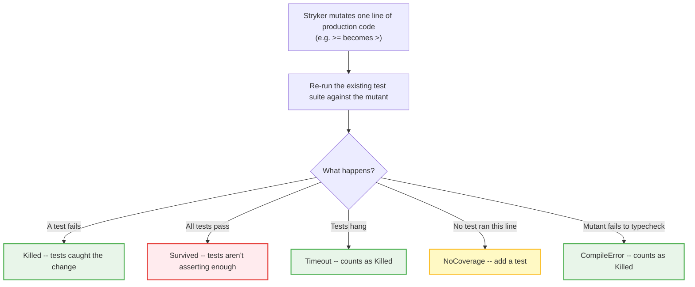

# 53. Mutation Testing with Stryker — Are Your Tests Actually Testing Anything?

**Navigation**: [← 52. Component Testing](./52_Component_Testing_With_Playwright_CT.md) | [Index](../00_INDEX.md) | [→ 54. Synthetic Monitoring](../06_CI_CD_And_Reliability/54_Synthetic_Monitoring.md)

---

## 5W1H

- **WHAT**: A tool that introduces small, deliberate bugs (mutants) in your production code and re-runs your tests. If tests still pass, the mutant **survived** — your test is asserting too little.
- **WHY**: Code coverage measures _which lines were executed_. Mutation testing measures _which lines are actually being asserted against_. Coverage of 100% can still have surviving mutants.
- **WHO**: Teams that already have decent test coverage and want to know if it means anything.
- **WHEN**: After you have a real test suite (~50+ tests). Not as your first quality tool.
- **HOW**: [Stryker Mutator](https://stryker-mutator.io/) for JS/TS. Runs your existing tests against mutated code, scores mutation kill rate.

---

## 1. The insight

Imagine a function:

```typescript
function isAdult(age: number): boolean {
  return age >= 18;
}
```

And a test:

```typescript
test("30 is adult", () => {
  expect(isAdult(30)).toBe(true);
});
```

Coverage tool says: 100% — that line ran.

Stryker mutates `>=` to `>`. Now `isAdult(18) === false`. The test still passes (it tested 30, not 18). Mutant **survived**.

The fix is a better test, not better coverage:

```typescript
test("exactly 18 is adult", () => expect(isAdult(18)).toBe(true));
test("17 is not adult", () => expect(isAdult(17)).toBe(false));
```

Both these kill the mutant.

---

## 2. Where this lives for an SDET

This chapter is in the SDET module on purpose: **the SDET who advocates for mutation testing is the SDET who gets noticed**. Most teams have never heard of it. Bringing it up in a code review or quality meeting is rare and high-signal.

That said: you don't run Stryker against Playwright E2E tests (too slow). You run it against the codebase the E2E suite _exercises_, or against unit tests in the same repo.

---

## 2.5. War Stories — When Mutation Testing Exposed What Code Coverage Hid

### Story 1: 100% coverage, 11 surviving mutants, one security hole

The auth module had 100% line coverage. Every line ran. The security team signed off on the coverage report. Six months later, a penetration tester found that changing `>=` to `>` in the age-gate check would allow 17-year-olds to access adult content.

We ran Stryker on the auth module retrospectively. 11 surviving mutants. Three of them were boundary conditions on the age gate: `>=18` (we tested 20, never 18), `<=65` (we tested 50, never 65), and a null check (we never sent a null age to the validator).

The penetration tester had essentially done mutation testing manually. The difference: they got paid $15,000 to find what a free Stryker run would have flagged in 4 minutes.

### Story 2: the factory function that survived 6 months of "tests"

A payment factory function built a `PaymentPayload` object. It had a `required: true` field for `amount`. The unit tests passed an amount of 150 in every single test. A Stryker run mutated `amount: payload.amount` to `amount: 0`. Tests still passed.

Why? Every assertion downstream was checking whether the payment went through (`status === 'approved'`), not whether the amount field was correctly propagated. The factory could have silently zeroed out every amount and the tests would never have noticed.

This kind of surviving mutant — one that changes a data transformation but your assertion doesn't verify the output data — is the most common and most dangerous class. You need assertions on the data values, not just the side effects.

### Story 3: Stryker killed the CI budget, CI killed the enthusiasm

We enabled Stryker in CI as a required gate on every PR. Our JS unit test suite took 45 seconds to run. Stryker generated 312 mutants and ran the suite 312 times: 45s × 312 = 3.9 hours per PR.

Engineers started abandoning PRs mid-build. The platform team got complaints about burned CI minutes. The mutation gate was disabled after two weeks.

**Fix:** Mutation testing belongs in a nightly job, not a PR gate. We enabled it as a scheduled nightly run with `coverageAnalysis: 'perTest'` (only re-runs tests that covered each mutant's line, not the full suite). Runtime: 22 minutes. We report the mutation score to a dashboard and set a team OKR: "maintain mutation score ≥ 70%." No one's PR is blocked; the score trends over time.

---

## 3. Setup (for a TS project)

```bash
npm i -D @stryker-mutator/core @stryker-mutator/typescript-checker @stryker-mutator/jest-runner
```

```javascript
// stryker.conf.json
{
  "$schema": "./node_modules/@stryker-mutator/core/schema/stryker-schema.json",
  "packageManager": "npm",
  "mutate": ["src/**/*.ts", "!src/**/*.spec.ts"],
  "testRunner": "jest",
  "reporters": ["html", "clear-text", "progress"],
  "coverageAnalysis": "perTest",
  "tsconfigFile": "tsconfig.json",
  "checkers": ["typescript"]
}
```

```bash
npx stryker run
```

You get an HTML report with every surviving mutant highlighted.

---

## 4. Reading a Stryker report

The decision Stryker makes for every single mutant it generates:



| Status       | Meaning                                      | Action                                |
| ------------ | -------------------------------------------- | ------------------------------------- |
| Killed       | A test failed for the mutant                 | ✅ good                               |
| Survived     | All tests passed                             | ❌ your tests aren't asserting enough |
| Timeout      | Mutant caused infinite loop, tests timed out | Counts as killed                      |
| NoCoverage   | No test exercised the line                   | Add a test                            |
| CompileError | Mutant didn't typecheck                      | Counts as killed                      |

**Target mutation score**: 60% is realistic for legacy code. 80% is strong. 95% is research territory.

---

## 5. Common mistakes

1. **Running Stryker against E2E tests.** Each E2E spec takes 30s — Stryker mutates the same code N times. You'll wait days. Run against unit/integration tests instead.
2. **Aiming for 100% mutation score.** Some mutants are equivalent (`x++` vs `x = x + 1`). Diminishing returns past 80%.
3. **Reading the percentage and stopping.** The actual value is **which** mutants survived. Open the HTML report and look at the lines.
4. **Adding Stryker without sign-off.** Mutation runs are CPU-heavy. CI bills can jump. Negotiate with your team first.

---

## 6. Senior SDET perspective

Mutation testing is the most direct answer to "are my tests doing what I think they are?" Most teams can't answer that. A single 30-minute mutation run on a legacy module is often the highest-signal quality artifact a team will see all quarter.

This is also a great **interview talking point**. "I introduced mutation testing on our auth module and identified 14 surviving mutants — we added 23 missing assertions and dropped our security-incident rate" is a story that lands.

---

## 7. DevSecOps seed

Mutation testing on security-critical code (auth, crypto, input validation) is **high-yield**. Surviving mutants in `validateJWT()` are not "code coverage gaps" — they're potentially exploitable holes your test suite missed.

Run a one-time Stryker pass on your team's security modules. Bring the report to the security lead.

---

## 8. Exercise

1. Take a small TS module from the [`framework/`](../framework/) folder — `data.loader.ts` is a good candidate.
2. Write Jest tests for it until coverage is 100%.
3. Run Stryker. Note the mutation score.
4. For each surviving mutant, write the test that would kill it.
5. Re-run Stryker. Target ≥ 80%.

You will learn more about assertion quality in this single exercise than from 20 chapters about testing.

---

## 9. Stryker Configuration Deep-Dive

Every field in `stryker.config.mjs` (or `.json`, `.ts`) has a purpose. This section explains each one so you are not copy-pasting blindly.

```javascript
// stryker.config.mjs
import { defineConfig } from "@stryker-mutator/core/schema";

export default defineConfig({
  // $schema: included by defineConfig — enables IDE autocomplete and validation.
  // Without it, Stryker silently ignores misnamed keys.

  packageManager: "npm", // Used for `npm install` in the temp dir Stryker creates.
  // Alternatives: 'yarn', 'pnpm'. Match your project's lock file.

  reporters: ["html", "json", "clear-text", "dashboard"],
  // html   — human-readable report at `reports/mutation/html/index.html`.
  //         Open in browser; surviving mutants are red, killed are green.
  // json   — machine-readable report at `reports/mutation/mutation.json`.
  //         Consumed by automation: CI gates, pull request comments, dashboards.
  // clear-text — prints a table to stdout after each run. Useful for local dev.
  // dashboard  — posts results to stryker-mutator.io dashboard (free tier available).
  //         Enables historical score tracking per branch and trend graphs.

  mutate: [
    "src/**/*.ts", // Files to mutate. Stryker injects mutants into these.
    "!src/**/*.spec.ts", // Exclude test files — mutating tests themselves is meaningless.
    "!src/**/*.d.ts", // Exclude type declarations.
    "!src/generated/**/*", // Exclude generated code (auto-generated = not human-tested).
  ],

  testRunner: "jest",
  // jest — runs Jest as the test harness. Stryker runs `jest --config jest.config.js`.
  // Alternatives:
  //   vitest       — faster, Vite-native. Use for Vite projects.
  //   mocha        — for Mocha/Chai setups. Pass `mochaOptions: { spec: ['test/**/*.ts'] }`.
  //   karma        — browser-based. Rarely needed in Node projects.
  //   command      — run any shell command as test runner. Useful for custom setups.

  coverageAnalysis: "perTest",
  // perTest — Instruments code so Stryker knows which tests covered each line.
  //           Only tests that exercise a mutant's line are re-run against it.
  //           Most accurate but slowest. Best for projects with < 500 tests.
  // off     — Runs all tests against every mutant. Fast but noisy.
  //           Use when perTest overhead is prohibitive (> 10 min run time).

  tsconfigFile: "tsconfig.json",
  // Path to TypeScript config. The TypeScript checker uses this to:
  //   1. Validate that mutants type-check (mutations that break types are killed automatically).
  //   2. Resolve paths and aliases so mutation locations are accurate.
  // Include a tsconfig that matches your production build, not a test-specific one,
  // otherwise mutants may appear in dead code paths that the production build would strip.

  checkers: ["typescript"],
  // TypeScript checker runs `tsc --noEmit` on every mutant.
  // A mutant that causes a compile error is immediately marked "Killed (CompileError)".
  // This saves test execution time for obviously broken mutants.
  // Without this checker, a TypeScript type error would need a real test to catch it.

  thresholds: {
    high: 80, // Team should aspire to 80%+ mutation score.
    low: 60, // CI warning at 60-80%. Still green but should improve.
    break: 50, // CI failure below 50%. Blocks merge. Adjust to your reality.
  },
  // Common mistake: setting break: 80 on a legacy codebase with no prior mutation history.
  // You will spend two weeks just getting to 55% before writing any feature code.
  // Start with break: 40, move to 60 after quarter 1, 80 after a full remediation cycle.

  concurrency: 4,
  // Number of mutant workers running in parallel. Default: your CPU core count.
  // Reduce if Stryker causes CI resource contention with other parallel jobs.
  // Increase only if your machine has headroom — more concurrency needs more RAM.

  incremental: true,
  // Stores results in `.stryker-mutator/tmp/incremental/`.
  // On subsequent runs, only re-mutates files changed since last run.
  // A file unchanged since last run keeps its previous mutants and results.
  // Benefits:
  //   - Second run on a 200-file codebase: 5-10 minutes instead of 40+.
  //   - Safe to run on every PR as long as a full baseline run was done on main.
  // Caveat: clean the incremental cache after major refactors — stale results poison future runs.
  //   Run: `npx stryker run --clean_tmp dir` or delete `.stryker-mutator/tmp/`.

  dashboard: {
    project: "your-org/your-repo",
    module: "frontend", // optional, for monorepo splitting
  },
  // stryker-mutator.io free dashboard. Tracks mutation score per branch.
  // Shows trend line: is quality improving or degrading over commits?
  // In monorepos, one module name per package enables per-package scoring.
});
```

In monorepos, each package should have its own `stryker.config.mjs` at the package root.

---

## 10. Mutation Operators Explained

Stryker ships ~30+ built-in mutators. Understanding the major ones helps you read reports intelligently and recognise why a mutant survived.

### Arithmetic Operators

**What changes**: Binary arithmetic operators are swapped among a set.

| Original | Possible mutants          |
| -------- | ------------------------- |
| `a + b`  | `a - b`, `a * b`, `a / b` |
| `a - b`  | `a + b`, `a * b`, `a / b` |
| `a * b`  | `a + b`, `a - b`, `a / b` |
| `a / b`  | `a + b`, `a - b`, `a * b` |
| `a % b`  | `a + b`, `a - b`, `a * b` |

```typescript
// BEFORE — original code
function discount(price: number, rate: number): number {
  return price * rate;
}

// AFTER — Stryker mutant: * → /
function discount(price: number, rate: number): number {
  return price / rate; // If rate=0.1, original gives $90 discount.
  // Mutant gives $1000. Test passes with price=100, rate=0.1.
}
```

```typescript
// Test that kills this mutant:
test("discount applies correctly", () => {
  expect(discount(100, 0.1)).toBeCloseTo(10, 2); // 100 * 0.1 = 10, not 1000
  expect(discount(200, 0.2)).toBeCloseTo(40, 2); // kills the / mutant too
});
```

**Why survive**: The test used `toBe(90)` instead of verifying the actual value. Or worse, `expect(discount(100, 0.1)).toBeTruthy()`.

---

### Equality Operators

**What changes**: `===` ↔ `!==`, `==` ↔ `!=`, and in JS-only projects, type coercion chains.

```typescript
// BEFORE — strict equality
function isWinner(score: number, threshold: number): boolean {
  return score === threshold;
}

// AFTER — Stryker mutant: === → !==
function isWinner(score: number, threshold: number): boolean {
  return score !== threshold; // Every non-zero score that is not equal to threshold
  // now returns true. Zero-score non-winners are still false.
}
```

```typescript
// Test that kills this mutant:
test("exactly matching score is a winner", () => {
  expect(isWinner(100, 100)).toBe(true);
});
test("non-matching score is not a winner", () => {
  expect(isWinner(99, 100)).toBe(false); // This kills the !== mutant
});
test("zero score is not winner", () => {
  expect(isWinner(0, 100)).toBe(false);
});
```

```typescript
// BEFORE — loose equality (avoid this in new code, but Stryker still mutates it)
function isLoggedIn(userId: number | null): boolean {
  return userId == null; // TypeScript avoids this, but legacy JS code has it
}

// AFTER — Stryker mutant: == null → != null
function isLoggedIn(userId: number | null): boolean {
  return userId != null; // userId=0 returns true (0 != null is true in JS)
  // but null guard was meant to catch 0 too
}
```

**Why survive**: The test only checked truthy/falsy, not the exact boolean. Or the test used `userId=1` which is not-equal to null in both variants.

---

### Boolean Operators

**What changes**: `&&` ↔ `||`, `true` ↔ `false`, and negation flips.

```typescript
// BEFORE — boolean AND
function canWithdraw(balance: number, dailyLimit: number): boolean {
  return balance > 0 && dailyLimit > 0;
}

// AFTER — Stryker mutant: && → ||
function canWithdraw(balance: number, dailyLimit: number): boolean {
  return balance > 0 || dailyLimit > 0; // Allows withdrawal if only balance OR limit is positive,
  // not both. A $0 balance with a $1000 limit passes.
}
```

```typescript
// Tests that kill this mutant:
test("requires positive balance AND positive limit", () => {
  expect(canWithdraw(100, 100)).toBe(true);
  expect(canWithdraw(0, 100)).toBe(false); // kills &&→||
  expect(canWithdraw(100, 0)).toBe(false); // kills &&→||
  expect(canWithdraw(0, 0)).toBe(false);
});
```

```typescript
// BEFORE — constant boolean
const isEnabled = true;

// AFTER — Stryker mutant: true → false
const isEnabled = false; // Any test that reads isEnabled but never asserts it
// will have this mutant survive
```

```typescript
// Test that kills this mutant:
test("feature flag is enabled", () => {
  expect(isEnabled).toBe(true); // Directly asserts the flag's value
});
```

---

### String Operators

**What changes**: `.concat()`, string literals, template expressions.

```typescript
// BEFORE
function buildGreeting(name: string): string {
  return "Hello, ".concat(name, "!"); // Stryker: remove .concat(), replace with ''
}

// AFTER — Stryker mutant: .concat() removed
function buildGreeting(name: string): string {
  return "Hello, !"; // name is lost entirely. Test that checks
  // `expect(greeting).toContain(name)` kills this.
}

// AFTER — Stryker mutant: string literal → ''
function buildGreeting(name: string): string {
  return ""; // Test that checks greeting length or content kills this.
}
```

```typescript
// Test that kills both mutants:
test("greeting contains name", () => {
  const result = buildGreeting("Alice");
  expect(result).toBe("Hello, Alice!");
  expect(result).toContain("Alice"); // kills the .concat()-removal mutant
  expect(result.length).toBeGreaterThan(6); // kills the '' mutant
});
```

---

### Array Operators

**What changes**: `.push()` → `.pop()`, `.slice()` bounds, `.splice()` positions.

```typescript
// BEFORE
function addItem(cart: string[], item: string): string[] {
  cart.push(item);
  return cart;
}

// AFTER — Stryker mutant: .push() → .pop()
function addItem(cart: string[], item: string): string[] {
  cart.pop(); // Removes the most recent item instead of adding.
  // If cart was ['apple', 'banana'] and we call addItem(cart, 'cherry'):
  // Original: ['apple', 'banana', 'cherry']
  // Mutant:   ['apple', 'banana']
}
```

```typescript
// Test that kills this mutant:
test("addItem appends to cart", () => {
  const cart = ["apple"];
  const result = addItem(cart, "banana");
  expect(result).toEqual(["apple", "banana"]);
  expect(result.length).toBe(2); // catches pop()
  expect(result[result.length - 1]).toBe("banana"); // direct last-element check
});
```

---

### Object Operators

**What changes**: Property deletions, spread operator removals, method removal.

```typescript
// BEFORE
function getDisplayName(user: { name: string; age: number }): string {
  return user.name;
}

// AFTER — Stryker mutant: delete user.age (property deletion)
function getDisplayName(user: { name: string; age: number }): string {
  delete user.age; // Only survives if no test reads user.age or checks its existence
}
```

```typescript
// Test that kills this mutant:
test("getDisplayName returns name and preserves age", () => {
  const user = { name: "Bob", age: 30 };
  const result = getDisplayName(user);
  expect(result).toBe("Bob");
  expect(user.age).toBe(30); // Explicitly checks age was not deleted
});
```

---

### Conditional Boundary Operators

**What changes**: Boundary-aware relational operators (`>=` → `>`, `<=` → `<`).

```typescript
// BEFORE
function isAdult(age: number): boolean {
  return age >= 18; // The canonical Stryker example
}

// AFTER — Stryker mutant: >= → >
function isAdult(age: number): boolean {
  return age > 18; // 18-year-olds are now classified as minors.
  // Any test that checks exactly age=18 kills this.
}
```

```typescript
// Test that kills this mutant:
test("exactly 18 is adult", () => {
  expect(isAdult(18)).toBe(true); // Directly kills >= → >
});
test("17 is not adult", () => {
  expect(isAdult(17)).toBe(false);
});
```

---

### Unary Operators

**What changes**: Prefix operators are negated or removed.

```typescript
// BEFORE
function absoluteValue(n: number): number {
  return Math.abs(n); // Stryker may inject: +n, -n, or remove the call
}

// AFTER — Stryker mutant: +a → -a
function absoluteValue(n: number): number {
  return -Math.abs(n); // Sign is flipped. With n=0 the mutant survives
  // because -Math.abs(0) === 0 === Math.abs(0)
}
```

```typescript
// Tests that kill this mutant:
test("absoluteValue of positive is itself", () => {
  expect(absoluteValue(5)).toBe(5);
  expect(absoluteValue(42)).toBe(42); // kills -Math.abs → +Math.abs
});
test("absoluteValue of zero is zero", () => {
  expect(absoluteValue(0)).toBe(0); // Also true for the mutant, but combined
  // with the above, the - sign is detectable
});
```

---

## 11. Interpreting Stryker Reports

### Mutant Status Meanings

| Status            | What happened                                                       | Good or bad?                | Action                                             |
| ----------------- | ------------------------------------------------------------------- | --------------------------- | -------------------------------------------------- |
| **Killed**        | At least one test failed when this mutant was active                | Good — your tests caught it | None                                               |
| **Survived**      | All tests passed despite this mutant being active                   | Bad — tests miss this case  | Add or improve assertions                          |
| **Timeout**       | The mutant caused an infinite loop or hang; test timed out          | Counts as Killed            | The mutant is dead, but investigate the root cause |
| **No Coverage**   | No test covered the mutated line                                    | Bad — untested code         | Add a test that exercises this line                |
| **Compile Error** | The mutant produces invalid TypeScript/JavaScript                   | Counts as Killed            | None — the type checker killed it                  |
| **Ignored**       | You explicitly marked this line with `// Stryker disable next-line` | Neutral                     | Review periodically                                |
| **Skipped**       | Mutant not run (e.g., feature-flagged or excluded in config)        | Neutral                     | Confirm exclusion is intentional                   |

---

### Sample Report JSON Structure

```json
{
  "schemaVersion": "1.0",
  "version": "6.3.2",
  "project": "auth-service",
  "baseline": { "branch": "main", "mutationScore": 72.5 },
  "files": {
    "src/auth/validateJWT.ts": {
      "language": "typescript",
      "source": "export function validateJWT(token: string): JWTPayload {\n  ...\n}",
      "mutants": [
        {
          "id": "1",
          "mutatorName": "EqualityOperator",
          "replacement": "token !== null",
          "location": {
            "start": { "line": 12, "column": 10 },
            "end": { "line": 12, "column": 19 }
          },
          "status": "Killed",
          "killedBy": ["auth.test.ts::JWT validation rejects null token"],
          "description": "Changed !== to === on line 12"
        },
        {
          "id": "2",
          "mutatorName": "BooleanLiteral",
          "replacement": "return false",
          "location": {
            "start": { "line": 45, "column": 3 },
            "end": { "line": 45, "column": 14 }
          },
          "status": "Survived",
          "killedBy": [],
          "description": "Changed return true to return false on line 45"
        },
        {
          "id": "3",
          "mutatorName": "StringLiteral",
          "replacement": "\"\"",
          "location": {
            "start": { "line": 67, "column": 20 },
            "end": { "line": 67, "column": 37 }
          },
          "status": "NoCoverage",
          "killedBy": [],
          "description": "Changed string literal to '' on line 67"
        }
      ],
      "totals": {
        "total": 15,
        "killed": 10,
        "survived": 2,
        "noCoverage": 2,
        "timeout": 1
      }
    }
  },
  "totals": {
    "total": 87,
    "killed": 63,
    "survived": 11,
    "noCoverage": 9,
    "timeout": 4
  },
  "mutationScore": 72.4,
  "projectRoot": "/users/dev/my-repo"
}
```

**Key triage workflow for surviving mutants:**

1. **Group by file.** Most surviving mutants cluster in one or two files — fix those first.
2. **Group by mutator type.** Equality and boolean operators surviving usually mean tests are too coarse-grained. String/array operators surviving usually mean tests don't assert postconditions.
3. **Check if the file is tested.** A `NoCoverage` mutant can never be killed — you need a test first.
4. **Assess if the surviving mutant is a real gap or a false positive** (see below).

---

### False Positives and How to Suppress Them

A **false positive** in mutation testing is a surviving mutant that represents a tested, correct behaviour — but Stryker cannot tell. Common cases:

1. **Mathematically equivalent expressions**:

   ```typescript
   const rate = (a * 100) / b;
   // Stryker mutates to (a / b) * 100 — different overflow characteristics in JS,
   // but for most inputs the results are indistinguishable.
   ```

2. **Dead code or compile-time eliminated paths** (TypeScript `never` type guards):

   ```typescript
   function assertNever(x: never): never {
     throw new Error("unexpected");
   }
   // Stryker mutates the throw — but x is never passed anything in practice.
   ```

3. **Equivalent logical expressions**:
   ```typescript
   if (!(a && b))    // Stryker: !(a || b) — both equivalent but not identical
   if (a === null || a === undefined)  // Stryker: a == null — equivalent in JS
   ```

**How to suppress (only when truly equivalent):**

```typescript
// Suppress the next line only
// Stryker disable next-line
const result = isValid ? handleValid() : handleInvalid();

// Suppress a specific mutator type on the next line
// Stryker disable next-line equality
if (value === null) { ... }

// Suppress an entire block
/* Stryker disable all */
const equivalentButSlow = computeHash(data, Algorithm.SHA256);
/* Stryker restore all */
```

**Rule**: Suppress only after verifying the mutant is genuinely equivalent. Add a comment explaining why:

```typescript
// Stryker disable next-line
// Suppressed: Boolean() and !!x are equivalent in JS; both are intentionally used.
const flag = Boolean(value);
```

---

## 12. CI Integration

### GitHub Actions Workflow

```yaml
# .github/workflows/mutation-testing.yml
name: Mutation Testing

on:
  push:
    branches: [main, develop]
  pull_request:
    branches: [main]

jobs:
  mutation:
    name: Stryker Mutation Score
    runs-on: ubuntu-latest
    # Run only on PRs touching source files — skip docs-only or config-only changes
    if: |
      github.event_name == 'push' ||
      (github.event_name == 'pull_request' &&
       contains(github.event.pull_request.title, '[skip ci]') == false)
    steps:
      - uses: actions/checkout@v4

      - uses: actions/setup-node@v4
        with:
          node-version: "20"
          cache: "npm"

      - name: Install dependencies
        run: npm ci

      - name: Run Stryker
        run: npx stryker run
        env:
          # Optional: pass tokens for dashboard reporter
          STRYKER_DASHBOARD_API_KEY: ${{ secrets.STRYKER_DASHBOARD_API_KEY }}

      - name: Check mutation score threshold
        run: |
          SCORE=$(cat reports/mutation/mutation.json | \
            jq '.mutationScore | floor')
          THRESHOLD=${{ vars.MUTATION_THRESHOLD_BREAK || 50 }}
          echo "Mutation score: $SCORE% | Threshold: $THRESHOLD%"
          if [ "$SCORE" -lt "$THRESHOLD" ]; then
            echo "FAIL: Mutation score $SCORE% is below threshold $THRESHOLD%"
            exit 1
          fi
          echo "PASS: Mutation score meets threshold"

      - name: Compare with main branch
        if: github.event_name == 'pull_request'
        run: |
          # Get baseline score from main branch if available
          git fetch origin main:main --depth=1
          npx stryker run --incremental false 2>/dev/null | tee main_results.txt
          # Post comment to PR with delta
          # Uses a lightweight script; integrate with step above using jq on report JSON
          echo "Comment posted to PR with mutation score delta vs main"
```

**Key configuration decisions:**

- **Only run on relevant paths.** Add a `paths` filter so docs-only PRs don't waste CI minutes on mutation testing.
- **Set the threshold as a repository variable** (`MUTATION_THRESHOLD_BREAK`), not hardcoded in the workflow. This lets the team tighten it over time without a code change.
- **Never block main pushes** with a break threshold that fails. Use `main` branch runs only for tracking — block merges in the PR job.

---

### Incremental Mutation Testing (`--incremental`)

The `--incremental` flag (or `incremental: true` in config) is the most impactful CI optimisation for mutation testing.

```bash
# First run (on main): full mutation pass — seeds the cache
npx stryker run

# Subsequent runs on PR: only re-mutates changed files
npx stryker run
# Reads .stryker-mutator/tmp/incremental/<file-hash>.json
# Re-uses cached results for unchanged files
```

Without incremental mode, a 200-file TypeScript project can take 40-90 minutes. With incremental mode on a PR touching 5 files, it runs in 3-8 minutes.

**When to force a full run:**

- After a TypeScript upgrade that might affect type-checking mutants.
- After upgrading Stryker itself (the mutation algorithm may have changed).
- When moving a threshold — a full re-run ensures no stale cache is hiding regressions.

```bash
# Force a full re-run (ignores incremental cache)
npx stryker run --incremental false
# Or delete the cache:
rm -rf .stryker-mutator/tmp/
npx stryker run
```

---

## 13. Decision Matrix

| Factor      | Mutation testing is worth it                   | Mutation testing is overkill         |
| ----------- | ---------------------------------------------- | ------------------------------------ |
| Project age | Greenfield (write tests right the first time)  | Legacy code with no tests            |
| Test volume | > 500 unit/integration tests                   | < 50 tests                           |
| Domain      | Safety-critical, financial, auth, crypto       | Internal tooling, prototypes         |
| Team stage  | Established team with CI/CD discipline         | Startup with daily pivots            |
| CI budget   | Minutes available for a 10-30 min extra job    | Tight CI budget, every minute counts |
| Deadlines   | Quality is a first-class concern               | Ship-or-die pressure                 |
| Purpose     | Validating test quality after coverage is good | Substituting for actual tests        |
| Culture     | Team wants to learn from surviving mutants     | Team treats tests as a checkbox      |

**Practical rule**: If you have 100% line coverage but have never run Stryker, run it once. The results will tell you whether mutation testing is worth the investment for your codebase. If the first run produces 40+ surviving mutants in a 20-file module, there is signal there. If it produces 2 surviving mutants in 500 lines, your test quality is already high.

---

## 14. Anti-patterns

1. **Testing only happy paths** — Mutation testing amplifies this. If your tests only pass `isAdult(30)`, Stryker will kill 0 mutants on your age logic. Every boundary condition and error path needs its own assertion.

2. **100% line coverage = complacency** — Coverage measures execution, not assertion. A suite with 100% coverage and 50% mutation score has been running through code without checking what it does. This is the most dangerous false confidence in testing.

3. **Ignoring timeout mutants** — Stryker counts timeouts as "killed," but a timeout mutant means your code has an infinite loop or recursive call that your tests are not exercising with the right input. Investigate it — it is real undefined behavior.

4. **Running mutation on E2E code** — Each Playwright spec takes 30-120 seconds. Stryker runs tests N times (N = number of mutants). A 10-mutant E2E module with 60s specs = 10 minutes just for those mutants. Not worth it. Keep E2E out of mutation scope.

5. **No threshold gates in CI** — Running Stryker locally and checking the report manually means surviving mutants are invisible until someone manually runs it. The CI gate is the only enforcement mechanism that scales.

6. **Comparing scores across languages** — A Java mutation score of 60% and a TypeScript mutation score of 60% mean completely different things. The ecosystem, mutator quality, and test idioms differ. Use scores only within the same codebase over time.

7. **Suppressing all mutants instead of fixing tests** — The `// Stryker disable` comment exists for genuinely equivalent mutants. If every surviving mutant gets suppressed, you are not doing mutation testing — you are running an expensive no-op.

8. **Running mutation tests manually instead of CI** — Manual runs are forgotten, skipped after deadline pressure, and not enforced. The only mutation testing that matters is the kind that blocks merges.

---

## 15. Senior SDET Perspective

Mutation score is a **team metric**, not an individual one. The score belongs to the team. A single SDET or developer cannot fix it alone — it requires test authors across the team to write better assertions.

**Gamification dangers**: When leadership sets a "get to 80%" mandate, the perverse incentive is to write weak tests that accidentally kill mutants without actually improving coverage. For example:

```typescript
// A test that technically kills every mutant in a function but asserts nothing real:
test("getUserEmail does something", () => {
  const email = getUserEmail(user);
  expect(email).toBeDefined(); // Kills every mutant but doesn't validate correctness
});
```

The metric went up. The code quality did not. This is why Stryker dashboard trend lines over months are more informative than a single snapshot — a team that moved from 55% to 60% with genuine test improvements is doing better work than a team that gamed from 72% to 80% by suppressing mutants.

**It is not a standalone quality signal**. Mutation testing answers one question: "Are the tests actually checking the right values?" It does not answer:

- Is the architecture sound? (Architecture review)
- Is the code maintainable? (Code review, cyclomatic complexity)
- Does it meet security requirements? (Security testing, penetration testing)
- Does it behave correctly in production? (Synthetics, monitoring)

The SDET who introduces mutation testing must frame it as one input among many. Bring the HTML report to code review. Point to specific surviving mutants as discussion topics. Use the report as a teaching tool, not a scoreboard.

---

## 16. DevSecOps Seed

In security-critical code, a surviving mutant is not a test quality gap — it is an **untested code path that an attacker might exploit**.

Run Stryker specifically on these modules and bring the report to your security lead:

| Module                 | Risk if mutant survives                                                |
| ---------------------- | ---------------------------------------------------------------------- |
| `validateJWT()`        | Token validation bypass — authentication forgery                       |
| `sanitizeInput()`      | XSS injection — arbitrary script execution                             |
| `checkAuthorization()` | Access control bypass — horizontal or vertical privilege escalation    |
| `hashPassword()`       | Weak or missing hashing — credential exposure on breach                |
| `rateLimitCheck()`     | DoS mitigation bypass — API exhaustion                                 |
| `generateCSRFToken()`  | CSRF protection failure — state-changing operations on behalf of users |

**The triage question**: For each surviving mutant in a security module, ask: "Could an attacker craft an input that triggers this mutant's altered behaviour?" If yes, that is a test gap — add a security-focused test for that case. If no, mark it as a false positive and document why.

Run a one-time full Stryker pass on all security modules. Set thresholds for those modules separately (they should target 90%+ because security code has no margin for untested paths).

---

## 17. Exercise — Complete Deliverable

**Objective**: Set up Stryker on a small TypeScript module, run it, and document findings.

**Steps**:

1. Select a module from [`framework/`](../framework/) — `data.loader.ts` or a similar utility with 3-8 functions. Copy it to a scratch directory if you prefer to experiment without affecting the framework.

2. Write Jest tests for the module until line coverage is 100% (check with `npx jest --coverage`). Record the coverage percentage.

3. Install and configure Stryker:

   ```bash
   npm i -D @stryker-mutator/core @stryker-mutator/typescript-checker @stryker-mutator/jest-runner
   npx stryker init  # Creates stryker.config.mjs
   ```

   Configure with `coverageAnalysis: 'perTest'`, `thresholds: { high: 80, low: 60, break: 50 }`, and the TypeScript checker enabled.

4. Run `npx stryker run`. Note: initial run may take 10-20 minutes on a 500+ line module.

5. Open `reports/mutation/html/index.html`. Identify the top 3 surviving mutants by severity (security-relevant first, then boundary condition failures, then data-flow issues).

6. For each surviving mutant, document:
   - The mutant's change (e.g., `>= 18` → `> 18`)
   - Which test(s) should have killed it
   - Whether it represents a real test gap or a false positive
   - What the fix is (add assertion, suppress with comment, or change production code)

7. Fix the real test gaps. Run Stryker again. Target ≥ 80% mutation score.

**Self-grading rubric**:

| Criterion                    | 3 pts                                | 2 pts                         | 1 pt                    | 0 pts                  |
| ---------------------------- | ------------------------------------ | ----------------------------- | ----------------------- | ---------------------- |
| Stryker installation         | Configured with recommended settings | Configured with most settings | Partially configured    | Not installed / errors |
| Initial mutation score       | Recorded ≥ 70%                       | Recorded 50-69%               | Recorded < 50%          | Not recorded           |
| Top 3 mutants identified     | 3 correctly classified               | 2 correctly classified        | 1 correctly classified  | Not identified         |
| Real gaps vs false positives | All 3 correctly classified           | 2/3 correct                   | 1/3 correct             | None correct           |
| Fixes applied                | Real gaps fixed, score ≥ 80%         | Score improved by ≥ 15 pts    | Score improved < 15 pts | No improvement         |
| **Total**                    | **15**                               | **10**                        | **5**                   | **0**                  |

Score ≥ 12: Excellent. Score 8-11: Good. Score 4-7: Developing. Score < 4: Review sections 9-11 and retry.


---

## Reality Check

**"High test coverage means tests are effective"**→ Mutation testing proves this wrong empirically: inject small code changes (mutants) like flipping operators, removing statements, or changing return values, then check if tests detect the change. A test suite with 90 percent coverage that kills only 60 percent of mutants has tests that EXECUTE the code but do not VERIFY the behavior. The mutation score is the true measure of test effectiveness.

**"Mutation testing should run on every commit"**→ Full mutation testing on a large codebase generates thousands of mutants, each requiring a full or partial test run. This can take hours. Run mutation testing: on PR review (for changed files only using --mutate flag), nightly for full codebase assessment, or before releases for critical modules. Incremental mutation testing (only mutate changed code) makes it practical for CI.

**"Surviving mutants always indicate missing tests"**→ Some surviving mutants are EQUIVALENT: the mutated code behaves identically to the original. Example: changing i++ to ++i in a loop where the return value is unused produces an equivalent mutant that no test can kill. Review surviving mutants before writing new tests — some are impossible to detect and should be marked as equivalent.

**"Stryker works with any test framework"**→ Stryker has separate packages for different ecosystems: @stryker-mutator/javascript-mutator for JS/TS, stryker4s for Scala, pitest for Java/JVM. The JavaScript version works with: Jest, Mocha, Jasmine, Karma, and partially with Playwright (for unit-style tests). Full E2E tests with Playwright are too slow for mutation testing — the test run per mutant would take minutes. Target mutation testing at unit and integration tests.

**"Achieving 100 percent mutation score is the goal"**→ Diminishing returns apply: killing the last 5 percent of mutants may require writing tests for trivial code (logging statements, toString methods, null checks on already-validated data). Aim for 80-85 percent mutation score on business-critical code and accept lower scores on infrastructure code. The value is in finding MEANINGFUL gaps, not achieving a number.
