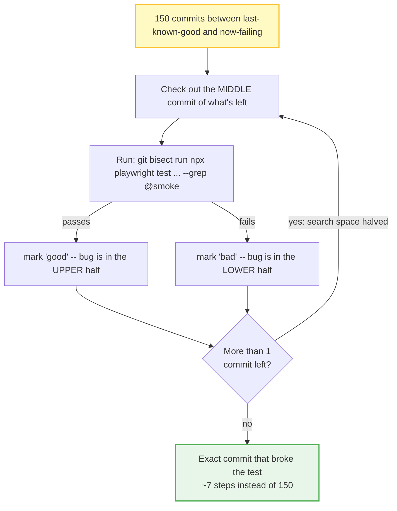

# 33. SDET → SDE Thinking — CS Fundamentals That Make You a Better Test Engineer

**Navigation**: [← Chapter 32: Interview Prep](./32_SDET_Interview_Prep.md) | [Index](../00_INDEX.md) | [→ Chapter 34: Algorithms in Test Automation](./34_Algorithms_in_Test_Automation.md)

**Cross-references (read these alongside this chapter):**

- [`../../14_Mental_Models/05_Universal_Problem_Framework.md`](../../14_Mental_Models/05_Universal_Problem_Framework.md) — Problem decomposition that applies to test design
- [`../../14_Mental_Models/08_Debugging_DryRun.md`](../../14_Mental_Models/08_Debugging_DryRun.md) — The dry-run debugging model → identical to trace-viewer analysis
- [`../../14_Mental_Models/18_Production_Debugging_Thinking.md`](../../14_Mental_Models/18_Production_Debugging_Thinking.md) — Production thinking that translates directly to test failure analysis
- [`../../02_Data_Structures/05_DS_In_Production.md`](../../02_Data_Structures/05_DS_In_Production.md) — How data structures appear in real systems you test
- [`../../06_OOP_Design/01_OOPS_Principles.md`](../../06_OOP_Design/01_OOPS_Principles.md) — OOP principles behind POM, Factory, Fixture patterns

---

## 5W1H

- **WHAT**: The computer science mental models that transform a good SDET into a great one — how data structure knowledge makes you write better tests, how algorithm thinking makes you find bugs faster, how OOP design patterns are already in your test framework.
- **WHY**: The gap between an SDET and an SDE is not "SDETs don't code." They do. The gap is **CS reasoning depth**. An SDE instinctively asks "what is the time complexity of this search?" An SDET who also thinks that way catches performance bugs, designs better test data structures, and can contribute to production code reviews.
- **WHO**: SDETs who want to grow beyond automation scripting toward engineering leadership, code review, and SDE tracks.
- **WHEN**: Read this alongside your DSA and OOP prep — the goal is to see the _same concept_ appear in both worlds simultaneously.
- **HOW**: Each section takes a CS concept from your DSA/OOP guide and shows its exact equivalent in test engineering.

---

## 0. War Stories — When CS Thinking Changed the Outcome

### HashMap vs O(n²): the test that took 45 minutes instead of 12 seconds

A new SDET wrote a test that verified every employee record fetched from the API had a corresponding row in the UI table. Implementation: for each of the 800 employees from the API, loop through every table row until you find the match.

```typescript
// O(n²) — for 800 employees × 800 rows = 640,000 comparisons
for (const employee of apiEmployees) {
  let found = false;
  for (const row of tableRows) {
    if (await row.textContent() === employee.name) {
      found = true;
      break;
    }
  }
  expect(found).toBe(true);
}
```

Runtime: 45 minutes. CI timed out. The test never completed.

Senior SDET with CS background looked at it for 10 seconds: "this is O(n²), we need a HashMap."

```typescript
// O(n) — build index once, then O(1) per lookup
const tableIndex = new Map<string, true>();
for (const row of tableRows) {
  tableIndex.set((await row.textContent()) ?? '', true);
}
for (const employee of apiEmployees) {
  expect(tableIndex.has(employee.name)).toBe(true);
}
```

Runtime: 12 seconds.

The SDET who spotted this was promoted within 6 months. The SDET who wrote the O(n²) version was not blamed — but they learned to ask "what's the time complexity?" before writing any loop that touches another loop.

### Stack reasoning: the test teardown that leaked data for 3 months

A fixture created a user, ran the test, and cleaned up. But the cleanup was in a `try/catch` block that silently swallowed errors:

```typescript
let userId: string;
test.beforeEach(async () => { userId = await createUser(); });
test.afterEach(async () => {
  try { await deleteUser(userId); } catch { /* silently ignored */ }
});
```

The `deleteUser` call was failing because the user had a foreign-key reference (a log entry created during the test). The catch silently swallowed the error. For 3 months, the test suite was creating users and never deleting them. The test database accumulated 40,000 orphaned users.

An SDE reviewing the code recognized this immediately: teardown errors should propagate, not be swallowed. The correct pattern is the LIFO cleanup stack (Ch06 fixtures, `yield`-based teardown), where Playwright's own `afterEach` machinery ensures cleanup runs and propagates errors:

```typescript
// The fixture pattern: cleanup always runs, errors propagate
test.extend({ user: async ({}, use) => {
  const userId = await createUser();
  await use(userId);
  await deleteUser(userId); // if this throws, Playwright reports it
}});
```

Understanding "the call stack propagates exceptions upward" — a CS fundamental — is what tells you why silent-catch in teardown is dangerous.

### Concurrency reasoning: the race condition nobody else saw

Two tests wrote to the same `auth-states/admin.json` file. Usually only one ran at a time. But when we enabled `fullyParallel: true`, both tests tried to write the file simultaneously. One wrote a partial JSON (the write was interrupted mid-byte), the second test read the partial JSON and parsed garbage, and it threw a cryptic `SyntaxError` with no obvious connection to the auth file.

An SDE on the team recognized this pattern immediately: concurrent write to a shared file without a lock is a race condition. The fix was `proper-lockfile` — a file-level mutex that serializes access. But the insight that got us there was CS: "two workers writing the same file concurrently is undefined behavior."

The SDET mindset alone would have blamed the JSON parser. The CS mindset named the root cause: concurrent mutation of shared state.

---

## 1. The Unified Mental Model: "Tests Are Programs"

Before the connections, the core insight:

```
A test suite IS a software system.
It has:
  - Data structures (your test data objects, maps, queues)
  - Algorithms (how you search for elements, retry logic, polling)
  - Design patterns (Factory, Observer, Strategy)
  - Concurrency (parallel workers)
  - I/O (API calls, DB queries, file reads)
  - State management (storageState, data accumulator)
  - Error handling (try/finally, retries)

The only difference from production code:
  Production code RUNS the business logic.
  Test code VERIFIES the business logic.

The CS skills are identical.
```

---

## 2. Hash Maps → Test Data Lookup

**The DSA concept** (from [`../../02_Data_Structures/01e_HashTable.md`](../../02_Data_Structures/01e_HashTable.md)):

- HashMap gives O(1) average lookup by key
- Java: `HashMap<String, CitationRecord>`
- TypeScript: `Map<string, CitationRecord>` or `Record<string, CitationRecord>`

**Where it appears in your test framework:**

```typescript
// Scenario: You create 50 citations in a worker fixture.
// Each test needs to look up "my" citation by ID.
// If you use an array → O(n) search per test: slow + fragile.
// If you use a Map → O(1) lookup per test.

// ❌ Array — O(n) lookup
const createdCitations: CitationApiResponse[] = [];
const myCitation = createdCitations.find((c) => c.citationId === "CIT-001");
// .find() scans the whole array — O(n)

// ✅ Map — O(1) lookup
const citationRegistry = new Map<string, CitationApiResponse>();
citationRegistry.set(citation.citationId, citation);
// ...
const myCitation = citationRegistry.get("CIT-001"); // O(1)
```

**Why this matters in tests:**

```
The TestDataManager (Ch28) is a Map internally.
The locator registry in the Mega POM (Ch18) is a Record<LocatorName, Locator> — a hash map.
The endpoint registry Endpoints.citations.getById(id) — a nested map of functions.

Every time you use Record<string, T> or Map<K, V> in test code,
you are applying the hash map from your DSA guide.
```

**Real-world precedent — HashMap's "O(1) average" has a documented worst case.** In December 2011, researchers Alexander Klink and Julian Wälde presented an attack at the 28th Chaos Communication Congress showing that PHP, Java, Python, Ruby, ASP.NET, and V8's hash table implementations all shared the same exploitable weakness: a predictable hash function meant an attacker could craft input keys that all collide into the same bucket, degrading that hash table's O(1) average lookup into O(n) per lookup and O(n²) total — a single crafted HTTP request could tie up a PHP server core for roughly 30 seconds (documented in the [CERT vulnerability note VU#903934](https://www.kb.cert.org/vuls/id/903934) and summarized in ["The Moment When You Realize Every Server in the World is Vulnerable"](https://tashian.com/articles/hash-table-attack/)). Every major language runtime patched this by randomizing their hash seed per-process. The lesson for test code specifically: "HashMap is O(1)" is an *average-case* guarantee that assumes reasonably distributed keys — it is not a worst-case guarantee, and a `TestDataManager` keyed by attacker-influenced or otherwise adversarial input (not just clean, internally-generated citation IDs) inherits the same theoretical failure mode, even if exploiting it deliberately is never the actual concern in test infrastructure.

**Cross-reference interview bridge:**

> If asked "implement a test data registry" in an SDE interview, you'd say:
> "I'd use a HashMap keyed by entity ID for O(1) retrieval, with a LinkedList to preserve insertion order for reverse-order cleanup (since children reference parents by FK)."
> That answer synthesises Ch28's TestDataManager + your DSA HashMap + LinkedList knowledge.

---

## 3. Queues and Stacks → Cleanup Order and Event Ordering

**The DSA concept** (from [`../../02_Data_Structures/01d_Stack_Queue.md`](../../02_Data_Structures/01d_Stack_Queue.md)):

- **Stack (LIFO)**: Last In, First Out — `push`, `pop`
- **Queue (FIFO)**: First In, First Out — `enqueue`, `dequeue`

**Stack in your test framework — cleanup order:**

```typescript
// TestDataManager cleanup REVERSES the creation order.
// Why? Because of FK constraints:
//   Create:  parent → child → grandchild
//   Delete:  grandchild → child → parent (reverse of creation)
// This is EXACTLY a stack: push on create, pop on cleanup.

class TestDataManager {
  private stack: (() => Promise<void>)[] = [];

  track(deleteAsync: () => Promise<void>): void {
    this.stack.push(deleteAsync); // push — like a stack
  }

  async cleanup(): Promise<void> {
    // pop in reverse — LIFO
    while (this.stack.length > 0) {
      const deleteOp = this.stack.pop()!;
      await deleteOp().catch(console.warn);
    }
  }
}
// Creation: [grandparent, parent, child] (push order)
// Cleanup:  child first, then parent, then grandparent (pop order)
// This respects FK constraints automatically.
```

**Queue in your test framework — event processing:**

```typescript
// When multiple notifications arrive, you process them in arrival order.
// Processing them out of order would give wrong assertion results.

// Conceptual model of pollForNotification():
// - API returns notifications as an array (arrival order = queue order)
// - You dequeue from the front: notifications[0] is oldest
// - You look for your specific event in the queue
// - Once found, you dequeue everything before it (confirmed they arrived first)

// Why FIFO matters:
// If CITATION_CREATED and PAYMENT_RECEIVED both arrive,
// you must see CITATION_CREATED BEFORE PAYMENT_RECEIVED.
// A queue assertion verifies ordering, not just presence.

const notifications = await notificationsClient.getByUser(account.userId);
// notifications is in FIFO order (oldest first)
const createIndex = notifications.findIndex(
  (n) => n.type === "CITATION_CREATED",
);
const payIndex = notifications.findIndex((n) => n.type === "PAYMENT_RECEIVED");
expect(createIndex).toBeLessThan(payIndex); // ← queue ordering assertion
```

---

**Real-world precedent — this is DevOps infrastructure, not just test cleanup.** `terraform destroy` faces the identical FK-constraint problem `TestDataManager.cleanup()` solves: HashiCorp's own documentation ([`terraform/docs/destroying.md`](https://github.com/hashicorp/terraform/blob/main/docs/destroying.md)) confirms Terraform builds the same dependency graph it uses for `apply`, then destroys in **reverse dependency order** — an EC2 instance is destroyed before the security group it references, because deleting the security group first would fail with the instance still attached to it. That's the stack discipline of `TestDataManager` (push on create, pop on cleanup) running at the scale of real cloud infrastructure teardown: create parent-then-child, destroy child-then-parent, for the same structural reason — a resource can't be safely removed while something still depends on it existing.

---

## 4. Trees → DOM Structure and POM Hierarchy

**The DSA concept** (from [`../../03_Algorithms/05_Trees.md`](../../03_Algorithms/05_Trees.md)):

- A tree has a root, internal nodes, leaves
- Tree traversal: depth-first (DFS) or breadth-first (BFS)
- Parent → child relationships

**The DOM is literally a tree:**

```
document (root)
└── html
    ├── head
    └── body
        └── div.crm-container
            ├── header.ms-CommandBar
            └── main
                └── div.ms-DetailsList (results grid)
                    ├── div.ms-DetailsList-headerWrapper
                    └── div.ms-DetailsList-contentWrapper
                        ├── div.ms-DetailsRow (row 0)
                        ├── div.ms-DetailsRow (row 1)
                        └── div.ms-DetailsRow (row 2)
```

**How this thinking improves your locators:**

```typescript
// Without tree thinking: use a single global CSS selector
// Risk: matches elements anywhere in the document
page.locator(".ms-DetailsRow:first-child"); // which table? there might be 2!

// With tree thinking: traverse from the root you care about
// DFS-style scoping: narrow down the tree branch first
const grid = page.locator(".results-section .ms-DetailsList");
const rows = grid.locator(".ms-DetailsRow"); // scoped to ONLY this grid's subtree
const firstRow = rows.first();

// You are doing a depth-first tree walk:
// document → .results-section → .ms-DetailsList → .ms-DetailsRow
```

**POM hierarchy IS a tree:**

```
CitationCrmModule (root)
├── SearchPanel (internal node)
│   ├── CustomerSearchTab (leaf)
│   └── CitationSearchTab (leaf)
├── ResultsGrid (internal node)
│   ├── GridHeader (leaf)
│   └── GridRow[] (leaves)
└── ActionBar (internal node)
    ├── NewCitationButton (leaf)
    └── ExportButton (leaf)
```

When you call `masterSearchPage.resultsGrid.rows.first()`, you're traversing:
`MasterSearchPage → ResultsGrid → rows → first()` — exactly a path from tree root to leaf.

**Cross-reference:** [`../../03_Algorithms/05_Trees.md`](../../03_Algorithms/05_Trees.md) — BFS tree traversal maps to `page.locator()` scope narrowing.

---

## 5. Graph Algorithms → Test Dependency Graphs

**The DSA concept** (from [`../../03_Algorithms/05c_Graphs_Fundamentals.md`](../../03_Algorithms/05c_Graphs_Fundamentals.md)):

- A directed graph has edges with direction: A → B means "A depends on B" or "A must come before B"
- Topological sort: order nodes such that all dependencies come first

**Your test suite IS a dependency graph:**

```
Test: "Supervisor reviews disputed citation"
  → Depends on: "Citation must exist" (node)
      → Depends on: "Customer must exist" (node)
          → Depends on: "Company must exist" (node)

Topological sort of test setup:
  1. Create company
  2. Create customer (references company)
  3. Create citation (references customer)
  4. Dispute the citation (references citation)
  5. Run the "supervisor reviews" test

If you run step 3 before step 2 → FK violation.
Topological sort of the dependency graph gives you the correct creation order.
```

**Detecting circular dependencies (bugs in your test framework):**

```typescript
// Circular dependency: Fixture A requires Fixture B; Fixture B requires Fixture A
// This is a cycle in your fixture dependency graph — Playwright detects and throws.

// Bad:
const test = base.extend({
  fixtureA: async ({ fixtureB }, use) => { ... },  // A needs B
  fixtureB: async ({ fixtureA }, use) => { ... },  // B needs A  ← cycle!
});
// Playwright error: "circular fixture dependency"

// Detection algorithm: Playwright runs DFS on the fixture dependency graph.
// If it finds a back edge (a node that was already in the current DFS path),
// it knows there's a cycle — same as cycle detection in directed graphs.
```

**Cross-reference:** [`../../03_Algorithms/05c_Graphs_Fundamentals.md`](../../03_Algorithms/05c_Graphs_Fundamentals.md) — Topological sort for test setup order. [`../../03_Algorithms/05b_Graphs_Internals.md`](../../03_Algorithms/05b_Graphs_Internals.md) — DFS cycle detection.

**Real-world precedent:** this isn't specific to test fixtures — it's how every major package manager installs your dependencies. When `npm install` (or `yarn`, `pnpm`) resolves a `package.json`, the set of declared dependencies forms a directed graph exactly like the fixture graph above (`A → B` meaning "A depends on B"), and the installer topologically sorts it to decide install order, using the identical DFS-with-cycle-detection this section just walked through — a circular `dependencies` chain between two packages is a real, documented failure mode installers have to guard against, not a hypothetical. The npm CLI's own RFC process has an open proposal (`npm/rfcs#707`) specifically about topologically sorting workspace packages so `npm run build --workspaces` executes each package only after the packages it depends on have already built — the exact "must create company before customer, must create customer before citation" constraint from this section's example, at the scale of an entire monorepo's build graph instead of a fixture chain.

---

## 6. Design Patterns → Your Test Framework Patterns

**The OOP concept** (from [`../../06_OOP_Design/02_Design_Patterns.md`](../../06_OOP_Design/02_Design_Patterns.md)):

Every design pattern in your framework has a name in GoF (Gang of Four):

| GoF Pattern                 | Where it appears in your test framework                                        |
| --------------------------- | ------------------------------------------------------------------------------ |
| **Factory Method**          | `PayloadsCitation.pending()` — factory creates objects with defaults           |
| **Builder**                 | `PayloadsCitation.pending({ ...overrides })` — builder with optional parts     |
| **Singleton**               | `config` object (one environment config per run)                               |
| **Strategy**                | Different seeding strategies (API vs DB vs globalSetup)                        |
| **Observer**                | `page.on('pageerror', handler)` — Playwright's event system                    |
| **Decorator**               | Managed client wrapping `CitationsApiClient.create()` to auto-track            |
| **Template Method**         | `APIUtils.processResponse()` — the template; subclasses fill in the body type  |
| **Proxy**                   | `page.route()` — intercepts requests before they reach the server              |
| **Chain of Responsibility** | Playwright fixture chain: browser → context → page → account → citationsClient |
| **Composite**               | POM hierarchy — a `MasterSearchPage` composed of `SearchPanel` + `ResultsGrid` |

**Deep dive — the Factory pattern in test code:**

```typescript
// GoF Factory Method intent:
// "Define an interface for creating objects, but let subclasses decide which class to instantiate."

// In test code — PayloadsCitation IS a Factory:
class PayloadsCitation {
  static pending(overrides = {}): CreateCitationPayload {
    // The factory decides the default values
    // The caller can override specific fields
    return { status: "PENDING", amount: 150, ...overrides };
  }

  static paid(overrides = {}): CreateCitationPayload {
    return PayloadsCitation.pending({
      status: "PAID",
      amount: 200,
      ...overrides,
    });
    //                              ↑ delegation to the base factory
  }
}

// The pattern benefit:
// - Test code doesn't know HOW citations are built (what the defaults are)
// - Only the factory knows — change defaults in ONE place, all tests update
// - New citation types (TRANSIT_FARE, BUS_PASS) get their own factory method
//   without touching any test file
```

**Cross-reference:** [`../../06_OOP_Design/02_Design_Patterns.md`](../../06_OOP_Design/02_Design_Patterns.md) — Full GoF pattern catalogue with Java examples. Map each one to your test code.

---

## 7. Time Complexity → Test Performance Thinking

**The CS concept** (from [`../../14_Mental_Models/09_Complexity_Intuition.md`](../../14_Mental_Models/09_Complexity_Intuition.md)):

- O(1): constant — doesn't grow with input size
- O(n): linear — grows proportionally
- O(n²): quadratic — danger zone

**How this applies to test suites:**

```
"Test suite as an algorithm"

ANTI-PATTERN: O(n²) test setup
  n tests × n data cleanup operations = n² operations.
  With 100 tests: 10,000 cleanup operations.
  With 1000 tests: 1,000,000 cleanup operations.

  How this happens:
    Each test creates data AND looks up/deletes ALL previous test data.
    Seen in: suites that verify "no stale data" by reading the entire DB.

PATTERN: O(1) test setup
  Each test creates its OWN data → O(1) cost per test regardless of suite size.
  100 tests: 100 create + 100 delete = 200 operations.
  1000 tests: 1000 create + 1000 delete = 2000 operations. O(n), not O(n²).

The right mental model:
  "Each test's cost should be O(1) — independent of the number of other tests."
  If adding a test makes EXISTING tests slower → you have a dependency. Fix it.
```

**Applying complexity thinking to locators:**

```typescript
// O(n) locator — scans ALL descendants of page
page.locator(".ms-DetailsRow"); // n = all rows in all tables on the page

// O(1) locator — scoped to a specific subtree
page.locator("#citationsGrid .ms-DetailsRow"); // scoped to one specific grid

// For D365 with 3 grids and 1000 rows total:
// O(n) version scans all 1000 rows → slow and might match wrong table
// O(1) version scans only the right grid's rows → fast and correct
```

**Cross-reference:** [`../../14_Mental_Models/09_Complexity_Intuition.md`](../../14_Mental_Models/09_Complexity_Intuition.md) — Full complexity intuition guide. Apply every example to your test framework.

---

## 8. Recursion → `expect.poll()` and Retry Logic

**The CS concept** (from [`../../03_Algorithms/03a_Recursion_Internals.md`](../../03_Algorithms/03a_Recursion_Internals.md)):

- Recursion: a function that calls itself with a smaller problem
- Base case: when to stop
- Recursive case: subdivide and call again

**`expect.poll()` IS recursive retry logic:**

```typescript
// Conceptual model of expect.poll() as recursion:

async function pollUntil<T>(
  fn: () => Promise<T>, // the check function
  expected: T, // the target value
  timeoutMs: number, // deadline (base case trigger)
  startTime = Date.now(),
): Promise<void> {
  // BASE CASE: timeout reached → throw
  if (Date.now() - startTime > timeoutMs) {
    throw new Error(`poll timed out after ${timeoutMs}ms`);
  }

  // CHECK: did we reach the target?
  const current = await fn();
  if (current === expected) return; // BASE CASE: success

  // RECURSIVE CASE: wait and try again
  await sleep(1000);
  return pollUntil(fn, expected, timeoutMs, startTime); // ← recursive call
}

// Playwright's expect.poll() does this with exponential backoff intervals:
await expect
  .poll(async () => (await citationsClient.getById(id)).status, {
    timeout: 30_000,
    intervals: [500, 1000, 2000, 5000],
  })
  .toBe("DISPUTED");
```

**Why the intervals grow — the actual trade-off:**

```
Interval 1: 500ms   → early check (notification might arrive quickly)
Interval 2: 1000ms  → wait a bit more
Interval 3: 2000ms  → backing off (if still not done, give it more time)
Interval 4: 5000ms  → worst case (something slow is happening)
```

Back-off is **not** the same mechanism as binary search, and it's worth being precise
about this because the wrong analogy gives you the wrong instinct when tuning it.
Binary search halves a *search space* — each probe eliminates half the remaining
candidates, which is what buys you O(log n). Polling eliminates nothing: every probe
asks the same question ("is it `DISPUTED` yet?") about a *single* unknown, and the
answer flips exactly once, at a time you don't control. There is no space being
halved, and no logarithmic factor anywhere.

What back-off actually trades off is **detection latency against probe count**:

| Schedule over a 30s timeout        | Probes spent | Latency if the answer lands at 120ms |
| ---------------------------------- | ------------ | ------------------------------------ |
| Fixed 100ms                        | 300          | ≤100ms — excellent                   |
| Fixed 1000ms                       | 30           | up to 1000ms — 8× worse              |
| Growing `[100, 250, 500, 1000]`    | 33           | ≤100ms — excellent                   |

The growing schedule gets the fast path's low latency at roughly the slow path's probe
cost. That works because of an assumption about the *distribution*, not about search:
most waits resolve early, so cheap probes are worth spending early, and the long tail
is rare enough that probing it slowly costs you little.

**Playwright's real defaults — and how the schedule is applied.** The chapter's
`[500, 1000, 2000, 5000]` above is an explicit override, not Playwright's behaviour.
The built-in default is `[100, 250, 500, 1000]`, and the **last interval repeats** for
the remainder of the timeout. From Playwright's own `types/test.d.ts` (v1.60.0), the
doc comment on `toPass` spells the schedule out:

```typescript
//   Probe, wait 1s, probe, wait 2s, probe, wait 10s, probe, wait 10s, probe
//   intervals: [1_000, 2_000, 10_000], // Defaults to [100, 250, 500, 1000].
```

Two things to read off that comment: the **first probe fires immediately** (before any
wait), and once the list is exhausted the final value is reused forever rather than the
poll giving up. So `[100, 250, 500, 1000]` over a 30s timeout probes at
t = 0, 100, 350, 850, then every second to 29,850 — the 33 probes in the table above.
You spend less time polling when results are fast, and don't hammer the API when
they're slow.

**Cross-reference:** [`../../03_Algorithms/03b_Recursion_Fundamentals.md`](../../03_Algorithms/03b_Recursion_Fundamentals.md) — Base case / recursive case structure. [`../../14_Mental_Models/01_Recursion_Tree_Thinking.md`](../../14_Mental_Models/01_Recursion_Tree_Thinking.md) — Visualising recursive calls as trees.

---

## 9. Binary Search → Bisect Debugging (Finding Flaky Commits)

**The CS concept** (from [`../../20_Interview_Mastery/Problem_Sets_DSA/14_DSA_Problems_BinarySearch_TwoPointers_SlidingWindow.md`](../../20_Interview_Mastery/Problem_Sets_DSA/14_DSA_Problems_BinarySearch_TwoPointers_SlidingWindow.md)):

- Binary search: in a sorted space, eliminate half the search space each step → O(log n)
- Precondition: the problem space must be monotonic (all passes before a point, all fails after)

**Binary search in debugging — `git bisect`:**

```bash
# Problem: Test was passing 3 weeks ago. Now it always fails.
# 150 commits between "passing" and "failing". Which one broke it?

# Brute force: check all 150 commits → O(n) = 150 test runs
# Binary search (git bisect): → O(log n) = ~7 test runs

git bisect start
git bisect bad HEAD              # current commit is broken
git bisect good abc123           # 3 weeks ago was fine

# Git checks out commit 75 (middle):
git bisect run npx playwright test tests/specs/citations/dispute.spec.ts --grep "@smoke"
# If test passes → 'git bisect good' → search upper half
# If test fails  → 'git bisect bad'  → search lower half
# Git narrows it down in ~7 steps

# After 7 steps: git bisect shows the EXACT commit that broke the test
# You can see exactly what changed → fix it
```

The loop that turns 150 candidate commits into ~7 test runs:



**How to read this diagram.** Start with the 150 commits and check out the middle one, run the smoke test, and mark it good (the bug is in the upper half) or bad (the bug is in the lower half). Notice the loop: while more than one commit remains, the search space is halved and you go back to the middle, ending at the exact commit in about 7 steps instead of 150.

**Two-pointer thinking → parallel resource management:**

```typescript
// Two-pointer pattern: two indices moving through a sorted array
// In testing: two contexts moving through a shared state

// Admin action at pointer 1 → Customer sees it at pointer 2
// They must stay "close enough" — if admin is 30 steps ahead,
// customer hasn't refreshed yet → assertion fails

// The fix: sync the pointers (wait for customer UI to catch up)
// before advancing the admin pointer further.
// This IS the two-pointer convergence pattern applied to async UIs.
```

---

## 10. Concurrency → Test Race Conditions and Parallel Execution

**The CS concept** (from concurrent programming):

- Race conditions: when the behavior of a program depends on the relative timing of events
- Shared mutable state: the root of concurrency bugs when multiple threads read/write the same memory
- Thread Local Storage (TLS): giving each thread its own isolated memory to prevent collisions

**How this maps to test automation:**

```
Test suites are highly concurrent distributed systems.
You have:
- Test Worker processes (Playwright parallel workers)
- Browser render threads
- Backend API servers
- Database transaction managers

A "flaky test" is almost always just a concurrency bug: an unhandled race condition between these systems.
```

**Shared Mutable State = Flaky Tests**

```typescript
// SDE Concurrent Programming Anti-pattern:
// Two threads modifying the same global variable without a lock.

// SDET Test Automation Anti-pattern:
// Two parallel workers modifying the same test account.
const customer = await getTestCustomer("cust-001");
await citationsClient.create(customer.id, { amount: 100 });
// If Worker 1 and Worker 2 run this simultaneously, Worker 2 might see
// Worker 1's citation in the UI and assert the wrong total amount.
```

**Real-world precedent — inconsistent shared state at the scale of a real trading firm.** On August 1, 2012, Knight Capital Group lost $440 million in 45 minutes when a deployment updated 7 of its 8 production trading servers with new code, but the 8th server kept a dormant feature flag from a system retired in 2003 — a **reused flag bit** that, on the un-updated server, now routed live order flow into that old, unintended code path. Within 45 minutes the mismatched server had executed over 4 million unintended trades. This is the identical failure shape as the two-worker citation bug above — different nodes (workers, here; servers, there) operating on **inconsistent shared state** — scaled from "wrong assertion in a test" to "$440M and a company sold off within days." The fix categories are the same too: either make every node's state identical (a consistent deployment, matching this section's eventual Thread-Local-Storage fix of giving every worker fully isolated state) or detect the inconsistency before it can act (a canary/staged rollout that would have caught server 8 diverging from the other 7 before it processed real order flow).

**Thread Local Storage = Worker-Scoped Fixtures**

```typescript
// SDE fix for shared state: Give each thread its own instance (TLS).
// SDET fix: Give each worker its own isolated test account.

// Playwright's scope: 'worker' IS Thread Local Storage.
// Worker 1 gets account A. Worker 2 gets account B.
// They run concurrently, but their state is completely isolated.
```

[`02_Test_Architecture/09_Parallel_Execution_Workers.md`](../02_Test_Architecture/09_Parallel_Execution_Workers.md) is where the illustrations above stop being illustrations: its own data-collision scenario (§3) and module-level `authToken` example (§4) are this exact failure shape in real, runnable Playwright code, and its worker-scoped `account` fixture (§8) is the real `{ scope: 'worker' }` implementation this section names by analogy.

**Event Loop Race Conditions**

```typescript
// SDEs think about thread synchronization: "Thread A must wait for Thread B's signal."
// SDETs think about Playwright event synchronization:

// The classic race condition (from Ch12):
await page.click("#openInNewTab");
const newPage = await context.waitForEvent("page");
// Race condition: if the new tab opens BEFORE waitForEvent is called, the event is missed.

// Synchronization fix (Promise.all ensures listeners are attached before action triggers):
const [newPage] = await Promise.all([
  context.waitForEvent("page"),
  page.click("#openInNewTab"),
]);
```

**CS insight**: Whenever you write a test, you must ask: "What happens if the API is slower than the UI render today?" or "What happens if another test runs this exact code at the exact same millisecond?" That is concurrent programming thinking.

---

## 11. The SDET→SDE Transition Mindset Map

```
SDET Skill               →    SDE Equivalent
─────────────────────────────────────────────────────────────
Writing POM classes       →    Writing production service classes (same OOP)
Fixture dependency graph  →    Dependency injection / IoC container design
TestDataManager cleanup   →    Resource pool / connection pool lifecycle
Flakiness root-cause      →    Production bug root-cause analysis (same methodology)
expect.poll() polling     →    Circuit breaker / retry pattern in microservices
page.route() mocking      →    Mock server / WireMock / service stub in production testing
DB fixture teardown       →    Database transaction rollback (same isolation concept)
Parallel workers          →    Concurrent thread/process design
Endpoint factory pattern  →    URL builder / fluent API in SDK design
Discriminated unions      →    Tagged union / sum type in functional programming
```

**The honest answer to "can an SDET become an SDE?":**

```
YES — and the path is shorter than you think.

What SDETs already have:
  ✅ Writing real code (TypeScript/Java)
  ✅ Understanding async/await, promises, closures
  ✅ API design (you read them all day — you understand REST deeply)
  ✅ Database querying (SQL in tests)
  ✅ OOP design patterns (POM = class hierarchy, Factory = payload builder)
  ✅ Debugging (trace viewer = debugger + network inspector)
  ✅ System architecture (you test it, so you understand it)

What needs to be added:
  → Data structure implementation (write a HashMap from scratch, not just use one)
  → Algorithm design (solve LeetCode medium problems without hints)
  → System design (design a URL shortener, not just test one)
  → Domain knowledge (how the business logic itself works, not just how to test it)

The curriculum in this repo covers all four.
Use 21_SDET_Playwright_Automation for the test engineering.
Use 02_Data_Structures + 03_Algorithms for CS fundamentals.
Use 06_OOP_Design for system design.
Use 20_Interview_Mastery for the interview bridge.
```

---

## 🏋️ Practice Challenges

### Challenge 1 [Cross-Domain] — HashMap in TestDataManager

Refactor `TestDataManager` from Ch28 to use `Map<string, SeedRecord>` keyed by a unique tracking ID instead of a plain array. Explain: what does this change the time complexity of `cleanupByType()` from and to?

<details><summary>Answer</summary>

```typescript
// Before: array — cleanupByType is O(n) scan
private records: SeedRecord[] = [];
cleanupByType(type: string) {
  const matching = this.records.filter(r => r.type === type);  // O(n)
  this.records = this.records.filter(r => r.type !== type);    // O(n)
}

// After: Map keyed by tracking ID — still O(n) for cleanupByType
// because you still need to scan for matching types
// BUT: get(trackingId) is O(1) if you want to cancel a specific resource early

private records: Map<string, SeedRecord> = new Map();
private trackingCounter = 0;

track(deleteAsync: () => Promise<void>, type: string): string {
  const id = `track-${++this.trackingCounter}`;
  this.records.set(id, { type, deleteAsync });
  return id;  // caller can use this to cancel a specific item early
}

cancelEarly(trackingId: string): void {
  this.records.delete(trackingId);  // O(1) — HashMap advantage
}

// cleanupByType: O(n) because HashMap doesn't support key-grouping
// To make cleanupByType O(1)-per-type, use Map<type, SeedRecord[]>
// (a Map of arrays — bucket by type)

// The lesson: choosing the right data structure depends on which operation
// needs to be fast. HashMap is best for ID lookup. Bucket map for type lookup.
```

</details>

---

### Challenge 2 [System Design] — Design a Parallel-Safe Test Data Registry

Using concepts from: HashMap (O(1) lookup), Queue (ordering), dependency graph (creation order):

Design (in pseudocode or TypeScript) a `ParallelDataRegistry` that:

1. Multiple workers can write to it simultaneously without collision
2. Lookup by ID is O(1)
3. Cleanup respects FK order (children before parents)
4. Worker A's data is never deleted by Worker B

<details><summary>Answer</summary>

```typescript
// Key design decisions:
// 1. Each worker gets its own registry instance (no shared state) → no concurrency issue
// 2. Map for O(1) lookup by ID
// 3. DAG (directed acyclic graph) for FK order — topological sort for cleanup
// 4. Worker ID stored on every record → worker isolation guaranteed

interface RegistryEntry {
  id: string;
  type: string;
  workerId: string; // isolation: only this worker deletes this
  parentIds: string[]; // FK dependencies (parents)
  deleteAsync: () => Promise<void>;
}

class ParallelDataRegistry {
  private registry: Map<string, RegistryEntry> = new Map(); // O(1) lookup
  private readonly workerId: string;

  constructor(workerId: string) {
    this.workerId = workerId;
  }

  register(
    id: string,
    type: string,
    parentIds: string[],
    deleteAsync: () => Promise<void>,
  ): void {
    this.registry.set(id, {
      id,
      type,
      workerId: this.workerId,
      parentIds,
      deleteAsync,
    });
  }

  // Topological sort for FK-correct cleanup order
  async cleanupAll(): Promise<void> {
    const sorted = this.topologicalSort(); // leaves first, roots last
    for (const entry of sorted) {
      if (entry.workerId !== this.workerId) continue; // only clean MY data
      await entry
        .deleteAsync()
        .catch((e) => console.warn(`Failed to delete ${entry.id}:`, e));
    }
    this.registry.clear();
  }

  private topologicalSort(): RegistryEntry[] {
    // DFS-based topological sort (from 03_Algorithms/05c_Graphs_Fundamentals.md)
    const visited = new Set<string>();
    const result: RegistryEntry[] = [];

    const dfs = (id: string): void => {
      if (visited.has(id)) return;
      visited.add(id);
      const entry = this.registry.get(id)!;
      for (const parentId of entry.parentIds) {
        dfs(parentId); // visit parents first → they go LATER in result (delete children first)
      }
      result.unshift(entry); // prepend → children come before parents in deletion order
    };

    for (const id of this.registry.keys()) dfs(id);
    return result;
  }
}
```

</details>

### Challenge 3 [MCQ] — Time Complexity of Test Assertion Loops

You have a test that verifies no duplicate citation IDs exist in a paginated API response of 10,000 rows. Which approach is most efficient?

```typescript
// Option A: nested loop
for (let i = 0; i < citations.length; i++) {
  for (let j = i + 1; j < citations.length; j++) {
    expect(citations[i].citationId).not.toBe(citations[j].citationId);
  }
}

// Option B: Set-based
const seen = new Set<string>();
for (const citation of citations) {
  expect(
    seen.has(citation.citationId),
    `Duplicate: ${citation.citationId}`,
  ).toBe(false);
  seen.add(citation.citationId);
}
```

- A) Both are O(n²) because Set.has() uses hashing which is O(n) in the worst case
- B) Option A is O(n²), Option B is O(n) amortized — for 10,000 rows Option A makes ~50 million comparisons vs Option B's 10,000 lookups
- C) Option B uses more memory so it's slower overall
- D) They are equivalent — TypeScript optimizes nested loops to O(n) automatically

<details><summary>Answer</summary>

**B** — This is the canonical Set vs nested-loop deduplication problem:

- **Option A**: O(n²) comparisons. For n=10,000: `(10,000 × 9,999) / 2 = 49,995,000` comparisons. At 100ns per comparison: ~5 seconds of pure CPU time just for assertions.

- **Option B**: O(n) time, O(n) space. `Set.has()` and `Set.add()` are O(1) amortized (hash table). For n=10,000: exactly 10,000 hash lookups + 10,000 inserts = 20,000 operations. At 100ns each: ~2ms.

In practice, a test with Option A on a 10,000-item response will timeout. Option B runs in milliseconds.

The **CS insight**: whenever you're checking membership in a growing collection inside a loop, reach for a Set or Map — not another loop. This is the SDEtoSDE pattern: your CS data structures knowledge directly prevents flaky test timeouts.

Memory trade-off: Option B uses O(n) memory (the Set). For test assertions on 10,000 strings of average 10 chars: ~100KB — negligible.

</details>

---

### Challenge 4 [Spot the Bug — Sorting Assertion Logic]

```typescript
test("API returns citations sorted by date descending", async ({
  citationsClient,
  account,
}) => {
  const citations = await citationsClient.search({
    customerId: account.userId,
  });

  // Verify sorted: each item should be >= the next item's date
  for (let i = 0; i < citations.length; i++) {
    expect(new Date(citations[i].issuedAt).getTime()).toBeGreaterThanOrEqual(
      new Date(citations[i + 1].issuedAt).getTime(),
    );
  }
});
```

There is an off-by-one error. Find it and write the corrected loop.

<details><summary>Answer</summary>

**Bug**: The loop runs `i` from `0` to `citations.length - 1` (inclusive). On the last iteration, `i = citations.length - 1`, and the code accesses `citations[i + 1]` = `citations[citations.length]` = `undefined`. Calling `.issuedAt` on `undefined` throws `TypeError: Cannot read properties of undefined`.

If `citations` has 1 item, the loop runs once with `i=0`, accessing `citations[1]` — undefined. The test throws instead of passes or fails meaningfully.

**Fix**: stop the loop one index earlier so `i + 1` never exceeds the last valid index:

```typescript
test("API returns citations sorted by date descending", async ({
  citationsClient,
  account,
}) => {
  const citations = await citationsClient.search({
    customerId: account.userId,
  });

  // Need at least 2 items to verify ordering
  expect(
    citations.length,
    "Need at least 2 citations to verify sort order",
  ).toBeGreaterThanOrEqual(2);

  // i goes to length - 2 so i+1 is always length - 1 (last valid index)
  for (let i = 0; i < citations.length - 1; i++) {
    const current = citations[i];
    const next = citations[i + 1];
    if (!current || !next) continue; // narrows both from `Citation | undefined`
    expect(
      new Date(current.issuedAt).getTime(),
      `Citation[${i}] should be >= Citation[${i + 1}]`,
    ).toBeGreaterThanOrEqual(new Date(next.issuedAt).getTime());
  }
});
```

**CS principle**: whenever you access `arr[i]` and `arr[i+1]` inside the same loop iteration, the loop bound must be `i < arr.length - 1`. This is the adjacent-pair pattern — fundamental to sorting verification, sliding window problems, and difference arrays.

**But the loop bound is the weaker half of the answer.** Note the two extra lines
above: `const current = citations[i]` followed by a `if (!current || !next)` guard.
They aren't defensive padding — without them this code **does not compile** in this
curriculum's own framework, because `framework/tsconfig.json` sets
`"noUncheckedIndexedAccess": true`. Under that flag `citations[i]` is typed
`Citation | undefined`, not `Citation`, so reading `.issuedAt` off it directly is an
error. Compiled with TypeScript 5.9.3 against exactly those settings, the
"just fix the bound" version fails:

```
ch33_challenge4.ts(15,30): error TS2532: Object is possibly 'undefined'.
ch33_challenge4.ts(16,27): error TS2532: Object is possibly 'undefined'.
```

Now run the *original* buggy loop through the same compiler, and the real lesson
appears — it fails too, at the same rule:

```
ch33_variants.ts(14,21): error TS2532: Object is possibly 'undefined'.
ch33_variants.ts(15,16): error TS2532: Object is possibly 'undefined'.
```

With the flag off (`--strict` alone), both versions compile silently and the off-by-one
survives to runtime, where it surfaces as `TypeError: Cannot read properties of
undefined` in the middle of an assertion — the 2-hour debugging session.

So there are two different kinds of answer to this challenge, and knowing which one you
just gave is the actual senior signal:

| Answer                                | What it relies on                                            | Strength                            |
| ------------------------------------- | ------------------------------------------------------------ | ----------------------------------- |
| "Use `i < arr.length - 1`"            | The author remembering the adjacent-pair rule, every time    | A **discipline** — forgettable      |
| `noUncheckedIndexedAccess` in tsconfig | The compiler refusing to build unguarded indexed reads       | A **guarantee** — not forgettable   |

This is the same distinction §7 draws between a convention and a constraint: one config
line converts an entire *class* of off-by-one indexing bug from a runtime discovery into
a compile error, across every file in the repo, forever. That's the reasoning shift this
chapter is about — an SDE reaches for the flag, not just the fix.

If you find the `continue` guard noisy, the pairwise form avoids manual indexing
altogether and compiles clean under the same flag:

```typescript
const times = citations.map((c) => new Date(c.issuedAt).getTime());
times.slice(1).forEach((next, idx) => {
  expect(
    times[idx],
    `Citation[${idx}] should be >= Citation[${idx + 1}]`,
  ).toBeGreaterThanOrEqual(next);
});
```

</details>

---

### Challenge 5 [Write It Yourself — Binary Search Application]

The citation API supports pagination: `GET /citations?page=N&size=100`. Pages are numbered from 1. You know there are between 1 and 10,000 citations, and the API returns them sorted by `citationId` ascending. Write a binary search function to find the page containing a specific `citationId` without scanning every page.

<details><summary>Answer</summary>

```typescript
/**
 * Binary search over paginated API results.
 * Returns the page number containing targetId, or -1 if not found.
 * Time complexity: O(log(totalPages)) API calls instead of O(totalPages).
 */
async function findPageContaining(
  citationsClient: CitationsApiClient,
  customerId: string,
  targetId: string,
  pageSize: number = 100,
): Promise<number> {
  // First: get total count to compute page range
  const meta = await citationsClient.searchMeta({ customerId });
  const totalPages = Math.ceil(meta.totalCount / pageSize);

  let low = 1;
  let high = totalPages;

  while (low <= high) {
    const mid = Math.floor((low + high) / 2);
    const page = await citationsClient.search({
      customerId,
      page: mid,
      size: pageSize,
    });

    const firstId = page[0]?.citationId;
    const lastId = page[page.length - 1]?.citationId;

    if (!firstId) break; // empty page — not found

    if (targetId >= firstId && targetId <= lastId) {
      // Target is within this page's range — verify exact presence
      const found = page.some((c) => c.citationId === targetId);
      return found ? mid : -1;
    }

    if (targetId < firstId) {
      high = mid - 1; // search left half
    } else {
      low = mid + 1; // search right half
    }
  }

  return -1; // not found
}

// For 10,000 citations at 100 per page = 100 pages:
// Binary search makes at most ceil(log2(100)) = 7 API calls
// Linear scan would make up to 100 API calls
// 14x fewer API calls = 14x faster test execution
```

**CS insight**: binary search is applicable whenever the data has a **monotonic property** — here, `citationId` is sorted, so all IDs on page N are less than all IDs on page N+1. That monotonicity is the precondition for binary search. Recognizing monotonicity in test scenarios is the SDE thinking skill this chapter builds.

</details>

---

**Navigation**: [← Chapter 32: Interview Prep](./32_SDET_Interview_Prep.md) | [Index](../00_INDEX.md) | [→ Chapter 34: Algorithms in Test Automation](./34_Algorithms_in_Test_Automation.md)


---

## Reality Check

**"CS fundamentals are irrelevant for SDETs"**→ Big-O analysis determines whether your test data generation scales or crashes on large datasets. Data structure choice determines whether your test utilities run in milliseconds or seconds. Concurrency understanding determines whether your parallel tests are safe or create race conditions. CS fundamentals are not academic — they are the engineering foundation that separates automation scripters from software engineers.

**"SDETs do not write production code"**→ Test infrastructure IS production code: test frameworks run in CI/CD pipelines that gate deployments, test utilities are used by the entire engineering team, and test reporting tools are monitored by managers and stakeholders. Code quality, maintainability, and reliability standards for test infrastructure should match production code standards. Unmaintainable test code becomes an organizational bottleneck.

**"Moving from SDET to SDE requires starting over"**→ SDETs who build test frameworks already practice: software design (framework architecture), API development (test utilities), database operations (test data management), CI/CD (pipeline configuration), and debugging (test failure investigation). The gap is in: product feature development workflow, code review from a feature perspective, and on-call/incident response. The engineering skills transfer; the domain context needs building.

**"Algorithm knowledge is only for interviews"**→ Algorithm patterns appear in test automation: graph traversal for dependency resolution in test ordering, dynamic programming for optimal test selection, and hashing for test data deduplication. An SDET who understands these patterns builds more efficient test infrastructure. The interview algorithm practice has direct utility in daily work.

**"CS theory is separate from practical engineering"**→ Theory predicts practical outcomes: understanding computational complexity tells you that your O(n squared) test data comparison will timeout on 10000 records before you waste 30 minutes running it. Understanding concurrency theory tells you that your shared HashMap will corrupt data before you spend a day debugging intermittent test failures. Theory is not academic — it is predictive engineering.
