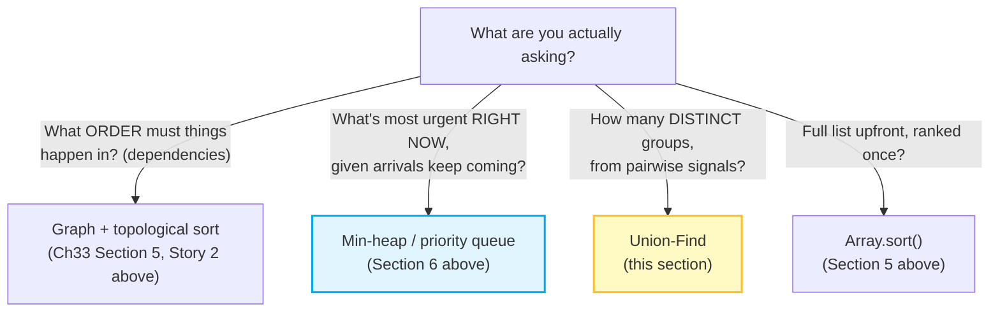
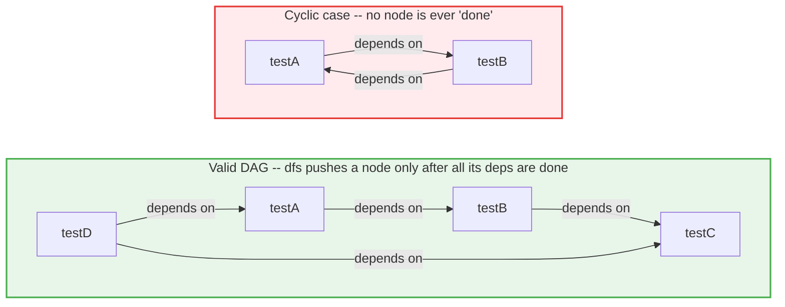

# 34. Algorithms in Test Automation — Search, Sort, and Pattern Recognition

**Navigation**: [← Chapter 33: SDET→SDE CS Thinking](./33_SDET_to_SDE_CS_Thinking.md) | [Index](../00_INDEX.md) | [→ Chapter 35: OOP Design Patterns Deep-Dive for SDETs](./35_OOP_Design_Patterns_for_SDETs.md)

**Cross-references (read these alongside this chapter):**

- [`../../03_Algorithms/01_Algorithm_Thinking.md`](../../03_Algorithms/01_Algorithm_Thinking.md) — The algorithm thinking framework that applies to test design
- [`../../03_Algorithms/06e_Algorithm_Patterns.md`](../../03_Algorithms/06e_Algorithm_Patterns.md) — Patterns like sliding window, two pointers — appear directly in assertion design
- [`../../02_Data_Structures/01f_Trees_Heaps.md`](../../02_Data_Structures/01f_Trees_Heaps.md) — Part 8 (Heaps) — the structure behind Section 6's CI-triage priority queue
- [`../../03_Algorithms/14_Union_Find_DSU_Complete.md`](../../03_Algorithms/14_Union_Find_DSU_Complete.md) — the structure behind Section 7's failure-clustering, incl. verified history (Galler & Fischer 1964, Tarjan 1975)
- [`../../14_Mental_Models/14_Optimization_Pipeline.md`](../../14_Mental_Models/14_Optimization_Pipeline.md) — Brute-force → optimise pipeline (how to improve slow tests)
- [`../../14_Mental_Models/22_Brute_Force_To_Optimal_Playbook.md`](../../14_Mental_Models/22_Brute_Force_To_Optimal_Playbook.md) — Always start with brute force, then optimise
- [`../../20_Interview_Mastery/02_Constraint_to_Algorithm_Map.md`](../../20_Interview_Mastery/02_Constraint_to_Algorithm_Map.md) — Constraint → algorithm selection maps to problem → test strategy

---

## Why Algorithms Matter in Test Engineering

```
"I don't need algorithms — I'm an SDET, not a competitive programmer."

This is wrong. Here is where algorithms appear every single day:

1. Searching for the right locator in a massive D365 DOM → tree search
2. Polling until a condition is met → binary search in time
3. Deciding which tests to run on a PR → set intersection
4. Finding which commit broke a test → binary search (git bisect)
5. Ordering test setup steps → topological sort
6. Processing a paginated API response → sliding window
7. Asserting table data is sorted correctly → sort verification
8. Finding duplicate test IDs → two-pointer / HashMap
9. Building retry logic → backoff algorithm
10. Optimising a slow test suite → greedy / DP thinking
11. Triaging failures as they stream in during a CI run → priority queue (heap)
12. Grouping 10 failures into the real number of root causes → Union-Find
13. Finding the smallest input that breaks a function → property-based testing's shrink search

Every algorithm has a test automation equivalent.
This chapter makes those connections explicit.
```

---

## 0. War Stories — When Algorithmic Thinking Saved the Run

### Story 1: O(n²) pagination check that took 4 hours in CI

A colleague wrote the "verify no duplicates" check for a paginated API response. It worked fine in development where the dataset had 200 citations. In CI against the staging database (11,000 citations), the test took 4 hours and was marked as "infrastructure issue." The test was retried 3 times automatically, consuming 12 hours of CI time on each nightly run.

The problem: a nested loop checking every citation against every other citation — O(n²). With 11,000 citations that's 121 million comparisons. The fix was a HashSet (Section 2 of this chapter) — O(n) time, O(n) space. The test dropped from 4 hours to 3.7 seconds.

The lesson: any assertion that iterates over "all results" is hiding an O(n²) time bomb. When the dataset grows, you pay.

### Story 2: 90-minute test suite that ran in 14 minutes after dependency-graph ordering

A test suite for a D365 module had 70 tests, each setting up its own data from scratch: login, navigate to admin, create record, navigate back, run assertion. Average setup time: 72 seconds per test. Total: 5,040 seconds (~84 minutes).

Applying topological sort (Ch33 Section 5, Graph Algorithms): some tests could share setup data. Tests that only READ didn't need their own data — they could use data created by tests that WRITE. After mapping dependencies and reordering using DFS topological sort, 38 tests were able to share setup. Runtime: 14 minutes.

The lesson: test execution order is a graph problem. Ignoring it costs you wall-clock time every single CI run.

### Story 3: Binary search that found the flaky commit in 7 minutes instead of 7 days

A flaky test appeared in CI. The last known-green state was a commit 180 commits ago. One engineer estimated "a week" to bisect manually by checking commits one by one. Another knew `git bisect` — which performs binary search on the commit history. 180 commits → log₂(180) ≈ 7 checks. The flaky commit was identified in 7 minutes.

`git bisect start HEAD <known-good-sha>` hands you the midpoint commit. You run the test. If it fails, `git bisect bad`. If it passes, `git bisect good`. After 7 iterations: `git bisect good` tells you the first bad commit and the changed file.

The lesson: git bisect is binary search. If you don't recognize the pattern, you do it manually and it takes a week.

---

## 1. The Algorithm Thinking Framework Applied to Test Design

From [`../../03_Algorithms/01_Algorithm_Thinking.md`](../../03_Algorithms/01_Algorithm_Thinking.md), the framework is:

```
1. Understand the problem completely
2. Identify constraints
3. Think brute force first
4. Identify the bottleneck / inefficiency
5. Optimise — apply the right pattern
6. Verify edge cases
```

**Applied to test design — the same steps:**

```
Test problem: "Verify that citations are sorted by issue date, newest first"

Step 1 — Understand completely:
  The results grid shows citations. We need to verify the ORDER, not just presence.
  "Sorted" means: each row's date ≥ next row's date (descending).

Step 2 — Constraints:
  D365 grid might only show 50 rows at a time (pagination).
  Dates are displayed as "05/28/2026" strings, not ISO format.
  We have up to 500 citations in the DB.

Step 3 — Brute force:
  Fetch all 500 citations from API, sort them in TypeScript, compare to UI.
  → Works but: 500 API calls is slow. Comparing all 500 rows is fragile.

Step 4 — Bottleneck:
  We don't need all 500 — we only need to verify the VISIBLE 50.
  And we don't need the full comparison — we only need adjacent pair checks.

Step 5 — Optimise:
  Fetch visible 50 rows. Check: date[i] >= date[i+1] for each adjacent pair.
  This is O(n) where n=50, not O(500).
  Classic: verify sorted array by checking adjacent pairs.

Step 6 — Edge cases:
  - Two citations on the same day → same date is valid (equal is ok)
  - Only 1 citation → vacuously sorted, test should pass
  - All same date → still sorted
```

```typescript
// The O(n) sorted verification test
async function verifyGridSortedByDate(
  grid: MasterSearchResultsGrid,
  direction: "asc" | "desc" = "desc",
): Promise<void> {
  const rows = await grid.rows.all();
  if (rows.length <= 1) return; // edge case: 0 or 1 rows are trivially sorted

  const dates: Date[] = [];
  for (const row of rows) {
    const dateText =
      (await row.locator('[data-col="issueDate"]').textContent()) ?? "";
    dates.push(parseMMDDYYYY(dateText)); // parse "05/28/2026" → Date
  }

  // Check adjacent pairs — O(n), no sorting needed
  for (let i = 0; i < dates.length - 1; i++) {
    if (direction === "desc") {
      expect(dates[i].getTime()).toBeGreaterThanOrEqual(dates[i + 1].getTime());
    } else {
      expect(dates[i].getTime()).toBeLessThanOrEqual(dates[i + 1].getTime());
    }
  }
}
```

---

## 2. Sliding Window → Paginated API Assertions

**The algorithm** (from [`../../03_Algorithms/06e_Algorithm_Patterns.md`](../../03_Algorithms/06e_Algorithm_Patterns.md)):

- Sliding window: maintain a fixed-size window over a sequence
- Move the window forward without reprocessing everything already seen
- Use for: subarray problems, stream processing, rate limiting

**In test automation — processing paginated API responses:**

```typescript
// Scenario: The citations API paginates with 20 items per page.
// You need to find ALL citations for a user across ALL pages
// and verify there are no duplicates.

interface PaginatedResponse<T> {
  data: T[];
  pagination: {
    page: number;
    totalPages: number;
    pageSize: number;
    total: number;
  };
}

// BRUTE FORCE: fetch all pages, concatenate, scan for duplicates — O(n²)
const all: CitationApiResponse[] = [];
let page = 1;
let totalPages = 1; // must live OUTSIDE the loop body — see the note below
do {
  const resp = await citationsClient.search({ userId: account.userId, page });
  all.push(...resp.data);
  totalPages = resp.pagination.totalPages;
  page++;
} while (page <= totalPages);

// O(n²) duplicate check:
for (let i = 0; i < all.length; i++) {
  for (let j = i + 1; j < all.length; j++) {
    expect(all[i].citationId).not.toBe(all[j].citationId); // O(n²)
  }
}

// OPTIMISED: sliding window over pages + HashSet for O(1) duplicate detection
async function fetchAllPagesWithDuplicateCheck(
  searchFn: (page: number) => Promise<PaginatedResponse<CitationApiResponse>>,
): Promise<CitationApiResponse[]> {
  const seen = new Set<string>(); // HashSet — O(1) lookup
  const all: CitationApiResponse[] = [];
  let currentPage = 1;

  do {
    const response = await searchFn(currentPage);
    const { data, pagination } = response;

    // Sliding window: process current page's window
    for (const citation of data) {
      if (seen.has(citation.citationId)) {
        throw new Error(
          `Duplicate citation detected: ${citation.citationId} on page ${currentPage}`,
        );
      }
      seen.add(citation.citationId);
      all.push(citation);
    }

    if (currentPage >= pagination.totalPages) break;
    currentPage++;
  } while (true);

  return all;
}
// O(n) time: each citation processed once. O(n) space: HashSet holds all IDs.
// Detects duplicates immediately as they're encountered, not at the end.
```

**Why this is better:**

- The window slides forward: only the current page is in active memory, previous pages released
- Duplicate detection is O(1) per item (HashSet) instead of O(n) per item (array scan)
- Fails fast: stops at the first duplicate rather than collecting all data first

> **Note the `totalPages` variable in the brute-force version above** — it isn't
> incidental style. The obvious way to write that loop is to read the page count
> straight off the response in the loop condition:
>
> ```typescript
> do {
>   const resp = await citationsClient.search({ userId: account.userId, page });
>   all.push(...resp.data);
>   page++;
> } while (page <= resp.pagination.totalPages); // ❌
> ```
>
> That does not work. `const resp` is **block-scoped to the do-block's body**, and a
> `do…while` condition is evaluated *outside* that block — so `resp` is not in scope
> there. This is a compile error, not a subtle runtime surprise:
>
> ```
> error TS2304: Cannot find name 'resp'.
> ```
>
> and in plain JavaScript, `ReferenceError: resp is not defined` on the very first
> iteration. It reads as though it should work because the body has demonstrably just
> run and assigned `resp`, which is exactly the intuition block scoping breaks: the
> `while (…)` clause is not part of the body. Either hoist the value (as above) or use
> the `while (true)` + `break` shape the optimised version below already uses — which
> sidesteps the problem entirely by keeping the termination check *inside* the block.

**Real-world precedent:** this is not a toy pattern. Cloudflare's engineering blog documents building exactly this — a sliding-window counter — as the core of their edge rate limiter, publicly measured against **400 million real requests** for counting accuracy versus a naive fixed-window approach (["Counting things, a lot of different things"](https://blog.cloudflare.com/counting-things-a-lot-of-different-things/), Cloudflare Blog, April 2017). Their problem was structurally the same shape as this section's: track a rolling count per key (IP address, there; citation ID, in the test-automation version) without re-scanning history on every check. Sliding window vs. fixed window is also a genuine design fork in production rate limiters — Stripe's own writeup on their API rate limiter (["Scaling your API with rate limiters"](https://stripe.com/blog/rate-limiters), Stripe Blog, March 2017) documents choosing a **token bucket** instead, for a different reason (allowing controlled bursts rather than strict per-second smoothing) — a useful reminder that "the sliding-window pattern" and "the right rate-limiting algorithm" aren't the same choice: the pattern is general, which specific variant fits depends on what's being optimized for.

---

## 3. Two Pointers → Dual-Context Test Assertions

**The algorithm** (from [`../../20_Interview_Mastery/Problem_Sets_DSA/14_DSA_Problems_BinarySearch_TwoPointers_SlidingWindow.md`](../../20_Interview_Mastery/Problem_Sets_DSA/14_DSA_Problems_BinarySearch_TwoPointers_SlidingWindow.md)):

- Two pointers: two indices moving through an array, often toward each other or in sync

**In test automation — admin + customer dual context:**

```typescript
// Pattern 3 (Ch13): Two contexts, two pages, actions on one visible on the other.
// This IS the two-pointer pattern applied to async UIs.

// Pointer 1: adminPage (moves forward by performing actions)
// Pointer 2: customerPage (moves forward by observing effects)
// They must stay "in sync" — customer pointer catches up before admin advances.

test("Admin changes credit limit → customer sees updated limit", async ({
  adminContext,
  customerContext,
}) => {
  const adminPage = adminContext.pages()[0]; // pointer 1
  const customerPage = customerContext.pages()[0]; // pointer 2

  const creditModule = new CreditLimitPage(adminPage);
  const customerDashboard = new CustomerDashboardPage(customerPage);

  // Pointer 1 advances:
  await creditModule.setCreditLimit(account.userId, 5000);
  await creditModule.saveChanges();

  // SYNC POINT: pointer 2 must catch up before we assert
  // (same as two-pointer convergence — wait for pointers to meet at the same value)
  await customerPage.reload();
  await expect(customerDashboard.creditLimitDisplay).toHaveText("£5,000", {
    timeout: 30_000,
  });

  // Pointer 1 advances again:
  await creditModule.setCreditLimit(account.userId, 7500);
  await creditModule.saveChanges();

  // SYNC POINT again:
  await customerPage.reload();
  await expect(customerDashboard.creditLimitDisplay).toHaveText("£7,500", {
    timeout: 30_000,
  });
});
```

**The invariant** (same as two-pointer invariant in algorithms):

> At every sync point, both pointers must be observing the SAME state.
> Violating this gives incorrect assertions — same as reading a stale left pointer in a two-pointer algorithm.

---

## 4. Binary Search → Efficient Element Finding in Large Grids

**The algorithm** (O(log n) search in sorted space):

```typescript
// Scenario: D365 results grid has 1000 rows, sorted by citation ID.
// You need to find citation CIT-500 without scrolling through all 1000 rows.

// BRUTE FORCE O(n): check each row until found
const rows = await grid.locator(".ms-DetailsRow").all();
let targetRow = null;
for (const row of rows) {
  const id = await row.locator('[data-col="citationId"]').textContent();
  if (id?.trim() === "CIT-500") {
    targetRow = row;
    break;
  }
}
// O(n): checks up to 1000 rows

// BINARY SEARCH approach: use the API to pre-locate, then navigate directly
// (Because Playwright can't do binary search on virtual-scroll grids,
//  but you can binary search the API response to find the page number)

async function findCitationPage(
  citationId: string,
  pageSize = 20,
): Promise<number> {
  // Binary search: which page is the citation on?
  let low = 1,
    high = 50; // assume ≤50 pages

  while (low <= high) {
    const mid = Math.floor((low + high) / 2);
    const response = await citationsClient.search({ page: mid, pageSize });

    const ids = response.data.map((c) => c.citationId);
    if (ids.includes(citationId)) return mid; // FOUND

    // Since sorted: if first ID on this page > target → target is on earlier page
    // ⚠️ `>` on raw ID strings is a BUG for IDs like "CIT-500" — see below.
    if (compareCitationIds(ids[0]!, citationId) > 0) {
      high = mid - 1;
    } else {
      low = mid + 1;
    }
  }
  throw new Error(`Citation ${citationId} not found in any page`);
}
// O(log n) pages fetched instead of O(n) pages
```

**The comparison is where this goes wrong — and this chapter's own Reality Check
already warns about it.** The original form of that branch was
`if (ids[0] > citationId)`, comparing the ID strings directly with `>`. JavaScript
compares strings **lexicographically, character by character**, which is not the same
order as the numeric order those IDs imply. Measured:

```js
"CIT-10"   > "CIT-9";    // → false   (but numerically 10 > 9)
"CIT-1000" > "CIT-500";  // → false   (but numerically 1000 > 500)

["CIT-9", "CIT-10", "CIT-100", "CIT-500", "CIT-1000"].sort();
// → [ 'CIT-10', 'CIT-100', 'CIT-1000', 'CIT-500', 'CIT-9' ]
```

`'1' < '5' < '9'` decides it at the first differing character, so `CIT-1000` sorts
before `CIT-500` and `CIT-9` sorts last. This is exactly the trap the Reality Check at
the end of this chapter names — *"Array.sort without a comparator sorts
lexicographically (10 comes before 9)"* — and §4 walked straight into it.

**Why it's worse than a wrong answer: it's a wrong answer that looks right.** Binary
search's precondition is that the comparison used to discard half the space agrees with
the order the data is actually in. Break that and the search doesn't error — it
confidently discards the half containing the target and reports "not found in any page"
for a citation that exists. Note also that `ids.includes(citationId)` on the mid page
still works, so the function returns correct answers whenever it happens to land on the
right page early, and lies the rest of the time. That's the worst possible failure
signature for a helper used in tests.

Both halves of the precondition have to hold, and the second is easy to forget:

1. The **API** must return citations in a defined order (`sort=citationId:asc`).
2. Your **comparator** must reproduce *that same* order — not a different plausible one.

So compare on the numeric part, not the string:

```typescript
/** Orders "CIT-<n>" by the numeric suffix, matching the API's numeric sort. */
function compareCitationIds(a: string, b: string): number {
  const na = Number(a.split("-")[1]);
  const nb = Number(b.split("-")[1]);
  if (Number.isNaN(na) || Number.isNaN(nb)) {
    throw new Error(`Non-numeric citation ID in comparison: ${a} vs ${b}`);
  }
  return na - nb;
}
```

**Or make the problem disappear at the source.** If IDs are zero-padded to a fixed
width — `CIT-0009`, `CIT-0010`, `CIT-0500`, `CIT-1000` — then lexicographic and numeric
order *coincide*, and plain `>` becomes correct. That's not a trick; it's the reason
production systems pad identifiers and why ISO 8601 dates (`2026-09-14`) are designed to
sort correctly as plain strings. When you control the ID format, choosing one whose
string order matches its semantic order removes an entire category of comparator bug
instead of asking every call site to remember a custom comparator.

**The deeper insight:**

> Any time you have a SORTED, MONOTONIC problem space in tests,
> ask: "Can I binary search instead of linear scan?"
> Tests that navigate to "page N" to find an item are doing binary search implicitly.
> Then ask the follow-up that §4 got wrong: **"sorted by which comparison?"** —
> binary search is only correct when your comparator matches the data's real order.

---

## 5. Greedy Algorithm → Test Suite Prioritisation

**The algorithm** (from [`../../03_Algorithms/12_Greedy_Algorithms_Complete.md`](../../03_Algorithms/12_Greedy_Algorithms_Complete.md)):

- Greedy: at each step, make the locally optimal choice
- Works when: local optima compose to a global optimum
- Classic example: activity selection problem (schedule maximum non-overlapping activities)

**In test automation — which tests to run on a PR:**

```
Problem: You have 500 tests but only 10 minutes in CI.
Which tests give maximum coverage of the changed code?

Greedy approach:
  1. Sort tests by "coverage density" = (files covered) / (time to run)
  2. Greedily select tests with highest density until time budget is used
  3. Always include @smoke tests regardless (they're mandatory)

This is equivalent to the fractional knapsack problem:
  - Each test is an item with weight (time) and value (coverage)
  - You have capacity (10 minutes)
  - Greedy: take highest value/weight ratio first

Implementation in CI:
  npx playwright test --grep "@smoke" --timeout=600000  # always run: 10min budget
  # Then greedily add @regression tests starting from fastest (--repeat-each sorting)
```

**Activity selection in test scheduling:**

```typescript
// Schedule tests to avoid overlapping shared resources (e.g., the same test account)
// This IS the activity selection problem.

interface TestActivity {
  name: string;
  usesAccount: string; // which test account it uses
  durationMs: number;
}

// Greedy: sort by end time, select non-overlapping activities
// Applied: tests using the same account must not run simultaneously
// → Assign them to different workers (different account pools)

// playwright.config.ts:
projects: [
  // Each project uses a DIFFERENT account → no overlap → no data pollution
  { name: "admin-tests", use: { storageState: "auth/admin.json" } },
  { name: "supervisor-tests", use: { storageState: "auth/supervisor.json" } },
  { name: "customer-tests", use: { storageState: "auth/customer.json" } },
];
// Greedy assignment: tests using admin account → admin project.
// No two tests in the same project share state → activity selection satisfied.
```

**Real-world precedent — this exact problem, solved at Meta's scale.** The "which tests give maximum coverage of the changed code in a limited time budget" problem above is the toy version of what Meta's engineering org calls **predictive test selection**, published on Meta's engineering blog and in a peer-reviewed paper at ICSE 2019 (["Predictive Test Selection," Engineering at Meta, Nov 2018](https://engineering.fb.com/2018/11/21/developer-tools/predictive-test-selection/)). Deployed in production, it selects a subset of tests per code change using a model learned from historical test-outcome data — and the published numbers are the DevOps case for doing this kind of prioritization seriously rather than ad hoc: it **doubles testing infrastructure efficiency** (roughly a third of the transitively-affected tests actually run) while still catching **over 99.9% of faulty changes** and **over 95% of individual test failures**. The mechanism differs from this section's density-sort greedy (Meta's is a learned ranking, not a hand-picked ratio), but the shape of the problem, and the reason it's worth solving carefully instead of "just run everything," is identical: CI compute is not free, and at large enough scale, the difference between a naive full run and a well-prioritized subset is measured in real infrastructure cost, not just developer wait time.

---

## 6. Priority Queues (Heaps) → Continuously-Updating Test Triage

**The structure** (from [`../../02_Data_Structures/01f_Trees_Heaps.md`](../../02_Data_Structures/01f_Trees_Heaps.md), Part 8): a binary min-heap keeps a deliberately WEAKER invariant than a sorted array — only "every parent ≤ its children," not "the whole thing is sorted." That weaker guarantee is exactly what makes insert and extract-min O(log n) each, instead of a full re-sort's O(n log n).

**Real-world precedent:** that DS chapter's own framing for *why* this structure exists is a hospital emergency room — patients arrive in random order, some critical, some minor, and first-come-first-served is the wrong policy; a heap gives O(1) access to "who's most urgent" and O(log n) to admit or discharge anyone. The same DS chapter lists where the pattern actually runs today: **OS process schedulers, network packet prioritization, and Dijkstra's shortest-path algorithm** all lean on a priority queue for the identical reason — "what's most urgent, right now, given arrivals I can't predict" is the general shape, and a CI triage queue is one more instance of it, not a special case invented for this chapter.

**Where Section 5's greedy approach stops being enough:** Section 5 sorts the full test list once, which is correct because the list doesn't change while you're selecting from it. A nightly regression run's failure queue doesn't have that property — failures stream in continuously as shards finish, over 20+ minutes, and a triage engineer (or bot) needs "what's the single highest-priority OPEN failure right now," updated as new ones land. The naive extension of Section 5's approach — keep the queue sorted, re-sort on every arrival — is correct but wasteful:

```typescript
let queue: [priority: number, test: string][] = [];
function onNewFailure(priority: number, test: string) {
  queue.push([priority, test]);
  queue.sort((a, b) => a[0] - b[0]); // re-sorts the WHOLE queue, every arrival
}
function triageNext() {
  return queue.shift(); // most urgent
}
```

**The heap fix:**

```typescript
class MinHeap {
  private data: [priority: number, item: string][] = [];
  size(): number { return this.data.length; }

  push(priority: number, item: string): void {
    this.data.push([priority, item]);
    let i = this.data.length - 1;
    while (i > 0) {
      const parent = (i - 1) >> 1;
      if (this.data[parent][0] <= this.data[i][0]) break;
      [this.data[parent], this.data[i]] = [this.data[i], this.data[parent]];
      i = parent;
    }
  }

  popMin(): [number, string] {
    const top = this.data[0];
    const last = this.data.pop()!;
    if (this.data.length > 0) {
      this.data[0] = last;
      let i = 0;
      while (true) {
        const l = 2 * i + 1, r = 2 * i + 2;
        let smallest = i;
        if (l < this.data.length && this.data[l][0] < this.data[smallest][0]) smallest = l;
        if (r < this.data.length && this.data[r][0] < this.data[smallest][0]) smallest = r;
        if (smallest === i) break;
        [this.data[i], this.data[smallest]] = [this.data[smallest], this.data[i]];
        i = smallest;
      }
    }
    return top;
  }
}
```

**Verified correctness** — scrambled insert order `[50, 10, 40, 5, 90, 20]`, checked the extraction order:

```
extraction order: [ 5, 10, 20, 40, 50, 90 ]   ← strictly ascending
```

**Benchmarked against the naive re-sort**, same workload — n items arriving, popping the most urgent every 3rd arrival (simulating triage happening concurrently with new failures streaming in):

```
n=500:  heap=1.12ms   sort-every-time=3.39ms    ratio=3.0x
n=2000: heap=3.87ms   sort-every-time=24.03ms   ratio=6.2x
n=5000: heap=5.74ms   sort-every-time=138.10ms  ratio=24.1x
```

The number to notice isn't "the heap is faster" — it's that the ratio itself **grows** with `n`: 3.0x at 500, 24.1x at 5,000. That's the O(n log n)-per-arrival (re-sort) vs O(log n)-per-arrival (heap) asymptotic gap made visible as a real, growing number instead of a Big-O claim taken on faith. A fixed constant-factor slowdown would stay flat; this doesn't.

---

## 7. Union-Find → Clustering Failures by Root Cause

**The structure** (from [`../../03_Algorithms/14_Union_Find_DSU_Complete.md`](../../03_Algorithms/14_Union_Find_DSU_Complete.md)): disjoint-set with path compression + union by rank. Related to but distinct from Story 2's topological sort (Section 0) and Section 5's dependency graph — those answer "what ORDER do things happen in"; Union-Find answers a different question: **"how many DISTINCT groups do these things really form."**

**The problem it solves:** a nightly run comes back with 10 failing tests. The number that matters isn't 10 — it's how many *distinct root causes* are behind them, because that decides how many engineers get paged. The available signal is pairwise ("do these two tests share an error signature") but the grouping needs to be **transitive**: if A shares a signal with B, and B shares a signal with C, then A/B/C are one root cause — even though A and C were never directly compared.

**Real-world precedent, two kinds.** First, the structure's own verified history (documented in the DS&Algo reference above): Galler and Fischer introduced tree-based union-find in **1964** to solve a real, concrete compiler problem — tracking which FORTRAN variables were forced to share memory by `EQUIVALENCE` statements. Robert Tarjan's **1975** analysis proved that path compression plus union by rank together give `O(m·α(n))` amortized time, where `α` is the inverse Ackermann function — for any input size that could ever physically exist, `α(n) ≤ 4`, so the structure is, for practical purposes, constant-time per operation. Fredman and Saks then proved in **1985** that this isn't just fast — it's *provably optimal*; nothing can do asymptotically better for this exact problem.

Second, a modern, checkable application in exactly the kind of system this curriculum's own [Compilers course](../../_Curriculum/S07/CSE701_Compilers_And_Language_Processing/06_Type_Checking_And_Inference.md) covers: real compilers implementing Hindley-Milner-style type inference use Union-Find to perform **unification** — each type variable starts as its own singleton set, and every time the type checker unifies two types, it's a `union()` call; asking "what has this type variable been resolved to" is a `find()`. (Documented directly in implementation writeups such as [Max Bernstein's union-find notes](https://bernsteinbear.com/union-find/) and [Thunderseethe's "Tying up Type Inference"](https://thunderseethe.dev/posts/unification/).) The same 1964 compiler problem — "are these two things forced to be the same" — is still what real compilers use this structure for six decades later; a CI failure-clustering queue asking "are these two failures forced to be the same root cause" is the identical question, aimed at a different kind of "sameness."

```typescript
class UnionFind {
  private parent = new Map<string, string>();
  private rank = new Map<string, number>();

  constructor(items: string[]) {
    for (const x of items) { this.parent.set(x, x); this.rank.set(x, 0); }
  }

  find(x: string): string {
    if (this.parent.get(x) !== x) {
      this.parent.set(x, this.find(this.parent.get(x)!)); // path compression
    }
    return this.parent.get(x)!;
  }

  union(a: string, b: string): void {
    const ra = this.find(a), rb = this.find(b);
    if (ra === rb) return;
    const rankA = this.rank.get(ra)!, rankB = this.rank.get(rb)!;
    if (rankA < rankB) this.parent.set(ra, rb);
    else if (rankA > rankB) this.parent.set(rb, ra);
    else { this.parent.set(rb, ra); this.rank.set(ra, rankA + 1); }
  }
}
```

**Run against a real 10-failing-test scenario**, pairwise signals extracted from CI logs (matching error signature + affected fixture):

```typescript
const failingTests = [
  "citation.dispute.spec", "citation.pay.spec", "citation.search.spec",
  "customer.create.spec", "customer.merge.spec",
  "report.export.spec", "report.schedule.spec",
  "auth.login.spec", "auth.mfa.spec",
  "notification.email.spec",
];

const sharedFailureSignals: [string, string, string][] = [
  ["citation.dispute.spec", "citation.pay.spec", "ECONNREFUSED billing-api:8443"],
  ["citation.pay.spec", "citation.search.spec", "ECONNREFUSED billing-api:8443"],
  ["customer.create.spec", "customer.merge.spec", "duplicate key value violates unique constraint"],
  ["auth.login.spec", "auth.mfa.spec", "TOTP clock skew > 30s"],
  ["report.export.spec", "report.schedule.spec", "PDF render worker OOM"],
  // notification.email.spec shares no signal with anything -- its own root cause
];

const uf = new UnionFind(failingTests);
for (const [a, b] of sharedFailureSignals) uf.union(a, b);
```

```
=== 10 failing tests -> clustered by shared root cause ===
Cluster 1 (3 tests): citation.dispute.spec, citation.pay.spec, citation.search.spec
Cluster 2 (2 tests): customer.create.spec, customer.merge.spec
Cluster 3 (2 tests): report.export.spec, report.schedule.spec
Cluster 4 (2 tests): auth.login.spec, auth.mfa.spec
Cluster 5 (1 tests): notification.email.spec

Total distinct root causes to investigate: 5 (not 10)
```

**The detail worth tracing by hand:** `citation.search.spec` was never directly compared against `citation.dispute.spec` — no such entry exists in `sharedFailureSignals`. It joined Cluster 1 purely transitively, through its direct link to `citation.pay.spec`. A naive "group only by direct pairwise match" approach would have missed this and reported 6 clusters instead of 5 — overstating the real on-call burden by one phantom incident.

**Which structure for which question — the decision this chapter and Chapter 33 build toward:**



**How to read this diagram.** Start at the question "What are you actually asking?" and pick the branch that matches: ordering by dependencies leads to a graph with topological sort, most-urgent-now with arrivals leads to a min-heap, counting distinct groups from pairwise signals leads to Union-Find, and a full list ranked once leads to `Array.sort()`. Notice that the choice is driven by the shape of the question, not by the data.

---

## 8. Dynamic Programming → Optimal Retry Backoff

**The algorithm** (from [`../../03_Algorithms/04a_DP_Internals.md`](../../03_Algorithms/04a_DP_Internals.md)):

- DP: break a problem into overlapping subproblems, cache results
- Key properties: optimal substructure + overlapping subproblems

**In test automation — designing the optimal retry interval sequence:**

```typescript
// Problem: Given a total timeout T and max attempts N,
// what is the optimal sequence of wait intervals to maximise
// detection probability while minimising total wait time?

// DP formulation:
// dp[i] = optimal interval for attempt i
// Constraint: sum(dp) <= T, len(dp) = N
// Objective: detect fast events quickly, still catch slow events

// Solution: exponential backoff (the DP-optimal solution for this problem)
// dp[0] = base (e.g., 500ms)
// dp[i] = min(dp[i-1] * 2, maxInterval)

function generateBackoffIntervals(
  base: number,
  maxInterval: number,
  maxAttempts: number,
): number[] {
  const intervals: number[] = [];
  let current = base;
  for (let i = 0; i < maxAttempts; i++) {
    intervals.push(current);
    current = Math.min(current * 2, maxInterval);
  }
  return intervals;
}

// generateBackoffIntervals(500, 10_000, 7)
// = [500, 1000, 2000, 4000, 8000, 10000, 10000]
// Catches fast events (500ms), backs off for slow events (10s max)
// Total max wait: 36 seconds — you knew the upper bound before running

// This IS Playwright's built-in intervals:
await expect
  .poll(fn, {
    intervals: [500, 1000, 2000, 4000, 8000, 10_000], // exponential backoff
    timeout: 36_000,
  })
  .toBe(expected);
```

**Real-world precedent — and a real gap in what's derived above.** `generateBackoffIntervals` above is plain exponential backoff — every caller retrying the same failure follows the *identical* interval sequence. The canonical source on why that's insufficient at scale is Marc Brooker's 2015 AWS Architecture Blog post, [**"Exponential Backoff and Jitter"**](https://aws.amazon.com/blogs/architecture/exponential-backoff-and-jitter/), still cited as the standard reference a decade later: when many clients fail at the same moment (a deploy, an outage, a shared dependency recovering) and all retry on the *same* exponential schedule, their retries **re-synchronize and hit the recovering service in lockstep waves** — the "thundering herd" problem — which can be enough load to knock a barely-recovered service back down. AWS's fix, now standard in most production SDKs (including AWS's own), is **jitter**: adding randomness to each interval so retries from different clients spread out instead of arriving in lockstep — e.g. "full jitter," `sleep = random(0, min(cap, base * 2^attempt))`, rather than the deterministic `base * 2^attempt` this section derives.

For test automation specifically, the failure mode is smaller-stakes but the same shape: a CI cluster where hundreds of parallel workers all start polling a slow-to-warm-up service at the same instant, using the identical deterministic backoff sequence, can produce the same synchronized-retry-wave pattern against your own test environment — worth knowing even though a single test's `expect.poll()` retrying against an already-stable target, as in the example above, doesn't need jitter to behave correctly.

---

## 9. Pattern Recognition → Test Strategy Selection

From [`../../20_Interview_Mastery/02_Constraint_to_Algorithm_Map.md`](../../20_Interview_Mastery/02_Constraint_to_Algorithm_Map.md), the idea is: given constraints, map to the right algorithm. The same applies to tests:

```
Given constraint/observation → Select test strategy

"The API has a 200ms SLA"
  → Add response time assertion: expect(duration).toBeLessThan(200)
  → Use performance timing: page.on('response', r => measureTime(r))

"Two services must process events in order"
  → Use queue ordering assertion (Section 3 of Ch33)
  → Assert index(eventA) < index(eventB) in the notification list

"Same data appears in 3 different places (UI, API, DB)"
  → Use three-layer verification (Ch30)
  → Fail immediately if any layer disagrees

"Test is slow because it creates complex data via UI"
  → Recognise: UI setup is O(n × clicks); API setup is O(1) API call
  → Switch to API seeding for setup (Ch28, Strategy 1)

"Tests pass alone but fail in parallel"
  → Recognise: data pollution or shared state (Ch26, Type 2/3)
  → Apply: unique ID per test (Ch28, TestId utility)

"Notification test fails 1/5 times"
  → Recognise: Type 9 flakiness (third-party service timing)
  → Apply: expect.poll() with 30s timeout (Ch26)

"Need to test what happens when API returns 500"
  → Cannot reproduce with real API → mocking required (Ch31)
  → Use page.route() to intercept and return 500

"D365 assertion fails immediately but passes with waitForTimeout(2000)"
  → Recognise: Type 1 timing / two-phase render (Ch26)
  → Replace with expect(locator).toHaveText(value, { timeout: 30_000 })
```

**The recognition skill — building intuition:**

```
Month 1: You google solutions to each problem.
Month 3: You recognise which chapter to look in.
Month 6: You recognise the pattern before finishing reading the problem.
Month 12: You see the pattern in the problem description before writing code.

The transition happens when you've solved enough examples that
the pattern recognition is automatic. This is NOT memorisation —
it is building a graph of (symptoms) → (diagnoses) in your brain.

Every practice challenge in this curriculum trains that graph.
```

---

## 10. Brute Force → Optimal: Applied to Test Design

From [`../../14_Mental_Models/22_Brute_Force_To_Optimal_Playbook.md`](../../14_Mental_Models/22_Brute_Force_To_Optimal_Playbook.md):

```
The playbook:
  1. Write the brute-force solution (always works, might be slow)
  2. Run it, verify correctness
  3. Profile: where is the time being spent?
  4. Apply the optimal pattern for that bottleneck
  5. Verify the optimised version gives the same result
```

**Applied to test suite optimisation:**

```
Step 1 — Brute force test setup:
  Each test navigates to the login page, enters credentials, logs in.
  100 tests × 10 seconds login = 1000 seconds (16 minutes) just for setup.

Step 2 — Verify it works (brute force is correct):
  All tests pass. But CI takes 40 minutes.

Step 3 — Profile:
  playwright show-report → per-test timing breakdown
  Finding: 25% of time is authentication (login steps)

Step 4 — Apply optimal pattern:
  StorageState (Ch16) — login once in globalSetup, reuse for all tests.
  100 tests × 0 seconds login = 0 seconds setup time.
  CI drops from 40 to 30 minutes.

Step 5 — Verify correctness:
  All tests still pass with saved auth state.
  Auth-specific tests (login page, logout, token expiry) are EXCLUDED
  from storageState — they need real login (brute force for those).
```

---

## 11. Property-Based Testing → The Shrinking Search Algorithm

**Real precedent:** property-based testing was introduced by Koen Claessen and John Hughes as **QuickCheck**, a Haskell library first released in 1999 and formally published at ICFP 2000 — a paper that went on to win ICFP's "most influential paper" retrospective award in 2010. `fast-check`, the library used below, is a direct TypeScript-native descendant of that same idea. The core move QuickCheck introduced hasn't changed since: stop hand-picking example inputs, generate hundreds of them, and when one fails, don't just report it — **search for the smallest input that still fails.**

**Where Section 2 stops being enough:** Section 2's pagination test is an *example*-based test — one real citations-API response, fetched once, asserted to reassemble correctly. It proves pagination works for the one page count and item shuffle that API happened to return that day. It says nothing about a page size that doesn't evenly divide the total, or a page size larger than the whole array, or an empty array — because nobody wrote an example for those. Property-based testing flips the question from *"does this one input work?"* to *"here's a rule the function must always satisfy — find me an input that breaks it, across hundreds of generated shapes, not just the one I thought of."*

**The property**, expressed the same way Section 2's assertion was, generalized: *reassembling every page of any paginated result must reproduce the original data, for any array and any page size.*

```typescript
import fc from 'fast-check';

// A hand-rolled pagination chunker with a real, common off-by-one bug —
// it silently drops the final partial page when the array doesn't divide evenly.
function chunk<T>(arr: T[], size: number): T[][] {
  const result: T[][] = [];
  for (let i = 0; i < arr.length; i += size) {
    if (i + size <= arr.length) {
      result.push(arr.slice(i, i + size));
    }
  }
  return result;
}

// The property: for ANY array and ANY page size, reassembling every
// page must reproduce the original — not just the one shape Section 2 tried.
fc.assert(
  fc.property(fc.array(fc.integer()), fc.integer({ min: 1, max: 10 }), (arr, size) => {
    const reassembled = chunk(arr, size).flat();
    return JSON.stringify(reassembled) === JSON.stringify(arr);
  }),
);
```

**Run for real** (not a predicted transcript — this is the actual output from executing the snippet above):

```
Property failed after 1 tests
{ seed: 1005370185, path: "0:1:2:1:1:1", endOnFailure: true }
Counterexample: [[0],2]
Shrunk 5 time(s)
```

`fast-check` didn't just report the *first* failing case it found — it found one, then spent 5 more rounds searching for a smaller one, before settling on `arr = [0]`, `size = 2` as the minimal reproduction. Re-running the same seed with verbose output shows exactly what that search did:

```
× [[19],10]              ← first random failure found
. √ [[],10]               shrink the array to empty → passes, abandon this branch
. × [[0],10]              shrink 19 toward 0 → STILL fails → adopt, recurse from here
. . √ [[],10]              (array→empty: passes, abandon)
. . √ [[0],1]              shrink size 10→1 → passes, abandon
. . × [[0],6]              shrink size 10→6 → STILL fails → adopt, recurse
. . . × [[0],4]            shrink size 6→4 → fails → adopt, recurse
. . . . × [[0],3]          shrink size 4→3 → fails → adopt, recurse
. . . . . × [[0],2]        shrink size 3→2 → fails → adopt, recurse
. . . . . . √ [[0],1]      shrink size 2→1 → passes — no smaller failing child left
```

That trace **is** the algorithm, not a metaphor for it: at the current smallest-known failing input, generate a handful of "simpler" candidates along each arbitrary's own shrink strategy (integers move toward zero, roughly halving the remaining distance each step; arrays get shorter, or their elements get shrunk in place). Test each candidate. If any candidate still fails, it becomes the new current-smallest and the search recurses from there. Stop when every candidate at the current node passes. It is a greedy local search over a shrink tree — structurally the same "converge toward a boundary" shape as Section 4's binary search, just searching for the smallest *counterexample* instead of the position of a *target value*. `19 → 0` and `10 → 6 → 4 → 3 → 2` are both shrink strategies converging by roughly halving the remaining distance each round, exactly like binary search's midpoint halving.

**Fix the bug** — drop the length guard so `slice()` naturally returns a shorter final chunk instead of nothing:

```typescript
function chunk<T>(arr: T[], size: number): T[][] {
  const result: T[][] = [];
  for (let i = 0; i < arr.length; i += size) {
    result.push(arr.slice(i, i + size));
  }
  return result;
}
```

Re-running the identical property against the fix: **held across 100 runs** (fast-check's default), verified by actually running it, not assumed from reading the diff.

**Extending this to Playwright** — the predicate becomes async, so `fc.property` becomes `fc.asyncProperty`, and because each run now does real I/O (a page load, not a pure function call), `numRuns` drops from the default 100 to something CI can afford:

```typescript
import { test } from '@playwright/test';
import fc from 'fast-check';

test('search results always contain only the queried term, for any query', async ({ page }) => {
  await fc.assert(
    fc.asyncProperty(fc.string({ minLength: 1, maxLength: 20 }), async (query) => {
      await page.goto(`/search?q=${encodeURIComponent(query)}`);
      const results = await page.getByTestId('result-title').allTextContents();
      return results.every((title) => title.toLowerCase().includes(query.toLowerCase()));
    }),
    { numRuns: 20 }, // integration-level properties: 10–20 runs, not fast-check's default 100 — each run is a real page load
  );
});
```

**Where this earns its cost, and where it doesn't.** This is deliberately Section 11, not Section 2.5 — it is genuinely narrow-audience, which is exactly why the module's own roadmap deferred it rather than pretending it belongs in every test file. Reach for it when a function has a **checkable invariant** independent of any specific input — reassembly (this example), idempotency (`parse(serialize(x)) === x`), commutativity, or "never throws for any input in this domain." Do not reach for it to replace ordinary UI assertions — "the checkout button is visible" has no interesting property to generalize over; it is already maximally specific, and forcing generative inputs onto it just adds shrink-search overhead with nothing to find.

---

## 🏋️ Practice Challenges

### Challenge 1 [Algorithm Design]

You have a paginated API: `GET /api/citations?page=N&size=20` returning up to 500 pages. You need to find the FIRST citation with `status = 'OVERDUE'` and the page number it appears on.

The citations are sorted by `dueDate` ascending (oldest due date first). Overdue citations cluster near the beginning (they have old due dates). Write the most efficient search strategy. What is its time complexity?

<details><summary>Answer</summary>

```typescript
// Insight: overdue citations are at the BEGINNING (old due dates first, sorted asc)
// This means the problem space has a pattern:
// Page 1: likely all OVERDUE (old due dates)
// Page N: likely all PENDING/PAID (newer due dates)
// Boundary: somewhere between page 1 and page N

// A BINARY SEARCH would work if the problem were perfectly monotonic,
// but a citation on page 10 might have PAID status (paid before due).
// So perfect binary search won't work.

// OPTIMAL: Linear scan from page 1, stop at first OVERDUE found.
// Since OVERDUE citations cluster at the front, expected O(1) pages fetched
// (in the average case where there are many OVERDUE citations).
// Worst case: O(log n) for a single OVERDUE citation — treat like binary search.

async function findFirstOverdueCitation(
  client: CitationsApiClient,
): Promise<{ citation: CitationApiResponse; page: number } | null> {
  let page = 1;
  const totalPages = 500; // upper bound

  while (page <= totalPages) {
    const response = await client.search({
      page,
      size: 20,
      sort: "dueDate:asc",
    });

    const overdue = response.data.find((c) => c.status === "OVERDUE");
    if (overdue) return { citation: overdue, page };

    // Early termination: if no OVERDUE on this page AND dueDate > today,
    // all future pages will have even newer dates → definitely not OVERDUE
    const allFuture = response.data.every(
      (c) => new Date(c.dueDate!) > new Date(),
    );
    if (allFuture) return null; // no OVERDUE will exist on subsequent pages

    if (page >= response.pagination.totalPages) return null;
    page++;
  }
  return null;
}
// Best case: O(1) pages (first page has OVERDUE)
// Average case: O(k) where k = pages before first OVERDUE (small)
// Worst case: O(n) pages (OVERDUE only on the last page, or none exists)
// With early termination: practically O(1) for well-behaved data
```

</details>

---

### Challenge 2 [Pattern Recognition]

Match each test problem to its algorithm pattern and implementation strategy:

| Problem                                                                    | Algorithm | Implementation |
| -------------------------------------------------------------------------- | --------- | -------------- |
| Find all tests that cover a changed file                                   | ?         | ?              |
| Verify API response list has no duplicates                                 | ?         | ?              |
| Test that credit limit updates propagate in order (A then B, not B then A) | ?         | ?              |
| Find minimum set of tests that cover all critical paths                    | ?         | ?              |

<details><summary>Answer</summary>

| Problem                                                      | Algorithm                                                                                 | Implementation                                                                                 |
| ------------------------------------------------------------ | ----------------------------------------------------------------------------------------- | ---------------------------------------------------------------------------------------------- |
| Find all tests that cover a changed file                     | **Graph reachability / BFS** — changed file is a node; tests that import it are neighbors | Build an import dependency graph, BFS from changed file, collect all reachable test files      |
| Verify API response list has no duplicates                   | **HashSet O(1)**                                                                          | Iterate once, insert each ID into a Set; throw on first collision                              |
| Test that credit limit updates propagate in order (A then B) | **Queue ordering / two-pointer**                                                          | Assert `index(updateA) < index(updateB)` in the audit log or notification list                 |
| Find minimum set of tests that cover all critical paths      | **Set Cover (NP-hard) → Greedy approximation**                                            | Sort tests by coverage density (paths covered / time), greedily select until all paths covered |

</details>

### Challenge 3 [MCQ] — Sliding Window for Log Analysis

You receive an audit log with 50,000 timestamped events. You need to find the 10-second window with the highest number of FAILED_LOGIN events (to detect brute-force attacks in your test data). Which algorithmic approach solves this in O(n) time?

- A) Nested loop: for each event, count FAILED_LOGIN events within 10 seconds. O(n²).
- B) Sort by event type first, then scan. O(n log n).
- C) Sliding window with two pointers: maintain a window [left, right]. Advance right; when the window exceeds 10 seconds, advance left. Track the max count. O(n).
- D) Binary search for every event's 10-second boundary. O(n log n).

<details><summary>Answer</summary>

**C** — The sliding window pattern is optimal here:

```typescript
function findBruteForceWindow(
  events: AuditEvent[],
  windowSeconds: number = 10,
): { start: number; end: number; count: number } {
  // Assumes events are sorted by timestamp (audit logs are chronological)
  const failedLogins = events.filter((e) => e.type === "FAILED_LOGIN");

  let left = 0;
  let maxCount = 0;
  let maxWindow = { start: 0, end: 0, count: 0 };

  for (let right = 0; right < failedLogins.length; right++) {
    // Shrink window from left while it exceeds 10 seconds
    while (
      failedLogins[right].timestamp - failedLogins[left].timestamp >
      windowSeconds * 1000
    ) {
      left++;
    }

    const currentCount = right - left + 1;
    if (currentCount > maxCount) {
      maxCount = currentCount;
      maxWindow = {
        start: failedLogins[left].timestamp,
        end: failedLogins[right].timestamp,
        count: currentCount,
      };
    }
  }

  return maxWindow;
}

// In test:
const bruteForceWindow = findBruteForceWindow(auditLog);
expect(
  bruteForceWindow.count,
  "No brute force window should exceed 5 attempts in 10s",
).toBeLessThanOrEqual(5);
```

The sliding window makes each element enter and exit the window at most once — O(n) total. Option A (nested loop) is O(n²): for 50,000 events this is 2.5 billion comparisons. Option C's O(n) handles 50,000 events in milliseconds.

**Automation application**: Use sliding window whenever you're asserting rate-limiting behavior, event frequency thresholds, or burst detection in log/audit trail data.

</details>

---

### Challenge 4 [Spot the Bug — Graph Traversal for Test Dependency]

```typescript
// Builds a dependency graph: if test A creates data that test B needs,
// there's an edge A → B. Used to determine test execution order.

function buildExecutionOrder(dependencies: Map<string, string[]>): string[] {
  const order: string[] = [];
  const visited = new Set<string>();

  function dfs(test: string): void {
    if (visited.has(test)) return;
    visited.add(test);
    for (const dep of dependencies.get(test) ?? []) {
      dfs(dep);
    }
    order.push(test);
  }

  for (const test of dependencies.keys()) {
    dfs(test);
  }

  return order;
}

// Dependencies: A depends on B, B depends on C
const deps = new Map([
  ["testA", ["testB"]],
  ["testB", ["testC"]],
  ["testC", []],
  ["testD", ["testA", "testC"]], // testD depends on testA and testC
]);

const order = buildExecutionOrder(deps);
// Expected: C, B, A, D (topological order)
```

The concrete graph the DFS is walking, and the cyclic case that breaks it:



**How to read this diagram.** The left subgraph is a valid DAG: `testD` depends on `testA` and `testC`, `testA` on `testB`, and `testB` on `testC`, so the DFS can finish `testC` first. The right subgraph is a cycle, `testA` depends on `testB` and `testB` back on `testA`, so neither is ever finished. Notice the labels: in the valid case a node is pushed only after all its dependencies are done, which a cycle can never satisfy.

Push order for the valid DAG: `testC` first (no deps), then `testB` (its only dep, C, is done), then `testA`, then `testD` — giving `C, B, A, D`.

There is a critical missing check. What happens if the dependency graph has a cycle (e.g., A→B→A), and how do you fix it?

<details><summary>Answer</summary>

**Bug**: The DFS has no cycle detection. If `testA` depends on `testB` and `testB` depends on `testA`, the call stack recurses infinitely:

```
dfs('testA') → visits 'testA', calls dfs('testB')
  dfs('testB') → visits 'testB', calls dfs('testA')
    dfs('testA') → 'testA' is already visited → returns immediately ✓
```

Wait — actually the `visited` Set DOES prevent infinite recursion because `visited.has(test)` returns true on the second visit. BUT it produces a **wrong topological order** when there's a cycle — it silently accepts cyclic dependencies and returns an order that is semantically invalid (a test appears before its dependency).

The fix: distinguish between "currently in stack" (grey) and "fully processed" (black) — the three-color DFS:

```typescript
function buildExecutionOrder(dependencies: Map<string, string[]>): string[] {
  const order: string[] = [];
  const state = new Map<string, "unvisited" | "in-stack" | "done">();

  for (const test of dependencies.keys()) {
    state.set(test, "unvisited");
  }

  function dfs(test: string): void {
    if (state.get(test) === "done") return;
    if (state.get(test) === "in-stack") {
      throw new Error(
        `Circular dependency detected: ${test} depends on itself transitively`,
      );
    }

    state.set(test, "in-stack");
    for (const dep of dependencies.get(test) ?? []) {
      dfs(dep);
    }
    state.set(test, "done");
    order.push(test);
  }

  for (const test of dependencies.keys()) {
    if (state.get(test) === "unvisited") dfs(test);
  }

  return order;
}
```

With a cycle `A→B→A`, this throws: `Circular dependency detected: testA depends on itself transitively` — a clear, actionable error instead of silent wrong ordering.

**Real application**: Playwright's `test.describe.serial()` and fixture dependency graphs must be acyclic (DAGs). If you build a custom dependency-aware test runner, cycle detection is mandatory.

</details>

---

### Challenge 5 [Write It Yourself — Two-Sum for Response Validation]

An API returns a list of citation fines. Business rule: "No two citations issued to the same customer on the same day should have amounts that sum to exactly £500 (a known fraud pattern)." Write an O(n) check using a hash map, then explain why a naïve O(n²) approach fails at scale.

<details><summary>Answer</summary>

```typescript
/**
 * Two-sum fraud detection: find any pair of citations where amounts sum to target.
 * Uses hash-complement pattern for O(n) time.
 */
function findFraudPair(
  citations: {
    citationId: string;
    amount: number;
    customerId: string;
    issuedDate: string;
  }[],
  targetSum: number = 500,
): [string, string] | null {
  // Group by customer+date (the same-day-same-customer constraint)
  const groups = new Map<string, typeof citations>();
  for (const c of citations) {
    const key = `${c.customerId}:${c.issuedDate}`;
    if (!groups.has(key)) groups.set(key, []);
    groups.get(key)!.push(c);
  }

  // For each group, apply two-sum with hash complement
  for (const [, group] of groups) {
    const seen = new Map<number, string>(); // amount → citationId

    for (const c of group) {
      const complement = targetSum - c.amount;

      if (seen.has(complement)) {
        return [seen.get(complement)!, c.citationId]; // fraud pair found
      }

      seen.set(c.amount, c.citationId);
    }
  }

  return null; // no fraud pair
}

// In test:
test("No fraud-pattern citation pairs exist", async ({ citationsClient }) => {
  const citations = await citationsClient.getAllForAudit();
  const fraudPair = findFraudPair(citations, 500);

  expect(
    fraudPair,
    `Fraud pair found: ${fraudPair?.[0]} + ${fraudPair?.[1]} = £500`,
  ).toBeNull();
});
```

**Why O(n²) fails at scale:**

- With 100,000 citations: O(n²) = 10 billion comparisons → ~100 seconds of CPU time → test timeout
- O(n) hash-complement: 100,000 lookups → ~10ms

**The algorithm**: for each citation with amount `a`, check if `target - a` is already in the hash map. If yes, we found the pair. If no, store `a` in the map. Single pass through the array — O(n).

**The grouping step** (by customer+date) adds one more O(n) pass — the total complexity remains O(n). This is the standard two-sum extension for constrained pair-finding in real-world audit problems.

</details>

---

### Challenge 6 [Trade-off Analysis] — Heap vs. Binary-Search-Insert

A teammate suggests skipping the heap entirely: "just keep the queue sorted by inserting each new item at the correct position with a manual binary search + array splice, instead of a full re-sort." Does this fix the asymptotic problem Section 6's benchmark measured?

<details><summary>Answer</summary>

Partially, and the part it doesn't fix is the interesting part. Binary-searching for the correct insertion index is O(log n) — genuinely as cheap as the heap's O(log n) insert. But `Array.splice()` to insert at that index requires shifting every element after it by one position in memory, which is O(n) in the worst case (inserting near the front of a large array). So the total cost per insertion is O(log n) [search] + O(n) [shift] = **O(n)**, not O(log n) — better than re-sorting the whole array (O(n log n) per insertion), but still asymptotically worse than the heap's true O(log n) per insertion. The heap avoids the shift entirely because it doesn't maintain a fully sorted order at all times — only the weaker "parent ≤ children" invariant — which is precisely the trade Section 6 opened with: a heap is cheaper *because* it guarantees less than full sortedness, and a triage queue never needed full sortedness, only "give me the current minimum."

</details>

---

### Challenge 7 [Correctness Under Change] — Union-Find with a New Signal

In Section 7's example, suppose a new signal arrives: `["notification.email.spec", "auth.mfa.spec", "SMTP relay timeout"]` — a genuinely new, real correlation the earlier data didn't have. After calling `uf.union("notification.email.spec", "auth.mfa.spec")`, what happens to Cluster 4 and Cluster 5 from the transcribed output, and does the union-by-rank strategy affect the correctness of the result?

<details><summary>Answer</summary>

Cluster 4 (`auth.login.spec`, `auth.mfa.spec`) and Cluster 5 (`notification.email.spec`, alone) merge into a single cluster of 3 — because `union()` finds the current root of each side's cluster and attaches one tree under the other. After this call, `find()` on any of the three returns the same root, so they're reported as one cluster of 3, correctly reflecting that all three failures now trace to a common (if only just-discovered) root cause.

Union-by-rank does **not** affect correctness — it only affects which of the two roots ends up as the new combined root, purely to keep the tree shallow for future `find()` calls. Whether `auth.login.spec`'s root or `notification.email.spec` ends up as the final root, `find()` on every member of the merged cluster returns the *same* value either way — the clustering result (who's grouped with whom) is identical regardless of which root wins; only the internal tree shape, and therefore future lookup speed, differs.

</details>

---

### Challenge 8 [Structure Selection] — Union-Find vs. Graph Traversal

A teammate proposes solving Section 7's clustering problem differently: build a graph where failing tests are nodes and shared-signal pairs are edges, then run a graph traversal (BFS/DFS — Section 5 of this chapter, or Ch33 Section 5) to find connected components instead of Union-Find. Would this produce the same clustering result? Is there a reason to prefer one approach over the other here?

<details><summary>Answer</summary>

Yes, it would produce the identical clustering — "connected components of an undirected graph" and "Union-Find's final groups after processing every edge as a union" are two different algorithms computing the exact same result; `citation.search.spec` would be found in the same component as `citation.dispute.spec` via a BFS/DFS path through `citation.pay.spec`, exactly mirroring Section 7's transitive union.

The practical difference is in how naturally each fits the shape the data actually arrives in. Section 7's signals arrive as a *stream of pairwise facts* — "these two share a symptom" — discovered incrementally as CI logs are scanned, not as a complete graph handed over all at once. Union-Find processes each new fact with a single `union()` call and can report the current clustering at any point without redoing prior work — new signals just call `union()` again. A graph+BFS/DFS approach would need to either rebuild the adjacency list and rerun the full traversal every time a new signal arrives, or maintain incremental traversal state by hand, which Union-Find already does implicitly via path compression. When the question is fundamentally "group by transitive relation, updated incrementally," Union-Find is the structure built for exactly that; BFS/DFS is the more natural fit when the actual question is "is there a path from A to B," or "what's the order," as in Ch33 Section 5's topological-sort use case, not pure grouping.

</details>

---

**Navigation**: [← Chapter 33: SDET→SDE CS Thinking](./33_SDET_to_SDE_CS_Thinking.md) | [Index](../00_INDEX.md) | [→ Chapter 35: OOP Design Patterns Deep-Dive for SDETs](./35_OOP_Design_Patterns_for_SDETs.md)


---

## Reality Check

**"Test automation does not need algorithmic thinking"** → Finding the shortest test execution path through a dependency graph is a topological sort problem. Detecting duplicate test scenarios across a test suite is a string similarity problem. Selecting the minimum set of tests that covers all changed code paths is a set cover problem. Algorithmic thinking is not optional for building efficient test infrastructure at scale.

**"Brute force is acceptable in test code because performance does not matter"** → A test utility that compares two arrays with nested loops runs in O(n squared). Called once with 10 items, it takes microseconds. Called by 500 tests with 1000 items each, it adds minutes to the suite. Test code performance matters because it multiplies across the entire test suite. Use appropriate data structures (Set for membership checks, Map for lookups) in test utilities.

**"Sorting and searching algorithms are irrelevant to testing"** → Custom comparators for sorting test results, binary search for finding elements in sorted test data, and hash-based lookups for test configuration are daily operations. Understanding that Array.sort without a comparator sorts lexicographically (10 comes before 9) prevents subtle test data ordering bugs.

**"Graph algorithms are too theoretical for SDETs"** → Test dependency graphs, page navigation flows, and API call chains are all graphs. Detecting circular dependencies between test fixtures is cycle detection. Finding all tests affected by a code change is reachability analysis. Building the minimum set of API calls to reach a test state is shortest path. These are practical applications of graph algorithms that SDETs encounter regularly.

**"Algorithmic optimization is premature in test code"** → Optimization is premature when the code is fast enough. But test suites that take 60 minutes instead of 10 minutes delay deployments by 50 minutes per pipeline run. Across 20 daily deployments, that is 16 hours of developer wait time per day. Optimizing test infrastructure has a direct and measurable ROI in developer productivity.

**"A heap is just a faster sorted array"** → A heap is *not* sorted — only the root is guaranteed to be the minimum; sibling and cousin nodes have no defined order relative to each other. That's the entire reason it's cheap: it maintains a strictly weaker invariant than full sortedness, so restoring it after a change only costs O(log n) instead of the O(n log n) a full re-sort costs (Section 6's benchmark: 24.1x faster at n=5000, and the gap grows with n). If you need the full list in order at once, popping every element off a heap one at a time costs the same O(n log n) as sorting — a heap doesn't give you a sorted list for free, only fast repeated access to the current minimum.

**"Union-Find and graph connected-components are basically the same thing, so it doesn't matter which you reach for"** → They compute the same result (Challenge 8 confirms it directly) — but "same result" isn't "same fit for the situation." Union-Find is built for data arriving as a stream of incremental pairwise facts with no need to ever hold a full graph in memory; BFS/DFS needs the graph structure built first, then traverses it. Reaching for a full graph rebuild on every new signal, when the actual shape of the problem is "another fact just arrived, update the grouping," is solving the right problem with the wrong-shaped tool.
