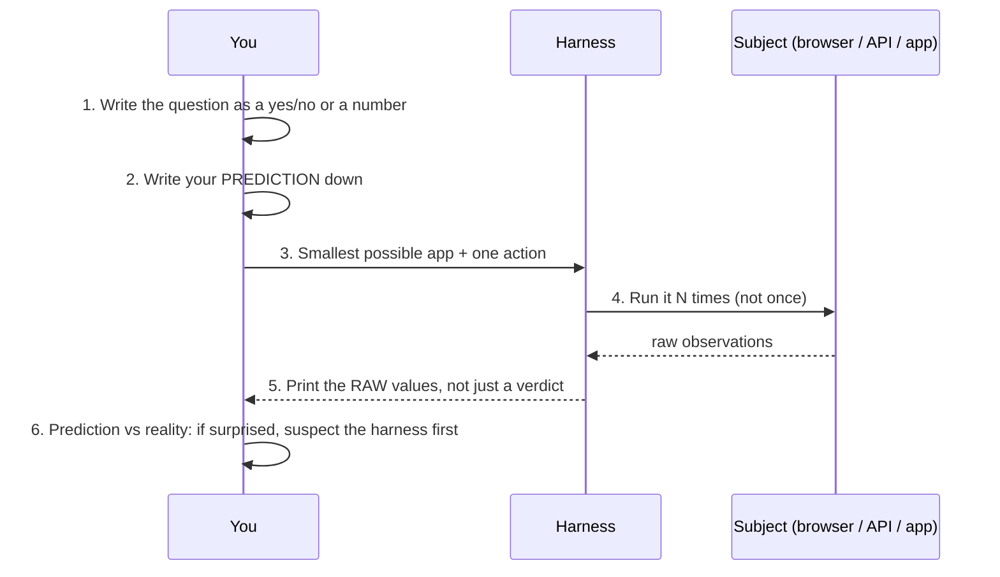

# Harness Guide — Answer Your Own Questions by Measuring

Sooner or later a chapter, a blog post or a colleague will tell you something about Playwright you're not sure is true. *"`fastForward` runs your intervals."* *"`page.route` mocks API calls."* *"This loop finds the row every time."* A senior engineer settles questions like that by **measuring**, not by debating. A **harness** is the small program that does the measuring.

This guide shows the method, then walks through the real mistakes made while building this labs folder. Every one of them produced a harness that confidently reported something false.

## The method



1. **One question, stated so it has an answer.** Not "how does the clock work?" but "with a 1-second `setInterval`, how many times does it fire under `fastForward(5000)` vs `runFor(5000)`?"
2. **Predict before you run.** Write the number down. A prediction you got wrong is the most valuable thing a harness can give you: it marks exactly where your mental model is broken.
3. **Smallest possible subject.** `page.setContent('<script>…</script>')` or a 20-line `node:http` server. Every extra moving part is somewhere for the bug to be in the *harness*, not the subject.
4. **Repeat it.** Timing-dependent behaviour can look deterministic on one run. Five runs is a minimum; for anything about flakiness, run it 50 times and report the distribution.
5. **Print raw observations.** `1, 1, 1, 1, 1` can't hide a broken harness. A bare `PASS` can.
6. **When the result surprises you, debug the harness first.** In practice the harness is wrong more often than Playwright is.

## A complete example

[`harness-examples/clock-fastforward-vs-runfor.mjs`](harness-examples/clock-fastforward-vs-runfor.mjs). Predict first, then run it:

```bash
node harness-examples/clock-fastforward-vs-runfor.mjs
```

It answers the question above in about 25 lines: install the fake clock, load a page with a 1-second interval, move time 5 seconds each way, and read the counter. Five runs each. Compare its output with what [Ch61 §3](../03_Real_World_Scenarios/61_Emulation_Clock_Network_And_Devices.md) says, and with your prediction.

## Five real harness bugs from building these labs

Each of these made a harness (or the grader itself) report something false. Each one also taught a rule.

### 1. The regex that silently lost its backslash

A consent-banner harness put a page script inside a JavaScript **template literal** so it could inject values. The script's regex contained `\w`. Inside a template literal `\w` isn't a recognised escape, so the backslash is silently dropped and the browser received `w`, a regex matching the letter w. The harness ran cleanly and reported that nothing matched.

**Rule:** when a harness says "0 found", first prove it *can* find something. Run it once against a case where you know the answer is "yes". Print the actual script or selector the browser received.

### 2. "Found after 2000 steps"

A scroll-until-found loop over a virtual grid had a step cap of 2000. One run reported the row "found", and the loop looked correct. Running it 26 times showed it failing about 40% of the time: the grid re-renders once per animation frame, and several scroll steps could land between two renders and skip past the row. ([Ch64 §6](../02_Test_Architecture/64_Dynamic_Locators_And_Data_Structures_In_POMs.md) has the measurement.)

**Rule:** a single success is not evidence of reliability. Repeat, count failures, and report *how* each run ended ("found at step 37" is a different outcome from "hit the cap").

### 3. The port Chromium refused

The grader started each app on port `0` (the OS picks a free port). One run the OS picked 1723, and Chromium refused to connect with `ERR_UNSAFE_PORT`: browsers block a list of ports used by other protocols. The failure *looked* like the learner's test failing on the correct app.

**Rule:** infrastructure flakes look exactly like subject flakes. Always log the raw error, and design the harness to rule itself out. The fix, in [`grader/app-kit.mjs`](grader/app-kit.mjs), is to pick from 20000–60000, which has no blocked ports, and retry if the port is busy.

### 4. The planted bug that only showed up half the time

Lab 02's "dismissing the banner breaks the cart" bug only happened if the banner appeared *before* the products finished loading. The banner's delay was random (200–900 ms) and the products took 300 ms, so the bug was real only about half the time. A perfect test would have been graded CAUGHT on one run and MISSED on the next. The grader's verdict was noise.

**Rule:** a harness that judges something must be deterministic about what it's judging. The fix made products take 1000 ms, so the banner always comes first and the bug always manifests. Then the reference solution was graded repeatedly to prove the verdict was stable.

### 5. The checker that flagged correct code

The grader warns about one-shot reads like `await locator.count()`, because they don't wait. Its first version flagged the *reference solution*: `expect.poll(async () => banner(page).count())`. Inside `expect.poll`, a one-shot read is exactly right, because the poll is the retry loop.

**Rule:** your checker can be wrong. When a check fires, confirm which side is wrong before "fixing" the subject. The fix was to judge each line on its own and exempt lines that run inside `expect.poll`, `toPass` or `waitForFunction`.

## Harness bug or subject bug? A quick triage

| Symptom | Suspect the harness when… | Suspect the subject when… |
| --- | --- | --- |
| "0 found" / "never happened" | you never proved it can report "found" | a known-positive control case *is* found |
| Passes once, fails sometimes | the harness has timers, random delays, shared state or a fixed port | the harness is deterministic and the subject has async work |
| Error mentions ports, `ECONNREFUSED`, `ERR_*` | always, until proven otherwise | never, first |
| Result contradicts the docs | you changed two things at once | a minimal repro still contradicts them (then check the version) |

## How the grader works — read it, then copy the shape

- **One app file, many variants.** Each `app/server.mjs` exports `start({ variant, port })`. Every planted bug is a `bug('bug-id')` switch in otherwise-correct code, so the correct app and the buggy ones can't drift apart.
- **The grader** ([`grader/grade.mjs`](grader/grade.mjs)) imports the app in-process, starts a variant on a random port, runs the Playwright CLI against it with `LAB_BASE_URL` set and the JSON reporter on, and reads the stats. It runs the correct app `goodRepeat` times, which must pass every time, and each bug once, which must fail at least one test.
- **Hints and debriefs** live in each lab's `lab.json` next to the bug ids, so adding a lab means writing an app, a `lab.json` and a README. The grader doesn't change.

This is **mutation testing** done by hand: instead of a tool mutating code automatically ([Ch53](../07_Specialised_Testing/53_Mutation_Testing_With_Stryker.md)), a person plants the mistakes a real developer would make. The question it answers is the one that matters: *would these tests have caught that?*

## Your turn — questions worth a harness

Pick one, **write your prediction down**, build the smallest harness that answers it, run it at least 5 times, and print raw values:

1. A `page.route('**/api/**')` handler is registered. The page calls `fetch('/api/x')`, and the test calls `page.request.get('/api/x')`. How many times does the handler run?
2. `expect(locator).toHaveText('Done')`: the element is **replaced** by a new element with the same selector halfway through the wait. Does the assertion still pass?
3. A `setTimeout(fn, 10_000)` inside the page, with `page.clock.install()` then `page.clock.fastForward(20_000)`. Does `fn` run? Does it run if the timer was created *before* `install()`?
4. Your own: find a sentence in any chapter you're not 100% sure about, and measure it. If the chapter is wrong, that's a real contribution: fix it.
