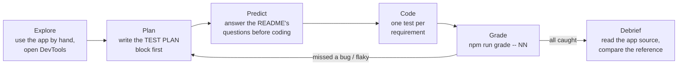

# Labs — Build It Yourself

The chapters teach you how Playwright works. The labs are where **you** do the work: think it through, plan the tests, write them, and find out whether they actually catch bugs.

Each lab is a small, real app with a mission and a list of requirements. You write the tests. Then the **grader** runs your tests against the correct app **and** against several broken versions, each with one bug planted in it. It's a straightforward check of test quality:

- Your tests must **pass** on the correct app, several times in a row (a test that passes only sometimes is flaky, and flaky tests are bugs).
- Your tests must **fail** on every broken version. A bug your tests don't catch is a bug that ships.

You don't get told what the bugs are. If you miss one, you get a hint pointing at the requirement you didn't really test. Once you catch them all, you get a debrief explaining each bug.

## The loop — every lab, every time



**How to read this diagram.** Read it left to right as the lab loop: Explore the app by hand, Plan the TEST PLAN block, Predict by answering the README's questions, Code one test per requirement, then Grade with `npm run grade`. Notice the two exits from Grade: a missed bug or flaky test sends you back to Plan, and only when all bugs are caught do you reach Debrief.

The **Plan** and **Predict** steps aren't optional extras. Writing *"R3: after a decline, the Pay button must be enabled again"* before you code is what makes you realise you have to test the decline *and* what happens after it. Predicting *"`textContent()` straight after the click will return an empty string"* and then being right (or wrong) is how auto-waiting sticks.

## Setup (once)

```bash
cd 21_SDET_Playwright_Automation/labs
npm install
npx playwright install chromium
```

## Commands

| Command | What it does |
| --- | --- |
| `npm run app -- 03` | Serve Lab 03's app on <http://localhost:4400> so you can explore it by hand. |
| `npx playwright test 03-checkout` | Run your tests against that running app (a second terminal). Add `--ui` to watch them. |
| `npm run grade -- 03` | Grade your tests: correct app × N runs, then every planted bug. Starts its own servers. |
| `npm run typecheck` | Strict TypeScript check of every lab's tests. |

## The labs

Do them in order. Each one assumes the skills of the ones before it.

| Lab | You'll practise | Bugs to catch | Read first |
| --- | --- | --- | --- |
| [01 — First Contact](01-first-contact/README.md) | Locators, auto-waiting, precise assertions on a slow page | 4 | Ch01, Ch02, Ch55 |
| [02 — Cookie Consent](02-cookie-consent/README.md) | Asserting on network traffic, state across reloads, `addLocatorHandler` for overlays that appear at random | 4 | Ch68 |
| [03 — Checkout](03-checkout/README.md) | Cross-origin card iframes, double-click protection, declines, money in minor units, back-office checks | 4 | Ch67 |
| [04 — Webhook Receiver](04-webhook-receiver/README.md) | Pure API testing: implement HMAC signing from a spec; replays, duplicates, out-of-order events | 5 | Ch67 §6 |
| [05 — OTP Login](05-otp-login/README.md) | Test-support endpoints, rules the UI hides, whose clock controls expiry | 5 | Ch57 §6.2, Ch61 §3 |
| [06 — Virtual Grid](06-virtual-grid/README.md) | 10,000 rows that mostly aren't in the DOM; the API as an independent oracle | 4 | Ch64 §6 |

## House rules

1. **Don't open `app/server.mjs` or `_solutions/` until you've graded.** The app is a black box, just like a real product. You learn about it the way you would at work: using it, reading the requirements, watching the network.
2. **No `waitForTimeout`, no `force: true`, no `test.only`/`test.skip`.** The grader rejects the last two and flags the first two. If you reach for a sleep, ask what you're actually waiting *for* and wait for that.
3. **When the correct app fails your test, your test is wrong.** Read the grader's output (it shows the assertion that failed and any risky patterns it spotted in your code), then open the trace: `npx playwright show-trace test-results/<test>/trace.zip`.
4. **When you finish:** `npm run grade -- 03 --solution` shows the reference solution passing. Read it *after* you pass, and compare your choices with it. It's one good answer, not the only one.

## Build your own harness

The grader is about 200 lines of plain Node. Once you've done a few labs, read [HARNESS_GUIDE.md](HARNESS_GUIDE.md). It covers how this one was built, the mistakes it made along the way, and how to build the same kind of harness to answer your own questions about Playwright.
