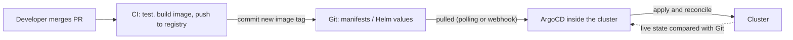
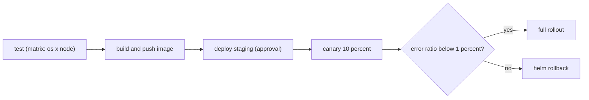

> **Navigation**: [← Fundamentals](00_DevOps_Fundamentals.md) | [Index](00_INDEX.md) | [Networking →](02_Networking_Security.md)

# 🚀 DevOps Advanced — IaC, GitOps, Observability & Production Patterns

> _"Junior DevOps: 'I deployed it manually and it works.' Senior DevOps: 'If I can't reproduce this deployment from code in under 5 minutes, it's not ready for production.'"_

---

# PART 0: The Evolution of Deployment

```
ERA 1 — THE BARE METAL AGE (1990s-2000s):
  Buy servers. Rack them. Install OS. SSH in. Deploy manually.
  Months to get a new server. Config drift everywhere.
  When server dies → panic. Rebuild from memory. Takes days.
  ANALOGY: Building a house brick by brick. Each house is unique.

ERA 2 — VIRTUALIZATION (2000s-2010s):
  VMware, VirtualBox. One physical → many virtual machines.
  Faster provisioning (~hours). But still snowflake configs.
  Chef, Puppet, Ansible emerge for config management.
  ANALOGY: Mass-producing house blueprints. Still building each one.

ERA 3 — CLOUD + CONTAINERS (2010s-2020s):
  AWS/GCP/Azure + Docker. Spin up in seconds. Immutable infra.
  Kubernetes orchestrates thousands of containers automatically.
  Terraform manages cloud infrastructure AS CODE (declarative).
  ANALOGY: Ordering pre-built modular homes from a catalog.

ERA 4 — PLATFORM ENGINEERING (2020s-present):
  Internal Developer Platforms. Developers self-serve deployments.
  GitOps (ArgoCD, Flux). Everything in Git — pull request to deploy.
  Service meshes (Istio, Linkerd). Observability (OpenTelemetry).
  Serverless on K8s (Knative). AI-assisted incident response.
  ANALOGY: A city with smart infrastructure — water, power, roads
  all managed automatically. Residents just move in.
```

---

### Each era exists because of the previous era's pain

| Era | The pain it removed | The new pain it created |
| --- | --- | --- |
| Bare metal | none: you owned everything | weeks to get a server; every server a unique snowflake; rebuild from memory |
| Virtualisation + config management (Chef/Puppet 2005, Ansible 2012) | provisioning in hours, repeatable OS configuration | drift: a server patched by hand diverges from its playbook; images and playbooks go stale |
| Cloud + IaC + containers (AWS 2006, Docker 2013, Terraform 2014, Kubernetes 2014) | minutes to provision, the environment is code, an image is the same everywhere | too many moving parts per team; YAML and cloud-specific detail leaked into every product team |
| Platform engineering + GitOps | one paved path; deploys are pull requests; the cluster converges to Git | the platform becomes its own product that needs owners, roadmaps and users |

The dates are first public releases; the pattern is the point: **no era replaced the previous one's tools, it added a layer on top**. A production system today still has an OS to patch, a VM or node to size, a network to design. Anyone who says "serverless means no ops" has moved the ops somewhere they cannot see it.

A useful test of whether a deployment process is "advanced": can you answer, for the thing currently in production, *what exact commit built it, who approved it, and how do I get back to the previous version in minutes?* If any answer is "ask someone", the rest of the chapter is how to fix that.

🔬 **Section Challenge — Mutable vs immutable**

**Challenge 1 (Reasoning):** A team patches production servers over SSH ("mutable") and has a nightly Ansible run that fixes drift. A second team bakes a new machine image per release and replaces servers ("immutable"). Name one failure the first approach tolerates silently and one cost of the second.

<details><summary>Answer</summary>

Mutable: if an engineer hot-fixes a config on one of 20 servers and forgets to update the playbook, nothing fails until the nightly run overwrites the fix (or never, if the run is skipped), so production behaviour depends on the history of manual commands rather than on version control; a rebuilt server then behaves differently from its siblings. Immutable: every change requires a new image build and rollout, so a one-line fix takes as long as your pipeline (minutes to an hour), you need image storage and a fast, reliable pipeline, and stateful data must live outside the replaced server (volumes, managed databases), which forces that design discipline. The trade is slower hot-fixes for reproducibility and trivial rollback (re-deploy the previous image).

</details>

---

# PART 1: Infrastructure as Code (Terraform)

---

```
WHAT IS IAC?
  Managing infrastructure (servers, databases, networks, DNS, load balancers)
  through DECLARATIVE CODE, not manual UI clicks.

  ANALOGY: Ordering at a restaurant.
  IMPERATIVE: "Take flour. Mix with water. Knead for 10 min. Roll flat..."
  DECLARATIVE: "I'd like a margherita pizza, please."

  Terraform = you describe WHAT you want (a pizza).
  Terraform figures out HOW to create/update it.

THE TERRAFORM WORKFLOW:
  1. WRITE: Define desired infrastructure in .tf files (HCL language)
  2. PLAN:  terraform plan → shows what will change (dry run!)
  3. APPLY: terraform apply → makes it real
  4. DESTROY: terraform destroy → tears it all down

STATE FILE (terraform.tfstate):
  Terraform stores the current state of your infrastructure.
  CRUCIAL: This file is the source of truth. If lost → Terraform
  doesn't know what exists. Use REMOTE STATE (S3, GCS) in production!

HOW TERRAFORM DIFFERS FROM ANSIBLE:
  Terraform: INFRASTRUCTURE — creates servers, networks, databases.
             Declarative. Tracks state. (Often used to replace rather than patch: the 'immutable' style.)
  Ansible:   CONFIGURATION — installs software, configures OS settings.
             Procedural steps. No state. Mutable.
  Often used TOGETHER: Terraform creates VMs, Ansible configures them.
```

```hcl
# ── TERRAFORM EXAMPLE: AWS web server + database ──

terraform {
  required_version = ">= 1.6"
  required_providers {
    aws = {
      source  = "hashicorp/aws"
      version = "~> 5.0"          # pin a major version so `init` does not jump you to a breaking release
    }
  }
}

# Provider: which cloud to talk to
provider "aws" {
  region = "us-east-1"
}

# VPC (Virtual Private Cloud — your own network in the cloud)
resource "aws_vpc" "main" {
  cidr_block           = "10.0.0.0/16"    # 10.0.0.0 - 10.0.255.255 (65,536 IPs)
  enable_dns_hostnames = true

  tags = { Name = "production-vpc" }
}

# Subnet (a subdivision of the VPC)
resource "aws_subnet" "public" {
  vpc_id                  = aws_vpc.main.id    # reference VPC above
  cidr_block              = "10.0.1.0/24"      # 256 addresses (AWS reserves 5, so 251 usable)
  availability_zone       = "us-east-1a"
  map_public_ip_on_launch = true

  tags = { Name = "public-subnet" }
}

# A "public" subnet is only public if it ROUTES to an internet gateway.
# Without these three resources the instance gets a public IP but is unreachable.
resource "aws_internet_gateway" "gw" {
  vpc_id = aws_vpc.main.id
}

resource "aws_route_table" "public" {
  vpc_id = aws_vpc.main.id

  route {
    cidr_block = "0.0.0.0/0"
    gateway_id = aws_internet_gateway.gw.id
  }
}

resource "aws_route_table_association" "public" {
  subnet_id      = aws_subnet.public.id
  route_table_id = aws_route_table.public.id
}

# Two PRIVATE subnets in different AZs: RDS requires a subnet group spanning at least two AZs
resource "aws_subnet" "private_a" {
  vpc_id            = aws_vpc.main.id
  cidr_block        = "10.0.10.0/24"
  availability_zone = "us-east-1a"
  tags              = { Name = "private-a" }
}

resource "aws_subnet" "private_b" {
  vpc_id            = aws_vpc.main.id
  cidr_block        = "10.0.11.0/24"
  availability_zone = "us-east-1b"
  tags              = { Name = "private-b" }
}

resource "aws_db_subnet_group" "db" {
  name       = "app-db"
  subnet_ids = [aws_subnet.private_a.id, aws_subnet.private_b.id]
}

# Security Group (firewall rules)
resource "aws_security_group" "web" {
  vpc_id = aws_vpc.main.id

  # Allow HTTP from anywhere
  ingress {
    from_port   = 80
    to_port     = 80
    protocol    = "tcp"
    cidr_blocks = ["0.0.0.0/0"]
  }

  # Allow HTTPS from anywhere
  ingress {
    from_port   = 443
    to_port     = 443
    protocol    = "tcp"
    cidr_blocks = ["0.0.0.0/0"]
  }

  # Allow all outbound
  egress {
    from_port   = 0
    to_port     = 0
    protocol    = "-1"
    cidr_blocks = ["0.0.0.0/0"]
  }
}

# Only the web tier may reach the database, on the PostgreSQL port
resource "aws_security_group" "db" {
  vpc_id = aws_vpc.main.id

  ingress {
    from_port       = 5432
    to_port         = 5432
    protocol        = "tcp"
    security_groups = [aws_security_group.web.id]   # reference a group, not an IP range
  }
}

# Look up the CURRENT Amazon Linux 2023 image instead of hard-coding an AMI id
# (AMI ids are per-region and go stale; Amazon Linux 2's published end-of-support date is 2026-06-30)
data "aws_ssm_parameter" "al2023" {
  name = "/aws/service/ami-amazon-linux-latest/al2023-ami-kernel-default-x86_64"
}

# EC2 Instance (virtual server)
resource "aws_instance" "web" {
  ami                    = data.aws_ssm_parameter.al2023.value
  instance_type          = "t3.medium"               # 2 vCPU, 4GB RAM
  subnet_id              = aws_subnet.public.id
  vpc_security_group_ids = [aws_security_group.web.id]

  user_data = <<-EOF
    #!/bin/bash
    dnf install -y docker
    systemctl enable --now docker
    docker run -d -p 80:8080 myorg/myapp:3.5.1      # pin a version: ":latest" makes rollbacks and audits impossible
  EOF

  tags = { Name = "web-server", Environment = "production" }
}

# RDS Database
resource "aws_db_instance" "postgres" {
  engine                      = "postgres"
  engine_version              = "16"                # a major version; check `aws rds describe-db-engine-versions` for supported minors
  instance_class              = "db.t3.medium"
  allocated_storage           = 100
  storage_encrypted           = true
  db_name                     = "myapp"
  username                    = var.db_username
  manage_master_user_password = true                # RDS stores/rotates the password in Secrets Manager: it never enters your .tf or state
  db_subnet_group_name        = aws_db_subnet_group.db.name
  vpc_security_group_ids      = [aws_security_group.db.id]
  skip_final_snapshot         = false
  final_snapshot_identifier   = "myapp-final"       # required when skip_final_snapshot = false
  multi_az                    = true                # high-availability!
}

# VARIABLES — parameterize everything (a block with 2+ arguments must be multi-line, as below)
variable "db_username" {
  type = string
}

# OUTPUTS — show useful info after apply
output "web_server_ip" { value = aws_instance.web.public_ip }
output "db_endpoint"   { value = aws_db_instance.postgres.endpoint }
```

---

### What the Terraform example gets wrong, and how Terraform actually works

I could not run `terraform` here (no binary in my sandbox and no cloud account), so the corrected HCL above is **not verified by `terraform validate`**; I checked it against the provider documentation and by reading. The original `variable "db_password" { type = string, sensitive = true }` is invalid HCL by the language rules (a block written on one line may hold only one argument), so I rewrote it on separate lines; I could not confirm the parser's error message without the binary. Other defects fixed above:

| Defect in the original | Consequence | Fix |
| --- | --- | --- |
| No internet gateway or route table | the "public" instance has a public IP but no path to the internet | `aws_internet_gateway` + route to it + association |
| RDS without a subnet group or security group | lands in the default VPC, not the one defined above; RDS also needs subnets in at least two AZs | `aws_db_subnet_group` over two private subnets, plus a DB security group that allows 5432 only from the web group |
| Hard-coded AMI `ami-0c55b159cbfafe1f0` (Amazon Linux 2) | AMI ids are per region and age out; Amazon Linux 2's published end-of-support date is 30 June 2026 (confirm on AWS's page) | `aws_ssm_parameter` for the latest Amazon Linux 2023 image |
| `password = var.db_password` with `sensitive = true` | `sensitive` hides the value in CLI output only; it is still written **in plain text to the state file** | `manage_master_user_password = true` so RDS keeps the secret in Secrets Manager |
| `engine_version = "15.4"` | specific minors are retired by AWS over time and then `apply` fails | use a major version or look up supported versions |
| `docker pull myapp:latest` | an unversioned deploy cannot be reproduced or rolled back | pin the tag |
| No `required_providers` / version | `terraform init` can pull a new major provider version and change behaviour | pin with `~> 5.0` |

**How a plan is produced.** Terraform builds a dependency graph from the references between resources (`aws_vpc.main.id` makes the subnet depend on the VPC), reads the **state file** to learn what it created before, queries the real infrastructure to refresh that picture, and diffs *desired (your .tf) against actual*. `terraform plan` prints that diff as `+` create, `~` update in place, `-/+` replace (destroy and recreate), `-` destroy. Learn to look for the `-/+`: it means downtime or data loss for that resource, and a change to an immutable attribute (such as the subnet of an instance) triggers it. `apply` walks the graph in order, in parallel where independent, and writes the new state after each resource. Because state is how Terraform knows what it owns:

- Keep it in a **remote backend with locking** (S3 with a lock mechanism, GCS, Terraform Cloud) so two people cannot apply at once and the file survives a laptop. Never commit it to Git: it can contain secrets.
- **Drift** (someone edits a resource in the console) shows up in the next plan as a diff Terraform wants to revert. Decide per case: revert, or update the code to match.
- Put `lifecycle { prevent_destroy = true }` on resources whose loss is catastrophic (databases); it turns an accidental `destroy` into an error.
- Splitting one giant state into several (per environment and per layer: network, data, apps) limits blast radius and plan time, at the cost of cross-state references.

**Alternatives.** HashiCorp changed Terraform's licence from MPL to the Business Source License in August 2023; the community forked the last open version as **OpenTofu** (Linux Foundation), which is largely drop-in compatible; check your organisation's licence stance. **Pulumi** and the **AWS CDK** express infrastructure in general-purpose languages (loops, tests, types) at the cost of a heavier toolchain; **CloudFormation** is AWS-only with built-in rollback and no state file to manage; **Crossplane** manages cloud resources through the Kubernetes API (reconciled continuously). Chapter 20 ([Terraform & IaC](20_Terraform_IaC.md)) has the full comparison and state mechanics.

**When not to reach for IaC:** a one-off experiment you will delete in an hour (use the console or CLI, then tear down), or resources that are created and mutated by something else (a Kubernetes controller creating load balancers): managing the same object from two systems produces a permanent fight over drift.

🔬 **Section Challenge — Terraform state and plans**

**Challenge 1 (Debugging):** `terraform plan` shows `aws_db_instance.postgres must be replaced` (`-/+`) after someone changed `db_name` from `myapp` to `app`. What does `apply` do, and how do you avoid data loss?

<details><summary>Answer</summary>

`db_name` is an attribute that cannot be changed on a running instance, so Terraform plans to destroy the database and create a new, empty one. Applying that would delete the production data (a final snapshot is taken only because `skip_final_snapshot = false`, and restoring it is manual). To avoid it: revert the code change; or if the rename is really needed, create a new database, migrate data with a dump/restore or replication, switch the application over, and only then remove the old one; add `lifecycle { prevent_destroy = true }` so the plan itself errors. Make reviewers read the plan summary line (`1 to add, 0 to change, 1 to destroy`), not just the diff of the .tf file.

</details>

**Challenge 2 (Security):** A teammate hides the DB password with `sensitive = true` and says "it is not in the logs, so it is safe". What is still exposed, and where?

<details><summary>Answer</summary>

The value is stored in clear text in `terraform.tfstate` (local or remote), in saved plan files, and potentially in CI logs if a provider echoes it. Anyone who can read the state bucket can read the password. Protect the state (encrypted backend, tight access control, no commits to Git) and prefer not to pass the secret through Terraform at all: use `manage_master_user_password` (RDS + Secrets Manager), or reference a secret by ARN and let the application fetch it at runtime.

</details>

---

# PART 2: Advanced Kubernetes — Production Patterns

---

```
BEYOND BASIC K8s (from the fundamentals guide):
  You know: Pods, Deployments, Services, HPA.
  Now: Rolling vs Canary vs Blue/Green, Helm charts, Ingress, ConfigMaps/Secrets.

DEPLOYMENT STRATEGIES:

1. ROLLING UPDATE (default — safe and gradual):
   Replace old pods with new ones GRADUALLY (how many at once is set by maxSurge/maxUnavailable; defaults 25%/25%).
   At no point is the app completely down, but OLD AND NEW VERSIONS RUN TOGETHER for a while.

   ANALOGY: Renovating rooms in a hotel while guests are staying.
   Room 1 closed for renovation → Room 2 still serving guests.
   Room 1 reopens (new version) → Room 2 closes for renovation.

   maxSurge: how many EXTRA pods during update (temporary capacity)
   maxUnavailable: how many pods can be DOWN simultaneously

2. CANARY DEPLOYMENT (gradual risk reduction):
   Deploy new version to a SMALL % of pods (5-10%). With a plain Service the percentage is just the pod ratio;
   exact weights need an ingress/mesh or a rollout controller (Argo Rollouts, Flagger).
   Monitor errors, latency, and metrics.
   If healthy → gradually increase to 100%.
   If broken → rollback instantly (only 5% of users affected).

   ANALOGY: Canary in a coal mine.
   Send one canary (new version) down the mine (production).
   If canary dies (high errors) → don't send miners (full rollout).

3. BLUE/GREEN (instant switchover):
   Run TWO identical environments: Blue (current) and Green (new).
   Green is fully tested. When ready → switch ALL traffic from Blue to Green.
   If Green fails → switch back to Blue instantly (still running!).

   COST: Double infrastructure during deployment. But zero downtime.
```

```yaml
# ── HELM CHART STRUCTURE ──
# Helm = package manager for Kubernetes
# Chart = a package of K8s manifests (YAML templates)

# Chart.yaml (metadata)
apiVersion: v2
name: myapp
version: 1.2.0
appVersion: "3.5.1"
description: My production application

# values.yaml (default configuration — can be overridden per environment)
replicaCount: 3
image:
  repository: myorg/myapp
  tag: "3.5.1"
  pullPolicy: IfNotPresent
resources:
  requests:
    cpu: 250m       # 0.25 CPU cores
    memory: 256Mi
  limits:
    cpu: 500m
    memory: 512Mi
service:
  type: ClusterIP
  port: 8080
ingress:
  enabled: true
  host: api.myapp.com
  tls: true
env:
  # DATABASE_URL is a SECRET: never put it in values.yaml (it lands in Git and in `helm get values`).
  # It is injected from a Secret via secretKeyRef in the Deployment template below.
  REDIS_URL: "redis://cache:6379"
  LOG_LEVEL: "info"

---
# templates/deployment.yaml (using Go templating)
apiVersion: apps/v1
kind: Deployment
metadata:
  name: {{ .Release.Name }}          # .Release.Name, not .Chart.Name: two releases of one chart must not collide
spec:
  replicas: {{ .Values.replicaCount }}
  selector:                          # REQUIRED by apps/v1, and immutable once created
    matchLabels:
      app: {{ .Release.Name }}
  strategy:
    type: RollingUpdate
    rollingUpdate:
      maxSurge: 1
      maxUnavailable: 0        # never below the desired count (needs a readiness probe to mean anything)
  template:
    metadata:
      labels:
        app: {{ .Release.Name }}     # must match spec.selector.matchLabels
    spec:
      containers:
      - name: {{ .Chart.Name }}
        image: "{{ .Values.image.repository }}:{{ .Values.image.tag }}"
        ports:
        - containerPort: {{ .Values.service.port }}
        resources: {{ toYaml .Values.resources | nindent 10 }}

        # Health checks — K8s knows when your app is healthy
        livenessProbe:           # Is the container alive?
          httpGet:
            path: /healthz
            port: {{ .Values.service.port }}
          initialDelaySeconds: 15
          periodSeconds: 20

        readinessProbe:          # Is the container READY to receive traffic?
          httpGet:
            path: /ready
            port: {{ .Values.service.port }}
          initialDelaySeconds: 5
          periodSeconds: 10

        env:
        - name: DATABASE_URL
          valueFrom:
            secretKeyRef:
              name: {{ .Release.Name }}-db      # Secret managed outside the chart (Sealed Secrets / External Secrets)
              key: url
        {{- range $key, $value := .Values.env }}
        - name: {{ $key }}
          value: {{ $value | quote }}
        {{- end }}

---
# templates/ingress.yaml (route external traffic to your service)
{{- if .Values.ingress.enabled }}
apiVersion: networking.k8s.io/v1
kind: Ingress
metadata:
  name: {{ .Release.Name }}-ingress
  annotations:
    cert-manager.io/cluster-issuer: letsencrypt-prod   # auto TLS!
spec:
  ingressClassName: nginx            # which controller serves this Ingress (see Chapter 18 on the ingress-nginx retirement)
  tls:
  - hosts:
    - {{ .Values.ingress.host }}
    secretName: {{ .Release.Name }}-tls
  rules:
  - host: {{ .Values.ingress.host }}
    http:
      paths:
      - path: /
        pathType: Prefix
        backend:
          service:
            name: {{ .Release.Name }}
            port:
              number: {{ .Values.service.port }}
{{- end }}
```

```bash
# Helm commands
helm install myapp ./charts/myapp                     # install
helm upgrade myapp ./charts/myapp --set replicaCount=5 # scale
helm rollback myapp 1                                  # rollback to revision 1
helm list                                              # see all releases
helm template myapp ./charts/myapp                    # render locally, no cluster needed (run this in CI)
helm upgrade --install myapp ./charts/myapp           # idempotent form for pipelines
```

---

### Choosing a deployment strategy, and what the Helm chart was missing

| Strategy | How traffic moves | Rollback speed | Extra cost | Hard part |
| --- | --- | --- | --- | --- |
| Rolling (default) | pods replaced gradually, governed by `maxSurge` / `maxUnavailable` (defaults 25% / 25%, not "one at a time") | slow: another rolling update back | little | old and new versions run **together**, so they must be compatible with the same database schema and the same clients |
| Canary | small share of real traffic to the new version, increased while metrics stay healthy | fast: send 0% | little, but needs traffic splitting and metric analysis | with plain Kubernetes Services the "percentage" is just the **pod ratio** (1 canary pod of 10 = ~10%); precise weights need an ingress/mesh or a controller such as Argo Rollouts or Flagger |
| Blue/green | two full environments, switch the router | instant: switch back | double capacity during the switch | stateful data (the DB cannot be duplicated), and long-lived connections on the old side |

Because rolling and canary strategies run two versions at once, **database migrations must be backward compatible** (the *expand then contract* pattern): add the new column nullable and deploy code that writes both, backfill, deploy code that reads the new column, and only in a later release drop the old column. Breaking this rule is the usual cause of "the deploy succeeded and the old pods are throwing errors".

The Helm chart above would not install as written. Defects and fixes:

- The Deployment had **no `spec.selector` and no pod labels**; `apps/v1` requires them, and they must match each other. Add `selector.matchLabels.app: {{ .Release.Name }}` and the same label under `template.metadata.labels`.
- The Ingress points at a Service that the chart **never creates**; add `templates/service.yaml` (below).
- Names built from `.Chart.Name` collide when two releases of the same chart share a namespace; use `.Release.Name` (or a `fullname` helper).
- `DATABASE_URL: "postgresql://user:pass@db:5432/myapp"` in `values.yaml` puts a **password in Git** and in every `helm get values` output. Pass secrets by reference (`valueFrom.secretKeyRef`) from an externally managed Secret.
- Add `ingressClassName` to the Ingress, as in [Chapter 18](18_Kubernetes_Complete.md).

```yaml
# templates/service.yaml
apiVersion: v1
kind: Service
metadata:
  name: {{ .Release.Name }}
spec:
  type: {{ .Values.service.type }}
  selector:
    app: {{ .Release.Name }}
  ports:
    - port: {{ .Values.service.port }}
      targetPort: {{ .Values.service.port }}
```

`helm template` renders the YAML locally without touching a cluster (it is the check to run in CI, together with a schema validator such as `kubeconform`); `helm install --dry-run` also contacts the API server to validate. `helm upgrade --install` is the idempotent form for pipelines. I did not have the `helm` binary available here, so the template syntax above is **not rendered or verified**; render it before you trust it.

🔬 **Section Challenge — Deployment strategies**

**Challenge 1 (Design):** A release renames a database column. Which deployment strategy would you use, and what must be true about the schema change for a rolling update to be safe?

<details><summary>Answer</summary>

Rolling or canary is fine **only if** the schema change is split across releases: (1) add the new column (nullable) and ship code that writes both columns and reads the old one; (2) backfill existing rows; (3) ship code that reads the new column; (4) in a later release, stop writing the old column and then drop it. At every step both the previous and the next application version work against the current schema. A one-step rename breaks whichever version is not the one that matches the schema during the overlap, and blue/green does not rescue you because both colours share the one database. If the change cannot be made compatible, schedule a maintenance window and deploy with the `Recreate` strategy.

</details>

**Challenge 2 (Debugging):** `helm install` fails with `Deployment.apps "myapp" is invalid: spec.selector: Required value`. What is wrong and what is the invariant you must keep afterwards?

<details><summary>Answer</summary>

The Deployment template has no `selector`. Add `selector.matchLabels` and the same labels in `template.metadata.labels`. The invariant: the selector must match the pod template's labels, and the selector of an existing Deployment is **immutable**, so choose labels you will never change (an app name, not a version), or you will need to delete and recreate the Deployment. The Service selector must also match those pod labels, otherwise the Service has no endpoints.

</details>

---

# PART 3: GitOps — Git as the Single Source of Truth

---

```
WHAT IS GITOPS?
  Everything about your infrastructure and deployments lives IN GIT.

  TRADITIONAL: Developer pushes code → CI builds image → CI PUSHES to K8s
  GITOPS:      Developer pushes code → CI builds image → CI updates Git manifest
               → ArgoCD PULLS from Git → ArgoCD deploys to K8s

  KEY DIFFERENCE:
  Traditional = CI system has kubectl access (security risk!)
  GitOps      = Only ArgoCD has cluster access. CI just pushes to Git.

  BENEFITS:
  ✓ Full audit trail: every deployment is a Git commit
  ✓ Rollback = git revert (not "type kubectl rollback and pray")
  ✓ Pull Request = deployment review (team reviews infra changes)
  ✓ Self-healing: if someone manually changes K8s, ArgoCD reverts it (only with syncPolicy.automated.selfHeal: true)!
  ✓ Declarative: Git repo describes desired state → ArgoCD enforces it

  TOOLS: ArgoCD (most popular), Flux (CNCF), Jenkins X

ARGOCD WORKFLOW:
  1. Developer merges PR to main branch
  2. CI pipeline builds Docker image, pushes to registry
  3. CI updates Helm chart version in a separate "gitops" repo
  4. ArgoCD watches gitops repo (polls every 3 min by default, or a webhook for instant)
  5. ArgoCD detects drift: Git says v3.5.1, cluster has v3.5.0
  6. ArgoCD syncs: applies new manifests to K8s cluster
  7. Health checks pass → deployment complete!
  8. If failing → ArgoCD shows "Degraded" in dashboard → alert fires
```

---

### GitOps in one diagram, and the setting that makes "self-healing" true



**How to read this diagram.** Follow the solid arrows left to right: code is merged, CI builds an image and then only *writes a commit* to the manifest repository; the agent running **inside** the cluster pulls that commit and applies it. The dotted arrow is the loop that makes it GitOps rather than just "YAML in Git": the agent keeps comparing the live cluster with Git. Notice what is missing: there is no arrow from CI to the cluster, so CI never holds cluster credentials, and the set of people who can change production is exactly the set who can merge to the manifest repository.

Two corrections to the text above. ArgoCD **polls the repository every 3 minutes by default** (a webhook makes it immediate), and a new `Application` does **not** sync automatically: you must enable it, and "if someone manually changes K8s, ArgoCD reverts it" is only true with `selfHeal` on:

```yaml
apiVersion: argoproj.io/v1alpha1
kind: Application
metadata:
  name: myapp
  namespace: argocd
spec:
  project: default
  source:
    repoURL: https://github.com/myorg/gitops-manifests
    targetRevision: main
    path: apps/myapp/production
  destination:
    server: https://kubernetes.default.svc
    namespace: production
  syncPolicy:
    automated:
      prune: true       # delete cluster objects that were removed from Git
      selfHeal: true    # revert manual changes to the cluster
    syncOptions:
      - CreateNamespace=true
```

`prune: true` is powerful and dangerous: a typo that removes a directory from Git deletes the workloads in the cluster. Start with manual sync for production, add `prune` and `selfHeal` when you trust the repository structure and have branch protection on it. I validated the YAML syntax with PyYAML; the Application CRD fields come from the Argo CD documentation and were not applied to a cluster here.

**Failure modes you will meet:** the app is `OutOfSync` forever because a controller mutates a field (an HPA changing `replicas`, a webhook injecting a sidecar) and Argo keeps trying to revert it (fix with `ignoreDifferences`); secrets cannot live as plain manifests in Git (use Sealed Secrets, SOPS or External Secrets); a bad commit is rolled out to every environment at once if all environments track `main` (promote through separate directories or branches per environment); and the manifest repo and the application repo drifting so that nobody knows which commit of the app is running (record the app commit SHA in the manifest commit message or an annotation). Chapter 23 ([GitOps Deployments](23_GitOps_Deployments.md)) covers repository layouts and Flux.

🔬 **Section Challenge — GitOps**

**Challenge 1 (Incident):** An engineer scales a Deployment to 10 replicas with `kubectl scale` during an incident. Five minutes later it is back at 3. What happened, and what is the correct way to change replicas in a GitOps setup?

<details><summary>Answer</summary>

With `selfHeal: true` the agent detected that live state (10) differs from Git (3) and reverted it: working as designed. The correct emergency path is to change the value in Git (a PR with a fast-track review), or temporarily pause auto-sync for that application (`argocd app set myapp --sync-policy none`) with a note to re-enable it. If the replica count is meant to be controlled by an HPA, remove `replicas` from the manifest (and set `ignoreDifferences`) so Git and the autoscaler stop fighting.

</details>

---

# PART 4: Observability Stack — Beyond Basic Monitoring

---

```
THE THREE PILLARS OF OBSERVABILITY:

1. METRICS (Prometheus + Grafana):
   NUMBERS over time. "How many requests per second?"
   Gauge: current value (CPU 65%)
   Counter: cumulative (total_requests: 1,234,567)
   Histogram: distribution (request_duration_seconds)

   USE: Alerting, SLO dashboards, capacity planning.

2. LOGS (ELK Stack / Loki):
   EVENTS with context. "User 123 got 500 error on /api/orders"
   Structured logging (JSON): { "level": "error", "userId": 123, "path": "/api/orders" }

   USE: Debugging specific failures, audit trails, searching for patterns.

3. TRACES (Jaeger / OpenTelemetry):
   The JOURNEY of a single request across multiple services.
   Request → API Gateway → User Service → Database → Cache → Response
   Each step has timing: "DB query took 340ms of the total 500ms"

   USE: Finding WHERE the bottleneck is in a microservices chain.

OPENTELEMETRY (OTel) — THE UNIFIED STANDARD:
  Before OTel: Different libraries for metrics (Prometheus), traces (Jaeger), logs (Fluentd).
  After OTel:  ONE SDK, ONE standard, exports to ANY backend.

  You instrument your code ONCE with OTel. Then choose your backend:
  • Metrics → Prometheus / Datadog
  • Traces  → Jaeger / Zipkin / X-Ray
  • Logs    → Loki / CloudWatch / ELK

  ANALOGY: OTel = USB-C. One cable, all devices.
  Before: different charger for each phone brand.
  After:  one universal connector.

ALERTING BEST PRACTICES:
  ✗ DON'T alert on: CPU usage (normal fluctuations trigger noise)
  ✓ DO alert on: SLO breaches (error rate > 0.1% over 5 min)
  ✓ DO alert on: Burn rate (at this pace, we'll exhaust the error budget in 6 hours)

  ACTIONABLE ALERTS ONLY:
  If an alert fires, someone must be able to DO something about it.
  "Disk 85% full" → actionable (expand disk or clean up).
  "Memory 60%" → probably noise (60% is normal).
```

```python
# OPENTELEMETRY — Python instrumentation example

from opentelemetry import trace, metrics
from opentelemetry.sdk.trace import TracerProvider
from opentelemetry.sdk.resources import Resource
from opentelemetry.sdk.trace.export import BatchSpanProcessor
from opentelemetry.exporter.otlp.proto.grpc.trace_exporter import OTLPSpanExporter
from opentelemetry.instrumentation.fastapi import FastAPIInstrumentor
from opentelemetry.instrumentation.requests import RequestsInstrumentor

# Setup once at app startup
trace.set_tracer_provider(TracerProvider(resource=Resource.create({"service.name": "orders-api"})))   # else spans say unknown_service
trace.get_tracer_provider().add_span_processor(
    BatchSpanProcessor(OTLPSpanExporter(endpoint="http://otel-collector:4317"))
)

# Auto-instrument FastAPI (adds traces to all endpoints automatically!)
FastAPIInstrumentor().instrument_app(app)
RequestsInstrumentor().instrument()  # traces all HTTP client calls too

# Custom spans for business logic
tracer = trace.get_tracer("myapp.orders")

@app.post("/orders")
async def create_order(request: OrderRequest):
    with tracer.start_as_current_span("create-order") as span:
        span.set_attribute("order.customer_id", request.customer_id)
        span.set_attribute("order.total", request.total)

        with tracer.start_as_current_span("validate-inventory"):
            check_inventory(request.items)  # sub-span: isolated timing

        with tracer.start_as_current_span("process-payment"):
            charge_payment(request.payment_method)

        with tracer.start_as_current_span("save-to-db"):
            order = save_order(request)

        span.set_attribute("order.id", order.id)
        return order
# In Jaeger UI: see each sub-operation's timing visually!
# "validate-inventory took 20ms, process-payment took 150ms, save-to-db took 30ms"
```

---

### Observability: what this summary leaves out

This section is a summary; [Chapter 21](21_Monitoring_Observability.md) has the mechanics, measured PromQL and alert-rule tests. Three things worth knowing before you use the OpenTelemetry example above:

- Without a **`service.name` resource attribute**, every span arrives labelled `unknown_service:python`, and the trace UI cannot tell your services apart. Create the provider with `TracerProvider(resource=Resource.create({"service.name": "orders-api"}))` (import `Resource` from `opentelemetry.sdk.resources`). I did not run the OTel packages here, so treat the snippet as unverified.
- Auto-instrumentation creates spans per HTTP request; it does not know your business operations. The `start_as_current_span("process-payment")` calls are what turn "POST /orders took 500 ms" into "payment took 150 ms of it".
- The alerting guidance ("alert on SLO burn rate, not on CPU") is tested with `promtool` in Chapter 21: a fast-burn rule (14.4x over 1 hour and 5 minutes) pages quickly, and at an error rate exactly on budget neither alert fires.

🔬 **Section Challenge — Choosing what to alert on**

**Challenge 1 (Reasoning):** Your service has an SLO of 99.9% success over 30 days (budget: 0.1% of requests, equal to 43.2 minutes of total outage). A deploy raises the error rate to 2% for 20 minutes, then it is rolled back. How much of the monthly budget did it consume, would the "14.4x burn over 1 hour and 5 minutes" alert from Chapter 21 page anyone, and would a "CPU above 80%" alert have caught it?

<details><summary>Answer</summary>

Consumption: 2% errors for 20 minutes is `0.02 x 20 = 0.4` minutes of total-outage equivalent, out of 43.2, so about **0.9%** of the monthly budget (assuming steady traffic). The burn rate while it lasted was 2% / 0.1% = 20x. I replayed this with `promtool test rules` (90 clean minutes, then 20 minutes at 1,000 requests/min with 20 errors/min, then clean): the fast-burn alert **never fired**, because the 1-hour window averages only 0.67% over those 20 minutes, below the 1.44% (14.4 x 0.1%) threshold. That is the design working: a 20-minute blip that costs under 1% of the budget does not deserve a page. With the same error rate **sustained**, the test showed no alert 40 minutes in and a firing alert at 59 minutes in (the 1-hour average has to cross 1.44%), which is when it is really endangering the budget. A CPU alert would probably not fire either: failing requests are often cheaper than successful ones, so CPU can even drop during an error spike.

</details>

---

# PART 5: CI/CD Advanced Patterns

---

```yaml
# ── ADVANCED GITHUB ACTIONS PIPELINE ──
# Features: matrix builds, caching, environment gates, canary deployment

name: Production Pipeline
on:
  push:
    branches: [main]
  pull_request:
    branches: [main]

jobs:
  test:
    runs-on: ${{ matrix.os }}          # the matrix axis must actually be used, or Windows is never tested
    strategy:
      matrix:
        node-version: [22, 24] # supported LTS lines (Node 18/20 are end-of-life by late 2026)
        os: [ubuntu-latest, windows-latest]
    steps:
      - uses: actions/checkout@v4

      - uses: actions/setup-node@v4
        with:
          node-version: ${{ matrix.node-version }}
          cache: "npm" # cache node_modules!

      - run: npm ci
      - run: npm run lint
      - run: npm run test -- --coverage

      - uses: actions/upload-artifact@v4
        with:
          name: coverage-${{ matrix.os }}-${{ matrix.node-version }}   # v4 artifacts need unique names per run
          path: coverage/

  build:
    needs: test # only if ALL test matrix jobs pass!
    runs-on: ubuntu-latest
    permissions:
      contents: read
      packages: write # GITHUB_TOKEN may push to ghcr.io only with this
    steps:
      - uses: actions/checkout@v4
      - uses: docker/setup-buildx-action@v3 # required for cache type=gha

      - uses: docker/login-action@v3
        with:
          registry: ghcr.io
          username: ${{ github.actor }}
          password: ${{ secrets.GITHUB_TOKEN }}

      - uses: docker/build-push-action@v5
        with:
          push: ${{ github.event_name == 'push' }} # do not push images from pull requests
          tags: ghcr.io/${{ github.repository }}:${{ github.sha }}
          cache-from: type=gha # GitHub Actions cache for Docker layers!
          cache-to: type=gha,mode=max

  deploy-staging:
    needs: build
    if: github.event_name == 'push' && github.ref == 'refs/heads/main' # never deploy from a PR
    runs-on: ubuntu-latest
    environment: staging # approval only if you configure required reviewers on this environment
    steps:
      # (authenticate to the cluster here, e.g. cloud OIDC login + get-credentials; helm has no kubeconfig otherwise)
      - name: Deploy to staging
        run: |
          helm upgrade myapp ./charts/myapp \
            --set image.tag=${{ github.sha }} \
            --namespace staging \
            --wait --timeout 300s

  deploy-production:
    needs: deploy-staging
    runs-on: ubuntu-latest
    environment: production # separate approval gate (configure required reviewers)!
    steps:
      # NOTE: canary.enabled / canary.weight must exist in the chart (or use Argo Rollouts / Flagger),
      # otherwise --set silently does nothing and this step is a full deploy.
      - name: Canary deploy (10%)
        run: |
          helm upgrade myapp ./charts/myapp \
            --set image.tag=${{ github.sha }} \
            --set canary.enabled=true \
            --set canary.weight=10 \
            --namespace production

      - name: Monitor canary (5 min)
        run: |
          sleep 300
          # curl returns JSON; [ -gt ] only compares integers (it errors with status 2, so the original guard never fired)
          RESP=$(curl -sf --data-urlencode 'query=sum(rate(http_requests_total{status=~"5..",track="canary"}[5m])) / sum(rate(http_requests_total{track="canary"}[5m]))' "$PROM_URL/api/v1/query")
          ERROR_RATE=$(printf '%s' "$RESP" | jq -r '.data.result[0].value[1] // "0"')
          if awk -v r="$ERROR_RATE" 'BEGIN { exit !(r > 0.01) }'; then
            echo "Canary failed! Rolling back."
            helm rollback myapp 0 --namespace production
            exit 1
          fi

      - name: Full rollout
        run: |
          helm upgrade myapp ./charts/myapp \
            --set image.tag=${{ github.sha }} \
            --set canary.enabled=false \
            --namespace production
```

---

### The pipeline above, with its bugs removed

Each of these would have bitten you in a real repository. The shell comparison was reproduced locally (explained below); the YAML-level behaviours come from the GitHub Actions documentation and are not run here (no repository, no runner):

| Line in the original | What actually happens | Fix |
| --- | --- | --- |
| `runs-on: ubuntu-latest` with `matrix.os: [ubuntu-latest, windows-latest]` | the matrix has an `os` axis but the job ignores it, so **Windows is never tested** and every combination runs twice on Linux | `runs-on: ${{ matrix.os }}` |
| `name: coverage-${{ matrix.node-version }}` | with `upload-artifact@v4`, artifact names must be unique per run; the `os` axis makes two jobs upload the same name and one fails | `name: coverage-${{ matrix.os }}-${{ matrix.node-version }}` |
| `node-version: [18, 20, 22]` | Node 18 and 20 are past end-of-life by late 2026 | test on the currently supported LTS lines (22, 24) and the version you deploy |
| `docker/build-push-action` with `cache-to: type=gha` and no buildx setup | the default Docker driver cannot export the GitHub cache | add `docker/setup-buildx-action@v3` before it |
| `push: true` on every event, including pull requests | PR builds push images; fork PRs have no write token | `push: ${{ github.event_name == 'push' }}` |
| Missing `permissions:` | pushing to ghcr.io with `GITHUB_TOKEN` needs `packages: write` | add `permissions: { contents: read, packages: write }` to the build job |
| Deploy jobs run on pull requests | a PR could deploy to staging | `if: github.ref == 'refs/heads/main' && github.event_name == 'push'` |
| `helm upgrade` with no cluster credentials | `helm` has no kubeconfig on the runner | authenticate with OIDC to your cloud and fetch credentials in a prior step; do not store a long-lived kubeconfig secret |
| `--set canary.enabled=true --set canary.weight=10` | the chart defines no such values: the flags are silently ignored and the "canary" is a full deploy | implement canary with a rollout controller (Argo Rollouts, Flagger) or an ingress/mesh weight |
| `if [ "$ERROR_RATE" -gt "0.01" ]` | **never triggers**, see below | parse the number, compare as floats |

**Reproduced locally: the canary guard could not fail.** `curl` returns the *JSON body* of the Prometheus API, and `[ ... -gt ... ]` compares only integers. With a response containing an error rate of 0.0312 (3%), the test aborts with `[: integer expression expected` and exit status 2. An `if` treats any non-zero status as "false", so the script prints "continue" and promotes a broken canary. Corrected step (the extraction and comparison were run with `python3` standing in for `jq`; on GitHub-hosted runners `jq` is preinstalled):

```bash
RESP=$(curl -sf --data-urlencode 'query=sum(rate(http_requests_total{status=~"5..",track="canary"}[5m])) / sum(rate(http_requests_total{track="canary"}[5m]))' \
       "$PROM_URL/api/v1/query")
ERROR_RATE=$(printf '%s' "$RESP" | jq -r '.data.result[0].value[1] // "0"')       # empty result => "0"
echo "canary error ratio: $ERROR_RATE"
if awk -v r="$ERROR_RATE" 'BEGIN { exit !(r > 0.01) }'; then                      # float comparison
  echo "Canary failed, rolling back"; helm rollback myapp 0 --namespace production; exit 1
fi
```

Test output of the logic: a response with `0.0312` gives `ROLL BACK`; an empty result gives `0 -> continue`. Note two more issues: an empty result (no canary traffic yet) reads as "healthy", so also check that the canary received requests; and `http://prometheus:9090` is a cluster-internal name that a GitHub-hosted runner cannot resolve: run the analysis inside the cluster (a rollout controller) or expose a private endpoint to the runner.



**How to read this diagram.** Left to right is the order of jobs; each arrow is a `needs:` dependency, so a failing test stops everything after it. The decision at the end is the one the broken shell comparison was supposed to implement: promote only if the canary's measured error ratio stays under the threshold, otherwise roll back. Notice the two approval points are the `environment:` gates before staging and production; the automated gate (the diamond) is the one that makes the rollout safe at 3 a.m.

🔬 **Section Challenge — CI/CD gates**

**Challenge 1 (Debugging):** Your pipeline's `deploy-production` job ran on a pull request from a fork and printed "no secrets available" warnings, but the job still succeeded. What two changes make this impossible?

<details><summary>Answer</summary>

Restrict the job to trusted events and refs: `if: github.event_name == 'push' && github.ref == 'refs/heads/main'` so it never runs for pull requests, and protect the `production` environment with required reviewers and a branch restriction in the repository settings so even a mistaken workflow edit cannot deploy without approval. Also review `pull_request_target` workflows, which run with secrets against fork code and are a classic way to leak them; never check out and execute untrusted PR code in such a workflow.

</details>

**Challenge 2 (Failure analysis):** The canary job passed, yet an hour after the full rollout error rates climb. Give two reasons a canary can pass while the release is bad.

<details><summary>Answer</summary>

(1) The canary took too little or the wrong traffic: with 10% of pods but few requests of the problematic type (a rarely used endpoint, a particular tenant, a batch job that runs hourly), the defect was not exercised during the 5-minute window; extend the window, use traffic mirroring or run a synthetic suite against the canary. (2) The check measured the wrong thing: an empty Prometheus result read as "0 errors", a metric aggregated over canary and stable pods together (diluting the canary by 9:1), or only error *rate* while the regression is latency or a downstream cost. Compare canary against baseline on several signals (error ratio, p95 latency, saturation) and fail closed when data is missing.

</details>

---

## 🔗 Cross-References

| Topic                          | Related Content                                                                                    |
| ------------------------------ | -------------------------------------------------------------------------------------------------- |
| **Docker basics**              | [DevOps Fundamentals](00_DevOps_Fundamentals.md) — containers, docker-compose                      |
| **Kubernetes basics**          | [DevOps Fundamentals](00_DevOps_Fundamentals.md) — Deployment, HPA                                 |
| **Distributed patterns**       | [Enterprise Distributed](../10_Enterprise_Systems/09_Distributed_Patterns.md) — Saga, Outbox, CQRS |
| **GitHub Actions for ML**      | [MLOps Production](../25_Python_ML_DL_NLP/13_MLOps_Production.md) — CI/CD for ML pipelines         |
| **SRE fundamentals**           | [DevOps Fundamentals](00_DevOps_Fundamentals.md) — SLOs, error budgets                             |
| **FastAPI (async deployment)** | [Python Asyncio](../25_Python_ML_DL_NLP/02b_Python_Asyncio_Internals.md)                           |
| **Networking / TLS / DNS**     | [Networking & Security](02_Networking_Security.md) — full DNS→TCP→TLS journey                      |
| **Service Mesh (Istio)**       | [Cloud Native](03_ServiceMesh_CloudNative.md) — mTLS, traffic splitting                            |
| **Serverless / Lambda**        | [Cloud Native](03_ServiceMesh_CloudNative.md) — cold starts, Knative                               |
| **SQL injection/security**     | [SQL Security](../08_SQL/33_SQL_Security_Injection.md) — parameterized queries                     |
| **DS in production**           | [DS in Production](../02_Data_Structures/05_DS_In_Production.md) — LRU cache, queues, hash maps    |


---

## Reality Check

**"Advanced DevOps is more sophisticated tooling"** — Advanced practice is usually SIMPLIFICATION and constraint, not more tools: the platform team that gives developers a paved road (one blessed way to deploy, observe, and secure a service — [21_SDET Ch62]'s platform model) reduces cognitive load, where a proliferation of tools each team wires differently is the opposite of maturity (the organization with fourteen ways to deploy has an operability problem wearing a sophistication costume). Maturity is measured by how EASY the right thing is, not by how many capabilities exist.

**"Progressive delivery is deploying gradually"** — The gradual rollout is the mechanism; the POINT is decoupling deploy from release and building an automated safety net: feature flags separate "code is in production" from "users see it" (deploy Tuesday, release Thursday, roll back the release without a redeploy — [production-code]'s flag lifecycle), canary analysis compares golden signals between the new version's small traffic slice and the baseline (automated promotion or rollback on the metrics, not a human watching a dashboard), and the whole apparatus exists to make the blast radius of a bad change small and the recovery automatic. "Deploy gradually" without the automated analysis and the flag decoupling is just a slower deploy.

**"GitOps is storing infrastructure in Git"** — GitOps is a specific control model: Git as the single source of truth AND a reconciliation agent (Argo, Flux) that continuously converges the cluster to match the repo — which changes the security and operational properties (no human has cluster write access; every change is a reviewed PR; drift is auto-corrected; rollback is git revert). The [IaC] reconciliation model applied continuously and to a running cluster, not just applied on demand. Teams that put YAML in Git and kubectl-apply by hand have the storage without the control loop — and the drift, and the who-changed-this mystery, return.

**"Chaos engineering is breaking things in production"** — Chaos engineering is HYPOTHESIS-DRIVEN experimentation: state a belief about resilience (the system tolerates one AZ failing), design the smallest experiment that tests it (kill instances in one AZ during business hours WITH a defined blast radius and abort conditions), and learn whether the belief holds BEFORE the real outage tests it for you. The discipline is the opposite of reckless — it is controlled, measured, and starts in staging; the value is converting unknown-unknowns (the failure mode nobody anticipated) into known-and-fixed. Running it as unstructured production breakage is the caricature that gives the practice its scary reputation and none of its benefit.

**"Platform engineering replaced DevOps"** — Platform engineering is DevOps confronting its own scaling failure: "every team owns their full stack" produced cognitive overload (each team reinventing deploy, observability, security — the [Ch62] federation problem), so platform engineering builds an internal product (the paved road, the self-service platform) that gives teams golden paths while keeping ownership. It is not a replacement but a maturity stage — and its own failure mode is the platform team that builds what it finds interesting rather than what developers need (the platform nobody adopts because the paved road is worse than the cow path), which is why treating the platform as a PRODUCT with users and adoption metrics is the practice that makes it work.
