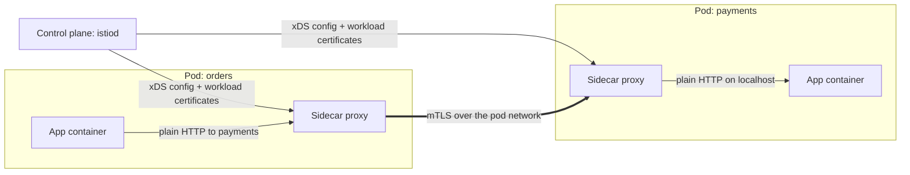

> **Navigation**: [← Networking & Security](02_Networking_Security.md) | [Index](00_INDEX.md)

# ☁️ Service Mesh, Serverless & Cloud Native Patterns

> _"Kubernetes answers 'how do I run containers.' Service mesh answers 'how do containers talk to each other securely, observably, and reliably — without changing a single line of application code.'"_

---

# PART 1: Service Mesh — The Networking Layer You Don't Code

---

```
THE PROBLEM:
  Microservices need to: encrypt traffic (mTLS), retry on failure,
  load balance, observe (trace requests), enforce rate limits.

  WITHOUT service mesh: every team adds these features IN CODE.
  → Java team uses Resilience4j. Python team uses their own retry lib.
  → Inconsistent, duplicated work, hard to enforce company-wide policies.

  WITH service mesh: a SIDECAR PROXY sits next to every pod.
  Your app makes plain HTTP calls. The proxy handles EVERYTHING:
  mTLS, retries, circuit breakers, tracing, rate limiting.

  ANALOGY: A translator accompanies you in a foreign country.
  You speak English (plain HTTP). The translator handles:
  local language (mTLS encryption), customs (rate limits),
  directions (routing), and reports where you've been (tracing).
  You don't need to learn anything new.

HOW IT WORKS:

  ┌─ Pod A ──────────────────────┐     ┌─ Pod B ──────────────────────┐
  │  ┌──────────┐  ┌──────────┐  │     │  ┌──────────┐  ┌──────────┐  │
  │  │ Your App │→→│  Envoy   │──┼──►──┼──│  Envoy   │→→│ Your App │  │
  │  │ (8080)   │  │ (sidecar)│  │     │  │ (sidecar)│  │ (8080)   │  │
  │  └──────────┘  └──────────┘  │     │  └──────────┘  └──────────┘  │
  └──────────────────────────────┘     └──────────────────────────────┘

  Your app calls http://payments:8080 (the normal Service name) → iptables rules in the pod redirect that
  connection to the local Envoy (Istio: port 15001) → Envoy encrypts (mTLS) →
  routes to Pod B's Envoy (inbound port 15006) → decrypts → forwards to Pod B's app.

  All traffic is encrypted in transit. Apps don't know about TLS.

KEY SERVICE MESH FEATURES:

1. mTLS (Mutual TLS):
   Every pod-to-pod call is encrypted. Both sides verify identity.
   Zero-trust networking: even internal traffic is encrypted.
   Certificate rotation happens automatically (no manual cert management!).

2. Traffic Management:
   Canary deploys: route 5% of traffic to new version.
   A/B testing: route by header (user-agent, cookie).
   Retries: automatic retry with backoff on 503 errors.
   Timeouts: global timeout policy (no more infinite waits).

3. Observability (cheap to get, not free to run):
   Every hop produces a span and metrics with no code changes, BUT joining the hops into one trace needs the
   app to forward the trace headers (traceparent / x-request-id) from inbound to outbound calls.
   Metrics: latency p99, error rate, requests/sec per service.
   Dashboard in Jaeger/Kiali shows the entire service graph.

ISTIO vs LINKERD:
  Istio:   Feature-rich. Complex. Uses Envoy proxy. More configuration.
           Best for: large enterprises, complex traffic policies.
  Linkerd: Lightweight. Simple. Uses its own micro-proxy.
           Best for: teams wanting simplicity, lower resource overhead.

  Recommendation: Linkerd is the simpler design, but since Feb 2024 Buoyant no longer publishes open-source
  *stable* releases (edge releases only), so check licensing/release channel first. Istio (sidecar or ambient mode)
  and Cilium are the other mainstream options.
```

```yaml
# ── ISTIO: Canary deployment via traffic splitting ──
apiVersion: networking.istio.io/v1        # v1beta1 on Istio < 1.22
kind: VirtualService
metadata:
  name: myapp
spec:
  hosts:
    - myapp
  http:
    - route:
        - destination:
            host: myapp
            subset: stable # v1.0 (current)
          weight: 90 # 90% of traffic
        - destination:
            host: myapp
            subset: canary # v2.0 (new)
          weight: 10 # 10% of traffic
      retries:
        attempts: 3
        perTryTimeout: 2s
      timeout: 10s

---
# Define which pods belong to which subset
apiVersion: networking.istio.io/v1
kind: DestinationRule
metadata:
  name: myapp
spec:
  host: myapp
  trafficPolicy:
    connectionPool:
      tcp:
        maxConnections: 100 # circuit breaker: max connections
    outlierDetection:
      consecutive5xxErrors: 5 # eject pod after 5 consecutive errors
      interval: 30s
      baseEjectionTime: 30s
  subsets:
    - name: stable
      labels:
        version: v1
    - name: canary
      labels:
        version: v2
```

---

### Why the mesh exists, and how it really intercepts traffic

**The pain, in order.** By 2015 teams running dozens of services found that every service re-implemented the same network plumbing in its own language: Netflix open-sourced it as libraries (Hystrix for circuit breaking, Ribbon for client-side balancing), which worked for a JVM shop and left every Python, Go and Node service on its own. The next idea was to move the plumbing out of the process and into a proxy next to it. Envoy was built at Lyft for this and open-sourced in 2016; Linkerd 1.0 (2017) was the first project to call itself a "service mesh"; Istio was announced in 2017 by Google, IBM and Lyft, with Envoy as its data plane. The Kubernetes sidecar-container pattern made it deployable without touching application images.

**How the traffic gets to the proxy (the part the diagram hides).** The app does *not* call `localhost:8080` and does not know a proxy exists. It calls `http://payments:8080` exactly as before. What changes is the pod's network namespace: an init container (or the CNI plugin) installs iptables `REDIRECT` rules so that every outbound TCP connection is sent to the sidecar's outbound listener (Istio: port 15001) and every inbound connection to the pod is sent to its inbound listener (port 15006). The sidecar looks at the original destination, applies the routing/retry/mTLS policy it was given, and opens its own connection onward. Those policies reach it from the **control plane** (Istio: `istiod`) over the **xDS** gRPC API, which is Envoy's standard way of being configured at runtime; the same channel hands each proxy a short-lived workload certificate (default lifetime 24 hours in Istio) carrying a **SPIFFE identity** such as `spiffe://cluster.local/ns/prod/sa/orders`, derived from the pod's Kubernetes ServiceAccount. (Not verified here: no cluster in my lab. The interception ports are from the Istio documentation.)



**How to read this diagram.** Two pods, each with the application and a sidecar proxy. Follow the thick arrow in the middle: the only encrypted hop is proxy-to-proxy (mutual TLS), while the application-to-proxy hops are plain traffic inside each pod. The control plane at the top does not carry user traffic; it only pushes configuration and certificates down to the proxies, so if it stops, existing connections keep working but policy changes and certificate renewals stop. Notice what the application never sees: a certificate, a retry, or the routing decision.

### Proving the "mTLS" claim without a cluster

What a sidecar pair does at the TLS layer is ordinary mutual TLS. I reproduced it with `openssl` and `curl`: a demo mesh CA, a server certificate for `payments`, a one-day client certificate for `orders` that carries the SPIFFE URI in its SAN, and a server that demands a client certificate signed by that CA (`openssl s_server -Verify 1`).

```text
client identity (SAN): URI:spiffe://cluster.local/ns/prod/sa/orders
client cert lifetime : notBefore=Oct 24 18:49:38 2026  notAfter=Oct 25 18:49:38 2026   (1 day)

1. no client certificate        -> curl: (56) ... tlsv13 alert certificate required        http=000
2. certificate from another CA  -> curl: (56) ... tlsv1 alert unknown ca                   http=000
3. certificate from the mesh CA -> http=200
```

Three things this teaches. (1) **Identity is the certificate, not the IP**: case 2 presents a certificate whose CN says "orders", yet it is refused because the signer is not the mesh CA. This is why mTLS survives pod IP churn, where IP-based firewall rules do not. (2) In TLS 1.3 the client finishes its handshake *before* the server checks the client certificate, so the rejection appears on the first read as a `(56)` error, not at connect time, which confuses people debugging "connection succeeded but the request failed". (3) Short lifetimes are the revocation strategy: a stolen one-day certificate is useless tomorrow, which is why the mesh must automate rotation.

Authorization then uses that identity. Reference YAML (written to the Istio `security.istio.io/v1` schema; not applied to a cluster here, so not verified end to end):

```yaml
apiVersion: security.istio.io/v1
kind: PeerAuthentication
metadata:
  name: default
  namespace: prod
spec:
  mtls:
    mode: STRICT          # refuse plaintext; PERMISSIVE accepts both (use only during migration)
---
apiVersion: security.istio.io/v1
kind: AuthorizationPolicy
metadata:
  name: payments-allow-orders
  namespace: prod
spec:
  selector:
    matchLabels:
      app: payments
  action: ALLOW           # once any ALLOW policy selects a workload, everything not matched is denied
  rules:
    - from:
        - source:
            principals: ["cluster.local/ns/prod/sa/orders"]   # the SPIFFE identity from the certificate
      to:
        - operation:
            methods: ["POST"]
            paths: ["/charge"]
```

### Correcting two claims in the text above

- **"Every request is automatically traced, no code changes."** The proxy creates a span for each hop it handles, but it cannot know that an *incoming* request caused an *outgoing* one: only your code can link them. Unless the application copies the trace headers (`traceparent`, or `x-request-id` plus `x-b3-*` for Zipkin-style) from the inbound request onto its outbound calls, you get disconnected single-hop spans instead of one trace. The mesh gives you the span machinery free; propagation is still one line of code per call (or an OpenTelemetry SDK).
- **"Observability (free!)"** costs CPU, memory and latency in every pod. Published Istio benchmarks put the added latency per proxy in the low single-digit milliseconds at moderate load, and each sidecar reserves memory on the order of tens of MB; multiply by pod count before adopting. Measure on your own workload.

### Sidecar, ambient, or eBPF

| Model | How | Trade-off |
| --- | --- | --- |
| Sidecar (classic Istio, Linkerd) | one proxy container per pod | strongest isolation per workload; per-pod resource cost; must restart pods to upgrade the proxy |
| Ambient (Istio, GA since 1.24) | node-level `ztunnel` does L4 mTLS; optional per-namespace "waypoint" proxy does L7 | far fewer proxies, no pod restarts; L7 features need waypoints; newer, so check your required features |
| eBPF datapath (Cilium) | kernel-level L3/L4 policy and encryption, Envoy only where L7 is needed | minimal overhead, needs recent kernels; L7 policy still involves a proxy |

On Linkerd specifically: it is a CNCF graduated project with a lean Rust proxy, but in February 2024 Buoyant stopped publishing open-source *stable* release artifacts (the project continues as "edge" releases; stable builds moved to Buoyant's commercial distribution). The text above recommends "start with Linkerd"; check the current release and licensing situation before choosing, rather than treating that as a default.

### When a mesh is the wrong answer, and how it fails

Use it when you need uniform mTLS and identity-based authorization across many services and several languages, or traffic shifting you cannot do in the app. Do not use it for fewer than about a dozen services in one language (a library plus Ingress is cheaper), for latency-critical paths where a proxy hop matters, or when nobody on the team can read an Envoy config at 3 a.m.

| Failure | Symptom | Check |
| --- | --- | --- |
| Pod not injected (namespace label added after pods started) | calls to it fail under STRICT mTLS | `kubectl get pod -o jsonpath='{.spec.containers[*].name}'` must list the proxy; restart the pods |
| App starts before the proxy is ready | first outbound calls fail at startup | proxy-startup ordering option (Istio `holdApplicationUntilProxyStarts`) or retries in the app |
| Batch Job never completes | pod stays `Running` because the sidecar never exits | native sidecar containers (Kubernetes 1.28+, stable in 1.33) or the mesh's quit-endpoint hook |
| Retries multiply load | backend sees 3x traffic during an incident | retries in mesh AND app AND gateway compound: pick one layer (see the arithmetic in chapter 02) |
| `503` with `UC` or `UF` flags in the Envoy access log | upstream connection terminated / failed | `istioctl proxy-config cluster POD`, then the backend's own logs |

🔬 **Section Challenge — Service mesh mechanics**

**Challenge 1 (Debugging):** After setting `PeerAuthentication` to `STRICT` in namespace `prod`, a legacy batch job in `legacy` namespace (no sidecar) can no longer reach `payments`. Why, and name two fixes with their trade-offs.

<details><summary>Answer</summary>

With STRICT, the `payments` sidecar accepts only mutual-TLS connections. The job has no sidecar, so it opens plain TCP; the sidecar rejects the connection (the same failure as case 1 of the openssl experiment: no valid client certificate). Fix A: inject a sidecar into the job's namespace so it gets an identity and speaks mTLS (best; requires the sidecar-exit problem for Jobs to be solved). Fix B: set `PERMISSIVE` for that workload or port only (`portLevelMtls`), which accepts plaintext and mTLS; it works immediately but leaves that port open to any pod in the cluster, so pair it with a NetworkPolicy limiting who can reach it and put a removal date on it.

</details>

**Challenge 2 (Reasoning):** A team shows a Jaeger trace in which `orders -> payments` appears as two separate one-span traces. The mesh is healthy. What is missing?

<details><summary>Answer</summary>

Context propagation in the `orders` application. The sidecar on `orders` created a span for the inbound request and a *new* span for the outbound call to `payments`, but without the inbound `traceparent`/`x-b3-*`/`x-request-id` headers copied onto the outbound request, the proxy has no way to tell that the outbound call belongs to the inbound one, so it starts a new trace. Fix: forward the trace headers in the client code (or use an OpenTelemetry instrumentation library that does it automatically), then verify that the outbound request carries the same trace id.

</details>

---

# PART 2: Serverless — Functions Without Servers

---

```
THE EVOLUTION:
  Bare Metal → VMs → Containers → Serverless
  Each step: less infrastructure for the developer to manage.

  Serverless = you write a FUNCTION. Cloud runs it. You pay per invocation.
  No servers to manage. No Docker. No K8s. Just code.

  ANALOGY:
  Running a server = owning a car. You pay even when parked.
  Serverless = taking a taxi. You pay only when riding.

AWS LAMBDA (most popular):

  Trigger → Lambda Function → Response

  Triggers: API Gateway (HTTP), SQS (message queue), S3 (file upload),
            CloudWatch (scheduled), DynamoDB Streams (data change)

  PRICING: $0.20 per 1 million requests PLUS duration billed in GB-seconds (memory x time).
           Free tier: 1M requests and 400,000 GB-seconds per month. Duration is usually the bigger line (see below).

  COLD START PROBLEM:
  First invocation after idle: Lambda spins up a container → 100-3000ms delay.
  Subsequent invocations: warm container → 1-10ms.

  MITIGATION:
  • Provisioned Concurrency: pre-warm N instances (costs more)
  • Smaller runtime: Python/Node start faster than Java/Spring
  • SnapStart (Java; now also Python and .NET): snapshot at init → fast restore

WHEN TO USE SERVERLESS vs CONTAINERS:
  ✓ Serverless: Event-driven, sporadic traffic, simple functions, startups
  ✗ Serverless: Long-running tasks (15 min max!), consistent high traffic,
                 complex apps, need control over runtime

  KNATIVE (Serverless ON Kubernetes):
    Run serverless workloads on YOUR K8s cluster.
    Scale-to-zero: no traffic → 0 pods (saves resources).
    Scale-from-zero: first request → pod spins up (cold start ~2-5s).
    Best of both: serverless scaling + K8s flexibility.
```

```python
# ── AWS LAMBDA FUNCTION (Python) ── (fixed: the original lacked `import uuid` / `datetime`)
import json
import os
import uuid
from datetime import datetime, timezone
from decimal import Decimal

import boto3

# Created OUTSIDE the handler: runs once per cold start, reused by every warm invocation.
dynamodb = boto3.resource('dynamodb')
table = dynamodb.Table(os.environ.get('ORDERS_TABLE', 'orders'))
sqs = boto3.client('sqs')
QUEUE_URL = os.environ.get('PAYMENT_QUEUE_URL', '')


def lambda_handler(event, context):
    """
    API Gateway trigger: POST /orders
    Event contains the HTTP request body.
    """
    body = json.loads(event['body'])

    # Validate
    if not body.get('customer_id') or not body.get('items'):
        return {
            'statusCode': 400,
            'body': json.dumps({'error': 'Missing required fields'})
        }

    # Store in DynamoDB (boto3 rejects Python floats: use Decimal built from a string)
    order_id = str(uuid.uuid4())
    table.put_item(Item={
        'orderId': order_id,
        'customerId': body['customer_id'],
        'items': body['items'],
        'total': Decimal(str(body['total'])),
        'status': 'PENDING',
        'createdAt': datetime.now(timezone.utc).isoformat()
    })

    # Trigger next step (async!)
    sqs.send_message(
        QueueUrl=QUEUE_URL,
        MessageBody=json.dumps({'orderId': order_id, 'total': str(body['total'])})
    )

    return {
        'statusCode': 201,
        'body': json.dumps({'orderId': order_id, 'status': 'PENDING'})
    }
```

---

### What was wrong in the handler, what a Lambda bill really contains, and when it fits

I ran the original handler against a stubbed `boto3` (offline). It stopped on the first valid request with `NameError: name 'uuid' is not defined`; `datetime` was missing as well. The corrected version above passes the same test (`201`, one DynamoDB put and one SQS send for a valid body, `400` for an empty one). Three further changes are deliberate: the clients are created **outside** the handler so a warm invocation reuses them instead of rebuilding them on every call; `total` is stored as a `Decimal` because boto3 refuses Python floats for DynamoDB numbers; and `datetime.utcnow()` is replaced because it is deprecated since Python 3.12.

One design flaw remains and is worth naming: the handler writes to DynamoDB and then sends to SQS. If the second call fails, the order sits in `PENDING` forever and the customer is never charged: a **dual write**. Solutions are the outbox pattern (write the message into the same DynamoDB transaction, let a stream publish it) or driving the next step from DynamoDB Streams instead of from the handler. See [Distributed Patterns](../10_Enterprise_Systems/09_Distributed_Patterns.md).

**What a Lambda bill contains.** The "$0.20 per million" figure is the *request* charge. You also pay for **duration**, billed in GB-seconds (memory setting x run time), at a rate on the order of $0.0000166667 per GB-second for x86 (check the current price list; it differs by region and architecture). Example: 5 million invocations a month at 128 MB (0.125 GB) and 200 ms each is `5M x 0.2 s x 0.125 GB = 125,000 GB-seconds` (about $2) plus 5M requests (about $1; free tier ignored), so a few dollars. At a steady 100 requests per second all month (about 260 million invocations) with the same function, requests alone cost about $52 and duration about $108, and a single small always-on container instance would usually be cheaper and has no cold starts. **The crossover between serverless and containers is utilisation**: idle-heavy and spiky favours functions; flat and busy favours containers.

**Cold starts.** The numbers above (100-3000 ms) are the right order of magnitude; the factors that move them are runtime (JVM and .NET slowest), package size, VPC attachment, and memory (more memory also means more CPU, so a bigger setting is sometimes both faster and cheaper per request). Lambda SnapStart, listed for Java above, is now also offered for Python and .NET runtimes (check the current supported list).

| Choose | When | Because |
| --- | --- | --- |
| Functions | event-driven glue (S3 upload, queue consumer), spiky or low traffic, no ops capacity | scale to zero, pay per use |
| Containers on managed compute (ECS/Fargate, Cloud Run) | steady HTTP traffic, long requests, need any runtime or library | predictable cost, no 15-minute limit, local parity |
| Kubernetes (+ Knative if you want scale-to-zero) | many services, you already run a platform team | portability and control, at operational cost |

🔬 **Section Challenge — Serverless**

**Challenge 1 (Calculation):** A function uses 512 MB, runs 800 ms and is invoked 40 million times a month. Compute the GB-seconds, and say whether a pair of always-on containers is worth evaluating.

<details><summary>Answer</summary>

GB-seconds = 40,000,000 x 0.8 s x 0.5 GB = **16,000,000 GB-s**. At roughly $0.0000166667 per GB-s that is about **$267** for duration, plus 40M requests at $0.20 per million = **$8**, so about $275 a month (free tier ignored; prices vary, so use the calculator for the exact figure). Average load is 40M / 2.6M seconds, about 15 requests per second, each taking 0.8 s, so roughly 12 requests are in flight on average. Two or three containers with 1 GB each could carry that, likely for less money, if traffic is steady. If the traffic is mostly a few busy hours a day, the function may still win. The decision input you must collect is the **hourly traffic curve**, not the monthly total.

</details>

**Challenge 2 (Failure analysis):** The handler above returns 201, the DynamoDB row exists, but the payment never runs for 1 order in a few thousand. What is the failure, and how do you make it safe?

<details><summary>Answer</summary>

The `sqs.send_message` call failed (throttling, timeout, or the function was killed after the put but before the send) after the order row was written: a dual write without atomicity. Safe designs: (a) write the order and an `outbox` item in one `TransactWriteItems`, and have a DynamoDB Stream trigger publish the SQS message (at-least-once, so the consumer must be idempotent on `orderId`); or (b) make the SQS send first and have the consumer create the order (then the failure is visible as a missing order, which is retryable). Either way, add a dead-letter queue and an alarm on its depth.

</details>

---

# PART 3: FinOps — Cloud Cost Management

---

```
THE PROBLEM:
  Cloud billing is pay-per-use.
  Without controls: engineering team spins up resources → forgets about them.
  Monthly AWS bill goes from $5,000 → $50,000. Nobody knows why.

  FINOPS = Financial + Operations. Making cloud costs visible and accountable.

COST OPTIMIZATION STRATEGIES:

1. RIGHT-SIZING:
   Most instances are overprovisioned. Monitor actual CPU/memory usage.
   t3.large (2 vCPU, 8GB) running at 5% CPU → switch to t3.small (save 75%) ONLY IF memory fits: t3.small has 2GB.

   Tools: AWS Compute Optimizer, Datadog, kubecost (K8s cost per pod).

2. RESERVED INSTANCES / SAVINGS PLANS:
   On-Demand: $0.1 per hour (full price, no commitment)
   1-year reserved: $0.06/hr (40% savings, commitment)
   3-year reserved: $0.04/hr (60% savings, big commitment)
   Spot instances: $0.02/hr (80% savings, BUT can be terminated with 2 min warning!)

   Spot is great for: batch processing, CI/CD runners, ML training.
   Spot is BAD for: production API servers (can't lose them mid-request!).

3. TAGGING:
   Tag every resource: team=payments, environment=staging, project=checkout.
   → Slice the bill by team: "Payments team: $12,000, Analytics: $8,000."
   → Delete all staging resources after 7 days automatically.

4. SCALING POLICIES:
   Schedule-based: Scale down at night (70% of traffic is daytime).
   Event-based: Scale up for Black Friday, scale down after.

   K8s: HPA (Horizontal Pod Autoscaler) + VPA (Vertical Pod Autoscaler).
   Cluster Autoscaler: add/remove NODES when pods can't be scheduled.

UNIT ECONOMICS:
  Track cost PER UNIT of business value:
  Cost per 1,000 API requests: $0.05
  Cost per customer: $2.50/month
  Cost per GB processed: $0.12

  If cost per request increases → investigate specific service.
```

---

### FinOps: the arithmetic behind the levers, and how each one backfires

**Why it exists.** On-premises, a purchase order was the control: nobody could spend $40,000 without someone signing. In the cloud an engineer can do it with `terraform apply`, and the bill arrives a month later, so the feedback loop that finance relied on is gone. FinOps (the FinOps Foundation launched in 2019 and is part of the Linux Foundation) is the practice of putting cost data in front of the people who cause the cost, soon enough to act on it.

The prices quoted above are illustrative, not current list prices. The *structure* is what to learn:

| Lever | What you give up | Typical backfire |
| --- | --- | --- |
| Right-sizing (`t3.large` to `t3.small` is a 75% saving per hour) | headroom; also memory: those two types have 8 GB vs 2 GB | the app was at 5% CPU but 70% **memory**, and now it is OOM-killed. Right-size on the binding resource (memory, IOPS, network), not CPU alone |
| Reserved Instances / Savings Plans | flexibility: a commitment for 1 or 3 years | you committed to a family you migrated off (Graviton, containers). Commit to ~70% of the stable baseline, not to peak, and prefer the more flexible plan types |
| Spot | the instance can be reclaimed with about a 2-minute warning (AWS) | the whole fleet is one instance type in one zone and is reclaimed together. Diversify instance types and zones, handle the termination notice, and keep the control plane and databases on on-demand |
| Tagging | nothing, but needs enforcement | 30% of spend is "untagged" because tags are optional. Enforce at creation (policy/Terraform checks), then report on tag coverage as a KPI |
| Scheduled scale-down | availability during the off hours | the nightly batch job or an on-call engineer in another time zone needs it. Make the schedule a team decision, with an override |

**Worked example of why unit economics beats total spend.** The bill rises from $50,000 to $65,000 (+30%). If requests rose 60% in the same month, cost per 1,000 requests **fell** from, say, $0.050 to $0.041 and the business is getting more efficient; if requests were flat, cost per request rose 30% and something regressed (a chatty new service, a log level, cross-AZ traffic). The absolute number cannot tell these apart; the ratio can. Always pair a cost metric with a business denominator: requests, orders, active users, GB processed.

**Hidden line items worth knowing:** data transfer between availability zones and out to the internet (a service chatting across AZs can cost more than the compute under it), NAT gateway per-GB processing charges, idle load balancers, orphaned EBS volumes and snapshots, and CloudWatch log ingestion for chatty debug logs. For Kubernetes the usual extra is **requests vs usage**: you pay for the CPU and memory your pods *request*, so a request set 3x above real usage wastes two thirds, and the cluster autoscaler dutifully adds nodes for it. Tools such as kubecost or OpenCost attribute node cost to pods and namespaces. Karpenter (a Kubernetes autoscaling project) provisions right-sized nodes per pending pod instead of scaling fixed node groups, which often cuts waste; treat the exact saving as something to measure on your own cluster.

🔬 **Section Challenge — FinOps decisions**

**Challenge 1 (Calculation):** A service runs 20 on-demand instances 24/7 at $0.10/hour. Traffic is steady except that at night only 8 are needed. Compare: (a) 20 on-demand; (b) 8 reserved at the 1-year rate of $0.06/hour + 12 on-demand scaled to run only 16 hours a day. Use 730 hours per month.

<details><summary>Answer</summary>

(a) 20 x $0.10 x 730 = **$1,460** per month. (b) 8 reserved x $0.06 x 730 = $350.40; 12 on-demand x $0.10 x (16 h x 30.4 days = 486.7 h) = $584.00; total about **$934**, a 36% saving. The reserved commitment covers exactly the always-needed baseline (8), which is the rule: commit to the floor of your usage, autoscale the peaks on-demand or spot. Committing to 20 would have cost $876 for the reserved fleet but locked in capacity you do not use 8 hours a day.

</details>

**Challenge 2 (Reasoning):** The platform team proposes moving CI runners to spot instances to save 70%. Name one thing that makes this safe and one that makes it unsafe.

<details><summary>Answer</summary>

Safe: CI jobs are retryable and short, so a reclaimed instance only means a rerun, and the queue absorbs the capacity dip; diversify across instance types and zones to reduce simultaneous reclaims. Unsafe: jobs that publish or deploy as their last step and are not idempotent (a runner killed halfway through a release leaves a half-published artifact) and long jobs (a 90-minute build has a high chance of being reclaimed, so the saving is eaten by reruns). Keep release and deploy jobs on on-demand runners, use spot for test and build jobs, and cache dependencies so a rerun is cheap.

</details>

---

# PART 4: Platform Engineering — The Future of DevOps

---

```
THE PROBLEM WITH "YOU BUILD IT, YOU RUN IT":
  Every team needs to: write Terraform, Dockerfiles, K8s manifests,
  set up CI/CD, configure monitoring, manage secrets...
  → Each team reinvents the wheel → inconsistent, slow, error-prone.

PLATFORM ENGINEERING:
  A dedicated team builds an Internal Developer Platform (IDP).
  Developers SELF-SERVE through Golden Paths:

  Developer: "I need a new microservice."
  IDP: "Fill in this form: service name, language, team."
  → Auto-creates: GitHub repo, Dockerfile, Helm chart, CI/CD pipeline,
     Prometheus alerts, Grafana dashboard, staging + prod namespaces.
  → Developer starts writing business code in 10 minutes!

THE CNCF LANDSCAPE (Cloud Native Computing Foundation):
  The CNCF graduates and incubates the tools that run the cloud:

  GRADUATED (production-proven):
  • Kubernetes (orchestration)
  • Prometheus (metrics)
  • Envoy (proxy/service mesh)
  • containerd (container runtime)
  • Helm (package management)
  • Argo (GitOps, workflows)
  • Flux (GitOps)
  • Jaeger (tracing)
  • Falco (runtime security)
  • Linkerd (service mesh)
  • Cilium (eBPF networking; graduated 2023)

  INCUBATING (gaining traction; levels change, check cncf.io/projects):
  • OpenTelemetry (observability; incubating, not graduated)
  • Dapr (portable microservices runtime)
  • Backstage (developer portal — Spotify open-sourced)
  • Crossplane (manage cloud from K8s)
  • Knative (serverless on K8s)
  • Kyverno (K8s policy engine)
```

---

### Platform engineering: when a golden path helps, and when it becomes a bottleneck

"You build it, you run it" assumed every team has the expertise to run its own infrastructure. At around 20 teams that assumption fails: each team spends 20-30% of its time on pipelines and manifests, and every team's pipeline is slightly different, so security fixes need 20 separate pull requests. A platform team replaces that with a product: a **golden path** (a paved, supported way to create a service) that teams *can* leave but rarely want to. Backstage (open-sourced by Spotify) is the common portal; the portal is the visible 10%, and the real work is the templates, the CI conventions and the on-call support behind it.

It fails when the platform becomes a ticket queue (the portal is a form that creates a Jira ticket), when it is mandated without being better than what teams built themselves, or when it hides so much that teams cannot debug their own services. Measure it like a product: time to first deploy for a new service, percentage of services on the golden path, and platform-team toil hours per week.

**CNCF maturity levels change.** The list above has two inaccuracies as written. OpenTelemetry is an *incubating* project, not graduated. Several projects listed as incubating or absent have moved since (Cilium graduated in 2023, Dapr in 2024), so treat any maturity table, including this one, as a snapshot and check the project page on cncf.io before citing a level. "Graduated" means a project passed a security audit, has a healthy contributor base and a governance process; it is a statement about project health, not about whether it suits your problem.

🔬 **Section Challenge — Platform engineering**

**Challenge 1 (Design):** You are the first platform engineer at a company with 12 product teams, each with its own CI setup. You have one quarter. What do you build first, and what do you deliberately not build?

<details><summary>Answer</summary>

Build the smallest thing that removes the most duplicated toil: a single service template (repo scaffold with Dockerfile, CI pipeline, deployment manifest and baseline alerts) that two friendly teams adopt in the first month; measure time-to-first-deploy before and after. Do not build a portal, a custom UI or a self-service for every resource yet: nobody has told you they need it, and a portal without good templates behind it is a form. Interview teams first; the top three pain points they list decide the roadmap. Review adoption monthly; if teams route around the template, the template is the problem.

</details>

---

## 🔗 Cross-References

| Topic                             | Related Content                                                                                    |
| --------------------------------- | -------------------------------------------------------------------------------------------------- |
| **Saga pattern (distributed tx)** | [Enterprise Distributed](../10_Enterprise_Systems/09_Distributed_Patterns.md) — compensation logic |
| **Circuit breaker**               | [Networking & Security](02_Networking_Security.md) — cloud reliability patterns                    |
| **DynamoDB (Lambda backend)**     | [NoSQL Guide](../08_SQL/22_NoSQL_MongoDB.md) — document stores                                     |
| **ML model serving (Lambda)**     | [MLOps Production](../25_Python_ML_DL_NLP/13_MLOps_Production.md)                                  |
| **Queue-based (SQS)**             | [DS in Production](../02_Data_Structures/05_DS_In_Production.md) — queues everywhere               |
| **Event-driven (Kafka)**          | [Enterprise Distributed](../10_Enterprise_Systems/09_Distributed_Patterns.md) — Outbox, CQRS       |


---

## Reality Check

**"A service mesh is just a fancy load balancer"** — A mesh moves cross-cutting NETWORK CONCERNS out of every service and into a sidecar proxy: mTLS between all services (encryption and identity without app code — [networking-security]'s zero-trust made default), retries/timeouts/circuit-breakers configured uniformly (the resilience patterns [backend-integration] needs, applied by policy instead of reimplemented per service in per-language libraries), traffic splitting for canaries, and observability (every hop traced and measured without instrumenting the app). Load balancing is one feature; the point is extracting the reliability-and-security plumbing that would otherwise be copy-pasted, inconsistently, into every service in every language.

**"The mesh makes services more reliable"** — The mesh ADDS a hop and a failure surface that must be justified: every request now traverses two proxies (latency, and the sidecar that can itself fail or misconfigure), the control plane is a new critical dependency, and the operational complexity is real (the mesh outage that takes down services that were individually healthy — the debugging session that ends at an Envoy config). The honest calculus: below a few dozen services, library-based resilience often beats a mesh's operational cost; the mesh earns its complexity at scale, in polyglot environments, where per-language reimplementation of mTLS-and-retries is the bigger cost. Adopting it as default sophistication rather than at the scale that justifies it is a common over-engineering.

**"Cloud-native means running in the cloud"** — Cloud-native is an ARCHITECTURE style (the CNCF definition): containerized, dynamically orchestrated, microservices designed for the environment's properties — elastic scaling, disposable instances (cattle not pets), declarative infrastructure, resilience to constant partial failure. A monolith lifted to a cloud VM runs IN the cloud without being cloud-native (it scales vertically, treats its server as a pet, assumes stable infrastructure), and captures little of the model's benefit. "Cloud-native" describes how the software is built to exploit and survive the environment, not the billing address of the server.

**"Kubernetes is required for cloud-native"** — Kubernetes is the dominant orchestrator but the architecture predates and outlives it: the principles (containers, declarative ops, resilience, elasticity) are realizable on simpler platforms (managed container services, serverless, Nomad) — and for many teams, k8s's operational complexity is a net negative (the three-person team running a Kubernetes cluster is spending its scarcest resource on infrastructure the managed alternative would have handled). Cloud-native is the goal; Kubernetes is one means with a steep cost, and "we need Kubernetes to be cloud-native" is how small teams acquire a platform-engineering burden they lack the headcount to carry.

**"Adopting cloud-native tools makes us cloud-native"** — The tools without the architecture reproduce old problems in new packaging: microservices with a shared database (the distributed monolith — all the operational cost of distribution, none of the independence, [system-design]'s coupling failure at service scale), containers running pet-like stateful processes that cannot be rescheduled, and orchestration wrapped around software that assumes stable infrastructure. The transformation is in the design decisions — service boundaries that allow independent deploy, statelessness that allows rescheduling, resilience that assumes failure — and a team can run every CNCF tool while shipping a monolith in container costume. The tools enable the architecture; they do not confer it.
