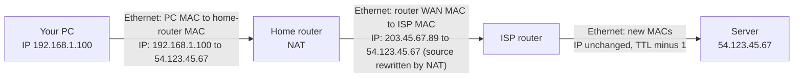

> **Navigation**: [Index](00_INDEX.md) | [Next → IP Addressing](05_IP_Addressing_Subnets.md)

# 🔌 Chapter 4: Networking Fundamentals — How Computers Talk

> _"Before you can debug a 502 Bad Gateway or configure a Kubernetes Ingress, you need to understand what a 'network' actually IS — electrical signals pulsing through copper, photons bouncing through glass, and radio waves modulating through air. This chapter strips networking down to the physics."_

---

# PART 1: The History — From Telegraph to 5G

---

```
1837 — TELEGRAPH:
  Samuel Morse. Binary communication: dots and dashes over copper wire.
  First "network" — one bit at a time, manually encoded.
  THIS IS NETWORKING. Everything since is just making it faster.

1876 — TELEPHONE:
  Alexander Graham Bell. Analog voice over copper.
  "Network" now means a mesh of connections between any two parties.
  The SWITCH was born: operators manually connecting calls.

  ANALOGY: Early telephone = early internet routing.
  Operator: "Who would you like to speak to?" (DNS lookup)
  Plugs in cable (routing)
  Connection established (TCP handshake)

1969 — ARPANET (the internet's ancestor):
  4 nodes: UCLA, Stanford, UCSB, University of Utah.
  Concept: PACKET SWITCHING (instead of circuit switching).

  Circuit switching (telephone): dedicated line for entire call.
    Benefits: guaranteed bandwidth.
    Problem: if you're silent, the line is WASTED.

  Packet switching (internet): data split into packets, each routed independently.
    Benefits: shared infrastructure, efficient.
    Problem: packets can arrive out of order → need reassembly.

  THIS DECISION — packet switching vs circuit switching —
  is the single most important design decision in networking history.
  It's why the internet works the way it does today.

1974 — TCP/IP:
  Vint Cerf & Bob Kahn define TCP (Transmission Control Protocol)
  and IP (Internet Protocol). The foundation of ALL internet communication.
  TCP handles reliability. IP handles addressing and routing.

1983 — DNS:
  Paul Mockapetris. Before DNS: a single HOSTS.TXT file was distributed
  to EVERY computer on the internet. Manually. By hand.
  DNS = distributed, hierarchical naming system. Scales to billions.

1989 — THE WORLD WIDE WEB:
  Tim Berners-Lee at CERN. HTTP protocol + HTML + URLs.
  Not the internet itself — a protocol ON TOP of the internet.
  The internet existed for 20 years before the web!

1991 — HTTP/0.9:
  Simple. One request, one response, connection closed.
  Only GET method. Only HTML responses.

1996 — HTTP/1.0:
  Headers added. POST method. Content types (images!).
  Still: ONE request per TCP connection → slow.

1997 — HTTP/1.1:
  Keep-alive connections (reuse TCP for multiple requests).
  Host header (multiple websites on one IP).
  Chunked transfer encoding. Still the workhorse today.

2004 — FACEBOOK LAUNCHES:
  The web shifts from documents to APPLICATIONS.
  AJAX (named 2005: Asynchronous JavaScript and XML) enables in-page updates without reloads.
  The browser becomes an application platform → REST APIs emerge.

2015 — HTTP/2:
  Binary protocol (not text). Multiplexing (many requests, one connection).
  Header compression (HPACK). Server push (in the spec, effectively dead: Chrome removed it in 2022).
  Designed by Google (based on SPDY).

2022 — HTTP/3 (QUIC):
  Replaces TCP with UDP + custom reliability.
  New connections: 1 RTT (TLS 1.3 merged in); 0-RTT only on resumption. No head-of-line blocking between streams.
  Built by Google, standardized by IETF (QUIC = RFC 9000, 2021; HTTP/3 = RFC 9114, 2022).

2024+ — The Present:
  WiFi 7 (802.11be): 46 Gbps theoretical.
  5G Advanced: up to 20 Gbps downlink.
  Starlink: satellite internet, 50-200 Mbps, 20-40ms latency.
  Submarine cables: 500+ Tbps capacity across oceans.
```

---

### Why packet switching won, and what the timeline gets wrong

The pain in 1960s data networking was that a phone call reserves a whole circuit, but computer traffic is **bursty**: a terminal sends a few characters, then nothing for seconds. A reserved circuit sits idle most of the time, and if any link on it fails, the call dies. Paul Baran (RAND, early 1960s) and Donald Davies (NPL, mid 1960s) independently proposed chopping messages into small blocks that find their own way, so that many users share each link and a failure only reroutes the blocks. ARPANET (1969) was the first large demonstration; its first four nodes were UCLA, the Stanford Research Institute (SRI), UC Santa Barbara and the University of Utah. The price of the idea is exactly the list in the text: out-of-order arrival, loss when buffers fill, and variable delay. TCP exists to hide the first two, and QoS and queue management exist to bound the third.

Corrections to the timeline above, so you do not repeat them in an interview:

- **AJAX** was named in 2005 (Jesse James Garrett); the XMLHttpRequest idea predates it, and Facebook's 2004 launch did not depend on it.
- **HTTP/2 server push** was in the specification but proved hard to use well and was removed from Chrome (version 106, 2022); treat it as dead.
- **HTTP/3 and QUIC**: QUIC is RFC 9000 (2021) and HTTP/3 is RFC 9114 (2022). A *new* QUIC connection takes 1 RTT (transport and TLS 1.3 handshake are merged); **0-RTT** applies only when resuming a previous connection, and 0-RTT data is replayable, so it is limited to idempotent requests. No head-of-line blocking *between streams*, because each stream has its own loss recovery.
- Wi-Fi "generation" names: the Wi-Fi Alliance named **Wi-Fi 4, 5, 6/6E and 7**; "Wi-Fi 1/2/3" for 802.11b/a/g are informal retroactive labels.

🔬 **Section Challenge — Packet vs circuit switching**

**Challenge 1 (Reasoning):** A voice call needs a constant 64 kbit/s and cannot tolerate delay variation; a web page load needs 5 Mbit/s for 2 seconds then nothing for 60. Which switching model suits each, and why is voice-over-IP viable on a packet network at all?

<details><summary>Answer</summary>

Voice is steady, small and jitter-sensitive: the circuit model fits naturally (reserved bandwidth, fixed delay). The page load is bursty, so a reserved circuit would be idle 97% of the time (2 s of use per 62 s); packet switching lets dozens of such users share the same link. VoIP works on packet networks because voice packets are small (typically 20 ms of audio, about 160 bytes), the receiver uses a short **jitter buffer** (tens of milliseconds) to smooth variable arrival, a lost packet is concealed rather than retransmitted (so UDP, not TCP), and the network can prioritise voice with QoS markings (DSCP EF) so queuing delay stays bounded.

</details>

---

# PART 2: The Physical Layer — How Bits Actually Travel

---

```
FUNDAMENTAL QUESTION: How does a "1" get from Computer A to Computer B?

Answer: It depends on the MEDIUM:

═══════════════════════════════════════════════════════════
 MEDIUM       │ SIGNAL TYPE    │ SPEED      │ RANGE
═══════════════════════════════════════════════════════════
 Copper cable │ Voltage change │ 1-40 Gbps  │ ~100m
 Fiber optic  │ Light pulse    │ 100+ Gbps  │ 80+ km
 WiFi         │ Radio wave     │ 1-46 Gbps  │ ~50-100m
 Cellular     │ Radio wave     │ 0.1-20 Gbps│ ~10 km
 Satellite    │ Radio wave     │ 50-500 Mbps│ 35,786 km (GEO)
═══════════════════════════════════════════════════════════
```

## Copper (Ethernet) — The Bedrock

```
HOW IT WORKS:
  A network interface card (NIC) changes voltage levels on the wire.
  High voltage = 1. Low voltage = 0.

  But it's more complex than that. Modern Ethernet uses ENCODING SCHEMES:

  Manchester encoding (old, 10 Mbps):
    1 = transition HIGH→LOW  within the bit period   (one convention; IEEE 802.3 uses the opposite polarity)
    0 = transition LOW→HIGH  within the bit period
    Self-clocking: receiver can detect timing from transitions.

  4B/5B + MLT-3 (100BASE-TX copper; 100BASE-FX fibre uses 4B/5B + NRZI):
    Encode 4 data bits as 5 signal bits (avoids long sequences of same voltage).

  PAM-5 (Gigabit Ethernet, 1000BASE-T):
    5 voltage levels: -2, -1, 0, +1, +2
    Each symbol carries 2 data bits; 125 Msymbols/s x 4 pairs x 2 bits = 1 Gbit/s (all 4 pairs needed).

CABLE CATEGORIES:
  Cat 5:   100 Mbps, 100 MHz bandwidth (legacy, don't use)
  Cat 5e:  1 Gbps, 100 MHz (most common in existing buildings)
  Cat 6:   1 Gbps (10 Gbps up to 55m), 250 MHz
  Cat 6a:  10 Gbps at full 100m, 500 MHz
  Cat 7:   10 Gbps, 600 MHz, individually shielded pairs (datacenter)
  Cat 8:   25-40 Gbps, 2000 MHz, 30m max (datacenter short runs)

TWISTED PAIRS — Why Are They Twisted?
  Each pair of wires carries a signal and its INVERSE.
  External electromagnetic interference (EMI) affects BOTH wires equally.
  The receiver subtracts the two → interference cancels out!
  Tighter twists = better noise cancellation.

  ANALOGY: Noise-cancelling headphones.
  Microphone picks up ambient noise → produces INVERSE wave → noise cancels.
  Same principle: twisted pair picks up EMI → subtraction cancels EMI.

RJ-45 CONNECTOR:
  The plug at the end of an Ethernet cable. 8 pins.
  Pin assignments follow T-568A or T-568B standard.

  Pins 1,2:   Transmit (TX) — data SENT from this device
  Pins 3,6:   Receive (RX) — data RECEIVED by this device
  Pins 4,5,7,8: Power (PoE) or unused (Gigabit uses all 4 pairs)

  Straight-through: PC → Switch (TX connects to RX on other end)
  Crossover: PC → PC (TX connects to TX → swap manually)
  Modern switches auto-detect with Auto-MDIX (crossover cable no longer needed).

PoE (POWER OVER ETHERNET):
  Delivers POWER + DATA on the same cable. No separate power adapter!
  PoE (802.3af):  15.4W — enough for WiFi access points, IP phones
  PoE+ (802.3at): 30W — enough for PTZ cameras, advanced APs
  PoE++ (802.3bt): 60-100W — enough for laptops, TVs, thin clients

  HOW: Power flows on unused pairs (Cat 5e) or phantom power on data pairs.
  PoE SWITCH: A switch that can supply power on its ports.
```

## Fiber Optic — Light Speed Communication

```
HOW IT WORKS:
  A laser (or LED) generates light pulses into a glass fiber.
  Light ON = 1. Light OFF = 0.
  Light travels via TOTAL INTERNAL REFLECTION:
  The glass core has higher refractive index than the cladding →
  light bounces back into the core at the boundary → travels for kilometers.

TWO TYPES:
  Single-Mode Fiber (SMF):
    Core diameter: 9 μm (microns — thinner than a hair!)
    One path of light (one "mode").
    Distance: set by the transceiver, not the glass: 10 km (LR), ~40 km (ER), ~80 km (ZR) without amplification.
    Used for: long-haul, datacenter interconnects, ISP backbones.

  Multi-Mode Fiber (MMF):
    Core diameter: 50 or 62.5 μm.
    Multiple paths of light (modes) bounce at different angles.
    Distance: 550m at 1 Gbit/s, but only ~300m (OM3) / ~400m (OM4) at 10 Gbit/s (limited by modal dispersion — different modes arrive at different times).
    Used for: within buildings, short datacenter runs.
    CHEAPER than single-mode (short-reach VCSEL/LED optics, wider core = easier alignment).

  ANALOGY:
  Single-mode = a perfectly straight highway tunnel. One lane. Light goes straight.
  Multi-mode = a wide cave tunnel. Light bounces off walls at different angles.
  Longer cave = more path differences = signals blur (dispersion).

WAVELENGTH DIVISION MULTIPLEXING (WDM):
  PROBLEM: One fiber can carry one light signal. Want more bandwidth?
  SOLUTION: Send MULTIPLE colors of light simultaneously!
  Each wavelength (color) carries a separate data channel.

  DWDM (Dense WDM): 80+ channels on one fiber. 100+ Gbps per channel.
  Total: 8+ Tbps on a SINGLE STRAND of glass!

  This is how submarine cables carry ALL of the internet across oceans.
  A single cable (like MAREA, Microsoft-Facebook) has 8 fiber pairs → 200+ Tbps.

CONNECTORS:
  LC (Little): most common. Small form factor. Click-lock.
  SC (Standard): push-pull. Common in older installations.
  MPO/MTP: 12-24 fibers in one connector (high-density datacenters).
```

## WiFi — Radio Frequency Communication

```
HOW IT WORKS:
  Data is MODULATED onto radio waves.
  The WiFi chip varies the wave's amplitude, frequency, or phase to encode bits.

  MODULATION TYPES (progressive complexity = more bits per symbol):
  BPSK:   1 bit per symbol (Binary Phase Shift Keying) — most robust, slowest
  QPSK:   2 bits per symbol
  16-QAM: 4 bits per symbol
  64-QAM: 6 bits per symbol
  256-QAM: 8 bits per symbol
  1024-QAM: 10 bits per symbol (WiFi 6) — very fast but needs strong signal
  4096-QAM: 12 bits per symbol (WiFi 7) — maximum speed, requires near-perfect signal

  ANALOGY: Morse code vs language.
  BPSK = Morse code: only 2 symbols (dot, dash). Slow but works over noisy line.
  1024-QAM = spoken language: thousands of distinct sounds. Fast but unclear if noisy.

WIFI STANDARDS EVOLUTION  (the Wi-Fi Alliance only named Wi-Fi 4, 5, 6/6E, 7; "Wi-Fi 1-3" are informal retro labels;
speeds are theoretical PHY maximums, real throughput is often around half or less):
  ┌────────────┬─────────┬───────────┬──────────┬────────────┐
  │ Standard    │ Name    │ Frequency │ Max Speed│ Year       │
  ├────────────┼─────────┼───────────┼──────────┼────────────┤
  │ 802.11b    │ WiFi 1  │ 2.4 GHz   │ 11 Mbps  │ 1999       │
  │ 802.11a    │ WiFi 2  │ 5 GHz     │ 54 Mbps  │ 1999       │
  │ 802.11g    │ WiFi 3  │ 2.4 GHz   │ 54 Mbps  │ 2003       │
  │ 802.11n    │ WiFi 4  │ 2.4/5 GHz │ 600 Mbps │ 2009       │
  │ 802.11ac   │ WiFi 5  │ 5 GHz     │ 3.5 Gbps │ 2013       │
  │ 802.11ax   │ WiFi 6  │ 2.4/5 GHz │ 9.6 Gbps │ 2019       │
  │ 802.11ax   │ WiFi 6E │ 6 GHz     │ 9.6 Gbps │ 2021       │
  │ 802.11be   │ WiFi 7  │ 2.4/5/6   │ 46 Gbps  │ 2024       │
  └────────────┴─────────┴───────────┴──────────┴────────────┘

KEY INNOVATION PER GENERATION:
  WiFi 4 (n): MIMO — multiple antennas, multiple data streams simultaneously.
    1 antenna = 1 stream. 4 antennas = 4 streams = 4x throughput.
  WiFi 5 (ac): MU-MIMO — talk to multiple DEVICES simultaneously (downlink only).
    Before: AP talks to device 1, then device 2, then device 3 (round-robin).
    After: AP talks to devices 1, 2, 3 AT THE SAME TIME.
  WiFi 6 (ax): OFDMA — subdivide a channel into smaller "resource units."
    Like splitting a highway lane into multiple bicycle lanes.
    Each device gets its own narrow lane → less waiting, lower latency.
    Also: uplink MU-MIMO (devices talk to AP simultaneously).
  WiFi 7 (be): MLO (Multi-Link Operation) — use 2.4 + 5 + 6 GHz bands SIMULTANEOUSLY.
    Up to ~3x the bandwidth by aggregating bands (needs AP and client both to support MLO).
    Also: 4096-QAM (12 bits/symbol), 320 MHz channel width.

2.4 GHz vs 5 GHz vs 6 GHz:
  2.4 GHz:
    ✓ Penetrates walls (longer wavelength → better diffraction)
    ✓ Longer range (100m+ outdoors)
    ✗ Only 3 non-overlapping channels (1, 6, 11)
    ✗ Crowded (Bluetooth, microwaves, baby monitors use 2.4 GHz)
    ✗ Slower (max 40 MHz channel width)

  5 GHz:
    ✓ 25 non-overlapping channels → less interference
    ✓ Wider channels (80 or 160 MHz) → faster
    ✗ Shorter range (absorbed by walls more)
    ✗ Not as many channels as 6 GHz

  6 GHz (WiFi 6E / WiFi 7):
    ✓ 59 non-overlapping channels → practically zero interference
    ✓ 320 MHz channels (WiFi 7) → maximum speed
    ✗ Shortest range of all three bands
    ✗ Requires WiFi 6E/7 devices (not backward compatible on 6 GHz)
```

---

### Physical layer: the arithmetic, the failure signatures, and the choice table

**Why gigabit over four copper pairs works.** 1000BASE-T runs at **125 million symbols per second on each of 4 pairs**, sending and receiving on all four at once, with each PAM-5 symbol carrying 2 data bits (the fifth voltage level and extra coding provide error correction): `4 pairs x 125 Msymbols/s x 2 bits = 1,000 Mbit/s`. That is also why a gigabit link needs **all four pairs intact**: a cable with one broken pair (or a badly punched jack) often still *links up* but negotiates **100 Mbit/s**, because 100BASE-TX uses only two pairs (pins 1,2 and 3,6). "My gigabit port runs at 100" is a physical fault until proven otherwise.

Corrections to the encoding notes above: 100BASE-TX uses **4B/5B with MLT-3** line coding (NRZI is what 100BASE-FX fibre uses). And the Manchester polarity convention differs by standard (IEEE 802.3 uses the opposite polarity to the one shown); what matters is that every bit has a mid-bit transition the receiver can lock its clock to, at the price of doubling the signalling rate.

**Distances are optics-dependent, not fibre-dependent.** The "80 km" figure for single-mode is what an 80 km (ZR-class) transceiver can reach; ordinary 10G-LR optics reach 10 km, ER about 40 km. Multi-mode reach also shrinks with speed: at 10 Gbit/s about 300 m on OM3 and 400 m on OM4, not 550 m (that figure belongs to 1 Gbit/s on 50 um fibre). Short-reach multi-mode optics today use VCSEL lasers rather than LEDs. Always match **fibre type and transceiver** (single-mode optic on multi-mode fibre will not give a reliable link).

| Need | Choose | Why / when not |
| --- | --- | --- |
| Office desk, 1-2.5 Gbit/s, up to 100 m | Cat 5e/6 copper | cheapest; not near heavy electrical machinery |
| 10 Gbit/s, full 100 m | Cat 6a | Cat 6 only reaches about 55 m at 10G |
| Between buildings or electrically noisy plant | single-mode fibre | immune to EMI and ground-potential differences between buildings |
| Rack-to-rack in a data centre, under 5 m | DAC (direct-attach copper) cable | cheaper than optics; too short and stiff for long runs |
| Access points, cameras, phones | copper with PoE (af 15.4 W, at 30 W, bt 60/90-100 W at the source) | budget the *switch's total PoE power*, not just the per-port limit |

**Failure signatures.** At the physical and link layers errors are counted, so look at counters before blaming software:

```bash
$ ip -s link show eth0          # RX/TX errors, dropped, carrier changes
$ ethtool eth0                  # negotiated speed/duplex (ethtool was not installed in my WSL image, so this line is not verified here)
```

| Symptom | Likely cause |
| --- | --- |
| Link flaps (carrier changes climbing) | bad cable/connector, failing transceiver, PoE overload resetting the device |
| Link up but 100 Mbit/s on a gigabit port | broken pair or poor termination |
| CRC / FCS errors climbing | EMI, damaged cable, over-length run, duplex mismatch |
| Slow transfers + late collisions + one side half duplex | duplex mismatch (one end auto-negotiates, the other is hard-set): leave both on auto |

**Wi-Fi: reading the table honestly.** The "Max Speed" column is the theoretical PHY rate with the maximum number of spatial streams and widest channel; a phone with 2 streams on an 80 MHz channel gets a fraction of it, and Wi-Fi is a **shared, half-duplex medium** (everyone on a channel takes turns), so real application throughput is often around half the negotiated link rate or less. Wider channels trade capacity for neighbours: 160/320 MHz channels leave few non-overlapping channels, so dense offices use 20 or 40 MHz channels on many APs rather than a few very wide ones. The Wi-Fi 7 "Multi-Link Operation" lets a device use more than one band at once for throughput or reliability; the "triple the bandwidth" figure is a best case that needs a client and AP that both implement it. Choose 2.4 GHz for range and simple IoT devices, 5 GHz as the default, and 6 GHz where clients support it and you want the cleanest spectrum (it is also the shortest range). Enterprise design (channel planning, roaming, RADIUS) is in [Chapter 12](12_WiFi_AP_Enterprise.md).

🔬 **Section Challenge — Physical layer**

**Challenge 1 (Debugging):** A newly installed desk port links at 100 Mbit/s although the switch and PC are both gigabit and a cable tester shows pins 4,5,7,8 open. What does that tell you, and what do you do?

<details><summary>Answer</summary>

Pairs 4,5 and 7,8 are not connected, so only pairs 1,2 and 3,6 carry signal. Gigabit Ethernet needs all four pairs, so auto-negotiation falls back to 100BASE-TX, which uses just those two pairs. The fault is in the termination (a mis-punched jack, a cable with two pairs cut, or a two-pair "telephone-grade" patch lead), not in the NIC or switch config. Re-terminate or replace the cable and confirm with the cable tester that all eight conductors map correctly; do not force the port speed, it cannot work.

</details>

---

# PART 3: Bandwidth, Latency & Throughput — The Three Musketeers

---

```
THESE THREE CONCEPTS ARE CONFUSED CONSTANTLY. Let's fix that.

BANDWIDTH: Maximum capacity of the pipe (bits per second).
  "How WIDE is the highway?" (how many lanes)
  Measured in: Mbps (megabits/sec) or Gbps (gigabits/sec).
  Your ISP says "100 Mbps" — that's bandwidth. Theoretical max.

LATENCY: Time for ONE bit to travel from A to B (milliseconds).
  "How LONG is the highway?"
  Measured in: ms (milliseconds).
  Ping google.com: ~20ms from your city, ~200ms from another continent.

  Components of latency:
  1. Propagation delay: speed of signal through medium
     Light in fiber: ~5 μs per km (200,000 km/s)
     Electrical in copper: ~5 μs per km
     Radio: ~3.3 μs per km (speed of light in air)

  2. Transmission delay: time to push bits onto the wire
     1,500 bytes on 100 Mbps link = 0.12 ms

  3. Queuing delay: waiting in router buffers
     Can be 0ms (no queue) to 500ms+ (congested router)

  4. Processing delay: router looks up routing table
     Modern routers: ~1 μs (negligible)

THROUGHPUT: Actual bits transferred per second (real-world).
  "How many CARS actually pass per hour?" (not theoretical max)
  Always LOWER than bandwidth.

  WHY THROUGHPUT < BANDWIDTH:
  • Protocol overhead: headers, handshakes, ACKs consume bandwidth
  • Congestion: shared links, other users
  • Packet loss: retransmissions waste bandwidth
  • Distance: TCP window sizes limit throughput over long distances

THE BANDWIDTH-DELAY PRODUCT (uses the ROUND-TRIP time):
  How many bits are "in flight" (sent but not yet acknowledged) between source and destination.

  100 Mbps bandwidth × 50ms RTT =
  100,000,000 × 0.050 = 5,000,000 bits = 625 KB in flight

  TCP's receive window must be AT LEAST this large.
  If window is smaller → link is underutilized!
  This is why high-bandwidth, high-latency connections (satellite)
  need TCP window scaling to achieve full throughput.

PRACTICAL EXAMPLES:
  ┌──────────────────────┬──────────┬─────────┬──────────────┐
  │ Connection           │ Bandwidth│ Latency │ Use Case     │
  ├──────────────────────┼──────────┼─────────┼──────────────┤
  │ Fiber to home        │ 1 Gbps   │ 3ms     │ Streaming 4K │
  │ LTE (rural)          │ 30 Mbps  │ 40ms    │ Mobile browse│
  │ 5G (urban)           │ 1 Gbps   │ 10ms    │ AR/VR, gaming│
  │ Satellite (Starlink) │ 200 Mbps │ 30ms    │ Rural access │
  │ Satellite (GEO)      │ 50 Mbps  │ 600ms   │ Remote areas │
  │ Datacenter (10GbE)   │ 10 Gbps  │ 0.1ms   │ Server↔server│
  │ Datacenter (InfiniBand)│100 Gbps│ 0.002ms │ HPC, GPU↔GPU │
  └──────────────────────┴──────────┴─────────┴──────────────┘

  Note: Satellite GEO has 600ms latency because the satellite is 35,786 km away.
  Signal travels: Earth → satellite → Earth = 71,572 km at speed of light ≈ 239ms ONE WAY (physical floor).
  Round trip (request + response) = ~480ms floor, ~600ms in practice. The TCP handshake costs one full RTT
  before the client can even send its request, and TLS adds another.

  Starlink LEO: satellites at 550 km → latency ~30ms. Game-changer for rural areas.
```

---

### Bandwidth, latency, throughput: the numbers, measured and calculated

Two corrections first. The **bandwidth-delay product** uses the **round-trip time** (data in flight is unacknowledged until the ACK returns), not the one-way latency: with `100 Mbit/s` and a `50 ms` RTT the pipe holds `100,000,000 x 0.050 = 5,000,000 bits = 625,000 bytes` (about 610 KiB). And the GEO satellite note above is imprecise: the signal covers `2 x 35,786 km` between user and ground station via the satellite, which at the speed of light is about **239 ms one way**, so the physical round-trip floor is about **477 ms** (the "600 ms" in the table includes processing and ground-station hops). A TCP client can send its request after **one** RTT (SYN, SYN-ACK, then data with the ACK), so about half a second before the first byte leaves, and with TLS 1.3 about another RTT before the request is sent.

I computed the rest with a short script so you can reproduce it, and checked the Linux defaults on my machine:

```text
Ethernet efficiency with 1500-byte IP packets: 1500 / (1500 + 14 header + 4 FCS + 8 preamble + 12 inter-frame gap) = 97.53%
Goodput on a 1 Gbit/s link (1460 B TCP payload / 1538 B on the wire): 949.3 Mbit/s    <- the "why is my gigabit 940?" answer

Window-limited TCP throughput = window / RTT:
  64 KiB window (no window scaling), RTT 100 ms  ->   5.24 Mbit/s
  64 KiB window,                      RTT 600 ms  ->   0.87 Mbit/s   (GEO satellite)
   4 MiB window,                      RTT 100 ms  -> 335.54 Mbit/s

$ sysctl net.ipv4.tcp_window_scaling net.ipv4.tcp_rmem
net.ipv4.tcp_window_scaling = 1
net.ipv4.tcp_rmem = 4096  131072  6291456            # min, default, max receive buffer in bytes
$ ping -c 3 1.1.1.1
64 bytes from 1.1.1.1: icmp_seq=3 ttl=252 time=3.63 ms     # rtt min/avg/max = 3.416/3.630/3.845 ms (from WSL2, one run)
```

The first two lines show why **throughput is always below bandwidth** even on a perfect link: 2.5% is Ethernet framing and a further 2.6% is IP and TCP headers. The window table shows the second reason: with a 64 KiB window a connection can send at most 64 KiB per round trip, so on a 100 ms path it cannot exceed 5.24 Mbit/s **no matter how fast the link is**. That is the practical reason TCP window scaling (RFC 7323, 1 = enabled above) exists and why `tcp_rmem`'s maximum matters on long fat networks. The `ttl=252` shows the reply started at 255 and crossed 3 routers; TTL is decremented per hop, which is what `traceroute` exploits.

| You observe | Probably limited by | Fix |
| --- | --- | --- |
| Small requests are slow, big downloads fine | latency (many round trips) | fewer round trips: keep-alive, HTTP/2, batching, CDN |
| Large transfers cap far below the link speed on a long path | window / RTT | larger buffers, window scaling, parallel streams, BBR |
| Speed collapses at certain hours | queueing or congestion | measure loss/RTT under load; fix the bottleneck link |
| Transfer fast at first, then slow | token-bucket shaping or a congested path | check the provider's policy; compare with a test to a different destination |

🔬 **Section Challenge — Bandwidth, latency, throughput**

**Challenge 1 (Calculation):** A backup runs between two datacenters 80 ms RTT apart over a 1 Gbit/s link. A single TCP connection with a 256 KiB maximum window achieves what throughput, how large must the window be to fill the link, and what is one other way to use the link fully?

<details><summary>Answer</summary>

Throughput = window / RTT = 262,144 B x 8 / 0.080 s = **26.2 Mbit/s** (2.6% of the link). To fill 1 Gbit/s the window must equal the bandwidth-delay product: `1,000,000,000 x 0.080 / 8 = 10,000,000 bytes` = **about 9.5 MiB**, so the socket buffers (`tcp_rmem` / `tcp_wmem` maxima) must allow that, with window scaling on. The other way: run several parallel connections (for example 8 x 256 KiB windows is about 210 Mbit/s, so you need roughly 40 streams without tuning), which is what multi-stream backup tools do. A modern congestion control such as BBR also helps when the path has loss.

</details>

---

# PART 4: The Network Models — OSI vs TCP/IP

---

```
WHY DO WE NEED LAYERS?
  A single protocol can't do everything.
  You need: physical signaling, addressing, routing, reliability, encryption, application logic.

  LAYERS = separation of concerns (just like software architecture!)
  Each layer does ONE job and provides a SERVICE to the layer above.

  ANALOGY: Sending a letter.
  You write a letter (application layer).
  Put it in an envelope with address (transport layer).
  Post office routes it through cities (network layer).
  Mail truck drives on roads (data link layer).
  Roads exist as physical asphalt (physical layer).

  Each layer adds its own HEADER (like nesting envelopes).

OSI MODEL (7 layers — theoretical reference, used for teaching):
  ┌──────────────────────────────────────────────────────────┐
  │ Layer 7: APPLICATION                                     │
  │  HTTP, HTTPS, FTP, SMTP, DNS, SSH, WebSocket             │
  │  "What does the user/application want to do?"            │
  ├──────────────────────────────────────────────────────────┤
  │ Layer 6: PRESENTATION                                    │
  │  Encryption (TLS), compression (gzip), data format       │
  │  (JSON→bytes, encoding conversions)                      │
  │  "How is the data formatted/encrypted?"                  │
  ├──────────────────────────────────────────────────────────┤
  │ Layer 5: SESSION                                         │
  │  Establish, manage, terminate sessions between apps      │
  │  (rarely a distinct layer in modern protocols)           │
  │  "Who's talking to whom?"                                │
  ├──────────────────────────────────────────────────────────┤
  │ Layer 4: TRANSPORT                                       │
  │  TCP (reliable, ordered), UDP (fast, unreliable)         │
  │  Port numbers. Flow control. Congestion control.         │
  │  "How do we ensure data arrives correctly?"              │
  ├──────────────────────────────────────────────────────────┤
  │ Layer 3: NETWORK                                         │
  │  IP (IPv4, IPv6). Routing between networks.              │
  │  "How do we get from network A to network B?"            │
  ├──────────────────────────────────────────────────────────┤
  │ Layer 2: DATA LINK                                       │
  │  Ethernet frames, MAC addresses, ARP, switches, VLANs    │
  │  "How do we talk to the NEXT device on the same wire?"   │
  ├──────────────────────────────────────────────────────────┤
  │ Layer 1: PHYSICAL                                        │
  │  Cables, connectors, voltages, light, radio frequencies  │
  │  "How do we transmit raw bits?"                          │
  └──────────────────────────────────────────────────────────┘

TCP/IP MODEL (4 layers — practical, what the internet uses):
  ┌──────────────────┐
  │ Application      │  = OSI L5-L7 (HTTP, DNS, SSH)
  ├──────────────────┤
  │ Transport        │  = OSI L4 (TCP, UDP)
  ├──────────────────┤
  │ Internet         │  = OSI L3 (IP, ICMP)
  ├──────────────────┤
  │ Network Access   │  = OSI L1-L2 (Ethernet, WiFi)
  └──────────────────┘

ENCAPSULATION — How Data Gets Wrapped:
  Application creates DATA: {"user": "Alice"}
  Transport adds TCP HEADER: src_port=49872, dst_port=443, seq=1, flags=PSH
  Network adds IP HEADER: src_ip=192.168.1.100, dst_ip=54.123.45.67, TTL=64
  Data Link adds ETHERNET HEADER: src_mac=AA:BB:CC:DD:EE:FF, dst_mac=...
  Physical: everything above converted to electrical signals and sent

  Each layer wraps the previous layer's data like a RUSSIAN NESTING DOLL.

  → On the receiving end, each layer STRIPS its header and passes data UP.
  Physical → Data Link → Network → Transport → Application → your JSON!
```

```
MNEMONIC FOR OSI LAYERS:
  "All People Seem To Need Data Processing"
  Application, Presentation, Session, Transport, Network, Data Link, Physical

  Or bottom-up:
  "Please Do Not Throw Sausage Pizza Away"
  Physical, Data Link, Network, Transport, Session, Presentation, Application
```

---

### What changes at each hop: the one idea that makes layering click

Layering is not just "7 boxes"; it is a rule about **which addresses are rewritten and where**. When a packet crosses routers, the **IP addresses stay the same end to end** (except where NAT rewrites them) while the **MAC addresses are rewritten at every hop**, because a MAC address only means something on one link.



**How to read this diagram.** Each arrow is one link and the label says what the frame (layer 2) and packet (layer 3) look like on it. The destination IP never changes along the way, but the Ethernet addresses are different on every arrow, because each router strips the old frame and builds a new one for the next link. The one other thing that changes is the *source* IP at the home router, where NAT swaps the private address for the public one. When you debug, this tells you which tool to use for which question: `ip neigh` / ARP answers "can I reach the next hop?", `ip route` answers "which next hop will be chosen?", and `traceroute` shows the sequence of hops.

The practical layer-triage you want, mapping the model above onto commands:

| Layer | Question | Command | A failure looks like |
| --- | --- | --- | --- |
| Link (1-2) | Is the cable/Wi-Fi up, do I have a MAC for the next hop? | `ip -br link`, `ip neigh` | `NO-CARRIER`; neighbour entry `FAILED` or `INCOMPLETE` |
| Network (3) | Do I have an IP and a route? Can I reach the gateway? | `ip -br addr`, `ip route`, `ping GATEWAY` | no default route; ping to gateway fails |
| Transport (4) | Does the port accept connections? | `nc -zv HOST PORT`, `ss -tn` | refused (RST) vs timeout (drop) |
| Application (7) | Does the service answer correctly? | `curl -v` | HTTP 4xx/5xx, TLS error |

Always work **bottom up** and stop at the first failing layer; most "the network is down" reports end at layer 1 or 2 (a cable, a Wi-Fi association, a port in the wrong VLAN).

🔬 **Section Challenge — Layers and hops**

**Challenge 1 (Reasoning):** A packet from your PC to a server three router hops away is captured at each hop. Which of these fields are identical at all captures: source MAC, destination MAC, source IP, destination IP, TTL, TCP source port? Ignore NAT for this question.

<details><summary>Answer</summary>

**Identical:** source IP, destination IP, TCP source port (and destination port, payload). **Different at every hop:** source MAC and destination MAC (each router builds a new frame addressed to the next link's neighbour) and TTL (decremented by one at each router). With NAT at the edge, the source IP and source port would also change at that device. The practical use: a capture showing the destination MAC equal to the *router's* MAC and the destination IP equal to a *remote* address is normal; a capture showing the destination MAC equal to the remote server's MAC for an off-subnet address would mean the host believes the server is on-link (a wrong netmask).

</details>

---

# PART 5: Switches, Routers & How Devices Connect

---

```
NETWORK DEVICES — Each Operates at a Different Layer:

HUB (Layer 1 — Physical):
  Dumb repeater. Receives signal → broadcasts to ALL ports.
  If 10 devices connected, ALL 10 see ALL traffic. Privacy? Zero.
  Also: collisions galore (only one device can transmit at a time).
  OBSOLETE. Nobody uses hubs anymore. Know it for history.

SWITCH (Layer 2 — Data Link):
  Smart. Learns which MAC addresses are on which ports.
  Forwards frames ONLY to the correct port.

  HOW A SWITCH LEARNS:
  1. Device A sends a frame from port 1.
  2. Switch reads source MAC address → stores: "MAC_A is on port 1."
  3. If destination MAC is unknown → FLOOD to all ports (just this once).
  4. Destination device responds → switch learns its MAC too.
  5. Future frames between A and B → sent ONLY on their ports.

  MAC ADDRESS TABLE (CAM table):
  ┌────────────────────┬──────┐
  │ MAC Address         │ Port │
  ├────────────────────┼──────┤
  │ AA:BB:CC:DD:EE:01  │ 1    │
  │ AA:BB:CC:DD:EE:02  │ 3    │
  │ AA:BB:CC:DD:EE:03  │ 7    │
  └────────────────────┴──────┘

  ANALOGY: A hotel receptionist who remembers which room each guest is in.
  First visit: "I don't know where Mr. Smith is. Let me page all rooms."
  Second visit: "Mr. Smith is in room 307" → delivers message directly.

ROUTER (Layer 3 — Network):
  Connects DIFFERENT networks together.
  Makes forwarding decisions based on IP addresses (not MAC).
  Maintains a ROUTING TABLE: "To reach 10.0.2.0/24, send via interface eth1."

  DIFFERENCE:
  Switch: connects devices on the SAME network (LAN).
  Router: connects DIFFERENT networks (your home to the internet).

  Your home "router" is actually a ROUTER + SWITCH + AP + FIREWALL + DHCP server.

LAYER 3 SWITCH (L3 switch):
  A switch that can ALSO route. Combines switch speed + routing intelligence.
  Used in: enterprise networks as the core/distribution layer switch.
  Handles inter-VLAN routing at hardware speed (ASICs, not CPU-based).
```

```bash
# ── SEE YOUR NETWORK TOPOLOGY ──

# Show your machine's interfaces and IPs
ip addr show                # Linux
# eth0: 192.168.1.100/24     ← wired connection
# wlan0: 192.168.1.101/24    ← WiFi connection
# lo: 127.0.0.1/8            ← loopback (localhost)

# Show your routing table (how your machine decides WHERE to send packets)
ip route show               # Linux
# default via 192.168.1.1 dev eth0     ← default gateway (your router)
# 192.168.1.0/24 dev eth0 scope link   ← local subnet (directly connected)
# 10.0.0.0/8 via 10.0.1.1 dev tun0    ← VPN route

route print                 # Windows
netstat -nr                 # macOS

# Show your ARP table (IP→MAC mappings the OS has learned)
arp -a
# 192.168.1.1 → AA:BB:CC:DD:EE:01  (your router's MAC)
# 192.168.1.102 → AA:BB:CC:DD:EE:02 (another device on LAN)

# ARP is how your computer finds the MAC address for an IP on the same subnet.
# "I need to send to 192.168.1.1, but Ethernet needs a MAC address."
# PC broadcasts: "Who has 192.168.1.1?" (ARP request)
# Router responds: "I'm 192.168.1.1, my MAC is AA:BB:CC:DD:EE:01" (ARP reply)

# Show your MAC address
ip link show eth0           # Linux
# ether AA:BB:CC:DD:EE:FF
```

---

### Switch learning, executed — and your own machine's tables

The "how a switch learns" list is easy to nod along to and hard to internalise, so here is the whole algorithm as a runnable Python simulation (a 4-port switch; the output is what the script printed):

```python
class Switch:
    def __init__(self, ports):
        self.ports = ports
        self.table = {}                      # MAC -> port  (the CAM table)

    def receive(self, in_port, src, dst):
        self.table[src] = in_port            # LEARN: the source MAC is reachable via the ingress port
        if dst == "ff:ff:ff:ff:ff:ff" or dst not in self.table:
            out = [p for p in range(1, self.ports + 1) if p != in_port]
            action = "FLOOD to ports " + str(out)
        else:
            action = "forward to port %d only" % self.table[dst]
        print("  port %d: %s -> %s   => %s" % (in_port, src, dst, action))

sw = Switch(4)
A, B, C = "aa:aa", "bb:bb", "cc:cc"
print("1. A (port 1) talks to B (port 3), B is unknown:");   sw.receive(1, A, B)
print("2. B replies to A:");                                 sw.receive(3, B, A)
print("3. A talks to B again:");                             sw.receive(1, A, B)
print("4. C (port 2) broadcasts an ARP request:");           sw.receive(2, C, "ff:ff:ff:ff:ff:ff")
print("table:", sw.table)
```

```text
1. A (port 1) talks to B (port 3), B is unknown:
  port 1: aa:aa -> bb:bb   => FLOOD to ports [2, 3, 4]
2. B replies to A:
  port 3: bb:bb -> aa:aa   => forward to port 1 only
3. A talks to B again:
  port 1: aa:aa -> bb:bb   => forward to port 3 only
4. C (port 2) broadcasts an ARP request:
  port 2: cc:cc -> ff:ff:ff:ff:ff:ff   => FLOOD to ports [1, 3, 4]
table: {'aa:aa': 1, 'bb:bb': 3, 'cc:cc': 2}
```

Note what the code makes obvious: the switch learns from the **source** of every frame, never from the destination; unknown-unicast and broadcast frames are **flooded**; and the table is finite (real ones hold thousands of entries and age out idle entries after about 5 minutes). Two failure modes follow directly. A **loop** (two cables between the same switches, no spanning tree) makes flooded frames circulate forever: a *broadcast storm* that saturates every link within seconds, which is why STP/RSTP exists and why "someone plugged a cable into the wrong wall port" can take down a floor. And **MAC flooding** (an attacker filling the table with fake sources) makes the switch fail open and flood everything, which is the reason for port-security limits. The `PoE` supply on a switch is budgeted in total watts, so a floor of APs may exceed it even if each port is within its limit.

On my own machine (WSL2 Ubuntu, one run), the commands from the block above produce, in this order, my interface, the routing table that decides the next hop, and the ARP/neighbour entry that supplies that hop's MAC:

```text
$ ip -br addr show eth0
eth0   UP   172.24.93.105/20 fe80::215:5dff:fe74:6e8d/64
$ ip route show
default via 172.24.80.1 dev eth0 proto kernel
172.24.80.0/20 dev eth0 proto kernel scope link src 172.24.93.105
$ ip neigh show
172.24.80.1 dev eth0 lladdr 00:15:5d:b9:07:72 DELAY
$ cat /sys/class/net/eth0/mtu
1500
```

Read it like the machine does for a packet to `1.1.1.1`: not inside `172.24.80.0/20`, so use the **default** route, next hop `172.24.80.1`; the neighbour table already holds that gateway's MAC (`00:15:5d:b9:07:72`), so no ARP request is needed; the frame goes to that MAC while the IP destination stays `1.1.1.1`. The neighbour state names matter in debugging: `REACHABLE` (recently confirmed), `STALE`/`DELAY` (will re-verify when used), `INCOMPLETE`/`FAILED` (ARP asked, nobody answered: layer 2 problem or wrong VLAN).

**Switch, router, L3 switch: which to buy/configure.**

| You need | Use | Notes |
| --- | --- | --- |
| Connect devices in one subnet | switch | no IP config needed; managed switches add VLANs and STP |
| Connect to another network or the internet; NAT; firewall | router / firewall | forwarding is by IP; may be CPU-bound at high rates |
| Fast routing between many internal VLANs | L3 switch | ASIC forwarding at line rate; limited NAT/firewall features |
| Isolation between tenants with real security guarantees | firewall between segments | a VLAN alone is a broadcast-domain boundary, not a security boundary |

🔬 **Section Challenge — Switching and tables**

**Challenge 1 (Debugging):** `ping 192.168.1.20` from a PC fails. `ip neigh` shows `192.168.1.20 dev eth0 FAILED`. Is this an IP, DNS, firewall or layer-2 problem, and what do you check next?

<details><summary>Answer</summary>

Layer 2: `FAILED` means the PC broadcast ARP requests ("who has 192.168.1.20?") and received no reply, so it never learned a MAC address and never sent an IP packet. DNS is not involved (a raw IP was used) and a host firewall would produce a *reply-less ping* only after ARP succeeded. Check: is the target powered and on the same VLAN and subnet (compare netmasks; a /24 vs /25 mismatch makes hosts disagree about who is on-link), is the switch port in the right VLAN (`show vlan`/port config), is the cable/port up, and does the target have the address configured (it may be using a different one). Capture with `tcpdump -n arp` on the PC: repeated requests with no replies confirm it.

</details>

---

# PART 6: How Data Flows — A Complete Journey

---

```
SCENARIO: You type "https://api.myapp.com/users" in a browser.
Let's trace EVERY step:

STEP 1 — APPLICATION LAYER:
  Browser constructs HTTP request:
  GET /users HTTP/1.1\r\n
  Host: api.myapp.com\r\n
  Accept: application/json\r\n
  \r\n

STEP 2 — DNS RESOLUTION:
  Browser: "What's the IP for api.myapp.com?"
  → Check browser cache → OS cache → router cache → ISP recursive resolver
  → Root servers (.com) → TLD servers → authoritative NS
  → Answer: 54.123.45.67 (see DNS chapter for full detail)

STEP 3 — TCP CONNECTION (Transport Layer):
  Source: 192.168.1.100:49872 (your machine, random ephemeral port)
  Dest:   54.123.45.67:443 (server, HTTPS port)

  SYN  →  (I want to connect, my seq # is 1000)
       ← SYN-ACK (OK, my seq # is 2000, I ACK your 1000+1)
  ACK  →  (I ACK your 2000+1. Connection established!)

STEP 4 — TLS HANDSHAKE (within TCP):
  ClientHello → (supported ciphers, TLS version, random bytes)
             ← ServerHello + Certificate + Key Share
  → Verify certificate chain (is this really api.myapp.com?)
  → Derive symmetric key using Diffie-Hellman key exchange
  → All future data encrypted with AES-256-GCM (or similar)

STEP 5 — HTTP REQUEST (encrypted, sent via TCP):
  Application data → encrypted by TLS → split into TCP segments
  → each segment gets IP header → each packet gets Ethernet frame

STEP 6 — YOUR MACHINE → YOUR ROUTER (Layer 2):
  IP dest: 54.123.45.67 (NOT on local subnet 192.168.1.0/24)
  → Must send to DEFAULT GATEWAY: 192.168.1.1 (your router)
  → ARP: "What MAC address is 192.168.1.1?" → router responds
  → Ethernet frame: src_mac=YOUR_MAC, dst_mac=ROUTER_MAC
  → Frame sent on the wire to your router

STEP 7 — YOUR ROUTER → ISP (Layer 3):
  Router receives frame → strips Ethernet header → reads IP header
  → Routing table lookup: "54.123.45.67 matches default route → ISP"
  → NAT: replaces your private IP (192.168.1.100) with public IP (203.45.67.89)
  → Adds new Ethernet header for ISP link → forwards packet

STEP 8 — ISP → INTERNET → DESTINATION (multiple router hops):
  Your packet traverses 10-20 routers (traceroute shows each hop).
  Each router: strip L2 header → read IP → lookup routing table → add new L2 header → forward.
  Crosses city, country, maybe ocean (via submarine fiber cable).

STEP 9 — DESTINATION SERVER RECEIVES:
  Server NIC receives electrical/optical signals → Ethernet frame.
  → Strip Ethernet → IP header confirmed → TCP segment reassembled
  → TLS decrypts → HTTP request reaches application
  → Application processes → generates JSON response
  → Response travels back the SAME way in reverse!

TOTAL TIME: ~50-200ms depending on distance and server processing.
```

---

### The journey with real artifacts, and where each step can fail

Three details in the walkthrough above deserve precision. Step 2 (DNS) and Step 6 (ARP) are **cached**: on a warm laptop neither generates any packet. The TLS step differs by version: in TLS 1.3 the handshake costs one round trip (as shown), in TLS 1.2 it costs two. And in Step 7 the NAT device keeps a **translation table** entry `(private IP, private port) <-> (public IP, public port)` so that the reply, addressed to the public side, can be mapped back; a connection with no traffic for the NAT timeout (often minutes for TCP, tens of seconds for UDP) loses its entry, which is why long-idle connections die silently behind NAT and why keep-alives exist (see [IP Addressing](05_IP_Addressing_Subnets.md) for NAT in depth).

You can observe the steps on any Linux box. From my WSL2 run against a public host (same commands you can use):

```text
$ getent hosts example.com                      # Step 2: DNS (returns IPv6 first on my network)
$ curl -s -o /dev/null -w 'dns=%{time_namelookup} tcp=%{time_connect} tls=%{time_appconnect} ttfb=%{time_starttransfer}\n' https://example.com/
dns=0.048887 tcp=0.060172 tls=0.084000 ttfb=0.100125       # Steps 2-5, cumulative seconds
$ ss -tn state established '( dport = :443 )'  # Step 3: the connection's 4-tuple while a transfer is running
172.24.93.105:60982  104.20.23.154:443  users:(("curl",pid=400,fd=5))
```

The four-tuple `(172.24.93.105, 60982, 104.20.23.154, 443)` is the identity of the connection: a source port picked by the OS from the ephemeral range, and a fixed destination port. Everything below the application (ARP, routing, NAT) works on those numbers.

| Step | Fails with | How to tell |
| --- | --- | --- |
| DNS | `Could not resolve host` | `getent hosts NAME` fails; try another resolver |
| ARP to gateway | all off-subnet traffic fails | `ip neigh` shows the gateway `FAILED` |
| Routing | `Network is unreachable` | `ip route get 54.123.45.67` has no route |
| TCP | refused (instant) or timeout (after 5 to 130 s) | `nc -zv`; compare with a known-good port |
| NAT / return path | request sent, no reply | capture on both sides: packet leaves, nothing returns |
| TLS | certificate or protocol error | `openssl s_client -connect HOST:443` |
| HTTP | 4xx/5xx | `curl -v` |

🔬 **Section Challenge — Tracing a request**

**Challenge 1 (Debugging):** `curl http://10.20.30.40` from your laptop on `192.168.1.0/24` returns `Network is unreachable` immediately, while `curl http://192.168.1.50` works. Which step of the journey failed, and why does the error appear instantly?

<details><summary>Answer</summary>

Step 6, route selection: the kernel found **no route** to `10.20.30.40` (no matching prefix and no default gateway), so it refuses to send anything and returns the error without any network traffic, which is why it is instant (compare a timeout, which means packets *were* sent). Check `ip route show` for a `default via ...` line and `ip route get 10.20.30.40`. Typical causes: the default route disappeared after a VPN disconnected or a DHCP lease problem, or the laptop is on Wi-Fi with no gateway assigned. If a default route exists but the network beyond drops the packet, you would instead see a timeout.

</details>

---

# PART 7: VLANs — Virtual Network Segmentation

---

```
WHAT IS A VLAN?
  A Virtual LAN. Logically divides ONE physical switch into MULTIPLE separate networks.
  Devices in VLAN 10 can't talk to devices in VLAN 20, even if plugged into the same switch.

  WHY?
  1. SECURITY: HR department can't sniff traffic from Finance department.
  2. BROADCAST CONTROL: broadcasts stay within the VLAN (ARP storms don't spread).
  3. ORGANIZATION: group devices logically, not physically.

  ANALOGY: A building with locked floors.
  Floor 1 (VLAN 10): Engineering. Floor 2 (VLAN 20): Finance.
  To go between floors, you must go through the lobby (router).
  The router can enforce policies: "Finance can reach the printer but not Dev servers."

TRUNK PORT vs ACCESS PORT:
  ACCESS PORT: Belongs to ONE VLAN. Connects to end devices (PCs, phones, APs).
    Port 1: VLAN 10 (Engineering)
    Port 2: VLAN 10 (Engineering)
    Port 5: VLAN 20 (Finance)

  TRUNK PORT: Carries MULTIPLE VLANs between switches.
    Uses 802.1Q tagging: each frame gets a 4-byte VLAN tag.
    Switch A port 24 (trunk) ←→ Switch B port 24 (trunk)
    Both switches share VLANs 10, 20, 30.

  NATIVE VLAN: Frames without a tag on a trunk port belong to the native VLAN.
    Default: VLAN 1. Change it for security!

INTER-VLAN ROUTING:
  Devices in VLAN 10 want to reach devices in VLAN 20.
  Options:
  1. Router-on-a-stick: one router interface with sub-interfaces for each VLAN.
  2. L3 switch: handles routing between VLANs at hardware speed (preferred).
  3. Firewall: route between VLANs with granular security policies.
```

---

### VLANs: the frame on the wire, and the limits of the isolation

An 802.1Q tag is 4 bytes inserted after the source MAC: a 16-bit tag protocol identifier (`0x8100`), 3 priority bits, 1 drop-eligible bit, and a **12-bit VLAN id**. Twelve bits give 4096 values; ids 0 and 4095 are reserved, so 4094 usable VLANs. The frame grows from 1518 to 1522 bytes (hence "baby giant" frames and the need to check switch MTU settings on trunks). VLANs were introduced because a flat Layer-2 network has one **broadcast domain**: every ARP request and DHCP discover reaches every host, which stops scaling past a few hundred hosts, and because physical separation (one switch per department) is expensive.

```text
access port (untagged)           trunk port (tagged)                access port
PC in VLAN 10  ---frame--->  [switch A] ==frame + 802.1Q tag 10==> [switch B] ---frame---> PC in VLAN 10
                                         (tag removed at the access port on the way out)
```

**The limits to teach honestly:**

- A VLAN separates *broadcast domains*; separation of *traffic policy* only exists if the inter-VLAN routing point (router, L3 switch or firewall) enforces ACLs. Without them, VLAN 10 can reach VLAN 20 through the router.
- **VLAN hopping**: with a misconfigured trunk (dynamic trunking negotiation left on, or an access port that accepts tagged frames), an attacker can reach other VLANs, including by **double tagging** against the native VLAN. Mitigations: set access ports to `switchport mode access`, disable negotiation, never use the native VLAN for user traffic, change it from VLAN 1, and prune unused VLANs from trunks.
- Maximum size: trunk MTU must allow the tag, and tunnelling (VXLAN, used in data centres and cloud) adds 50 bytes more, so overlay networks commonly set MTU 1450 or enable jumbo frames underneath. Mismatched MTU shows up as "small packets work, large transfers hang" (an MTU black hole).

| Choose | When |
| --- | --- |
| VLANs | separating broadcast domains and groups in one building; guest vs staff Wi-Fi; voice vs data |
| Separate switches / physical separation | regulated environments where a misconfiguration must not be able to bridge networks |
| Firewall between segments | any time the question is "what may talk to what" and not only "who hears broadcasts" |
| VXLAN / overlay | more than 4094 segments, or L2 domains stretched across routed networks (data centre, cloud) |

🔬 **Section Challenge — VLANs**

**Challenge 1 (Debugging):** After adding VLAN 30 to switch A and to the trunk to switch B, hosts on VLAN 30 on switch B cannot reach hosts on VLAN 30 on switch A. Both access ports are assigned correctly. List the first three things to check.

<details><summary>Answer</summary>

(1) The trunk's **allowed VLAN list** on both ends: many trunks permit only an explicit list, and VLAN 30 must be in it at both switches (and at any switch in between). (2) VLAN 30 **exists in the VLAN database** on switch B (on some platforms an assigned-but-undefined VLAN leaves the port in an inactive state). (3) **Native VLAN mismatch or tagging mismatch** on the trunk, and a spanning-tree state that blocks VLAN 30 on the trunk (per-VLAN STP can block one VLAN's path). Verify with `show interfaces trunk` and `show vlan brief` (Cisco-style) or the platform equivalent, and confirm the MAC of a VLAN 30 host appears in the MAC table on the *remote* switch's trunk port.

</details>

---

## 🔗 Cross-References

| Topic                           | Related Content                                                                        |
| ------------------------------- | -------------------------------------------------------------------------------------- |
| **IP Addressing deep dive**     | [Ch 05: IP & Subnets](05_IP_Addressing_Subnets.md) — CIDR math, NAT, ARP               |
| **TCP/UDP mechanics**           | [Ch 06: TCP/UDP Deep Dive](06_TCP_UDP_Deep_Dive.md) — handshake, state machine         |
| **DNS resolution**              | [Ch 07: DNS Complete](07_DNS_Complete.md) — record types, DNSSEC                       |
| **Queue (TCP buffer)**          | [DS in Production](../02_Data_Structures/05_DS_In_Production.md) — ring buffers        |
| **Hash table (ARP, MAC table)** | [DS in Production](../02_Data_Structures/05_DS_In_Production.md)                       |
| **Graph algorithms (routing)**  | [Algorithms in Production](../03_Algorithms/13_Algorithms_In_Production.md) — Dijkstra |
| **HTTP protocol**               | [Ch 08: HTTP Complete](08_HTTP_Complete.md)                                            |
| **Kubernetes networking**       | [Networking & Security](02_Networking_Security.md) — kube-proxy, Ingress               |


---

## Reality Check

**"The OSI model describes how networks work"** — OSI is a TEACHING taxonomy; the internet runs on the TCP/IP model, and the layers people actually debug are four, not seven (link, internet/IP, transport/TCP-UDP, application) — the value of layering is DIAGNOSTIC ISOLATION: a failure lives at exactly one layer, and naming it routes the fix (name resolution is application-adjacent, reachability is IP, connection establishment is transport, protocol behavior is application — [servers/ports]' layer-triage). Memorizing seven layers as trivia misses the point; using the layer model to bisect "the network is broken" into a specific tractable question is the skill.

**"TCP guarantees delivery"** — TCP guarantees delivery OR notification of failure, in order, to the OTHER TCP STACK — not to your application: a sent-and-acked byte can still be lost if the receiving app crashes before reading it (the ack means the kernel buffered it, not that the app processed it — the reason application-level acknowledgment exists on top of TCP), the connection can silently die (the half-open connection where one side rebooted — keepalives and application heartbeats exist because TCP alone will not tell you for a long time), and "reliable" says nothing about latency (the retransmission that arrives seconds late — head-of-line blocking). TCP's guarantees are real, precisely scoped, and routinely over-read into "my message definitely got processed."

**"UDP is unreliable, so it's for unimportant data"** — UDP omits TCP's guarantees so the APPLICATION can make different trade-offs, often for critically-important data: video and voice want the latest frame, not a retransmitted stale one (a dropped packet is better than a late packet — TCP's in-order guarantee is actively wrong here), DNS uses UDP because a single small request/response beats a connection handshake, and QUIC (HTTP/3's foundation) rebuilt reliability ON UDP precisely to escape TCP's head-of-line blocking and slow handshakes. UDP is not lesser; it is the substrate for applications whose reliability and latency needs do not match TCP's opinionated defaults.

**"Latency and bandwidth are both just speed"** — They are orthogonal and confusing them mis-designs systems: bandwidth is throughput (bytes per second — fixable with a bigger pipe), latency is round-trip delay (bounded by distance and speed of light — NOT fixable with more bandwidth, the reason the cross-continent API call is slow no matter the connection). The consequences: chatty protocols (many small round-trips) are latency-bound and a fat pipe does not help (batch, pipeline, or move closer — [system-design]'s reason for edge/CDN), while bulk transfer is bandwidth-bound. The classic mistake is throwing bandwidth at a latency problem (the microservice chain making twenty sequential calls, each fast in bytes, deadly in accumulated round-trips).

**"Networking knowledge is for infrastructure teams"** — The application-layer decisions that determine network behavior are developer-owned and were covered from the app side in [13_DE servers/ports]: connection pooling and reuse (the handshake cost paid per-request versus amortized), timeout budgets aligned across hops, keepalive tuning, retry-and-backoff interacting with load balancing, and protocol choice (HTTP/1.1 head-of-line versus HTTP/2 multiplexing versus HTTP/3). Every one is code or config in the application, invisible to the network team, and responsible for the majority of "the network is slow" tickets that are actually "the application uses the network badly." The complete networking picture exists so developers can see which knobs are theirs.
