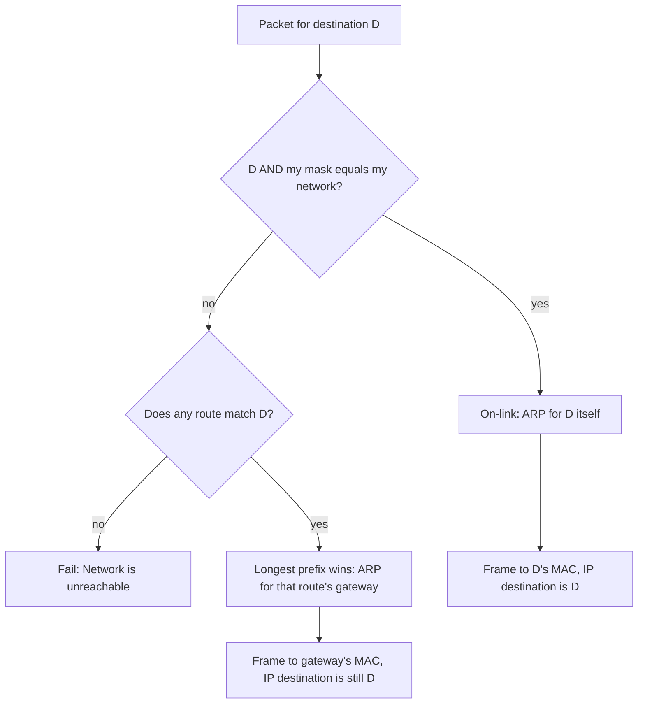

**Navigation**: [← Fundamentals](04_Networking_Complete.md) | [Index](00_INDEX.md) | [Next → TCP/UDP](06_TCP_UDP_Deep_Dive.md)

# 🌍 Chapter 5: IP Addressing, Subnets & Routing — The Internet's Postal System

_"Every device on the internet has an address. Understanding IP addressing is like understanding how the postal system works — without it, you can't send or receive anything."_

> **Verified on:** WSL2 Ubuntu 24.04.1 (kernel 6.6.87.2-microsoft-standard-WSL2), iproute2 6.1.0, Python 3.12.3. Subnet arithmetic was checked with Python's `ipaddress` module; routing, ARP and port behaviour were run in private network namespaces (`unshare -rn`). Not verified here: NAT (no `nft`/`iptables` binary), DHCP, `traceroute`/`mtr`/`arp`/`tcpdump` (not installed).

---

# PART 0: The Problem, Derived — What Would You Have to Invent?

---

Start with two machines and a cable: no addresses are needed, whatever you send arrives at the only other machine. Add a third and a fourth on a shared medium and you must say *who a message is for*. Walk forward from there and watch what each fix forces you to invent.

**1. Give every interface a number.** Each message carries a destination number, and each machine only accepts messages carrying its own. IPv4 uses 32 bits, so there are 2^32 = 4,294,967,296 numbers.

**2. A flat list of numbers cannot be routed.** Once networks are joined by routers, a router must answer one question for every packet: *which link do I send this out of?* If the numbers carry no structure (host 1, host 2, ... assigned in order of purchase), the only way to answer is a table with one entry per host. Python gives the cost:

```text
>>> 2**32 * 8 / 2**30       # entries x 8 bytes each, in GiB
32.0
```

That is 32 GiB of table in *every* router, and every new machine anywhere would have to be announced to all of them. The fix you have to invent is **addresses with structure**, so one table entry can stand for a whole group: split the number into a *network part* (leading bits) and a *host part* (trailing bits). A router then stores "everything beginning with these 24 bits goes out port 3", one entry for 256 hosts, and a shorter prefix covers even more.

**3. Where does the split go?** The first answer was a fixed split (classes A, B and C: 8, 16 or 24 network bits). It wastes space badly: a company needing 300 addresses had to take a /16 with 65,536, using 0.46% of it. So make the split a number carried with the address, the **prefix length**: `/n` means "the first n bits are the network". That is CIDR, and the **mask** is the same information written as 32 bits (`/24` = `255.255.255.0`).

**4. Prefixes nest, so several entries can match.** `10.0.0.0/8` contains `10.5.0.0/16`, which contains `10.5.3.0/24`. A destination can match all three; the rule you must invent to make forwarding unambiguous is **the longest matching prefix wins** (the most specific route). The default route `0.0.0.0/0` matches everything with the shortest possible prefix, so it only applies when nothing else does.

**5. A host asks the same question before it sends anything.** "Is the destination on my own link, or must I hand it to a router?" It answers with the mask: if `destination AND mask` equals `my address AND mask`, deliver directly, otherwise use the routing table.



**How to read this diagram.** Start at the top. The first diamond is the host's own subnet test: it is the *only* place the mask is used on the sending host, and everything depends on it being right. A "yes" means the packet goes straight onto the wire addressed to D's hardware address. A "no" means the routing table decides: no match is an immediate error, a match sends the frame to the *gateway's* hardware address while the IP destination stays D. The last two boxes are why the IP address is end-to-end and the MAC address is hop-by-hop.

**6. What is left over becomes the rest of this chapter.** Finding the hardware address on a link (ARP, Part 4), running out of numbers (NAT in Part 3, IPv6 in Part 6), configuring hosts automatically (DHCP, Part 7) and letting routers learn their tables (Part 8).

## The decisions on real output

Everything above was run in three private network namespaces (client A `10.0.1.10/24`, router R with `10.0.1.1` and `10.0.2.1`, server B `10.0.2.10/24`, built in the Lab below). A router's table with nested prefixes, asked where a packet would go (`ip route get`):

```text
$ ip route          (a host with these routes)
default via 192.168.1.1 dev d0
10.0.0.0/8 via 10.0.1.1 dev d1
10.0.1.0/24 dev d1 proto kernel scope link src 10.0.1.2
10.5.0.0/16 via 10.0.9.1 dev d2
10.5.3.0/24 via 172.16.0.1 dev d3
192.168.1.0/24 dev d0 proto kernel scope link src 192.168.1.5
$ ip route get 10.5.3.42      ->  via 172.16.0.1 dev d3     (the /24 wins)
$ ip route get 10.5.8.8       ->  via 10.0.9.1  dev d2      (the /16 wins)
$ ip route get 10.200.0.1     ->  via 10.0.1.1  dev d1      (only the /8 matches)
$ ip route get 142.250.80.4   ->  via 192.168.1.1 dev d0    (default route)
$ ip route get 192.168.1.77   ->  dev d0                    (no "via": on-link)
```

(Each `->` line is the `ip route get` output trimmed to its route part; the full output also prints `src`, `uid` and `cache`. The mask-mismatch block below is trimmed in the same way, keeping the line that matters from each command.)

The `via` word is the whole distinction between steps "on-link" and "gateway" in the diagram. Now watch one ping cross the router, capturing on both sides. The output comes from a 40-line Python `AF_PACKET` sniffer (`tcpdump` is not installed here); the layout is the sniffer's own, not tcpdump's:

```text
--- wire between A and R:
ARP  who-has 10.0.1.1 tell 10.0.1.10      (eth dst ff:ff:ff:ff:ff:ff)
ARP  10.0.1.1 is-at 72:96:73:94:46:7e
IP   10.0.1.10 > 10.0.2.10: ICMP echo request, ttl 64   (eth ae:12:d0:6a:8f:25 > 72:96:73:94:46:7e)
IP   10.0.2.10 > 10.0.1.10: ICMP echo reply,   ttl 63   (eth 72:96:73:94:46:7e > ae:12:d0:6a:8f:25)
--- wire between R and B:
ARP  who-has 10.0.2.10 tell 10.0.2.1      (eth dst ff:ff:ff:ff:ff:ff)
ARP  10.0.2.10 is-at 7a:5a:76:18:85:b3
IP   10.0.1.10 > 10.0.2.10: ICMP echo request, ttl 63   (eth 22:b8:19:5f:5c:d9 > 7a:5a:76:18:85:b3)
IP   10.0.2.10 > 10.0.1.10: ICMP echo reply,   ttl 64   (eth 7a:5a:76:18:85:b3 > 22:b8:19:5f:5c:d9)
```

Three facts are visible that prose only asserts. A asked ARP for the *router* (`10.0.1.1`), not for B, because B failed the subnet test. The IP source and destination are identical on both wires while the Ethernet addresses are completely different (router rewrites them at each hop). And the **TTL** went from 64 to 63: every router decrements it, which is how loops die and how traceroute works (Chapter 15).

The same ping with a *wrong mask* shows what the subnet test costs when it lies. Re-address A as `10.0.1.10/16` (so `10.0.2.10` now looks on-link, because both share the first 16 bits):

```text
$ ip route                      ->  10.0.0.0/16 dev a0 proto kernel scope link src 10.0.1.10
$ ping -c2 -W2 10.0.2.10        ->  2 packets transmitted, 0 received, 100% packet loss
$ nc -zv -w5 10.0.2.10 80       ->  nc: connect to 10.0.2.10 port 80 (tcp) failed: No route to host
$ ip neigh                      ->  10.0.2.10 dev a0  INCOMPLETE   (becomes FAILED once the probes give up)
wire:  ARP  who-has 10.0.2.10 tell 10.0.1.10      (repeated about once a second, never answered)
```

A is shouting an ARP request on its own link for a host that lives on another link; nobody there owns `10.0.2.10`, so ARP never completes and, after roughly three seconds of unanswered probes, the kernel reports `No route to host` (`EHOSTUNREACH`). With a shorter `nc -w2` you see a plain timeout instead, because `nc` gives up before ARP does. The routing table looked fine; the **mask** was wrong. That is the classic "everything is configured, but one VLAN cannot talk to another" bug.

---

# PART 1: The History of IP Addressing

---

```
THE PROBLEM (1960s-1970s):
  ARPANET had 4 nodes. Addressing was trivial: "send to node 2."
  By 1981: hundreds of hosts. Need a SCALABLE addressing system.

1981 — IPv4 DEFINED (RFC 791):
  32-bit addresses. 2^32 = 4,294,967,296 possible addresses.
  Seemed infinite at the time. The internet was < 1,000 hosts.

1993 — CIDR INTRODUCED (classless addressing):
  Original "classful" system (Class A, B, C) wasted addresses.
  CIDR allows variable-length subnets. Saves millions of addresses.

1994 — NAT INVENTED:
  Network Address Translation. Multiple devices share ONE public IP.
  Delayed IPv4 exhaustion by decades. Your home router does NAT.

2011-2015 — IPv4 EXHAUSTION (corrected: the original note said 2012):
  IANA handed its last free /8 blocks to the regional registries in February 2011.
  The registries then ran out one by one (APNIC 2011, RIPE NCC 2012, ARIN 2015).
  Addresses now change hands on a secondary market and cloud providers charge for public IPv4.

2017+ — IPv6 ADOPTION GROWING:
  Google publishes the share of its users reaching it over IPv6 on a live statistics page;
  read the current number there (not fetched here) instead of trusting a figure in a chapter.
  Mobile networks: much 4G/5G traffic is IPv6 natively.
  But the enterprise world is still mostly IPv4 with NAT. Transition is slow.
```

---

# PART 2: IPv4 — Binary Math Deep Dive

---

```
AN IPv4 ADDRESS IS 32 BITS. PERIOD.

"192.168.1.100" is just a HUMAN-READABLE representation of 32 bits:

  192     .  168     .  1       .  100
  11000000   10101000   00000001   01100100

HOW TO CONVERT:
  192 = 128 + 64 = 2^7 + 2^6 = 11000000
  168 = 128 + 32 + 8 = 2^7 + 2^5 + 2^3 = 10101000
  1   = 2^0 = 00000001
  100 = 64 + 32 + 4 = 2^6 + 2^5 + 2^2 = 01100100

BINARY POSITION VALUES:
  128  64  32  16  8  4  2  1
  2^7  2^6 2^5 2^4 2^3 2^2 2^1 2^0

PRACTICE:
  What is 10.0.3.200 in binary?
  10  = 00001010
  0   = 00000000
  3   = 00000011
  200 = 11001000 (128 + 64 + 8 = 200)
  Answer: 00001010.00000000.00000011.11001000

SPECIAL ADDRESSES:
  0.0.0.0        → "this host" / unspecified (server binds to ALL interfaces)
  127.0.0.1      → loopback (localhost — talks to yourself, never leaves the machine)
  127.0.0.0/8    → entire loopback range (16 million addresses, ALL are localhost)
  255.255.255.255 → limited broadcast (all hosts on local network)
  169.254.x.x     → link-local / APIPA (no DHCP server found → self-assigned)
```

## Subnet Masks & CIDR — The Complete Math

```
THE SUBNET MASK DIVIDES AN IP INTO TWO PARTS:
  NETWORK part: identifies WHICH network (like a city)
  HOST part:    identifies WHICH device on that network (like a house number)

SUBNET MASK IN BINARY:
  255.255.255.0 = 11111111.11111111.11111111.00000000
                  ←──── network (24 bits) ────→←host→

  The 1s = network bits. The 0s = host bits.
  CIDR notation: /24 means "24 network bits, 8 host bits."

CALCULATING THE NETWORK ADDRESS:
  IP AND subnet mask = network address.

  IP:        192.168.  1.100 = 11000000.10101000.00000001.01100100
  Mask /24:  255.255.255.  0 = 11111111.11111111.11111111.00000000
  AND RESULT: 192.168.  1.  0 = 11000000.10101000.00000001.00000000

  Network address: 192.168.1.0
  This means: "all devices with IP 192.168.1.x are on the SAME network."

AVAILABLE HOST ADDRESSES:
  /24 gives 8 host bits → 2^8 = 256 total addresses.
  But: first address (192.168.1.0) = NETWORK address (identifies the subnet).
       last address (192.168.1.255) = BROADCAST address (reaches all hosts).
  USABLE hosts: 256 - 2 = 254 devices.

CIDR CHEAT SHEET:
  ┌──────┬────────────────┬────────┬──────────┬──────────────────────┐
  │ CIDR │ Subnet Mask    │ Hosts  │ Usable   │ Use Case             │
  ├──────┼────────────────┼────────┼──────────┼──────────────────────┤
  │ /32  │ 255.255.255.255│ 1      │ 1        │ Single host route    │
  │ /31  │ 255.255.255.254│ 2      │ 2*       │ Point-to-point link  │
  │ /30  │ 255.255.255.252│ 4      │ 2        │ Router-to-router     │
  │ /28  │ 255.255.255.240│ 16     │ 14       │ Small office         │
  │ /27  │ 255.255.255.224│ 32     │ 30       │ Small subnet         │
  │ /26  │ 255.255.255.192│ 64     │ 62       │ Medium subnet        │
  │ /25  │ 255.255.255.128│ 128    │ 126      │ Large subnet         │
  │ /24  │ 255.255.255.0  │ 256    │ 254      │ Standard LAN (home)  │
  │ /22  │ 255.255.252.0  │ 1,024  │ 1,022    │ Large office         │
  │ /20  │ 255.255.240.0  │ 4,096  │ 4,094    │ Campus network       │
  │ /16  │ 255.255.0.0    │ 65,536 │ 65,534   │ Large corporate      │
  │ /8   │ 255.0.0.0      │ 16.7M  │ 16.7M    │ ISP / the whole 10.x │
  └──────┴────────────────┴────────┴──────────┴──────────────────────┘

  Corrections (checked with Python's ipaddress module; every host count above is exact):
  - The original table listed "AWS VPC" for /8. A VPC cannot be a /8: AWS documents IPv4
    VPC blocks of /16 to /28 (from AWS documentation, not fetched here). The 10.0.0.0/8
    RFC 1918 block is what you CARVE VPC ranges out of.
  - The "2*" for /31 means: no network or broadcast address is reserved on a point-to-point
    link (RFC 3021), so both addresses are usable. ipaddress.ip_network("203.0.113.0/31").hosts()
    returns both; a /30 returns only .1 and .2.
  - Cloud providers also reserve a few addresses in every subnet (AWS reserves five, per its
    documentation, not fetched here), so a /28 gives fewer than 14 usable addresses there.

SUBNETTING EXERCISE:
  GIVEN: Network 10.0.0.0/16. You need 4 subnets.

  /16 = 65,536 hosts. Dividing into 4 → need 2 extra bits → /18.
  2^2 = 4 subnets. Each has 2^14 = 16,384 addresses (- 2 = 16,382 usable).

  Subnet 1: 10.0. 0.0/18  (10.0.0.1   → 10.0.63.254)
  Subnet 2: 10.0.64.0/18  (10.0.64.1  → 10.0.127.254)
  Subnet 3: 10.0.128.0/18 (10.0.128.1 → 10.0.191.254)
  Subnet 4: 10.0.192.0/18 (10.0.192.1 → 10.0.255.254)

  HOW? The /18 mask means the first 18 bits are network.
  16 original + 2 new = 18 → those 2 bits create 4 combinations (00, 01, 10, 11).

  In the third octet (bits 17-24):
  00xxxxxx = 0-63    → Subnet 1
  01xxxxxx = 64-127  → Subnet 2
  10xxxxxx = 128-191 → Subnet 3
  11xxxxxx = 192-255 → Subnet 4
```

---

# PART 3: Private, Public & Special IP Ranges

---

```
PRIVATE IP RANGES (RFC 1918):
  Not routed on the public internet. Free to use internally.

  ┌────────────────┬───────────────────────────────┬────────────┐
  │ Range          │ CIDR                          │ # Addresses│
  ├────────────────┼───────────────────────────────┼────────────┤
  │ 10.0.0.0/8     │ 10.0.0.0 → 10.255.255.255     │ 16,777,216 │
  │ 172.16.0.0/12  │ 172.16.0.0 → 172.31.255.255   │ 1,048,576  │
  │ 192.168.0.0/16 │ 192.168.0.0 → 192.168.255.255 │ 65,536     │
  └────────────────┴───────────────────────────────┴────────────┘

  Where used:
  10.x.x.x:       Large enterprise networks, AWS VPCs, K8s pod CIDRs.
  172.16-31.x.x:  Docker default bridge (172.17.0.0/16), medium networks.
  192.168.x.x:    Home routers, small offices.

WHY PRIVATE IPs EXIST:
  IPv4 only has 4.3 billion addresses. Connected devices (phones, laptops, servers, sensors) outnumber that.
  Solution: reuse private IPs behind NAT.
  Every home network uses 192.168.1.x → millions of homes reuse the SAME addresses.
  Each home's router translates (NAT) to its unique public IP.
```

## NAT (Network Address Translation) — The Deep Dive

```
NAT IS THE REASON IPv4 STILL WORKS.

HOW NAT WORKS — Step by Step:

  Your laptop (192.168.1.100) wants to visit google.com (142.250.80.4).

  1. OUTGOING PACKET from laptop:
     Source: 192.168.1.100:49872   Destination: 142.250.80.4:443

  2. ROUTER performs SNAT (Source NAT):
     Rewrites source IP to router's PUBLIC IP.
     Records the mapping in NAT table.

     NAT TABLE:
     ┌────────────────────────┬────────────────────┐
     │ Internal               │ External           │
     ├────────────────────────┼────────────────────┤
     │ 192.168.1.100:49872    │ 203.45.67.89:50001 │
     │ 192.168.1.101:52344    │ 203.45.67.89:50002 │
     │ 192.168.1.102:60122    │ 203.45.67.89:50003 │
     └────────────────────────┴────────────────────┘

     Translated packet:
     Source: 203.45.67.89:50001   Destination: 142.250.80.4:443

  3. GOOGLE RESPONDS to 203.45.67.89:50001.

  4. ROUTER receives response, looks up NAT table:
     "Port 50001 → 192.168.1.100:49872"
     Rewrites destination back to internal IP.

     Translated packet:
     Source: 142.250.80.4:443   Destination: 192.168.1.100:49872

  5. LAPTOP receives the response.

NAT TYPES:
  SNAT (Source NAT): Rewrite source IP (outgoing — your home router does this).
  DNAT (Destination NAT / Port Forwarding): Rewrite destination IP (incoming).
    → "Port 8080 on my public IP → forward to 192.168.1.50:80 (web server)"

  PAT (Port Address Translation / NAT Overload):
    Many-to-one: many internal IPs → one public IP (using different ports).
    THIS is what your home router does. Also called "masquerading."

PROBLEMS WITH NAT:
  1. Breaks peer-to-peer: two devices behind NAT can't directly connect.
     → Solutions: STUN, TURN, ICE (used by WebRTC for video calls).
  2. Performance: router must inspect + rewrite EVERY packet.
  3. Debugging: logs show public IP, not internal IP → need NAT table correlation.
  4. Protocols that embed IP in payload (SIP, FTP active mode) break behind NAT.
     → ALG (Application Layer Gateway) needed for special handling.
```

**Why a NAT box must keep state (derived).** Rewriting the source address on the way out is easy. The hard part is the reply: it arrives addressed to the *shared* public IP, and the only thing that says which inside host it belongs to is the port, so the router must remember a mapping from (public port) to (inside IP, inside port) for every live flow. Three consequences follow without any further assumption. Unsolicited inbound packets match no mapping and are dropped, which is the "accidental firewall" the Reality Check warns about. The mapping table has a size limit and idle timeouts, so a long-idle connection (a quiet database or SSH session) can silently lose its mapping and die: this is what TCP keepalives are for. And because the table is memory, restarting the NAT device drops every flow through it. On Linux that table is **conntrack**, filled in by the masquerade/SNAT/DNAT rules shown in [Chapter 10](10_Firewalls_Access_Control.md). Not verified here: this lab has no `nft` or `iptables` binary, so NAT translation itself was not run; the local port-exhaustion behaviour in the challenge below was.

---

🔬 **Section Challenge — NAT (Network Address Translation) — The Deep Dive**

**Challenge 1 (Reasoning):** Your server behind a NAT router handles 70,000 concurrent WebSocket connections to a single external API. Connections start failing with "cannot assign requested address." The server has plenty of CPU and memory. What's the bottleneck?

<details><summary>Answer</summary>

**Ephemeral port exhaustion, and the first place it happens is the server itself, not the NAT box.** (The original answer blamed the NAT table; that is the second limit, not the one this error message reports.) A TCP connection is identified by the 4-tuple (source IP, source port, destination IP, destination port). To one destination `IP:port`, a single source IP can therefore hold only as many connections as it has free source ports. On Linux the pool is `net.ipv4.ip_local_port_range`, which defaults to `32768 60999` here: **28,232 ports**, so 70,000 connections to one `IP:port` cannot fit even before NAT is involved. `connect()` fails with `EADDRNOTAVAIL` ("Cannot assign requested address") from the local kernel; a NAT router that runs out of ports does not send your process that error, you see timeouts or dropped connections instead. The error was reproduced with a deliberately tiny range:

```text
$ sysctl -w net.ipv4.ip_local_port_range="40000 40004"     # a 5-port range, in a private namespace
connection  1: local port 40002
connection  2: local port 40000
connection  3: local port 40001
connection  4: local port 40003
connection  5: EADDRNOTAVAIL - Cannot assign requested address
```

(Five ports in the range, four connections made before the error; the kernel's port-selection details decide the exact count, so do not rely on "range size = connections".) **Fixes, in order:** (1) pool and reuse connections, or multiplex requests over fewer connections (HTTP/2 and WebSockets exist for this); (2) widen the range (`sysctl net.ipv4.ip_local_port_range="1024 65535"`, at most about 64,500 ports); (3) give the host more source IPs, or spread across several destination IPs or ports, since the limit is per destination; (4) behind PAT, the shared public IP has the same arithmetic, so add public IPs to the NAT pool. Sockets in `TIME_WAIT` hold their port for 60 seconds on Linux after close, so fast open-and-close patterns exhaust the pool well below the theoretical connection count. **Check:** `ss -s` (counts by state) and `ss -tan state time-wait | wc -l`. Thousands of `TIME_WAIT` entries to one destination is the telltale sign. NAT-table limits are a separate check on the router (`conntrack -C` against `nf_conntrack_max`, not verified here).

</details>

# PART 4: ARP (Address Resolution Protocol) — IP → MAC

---

```
THE PROBLEM:
  You know the IP address (192.168.1.1) but Ethernet needs a MAC address.
  How do you find the MAC address for an IP on your local network?

ARP IS THE ANSWER:

  Step 1: Machine A wants to send to 192.168.1.1.
  Step 2: A checks its ARP cache (maybe it already knows the MAC).
  Step 3: If not cached → A broadcasts an ARP Request to ALL devices:
          "Who has IP 192.168.1.1? Tell 192.168.1.100"
          Destination MAC: FF:FF:FF:FF:FF:FF (broadcast)
  Step 4: The device with IP 192.168.1.1 responds (unicast):
          "192.168.1.1 is at MAC AA:BB:CC:DD:EE:01"
  Step 5: A stores this in ARP cache. (Corrected: the note said "5-20 min". On Linux an entry stays
          REACHABLE for base_reachable_time_ms = 30000 (about 30 s, randomised 0.5x to 1.5x), then goes
          STALE and is re-checked only when used; gc_stale_time = 60 s. Read yours with
          sysctl net.ipv4.neigh.default.base_reachable_time_ms.)
  Step 6: A can now construct the Ethernet frame with correct MAC.

ARP IS LAYER 2 — it does NOT cross routers!
  If destination is on a DIFFERENT subnet → ARP for the default gateway instead.
  The gateway (router) then forwards the packet to the next hop.

ARP SPOOFING / POISONING (SECURITY THREAT):
  Attacker sends fake ARP replies: "I am 192.168.1.1, my MAC is ATTACKER_MAC."
  All traffic to the gateway now goes through the attacker (Man-in-the-Middle).
  Defense: Dynamic ARP Inspection (DAI) on managed switches.
```

```bash
# ── ARP COMMANDS ──

# Show ARP cache
arp -a                         # All platforms
ip neigh show                  # Linux (modern)

# Example output (illustrative addresses; real output seen on this lab's eth0 was
# "172.24.80.1 dev eth0 lladdr 00:15:5d:59:ab:41 STALE"):
# 192.168.1.1   dev eth0  lladdr AA:BB:CC:DD:EE:01  REACHABLE
# 192.168.1.102 dev eth0  lladdr CC:DD:EE:FF:00:11  STALE
# Note: the `arp` command comes from the legacy net-tools package and is not installed on
# Ubuntu 24.04 by default; `ip neigh` is the iproute2 equivalent and was used for every
# ARP observation in this chapter.

# Manually add a static ARP entry (prevent ARP spoofing for critical hosts)
sudo arp -s 192.168.1.1 AA:BB:CC:DD:EE:01

# Clear ARP cache
sudo ip neigh flush all        # Linux
```

---

# PART 5: MAC Addresses — The Physical Identity

---

```
EVERY NETWORK INTERFACE HAS A MAC ADDRESS:
  48 bits (6 bytes), written in hex:
  AA:BB:CC:DD:EE:FF

  STRUCTURE:
  ┌──────────────────┬──────────────────┐
  │ OUI (24 bits)    │ Device ID (24)   │
  │ Manufacturer     │ Unique per device│
  ├──────────────────┼──────────────────┤
  │ AA:BB:CC         │ DD:EE:FF         │
  └──────────────────┴──────────────────┘

  OUI (Organizationally Unique Identifier):
  Assigned by IEEE. Each manufacturer gets a unique OUI.
  00:50:56 = VMware
  B8:27:EB = Raspberry Pi Foundation
  (The original list also gave "AC:DE:48 = Apple". That could not be confirmed here, no OUI
  database is installed, so it has been removed rather than trusted; look prefixes up in the
  IEEE registry. The two above are from the IEEE registry and were not re-checked here.)

  You can look up any MAC address: https://macvendors.com/

  Not every MAC has a real OUI. Bit 1 (0x02) of the first byte is the "locally administered"
  flag: virtual devices such as veth pairs, bridges and containers get random MACs with it set.
  Example from this lab: ae:12:d0:6a:8f:25 -> first byte 0xae = 10101110, bit 0x02 is 1, so
  it is locally administered and has no vendor.

IMPORTANT DISTINCTIONS:
  MAC address: Layer 2 — NEVER leaves the local network segment.
  IP address:  Layer 3 — routed across the internet.

  When a packet crosses a router:
  → Source and destination MAC addresses CHANGE at each hop.
  → Source and destination IP addresses STAY THE SAME end-to-end.

  ANALOGY: A letter traveling through the postal system.
  MAC = the delivery truck's license plate (changes for each leg of the journey).
  IP = the address on the envelope (stays the same from sender to recipient).
```

---

# PART 6: IPv6 — The Future (and Present)

---

```
WHY IPv6?
  IPv4: 4.3 billion addresses. NOT ENOUGH.
  IPv6: 3.4 × 10^38 addresses = 340 undecillion.
  (Corrected: the original sentence claimed "every ATOM on Earth several billion addresses".
  That is off by about 21 orders of magnitude: Earth has roughly 10^50 atoms (an astronomy
  estimate, not measured here) against 2^128 = 3.40e38 addresses, which is about 2.6e-12
  addresses per atom. A true comparison: 2^128 / 5.1e14 square metres of Earth's surface
  is roughly 6.7e23 addresses per square metre.)

IPv6 ADDRESS FORMAT:
  128 bits, written as 8 groups of 4 hex digits:
  2001:0db8:85a3:0000:0000:8a2e:0370:7334

  Shortening rules:
  1. Leading zeros can be dropped: 0db8 → db8
  2. One group of consecutive all-zero blocks → ::
     2001:db8:0:0:0:0:0:1 → 2001:db8::1

  COMMON ADDRESSES:
  ::1             → loopback (equivalent to 127.0.0.1)
  ::              → unspecified (equivalent to 0.0.0.0)
  fe80::/10       → link-local (auto-configured on every interface)
  fc00::/7        → unique local (equivalent to private IPv4 ranges; in practice you pick
                    addresses from its fd00::/8 half, RFC 4193; the original note said fd00::/8)
  2000::/3        → global unicast (publicly routable, assigned by ISPs)

KEY DIFFERENCES FROM IPv4:
  1. NO NAT: every device gets a globally unique public IP. End-to-end connectivity!
  2. NO BROADCAST: replaced by multicast (ff02::1 = all nodes).
  3. NO ARP: replaced by NDP (Neighbor Discovery Protocol) — uses ICMPv6.
  4. AUTO-CONFIGURATION: SLAAC (Stateless Address Auto-Configuration).
     Device generates its own IPv6 address from a network prefix (advertised by the router)
     plus an interface identifier. The original EUI-64 method builds that identifier from the
     MAC; seen in this lab: MAC b2:ba:d4:92:0d:2f gave link-local fe80::b0ba:d4ff:fe92:d2f
     (flip bit 0x02 of the first byte: b2 -> b0, insert ff:fe in the middle; the sysctl
     net/ipv6/conf/<if>/addr_gen_mode was 0 = EUI-64 in a fresh namespace). Many systems now
     use random "stable privacy" or temporary addresses instead, so the MAC does not leak into
     every address you ever use.
     No DHCP needed (though DHCPv6 exists for additional config).
  5. IPsec: originally REQUIRED in every IPv6 node, but later node-requirements guidance
     (RFC 6434, if you want to read it) downgraded that to recommended. Corrected: the original
     note called it "MANDATORY". In practice TLS and SSH, not IPsec, protect most traffic.
  6. SIMPLIFIED HEADER: fixed 40-byte header (IPv4 has variable-length header).
     Extension headers replace IPv4's options field → faster processing.

DUAL STACK:
  Today, most systems run IPv4 AND IPv6 simultaneously.
  When connecting to a server:
  1. Try IPv6 first (if available).
  2. Do not WAIT for it to fail: start the IPv4 attempt after a short delay (RFC 8305
     recommends 250 ms) and use whichever connects first.
  Called "Happy Eyeballs" algorithm (RFC 8305). Without the delay-then-race, a broken IPv6
  path would make every connection hang for the full connect timeout before falling back.
```

---

# PART 7: DHCP — Automatic IP Assignment

---

```
WITHOUT DHCP:
  You manually configure each device: IP address, subnet mask, gateway, DNS servers.
  100 devices? = 100 manual configurations. Change the gateway? → 100 updates.

WITH DHCP (Dynamic Host Configuration Protocol):
  Device boots → asks for an IP → DHCP server assigns one automatically.
  Also configures: subnet mask, default gateway, DNS servers, lease time.

THE DORA PROCESS:
  D — DISCOVER: Client broadcasts "any DHCP servers out there?" (who am I?)
  O — OFFER:    Server responds "how about 192.168.1.100 for 24 hours?"
  R — REQUEST:  Client says "yes, I'll take 192.168.1.100"
  A — ACK:      Server confirms "it's yours for 24 hours!"

  The client can RENEW the lease at 50% of the lease time.
  If not renewed and lease expires → client must go through DORA again.

DHCP SCOPES:
  Pool: 192.168.1.100 - 192.168.1.200 (100 addresses for dynamic assignment)
  Reserved: 192.168.1.10-99 (for servers, printers — static IPs via DHCP)
  Excluded: 192.168.1.1-9 (network devices — configured manually)

  DHCP Reservation: "device with MAC AA:BB:CC:DD:EE:01 ALWAYS gets 192.168.1.50"
  → Combines convenience of DHCP with predictability of static IPs.

SECURITY:
  DHCP Starvation Attack: attacker sends thousands of DISCOVER requests →
    exhausts all available addresses → legitimate devices can't get IPs.
  Rogue DHCP Server: attacker runs their own DHCP server →
    assigns a gateway IP they control → intercepts all traffic!

  Defense: DHCP Snooping on managed switches → only trusted ports can respond.
```

```bash
# ── DHCP COMMANDS ──

# View your DHCP lease (Linux). WHERE depends on which client the distro uses:
cat /var/lib/dhclient/dhclient.leases        # ISC dhclient, RHEL-style path (dhclient is not installed on this lab's Ubuntu 24.04)
nmcli connection show "Wired connection 1" | grep DHCP   # NetworkManager (nmcli is not installed here)
networkctl status eth0                       # systemd-networkd shows the lease (networkctl exists here;
                                             # this WSL2 NIC has a fixed address, so DHCP output was not verified)
# Corrected note: the dhclient path above is not universal; on Ubuntu 24.04 the lease is held
# by systemd-networkd or NetworkManager, and /usr/sbin/dhcpcd is what this lab has installed.
# The 50% renewal point is called T1; if renewal fails the client rebinds, by default at
# 87.5% of the lease (T2), by broadcasting to any server (RFC 2131 defaults).

# Release and renew DHCP lease
sudo dhclient -r eth0          # release current IP
sudo dhclient eth0             # request new IP

# Windows
ipconfig /release
ipconfig /renew
ipconfig /all                  # shows DHCP server, lease times, DNS servers
```

---

# PART 8: Routing — How Packets Navigate the Internet

---

```
ROUTING = deciding where to send a packet NEXT.

Every device with IP (your laptop, router, server) has a ROUTING TABLE.
When a packet needs to be sent:

  1. Check destination IP.
  2. Look in routing table for the MOST SPECIFIC match.
  3. Forward to the matching next hop (or directly if local).

ROUTING TABLE ON YOUR LAPTOP:
  ┌──────────────────┬──────────────┬────────────┬───────┐
  │ Destination      │ Gateway      │ Interface  │ Metric│
  ├──────────────────┼──────────────┼────────────┼───────┤
  │ 192.168.1.0/24   │ 0.0.0.0      │ eth0       │ 100   │
  │ 10.0.0.0/8       │ 10.0.1.1     │ tun0 (VPN) │ 50    │
  │ 0.0.0.0/0        │ 192.168.1.1  │ eth0       │ 200   │
  └──────────────────┴──────────────┴────────────┴───────┘

  Rules:
  → Packet to 192.168.1.50? Matches /24 → send directly on eth0 (local).
  → Packet to 10.5.3.42? Matches 10.0.0.0/8 → send via VPN (tun0).
  → Packet to 142.250.80.4 (Google)? No specific match → default route (0.0.0.0/0)
    → send to gateway 192.168.1.1 (your router) → router handles from here.

  LONGEST PREFIX MATCH: more specific = higher priority.
  /24 beats /16 beats /8 beats /0 (default route).

HOW DO ROUTERS LEARN ROUTES?

  STATIC ROUTING: Admin manually adds routes.
    ip route add 10.0.2.0/24 via 10.0.1.2
    Simple but doesn't scale. Used for small networks.

  DYNAMIC ROUTING PROTOCOLS:
  Routers TALK TO EACH OTHER and share route information.

  IGP (Interior Gateway Protocol — within an organization):
    RIP:  Distance-vector. Counts hops. Max 15 hops. Legacy. Simple. Slow to converge.
    OSPF: Link-state. Dijkstra's algorithm! Builds a complete map of the network.
          Converges fast. Used in enterprises AND ISPs. Most common IGP.
    EIGRP: Cisco proprietary. Hybrid. Fast convergence.
    IS-IS: Link-state. Similar to OSPF. Used by large ISPs.

  EGP (Exterior Gateway Protocol — between organizations):
    BGP (Border Gateway Protocol): THE protocol that runs the internet.
    Every ISP, cloud provider, and large enterprise uses BGP.
    "How does AT&T know to route to AWS? BGP."
    "How does AWS know to route to Google? BGP."

    BGP: path-vector. Exchanges lists of AS (Autonomous System) paths.
    AS = a collection of IP ranges under one administrative control.
    AWS = AS16509. Google = AS15169. AT&T = AS7018.

    BGP announcements:
    "AS16509 (AWS) can reach 54.123.0.0/16.
     To get there from AS7018 (AT&T): AS7018 → AS3356 → AS16509."

    BGP is the most critical protocol on the internet.
    A BGP misconfiguration can take down countries (Pakistan, 2008 → YouTube globally offline).
```

```bash
# ── ROUTING COMMANDS ──

# Show routing table
ip route show                  # Linux
route print                    # Windows
netstat -nr                    # macOS

# Add a static route
sudo ip route add 10.0.2.0/24 via 10.0.1.2

# Trace the route a packet takes (see every hop)
traceroute api.myapp.com       # Linux/macOS
tracert api.myapp.com          # Windows

# Example output (ILLUSTRATIVE: invented addresses and times; traceroute is not installed in this lab.
# A real hop-by-hop trace built with ping -t is shown in the Lab and in Chapter 15):
# 1  192.168.1.1      1.234 ms    ← your router
# 2  10.0.0.1         5.678 ms    ← ISP router
# 3  72.14.215.85     12.34 ms    ← backbone router
# ...
# 12 54.123.45.67     45.67 ms    ← destination server
# Each hop = one router the packet passes through.

# MTR: combine traceroute + ping (continuous monitoring)
mtr api.myapp.com
# Shows: each hop, loss %, average latency — live updating!
```

---

## Alternatives and When to Use Each

Every choice in this chapter trades something away. The table states what, so the right answer for your network is a decision rather than a habit.

| Decision | Choose A when | Choose B when | What the choice costs |
| --- | --- | --- | --- |
| Subnet size: one big `/16` vs many `/24` to `/28` | **Big:** a lab or a single small team, so there is nothing to separate | **Small:** you want separate security rules, route tables and failure domains per tier or per team | Big: one broadcast domain and one blast radius, and rules cannot target a tier. Small: addresses wasted at the edges, more routes, and a growth plan you must keep |
| Point-to-point link: `/30` vs `/31` | `/30` where old equipment may mishandle `/31` | `/31` (RFC 3021) on modern routers, to halve address use on thousands of links | `/31` has no network or broadcast address, so tools that assume them can misbehave |
| Host addressing: static vs DHCP vs DHCP reservation | Static for the router, DNS and DHCP servers themselves (they cannot ask for an address) | DHCP for everything that moves; a reservation (fixed by MAC) for servers and printers you want findable | Static: drift and typos with no central record. DHCP: a server and its scope become a dependency, and a rogue DHCP server can redirect traffic |
| Routes: static vs OSPF/IS-IS vs BGP | Static for a few stable paths | OSPF/IS-IS inside one organisation that changes often; BGP between organisations | Static does not react to failure. Dynamic protocols react but add convergence time, configuration and their own failure modes |
| Reaching the internet: NAT vs public IPv6 vs a proxy | NAT when you only have IPv4 and need outbound access from private addresses | Public IPv6 (with a firewall) for end-to-end reachability; a proxy when you want to inspect or log requests | NAT keeps per-flow state and breaks inbound reachability and peer-to-peer. IPv6 needs every dependency to speak it. A proxy sees only the protocols it understands |
| Two networks use the same range | **Renumber** one of them if you can, the only fix that stays fixed | **Translate** between them (NAT in both directions) only as a stop-gap; or expose single services through a proxy or private endpoint instead of routing the networks | Renumbering is slow and risky. Translation hides the real source address, breaks protocols that carry IPs in their payload, and makes logs ambiguous |

**When to avoid each, in one line.** Do not use a `/16` flat network once more than one team shares it. Do not use `/31` where you cannot test the far end. Do not use static routes for anything you cannot afford to fix by hand at 3 a.m. Do not rely on NAT as your firewall (Reality Check). Do not peer two networks before running an overlap check.

## How It Fails and How to Debug It

Each row was reproduced in the Lab network below unless marked otherwise. Run the proving command before you change anything.

| Symptom | Cause | Command that proves it |
| --- | --- | --- |
| `connect: Network is unreachable` (`ENETUNREACH`) instantly | No route matches the destination, and no default route exists | `ip route get <dst>` prints `RTNETLINK answers: Network is unreachable` |
| `No route to host` (`EHOSTUNREACH`) after about 3 seconds | The destination looks on-link (wrong mask or wrong VLAN), so ARP never gets an answer | `ip neigh` shows `INCOMPLETE` then `FAILED`; `ip -br addr` shows the mask |
| `ping` loses every packet, nothing else is wrong | The router has IP forwarding off, so the packet reaches it and goes no further | `sysctl net.ipv4.ip_forward` prints `0` on the router (observed: request visible on the near side, nothing on the far side) |
| `ping` loses every packet, but the destination *receives* the request | The destination has no route back to the source's subnet | on the destination, `ip route get <source-ip>` fails; the capture shows the same echo request arriving twice and no reply |
| `Error: Nexthop has invalid gateway` when adding a route | The gateway is not inside any directly attached subnet | `ip -br addr` and check the gateway against each prefix |
| `Cannot assign requested address` on `connect()` | Local ephemeral ports to that destination are used up | `sysctl net.ipv4.ip_local_port_range`, `ss -s` |
| Peering or VPN will not come up, or traffic goes to the wrong place | The two sides use overlapping ranges | `python3 -c "import ipaddress as i; print(i.ip_network('10.20.0.0/16').overlaps(i.ip_network('10.20.128.0/17')))"` prints `True` |
| Two hosts fight over one address, intermittent loss (not reproduced here) | Duplicate IP on one link, ARP table flapping between two MACs | `ip neigh` showing the MAC change; `arping -D` (not installed here) |

## Lab: Build a Router in Three Namespaces and Break It on Purpose

Needs WSL2 or any Linux with `iproute2`, `ping`, `nc` and Python 3. No root needed: `unshare -rn` gives you a private network namespace in which you are root. Nothing touches your real network. The commands below were run on the lab described in the Verified on line.

**Part A: subnet arithmetic (five minutes, no network).**

1. Plan a `10.20.0.0/16` VPC for four tiers: web 500 hosts, app 200, db 50, management 10. Largest first, so each block starts on its natural boundary:

```python
import ipaddress as ip, math
cur = int(ip.ip_network("10.20.0.0/16").network_address)
for name, hosts in [("web", 500), ("app", 200), ("db", 50), ("mgmt", 10)]:
    prefix = 32 - math.ceil(math.log2(hosts + 2))        # +2 for network and broadcast
    net = ip.ip_network((cur, prefix)); cur += net.num_addresses
    print(f"{name:5} needs {hosts:3} -> {net}  usable {net.num_addresses - 2}")
print("next free:", ip.ip_address(cur))
```

Expected result:

```text
web   needs 500 -> 10.20.0.0/23  usable 510
app   needs 200 -> 10.20.2.0/24  usable 254
db    needs  50 -> 10.20.3.0/26  usable 62
mgmt  needs  10 -> 10.20.3.64/28  usable 14
next free: 10.20.3.80
```

Check: `ip.ip_network("10.20.3.64/28").subnet_of(ip.ip_network("10.20.0.0/16"))` is `True`, and none of the four overlaps another (`a.overlaps(b)` is `False` for each pair). Note the order: allocating small blocks first would leave gaps the large block could not use, because a `/23` must start on an even third octet.

**Part B: the router (ten minutes).**

2. Save and run this script. It creates client A, server B and a router (the namespace the script itself runs in), with `a`/`b` as shortcuts to run a command inside each. Outputs from step 3 on are printed.

```bash
unshare -rn bash -c '
exec 2>&1
ip link set lo up
unshare -n sleep infinity & A=$!          # client namespace
unshare -n sleep infinity & B=$!          # server namespace
sleep 0.5
a() { nsenter -t $A -n "$@"; }; b() { nsenter -t $B -n "$@"; }
ip link add ra type veth peer name a0; ip link set a0 netns $A
ip link add rb type veth peer name b0; ip link set b0 netns $B
ip addr add 10.0.1.1/24 dev ra; ip link set ra up
ip addr add 10.0.2.1/24 dev rb; ip link set rb up
a ip link set lo up; a ip addr add 10.0.1.10/24 dev a0; a ip link set a0 up
b ip link set lo up; b ip addr add 10.0.2.10/24 dev b0; b ip link set b0 up

echo "## 3 no gateway";           a ping -c1 -W1 10.0.2.10
echo "## 4 gateways, forwarding"; a ip route add default via 10.0.1.1; b ip route add default via 10.0.2.1
sysctl net.ipv4.ip_forward;      a ping -c1 -W1 10.0.2.10 | tail -2
echo "## 5 forwarding on";        sysctl -w net.ipv4.ip_forward=1; a ping -c2 -W1 10.0.2.10 | sed -n "2,3p"
echo "## 6 traceroute by hand";   a ping -c1 -W1 -t 1 10.0.2.10 | sed -n 2p; a ping -c1 -W1 -t 2 10.0.2.10 | sed -n 2p
echo "## 7 wrong mask";           a ip addr flush dev a0; a ip addr add 10.0.1.10/16 dev a0; a ip neigh flush all
a ip route; a nc -zv -w5 10.0.2.10 80; a ip neigh
echo "## 8 no route back";        a ip addr flush dev a0; a ip addr add 10.0.1.10/24 dev a0; a ip route add default via 10.0.1.1
b ip route del default; a ping -c1 -W1 10.0.2.10 | tail -2; b ip route get 10.0.1.10
kill $A $B
'
```

Expected result (the lines that matter; the `time=` figures vary):

```text
## 3 no gateway
ping: connect: Network is unreachable
## 4 gateways, forwarding
net.ipv4.ip_forward = 0
1 packets transmitted, 0 received, 100% packet loss, time 0ms
## 5 forwarding on
net.ipv4.ip_forward = 1
64 bytes from 10.0.2.10: icmp_seq=1 ttl=63 time=0.058 ms
## 6 traceroute by hand
From 10.0.1.1 icmp_seq=1 Time to live exceeded
64 bytes from 10.0.2.10: icmp_seq=1 ttl=63 time=0.027 ms
## 7 wrong mask
10.0.0.0/16 dev a0 proto kernel scope link src 10.0.1.10
nc: connect to 10.0.2.10 port 80 (tcp) failed: No route to host
10.0.2.10 dev a0 FAILED
## 8 no route back
1 packets transmitted, 0 received, 100% packet loss, time 0ms
RTNETLINK answers: Network is unreachable
```

Check, by what each step proves: step 3 shows a route is a prerequisite for sending; step 4 shows a gateway alone is not enough (forwarding is a router-side switch, default `0`); step 5 shows `ttl=63`, one hop; step 6 is a traceroute with no traceroute binary (TTL 1 expires at the router, which answers with ICMP "time exceeded", TTL 2 reaches B); step 7 reproduces the mask bug; step 8 shows a one-way path: the request arrives, the reply has nowhere to go. If a step differs, run `ip addr`, `ip route` and `ip neigh` inside `a` and `b` first; the cause is always visible there.

**Stretch.** Add a third subnet `10.0.3.0/24` behind a second router and make A reach it with one static route on the first router (`ip route add 10.0.3.0/24 via <second-router-ip>`). Then add a more specific `/32` route for one address that points elsewhere, and confirm with `ip route get` that the `/32` wins.

🔬 **Section Challenge — Subnets, prefixes and the subnet test**

**Challenge 1 (Calculation):** You are given `10.20.0.0/16` and must fit web (500 hosts), app (200), db (50) and management (10) subnets. Give the prefix and range of each, and say whether a fifth subnet of 1,000 hosts still fits afterwards.

<details><summary>Answer</summary>

Each subnet needs `hosts + 2 <= 2^(32 - prefix)`. Web: 502 needs 512, so `/23`. App: 202 needs 256, so `/24`. Db: 52 needs 64, so `/26`. Management: 12 needs 16, so `/28`. Allocating largest first gives `10.20.0.0/23`, `10.20.2.0/24`, `10.20.3.0/26`, `10.20.3.64/28`, and the next free address is `10.20.3.80`. Largest-first matters because a block must start on a multiple of its own size. A subnet of 1,000 hosts needs 1,002 addresses, so a `/22` (1,024), which must start on a multiple of 4 in the third octet: the first possible start is `10.20.4.0`, and it fits there (`10.20.4.0/22` ends at `10.20.7.255`). The unused `10.20.3.80` to `10.20.3.255` stays available for small subnets. Python proves every step: `ip_network((cur, prefix))` and `overlaps()`. Also leave room: cloud providers reserve a few addresses in each subnet, so a `/28` is smaller than 14 there.

</details>

**Challenge 2 (Debugging):** Host `10.0.1.10/16` can ping everything in `10.0.1.0/24` but gets `No route to host` for `10.0.2.10`, which sits on a different segment behind a router at `10.0.1.1`. `ip route` on the host shows a default route via `10.0.1.1`. What is wrong and which two commands prove it?

<details><summary>Answer</summary>

The `/16` mask makes `10.0.2.10` fall inside the host's own network (`10.0.0.0/16`), so the subnet test says "on-link" and the kernel ARPs for `10.0.2.10` directly instead of sending to the router; nobody on that link owns it, ARP fails, and `connect()` returns `EHOSTUNREACH`. The default route is never consulted because a more specific connected route (`/16`) matches first. Proof: `ip route get 10.0.2.10` prints a line with `dev` and no `via`, and `ip neigh` shows the entry for `10.0.2.10` as `INCOMPLETE` or `FAILED`. Fix the host's mask to match the real segment (`/24`) at its source, usually the DHCP scope or the static configuration, rather than adding a host route as a workaround.

</details>

**Challenge 3 (Design):** After a merger, both companies' networks use `10.0.0.0/16`, and you must connect them so some services in each are reachable from the other. List your options in order of preference and what each costs.

<details><summary>Answer</summary>

First, run an overlap audit (`overlaps()` across every range each side uses), because the overlap may be partial and only one range needs to move. Preferred: **renumber** the smaller or younger network; it is slow but permanent, and the only option that leaves logs and routes unambiguous. If renumbering is blocked, **expose specific services** through a reverse proxy, VPN endpoint or cloud private-endpoint service so that only a few addresses cross, rather than routing the whole network. Last resort: **NAT in both directions** between the two address spaces (each side sees the other as a different, translated range). That works, but you pay for it: logs show translated addresses, protocols that embed IP addresses in their payload need helpers, and every new service needs a mapping entry. The reason the answer is never "just route it" is that a router cannot tell which of two identical `10.0.5.7` hosts a packet means; the prefix ambiguity from the derivation at the top of this chapter is exactly the problem.

</details>

🔬 **Section Challenge — Routing and failure analysis**

**Challenge 1 (Trace):** A host has routes: `default via 192.168.1.1`, `10.0.0.0/8 via 10.0.1.1`, `10.5.0.0/16 via 10.0.9.1`, `10.5.3.0/24 via 172.16.0.1`. For each destination, name the next hop: `10.5.3.42`, `10.5.8.8`, `10.200.0.1`, `8.8.8.8`. Then say what changes on the wire for the first one.

<details><summary>Answer</summary>

`10.5.3.42` goes to `172.16.0.1` (the `/24` is the longest match), `10.5.8.8` to `10.0.9.1` (`/16`; the `/24` does not contain it), `10.200.0.1` to `10.0.1.1` (only the `/8` contains it), `8.8.8.8` to `192.168.1.1` (only the default route matches). These were checked with `ip route get` in a lab with the same table. On the wire for the first packet the host ARPs for `172.16.0.1`, not for `10.5.3.42`: the Ethernet destination is the next hop's address while the IP destination stays `10.5.3.42`, and the TTL drops by one at every router that forwards it.

</details>

**Challenge 2 (Debugging):** From client A you ping server B across a router. A packet capture on B's side shows the echo request arriving, twice, one second apart, and nothing leaving. Nothing is wrong with the router. What is wrong, how do you prove it in one command on B, and what is the fix?

<details><summary>Answer</summary>

B received the request but has no route to A's subnet (no default route, and `10.0.1.0/24` is not directly attached), so it cannot send the reply. The repeated request is just ping's second probe. Prove it on B with `ip route get <A's address>`: it answers `RTNETLINK answers: Network is unreachable`. Fix: add a route back, either a default route via the router (`ip route add default via 10.0.2.1`) or a specific one (`ip route add 10.0.1.0/24 via 10.0.2.1`). The lesson is that routing is per direction: a ping that "does not work" may be failing on the return path, and only a capture or a look at the far end's table shows which direction broke.

</details>

## 🔗 Cross-References

| Topic                       | Related Content                                                                             |
| --------------------------- | ------------------------------------------------------------------------------------------- |
| **Dijkstra in OSPF**        | [Algorithms in Production](../03_Algorithms/13_Algorithms_In_Production.md) — shortest path |
| **Hash tables (ARP cache)** | [DS in Production](../02_Data_Structures/05_DS_In_Production.md)                            |
| **Binary math**             | [Bit Manipulation](../03_Algorithms/06a_Greedy_BitManip.md) — bit operations                |
| **AWS VPC subnets**         | [Cloud Networking](13_Cloud_Networking_VPC.md) — Terraform VPC                              |
| **NAT in Docker**           | [DevOps Fundamentals](00_DevOps_Fundamentals.md) — Docker bridge networking                 |
| **Kubernetes pod CIDR**     | [Networking & Security](02_Networking_Security.md) — K8s networking model                   |
| **TCP uses IP**             | [Ch 06: TCP/UDP Deep Dive](06_TCP_UDP_Deep_Dive.md)                                         |
| **DNS uses IP**             | [Ch 07: DNS Complete](07_DNS_Complete.md)                                                   |


---

## Reality Check

**"Subnetting is math you look up when needed"** — Subnet reasoning is a DAILY operational literacy in cloud: designing a VPC means choosing address ranges that will not collide when you peer networks or connect on-prem (the two-teams-both-used-10.0.0.0/16 merger nightmare — [cloud-networking]'s planning), sizing subnets for growth (the /28 that ran out of IPs mid-scale-up), and reading CIDR in security groups and route tables fluently (is this rule matching the range I think). The math is trivial; the SKILL is treating address space as a planned, finite, collision-prone resource rather than magic numbers the cloud assigns.

**"Private IP ranges are secure because they're not routable"** — Non-routability on the public internet is not a security control: the RFC1918 ranges (10.x, 172.16-31.x, 192.168.x) are reachable from anything ON the network or peered to it ([networking-security]'s trusted-internal fallacy — private does not mean isolated), NAT lets private hosts reach out (and the responses back), and misconfigured peering, VPN, or a compromised bastion bridges the "private" network to hostile territory. Private addressing is an addressing-scarcity and organization tool (reuse the same ranges in isolated networks), not a firewall — treating "it's on a private IP" as a security boundary is exactly the perimeter fallacy zero-trust exists to kill.

**"NAT is a security feature"** — NAT's security benefit is an ACCIDENT of its address-conservation purpose (inbound connections have no translation entry, so they are dropped — a side effect, not a designed control), and relying on it as security is fragile: it provides no protection for the outbound connections the private host initiates (the malware phoning home works fine through NAT), no defense once a connection is established, and IPv6 largely eliminates NAT (restoring end-to-end addressability, which means the firewall — not NAT — must be the actual control). NAT is address translation that happens to drop unsolicited inbound; a stateful firewall is the thing that intentionally controls access, and conflating them leaves you defended by a coincidence.

**"IPv6 is the future we can ignore for now"** — IPv6 is present-tense in the parts developers touch: mobile networks and major platforms are IPv6-first (the app that assumed IPv4-only address parsing that breaks on a v6 client — the ::1 versus 127.0.0.1 that your allow-list forgot), cloud environments increasingly dual-stack, and the address model differs enough to break naive assumptions (no NAT, so no "private means unreachable" reflex; different address notation your regex must handle; link-local and multiple-addresses-per-interface norms). Ignoring IPv6 is fine until a v6 client hits the code that assumed four dotted octets — and that code exists in more places than teams expect.

**"Address exhaustion is why we have IPv6"** — Exhaustion is the origin story, but the developer-relevant consequences are the daily ones: IPv4 scarcity is WHY NAT is everywhere (and why NAT's complications — connection tracking, port exhaustion at scale [servers/ports], the difficulty of peer-to-peer — pervade the internet), why cloud IPs cost money and get recycled (the DNS pointing at a reassigned IP — [servers/ports]' TTL trap), and why address PLANNING matters (you cannot just grab another /8). The exhaustion is abstract; its fingerprints — NAT everywhere, IPs as a managed resource, the elaborate machinery of address conservation — are what you actually work with.

**"`No route to host` and `Network is unreachable` mean the same thing"** — They come from different failures. `Network is unreachable` (`ENETUNREACH`) is immediate and means no route in the table matches. `No route to host` (`EHOSTUNREACH`) usually means a route matched and the host was supposed to be on the same link, but ARP got no answer (wrong mask, wrong VLAN, host down) or a router sent back an ICMP "host unreachable". Both were reproduced above, and the proving commands differ (`ip route get` versus `ip neigh`).

**"The IP address changes at each router"** — The IP source and destination stay the same end to end (apart from NAT). What the router rewrites is the Ethernet header, new source and destination MACs on each link, and the TTL, which drops by one. The packet capture in this chapter shows identical IP addresses and different MACs on the two sides of the router.

**"A /24 always gives you 254 hosts"** — 254 is `2^8 - 2` only when the first and last addresses are reserved as network and broadcast. A `/31` has no such reservation (RFC 3021), a `/32` is one host, and cloud providers reserve additional addresses in every subnet. Count what your platform actually leaves, not the textbook figure.

**"Widening `ip_local_port_range` lets one host open about 64,000 connections in total"** — The limit is per destination: a connection is identified by (source IP, source port, destination IP, destination port), so the same port can be reused toward a different destination. It also means the ceiling to one busy backend (for example a database or an API) is the first one you hit, which is why it shows up as `Cannot assign requested address` long before the host is "out of ports" overall.

**"A subnet mask is just a convenience for humans"** — It is the one input to the host's local-or-remote decision. A wrong mask changes which packets the host tries to deliver directly, and the routing table that looks correct is then never consulted for those destinations.

## Books

Chapter numbers and titles are from [BOOKS.md](BOOKS.md), which read them from each book's own table of contents.

| Book | Read | What it adds beyond this chapter |
| --- | --- | --- |
| *TCP/IP Illustrated, Volume 1: The Protocols*, 2nd ed., Stevens and Fall (PAID, Addison-Wesley Professional, 2011) | Ch 2 The Internet Address Architecture, Ch 4 ARP, Ch 5 The Internet Protocol (IP), Ch 6 System Configuration: DHCP and Autoconfiguration, Ch 7 Firewalls and Network Address Translation (NAT), Ch 8 ICMPv4 and ICMPv6 | The packet-level detail behind addressing, resolving, forwarding, NAT and error reporting, with the header fields explained. Read Ch 4 and Ch 5 next to the capture above, and Ch 8 for the "time exceeded" message that powers traceroute. |
| *Beej's Guide to Network Programming* (FREE) — https://beej.us/guide/bgnet/html/ | Ch 3 "IP Addresses, `struct`s, and Data Munging" (3.1 IP Addresses, versions 4 and 6; 3.2 Byte Order) | How addresses and byte order appear in actual C code, which is where the 32-bit and 128-bit numbers of this chapter become variables. |
