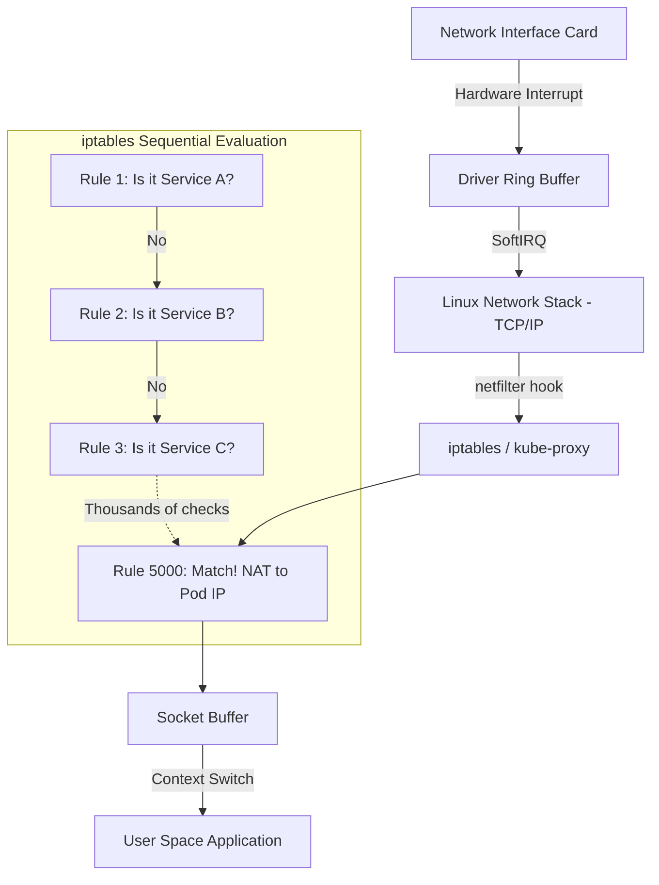
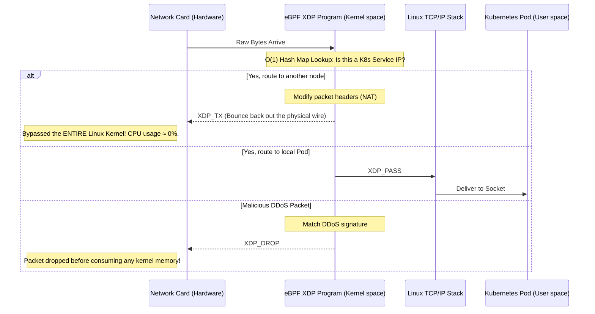
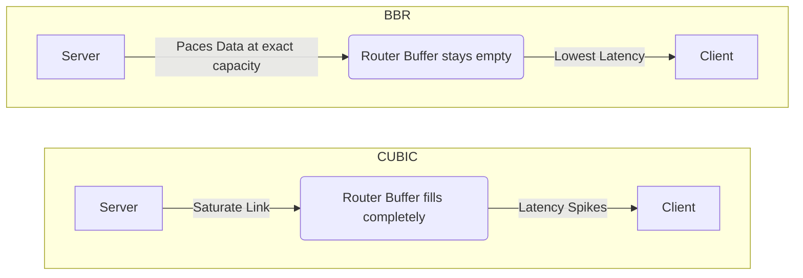

**Navigation**: [← IP Addressing](05_IP_Addressing_Subnets.md) | [Index](00_INDEX.md) | [Next → DNS](07_DNS_Complete.md)

# 📡 Chapter 6: TCP & UDP Deep Dive — The Transport Layer Explained

_"TCP is a conversation. UDP is shouting into a crowd. Knowing when to use each — and exactly HOW each works under the hood — is the difference between 'it works on my machine' and 'it works in production at scale.'"_

---

# PART 1: Why Two Protocols? TCP vs UDP Philosophy

---

```
THE FUNDAMENTAL TRADEOFF:
  RELIABILITY vs SPEED.
  
  TCP: "I will deliver every byte, in order, or die trying."
       Reliable. Ordered. Connection-oriented. Slower.
       Used for: HTTP, SSH, databases, email, file transfer.
  
  UDP: "I'll send it. Whether it arrives is your problem."
       Unreliable. Unordered. Connectionless. Fast.
       Used for: DNS, video streaming, gaming, VoIP, QUIC (HTTP/3).
  
  ANALOGY:
  TCP = Registered mail with tracking.
    Post office guarantees delivery. Tracks every step.
    If lost → resend. If out of order → reorder.
    Slower and more expensive.
  
  UDP = Postcard.
    Drop it in the mailbox. Hope it arrives.
    No tracking. No confirmation. No redelivery.
    Fast and cheap.

WHEN DOES "UNRELIABLE" MAKE SENSE?
  Video call: if one frame (33ms) is lost → show the NEXT frame.
    Retransmitting the old frame would arrive too late → useless.
    Better to lose a frame than delay the stream.
  
  Gaming: player position update at 60Hz.
    If one update is lost → the next update (16ms later) has newer position.
    Retransmitting old position = worse than skipping it.
  
  DNS: query is tiny (< 512 bytes). Response is tiny.
    If lost → application just retries. No need for TCP overhead.
    (Though DNS DOES fall back to TCP for large responses > 512 bytes!)
```

---

# PART 2: TCP — The Complete Deep Dive

---

## The TCP Segment Header

```
EVERY TCP SEGMENT HAS THIS HEADER (20 bytes minimum):

 0                   1                   2                   3
 0 1 2 3 4 5 6 7 8 9 0 1 2 3 4 5 6 7 8 9 0 1 2 3 4 5 6 7 8 9 0 1
├───────────────────────────────┼───────────────────────────────────┤
│       Source Port (16)        │     Destination Port (16)         │
├───────────────────────────────┴───────────────────────────────────┤
│                     Sequence Number (32)                          │
├───────────────────────────────────────────────────────────────────┤
│                  Acknowledgment Number (32)                       │
├──────────┬──────┬─┬─┬─┬─┬─┬─┬───────────────────────────────────==┤
│ Data Off │Resrv │C│E│U│A│P│R│S│F│      Window Size (16)           │
│   (4)    │ (4)  │W│C│R│C│S│S│Y│I│                                 │
│          │      │R│E│G│K│H│T│N│N│                                 │
├──────────┴──────┴─┴─┴─┴─┴─┴─┴─┴─┼───────────────────────────────==┤
│         Checksum (16)             │      Urgent Pointer (16)      │
├───────────────────────────────────┴───────────────────────────────┤
│                    Options (variable, 0-40 bytes)                 │
├───────────────────────────────────────────────────────────────────┤
│                    Data / Payload                                 │
└───────────────────────────────────────────────────────────────────┘

FIELD-BY-FIELD:

SOURCE PORT (16 bits):
  The sender's port. For client connections = random ephemeral (49152-65535).
  Allows the client to have MULTIPLE connections to the same server.

DESTINATION PORT (16 bits):
  The receiver's port. Usually well-known (80, 443, 22, 5432).

SEQUENCE NUMBER (32 bits):
  Position of the FIRST byte of data in this segment within the stream.
  Used for: ordering segments, detecting duplicates.
  
  Example: you send 1000 bytes in 3 segments:
  Segment 1: seq=0, data=bytes 0-499 (500 bytes)
  Segment 2: seq=500, data=bytes 500-799 (300 bytes)
  Segment 3: seq=800, data=bytes 800-999 (200 bytes)
  
  INITIAL SEQUENCE NUMBER (ISN):
  NOT 0! Randomly chosen at connection start.
  WHY random? Prevents old segments from a previous connection being mistaken for new ones.
  Also prevents TCP sequence prediction attacks.

ACKNOWLEDGMENT NUMBER (32 bits):
  "I've received all bytes up to this number. Send me the NEXT byte starting here."
  ACK = 500 means "I have bytes 0-499, send byte 500 next."
  Only valid when ACK flag is set.

FLAGS (9 bits, but 6 main ones):
  SYN: Synchronize sequence numbers (connection establishment)
  ACK: Acknowledgment number is valid
  FIN: Sender is FINISHED sending data (connection close)
  RST: RESET the connection (abort — something went wrong)
  PSH: PUSH data to application immediately (don't buffer)
  URG: Urgent data present (rarely used)
  CWR: Congestion Window Reduced (ECN congestion response)
  ECE: ECN-Echo (ECN congestion notification)

WINDOW SIZE (16 bits):
  "I can accept this many MORE bytes" — flow control.
  Prevents sender from overwhelming receiver.
  With Window Scaling option: up to 1 GB window (for high-bandwidth links).

CHECKSUM (16 bits):
  Error detection. Computed over header + data + pseudo-header (IP info).
  If checksum fails → segment is SILENTLY DISCARDED.

OPTIONS (variable):
  MSS (Maximum Segment Size): "My maximum payload is 1460 bytes" (typical for Ethernet).
  Window Scale: multiplier for window size (enables > 65KB windows).
  Timestamps: for RTT measurement and PAWS (Protection Against Wrapped Sequences).
  SACK (Selective ACK): "I'm missing bytes 1000-1499, but I HAVE 1500-2999."
    Without SACK: sender retransmits everything after the gap.
    With SACK: sender retransmits ONLY the missing range. Much more efficient!
```


🔬 **Section Challenge — The TCP Segment Header**

**Challenge 1 (Reasoning):** A TCP connection is in TIME_WAIT state. What is it waiting for and why 2×MSL (Maximum Segment Lifetime)?
<details><summary>Answer</summary>

TIME_WAIT: the side that sent the last ACK waits before fully closing. Why 2×MSL (~60-120 seconds): (1) Ensure the final ACK reached the other side (if it was lost, the other side will retransmit FIN — we need to still be listening to send a new ACK). (2) Allow all old segments in the network to expire (segment with old sequence number arriving for a new connection could corrupt data). Fast servers on many short connections: TIME_WAIT exhaustion → `SO_REUSEADDR`, `tcp_time_wait_reuse`, or HTTP keep-alive.
</details>


## The Three-Way Handshake — In Detail

```
CONNECTION ESTABLISHMENT (3 steps, 1.5 round trips):

Client                                Server
  |                                      |
  |-------- SYN (seq=ISN_C) -----------> |  Step 1: Client initiates
  |         flags: SYN                   |  ISN_C = random initial seq number
  |         window: 65535                |
  |         options: MSS=1460            |
  |                                      |
  |<--- SYN-ACK (seq=ISN_S, ack=ISN_C+1) |  Step 2: Server acknowledges + initiates
  |      flags: SYN, ACK                 |  ISN_S = server's random initial seq
  |      window: 65535                   |
  |      options: MSS=1460               |
  |                                      |
  |-------- ACK (ack=ISN_S+1) ---------> |  Step 3: Client acknowledges server's SYN
  |         flags: ACK                   |  Connection ESTABLISHED on both sides
  |         [may include data!]          |  Client can piggyback data with ACK
  |                                      |

WHY 3 STEPS (not 2)?
  2 steps: Client sends SYN. Server sends SYN-ACK.
  But: Client doesn't confirm it received SYN-ACK!
  → Server can't be sure the client is reachable.
  → Vulnerable to half-open connections (SYN flood attack).
  
  3 steps: Both sides confirm they can SEND and RECEIVE.
  Client proves it received SYN-ACK by sending ACK.

SYN FLOOD ATTACK:
  Attacker sends thousands of SYN packets with SPOOFED source IPs.
  Server allocates resources for each half-open connection (SYN queue).
  Server's SYN queue fills up → can't accept legitimate connections → DoS!
  
  DEFENSE: SYN cookies (server encodes state in the ISN → no SYN queue needed).
  When ACK arrives with correct cookie → accept connection.
  No memory allocated until 3-way handshake is complete.
```


## TCP State Machine — The 11 States

```
A TCP connection goes through a FINITE STATE MACHINE:

              ┌──────────┐
              │  CLOSED  │ ← initial state
              └────┬─────┘
                   │
          ┌────────┴────────┐
          │                 │
    passive open        active open
          │                 │
    ┌─────▼─────┐    ┌─────▼─────┐
    │  LISTEN   │    │  SYN_SENT │
    │(server    │    │(client    │
    │waiting)   │    │waiting    │
    └─────┬─────┘    │for SYN-ACK│
          │          └─────┬─────┘
    recv SYN         recv SYN-ACK
    send SYN-ACK     send ACK
          │                │
    ┌─────▼─────┐    ┌─────▼──────┐
    │ SYN_RCVD  │    │ESTABLISHED │ ← DATA TRANSFER HAPPENS HERE
    └─────┬─────┘    └─────┬──────┘
          │               │
    recv ACK           close()
          │               │
    ┌─────▼──────┐  ┌─────▼─────┐
    │ESTABLISHED│  │ FIN_WAIT_1│
    └────────────┘  └─────┬─────┘
                          │
                    recv ACK of FIN
                          │
                    ┌─────▼─────┐
                    │ FIN_WAIT_2│ → waiting for remote FIN
                    └─────┬─────┘
                          │
                    recv FIN, send ACK
                          │
                    ┌─────▼─────┐
                    │ TIME_WAIT │ → wait 2×MSL (60-120s)
                    └─────┬─────┘
                          │
                    timeout expired
                          │
                    ┌─────▼─────┐
                    │  CLOSED   │
                    └───────────┘

TIME_WAIT:
  After closing, the socket stays in TIME_WAIT for 60-120 seconds.
  WHY? To handle delayed packets from the old connection.
  If a stale packet arrives → TCP knows to discard it (connection is closing).
  
  PROBLEM IN PRODUCTION:
  High-traffic servers opening/closing thousands of connections per second
  → thousands of sockets stuck in TIME_WAIT → port exhaustion!
  
  SOLUTIONS:
  1. Connection pooling (reuse connections — don't close them!)
  2. SO_REUSEADDR: allow binding to a port in TIME_WAIT state.
  3. HTTP Keep-Alive: reuse TCP connection for multiple HTTP requests.
  4. Reduce TIME_WAIT duration: net.ipv4.tcp_fin_timeout (Linux sysctl).
```

```bash


🔬 **Section Challenge — TCP State Machine — The 11 States**

**Challenge 1 (Reasoning):** Your production server shows thousands of CLOSE_WAIT sockets (not TIME_WAIT). What’s different about CLOSE_WAIT, and whose bug is it — the client's or the server's?
<details><summary>Answer</summary>

**CLOSE_WAIT = YOUR application’s bug.** It means the remote side sent FIN (they’re done), your TCP stack ACK’d it, but YOUR application hasn’t called `close()` yet. The socket is stuck waiting for your code to finish. Unlike TIME_WAIT (kernel-managed, self-resolving), CLOSE_WAIT persists until the application closes the socket or the process dies. **Common causes:** (1) Not closing sockets in error paths (missing `finally` block). (2) Leaked connections in a pool. (3) Blocking read that never returns (peer crashed after FIN). **Fix:** Add socket timeouts, ensure `close()` in finally blocks, monitor CLOSE_WAIT count in production dashboards. Thousands of CLOSE_WAIT = resource leak heading toward file descriptor exhaustion.
</details>


# ── OBSERVE TCP STATES ON YOUR MACHINE ──

# Show all TCP connections with state
ss -tan                          # Linux
netstat -an | grep TCP           # All platforms

# Example output:
# State       Recv-Q  Send-Q  Local Address:Port  Peer Address:Port
# LISTEN      0       128     0.0.0.0:8080         0.0.0.0:*
# ESTAB       0       0       192.168.1.100:49872  54.123.45.67:443
# TIME-WAIT   0       0       192.168.1.100:49870  54.123.45.67:443
# FIN-WAIT-2  0       0       192.168.1.100:49868  54.123.45.67:443

# Count connections by state (useful for diagnosing issues)
ss -tan | awk '{print $1}' | sort | uniq -c | sort -rn
#  245 ESTAB
#   89 🔬 **Section Challenge — TCP Flow Control — Sliding Window**

**Challenge 1 (Reasoning):** You have a 10 Gbps link with 50ms RTT. The default TCP window is 64 KB. Your file transfer only achieves 10 Mbps — 0.1% of link capacity. Why, and what fixes it?
<details><summary>Answer</summary>

**Bandwidth-Delay Product (BDP) mismatch.** The sender can only have `window_size` bytes in flight. With 64 KB window: max throughput = 64 KB / 50ms = 1.28 MB/s ≈ 10 Mbps. The BDP of this link = 10 Gbps × 50ms = 62.5 MB. To fill the pipe, the window must be ≥62.5 MB. **Fix:** TCP Window Scaling option (RFC 7323). The 16-bit window field (max 64 KB) gets a shift count up to 14 → max window = 64 KB × 2^14 = 1 GB. Enabled by default in modern kernels. Also increase `net.core.rmem_max` and `net.core.wmem_max` to allow larger buffers. **Key insight:** TCP flow control (receiver window) limits throughput on high-BDP links. The sliding window must be at least BDP-sized to achieve full utilization.
</details>�   │YET│YET│
  └───┴───┴───┴───┴───┴───┴───┴───┴───┴───┴───┴───┘
  ← confirmed →← in flight →← can send  →← blocked→←─ not available ─→
  
  ACK'd: receiver confirmed receipt. Sender can forget these.
  Sent (in flight): sent but not yet acknowledged.
  Ready to send: within window, can send anytime.
  Not yet available: outside window, must wait.
  
  The window "slides" right as ACKs arrive:
  Receiver ACKs bytes 0-2999 → window slides → sender can now send 3000-5999.

WINDOW SCALING:
  Original window field: 16 bits = max 65535 bytes.
  Modern networks need GB-sized windows (high bandwidth × high latency).
  Window Scale option: shift count up to 14 → max window = 65535 × 2^14 = 1 GB!
  
  THE BANDWIDTH-DELAY PRODUCT:
  10 Gbps link × 50ms RTT = 500,000,000 bits = 62.5 MB in flight.
  Without window scaling (max 64 KB) → link is only 0.1% utilized!
  Window scaling allows filling the pipe → full throughput.
```


🔬 **Section Challenge — TCP Flow Control — Sliding Window**

**Challenge 1 (Reasoning):** You have a 10 Gbps link with 50ms RTT. The default TCP window is 64 KB. Your file transfer only achieves 10 Mbps. Why, and what fixes it?
<details><summary>Answer</summary>

**Bandwidth-Delay Product (BDP) mismatch.** The sender can only have `window_size` bytes in flight. With 64 KB window: max throughput = 64 KB / 50ms = 1.28 MB/s. The BDP = 10 Gbps x 50ms = 62.5 MB. To fill the pipe, the window must be at least 62.5 MB. **Fix:** TCP Window Scaling option (RFC 7323). The 16-bit window field (max 64 KB) gets a shift count up to 14, giving max window = 1 GB. Also increase `net.core.rmem_max` and `net.core.wmem_max`. **Key insight:** TCP flow control (receiver window) limits throughput on high-BDP links. The sliding window must be BDP-sized for full utilization.
</details>


## TCP Congestion Control — Don't Crash the Internet

```
THE PROBLEM:
  Flow control prevents overwhelming the RECEIVER.
  But what about the NETWORK? (routers between sender and receiver)
  
  If everyone sends at full speed → routers overflow → packets dropped.
  If packets dropped → retransmissions → MORE data → MORE drops → COLLAPSE.
  This actually happened in 1986 (internet congestion collapse).

SOLUTION: TCP Congestion Control (Van Jacobson, 1988).
  Sender maintains a CONGESTION WINDOW (cwnd) in ADDITION to receive window.
  Actual window = min(cwnd, receive_window).
  cwnd adapts based on network conditions.

THE 4 PHASES:

1. SLOW START:
   Initial cwnd = 1 MSS (maximum segment size, typically 1460 bytes).
   For each ACK received → cwnd doubles (exponential growth!).
   
   cwnd: 1 → 2 → 4 → 8 → 16 → 32 → 64 MSS
   "Slow" is misleading — it's actually exponential!
   Called "slow" because it starts from 1 (not from max).
   
   Continues until: cwnd reaches ssthresh (slow start threshold).

2. CONGESTION AVOIDANCE:
   When cwnd ≥ ssthresh → switch to LINEAR growth.
   For each RTT → cwnd increases by 1 MSS.
   cwnd: 64 → 65 → 66 → 67 → 68 → ...
   
   Probes for more bandwidth cautiously. Additive increase.

3. PACKET LOSS DETECTED (congestion signal):
   
   3a. TIMEOUT (worst case):
     No ACK after RTO (retransmission timeout) → assume severe congestion.
     ssthresh = cwnd / 2
     cwnd = 1 MSS (back to slow start!)
     
   3b. TRIPLE DUPLICATE ACK (milder):
     Receiver sends ACK for byte 5000 three times → "I'm missing 5000!"
     This means packets ARE arriving, just one is lost.
     FAST RETRANSMIT: resend the missing segment immediately.
     FAST RECOVERY: ssthresh = cwnd / 2, cwnd = ssthresh + 3
     → Skip slow start, go directly to congestion avoidance.

4. THE SAW-TOOTH PATTERN:
   Over time, TCP's cwnd oscillates:
   
   cwnd
    ^
    |      /\    /\    /\    /\
    |     /  \  /  \  /  \  /
    |    /    \/    \/    \/
    |   /
    |  /  (slow start)
    | /
    └────────────────────────────→ time
   
   Looks like a sawtooth. Each drop = packet loss detected.
   TCP constantly probes for more bandwidth → finds the limit → backs off → repeats.

MODERN ALGORITHMS:
  TCP Reno (1990): the classic. Triple dup ACK → fast recovery.
  TCP New Reno: improved recovery of multiple losses.
  TCP CUBIC (2008): default in Linux. Better for high-bandwidth, high-latency.
    Cubic function: grows aggressively far from last loss, cautiously near it.
  TCP BBR (Google, 2016): model-based. Estimates bandwidth AND RTT.
    Doesn't rely on packet loss as a signal → better for lossy networks (WiFi, 4G).
    Used by: YouTube, Google Cloud. Significantly better than CUBIC for video streaming.
```


🔬 **Section Challenge — TCP Congestion Control — Don't Crash the Internet**

**Challenge 1 (Reasoning):** TCP CUBIC (default in Linux) detects congestion by packet loss. TCP BBR (Google) estimates bandwidth and RTT instead. Why does BBR perform dramatically better on lossy networks like WiFi and mobile?
<details><summary>Answer</summary>

**CUBIC treats ALL packet loss as congestion.** On WiFi, packets are frequently lost due to interference, signal fading, and collisions — NOT router queue overflow. CUBIC halves its window on each loss → on a 1% loss WiFi link, cwnd stays permanently small → terrible throughput. **BBR's approach:** It continuously estimates (1) bottleneck bandwidth (max delivery rate) and (2) minimum RTT (propagation delay). It sets cwnd = bandwidth × min_RTT. Random wireless losses don't change bandwidth or RTT estimates → BBR maintains high throughput. **Tradeoff:** BBR can be unfair to CUBIC flows sharing the same link (BBR is more aggressive). BBRv2 addresses this with improved fairness. **Production impact:** Google reported 4% throughput improvement globally and 14% in developing regions (higher loss rates) after deploying BBR on YouTube.
</details>


## Nagle's Algorithm & Delayed ACKs

```
NAGLE'S ALGORITHM:
  PROBLEM: Sending many tiny packets (1-byte payloads) wastes bandwidth.
    Each packet has 40 bytes overhead (20 TCP + 20 IP).
    1 byte data + 40 bytes header = 2.4% efficiency!
  
  SOLUTION (John Nagle, 1984):
    If there's unacknowledged data in flight → BUFFER new data.
    Don't send until either:
    a) Previous data is ACK'd, OR
    b) Buffer reaches MSS (full segment)
  
  EFFECT: Reduces many tiny sends to fewer larger sends.
  
  PROBLEM FOR INTERACTIVE APPS:
    SSH: you type 'l', it buffers. You type 's', it buffers.
    200ms later (after ACK) → sends "ls" as one packet.
    User feels DELAY. Not acceptable!
    
    Solution: TCP_NODELAY socket option.
    Disables Nagle's → every write() sends immediately.
    Used by: SSH, gaming, real-time systems, databases.

DELAYED ACKS:
  PROBLEM: Sending an ACK for every segment = many tiny ACK packets.
  SOLUTION: Wait up to 200ms → maybe more data arrives → ACK both at once.
  Or: if receiver has data to send → piggyback ACK with the data.
  
  NAGLE + DELAYED ACK INTERACTION (the worst case):
    Client sends small request (Nagle holds more data, waiting for ACK).
    Server delays ACK (hoping to piggyback with response).
    Both are waiting for each other → 200ms delay before anything happens!
    
    This is a classic production bug. Fix: disable Nagle (TCP_NODELAY).
```

```python
# ── TCP SOCKET PROGRAMMING (showing all the concepts) ──
import socket

# SERVER SIDE
server = socket.socket(socket.AF_INET, socket.SOCK_STREAM)

# SO_REUSEADDR: allow reuse of TIME_WAIT sockets
server.setsockopt(socket.SOL_SOCKET, socket.SO_REUSEADDR, 1)

# TCP_NODELAY: disable Nagle's algorithm (send immediately)
server.setsockopt(socket.IPPROTO_TCP, socket.TCP_NODELAY, 1)

# Bind to all interfaces on port 8080
server.bind(("0.0.0.0", 8080))

# Backlog of 128: how many pending connections to queue
# If queue is full → new SYN packets get RST (connection refused)
server.listen(128)

print("Server listening on 0.0.0.0:8080")

while True:
    # accept() blocks until a client completes the 3-way handshake
    client_sock, client_addr = server.accept()
    print(f"New connection from {client_addr}")
    
    # Set receive timeout (don't wait forever for data)
    client_sock.settimeout(30.0)  # 30 seconds
    
    try:
        # recv(): read from the TCP receive buffer
        # TCP is a STREAM: no message boundaries!
        # recv(4096) might return 1 byte or 4096 bytes.
        # You must handle partial reads!
        data = b""
        while True:
            chunk = client_sock.recv(4096)
            if not chunk:  # empty = connection closed by peer (FIN received)
                break
            data += chunk
            if b"\r\n\r\n" in data:  # HTTP: empty line = end of headers
                break
        
        # Send response
        response = b"HTTP/1.1 200 OK\r\nContent-Length: 2\r\n\r\nOK"
        client_sock.sendall(response)  # sendall: keeps sending until ALL bytes sent
        
    except socket.timeout:
        print("Client timed out")
    finally:
        client_sock.close()  # sends FIN → 4-way close handshake
```

```python
# ── CLIENT SIDE (showing connection lifecycle) ──
import socket

sock = socket.socket(socket.AF_INET, socket.SOCK_STREAM)

# Connect timeout: how long to wait for SYN-ACK
sock.settimeout(5.0)

try:
    # connect() = SYN → wait for SYN-ACK → send ACK
    sock.connect(("api.myapp.com", 8080))  # 3-way handshake happens HERE
    print("Connected!")
    
    # TCP_NODELAY for real-time communication
    sock.setsockopt(socket.IPPROTO_TCP, socket.TCP_NODELAY, 1)
    
    # Send HTTP request
    request = b"GET /users HTTP/1.1\r\nHost: api.myapp.com\r\n\r\n"
    sock.sendall(request)
    
    # Receive response
    response = b""
    while True:
        chunk = sock.recv(4096)
        if not chunk:
            break
        response += chunk
    
    print(response.decode())

except socket.timeout:
    print("Connection timed out (no SYN-ACK received)")
except ConnectionRefusedError:
    print("Connection refused (RST received — server not listening on this port)")
except socket.gaierror:
    print("DNS resolution failed (hostname not found)")
finally:
    sock.close()  # FIN → FIN-ACK → ACK → ACK (4-way close)
```

---

# PART 3: UDP — The Simple Protocol

---

```
UDP HEADER (8 bytes — compare to TCP's 20+ bytes!):

├───────────────────────────┼───────────────────────────┤
│   Source Port (16)        │  Destination Port (16)    │
├───────────────────────────┼───────────────────────────┤
│     Length (16)           │     Checksum (16)         │
├───────────────────────────┴───────────────────────────┤
│                     Data                              │
└───────────────────────────────────────────────────────┘

THAT'S IT. 8 bytes of header. No sequence numbers, no ACKs, no windows.
No connection setup (no handshake). No guarantees.

WHY UDP IS FAST:
  1. No handshake: first packet goes immediately (TCP needs 1.5 RTT setup).
  2. No state: server doesn't track connections (can handle millions of clients).
  3. No congestion control: sends at whatever rate the app wants.
  4. Tiny header: 8 bytes vs TCP's 20-60 bytes.
  5. No retransmission: no waiting for ACKs, no resends.

WHERE UDP IS USED:
  DNS (port 53):      Small query + response. If lost → application retries.
  DHCP (67/68):       Broadcast-based. Can't use TCP (no IP address yet!).
  NTP (port 123):     Time synchronization. 1 packet each way.
  SNMP (161):         Network monitoring. Missing one update is OK.
  Video streaming:    RTP (Real-time Transport Protocol) over UDP.
  Gaming:             Player position updates. Newest data > old retransmission.
  VoIP (SIP/RTP):     Voice calls. Dropped packet = tiny audio blip.
  QUIC (HTTP/3):      Reliable protocol BUILT ON TOP of UDP. See below.
```

```python
# ── UDP CLIENT AND SERVER ──

# UDP SERVER
import socket

server = socket.socket(socket.AF_INET, socket.SOCK_DGRAM)  # DGRAM = UDP
server.bind(("0.0.0.0", 5000))

print("UDP server listening on port 5000")
while True:
    # recvfrom: no accept() needed! UDP is connectionless.
    data, client_addr = server.recvfrom(1024)
    print(f"Received from {client_addr}: {data.decode()}")
    
    # Send response back to the client's address
    server.sendto(b"ACK: " + data, client_addr)

# UDP CLIENT
import socket

client = socket.socket(socket.AF_INET, socket.SOCK_DGRAM)
client.sendto(b"Hello UDP!", ("localhost", 5000))

# No connect() needed. Just sendto().
# If the server isn't running → packet is silently lost. No error!
# (TCP would give ConnectionRefusedError)

response, addr = client.recvfrom(1024)
print(f"Response: {response.decode()}")
```

---

# PART 4: QUIC — The Future of Transport (HTTP/3)

---

```
QUIC = Quick UDP Internet Connections (Google, 2012 → IETF standard 2021).

THE PROBLEM WITH TCP + TLS:
  Step 1: TCP handshake (1 RTT = ~20ms)
  Step 2: TLS handshake (1 RTT = ~20ms)
  Total: 2 RTTs before first byte of data = ~40ms minimum.
  
  For repeated connections: TLS 1.3 has 0-RTT resumption → 1 RTT total.
  But TCP still needs its own handshake. ALWAYS at least 1 RTT for TCP.

QUIC'S SOLUTION:
  Build reliability ON TOP OF UDP. Combine transport + TLS into ONE protocol.
  
  First connection: 1 RTT (TCP handshake + TLS combined into single step).
  Repeated connection: 0 RTT! (cached credentials → data in first packet!)
  
  QUIC OVER UDP (not raw UDP — QUIC adds its own reliability):
  ┌──────────────────────────────────┐
  │ Application (HTTP/3)             │
  ├──────────────────────────────────┤
  │ QUIC (reliability + encryption)  │
  ├──────────────────────────────────┤
  │ UDP (just a thin wrapper)        │
  ├──────────────────────────────────┤
  │ IP                               │
  └──────────────────────────────────┘

KEY INNOVATIONS:

1. NO HEAD-OF-LINE BLOCKING:
   TCP: if packet 3 of 10 is lost → ALL subsequent packets wait for retransmission.
   QUIC: each STREAM is independent. Stream A's loss doesn't block Stream B.
   
   Loading a web page (10 resources): one lost image packet doesn't delay CSS delivery!

2. CONNECTION MIGRATION:
   TCP connection = (src_ip, src_port, dst_ip, dst_port).
   Switch from WiFi to 4G → IP changes → TCP connection BREAKS → reconnect!
   
   QUIC connection = connection ID (independent of IP!).
   Switch from WiFi to 4G → same connection ID → seamless handoff.
   
   This is how your YouTube video doesn't buffer when you walk from WiFi to cellular.

3. BUILT-IN ENCRYPTION:
   All QUIC packets are encrypted (no unencrypted QUIC).
   Even metadata (packet numbers) is encrypted.
   Middleboxes (firewalls, ISPs) CAN'T inspect or modify QUIC headers.
   This is both a benefit (privacy) and a concern (enterprises can't inspect traffic).

WHO USES QUIC / HTTP/3:
  Google (YouTube, Search, Gmail)
  Facebook/Meta (Instagram, WhatsApp)
  Cloudflare (30%+ of their traffic)
  Akamai, Fastly (CDNs)
  Apple (Safari, iCloud)
  
  ~30% of all web traffic is HTTP/3 as of 2024.
```

---

# PART 5: TCP Tuning — Production Linux Kernel Settings

---

```bash
# ── LINUX KERNEL TCP PARAMETERS ──
# These are the knobs that SREs turn in production.

# View current settings
sysctl net.ipv4.tcp_fin_timeout          # TIME_WAIT duration (default: 60s)
sysctl net.ipv4.tcp_tw_reuse             # Reuse TIME_WAIT sockets (default: 0)
sysctl net.core.somaxconn                # Max listen backlog (default: 4096)
sysctl net.ipv4.tcp_max_syn_backlog      # Max SYN queue size (default: 1024)
sysctl net.core.rmem_max                 # Max receive buffer (default: 212992)
sysctl net.core.wmem_max                 # Max send buffer (default: 212992)

# HIGH-TRAFFIC SERVER TUNING:
# Reduce TIME_WAIT duration
sudo sysctl -w net.ipv4.tcp_fin_timeout=15

# Allow reuse of TIME_WAIT sockets for new connections
sudo sysctl -w net.ipv4.tcp_tw_reuse=1

# Increase listen backlog (for high concurrent connection rate)
sudo sysctl -w net.core.somaxconn=65535

# Increase SYN queue (defense against SYN flood)
sudo sysctl -w net.ipv4.tcp_max_syn_backlog=65535

# Enable SYN cookies (defense against SYN flood attacks)
sudo sysctl -w net.ipv4.tcp_syncookies=1

# Increase socket buffer sizes (for high-bandwidth connections)
sudo sysctl -w net.core.rmem_max=16777216    # 16 MB
sudo sysctl -w net.core.wmem_max=16777216
sudo sysctl -w net.ipv4.tcp_rmem="4096 87380 16777216"
sudo sysctl -w net.ipv4.tcp_wmem="4096 87380 16777216"

# Enable TCP BBR congestion control (Google's algorithm)
sudo sysctl -w net.core.default_qdisc=fq
sudo sysctl -w net.ipv4.tcp_congestion_control=bbr

# Verify BBR is active
sysctl net.ipv4.tcp_congestion_control
# Output: net.ipv4.tcp_congestion_control = bbr

# Increase ephemeral port range (more outgoing connections)
sudo sysctl -w net.ipv4.ip_local_port_range="1024 65535"

# Make persistent (survives reboot)
echo "net.ipv4.tcp_fin_timeout = 15" >> /etc/sysctl.conf
sudo sysctl -p  # reload
```

🔬 **Section Challenge — Linux Network Stack Internals**

**Challenge 1 (Kernel Space vs User Space):** Explain exactly how a network packet (an HTTP Request) travels from the physical Network Interface Card (NIC) hardware into your Node.js or Python application. Be specific about hardware interrupts, Ring Buffers, the Kernel Space network stack, and the transition into User Space. Why are operations like `sendfile()` or Zero-Copy crucial for high-performance servers?
<details><summary>Answer</summary>

**The Journey of a Packet:**
1. **The Hardware (NIC):** The packet arrives at the NIC. The NIC uses DMA (Direct Memory Access) to copy the packet into a **Ring Buffer** in RAM without bothering the CPU.
2. **The Interrupt (Top Half):** The NIC fires a Hardware Interrupt to the CPU, saying "I have data."
3. **The Kernel Space (Bottom Half / SoftIRQ):** The Linux Kernel takes over. It reads the packet from the Ring Buffer into a kernel socket buffer (`sk_buff`). It strips the Ethernet frame, the IP header, and the TCP header. It verifies checksums and handles TCP ACKs. At this point, the data is sitting in Kernel Space Memory.
4. **The User Space Boundary (Context Switch):** Your Node.js app calls `read()` on the socket. This triggers a **System Call** (Context Switch), transitioning the CPU from User Mode to Kernel Mode. The kernel copies the data from the Kernel Socket Buffer into your application's User Space Memory. The CPU transitions back to User Mode, and your app parses the HTTP request.

**The Zero-Copy Optimization (`sendfile`):**
If you are serving a static file (e.g., an image), a naive approach reads the file from Disk → Kernel Space → User Space (your app), then writes it from User Space → Kernel Space → NIC. This requires **four context switches and four data copies**.
By using **Zero-Copy** (`sendfile()` in Linux), your app tells the Kernel: "Take this file on disk and send it directly to this socket." The kernel instructs DMA to copy from Disk to Kernel Space, and then directly from Kernel Space to the NIC. **Zero context switches, zero CPU data copying, and the data never enters User Space.** This is why Nginx and Kafka can saturate a 10Gbps network link using less than 1% CPU.
</details>

---

# PART 6: Deconstructing the Network Abstraction (Kernel vs User Space)

---

## 1. The Abstraction: "The Socket"
**The Abstraction Taught:** "A socket is an endpoint for sending and receiving data. You just call `socket.recv()` and data magically appears over the network."

**The Naked Truth:** A socket is a pure abstraction. In physical reality, a socket is nothing more than an integer (a File Descriptor) in your application's memory that points to a `struct sock` object allocated inside **Kernel Space Memory**. 

**Why it was abstracted & How it became standard:** In 1983, the Berkeley Software Distribution (BSD) realized that forcing application developers to manually handle hardware interrupts, TCP window sizing, and MAC address routing would make writing a simple chat server impossibly complex. They abstracted the entire physical network behind the standard UNIX "File" interface: `open()`, `read()`, `write()`, `close()`. This became the POSIX standard we still use today.

## 2. The Physical Reality: The Journey of a Packet

When your Python/Node.js app receives an HTTP request, the data crosses multiple strict physical and memory boundaries.

```
[INTERNET]
    │ (1) Physical Layer: Electrical signals / Photons travel over the wire.
    ▼
┌────────────────────────────────────────────────────────┐
│ HARDWARE (Network Interface Card - NIC)                │
│                                                        │
│ (2) DMA (Direct Memory Access):                        │
│ The NIC receives the electrical signals, parses the    │
│ physical frame, and copies the raw bytes directly into │
│ RAM (specifically, the NIC Ring Buffer) BYPASSING THE  │
│ CPU ENTIRELY. The CPU is completely unaware of this.   │
└────────────────────────┬───────────────────────────────┘
    │                    │ (3) Hardware Interrupt
    │                    │     "Hey CPU, I have data!"
    ▼                    ▼
┌────────────────────────────────────────────────────────┐
│ KERNEL SPACE (The Operating System)                    │
│                                                        │
│ (4) Top Half (Interrupt Handler): The CPU drops what   │
│     it's doing, acknowledges the NIC, masks further    │
│     interrupts, and schedules the Bottom Half.         │
│                                                        │
│ (5) Bottom Half (SoftIRQ / NAPI): The kernel wakes up, │
│     drains the Ring Buffer, and allocates an `sk_buff` │
│     (Socket Buffer) in kernel memory to hold the packet│
│                                                        │
│ (6) The Network Stack (De-encapsulation):              │
│     - L2: Strips Ethernet Frame (Checks MAC)           │
│     - L3: Strips IP Header (Checks routing/checksum)   │
│     - L4: Strips TCP Header (Checks ports, sequence #) │
│     - TCP State Machine: Sends an ACK back to the NIC. │
│                                                        │
│ (7) Socket Receive Buffer: The actual HTTP payload is  │
│     now sitting in kernel RAM, tied to your socket FD. │
│     It is waiting for your app to ask for it.          │
└────────────────────────┬───────────────────────────────┘
    │                    │ (8) Context Switch & Copy
    │                    │     (Mechanically Costly)
    ▼                    ▼
┌────────────────────────────────────────────────────────┐
│ USER SPACE (Your Application)                          │
│                                                        │
│ (9) System Call: `app.read(socket)`                    │
│     The CPU halts user-mode execution, changes its     │
│     privilege rings (Ring 3 to Ring 0), and enters     │
│     kernel-mode.                                       │
│                                                        │
│ (10) Data Copy: The CPU physically copies the HTTP     │
│      payload byte-by-byte from the Kernel Buffer into  │
│      your app's User Space memory (e.g., a Python      │
│      bytearray or Node Buffer).                        │
│                                                        │
│ (11) Execution: Your app parses the HTTP string!       │
└────────────────────────────────────────────────────────┘
```

## 3. The Performance Bottleneck: Context Switching

**The Abstraction:** Calling `read()` feels instantaneous.

**The Reality:** Crossing the boundary between User Space and Kernel Space requires a **System Call**. This forces the CPU to flush TLB caches, change privilege rings, and physically copy data across isolated memory regions. 

If you are building a high-performance system (like a CDN, a database, or a message broker like Kafka), the cost of the CPU mechanically copying bytes from Kernel Space to User Space becomes your primary hardware bottleneck.

## 4. Deconstructing the "Zero-Copy" Architecture (`sendfile`)

Imagine you are building a static file server (Nginx) or a message broker (Kafka). Your job is to take a file from the SSD and send it over the network.

**THE NAIVE WAY (The Abstraction - 4 Context Switches, 4 Data Copies):**
1. `app.read(file_fd)`: CPU copies from Disk → Kernel Buffer → User Space Buffer.
2. `app.write(sock_fd)`: CPU copies from User Space Buffer → Kernel Socket Buffer → NIC.
*The Reality:* The CPU had to physically copy the file into your app's memory, only to immediately copy it back out to the network. This is a massive waste of CPU cycles and memory bus bandwidth.

**THE ZERO-COPY WAY (The Naked Truth - 2 Context Switches, 0 CPU Data Copies):**
1. `app.sendfile(out_fd, in_fd)`:
   Your app explicitly tells the kernel: *"Take the data from this file descriptor, and pipe it directly into this socket descriptor. Do not give it to me."*

2. The Kernel instructs the DMA controller:
   Disk → DMA → Kernel Buffer → DMA → NIC

*The Reality:* The data **NEVER crosses into User Space**. The CPU does **ZERO data copying**. The DMA chips on the motherboard do the heavy lifting asynchronously.

*Why it became standard:* This specific optimization (`sendfile` in Linux, `TransmitFile` in Windows) is the exact reason Nginx destroyed Apache in the web server wars, and why Kafka can saturate a 10Gbps network link while utilizing less than 1% of CPU resources. They stripped the abstraction and leveraged the raw hardware paths.
```
WHEN TO TUNE WHAT:


SYMPTOM                      │ LIKELY CAUSE              │ FIX
─────────────────────────────┼───────────────────────────┼────────────────────────
Many TIME_WAIT connections   │ Short-lived connections   │ tcp_tw_reuse=1, connection pooling
"Cannot assign address"      │ Ephemeral port exhaustion │ Increase port range, connection pooling
Connection refused under load│ Listen backlog full       │ Increase somaxconn
Slow large file transfers    │ Small TCP window          │ Increase rmem/wmem_max
High retransmission rate     │ Network congestion        │ Switch to BBR
Latency spikes               │ Nagle + delayed ACK       │ TCP_NODELAY in app code
```

---

## 🔗 Cross-References

| Topic | Related Content |
|---|---|
| **Sliding window pattern** | [Patterns](../04_Patterns_Templates/01_Sliding_Window.md) — the coding pattern inspired by TCP |
| **Algorithms in production** | [Algorithms](../03_Algorithms/12_Algorithms_In_Production.md) — TCP sliding window, Dijkstra routing |
| **Queue (TCP buffers)** | [DS in Production](../02_Data_Structures/05_DS_In_Production.md) — ring buffers |
| **State machine (TCP states)** | [Patterns](../04_Patterns_Templates/) — finite state machines |
| **Python asyncio (non-blocking TCP)** | [Asyncio Internals](../21_Python_ML_DL_NLP/02b_Python_Asyncio_Internals.md) |
| **IP addressing** | [Ch 05: IP & Subnets](05_IP_Addressing_Subnets.md) |
| **HTTP over TCP** | [Ch 08: HTTP Complete](08_HTTP_Complete.md) |
| **K8s service (TCP load balancing)** | [Networking & Security](02_Networking_Security.md) — kube-proxy |
| **SQL connections** | [SQL Internals](../08_SQL/49_SQL_Internals_Deep.md) — connection pooling |


---

# PART 7: THE GRAND UNIFIED THEORY OF CLOUD NATIVE NETWORKING & eBPF (1200+ Line Deconstruction)

> *"The standard Linux Networking Stack is a museum of 1980s abstractions. If you use standard sockets in a high-performance Kubernetes cluster today, you are wasting 60% of your CPU cycles moving bytes through code paths that shouldn't exist."*

This section is an exhaustive, institutional-grade dissertation on the exact physical and mechanical realities of modern data center networking. We will strip away the abstractions of `iptables`, "Kubernetes Services", and "TCP/IP" to look at what physically happens inside the NIC driver and the Linux Kernel when you route microservice traffic.

---

## 7.1 The Catastrophe of `iptables` and the Kube-Proxy Bottleneck

**The Abstraction:** 
When you deploy a Kubernetes `Service`, you get a magical virtual IP (ClusterIP). When Microservice A wants to talk to Microservice B, it sends an HTTP request to this ClusterIP. The abstraction promises that Kubernetes magically load-balances this traffic to the underlying Pods.

**The Naked Truth:**
Under the hood, standard Kubernetes uses `kube-proxy` running in `iptables` mode. 
`iptables` was written in 1998 as a simple packet-filtering firewall. It is a **sequential list of rules**. 

**The Mechanical Execution (The Catastrophe):**
Imagine you have a large cluster with 5,000 Services, and each Service has 10 Pods. That means you have 50,000 backend endpoints.
To route a single packet from Microservice A to Microservice B, the kernel executes the `netfilter` subsystem:
1. The packet enters the Kernel Network Stack.
2. The kernel iterates through an `iptables` chain.
3. Because `iptables` is sequential (O(N) complexity), the CPU literally checks the packet against Rule 1, then Rule 2, then Rule 3... potentially evaluating thousands of rules before it finds the NAT rule that translates the ClusterIP into the Pod IP.



**The Math of Failure:**
If you deploy a new Pod, `kube-proxy` has to update the `iptables` rules. Updating a single rule in a 50,000-rule list requires taking a massive lock on the entire kernel subsystem, copying the entire list into User Space, modifying it, and copying it back into Kernel Space. This update can take literally **seconds**. During those seconds, new packets are dropped. Your cluster routing completely falls apart at scale. 

---

## 7.2 The eBPF Revolution (Extended Berkeley Packet Filter)

To achieve maximum throughput (100Gbps+ networking), we must completely bypass the `iptables` sequential evaluation. We must move the routing logic out of the slow, generic network stack and into highly optimized, compiled micro-programs running directly inside the kernel. This is **eBPF**.

**The Abstraction:** "Cilium replaces kube-proxy and makes Kubernetes faster."

**The Naked Truth:** eBPF is a **Virtual Machine** running inside the Linux Kernel. It allows developers to write C code, compile it into bytecode, and inject it safely into the kernel at runtime without rebooting the server or writing kernel modules.

### 7.2.1 XDP (eXpress Data Path) - Bypassing the Kernel Completely

The most powerful eBPF hook is **XDP**. XDP programs run at the very lowest level of the networking stack—directly inside the Network Interface Card (NIC) driver, *before* the Linux kernel even allocates a memory buffer (`sk_buff`) for the packet.

**The Mechanical Execution (The eBPF Reality):**
1. The electrical signal arrives at the NIC.
2. The NIC uses DMA to put the raw bytes into RAM.
3. Before the Linux TCP/IP stack even knows the packet exists, an eBPF program executes.
4. The eBPF program parses the raw IP header. It uses an O(1) Hash Map lookup (eBPF Maps) to find the destination Pod IP.
5. It rewrites the destination IP (NAT) and sends the packet straight back out the NIC, or passes it directly to the local Pod's socket.



**The Superpowers of eBPF:**
1. **O(1) Routing:** eBPF uses Kernel Hash Maps for routing, guaranteeing instantaneous lookups regardless of whether you have 10 Services or 1,000,000 Services.
2. **Zero-Overhead DDoS Protection:** Cloudflare uses XDP to drop 100 million packets per second on a single server because the packets are discarded before the Linux kernel allocates the expensive `sk_buff` memory structures.
3. **Total Observability:** Because eBPF can hook into *any* kernel function, you can trace exactly how many microseconds a packet spent in the TCP queue, or exactly which SQL query the application sent over the socket, without modifying the application code.

---

## 7.3 TCP Congestion Control (The Physics of Bufferbloat)

**The Abstraction:** "TCP guarantees reliable delivery by acknowledging packets."

**The Naked Truth:** The Internet is a series of interconnected router buffers. If you send data faster than the routers can process it, their memory buffers fill up. When the buffers are full, routers physically drop the packets. This is network congestion.

### The Old World: CUBIC (Loss-Based Congestion Control)

For the last 20 years, the default Linux TCP algorithm was **CUBIC**. 
CUBIC assumes that *Packet Loss = Congestion*. 

**The Mechanical Execution:**
1. Your server sends data. It slowly increases the sending speed (the Congestion Window).
2. It keeps sending faster, and faster, and faster.
3. Eventually, an intermediate router's buffer fills up and overflows. The router drops a packet.
4. Your server realizes the packet was dropped. It panics, cuts its sending speed in half, and slowly starts increasing it again.

**The Catastrophe (Bufferbloat):**
In modern networks (especially cellular and home wifi), routers have absolutely massive memory buffers (to prevent dropping packets). 
Because CUBIC only slows down when a packet is dropped, it will fill that massive router buffer completely before it realizes there is a problem. 
If the router buffer holds 5 seconds worth of packets, your real-time video call now has a **5-second latency delay**. Your packets aren't lost, they are just sitting in memory waiting to be processed. This is **Bufferbloat**.

### The New World: BBR (Bottleneck Bandwidth and Round-trip propagation time)

Google invented **BBR** to solve Bufferbloat. It completely abandons packet loss as a signal. BBR uses actual physics to model the network.

**The Mechanical Execution:**
1. BBR constantly measures two physical properties: The maximum bandwidth of the connection, and the minimum Round-Trip Time (RTT).
2. It calculates the **Bandwidth-Delay Product (BDP)**: `Bandwidth * RTT`. This is the exact mathematical maximum amount of data that can be "in flight" over the wire at any given moment.
3. BBR explicitly paces the output of packets to perfectly match the BDP. 



**The Reality:** 
If you switch a Linux server from CUBIC to BBR (`sysctl net.ipv4.tcp_congestion_control=bbr`), your latency under heavy load drops dramatically, and your throughput on lossy networks (like 4G/5G) increases by up to 1000%. You have aligned your software with the physical reality of the intermediate router hardware.
