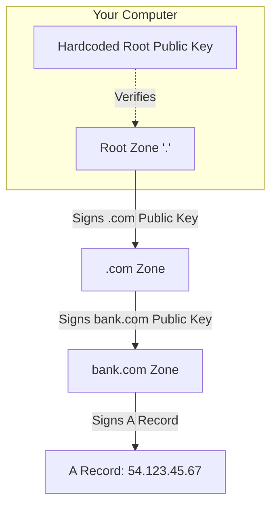

> **Navigation**: [← TCP/UDP](06_TCP_UDP_Deep_Dive.md) | [Index](00_INDEX.md) | [Next → HTTP](08_HTTP_Complete.md)

# 🔍 Chapter 7: DNS — The Internet's Phone Book

> _"DNS is the most critical system on the internet that nobody thinks about. If DNS goes down, the internet effectively stops working — even though all the servers are still running. You just can't find them."_

---

# PART 1: History — From hosts.txt to Global DNS

---

```
THE BEGINNING (1970s):
  ARPANET had a file called HOSTS.TXT.
  Every hostname → IP mapping was in this ONE FILE.
  Maintained by ONE person (Elizabeth Feinler at SRI).
  Every computer downloaded this file periodically.

  When ARPANET had 100 hosts → manageable.
  When internet reached 1,000 hosts (early 1983) → impossible.
  File was megabytes, always outdated, naming conflicts.

1983 — DNS INVENTED:
  Paul Mockapetris (RFC 882, 883 → later RFC 1034, 1035).
  DISTRIBUTED, HIERARCHICAL naming system.
  No single point of failure. Scales to billions of names.

  THIS IS THE SAME SYSTEM RUNNING TODAY.
  41 years later, the fundamental design hasn't changed.

THE DNS HIERARCHY:

  . (ROOT)                         ← 13 root server clusters worldwide
  ├── .com (TLD)                   ← Verisign operates .com
  │   ├── google.com               ← Google's authoritative NS
  │   │   ├── www.google.com       ← A record: 142.250.80.4
  │   │   ├── mail.google.com      ← CNAME → googlemail.l.google.com
  │   │   └── dns.google.com       ← A record: 8.8.8.8
  │   ├── github.com               ← GitHub's authoritative NS
  │   └── myapp.com                ← YOUR domain's authoritative NS
  ├── .org
  ├── .net
  ├── .io                          ← Country code TLD (British Indian Ocean Territory!)
  ├── .dev                         ← Google-owned TLD (requires HTTPS)
  └── .uk, .de, .jp, ...           ← Country code TLDs

THE 13 ROOT SERVERS:
  Named A through M. Run by different organizations worldwide.
  A = Verisign, B = USC-ISI, J = Verisign, K = RIPE NCC, etc.

  BUT: "13 root servers" is misleading.
  Each "server" is actually hundreds of instances via ANYCAST.
  Real count: 1,700+ root server instances across 200+ locations.

  ANYCAST: same IP address announced from multiple physical locations.
  Your query goes to the NEAREST instance (BGP routing handles this).
```

---

# PART 2: The Resolution Process — Step by Step

---

```
YOU TYPE: https://api.myapp.com/users
BROWSER NEEDS: the IP address of api.myapp.com

STEP 1 — BROWSER CACHE:
  Browser checks its in-memory DNS cache.
  Chrome: chrome://net-internals/#dns (view cached entries!)
  TTL-based: if cached AND TTL hasn't expired → use cached IP. Done!

STEP 2 — OS CACHE (STUB RESOLVER):
  Browser asks the OS resolver.
  The OS checks its system-wide DNS cache.

  Linux: systemd-resolved maintains a cache.
  macOS: mDNSResponder.
  Windows: DNS Client service.

  Also checks: /etc/hosts file (Linux/macOS) or C:\Windows\System32\drivers\etc\hosts
  Entries in hosts file OVERRIDE DNS!

  127.0.0.1  localhost
  192.168.1.50  myapp.local    ← custom mapping (useful for dev)
  0.0.0.0  ads.facebook.com   ← block ads by mapping to nowhere!

STEP 3 — RECURSIVE RESOLVER:
  OS sends query to configured DNS server (usually your ISP or 8.8.8.8).
  This is the RECURSIVE RESOLVER — it does the heavy lifting.

  The resolver checks ITS cache first.
  Popular domains (google.com) are almost always cached.

STEP 4 — ITERATIVE QUERIES (if not cached):
  Resolver asks the ROOT SERVER: "Where is api.myapp.com?"
  Root: "I don't know, but .com is handled by these TLD servers: a.gtld-servers.net ..."

  Resolver asks the .COM TLD SERVER: "Where is api.myapp.com?"
  TLD: "I don't know, but myapp.com is handled by: ns1.cloudflare.com, ns2.cloudflare.com"

  Resolver asks AUTHORITATIVE NS (ns1.cloudflare.com): "What is api.myapp.com?"
  Authoritative: "api.myapp.com → 54.123.45.67, TTL=300 (5 minutes)"

  Resolver caches the answer (for TTL seconds) and returns it to your OS.

TOTAL: Up to 4 network round trips (if nothing is cached).
In practice: 1-2 hops (root + TLD are almost always cached by recursive resolver).
Typical DNS resolution time: 5-50ms (cached) or 50-200ms (uncached).

VISUAL:
  Browser → OS Cache → Recursive Resolver → Root → TLD → Authoritative → Answer!
  Each arrow can be a cache HIT (instant) or a cache MISS (network round trip).
```

---

# PART 3: DNS Record Types — The Complete Reference

---

```
A RECORD (Address):
  Maps hostname to IPv4 address.
  api.myapp.com → 54.123.45.67
  Most common record type. The fundamental purpose of DNS.

  Multiple A records = DNS round-robin load balancing:
  api.myapp.com → 54.123.45.67
  api.myapp.com → 54.123.45.68
  api.myapp.com → 54.123.45.69
  First query returns .67, second returns .68, etc. (simple but no health checking!)

AAAA RECORD (IPv6 Address):
  Maps hostname to IPv6 address.
  api.myapp.com → 2001:db8::1
  Four A's because IPv6 is 4× the length of IPv4 (128 vs 32 bits).

CNAME RECORD (Canonical Name / Alias):
  Maps hostname to ANOTHER hostname.
  www.myapp.com → myapp.com (www is just an alias for the main domain)
  blog.myapp.com → myapp.ghost.io (points to Ghost hosting)

  IMPORTANT: CNAME cannot coexist with other records at the SAME name!
  You CANNOT have: myapp.com CNAME someother.com AND myapp.com MX mail.google.com
  Root domain (@) should use A/AAAA, not CNAME.

  ALIAS / ANAME: Non-standard extension by Cloudflare/Route53.
  Acts like CNAME but at the root domain. Resolves to IP at query time.

MX RECORD (Mail Exchange):
  Specifies mail servers for the domain.
  myapp.com MX 10 mail1.myapp.com
  myapp.com MX 20 mail2.myapp.com

  Priority number: LOWER = higher priority.
  Mail goes to mail1 first. If down → tries mail2.

TXT RECORD (Text):
  Arbitrary text. Used for VERIFICATION and SECURITY:

  SPF: "v=spf1 include:_spf.google.com ~all"
    → "Only Google's servers can send email from @myapp.com"
    → Prevents email spoofing.

  DKIM: Cryptographic signature for emails.
    → Receiving mail server can verify the email wasn't tampered with.

  DMARC: Policy for handling SPF/DKIM failures.
    → "If email fails verification, reject it."

  Domain verification: Google/AWS/etc ask you to add a TXT record
    to prove you own the domain.

NS RECORD (Name Server):
  Delegates a domain to specific name servers.
  myapp.com NS ns1.cloudflare.com
  myapp.com NS ns2.cloudflare.com
  "Cloudflare is authoritative for myapp.com."

SOA RECORD (Start of Authority):
  Contains zone metadata: primary NS, admin email, serial number,
  refresh interval, retry interval, expire time, minimum TTL.
  One per zone. Critical for zone transfers between DNS servers.

SRV RECORD (Service):
  Specifies host and port for a service.
  _sip._tcp.myapp.com SRV 10 5 5060 sip.myapp.com
  → "SIP over TCP is available on sip.myapp.com port 5060"

  Used by: LDAP, SIP, XMPP, Kubernetes service discovery.

PTR RECORD (Pointer / Reverse DNS):
  Maps IP → hostname (reverse of A record).
  67.45.123.54.in-addr.arpa PTR api.myapp.com
  Used by: email servers to verify sender domain, security logging.

CAA RECORD (Certificate Authority Authorization):
  Specifies which CAs can issue TLS certificates for your domain.
  myapp.com CAA 0 issue "letsencrypt.org"
  → Only Let's Encrypt can issue certs for myapp.com.
  Prevents unauthorized certificate issuance.
```

```bash
# ── DNS COMMANDS — Complete Reference ──

# Basic lookup
nslookup api.myapp.com
dig api.myapp.com A

# Lookup specific record types
dig myapp.com MX          # mail servers
dig myapp.com TXT         # SPF, DKIM, verification
dig myapp.com NS          # name servers
dig myapp.com SOA         # zone authority
dig myapp.com AAAA        # IPv6 address
dig myapp.com CAA         # certificate authorities

# Trace the FULL resolution path (see every hop!)
dig +trace api.myapp.com
# Output shows: root servers → TLD servers → authoritative NS → final answer

# Query a SPECIFIC DNS server
dig @8.8.8.8 api.myapp.com       # Ask Google's DNS
dig @1.1.1.1 api.myapp.com       # Ask Cloudflare's DNS
dig @ns1.cloudflare.com api.myapp.com  # Ask authoritative directly

# Reverse DNS lookup (IP → hostname)
dig -x 8.8.8.8
# Answer: dns.google.

# Show only the answer (clean output)
dig +short api.myapp.com
# 54.123.45.67

# Check TTL (Time-To-Live) — how long until cache expires
dig api.myapp.com | grep -A1 "ANSWER SECTION"
# api.myapp.com.  300  IN  A  54.123.45.67
# TTL = 300 seconds = 5 minutes

# Test DNS propagation after changing records
# Query multiple public DNS servers to check if update has propagated:
for dns in 8.8.8.8 1.1.1.1 9.9.9.9 208.67.222.222; do
  echo "$dns: $(dig +short @$dns api.myapp.com)"
done

# Flush local DNS cache
sudo systemd-resolve --flush-caches  # Linux (systemd)
sudo dscacheutil -flushcache          # macOS
ipconfig /flushdns                    # Windows
```

---

# PART 4: TTL, Caching & Propagation

---

```
TTL (TIME TO LIVE):
  Every DNS record has a TTL: how many seconds resolvers should CACHE the answer.

  Low TTL (60-300s / 1-5 min):
    ✓ Changes propagate quickly (good for failover, migrations)
    ✗ More DNS queries (higher load on authoritative servers)
    ✗ Slightly higher latency (cache misses more often)
    Use for: production services, load balancers, CDN endpoints

  High TTL (3600-86400s / 1-24 hours):
    ✓ Fewer DNS queries (CDN, authoritative servers have less load)
    ✓ Lower latency (cache hits more often)
    ✗ Changes take hours to propagate
    Use for: static records (MX, NS), rarely-changed hosts

  TTL STRATEGY FOR MIGRATIONS:
  1. BEFORE migration (48 hours ahead): reduce TTL to 60 seconds.
  2. WAIT for old TTL to expire (caches flush the old high-TTL record).
  3. MAKE THE CHANGE (update IP address).
  4. WAIT 60 seconds → all clients get new IP.
  5. AFTER migration: increase TTL back to normal.

  If you skip step 1 → clients with old cached (high-TTL) records
  will keep going to the OLD server for hours!

DNS PROPAGATION:
  "Propagation" is really just "waiting for old cached entries to expire."
  There's no active "push" of DNS updates. It's all pull + cache TTL.

  Typical propagation times:
  TTL 60s:    → ~1 minute
  TTL 300s:   → ~5 minutes
  TTL 3600s:  → ~1 hour
  TTL 86400s: → ~24 hours

  Check propagation: https://dnschecker.org/ or the script above.

  EDGE CASE: Some ISP resolvers IGNORE TTL and cache for longer!
  Nothing you can do about this. Plan for 1-2 hours even with low TTL.
```

---

# PART 5: DNS Security — Attacks & Defenses

---

```
DNS WAS DESIGNED WITHOUT SECURITY (1983).
No authentication. No encryption. Trust is assumed. Bad assumption.

ATTACK 1 — DNS SPOOFING / CACHE POISONING:
  Attacker sends fake DNS responses before the real authoritative server responds.
  Recursive resolver caches the FAKE answer.
  All clients of that resolver now go to the ATTACKER'S server!

  Defense: DNSSEC (see below), randomized source ports, 0x20 encoding.

ATTACK 2 — DNS AMPLIFICATION (DDoS):
  Attacker sends DNS queries with SPOOFED source IP (victim's IP).
  DNS servers respond to the VICTIM with large responses.
  Amplification factor: tiny query (64 bytes) → huge response (4000+ bytes).
  → 60x amplification! Flood the victim's bandwidth.

  Defense: Rate limiting, response rate limiting (RRL) on DNS servers,
  BCP38 (ISPs should block spoofed source IPs).

ATTACK 3 — DNS TUNNELING:
  Encode arbitrary data in DNS queries (subdomain = data payload).
  Bypasses firewalls (DNS is almost never blocked).
  Used by: malware for command & control, data exfiltration.

  Defense: Monitor DNS query length, detect unusual subdomains.

DNSSEC (DNS Security Extensions):
  Adds CRYPTOGRAPHIC SIGNATURES to DNS records.
  Authoritative server signs records with its private key.
  Resolvers verify signatures using the public key (published in DNS!).

  Chain of trust: root signs → TLD signs → domain signs → records verified.

  ADOPTION: ~30% of domains are signed. Chrome validates DNSSEC since 2023.
  Limitation: DNSSEC proves data INTEGRITY (not tampered), NOT privacy
  (queries are still plaintext → ISP can see what domains you visit).

DNS OVER HTTPS (DoH) / DNS OVER TLS (DoT):
  PROBLEM: DNS queries are plaintext UDP → ISP/employer/attacker can see them.

  DoH (port 443): DNS queries inside HTTPS. Looks like normal web traffic.
    Used by: Firefox, Chrome, Edge (default or optional).
    Server: https://dns.google/dns-query, https://cloudflare-dns.com/dns-query

  DoT (port 853): DNS queries encrypted with TLS.
    Used by: Android (Private DNS setting), system-level resolvers.

  CONTROVERSY: DoH bypasses enterprise/parental DNS filtering.
  Enterprise: "We block malware domains at DNS level. DoH breaks that."
  Privacy advocates: "ISPs shouldn't see my DNS queries."
  Both sides have valid points!
```

---

# PART 6: DNS in Production — Configuration & Best Practices

---

```
POPULAR DNS PROVIDERS:

  RECURSIVE RESOLVERS (where clients send queries):
  8.8.8.8 / 8.8.4.4          — Google Public DNS
  1.1.1.1 / 1.0.0.1          — Cloudflare DNS (fastest!)
  9.9.9.9                    — Quad9 (privacy + security focused)
  208.67.222.222              — OpenDNS (Cisco)
  Your ISP's resolver         — usually slowest, least private

  AUTHORITATIVE DNS HOSTING (where YOUR records live):
  Cloudflare DNS              — free, global anycast, fast propagation
  AWS Route 53                — integrates with AWS, health checks, routing policies
  Google Cloud DNS            — high availability, global
  NS1                        — traffic management, RUM-based routing

  Cloudflare is the most popular choice for most developers.
  Route 53 if you're deep in AWS ecosystem.

CONFIGURING DNS FOR A NEW DOMAIN:

  1. Buy domain from registrar (Namecheap, Cloudflare, GoDaddy).
  2. Point NS records to your DNS provider.
     myapp.com NS ns1.cloudflare.com
     myapp.com NS ns2.cloudflare.com
  3. Add records:
     @ A 54.123.45.67           (root domain → your server)
     www CNAME myapp.com        (www → root domain)
     api A 54.123.45.68         (API subdomain → API server)
     @ MX 10 mx.zoho.com        (email → Zoho mail)
     @ TXT "v=spf1 include:zoho.com ~all"  (SPF for email auth)

  4. Wait for propagation (reduced TTL of 60s → ~1 minute).
  5. Verify: dig myapp.com A, dig www.myapp.com CNAME.

HEALTH-CHECKED DNS (AWS Route 53 & similar):
  Route 53 can health-check your servers and REMOVE unhealthy IPs from DNS!

  api.myapp.com → 54.123.45.67 (health check: GET /health every 30s)
  api.myapp.com → 54.123.45.68 (health check: GET /health every 30s)

  If .67 fails health check → Route 53 stops returning it in responses.
  Clients automatically go to .68 only. Automatic failover via DNS!

  ROUTING POLICIES (Route 53):
  Simple: round-robin across all IPs.
  Weighted: 70% to .67, 30% to .68 (canary deployment!).
  Latency-based: route to the server closest to the client.
  Geolocation: users in EU → EU server. Users in US → US server.
  Failover: primary server, with automatic failover to secondary.
```

```python
# ── DNS IN PYTHON ──

import socket

# Basic DNS resolution (uses the OS resolver)
ip = socket.gethostbyname("api.myapp.com")
print(f"api.myapp.com → {ip}")
# Uses /etc/resolv.conf nameservers → recursive resolver.

# Get ALL addresses (including IPv6)
results = socket.getaddrinfo("google.com", 443, socket.AF_UNSPEC, socket.SOCK_STREAM)
for family, socktype, proto, canonname, sockaddr in results:
    print(f"  {sockaddr[0]} (IPv{'4' if family == socket.AF_INET else '6'})")

# Using dnspython library for full DNS control
import dns.resolver

# Query A records
answers = dns.resolver.resolve("api.myapp.com", "A")
for rdata in answers:
    print(f"A: {rdata.address}, TTL: {answers.rrset.ttl}")

# Query MX records
mx_answers = dns.resolver.resolve("google.com", "MX")
for mx in mx_answers:
    print(f"MX: {mx.exchange} (priority: {mx.preference})")

# Query TXT records (SPF, DKIM)
txt_answers = dns.resolver.resolve("google.com", "TXT")
for txt in txt_answers:
    print(f"TXT: {txt.to_text()}")

# Reverse DNS lookup
from dns.reversename import from_address
rev_name = from_address("8.8.8.8")
rev_answers = dns.resolver.resolve(rev_name, "PTR")
for ptr in rev_answers:
    print(f"8.8.8.8 → {ptr.to_text()}")  # dns.google.
```

---

# PART 7: THE GRAND UNIFIED THEORY OF DNS PHYSICS AND CRYPTOGRAPHY (Deconstructed)

> _"There are not '13 root servers.' That is an abstraction from the 1980s. There are over 1,700 physical servers scattered across the globe, bound together by the mathematical laws of the Border Gateway Protocol (BGP). To understand DNS at scale is to understand the physics of global routing."_

This section strips away the abstraction of "DNS queries" and looks at the exact physical hardware, kernel interactions, and cryptographic math that keeps the internet alive.

---

## 7.1 The Abstraction: "13 Root Servers" vs The Reality of BGP Anycast

**The Abstraction Taught:** "When your resolver needs to find `.com`, it asks one of the 13 Root Servers (A through M) located in America."

**The Naked Truth:** If the entire internet relied on 13 physical servers, the internet would have collapsed in 1999. You cannot serve billions of queries per second from 13 boxes, and the speed of light makes pinging Virginia from Tokyo unacceptably slow (200ms round-trip).

To solve this, internet engineers utilized **BGP Anycast**.

**The Mechanical Execution of Anycast:**
In standard networking (Unicast), one IP address maps to one physical server. In Anycast, _one IP address is announced by hundreds of different servers globally simultaneously_.

1. Cloudflare operates the `F-Root` server. They deploy 300 physical servers in 300 different data centers globally (Tokyo, London, Sydney, New York).
2. Every single one of these 300 servers runs BGP (Border Gateway Protocol) and announces to the global internet backbone: _"I am IP address `192.5.5.241`"_.
3. When your laptop in Tokyo sends a DNS UDP packet to `192.5.5.241`, the backbone routers evaluate the BGP tables. The routers are programmed to forward the packet over the **shortest physical path** (fewest autonomous system hops).
4. The router calculates that the Tokyo datacenter is 2 hops away, and New York is 15 hops away. The packet is physically routed to the Tokyo server.

```mermaid
flowchart TD
    Client_Tokyo[Client in Tokyo] -->|Dest IP: 192.5.5.241| BGP_T[BGP Router Japan]
    Client_NY[Client in NY] -->|Dest IP: 192.5.5.241| BGP_NY[BGP Router USA]

    subgraph Anycast "F-Root (IP: 192.5.5.241)"
        Root_Tokyo[F-Root Server\nTokyo Datacenter]
        Root_NY[F-Root Server\nNew York Datacenter]
    end

    BGP_T -->|Shortest Path (2ms)| Root_Tokyo
    BGP_NY -->|Shortest Path (5ms)| Root_NY
```

**The Superpower:**
Anycast provides mathematically perfect load balancing and infinite DDoS absorption without using a Load Balancer. If an attacker in Russia launches a 1 Tbps DDoS attack against `192.5.5.241`, the BGP routers physically route the attack traffic ONLY to the Russian root server instances. The Russian servers might melt down, but the rest of the world remains completely unaffected because physics dictates the attack traffic cannot reach New York.

---

## 7.2 The Physics of a DNS Amplification Attack

**The Abstraction:** "A DDoS attack is just a botnet sending lots of traffic to crash a server."

**The Naked Truth:** Sending traffic requires bandwidth. If an attacker has a 1 Gbps internet connection, they can only send 1 Gbps of attack traffic. That is not enough to take down an enterprise server. To destroy a server, the attacker must manipulate the UDP protocol to **amplify** their bandwidth.

**The Mechanical Reality of UDP:**
DNS runs on UDP (User Datagram Protocol). UDP is stateless and connectionless. There is no "handshake." You just throw a packet at a server, and it throws an answer back to the Source IP.

Because there is no handshake, it is trivial to **Spoof the Source IP**.

**The Attack Execution:**

1. The Attacker wants to destroy `Victim.com` (IP: `50.50.50.50`).
2. The Attacker crafts a tiny DNS query (64 bytes). It asks a public DNS resolver: _"Give me every single DNS record you have for `reddit.com`, including all cryptographic signatures (ANY query)."_
3. The Attacker modifies the UDP packet header. They erase their own IP address and overwrite the `Source IP` field with `50.50.50.50` (the Victim).
4. The Attacker sends this 64-byte packet to an open DNS resolver.
5. The DNS resolver processes the query. It gathers massive amounts of data. It constructs a massive DNS response packet (4,000 bytes).
6. The DNS resolver looks at the Source IP on the request (`50.50.50.50`) and blasts the 4,000-byte response directly at the Victim.

**The Math of Destruction:**

- Attacker bandwidth used: **64 bytes**.
- Victim bandwidth hit: **4,000 bytes**.
- Amplification Factor: **62.5x**.

If the attacker controls a botnet capable of generating 10 Gbps of spoofed queries, the DNS resolvers will magnify it and blast the Victim with **625 Gbps** of traffic. The physical network switches in front of the Victim's server will have their memory buffers overflowed in milliseconds, dropping all legitimate traffic. The victim is erased from the internet.

---

## 7.3 DNSSEC: Cryptography in the Memory Buffer

**The Abstraction:** "DNSSEC secures DNS by adding signatures."

**The Naked Truth:** DNS was built on trust. If your computer asks for `bank.com`, an attacker on the same Starbucks WiFi can race the real server, reply faster with a fake IP address, and steal your banking credentials (DNS Cache Poisoning). DNSSEC solves this using physical, asymmetric cryptography.

**The Mechanical Execution:**
DNSSEC does not encrypt the query (it is still plaintext). Instead, it adds mathematical proofs (Signatures) to the answers.

1. **The Keys:** The owner of `bank.com` generates a cryptographic Key Pair (Public Key / Private Key).
2. **The Signature:** They mathematically hash the A record (`54.123.45.67`) and encrypt the hash using their Private Key. This creates an `RRSIG` (Resource Record Signature).
3. **The Publication:** They publish both the A record and the Public Key (`DNSKEY` record) into the DNS zone.
4. **The Validation:** When your browser asks for `bank.com`, the resolver receives the IP address AND the `RRSIG`. The resolver uses the Public Key to decrypt the signature and verify the hash matches the IP address perfectly in memory.

**The Chain of Trust (The DS Record):**
How does your resolver know the Public Key wasn't ALSO forged by the attacker?

- The `.com` TLD server holds a mathematical hash of `bank.com`'s Public Key (the `DS` record). It signs this with the `.com` Private Key.
- The Root Server (`.`) holds a mathematical hash of the `.com` Public Key. It signs this with the Root Private Key.
- Every computer operating system on Earth ships with the Root Server's Public Key hardcoded into its kernel/OS memory.



If an attacker tries to forge the IP address, they cannot forge the signature without the Private Key. The math fails, the CPU rejects the packet, and the browser displays a hard error, physically preventing you from connecting to the malicious server.

---

## 🔗 Cross-References

| Topic                      | Related Content                                                                   |
| -------------------------- | --------------------------------------------------------------------------------- |
| **Hash table (DNS cache)** | [DS in Production](../02_Data_Structures/05_DS_In_Production.md)                  |
| **Tree (DNS hierarchy)**   | [DS in Production](../02_Data_Structures/05_DS_In_Production.md) — tree structure |
| **UDP for DNS**            | [Ch 06: TCP/UDP](06_TCP_UDP_Deep_Dive.md) — why DNS uses UDP                      |
| **TLS certificates**       | [Ch 09: TLS & Encryption](09_TLS_Encryption.md)                                   |
| **AWS Route 53**           | [Cloud Networking](13_Cloud_Networking_VPC.md)                                    |
| **Kubernetes DNS**         | [Networking & Security](02_Networking_Security.md) — CoreDNS, service discovery   |
| **Python async DNS**       | [Asyncio Internals](../21_Python_ML_DL_NLP/02b_Python_Asyncio_Internals.md)       |
