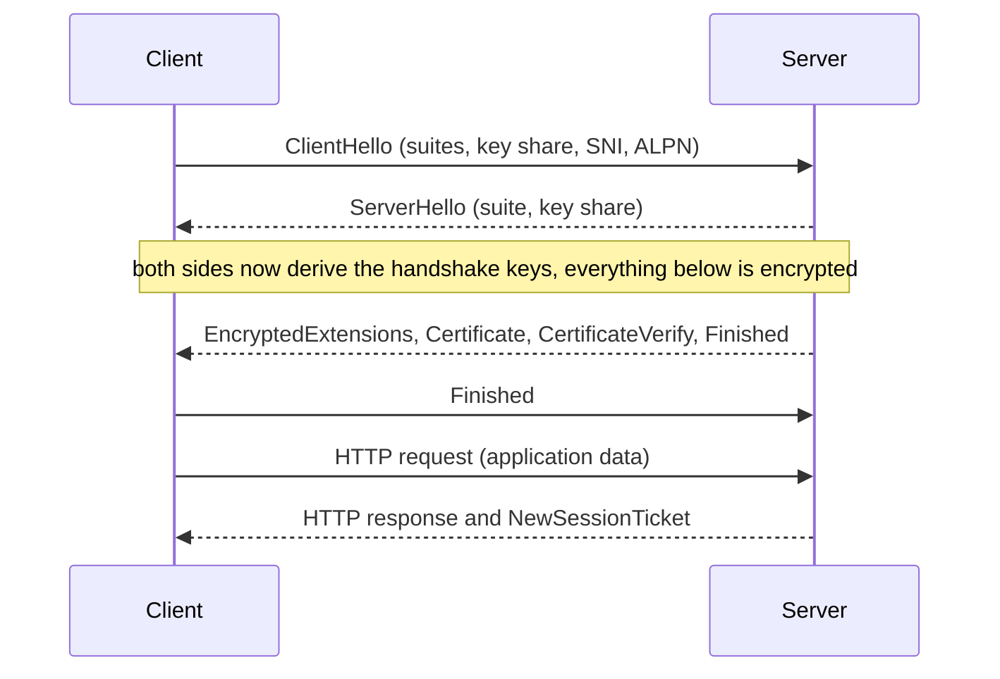

**Navigation**: [← HTTP](08_HTTP_Complete.md) | [Index](00_INDEX.md) | [Next → Firewalls](10_Firewalls_Access_Control.md)

# 🔒 Chapter 9: TLS & Encryption — Securing Every Byte

_"Without TLS, everything you send on the internet — passwords, credit cards, private messages — travels as PLAINTEXT. Anyone on the same WiFi, any router between you and the server, your ISP — they can read it ALL. TLS is the lock on the door of every HTTP connection."_

---

# PART 1: Cryptography Fundamentals — The Building Blocks

---

```
THREE PROPERTIES WE NEED:
  1. CONFIDENTIALITY: only intended recipient can read the data.
  2. INTEGRITY: data wasn't modified in transit.
  3. AUTHENTICATION: the server IS who it claims to be (not an impersonator).

TLS provides ALL THREE. Let's understand each building block.
```

## Symmetric Encryption — One Key

```
CONCEPT: Same key to ENCRYPT and DECRYPT.
  Encrypt(key, "hello") → "x8f2a..."
  Decrypt(key, "x8f2a...") → "hello"

  ANALOGY: A locked box with one key.
  Both sender and receiver have a COPY of the same key.
  Anyone with the key can lock (encrypt) or unlock (decrypt).

ALGORITHMS:
  AES (Advanced Encryption Standard):
    AES-128: 128-bit key.
    AES-256: 256-bit key (used by governments, banks, TLS).
    Block cipher: encrypts data in 128-bit blocks.

    Modes:
    CBC (Cipher Block Chaining): each block depends on previous (serial).
    GCM (Galois/Counter Mode): parallelizable, provides AEAD.
      AEAD = Authenticated Encryption with Associated Data.
      Encryption + integrity check in ONE operation. THE standard for TLS 1.3.

  ChaCha20-Poly1305:
    Designed by Daniel J. Bernstein; Google pushed it into TLS (2014-15) as an alternative to AES-GCM.
    Faster on devices WITHOUT hardware AES (with AES-NI, AES-GCM wins: measured below).
    Used by: Android, Chrome on ARM, mobile devices.
    ChaCha20 = stream cipher (encryption). Poly1305 = MAC (integrity).

SPEED: Symmetric encryption is FAST.
  AES-256-GCM with hardware acceleration (AES-NI): ~5 GB/s on modern CPUs.
  That's why TLS uses symmetric encryption for actual data transfer.

THE PROBLEM: How do you SHARE the key securely?
  If you send the key over the internet → attacker intercepts → security broken.
  → We need ASYMMETRIC encryption to exchange the symmetric key.
```

## Asymmetric Encryption — Two Keys

```
CONCEPT: TWO different keys. PUBLIC key and PRIVATE key.
  Encrypt(public_key, "hello") → "x8f2a..."
  Decrypt(private_key, "x8f2a...") → "hello"

  Public key: shared with EVERYONE (literally public).
  Private key: kept SECRET by the owner (never shared!).

  Anything encrypted with the public key → ONLY the private key can decrypt.
  Anything signed with the private key → ANYONE with the public key can verify.

ALGORITHMS:
  RSA (Rivest-Shamir-Adleman, 1977):
    Based on: difficulty of factoring large primes.
    Key sizes: 2048-bit (minimum today), 3072/4096-bit for long-lived keys (4096 signs ~6.6x slower, measured).
    Used for: certificate signing, key exchange (legacy TLS).
    Slow: ~1,800 RSA-2048 signatures/s per core, versus ~4.8 GB/s of AES-GCM (measured below).

    math:
    Choose two large primes: p = 61, q = 53
    n = p × q = 3233  (this is the modulus)
    φ(n) = (p-1)(q-1) = 3120
    Choose e (public exponent) = 17
    Find d where (d × e) mod φ(n) = 1 → d = 2753
    Public key: (n=3233, e=17)
    Private key: (n=3233, d=2753)

    Encrypt: ciphertext = message^e mod n
    Decrypt: message = ciphertext^d mod n

    Security: to derive d from e and n, you need to factor n into p × q.
    For 2048-bit keys: no known algorithm can do this in reasonable time.

  Elliptic Curve (ECC, 1985):
    Based on: difficulty of the elliptic curve discrete logarithm problem.
    Key sizes: 256-bit (equivalent to RSA 3072-bit!)
    MUCH smaller keys, MUCH faster than RSA.
    Used for: TLS 1.3 key exchange, ECDSA signatures, SSH keys (ed25519).

    WHY ECC IS WINNING:
    RSA 2048-bit key = 256 bytes. ECC 256-bit key = 32 bytes.
    Same security, 8× smaller → less bandwidth, faster handshakes.
    TLS 1.3 removed RSA key exchange; only ephemeral (EC)DHE key exchange remains (finite-field DH groups are still allowed).

THE HYBRID APPROACH (how TLS actually works):
  Problem: Asymmetric is SLOW (good for small data).
  Solution: Use asymmetric to exchange a SYMMETRIC key.
            Then use the fast symmetric key for actual data.

  This is called KEY EXCHANGE.
  TLS 1.3: Diffie-Hellman key exchange → derive AES-256-GCM key → fast data encryption.
```

🔬 **Section Challenge — Asymmetric Encryption — Two Keys**

**Challenge 1 (Reasoning):** If asymmetric encryption (RSA/ECC) can encrypt data, why doesn't TLS just use it for ALL data instead of the hybrid approach (asymmetric for key exchange → symmetric for data)?

<details><summary>Answer</summary>

**Performance: orders of magnitude slower.** In my measurement one core did about 1,800 RSA-2048 private-key operations per second (a few hundred bytes each, so well under 1 MB/s) versus about 4.8 GB/s for AES-256-GCM with AES-NI. For a 100 MB file download: RSA-only = minutes; AES = about 0.02 seconds. **Also:** RSA can only encrypt data smaller than the key size (256 bytes for RSA-2048). Larger data requires chunking + padding overhead. **The hybrid solves both:** Use slow asymmetric crypto ONCE (key exchange: ~1ms) to agree on a symmetric key. Then use fast symmetric crypto for all subsequent data. **TLS 1.3 goes further:** It doesn't even use RSA for key exchange anymore — it uses ECDHE (Elliptic Curve Diffie-Hellman Ephemeral), which provides forward secrecy. RSA key exchange was removed because a compromised private key would decrypt ALL past recorded traffic.

</details>

## Diffie-Hellman Key Exchange — The Magic

```
THE PROBLEM:
  Alice and Bob want to agree on a shared secret.
  They can only communicate over an insecure channel (internet).
  Eve is listening to EVERYTHING.
  How do Alice and Bob create a shared secret that Eve can't derive?

THE MATH (simplified):
  Public parameters: prime p = 23, generator g = 5

  Alice:
    Chooses secret a = 6 (private, never shared!)
    Computes A = g^a mod p = 5^6 mod 23 = 15625 mod 23 = 8
    Sends A = 8 to Bob (public, Eve sees this)

  Bob:
    Chooses secret b = 15 (private, never shared!)
    Computes B = g^b mod p = 5^15 mod 23 = 30517578125 mod 23 = 19
    Sends B = 19 to Alice (public, Eve sees this)

  Alice computes: shared_secret = B^a mod p = 19^6 mod 23 = 2
  Bob computes:   shared_secret = A^b mod p = 8^15 mod 23 = 2

  SAME SECRET: 2! Without ever transmitting the secret itself.

  Eve knows: p=23, g=5, A=8, B=19.
  To find the secret, Eve must solve: find a where 5^a mod 23 = 8.
  This is the DISCRETE LOGARITHM PROBLEM — computationally infeasible for large numbers.

  ANALOGY: Paint mixing.
  Public color: yellow.
  Alice mixes yellow + her secret blue → sends green to Bob.
  Bob mixes yellow + his secret red → sends orange to Alice.
  Alice mixes orange + her secret blue → BROWN.
  Bob mixes green + his secret red → BROWN (same color!).
  Eve sees yellow, green, orange — but can't unmix to find the secret colors.

ECDHE (Elliptic Curve Diffie-Hellman Ephemeral):
  Same concept but using elliptic curve math instead of modular arithmetic.
  Much smaller numbers → faster computation, same security.
  "Ephemeral" = new keys for EVERY connection (forward secrecy!).

  FORWARD SECRECY:
  If server's LONG-TERM private key is compromised LATER →
  past traffic is STILL secure because each session used a UNIQUE ephemeral key.
  The ephemeral key was discarded after the session ended.

  Without forward secrecy (RSA key exchange):
  If attacker records encrypted traffic AND later steals the private key →
  attacker can decrypt ALL past recorded traffic! Terrible!

  TLS 1.3 MANDATES forward secrecy. RSA key exchange is removed entirely.
```

---

### Why TLS exists, and what the algorithms really cost (measured)

**The pain.** HTTP, SMTP and the other early protocols sent everything in clear text; anyone on the path could read or alter it. Netscape designed **SSL** in the mid-1990s so that credit-card numbers could be typed into a browser (SSL 2.0 in 1995, SSL 3.0 in 1996). The IETF standardised it as **TLS 1.0 (RFC 2246, 1999)**, followed by 1.1 (2006) and 1.2 (2008, RFC 5246). A long series of attacks against old design choices followed (BEAST, CRIME, **Heartbleed** in April 2014, which was a bug in OpenSSL's implementation rather than in the protocol, and **POODLE** in 2014 against SSL 3.0), which led to **TLS 1.3 (RFC 8446, August 2018)**: it removed static-RSA key exchange, CBC-mode and other legacy options and cut the handshake to one round trip. RFC 8996 (March 2021) formally deprecated TLS 1.0 and 1.1. Today the realistic decision is "TLS 1.2 and 1.3 enabled, 1.3 preferred".

The text above says symmetric crypto is fast and public-key crypto is slow. Here are the numbers on the machine I tested (OpenSSL 3.0.13, one core, WSL2; your CPU will differ, the ratios are what matters):

```text
$ openssl speed -evp aes-256-gcm          # throughput by block size
AES-256-GCM          16 B: 509 MB/s     1 KB: 4.1 GB/s     16 KB: 4.85 GB/s     (AES-NI hardware instructions)
$ openssl speed -evp chacha20-poly1305
ChaCha20-Poly1305    16 B: 331 MB/s     1 KB: 2.5 GB/s     16 KB: 2.63 GB/s
$ openssl speed rsa2048 ecdsap256 ed25519
                         sign/s    verify/s
rsa 2048 bits             1,840      65,180
ecdsa (nistp256)         52,876      17,926
EdDSA (Ed25519)          27,292      10,238
```

What to read from this:

- Bulk encryption is not the problem: one core encrypts nearly 5 GB/s with AES-GCM. The "~5 GB/s" claim above is right for hardware AES; **ChaCha20 is still about half that speed here because this CPU has AES-NI**, and it wins only on CPUs *without* AES instructions (many phones and small ARM devices), which is why TLS libraries pick it for those clients.
- Public-key work is dominated by **who signs**: an RSA-2048 server can sign only about 1,840 handshakes a second per core, an ECDSA P-256 server about 52,900 (**29 times more**). Verification is the reverse: RSA verifies fastest (65,000/s). So RSA certificates put the cost on your servers during every full handshake; ECDSA moves the cost to clients, who do far fewer of them. This is the practical reason to issue ECDSA (or dual) certificates for busy endpoints.
- "RSA is ~1000x slower than AES" is understated for data volume: an RSA-2048 private-key operation handles at most a couple of hundred bytes, so at 1,840 operations per second it moves roughly 0.4 MB/s against AES's roughly 4,850 MB/s, a ratio of **over 10,000x**. Either way, the conclusion is the same: use public keys once, then switch to a symmetric key.

**What is next: post-quantum.** A future quantum computer could break RSA and elliptic-curve key exchange, and an attacker can record traffic today and decrypt it later ("harvest now, decrypt later"). Browsers and large CDNs therefore already offer a **hybrid key exchange** (X25519 combined with the ML-KEM lattice algorithm) in TLS 1.3, and OpenSSL gained ML-KEM support in 3.5 (2025). The OpenSSL 3.0 used in this lab predates it, so I could not test it. The lesson for operators: keep libraries current, because the migration is mostly a library-upgrade event, not an application change.

🔬 **Section Challenge — Why TLS is built this way**

**Challenge 1 (Calculation):** A server must handle 20,000 new TLS connections per second at peak with full handshakes. Using the measured signing rates above, how many cores does the signature work alone need with an RSA-2048 certificate versus an ECDSA P-256 certificate? What reduces the load without changing the certificate?

<details><summary>Answer</summary>

RSA-2048: `20,000 / 1,840 = 10.9`, so about **11 cores** just for signing. ECDSA P-256: `20,000 / 52,876 = 0.38`, so under **half a core**. The ECDHE key exchange also costs CPU on both certificate types, so these are lower bounds. Without changing the certificate: **session resumption** (tickets or PSK) skips the signature on repeat connections (I confirmed `Reused, TLSv1.3` below), long-lived keep-alive and HTTP/2 connections mean fewer handshakes in the first place, and terminating TLS on a tier sized for it (or offloading to a CDN or load balancer) concentrates the work. Dual-certificate setups let capable clients use ECDSA while legacy clients get RSA.

</details>

---

### Run the math yourself

Both toy examples above are small enough to check with three lines of Python. This is not secure (the numbers are tiny, an attacker brute-forces them instantly) but it proves the mechanism:

```python
p, g, a, b = 23, 5, 6, 15
A, B = pow(g, a, p), pow(g, b, p)                  # the public values each side sends
print("A", A, "B", B, "shared", pow(B, a, p), pow(A, b, p))     # both sides compute the same secret

n, e, d = 61 * 53, 17, 2753                        # the RSA example: n = 3233
print("17 * 2753 mod 3120 =", (17 * 2753) % 3120)  # d is the inverse of e modulo phi(n)
c = pow(65, e, n); print("encrypt 65 ->", c, " decrypt ->", pow(c, d, n))
```

```text
A 8 B 19 shared 2 2
17 * 2753 mod 3120 = 1
encrypt 65 -> 2790  decrypt -> 65
```

The Diffie-Hellman numbers in the text are correct (A = 8, B = 19, shared secret 2). Real deployments use groups of 2048 bits or more, or elliptic curves such as X25519 with 256-bit keys. Notice what is *not* in the exchange: the shared secret never crosses the wire. An eavesdropper sees `p, g, A, B` and must compute a discrete logarithm. One thing DH alone does not do is **authenticate** the other party: if Eve sits in the middle and runs one exchange with Alice and another with Bob, both think they are secure. That is the entire reason certificates and the `CertificateVerify` signature exist (Part 4).

---

# PART 2: Hashing & MACs — Data Integrity

---

```
HASH FUNCTION:
  Input: any-length data → Output: fixed-length "fingerprint."

  Properties:
  1. Deterministic: same input → ALWAYS same output.
  2. Fast to compute.
  3. One-way: impossible to reverse (can't get input from output).
  4. Collision-resistant: extremely hard to find two inputs with same output.
  5. Avalanche effect: tiny input change → completely different output.

  Algorithms:
  MD5: 128-bit output. BROKEN — collisions found. Never use for security.
  SHA-1: 160-bit. BROKEN — Google found a collision (2017). Legacy only.
  SHA-256: 256-bit. Secure. Used by: TLS certificates, Bitcoin, package registries (Git still defaults to hardened SHA-1).
  SHA-384: 384-bit. Used by: TLS cipher suites.
  SHA-3: 256/512-bit. Different design (Keccak). NIST standard backup.
  BLAKE3: Very fast. Growing adoption in file-hashing tools and content-addressed storage.

HMAC (Hash-based Message Authentication Code):
  Combines a hash function with a SECRET KEY:
  HMAC(key, message) → tag

  Verifier computes HMAC with same key → if tag matches → message is authentic AND unmodified.

  Used in: TLS key derivation (HKDF) and Finished messages (record integrity itself is AEAD in 1.3), API authentication (HMAC-SHA256 signing),
  JWTs (HS256 = HMAC-SHA256).

DIGITAL SIGNATURES (asymmetric version of MAC):
  Sign:    signature = Sign(private_key, hash(message))
  Verify:  Verify(public_key, hash(message), signature) → true/false

  Anyone can verify (public key). Only signer can create (private key).
  Used for: TLS certificates, code signing, Git commits (GPG), JWTs (RS256, ES256).
```

---

**Corrections to the notes on keys and hashes above.**

- RSA key size: 2048 bits is today's minimum; 3072 or 4096 for keys that must stay safe for many years. 4096-bit RSA signing was 6.6 times slower than 2048 in my run (267 vs 1,753 signatures per second per core), so do not pick it by reflex on a busy server.
- TLS 1.3 removed *RSA key exchange* (the client encrypting a secret to the server's RSA key). It still allows finite-field Diffie-Hellman groups as well as the elliptic-curve groups, so "ECC only" is not exact. Every TLS 1.3 key exchange is ephemeral, which gives forward secrecy.
- Git has used **SHA-1** (a hardened variant that detects the known collision attack) as its default object hash; SHA-256 repositories exist but are not the default. SHA-256 is what TLS certificates, Bitcoin and many package registries use. BLAKE3 is a fast hash with growing use in file-hashing tools and content-addressed storage.
- In TLS 1.3 record integrity comes from the AEAD cipher (AES-GCM, ChaCha20-Poly1305), not a separate HMAC; HMAC remains in the key-derivation function (HKDF) and the `Finished` message, and in TLS 1.2 CBC suites. HMAC is still the right tool for API request signing and webhooks.

| Primitive | Needs a shared secret? | Proves who | Use it for |
| --- | --- | --- | --- |
| Hash (SHA-256) | no | nobody (anyone can recompute it) | integrity of files you got from a trusted place, content addressing |
| HMAC | yes (both sides hold the key) | someone with the key | webhook signatures, API request signing, session tokens |
| Digital signature (ECDSA, Ed25519, RSA) | no (verifier has only the public key) | the private-key holder | certificates, code signing, JWTs that third parties verify |
| AEAD (AES-GCM) | yes | someone with the key | encrypting and authenticating data in transit and at rest |

🔬 **Section Challenge — Hash, MAC or signature?**

**Challenge 1 (Design):** You publish a software download. Users should be able to detect tampering even if your website is compromised. Is a SHA-256 checksum on the same page enough? What would you do?

<details><summary>Answer</summary>

No. If an attacker can change the download, they can change a checksum sitting beside it, so a plain hash only protects against accidental corruption. Use a **digital signature**: sign the release (or its checksum file) with a private key that is *not* on the web server, and publish the public key out of band (your documentation, a package manager's keyring, a transparency log). Verification then fails for a tampered file because the attacker cannot produce a valid signature without the private key. Tools: GPG/minisign signatures, Sigstore/cosign for containers, or signed tags and package-manager signing. HMAC does not help here: the verifier would need the secret key, so every user could also forge releases.

</details>

---

# PART 3: TLS 1.3 Handshake — Step by Step

---

```
THE FULL TLS 1.3 HANDSHAKE (1-RTT):

Client                                      Server
  |                                            |
  |-------- ClientHello ─────────────────────>|
  |  Supported cipher suites (e.g., TLS_AES_256_GCM_SHA384)
  |  Supported key exchange groups (e.g., x25519, secp256r1)
  |  Client's key share (ECDHE public value)  |
  |  SNI: api.myapp.com (Server Name Indication)
  |  ALPN: h2, http/1.1 (Application Layer Protocol Negotiation)
  |                                            |
  |<─────── ServerHello ──────────────────────|
  |  Chosen cipher suite: TLS_AES_256_GCM_SHA384
  |  Server's key share (ECDHE public value)   |
  |                                            |
  |<─────── EncryptedExtensions ──────────────|
  |  ALPN: h2 (chosen protocol: HTTP/2)        |
  |                                            |
  |<─────── Certificate ──────────────────────|
  |  Server's TLS certificate + chain          |
  |                                            |
  |<─────── CertificateVerify ────────────────|
  |  Signature over handshake (proves cert ownership)
  |                                            |
  |<─────── Finished ─────────────────────────|
  |  HMAC over entire handshake transcript     |
  |                                            |
  |  Client verifies:                          |
  |  1. Certificate chain → trusted CA?        |
  |  2. Certificate hostname = api.myapp.com?  |
  |  3. Certificate not expired?               |
  |  4. CertificateVerify signature valid?     |
  |  5. Derive shared secret from key shares   |
  |                                            |
  |-------- Finished ────────────────────────>|
  |  HMAC confirming client's view of handshake|
  |                                            |
  |<======= ENCRYPTED DATA EXCHANGE =========>|
  |  All data encrypted with AES-256-GCM       |
  |  using keys derived from shared secret     |

TOTAL: 1 round trip! (TLS 1.2 required 2 round trips)

0-RTT RESUMPTION (for repeat connections):
  Client has cached the server's pre-shared key from a previous session.
  Client sends data IN THE FIRST PACKET (with ClientHello).
  Server can process data immediately → 0 round trips for data!

  RISK: 0-RTT data can be REPLAYED by an attacker.
  Only safe for IDEMPOTENT requests (GET, not POST).
```

---

### The handshake on the wire, with real message sizes

I ran a TLS 1.3 server (`openssl s_server`, with a certificate chain I created: root, intermediate, leaf) and connected with `openssl s_client -tls1_3 -trace`. The handshake messages, in the order they crossed the wire:

```text
ClientHello           Length=239     client -> server   (cipher suites, key share, SNI, ALPN)
ServerHello           Length=118     server -> client   (chosen suite, server key share)  <- keys derivable from here on
EncryptedExtensions   Length=2       server -> client   (already encrypted)
Certificate           Length=918     server -> client   (leaf + intermediate, encrypted)
CertificateVerify     Length=74      server -> client   (signature over the transcript)
Finished              Length=48      server -> client
Finished              Length=48      client -> server
```

That matches the diagram above, plus two facts the diagram cannot show. First, **everything after `ServerHello` is encrypted**, including the certificate: in TLS 1.3 a passive observer sees the server name in the ClientHello (SNI, unless Encrypted Client Hello is used) but not which certificate was presented, which was visible in TLS 1.2. Second, the `Certificate` message carried **918 bytes** for a two-certificate ECDSA chain; an RSA-2048 chain with two or three certificates is typically several kilobytes, which can push the first server flight past the initial TCP congestion window (10 packets, about 14 KB) and add a round trip. Short chains and ECDSA keys make handshakes smaller as well as cheaper.

Version and suite negotiation, tested against that server with OpenSSL 3.0.13's default settings:

```text
-tls1    : "no protocols available"       (TLS 1.0 is disabled in this client build)
-tls1_1  : "no protocols available"       (TLS 1.1 likewise)
-tls1_2  : ECDHE-ECDSA-AES256-GCM-SHA384 (TLS 1.2: key exchange and signature appear in the suite name)
-tls1_3  : TLS_AES_256_GCM_SHA384         (TLS 1.3: the suite only names the AEAD and hash; key exchange is negotiated separately)
```

Reading the names: in TLS 1.2 `ECDHE-ECDSA-AES256-GCM-SHA384` means ECDHE key exchange, ECDSA signature, AES-256-GCM, SHA-384 for the PRF. In TLS 1.3 the suite names shrink to `TLS_AES_256_GCM_SHA384` because key exchange (a "supported group" such as x25519) and signatures are negotiated in extensions. When a legacy client "cannot connect after we disabled TLS 1.0", this is the mechanism: the server refuses the version, and the client only speaks the old one.

**Session resumption.** After the first handshake the server sends a `NewSessionTicket`. Saving it (`-sess_out`) and presenting it on a new connection (`-sess_in`) gave `Reused, TLSv1.3, Cipher is TLS_AES_256_GCM_SHA384`: the second connection skipped certificate verification and the signature. That is both a latency win and the CPU saving calculated earlier. Resumption can also carry **0-RTT early data**, which is replayable: only enable it for endpoints where a replayed request is harmless (idempotent GETs), and make the server reject early data on state-changing routes.



**How to read this diagram.** Time flows downward. The client sends one message, the server answers with its key share and then, already encrypted, its certificate, a signature proving it owns the certificate's key, and a `Finished` MAC over everything said so far. The client verifies, sends its own `Finished`, and can put the first HTTP request right behind it; that is the "1-RTT" the chapter keeps repeating. The note marks the moment authentication becomes possible: before `ServerHello` nothing is secret, after it everything is, which is why a TLS 1.3 certificate is no longer visible on the wire.

**Debugging order when a handshake fails:** (1) does TCP connect (`nc -zv HOST 443`)? (2) does the server answer a `ClientHello` at all (`openssl s_client -connect HOST:443 -servername NAME`, look for `alert` lines)? (3) which versions and suites does it accept (`-tls1_2`, `-tls1_3`, `-cipher`)? (4) does the certificate chain verify (`Verify return code`)? (5) does the client send the right SNI name (a missing `-servername` often returns the server's *default* certificate, the classic cause of "wrong certificate" reports)?

🔬 **Section Challenge — The TLS 1.3 handshake**

**Challenge 1 (Debugging):** After a security hardening change, one legacy Java 7 client gets `handshake_failure` while browsers work. The server config now allows only TLS 1.2 and 1.3 with ECDHE suites. Name the likely cause and the decision you must make.

<details><summary>Answer</summary>

The client supports at most TLS 1.0/1.1 (older Java 7 builds default to TLS 1.0 for outgoing connections) or only cipher suites the server removed, so there is no common protocol/suite and the server answers with `handshake_failure` or `protocol_version`. Confirm by capturing the ClientHello (`openssl s_client` against the server using `-tls1`, or `tcpdump` and inspecting offered versions) or reading the server's error log. The decision is a risk trade-off, not a technical fix: upgrade or replace the client (best), put the legacy client behind a proxy or separate listener that still speaks old TLS and is network-isolated, or re-enable the weak protocol for that one endpoint with compensating controls. Do not weaken the main listener for everyone.

</details>

**Challenge 2 (Reasoning):** Why does TLS 1.3 put the `Certificate` after `ServerHello` encrypted, and what does that change for a network monitoring appliance that logs which certificate a user saw?

<details><summary>Answer</summary>

Once both key shares are exchanged, the endpoints can derive handshake traffic keys, so every following message can be encrypted; this hides the certificate (and thus the real identity behind a shared IP) from passive observers and prevents middleboxes from depending on parsing it. A monitor that relied on reading the certificate in plaintext (as TLS 1.2 allowed) now only sees the SNI hostname in the `ClientHello` (still visible unless ECH is used), IP addresses and timing. To inspect more, organisations must terminate TLS on a proxy that the clients trust (deliberate interception with a corporate CA), not passively sniff.

</details>

---

# PART 4: Certificates & PKI — The Trust System

---

```
THE TRUST PROBLEM:
  You visit https://bank.com. How do you know it's really your bank?
  Without certificates: attacker intercepts → shows THEIR site → steals your password!

  SOLUTION: Certificate Authorities (CAs) — trusted third parties.
  CA says: "I verified that bank.com is owned by Bank Corp."
  CA signs a certificate with its private key.
  Browser has CA's public key pre-installed → can verify the signature.

THE CERTIFICATE CHAIN:
  Root CA (pre-installed in browser/OS: ~150 root CAs)
    → signs → Intermediate CA (reduces risk if root is compromised)
      → signs → YOUR DOMAIN CERTIFICATE

  Chain example for api.myapp.com:
  1. Root: "ISRG Root X1" (pre-installed in browser; the older "DST Root CA X3" expired 2021-09-30)
  2. Intermediate: a Let's Encrypt intermediate such as "R10" (names change every few years)
  3. Leaf: "api.myapp.com" (signed by intermediate)

  Browser validates: root signature on intermediate ✓ → intermediate signature on leaf ✓ → TRUSTED.

WHAT'S IN A CERTIFICATE (X.509):
  Subject: CN=api.myapp.com, O=My Company, L=San Francisco, ST=CA, C=US
  Issuer: CN=R10, O=Let's Encrypt     (example name)
  Validity: Not Before: 2024-01-01, Not After: 2024-03-31 (90 days for LE)
  Public Key: EC 256-bit (the server's public key for key exchange)
  Subject Alternative Names (SAN): api.myapp.com, *.myapp.com
  Key Usage: Digital Signature, Key Agreement
  Certificate Signature Algorithm: sha256WithRSAEncryption

  SAN (Subject Alternative Name): THE field browsers check for hostname.
  Wildcard cert: *.myapp.com → covers www.myapp.com, api.myapp.com (but NOT myapp.com itself!).

LET'S ENCRYPT — FREE TLS FOR EVERYONE:
  Run by ISRG (founded by Mozilla, EFF, Univ. of Michigan; Akamai/Cisco early sponsors). First certs 2015.
  Issues free TLS certificates via automated ACME protocol.
  90-day validity today (force automation → no forgotten expired certs!); shorter lifetimes are coming industry-wide.
  Hundreds of millions of active certificates. Changed the web from mostly HTTP to mostly HTTPS.

  HOW ACME WORKS:
  1. certbot (client) requests cert for api.myapp.com.
  2. Let's Encrypt challenges: "Prove you control this domain."
     HTTP-01: place a file at http://api.myapp.com/.well-known/acme-challenge/TOKEN
     DNS-01:  create a TXT record: _acme-challenge.api.myapp.com
  3. Let's Encrypt verifies → issues certificate.
  4. certbot installs cert in nginx/Apache and sets up auto-renewal (a systemd timer or cron job). A WILDCARD cert needs DNS-01.
```

```bash
# ── CERTIFICATE COMMANDS ──

# Check a server's certificate
openssl s_client -connect api.myapp.com:443 -servername api.myapp.com < /dev/null
# Shows: certificate chain, protocol, cipher suite

# View certificate details
openssl s_client -connect api.myapp.com:443 -servername api.myapp.com < /dev/null 2>/dev/null | \
  openssl x509 -text -noout
# Shows: subject, issuer, validity dates, SANs, public key type/size

# Check certificate expiry
openssl s_client -connect api.myapp.com:443 -servername api.myapp.com < /dev/null 2>/dev/null | \
  openssl x509 -enddate -noout
# Output: notAfter=Mar 31 12:00:00 2024 GMT

# Generate a self-signed certificate (for development). Without -nodes the key is passphrase-protected and the
# command WAITS for a passphrase on the terminal (it hung in my non-interactive test).
openssl req -x509 -newkey rsa:4096 -sha256 -days 365 -nodes \
  -keyout key.pem -out cert.pem \
  -subj "/CN=localhost" \
  -addext "subjectAltName=DNS:localhost,IP:127.0.0.1"

# Let's Encrypt with certbot (production)
sudo certbot --nginx -d api.myapp.com -d www.myapp.com
# Auto-configures nginx, installs cert, sets up renewal timer.

# Test renewal
sudo certbot renew --dry-run

# Certificate in Kubernetes (cert-manager)
# cert-manager automatically requests + renews Let's Encrypt certs:
```

```yaml
# Kubernetes cert-manager: automatic TLS certificates
apiVersion: cert-manager.io/v1
kind: Certificate
metadata:
  name: api-tls
  namespace: production
spec:
  secretName: api-tls-secret
  issuerRef:
    name: letsencrypt-prod
    kind: ClusterIssuer
  dnsNames:
    - api.myapp.com
    - www.myapp.com
# cert-manager handles: domain verification, cert issuance, renewal.
# The cert appears as a K8s Secret that Ingress can reference.
```

---

### Build a PKI in 10 commands, then break it on purpose

Reading about chains is weaker than building one. I created a root CA, an intermediate CA and a leaf certificate for `api.myapp.test` (SANs `api.myapp.test` and `*.dev.myapp.test`) with `openssl req` / `openssl x509 -req`, then ran the failures that cause real outages:

```text
$ openssl verify -CAfile root.crt leaf.crt                      # leaf alone, intermediate missing
error 20 at 0 depth lookup: unable to get local issuer certificate
$ openssl verify -CAfile root.crt -untrusted int.crt leaf.crt   # intermediate supplied
leaf.crt: OK
$ openssl verify ... -attime <now + 100 days> leaf.crt          # leaf was valid for 90 days
error 10 at 0 depth lookup: certificate has expired
$ openssl x509 -in leaf.crt -noout -checkend $((30*86400))      # valid 30 days from now?  -> "Certificate will not expire"
$ openssl x509 -in leaf.crt -noout -checkend $((100*86400))     # valid 100 days from now? -> "Certificate will expire"
```

Hostname matching, tested with `-verify_hostname` against the SAN list `api.myapp.test, *.dev.myapp.test`:

| Name presented | Result | Why |
| --- | --- | --- |
| `api.myapp.test` | OK | exact SAN match |
| `x.dev.myapp.test` | OK | `*` matches exactly one label |
| `a.b.dev.myapp.test` | FAIL | a wildcard does not span two labels |
| `dev.myapp.test` | FAIL | a wildcard does not match the bare parent |
| `myapp.test` | FAIL | not in the SAN list at all |

Now the same chain served by two servers, one sending only the leaf and one sending leaf plus intermediate (`openssl s_server -cert leaf.crt` vs `... -cert_chain int.crt`), tested with both `openssl s_client` and `curl --cacert root.crt`:

```text
server sends leaf only    : verify error:num=20:unable to get local issuer certificate
                            curl: (60) SSL certificate problem: unable to get local issuer certificate
server sends leaf + inter : Verification: OK     curl http=200
connect as other.test     : curl: (60) SSL: no alternative certificate subject name matches target host name 'other.test'
```

This is the classic **"works in Chrome, fails in curl and in Java"** report. Browsers can *fetch a missing intermediate* from the certificate's Authority Information Access URL (and cache intermediates they have seen); curl, OpenSSL-based clients and most server-side libraries do not, so a server that omits its intermediate works for desktop users and breaks every API client. The fix is on the server: always serve the **full chain** (leaf plus intermediates, not the root) in the right order. After any certificate renewal, test with `openssl s_client -connect HOST:443 -servername HOST` and look at `Verify return code`, not with a browser.

**Corrections and updates to the chain and Let's Encrypt notes above.**

- The example chain used "DST Root CA X3" and the "R3" intermediate. DST Root CA X3 **expired on 30 September 2021** (it caused a wave of outages on old devices); Let's Encrypt's roots are now ISRG Root X1 and X2, and the intermediates are replaced every few years (names such as R10 or E5 in the generation after R3), so never pin an intermediate.
- Let's Encrypt began as a project of the Internet Security Research Group, founded by Mozilla, the EFF and the University of Michigan (Akamai and Cisco were early sponsors), and issued its first certificates in 2015. "400 million certificates" is out of date; it serves hundreds of millions of active certificates. Check its current statistics page rather than quoting a number.
- **Certificate lifetimes are shrinking by industry rule.** Under CA/Browser Forum ballot SC-081 (2025), the maximum lifetime for publicly trusted TLS certificates drops to 200 days for certificates issued from 15 March 2026, 100 days from 15 March 2027 and 47 days from 15 March 2029. The example certificate I fetched from a public site during this session was valid for about 90 days. Let's Encrypt has also announced a move to shorter lifetimes. Conclusion: renewal must be automated end to end, including deployment to every load balancer and pod.
- A wildcard certificate requires the **DNS-01** ACME challenge (HTTP-01 cannot prove control of every subdomain).
- The browser checks the **SAN** list, not the Common Name; the CN is ignored by modern clients.

**Self-signed certificates for development.** The command in the chapter (`openssl req -x509 -newkey rsa:4096 -keyout key.pem ...`) **encrypts the private key with a passphrase and waits for you to type one**: when I ran it in a script with no terminal, it hung until I killed it. Add `-nodes` (OpenSSL 3 also accepts `-noenc`) for an unencrypted dev key, and prefer a local CA created with `mkcert` so browsers trust it instead of showing warnings.

A `ClusterIssuer` is needed for the `Certificate` shown above, and `cert-manager` solves the ACME challenge through the Ingress (YAML syntax checked, not applied to a cluster):

```yaml
apiVersion: cert-manager.io/v1
kind: ClusterIssuer
metadata:
  name: letsencrypt-prod
spec:
  acme:
    server: https://acme-v02.api.letsencrypt.org/directory
    email: platform@myapp.com
    privateKeySecretRef:
      name: letsencrypt-prod-account-key
    solvers:
      - http01:
          ingress:
            ingressClassName: nginx        # wildcard names need a dns01 solver instead
```

Use the staging endpoint (`https://acme-staging-v02.api.letsencrypt.org/directory`) while testing: production has strict rate limits and a mistake can lock you out for days.

| Failure | Typical message | First command |
| --- | --- | --- |
| Expired leaf | `certificate has expired` (error 10) | `openssl x509 -enddate -noout`, then check why renewal failed |
| Missing intermediate | `unable to get local issuer certificate` (20) | `openssl s_client -showcerts`: count the certificates sent |
| Name mismatch | `no alternative certificate subject name matches` | compare SANs with the name you connect to |
| Missing SNI | the wrong (default) certificate is returned | add `-servername`; fix the client to send SNI |
| Client clock wrong | `not yet valid` / `expired` on a fresh cert | `date`, NTP |
| Private CA not trusted | `self-signed certificate in certificate chain` | install the CA in the client trust store, never disable verification |

🔬 **Section Challenge — Certificates in production**

**Challenge 1 (Incident):** At 02:00 a partner's batch job starts failing with `unable to get local issuer certificate` while the website works fine in every browser you try. The certificate was renewed yesterday. What happened and how do you prove it in one command?

<details><summary>Answer</summary>

The renewal produced a new leaf, and the server (or load balancer) is now configured with the leaf only, without the intermediate; browsers silently fetch the intermediate via AIA but the partner's non-browser client cannot. Prove it: `openssl s_client -connect api.example.com:443 -servername api.example.com -showcerts </dev/null` and count the certificates in the `Certificate chain` section (expect leaf plus intermediate; you will see only `0 s:` and no `1 s:`), with `Verify return code: 21` or `20`. Fix by configuring the full chain (`fullchain.pem`, not `cert.pem`, in nginx's `ssl_certificate`) and reload. Prevent by adding a post-renewal check that verifies the served chain with a non-browser client.

</details>

**Challenge 2 (Design):** The new 47-day lifetime rule is coming. List three things in your estate that will break if renewal still involves a human.

<details><summary>Answer</summary>

(1) Any certificate installed by hand on appliances, load balancers or legacy servers (ticket, CSR, copy and reload): at 47 days that is a renewal roughly every five weeks per certificate. (2) Certificates embedded in places nobody revisits: Java keystores, container images, mobile app pinning, partner allow-lists that pin a specific certificate. (3) Monitoring that only alerts a few days before expiry: with short lifetimes you need alerting on *failed renewal attempts* (e.g. cert-manager `Certificate` not Ready, certbot timer failing) well before the expiry date. Mitigations: ACME everywhere (cert-manager, certbot, cloud-managed certificates), pin the CA or the public key hash rather than the leaf, and treat the expiry date of every certificate as a monitored metric.

</details>

---

# PART 5: mTLS — Mutual TLS (Zero Trust)

---

```
STANDARD TLS: Client verifies server's identity. Server doesn't verify client.
  Used for: web browsing (server proves it's google.com, client is anonymous).

MUTUAL TLS (mTLS): BOTH sides verify each other's certificates.
  Server verifies client AND client verifies server.

  USE CASES:
  • Microservices: Service A proves identity to Service B (and vice versa).
  • Zero-trust networking: no implicit trust, even inside the datacenter.
  • API authentication: client certificate replaces API key.
  • IoT: devices authenticate to cloud services.

  SERVICE MESH (Istio/Linkerd):
  Sidecar proxy automatically handles mTLS between ALL services.
  Your application code doesn't know about TLS.
  Certificate rotation happens automatically via the proxy → the mesh CA (istiod in Istio; Citadel was merged into istiod in 1.5).

  Without service mesh: each team manages their own certificates.
  With service mesh: zero-config mTLS everywhere. Zero trust. Automatically.
```

---

### mTLS, verified end to end

[Chapter 3](03_ServiceMesh_CloudNative.md) has a runnable mutual-TLS experiment with `openssl s_server -Verify 1` and `curl --cert`; the three outcomes it measured are worth repeating here because they define what mTLS does: **no client certificate** is refused (`tlsv13 alert certificate required`), a certificate **signed by another CA** is refused (`alert unknown ca`), and a certificate from the CA the server trusts is accepted (HTTP 200). Authorization is a *separate* step that uses the identity inside the certificate (for a mesh, a SPIFFE ID such as `spiffe://cluster.local/ns/prod/sa/orders`); mTLS proves who is calling, a policy then decides what that caller may do.

| Mechanism | Credential | Revocation / rotation | Best for | Weak at |
| --- | --- | --- | --- | --- |
| mTLS | client certificate (short-lived in a mesh) | expire quickly, automate issuance | service-to-service inside your platform, device fleets | partners who cannot manage certificates; browsers (poor UX) |
| API key | static secret string | manual, often forgotten | simple third-party API access | leaks via logs and repos; no identity of the machine |
| JWT / OAuth token | signed token with claims | short expiry, refresh | user and delegated authorisation across services | token theft; needs TLS anyway |
| Network location (IP allow-list) | source IP | edit firewall rules | a stopgap | spoofing inside a flat network, NAT sharing, mobile clients |

The mesh text above names "Citadel" as the certificate authority; Citadel was folded into the single **`istiod`** control-plane binary in Istio 1.5 (2020), so today certificates come from `istiod`. The rotation interval is short by design (24 hours by default in Istio) because short life replaces revocation: there is no practical way to make every client check a revocation list, so you make the credentials expire before a thief can use them.

🔬 **Section Challenge — mTLS**

**Challenge 1 (Reasoning):** Your partner insists on API keys because "client certificates are too hard", but the API moves payment data. Make the case for one control that gives you most of mTLS's benefit without certificates on their side, and name what you lose.

<details><summary>Answer</summary>

Use **OAuth 2.0 client credentials with short-lived signed tokens** (and optionally sender-constrained tokens, DPoP, or private-key JWT client authentication) over normal TLS: the partner holds a private key or secret only to *obtain* a token that lives minutes, so a leaked token is nearly worthless and every call carries a verifiable identity and scope. Add an IP allow-list for the partner's egress addresses as defence in depth. What you lose versus mTLS: the TLS layer itself no longer proves the caller's identity (the token does, so token handling must be airtight), there is no automatic binding between the connection and the credential unless you add sender-constrained tokens, and a stolen *secret* still allows token minting until revoked, so rotate it and alert on unusual token requests.

</details>

---

## 🔗 Cross-References

| Topic                         | Related Content                                                                 |
| ----------------------------- | ------------------------------------------------------------------------------- |
| **TCP transport for TLS**     | [Ch 06: TCP/UDP](06_TCP_UDP_Deep_Dive.md) — TLS runs on TCP                     |
| **HTTPS = HTTP + TLS**        | [Ch 08: HTTP Complete](08_HTTP_Complete.md)                                     |
| **DevSecOps (certificates)**  | [Networking & Security](02_Networking_Security.md) — cert pipeline              |
| **Service mesh mTLS**         | [Cloud Native](03_ServiceMesh_CloudNative.md) — Istio/Linkerd                   |
| **JWT tokens**                | [Enterprise Auth](../10_Enterprise_Systems/06_Authentication_Security.md)       |
| **Python requests (TLS)**     | [Asyncio](../25_Python_ML_DL_NLP/02b_Python_Asyncio_Internals.md) — HTTPS calls |
| **Math (modular arithmetic)** | [Math Behind Code](../25_Python_ML_DL_NLP/04b_Math_Behind_The_Code.md)          |
| **Hash tables (cert cache)**  | [DS in Production](../02_Data_Structures/05_DS_In_Production.md)                |


---

## Reality Check

**"TLS encrypts the connection, that's what it does"** — TLS provides THREE distinct properties, and conflating them causes real errors: confidentiality (encryption — the obvious one), INTEGRITY (tamper-detection — the reason a corrupted or injected byte breaks the connection rather than passing silently), and AUTHENTICATION (the certificate proving you are talking to who you think — the property that "trust all certs" throws away while keeping encryption, producing an encrypted connection to possibly an attacker, [networking-security]'s valid-cert-on-wrong-endpoint). Encryption without authentication is a private conversation with a stranger; the certificate is the part that makes it a private conversation with the RIGHT party, and it is the part sloppy clients disable.

**"Certificates prove identity, so a valid cert means trust"** — A valid certificate proves control of the DOMAIN at issuance time, nothing more: it does not vouch for the operator's honesty (a phishing site gets a valid Let's Encrypt cert for its look-alike domain in seconds — the padlock means encrypted-and-domain-verified, not trustworthy), does not prevent a compromised or malicious CA from issuing for your domain (Certificate Transparency logs and CAA records exist to detect and constrain this), and expires (the recurring outage). "Valid cert equals trust" is precisely the assumption phishing exploits; the cert authenticates the DOMAIN, and the human still has to trust the domain.

**"Certificate expiry is handled, we set it up once"** — Cert expiry is one of the most reliable RECURRING outage causes precisely because "set it up once" is the mindset: the cert bought for two years that lapses on a holiday, the internal service cert nobody automated, the renewed cert not deployed to all the load balancers, the intermediate cert that expired separately from the leaf. The fix is treating certs as continuously-managed with alerting (expiry monitoring as a golden signal, [monitoring]) and automation (ACME/Let's Encrypt short-lived certs that force automation because manual renewal every 90 days is untenable — the constraint that eliminates the class). A cert is a time-bombed dependency, and "set up once" is how the bomb goes off.

**"Stronger encryption is always better"** — Encryption STRENGTH is rarely the weak link, and over-focusing on it distracts from real risks: the crypto is almost never broken (the attacker does not factor your key — they steal it, phish the credential, exploit the app, or MITM the unverified cert), protocol and configuration are where the failures live (the deprecated TLS version still enabled, the weak cipher suite negotiated, the missing forward secrecy that exposes past traffic if the key later leaks), and key MANAGEMENT is the actual hard problem (where the private key lives, who can read it, how it rotates). "Use strong encryption" is table stakes met by defaults; the engineering is in protocol configuration, cert/key lifecycle, and not disabling the verification that makes any of it meaningful.

**"mTLS is enterprise complexity we don't need"** — Mutual TLS (both sides present certs) is the mechanism behind zero-trust service identity, and its "complexity" is increasingly automated away: the service mesh issues, rotates, and validates workload certs transparently ([service-mesh] — mTLS between all services with no app code), turning "which services can this one talk to" into cryptographic identity rather than network-location trust ([networking-security]'s core move). For internal service-to-service traffic at scale, mTLS is how you stop trusting the network — and while rolling your own is genuinely complex, the mesh-provided version is closer to a config flag. Dismissing it as unnecessary enterprise weight is the perimeter-security mindset that one internal breach invalidates.
