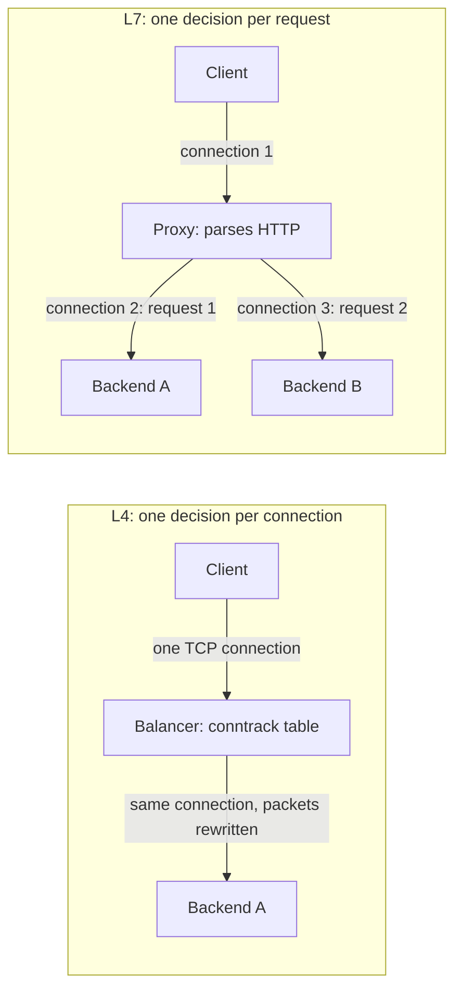
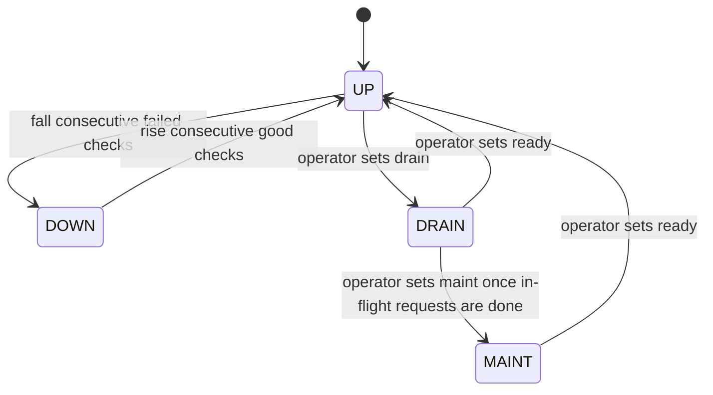

> **Navigation**: [← Firewalls](10_Firewalls_Access_Control.md) | [Index](00_INDEX.md) | [Next → WiFi & APs](12_WiFi_AP_Enterprise.md)

# ⚖️ Chapter 11: Load Balancing & Proxies — Distributing Traffic at Scale

> _"One server can handle 2,000 requests per second. You get 100,000 req/s. Without load balancing, you're dead. With it, you split traffic across 50 servers and no one breaks a sweat."_

---

# PART 1: Forward Proxy vs Reverse Proxy

---

```
FORWARD PROXY (client-side):
  Client → Forward Proxy → Internet

  The proxy acts on BEHALF OF THE CLIENT.
  Internet sees the proxy's IP, not the client's.

  Uses:
  1. Privacy/anonymity: hide client IP (VPN, Tor).
  2. Content filtering: corporate proxy blocks social media.
  3. Caching: proxy caches responses → faster for repeated requests.
  4. Bypassing restrictions: access blocked websites through foreign proxy.

  Examples: Squid, corporate proxy servers, VPN tunnels.

REVERSE PROXY (server-side):
  Client → Reverse Proxy → Backend Servers

  The proxy acts on BEHALF OF THE SERVER.
  Client sees the proxy's IP, not the backend servers'.

  Uses:
  1. Load balancing: distribute across multiple backends.
  2. TLS termination: proxy handles HTTPS, backends get HTTP.
  3. Caching: cache static responses at the edge.
  4. Security: hide backend topology, WAF, rate limiting.
  5. Compression: proxy gzips responses.

  Examples: nginx, HAProxy, Envoy, Traefik, Caddy, AWS ALB.

THE CRITICAL DIFFERENCE:
  Forward: protects CLIENTS. Client knows about the proxy.
  Reverse: protects SERVERS. Client usually doesn't know there's a proxy.
```

---

### Why proxies exist (the pain, and a short history)

A single web server has three hard limits: one machine's capacity, one machine's uptime, and one public identity. Before dedicated proxies, the first workaround was **DNS round-robin** (several A records for one name): it spreads clients, but DNS knows nothing about health, caches the answers for the TTL, and so keeps sending users to a dead address until the caches expire. Dedicated hardware balancers (F5 BIG-IP and similar) appeared in the late 1990s to put one stable virtual IP in front of many servers; software replaced much of it: **HAProxy** (started by Willy Tarreau in the early 2000s), **nginx** (Igor Sysoev, first public release October 2004, written to solve the "C10K" problem of serving ten thousand connections from one process), and **Envoy** (built at Lyft, open-sourced in 2016, configured by API instead of by file reload). Google's **Maglev** paper (2016) described the software L4 balancer in front of its services.

Forward and reverse proxies are the same mechanism pointed in opposite directions; what differs is **who configures the client** and **who is being protected**. A forward proxy must be known to the client (browser setting, `HTTP_PROXY` environment variable, or a transparent redirect on the network); a reverse proxy is invisible to the client, which believes the proxy *is* the server. VPNs and Tor, listed above, are tunnels rather than HTTP forward proxies, but they serve the same "origin sees someone else's IP" purpose.

🔬 **Section Challenge — Forward vs reverse proxy**

**Challenge 1 (Reasoning):** Your backend logs show every request coming from `10.0.0.5`, the reverse proxy, so per-user rate limiting and audit logs are useless. Where does the real client address live, and what must you do before you trust it?

<details><summary>Answer</summary>

It is in the `X-Forwarded-For` header (or the `Forwarded` header, or the PROXY protocol prefix when the proxy is L4). Before trusting it you must make sure it was set by *your* proxy: a client can send its own `X-Forwarded-For: 1.2.3.4` and nginx's `$proxy_add_x_forwarded_for` simply **appends** to it. Verified in my lab: sending `X-Forwarded-For: 1.2.3.4` through nginx produced `xff=1.2.3.4, 127.0.0.1` at the backend, so the *left-most* entry was attacker-controlled and the real peer was the *right-most*. Rules: the edge proxy should overwrite the header (`proxy_set_header X-Forwarded-For $remote_addr;`) or the backend should count back from the right a known number of trusted hops, and the backend should only accept the header from the proxy's own address.

</details>

---

# PART 2: Layer 4 vs Layer 7 Load Balancing

---

```
LAYER 4 (Transport — TCP/UDP level):
  Sees: source IP, dest IP, source port, dest port, protocol.
  Does NOT see: HTTP headers, URLs, cookies, content.

  Decision: based on IP + port. Route entire TCP connection to one backend.
  Speed: FAST (no content parsing, works at kernel level).

  HOW IT WORKS:
  Client connects to VIP (Virtual IP: 54.123.45.67:443).
  L4 LB selects backend server (10.0.1.10:8000).
  ALL packets in this connection go to the SAME backend.

  Modes:
  DSR (Direct Server Return): backend responds DIRECTLY to client (bypasses LB).
    Ultra-fast. Used for: high-bandwidth services (video streaming).
  NAT mode: LB rewrites src/dst IPs. Both directions through LB.

  Examples: AWS NLB, HAProxy L4 mode, Linux IPVS, nginx (stream module).

  ANALOGY: A highway toll booth.
  Routes cars (connections) to different lanes (backends) based on license plate (IP/port).
  Doesn't read what's in the car (HTTP content).

LAYER 7 (Application — HTTP/HTTPS level):
  Sees: HTTP headers, URL path, host header, cookies, query params, body.

  Decision: based on CONTENT.
  /api/*        → api-backends
  /static/*     → CDN/static servers
  /admin/*      → admin-backends (with additional auth check)
  Host: api.v2  → v2-backends
  Cookie: canary=true → canary-backends

  Speed: Slower than L4 (must parse HTTP). But much more powerful.

  CAN DO:
  • TLS termination (handles HTTPS, forwards HTTP to backends)
  • Header injection (add X-Request-Id for tracing)
  • URL rewriting (/old-path → /new-path)
  • Response caching
  • Rate limiting per path/user
  • A/B testing, canary routing

  Examples: AWS ALB, nginx, HAProxy L7 mode, Envoy, Traefik.

  ANALOGY: A restaurant host.
  Reads your reservation (HTTP request). VIP? Private room. Regular? Main dining.
  Vegetarian? Kitchen with veggie chef. Understands your NEEDS.

WHEN TO USE:
  L4: Raw TCP/UDP traffic (databases, MQTT, game servers, TLS passthrough), maximum performance.
      NOT gRPC/HTTP/2: one long connection carries many calls, so L4 pins them all to one backend.
  L7: HTTP APIs, web apps, microservices — whenever you need content-based routing.
  Both: L4 in front (global traffic distribution) → L7 behind (per-service routing).
```

---

### How the two layers differ inside — and a measurement that shows it

An **L4** balancer works on connections. It sees the first packet (the SYN), picks a backend once, records the choice in a connection-tracking table, and from then on forwards or rewrites every packet of that TCP connection to the same backend. It never reads the bytes. An **L7** balancer terminates the client's connection itself, parses each HTTP request, and opens (or reuses) a *separate* connection to a backend: there are two independent TCP connections, and the balancing decision is made **per request**.



**How to read this diagram.** Left box: the client's single TCP connection is pinned to Backend A for its whole life, because the L4 balancer decided when the connection opened. Right box: the client has one connection to the proxy, but the proxy opens its own connections to the backends and can send consecutive requests from that one client connection to different backends. The thing to notice is the number of connections: L4 is one stream stitched through, L7 is two (or more) separate streams joined by a program that understands HTTP.

I proved it with HAProxy 2.8 in front of two backends, once with `mode tcp` and once with `mode http`, using `curl` to send 8 requests down **one keep-alive connection**:

```text
mode tcp  : 8 requests over ONE connection      ->  8 backend=A
mode tcp  : 8 requests over 8 connections       ->  4 backend=A, 4 backend=B
mode http : 8 requests over ONE connection      ->  4 backend=A, 4 backend=B
mode http : 8 requests over 8 connections       ->  4 backend=A, 4 backend=B
```

This table is also why gRPC does not belong in the "use L4" list (the original text had it there, which was wrong): gRPC (and any HTTP/2 client) opens one long-lived connection and multiplexes thousands of calls over it. An L4 balancer sees one connection and pins *all* of it to one backend, so a service with 10 pods can have 1 pod doing everything. Balance gRPC at L7 (Envoy, nginx `grpc_pass`, an ALB with gRPC support) or with client-side balancing over a headless Service.

DSR and NAT modes, concretely. In **NAT mode** the balancer rewrites the destination IP/port on the way in and the source on the way out; replies must come back through it, so it is a bottleneck for download-heavy traffic. In **DSR** the balancer rewrites only the destination MAC (same L2 network), and the backend, which also has the VIP configured on a loopback interface, replies straight to the client: the balancer sees only small request packets, not the large responses. The price: the balancer cannot terminate TLS, cannot see the replies, and every backend must be configured with the VIP (and told not to answer ARP for it). Not verified here: it needs two hosts on one L2 segment.

### L4 or L7? A decision table

| Question | If yes | Layer |
| --- | --- | --- |
| Do you need routing by host, path, header or cookie? | the balancer must read HTTP | L7 |
| Is traffic gRPC, HTTP/2 or WebSocket with many logical calls per connection? | per-connection pinning gives uneven load | L7 (or client-side LB) |
| Is the protocol not HTTP (PostgreSQL, MQTT, SMTP, game UDP)? | nothing to parse | L4 |
| Must TLS remain end-to-end, un-decrypted at the balancer? | passthrough | L4 (or L7 with SNI-based TCP routing) |
| Is multi-gigabit throughput with minimal CPU the priority? | no parsing | L4 (IPVS, NLB), often DSR |
| Need retries, request-level metrics, canary by header? | per-request visibility | L7 |

"Both" is common and sensible: a cloud L4 balancer for the stable public address and DDoS absorption, behind it a fleet of L7 proxies for routing.

🔬 **Section Challenge — L4 vs L7**

**Challenge 1 (Debugging):** A team moves a gRPC service from 3 pods to 12 behind a Kubernetes `ClusterIP` Service and an AWS NLB. Latency does not improve and `kubectl top pods` shows 2 pods at 90% CPU and 10 near idle. Why, and how do you fix it without changing the service code?

<details><summary>Answer</summary>

gRPC clients keep one HTTP/2 connection open and multiplex every call over it; kube-proxy and the NLB balance **connections**, not calls, so each client's connection stays on whichever pod it first hit, and a handful of busy clients saturate a handful of pods. New pods receive no traffic until clients reconnect. Fixes: put an L7 proxy that understands HTTP/2 in front (Envoy/Istio, or an ingress with gRPC support) so each call is balanced independently; or use a headless Service (`clusterIP: None`) with a client library that does its own balancing across the returned pod IPs (`round_robin` policy); or have servers send `GOAWAY` after a max connection age (`MAX_CONNECTION_AGE`) so clients periodically re-balance. Verify by watching per-pod request counts after the change, not CPU alone.

</details>

**Challenge 2 (Design):** You must route `/api` to one pool and everything else to another, **and** the compliance team demands that TLS is never decrypted outside the application servers. Is that possible?

<details><summary>Answer</summary>

Not by path: the path is inside the encrypted HTTP request, so a balancer that cannot decrypt cannot see it. What an L4 balancer *can* see without decrypting is the **SNI** hostname in the TLS ClientHello (haproxy `req.ssl_sni`, nginx `stream` with `ssl_preread`). So split by hostname instead: `api.example.com` to one pool, `www.example.com` to another, with TLS passed through untouched. If path routing is mandatory, TLS must terminate at the balancer, and the compliance answer becomes re-encrypting to the backends (mTLS) so that traffic is never in plaintext on the network, which satisfies "encrypted in transit" but not "never decrypted outside the app servers". Surface that trade-off to the requirement owner instead of silently picking one.

</details>

---

# PART 3: Load Balancing Algorithms

---

```
ROUND ROBIN:
  Server 1 → 2 → 3 → 1 → 2 → 3 → ...
  Fair if all servers are IDENTICAL (same CPU, same load).
  Problem: if server 3 is slow (processing a heavy request), it still gets traffic → overwhelmed.
  DNS also supports round-robin (multiple A records).

WEIGHTED ROUND ROBIN:
  Server 1 (weight=5) → gets 5 out of every 7 requests.
  Server 2 (weight=1) → gets 1 out of 7.
  Server 3 (weight=1) → gets 1 out of 7.
  Use: larger servers get more traffic. Canary deployment (new version = low weight).

LEAST CONNECTIONS:
  Route to the server with the FEWEST active connections.
  Best for: long-lived connections (WebSockets, gRPC streams, database connections).
  Problem: doesn't account for server CAPACITY (big vs small server).

WEIGHTED LEAST CONNECTIONS:
  Combines least connections with weights.
  Score = active_connections / weight. Lowest score wins.
  Best of both: capacity-aware AND load-aware.

RANDOM:
  Pick a random server. Surprisingly effective with enough servers.
  "Power of Two Random Choices": pick 2 random servers → route to the less loaded one.
  Better than round-robin for heterogeneous workloads!

IP HASH:
  hash(client_ip) % num_servers = server index.
  Same client ALWAYS goes to the same server (session affinity).
  Problem: add/remove a server → ALL hashes change → ALL sessions reassigned.

CONSISTENT HASHING:
  Servers and clients mapped to positions on a hash ring (0 to 2^32).
  Client goes to the nearest server clockwise on the ring.
  Adding a server: only ~1/N of clients are remapped.
  Removing a server: only that server's clients are remapped.

  Used by: nginx (`hash KEY consistent;`), HAProxy (`hash-type consistent`), Envoy (ring hash, Maglev),
  CDNs, database sharding (Cassandra, DynamoDB).
  SEE: DS in Production — Hash Tables — Consistent Hashing for full explanation.

LEAST RESPONSE TIME:
  Route to the server with the lowest average response time (nginx Plus `least_time`).
  Adaptive: automatically sends less traffic to slow servers.
  Requires: active health monitoring and latency tracking.
```

---

### Measured: why consistent hashing exists

The claim "add or remove a server and every hash changes" is easy to believe and easy to get quantitatively wrong, so I measured it with real nginx 1.24: four backends, 200 different URLs routed with `hash $request_uri;` (plain modulo) and then with `hash $request_uri consistent;`, then backend S4 removed and the same 200 URLs sent again.

```text
modulo     : 52 of 200 keys keep their server; 94 keys that were NOT on S4 moved anyway
consistent : 154 of 200 keys keep their server; 0 keys that were not on S4 moved
```

With modulo (`hash(key) % N`), changing N from 4 to 3 remaps about `1 - 1/N` of all keys in theory (here 74% of them moved, against the theoretical 75%), so removing one cache server makes three quarters of the cache cold at once and the database behind it takes the stampede. Consistent hashing remaps only the departed server's share (about 1/N, here the 46 keys that lived on S4). Open-source nginx supports it via `hash KEY consistent;` (ketama), HAProxy via `hash-type consistent`; the text above listing only nginx Plus was incomplete.

**Which algorithm when.** Use *round robin / weighted* for stateless, uniform requests. Use *least connections* when request durations vary a lot or connections are long-lived. Use *hash on a key* (URL, user id) when the backend holds a **cache or session** keyed by that value: the algorithm's real purpose there is cache locality, not fairness. Use *power of two choices* (Envoy `LEAST_REQUEST` with default two samples, nginx `random two least_conn`) when you have many balancers that cannot share state: two random samples avoid the herd effect where every balancer sends its next request to the *same* globally least-loaded server at the same moment.

🔬 **Section Challenge — Choosing an algorithm**

**Challenge 1 (Calculation):** A cache tier has 10 servers hashed with `key % 10`. You add an 11th. Roughly what fraction of keys now map to a different server with modulo hashing versus consistent hashing? What happens to the database?

<details><summary>Answer</summary>

Modulo: a key keeps its server only if `key % 10 == key % 11`, which is true for 10 of every 110 consecutive keys (1/11), so about **91% of keys remap**; nearly the whole cache is cold, and the database sees close to its full read load until the cache refills (a cache stampede that can take the database down). Consistent hashing: only the keys the new server takes over move, about 1/11 = **9%**, the other 91% stay where they were. This is why caches, CDN node selection and sharded stores use consistent hashing, and why you also add *virtual nodes* (many ring positions per server) to keep the 9% evenly spread rather than all taken from one neighbor.

</details>

**Challenge 2 (Trade-off):** Round-robin across 3 identical servers, but one request type takes 100x longer than the rest. Two servers sit at 20% CPU and one at 95%. Which algorithm change helps most, and what does it still not fix?

<details><summary>Answer</summary>

Switch to **least connections** (or least outstanding requests): the server stuck on slow requests accumulates open connections, so new requests go to the others. It does not fix the root cause, that one request type has a 100x cost, so a single backend can still be overwhelmed when slow requests arrive in a burst; the structural fix is to route the expensive endpoint to its own pool (L7 path routing) or make it asynchronous (queue + worker) so it cannot consume the capacity of cheap requests.

</details>

---

# PART 4: nginx — Complete Load Balancer Configuration

---

```nginx
# ── PRODUCTION NGINX LOAD BALANCER ──

# Worker processes: one per CPU core
worker_processes auto;
events {
    worker_connections 65535;     # max connections per worker (also needs worker_rlimit_nofile >= this, and LimitNOFILE in systemd)
    multi_accept on;             # accept multiple connections at once
    use epoll;                   # Linux high-performance event mechanism
}

http {
    # ── LOGGING ──
    log_format json_logs escape=json '{'
        '"time":"$time_iso8601",'
        '"remote_addr":"$remote_addr",'
        '"method":"$request_method",'
        '"uri":"$request_uri",'
        '"status":$status,'
        '"body_bytes":$body_bytes_sent,'
        '"request_time":$request_time,'
        '"upstream_response_time":"$upstream_response_time",'
        '"upstream_addr":"$upstream_addr",'
        '"request_id":"$request_id"'
    '}';
    access_log /var/log/nginx/access.log json_logs;

    # ── PERFORMANCE ──
    sendfile on;                 # zero-copy file serving
    tcp_nopush on;               # send headers and beginning of file together
    tcp_nodelay on;              # disable Nagle's algorithm
    keepalive_timeout 65;
    gzip on;
    gzip_types text/plain application/json application/javascript text/css;
    gzip_min_length 1000;        # don't compress tiny responses

    # ── UPSTREAM GROUPS ──
    upstream api_servers {
        least_conn;              # algorithm: least active connections

        server 10.0.1.10:8000 weight=3 max_fails=3 fail_timeout=30s;
        server 10.0.1.11:8000 weight=2 max_fails=3 fail_timeout=30s;
        server 10.0.1.12:8000 weight=1 max_fails=3 fail_timeout=30s;
        server 10.0.1.13:8000 backup;    # only if all others are down

        keepalive 32;            # keep 32 idle connections to backends (only works with proxy_http_version 1.1 + Connection "" in the location)
    }

    upstream static_servers {
        server 10.0.2.10:80;
        server 10.0.2.11:80;
    }

    upstream websocket_servers {
        ip_hash;                 # session affinity for WebSocket
        server 10.0.3.10:8080;
        server 10.0.3.11:8080;
    }

    # ── RATE LIMITING ──
    limit_req_zone $binary_remote_addr zone=api_limit:10m rate=100r/s;
    limit_req_zone $binary_remote_addr zone=login_limit:10m rate=5r/m;

    # ── HTTP → HTTPS REDIRECT ──
    server {
        listen 80;
        server_name api.myapp.com www.myapp.com;
        return 301 https://$host$request_uri;
    }

    # ── MAIN HTTPS SERVER ──
    server {
        listen 443 ssl;
        http2 on;                # nginx >= 1.25.1; older: `listen 443 ssl http2;`
        server_name api.myapp.com;

        # TLS configuration
        ssl_certificate     /etc/nginx/certs/fullchain.pem;
        ssl_certificate_key /etc/nginx/certs/privkey.pem;
        ssl_protocols       TLSv1.2 TLSv1.3;
        # TLS 1.2 suites only (TLS 1.3 suites are not set here). Too narrow a list drops ChaCha20 for phones;
        # the safer move is to copy the current Mozilla "intermediate" profile instead of hand-picking.
        ssl_ciphers         'ECDHE-ECDSA-AES256-GCM-SHA384:ECDHE-RSA-AES256-GCM-SHA384:ECDHE-ECDSA-CHACHA20-POLY1305:ECDHE-RSA-CHACHA20-POLY1305';
        ssl_prefer_server_ciphers off;
        ssl_session_cache   shared:SSL:10m;
        ssl_session_timeout 10m;

        # Security headers.  TRAP: add_header is inherited by a location ONLY if that location has no add_header
        # of its own (see /static/ below) -> repeat these there, or `include snippets/security-headers.conf;` in both.
        add_header Strict-Transport-Security "max-age=31536000; includeSubDomains" always;
        add_header X-Content-Type-Options "nosniff" always;
        add_header X-Frame-Options "DENY" always;
        # X-XSS-Protection removed: obsolete, and the old browser auditor could itself introduce bugs.
        # Prefer a Content-Security-Policy header.

        # Shared proxy headers at server level: inherited by EVERY location that sets no proxy_set_header itself.
        proxy_http_version 1.1;               # required for upstream keepalive
        proxy_set_header Connection "";
        proxy_set_header Host $host;
        proxy_set_header X-Real-IP $remote_addr;
        proxy_set_header X-Forwarded-Proto $scheme;
        proxy_set_header X-Request-Id $request_id;
        # X-Forwarded-For APPENDS to what the client sent, and a client can pre-fill it. At the public edge, overwrite;
        # behind another trusted proxy use $proxy_add_x_forwarded_for instead.
        proxy_set_header X-Forwarded-For $remote_addr;

        # ── API ROUTES ──
        location /api/ {
            limit_req zone=api_limit burst=20 nodelay;
            proxy_pass http://api_servers;
            # No proxy_set_header here ON PURPOSE: the shared set lives at server level and a location inherits it
            # only while it defines none of its own. (Setting just ONE here would silently drop all the others.)

            proxy_connect_timeout 5s;
            proxy_read_timeout 30s;
            proxy_send_timeout 10s;

            proxy_next_upstream error timeout http_502 http_503;   # POST/PATCH already sent are NOT retried (needs `non_idempotent`)
            proxy_next_upstream_tries 2;
        }

        # ── LOGIN (stricter rate limit) ──
        location /api/auth/login {
            limit_req zone=login_limit burst=3 nodelay;
            limit_req_status 429;
            proxy_pass http://api_servers;
            # Inherits the server-level proxy_set_header set. In the original, headers lived inside /api/, and this
            # sibling location got none of them (verified: backend saw Host: <upstream name>, no X-Request-Id).
            # Timeouts are inherited the same way: set proxy_*_timeout at server level too if login needs them.
        }

        # ── STATIC FILES (cached) ──
        location /static/ {
            proxy_pass http://static_servers;
            expires 30d;
            add_header Cache-Control "public, immutable";
            # this add_header means the server-level HSTS/nosniff headers are NOT sent here: repeat them
            add_header Strict-Transport-Security "max-age=31536000; includeSubDomains" always;
            add_header X-Content-Type-Options "nosniff" always;
        }

        # ── WEBSOCKET ──
        location /ws/ {
            proxy_pass http://websocket_servers;
            proxy_http_version 1.1;
            proxy_set_header Upgrade $http_upgrade;
            proxy_set_header Connection "upgrade";
            proxy_read_timeout 86400;    # keep WebSocket alive for 24h
        }

        # ── HEALTH CHECK ENDPOINT ──
        location /health {
            access_log off;
            default_type application/json;     # NOT add_header Content-Type: that sends two Content-Type headers
            return 200 '{"status": "healthy"}';
        }
    }
}
```

---

### Lab — five silent bugs in the "production" config, each proved

This chapter's config looked plausible and `nginx -t` accepts it. Plausible is not correct. I reproduced each suspect behaviour with nginx 1.24.0 and a small Python backend that echoes what it receives (extracted from the Ubuntu package, run as a normal user on ports 8080+; `http2 on;` needs 1.25.1+, so that one line is not verified here).

| # | Suspicious line in the original | What actually happens (measured) | Fix applied above |
| --- | --- | --- | --- |
| 1 | `keepalive 32;` in `upstream` but no `proxy_http_version 1.1` | 6 requests opened **6** upstream connections; with `proxy_http_version 1.1` + `Connection ""` they used **1** | both directives added to the locations |
| 2 | `location /api/auth/login { proxy_pass ...; }` as a sibling of `/api/` | the backend received `Host: u` (the upstream's name, not the client's) and **no** `X-Request-Id`, `X-Forwarded-For` or custom timeouts: `proxy_set_header` is inherited from the *parent* level, never from a sibling location | shared `proxy_set_header` set moved to `server{}`, none left in the locations |
| 3 | `add_header Strict-Transport-Security ...` at `server{}` and `add_header Cache-Control ...` in `/static/` | `/api/` responses carried HSTS; `/static/` responses carried **no HSTS** (0 matches): `add_header` replaces, not extends, the inherited set as soon as a location defines its own | repeat the security headers in `/static/` or use the `headers-more` module / include a snippet file |
| 4 | `return 200 '...'; add_header Content-Type application/json;` | the response had **two** `Content-Type` headers (`text/plain` and `application/json`) | `default_type application/json;` |
| 5 | `X-XSS-Protection "1; mode=block"` | not a bug in nginx; the header is obsolete (modern browsers removed the auditor, and in old ones it could itself create vulnerabilities) | removed; rely on `Content-Security-Policy` |

Failure signatures from the same run, which you should be able to read off an error log:

```text
GET /dead/x  -> 502   error.log: connect() failed (111: Connection refused) while connecting to upstream
GET /slow/x  -> 504   error.log: upstream timed out (110: Connection timed out) while reading response header from upstream
```

**502 = the proxy could not get a valid answer from the upstream (refused, reset, malformed). 504 = it got no answer within `proxy_read_timeout`. 503 = the proxy itself had nothing to try** (HAProxy returns it when every server is down; nginx returns it for `limit_req`/`limit_conn` rejections unless you set `limit_req_status`). Three codes, three different first questions.

Other corrections to the config above, all by reading rather than running: `worker_connections 65535` only works if the process may open that many files (`worker_rlimit_nofile`, and the systemd `LimitNOFILE`); restricting `ssl_ciphers` to two AES-GCM suites removes ChaCha20 (the fast choice on phones without AES hardware) from TLS 1.2, and TLS 1.3 suites are not controlled by `ssl_ciphers` at all; current Mozilla guidance sets `ssl_prefer_server_ciphers off`. `proxy_next_upstream ... http_502 http_503` **does not retry POST/PATCH** that were already sent unless you add `non_idempotent`, which is the right default: retrying a non-idempotent request can charge a card twice. ip_hash on `/ws/` is only needed if clients fall back to HTTP long-polling; a pure WebSocket connection stays on one backend by nature. `limit_req_zone` belongs in `http{}`, as in this chapter; size the zone for your client count (the nginx docs give about 8 thousand 128-byte states per megabyte on 64-bit systems, so `10m` is on the order of 80,000 distinct client addresses before old entries are evicted).

🔬 **Section Challenge — Reading an nginx config adversarially**

**Challenge 1 (Debugging):** After a deploy, the login endpoint works but its audit log shows the backend's own upstream name as the host and every login has an empty `X-Request-Id`. `/api/orders` is fine. Config unchanged for a month except that someone added the more specific `location /api/auth/login { proxy_pass http://api_servers; }`. Explain and fix.

<details><summary>Answer</summary>

nginx picks the longest matching prefix, so `/api/auth/login` is now served by its own location instead of `/api/`. `proxy_set_header` (and `proxy_read_timeout`, `proxy_next_upstream`) is inherited only from enclosing levels (`server`, `http`); a sibling location shares nothing, so none of the headers set in `/api/` apply and nginx falls back to its defaults (`Host` = the upstream name). I reproduced exactly this: the backend saw `host=u` and `xrid=None`. Fix: move the common `proxy_set_header` lines up to `server{}` (they apply to every location that does not set its own), or put them in an `include snippets/proxy.conf;` used by every location.

</details>

**Challenge 2 (Reasoning):** Security scan: "HSTS header missing on /static/*" although the server block clearly sets it. Why?

<details><summary>Answer</summary>

`add_header` is inherited from the previous level **only if the current level has no `add_header` of its own**. `/static/` defines `add_header Cache-Control ...`, so the `server{}`-level HSTS/nosniff/frame headers are dropped for that location. Measured: 1 HSTS header on `/api/x`, 0 on `/static/x`. Repeat the security headers in the location, include a shared snippet in both, or use the third-party `headers-more` module which does not have this trap.

</details>

---

# PART 5: CDN (Content Delivery Network)

---

```
THE PROBLEM:
  Your server is in Virginia. User is in Tokyo.
  Round-trip time: ~150ms. Every NEW connection pays several of them (DNS + TCP + TLS before the first byte),
  and dependent fetches (HTML -> CSS -> font) cannot be parallelised: each is another 150ms round trip.
  (Parallel fetches and keep-alive hide most of the per-resource cost, so "100 x 150ms" overstates it.)

CDN SOLUTION:
  Cache your content at 300+ EDGE LOCATIONS worldwide.
  User in Tokyo → hits CDN edge in Tokyo (5ms) instead of Virginia (150ms).

  CDN PROVIDERS:
  (Edge-location counts below are vendor claims that change every year: verify on the vendor page.)
  Cloudflare: very large footprint, has a free tier. Also offers DDoS protection, WAF, DNS.
  AWS CloudFront: hundreds of PoPs. Deep AWS integration.
  Akamai: oldest of the major CDNs (founded 1998), largest enterprise footprint.
  Fastly: programmable edge, fast purge by surrogate key.

WHAT CDN CACHES:
  Static assets: CSS, JS, images, fonts, videos.
  API responses: if Cache-Control allows (GET requests with proper headers).

  CACHE RULES (set by your server's response headers):
  Cache-Control: public, max-age=31536000, immutable
    → CDN caches for 1 year. Never revalidates. File name has version hash.
    → Used for: style.abc123.css (filename changes = cache busts automatically).

  Cache-Control: public, max-age=60, stale-while-revalidate=300
    → CDN caches for 60s, then serves stale while fetching fresh in background.
    → Used for: API responses, dynamic HTML.

  Cache-Control: private, no-store
    → CDN does NOT cache. Every request goes to origin.
    → Used for: user-specific data, authenticated APIs.

CDN INVALIDATION:
  You deploy new CSS. Old CSS is cached at 300 locations.
  OPTIONS:
  1. Versioned filenames (best): style.v2.css → new URL → CDN fetches fresh.
  2. Purge: send purge request to CDN → invalidates cached copies.
     Purge speed varies by vendor, plan and year (Fastly built its reputation on near-instant purge; Cloudflare and
     others now also advertise sub-second global purge on some plans). Check the current docs before relying on a number.
  3. Wait for TTL expiration (if you can afford the delay).
```

---

### How a CDN decides, and when not to use one

A CDN edge answers a request in one of three ways, and you can see which in the response headers (`X-Cache: HIT/MISS`, `CF-Cache-Status`, `Age`): **HIT** (served from the edge, `Age` says how old), **MISS** (edge asked your origin, then stored the answer), **REVALIDATED** (edge asked the origin "has this changed?" with `If-None-Match`/`If-Modified-Since` and got `304 Not Modified`, which costs a round trip but no body). What decides it is only your response headers: `Cache-Control` (`s-maxage` applies to shared caches such as CDNs and overrides `max-age` there), `Vary` (which request headers create separate cache entries), and `Set-Cookie` (many CDNs refuse to cache a response that sets a cookie). Two classic outages come from here: a response with `Vary: Cookie` or `Vary: *` that turns the cache into a pass-through (every user gets their own entry), and an authenticated API response cached without `private`, which hands user A's data to user B.

**Correction to the latency arithmetic above.** "100 resources x 150 ms = 15 seconds" is wrong: browsers fetch in parallel (about 6 connections per host on HTTP/1.1, multiplexing on HTTP/2) and reuse connections. The real cost of distance is paid in **round trips that cannot be parallelised**: DNS, TCP, TLS (at 150 ms RTT, roughly 450 ms before the first byte on a fresh HTTPS connection with TLS 1.3 and one DNS hop), then the dependency chain HTML -> CSS -> font. A CDN helps by shortening each of those round trips (the edge is 5 ms away) and by terminating TLS close to the user, even for uncacheable dynamic requests.

**Provider numbers and purge speeds drift.** The PoP counts listed above are vendor claims that change every year; verify on the vendor page before you quote them. Purge latency has also converged: Fastly built its name on near-instant purge, and Cloudflare and others now advertise global purge in well under a second as well, so choose on features and price, not on a purge-time figure from a blog post.

| Use a CDN when | Do not (or be careful) when |
| --- | --- |
| Static assets with content-hash filenames | Responses differ per user and you cannot make the cache key include that |
| Global audience, origin far from users | All users are in one region next to the origin |
| You want DDoS absorption and WAF at the edge | You cannot tolerate a third party terminating your TLS (compliance), or need exact per-request origin logs |
| Origin bandwidth is the main cost | The content changes every second and must never be stale |

🔬 **Section Challenge — CDN caching**

**Challenge 1 (Debugging):** You ship a bug fix in `app.js` and purge nothing. Users keep getting the old file for a day. `curl -I` shows `Cache-Control: public, max-age=86400` and `Age: 41000`. Explain, and name the permanent fix so this never needs a purge.

<details><summary>Answer</summary>

The edge (and every browser) is correctly obeying a 24-hour TTL; `Age: 41000` means the copy is 11.4 hours old with about 12.6 hours left, and the browser's own copy follows the same rule. A purge would fix the edge but not browsers that already hold the file. Permanent fix: **fingerprint the filename** (`app.3f9a1c.js`, produced by the bundler) and serve it with `max-age=31536000, immutable`; the HTML that references it is served with a short TTL or `no-cache`. A new build changes the URL, so there is nothing stale to purge; old files expire harmlessly.

</details>

**Challenge 2 (Failure analysis):** After enabling the CDN, users occasionally see another person's account page. What happened and how do you prevent it?

<details><summary>Answer</summary>

The account page response was cacheable (no `Cache-Control: private`/`no-store`, or the CDN had a blanket "cache everything" rule for HTML) and the cache key did not include the session, so the first user's page was stored and served to the next visitor. Prevention: send `Cache-Control: private, no-store` on any response that depends on identity; make the CDN rule bypass cache when the `Authorization` header or session cookie is present; never use blanket cache-everything rules on routes that can return user data; and add a test that requests an authenticated route with two identities and asserts that the bodies differ.

</details>

---

# PART 6: Health Checks, Draining and Failure Modes — HAProxy Lab

---

A balancer is only as available as its **health model**. Two kinds exist, and you want both:

- **Passive**: watch real traffic; after `max_fails` errors in `fail_timeout` take the server out (open-source nginx does only this). Free, but real users pay for the first failures.
- **Active**: the balancer sends its own probe (`GET /health` every `inter`) and removes a server after `fall` failures and re-adds it after `rise` successes (HAProxy `check`, nginx Plus `health_check`, cloud target-group checks).

Lab: HAProxy 2.8.16 (extracted from the Ubuntu package, run unprivileged on 127.0.0.1) in front of two Python backends, `balance roundrobin`, `option httpchk GET /health`, `default-server inter 300ms fall 2 rise 2`:

```text
$ echo "show stat" | nc -U hap.sock | cut -d, -f2,18,37      # name, status, last check result
a,UP,L7OK
b,UP,L7OK

# kill backend b, wait ~1 second (fall 2 x inter 300ms), look again
a,UP,L7OK
b,DOWN,L4CON          # L4CON = TCP connection to the server failed
```

Four requests after that all landed on `a`. Variations I observed with the same binary:

| What I did | Check result | Lesson |
| --- | --- | --- |
| backend returned **503** on `/health` | `DOWN, L7STS` | `http-check expect status 200` is what turns an HTTP status into a decision |
| backend answered `/health` **after 1 s** while `inter` was 500 ms | `DOWN, L7TOUT` | a check timeout defaults to the `inter` value: a slow-but-alive server (GC pause, cold start) is evicted by a too-tight probe, and under load the removal makes the remaining servers slower, which removes them too (a self-inflicted outage) |
| `set server be/a state drain` over the admin socket | traffic stops going to `a`; 6 of 6 new requests went to `b` | **draining** lets in-flight requests finish: use it before a deploy instead of killing the process |
| all servers down | HTTP **503** with body "No server is available to handle this request." | this is the balancer speaking, not the app; alert on "healthy servers < 2", not on user 5xx alone |



**How to read this diagram.** Each box is a state of one backend as seen by the balancer, and each arrow is the event that moves it. The automatic loop is `UP <-> DOWN`, driven by consecutive check results (so a single blip does not flip it: that is what `fall`/`rise` are for). The manual path `UP -> DRAIN -> MAINT` is how you remove a server on purpose without dropping requests. Notice that DOWN is a verdict the balancer reaches by itself while DRAIN is a decision you make: they look the same to clients, which is why dashboards must show the reason.

Operating details that cause incidents:

- **Make `/health` mean something, cheaply.** A liveness-style `200` proves the process is up. A readiness-style check that also pings the database makes *every* backend fail together when the database blips and the balancer then has nowhere to send traffic. Common compromise: shallow check for the balancer, deep check for dashboards and alerts.
- **The balancer is now your single point of failure.** Run two behind a floating address (VRRP/keepalived), anycast, or a cloud-managed balancer; the unspoken part of "HA load balancer" is that the balancer's own redundancy must be tested (kill one and watch).
- **Source IP loss.** An L7 proxy makes the backend see the proxy's address. For HTTP use `X-Forwarded-For` (HAProxy `option forwardfor`; verified: the backend saw `xff=127.0.0.1`); for plain TCP use the **PROXY protocol** (`send-proxy` on the balancer, `accept-proxy`/`proxy_protocol` on the receiver). The receiver must be configured to *expect* it, otherwise the PROXY line is read as garbage and every connection fails (not verified here).
- **Connection limits.** Each proxied request holds a client socket and a backend socket; `ss -s` on the balancer and `nf_conntrack` limits (L4/NAT) are the first ceilings you meet. An exhausted ephemeral port range toward one backend (`ip_local_port_range`, about 28k ports by default) caps connections to that one backend IP:port to roughly that number.

🔬 **Section Challenge — Health checks and failure**

**Challenge 1 (Incident):** Every backend flips DOWN, then UP, then DOWN about every 20 seconds during peak traffic; users see intermittent 503 "No server is available". Backend CPU is high but the apps are fine when checked by hand. What is the most likely cause and how do you confirm it?

<details><summary>Answer</summary>

Health-check flapping from a probe timeout that is tighter than the loaded response time (I reproduced the mechanism: `inter 500ms`, backend answering in 1 s gave `DOWN, L7TOUT` for a server that was healthy). When a few servers fail the check, their traffic shifts to the rest, which become slower, fail their checks, and the whole pool oscillates. Confirm with the check results (`show stat` column `check_status` showing `L7TOUT`) and the backend's own latency percentiles under load; compare `timeout check` with p99 of `/health`. Fix: give the check a realistic `timeout check`, use a cheap dedicated endpoint, raise `fall`, and add `slowstart` so recovered servers are ramped up instead of getting a full share at once.

</details>

**Challenge 2 (Procedure):** Write the sequence to deploy a new version to one backend with zero dropped requests, using only the stats-socket commands from this lab.

<details><summary>Answer</summary>

1. `set server be/a state drain`: new requests stop, existing ones continue. 2. Poll `show stat` until the server's current sessions (`scur`) reach 0 (or wait longer than your longest request). 3. Deploy and restart the app on that host. 4. Wait until `/health` returns 200 locally. 5. `set server be/a state ready`: the active check sees it healthy (`rise 2`) and traffic returns. 6. Repeat per host so capacity never drops by more than one server. In Kubernetes the equivalent is the Service removing a pod from endpoints when it fails readiness, plus a `preStop` sleep and `terminationGracePeriodSeconds` so in-flight requests finish.

</details>

---

## 🔗 Cross-References

| Topic                  | Related Content                                                                     |
| ---------------------- | ----------------------------------------------------------------------------------- |
| **Consistent hashing** | [DS in Production](../02_Data_Structures/05_DS_In_Production.md)                    |
| **TCP load balancing** | [Ch 06: TCP/UDP](06_TCP_UDP_Deep_Dive.md) — kube-proxy, IPVS                        |
| **HTTP routing**       | [Ch 08: HTTP](08_HTTP_Complete.md) — headers, methods                               |
| **TLS termination**    | [Ch 09: TLS](09_TLS_Encryption.md) — certificates for nginx                         |
| **K8s Ingress**        | [Networking & Security](02_Networking_Security.md) — Ingress controllers            |
| **Service mesh**       | [Cloud Native](03_ServiceMesh_CloudNative.md) — Envoy proxy                         |
| **React deployment**   | [React Fundamentals](../15_React_Frontend/01_React_Fundamentals.md) — build → nginx |
| **CSS CDN**            | [CSS Modern](../18_CSS_Complete/04_CSS_Modern_Architecture.md) — versioned assets   |


---

## Reality Check

**"A load balancer spreads requests evenly"** — Even REQUEST distribution is not even LOAD distribution ([06_OOP system-design]'s same point from the architecture side): requests vary in cost by orders of magnitude, so round-robin sends equal counts to unequal work (the hot server serving the expensive queries while its neighbor idles), which is why least-connections, least-response-time, and power-of-two-choices exist — and why session affinity (sticky sessions) trades even distribution for cache locality (and creates the imbalance where one sticky whale overloads its assigned server). "Spreads evenly" describes the naive algorithm; real load balancing chooses a policy matched to the workload's cost distribution.

**"Load balancers provide high availability"** — A load balancer provides HA only if its HEALTH CHECKING is correct, and the health check is where the subtle failures live: the shallow check (TCP connect succeeds, but the app is deadlocked — traffic routed to a broken server that "passed"), the deep check that is too expensive (health checks that themselves overload the backend), the check that does not match user reality (pings /health while /api is broken), and the flapping instance (marked unhealthy, healthy, unhealthy — the thrash). Plus the LB itself is now a critical dependency needing its own redundancy (the single LB that is a single point of failure — the thing meant to provide HA lacking it). HA is a property of the whole health-check-and-redundancy design, not a feature the box provides by existing.

**"Reverse proxy and load balancer are the same thing"** — They overlap but solve different problems: a reverse proxy is a SINGLE ENTRY POINT that can do TLS termination, caching, compression, request routing by path/host, and header manipulation (the [service-mesh] concerns at the edge), while load balancing is DISTRIBUTION across backends — a reverse proxy often load-balances, and a load balancer often reverse-proxies, but the concepts are orthogonal (you can reverse-proxy to one backend, or load-balance at L4 without proxying). Knowing which capability you need (routing? termination? caching? distribution? all?) determines the tool and config; treating them as synonyms leads to reaching for the wrong feature set.

**"L4 versus L7 load balancing is a performance detail"** — The layer determines what routing decisions are POSSIBLE: L4 (transport) balances on IP/port — fast, protocol-agnostic, but blind to content (cannot route /api to one pool and /static to another, cannot do cookie-based affinity, cannot retry a failed HTTP request because it does not parse HTTP), while L7 (application) parses the protocol — path/header/cookie routing, HTTP-aware retries and health, request-level observability — at higher cost. The choice is a CAPABILITY decision: content-based routing, TLS termination, and HTTP-aware behavior require L7; raw throughput for non-HTTP or when the app handles routing suits L4. "Performance detail" hides that the layer gates entire feature categories.

**"Adding a load balancer scales the application"** — The load balancer scales the STATELESS tier and often just RELOCATES the bottleneck to whatever is shared behind it ([06_OOP system-design]'s where-is-the-state): ten app servers behind an LB all hammer the one database (the real bottleneck, now hit ten times harder — scaling the wrong layer), or share the one cache, or contend on the same locks. Load balancing is necessary for horizontal scaling but insufficient alone — it must be paired with making the tier genuinely stateless (session state externalized, [16 CrossSite storageState] patterns), and with scaling or protecting the shared dependencies behind it. The LB that "scaled" the app by fronting more servers, while the database melted, is the classic misdiagnosis.
