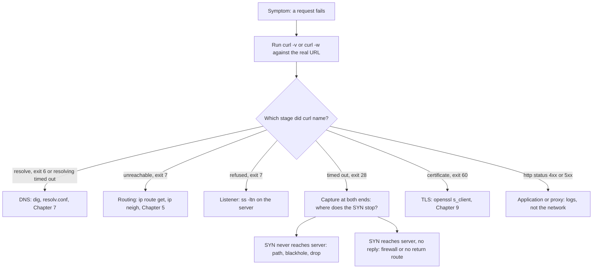

> **Navigation**: [← SSH](14_SSH_Remote_Access.md) | [Index](00_INDEX.md)

# 🔬 Chapter 15: Network Debugging & Packet Capture — Finding The Problem

> _"'The network is broken' is the most useless troubleshooting statement ever. WHICH part of the network? DNS? TCP? TLS? Firewall? Load balancer? This chapter gives you the systematic methodology and tools to pinpoint the EXACT layer where things break."_

> **Verified on:** WSL2 Ubuntu 24.04.1 (kernel 6.6.87.2-microsoft-standard-WSL2), iproute2 6.1.0, curl 8.5.0, OpenBSD netcat 1.226, OpenSSL 3.0.13, dig 9.18.39, Python 3.12.3. Faults were injected in private network namespaces (`unshare -rn`: a client, a router and a server). **Not installed here, so not verified:** `tcpdump`, `traceroute`, `mtr`, `nmap`, `arp`, `iperf3`, Wireshark; Docker and Kubernetes (no cluster). Packet captures shown come from a 40-line Python `AF_PACKET` sniffer and are labelled as such, never as `tcpdump` output.

---

# PART 0: The Problem, Derived — What Would You Have to Invent?

---

"The network is broken" cannot be debugged, because it names no part. What would you have to invent to make a failure *diagnosable*?

**1. Split the path into stages that each have a test with two outcomes.** A request from an application to a remote application is not one thing; it is a pipeline in which each stage consumes the previous stage's output:

```text
name  ->  address  ->  route  ->  connection  ->  trust  ->  answer
DNS       the IP       IP/ARP     TCP handshake    TLS       HTTP status
```

A stage can only run if the one before it worked, so the *first* stage that fails explains every failure after it, and the later stages are not "also broken", they never ran. That is the entire theory of layered debugging: **find the first failing stage, then fix only that.**

**2. A test is only informative if you know the stages below it passed.** `curl` timing out tells you nothing until you know DNS and routing were fine. That gives the safe default: go bottom-up and prove each stage before trusting the next. Its cost is one command per stage.

**3. Do better than one command per stage: use a probe that crosses several stages and says where it stopped.** `curl` does name resolution, connect, TLS and HTTP in one run, and reports *which* it failed in its exit status and message. Run it first; it is a bisection step. Then switch to the dedicated tool of the stage it names. Measured in the Lab network:

| What failed | `curl` message | Exit status | Time to fail | Stage |
| --- | --- | --- | --- | --- |
| nothing (HTTP) | `http=200` | 0 | 5 ms | none |
| name does not exist (real resolver) | `Could not resolve host` | 6 | immediate | name |
| no resolver reachable | `Resolving timed out after 3000 ms` | 28 | 3.0 s | name |
| no route | `Failed to connect ... Couldn't connect to server` | 7 | 0.07 ms | route |
| port closed | the same text, exit 7 | 7 | 0.1 ms | connection |
| packets silently lost | `Connection timed out after 3002 ms` | 28 | 3.0 s | connection or route |
| untrusted or wrong-name certificate | `SSL certificate problem` or `no alternative certificate subject name matches` | 60 | 5 ms | trust |
| server answered with an error | `http=404` | 0 | 1.4 ms | answer (the network is fine) |

`curl -w` adds the per-stage clock: the healthy HTTPS request read `dns=0.000021 tcp=0.000627 tls=0.004057 first_byte=0.004403 total=0.004449`, the cumulative time at the end of each stage, so the *gap* between two numbers is the stage that is slow (here TLS cost about 3.4 ms of the 4.4). Exit status 0 with `http=404` is the case people miss: **an HTTP error is a successful network round trip.**

**4. The error text is evidence, so learn the four that people confuse.** All four were produced on purpose below:

| Message | What the kernel actually knows | Typical causes | Next command |
| --- | --- | --- | --- |
| `Connection refused` (ECONNREFUSED) | A TCP reset came back | Nothing listens on that port, or a firewall `reject with tcp reset` | `ss -ltn` on the server |
| `No route to host` (EHOSTUNREACH) | An ICMP "host unreachable" came back, or ARP got no answer | A router `unreachable` route, a firewall REJECT with ICMP, a wrong mask or dead host on the same link | `ip neigh`; capture for ICMP type 3 |
| `Network is unreachable` (ENETUNREACH) | The local routing table has no matching route | Missing default route, interface down | `ip route get <dst>` |
| `Connection timed out` (ETIMEDOUT) | **Nothing came back at all** | A firewall DROP, a blackhole route, no return route on the server, a dead host | Capture at both ends (see below) |

The dangerous one is the last: it is the only message that says *nothing*, and at least three different faults produce it identically. The way to separate them is to ask **where the first packet stops**: capture on the server's interface. If the SYN never arrives, the fault is between you and it (a blackhole or a drop on the path). If it arrives and nothing leaves, the fault is on the server (a firewall drop, or no route back to you; `ip route get <client-ip>` on the server answers that second case, as the Chapter 5 lab showed).



**How to read this diagram.** Start at the red-flag symptom and run the one probe that spans the stages. The diamond is the whole method: the probe's own message (not your guess) chooses the branch. Each branch ends at the tool and chapter for exactly one stage, so you never run a stage's tool before the stage above it is cleared. The timeout branch is the only one that needs more evidence, which is why it splits again by *where the packet stopped*.

**5. When the probe cannot decide, use the stage tools.** The rest of this chapter (`ping`, `dig`, `nc`, `openssl`, `tcpdump`, `nmap`) is that toolbox, in the order of the stages. `ping` and `traceroute` answer only the *route* stage; most real failures are in the stages above it.

---

## The mechanisms behind the tools, on real output

**A traceroute built by hand.** `traceroute` is not magic: every router decrements the IP TTL, and the router where it reaches zero answers with an ICMP "time exceeded" that reveals its address. `ping -t N` sets the TTL, so a loop over N is a traceroute. In the three-namespace lab (client, router, server):

```text
1  From 10.0.1.1 Time to live exceeded          <- the router, the first hop
2  64 bytes from 10.0.2.10: ttl=63 time=0.140 ms <- reached the server
3  64 bytes from 10.0.2.10: ttl=63 time=0.054 ms
```

The `ttl=63` on the reply shows the router decremented it once. A row of `* * *` in a real trace therefore means "no answer came back for that TTL", which is a router that does not generate (or that rate-limits) ICMP, not necessarily a broken path: the packets may still be forwarded.

**Why a refused connection is a reset, seen in packets** (captured by the Python sniffer on the router's server-side interface; not tcpdump):

```text
0.4365 IP 10.0.1.10.53360 > 10.0.2.10.9999: TCP flags [S]  (0x02), ttl 64
0.4366 IP 10.0.2.10.9999  > 10.0.1.10.53360: TCP flags [.R] (0x14), ttl 63
```

The reply carries RST and ACK together, byte value `0x14`. A capture filter written as "flag byte equals 4" (`tcp[13] == 4`) therefore *misses* a normal refusal; the bit test `tcp[tcpflags] & tcp-rst != 0` catches it. Python confirms the arithmetic: `0x14 == 4` is `False`, `bool(0x14 & 0x04)` is `True`.

**The failure that only large packets trigger: a path-MTU black hole.** Small packets fit through every link; a large one meets a link with a smaller MTU. IP then relies on an ICMP "fragmentation needed" message from the router so the sender can shrink its packets. If a firewall drops that ICMP, large transfers stall while small ones work, the most confusing symptom in this chapter. Reproduced in two experiments. For the pings the router's server-facing link was set to MTU 1400; for the file transfers the router's client-facing link was set to 1400 so that data flowing from server to client hits it:

```text
$ ping -c1 -M do -s 1472 10.0.2.10          (DF set, 1500-byte packet)
From 10.0.1.1 icmp_seq=1 Frag needed and DF set (mtu = 1400)
$ ping -c1 -M do -s 1372 10.0.2.10          (exactly 1400 bytes: fits)
1380 bytes from 10.0.2.10: icmp_seq=1 ttl=63
$ ping -c1 -M do -s 1373 10.0.2.10          (after the router told the client its MTU)
ping: local error: message too long, mtu=1400

with ICMP allowed:   small file (300 B)    http=200
                     big file (100000 B)   http=200, and the server's route cache holds "mtu 1400"
with ICMP dropped at the server (INPUT drop of ICMP):
                     small file (300 B)    http=200
                     big file (100000 B)   curl: Operation timed out after 4003 ms with 0 out of 100000 bytes received
                                           the server's route cache has no mtu entry: it never learned
```

The `-s 1472` rule from the chapter's reference section is the same arithmetic: a 1472-byte payload plus 28 bytes of ICMP and IP headers is a 1500-byte packet. The proving command for a suspected black hole is that very ping at decreasing sizes with `-M do`: the largest size that gets an answer is the path MTU. Fixes: let `ICMP type 3 code 4` through every firewall, or clamp the TCP MSS at the edge.

---

# PART 1: The Debugging Methodology — Layer by Layer

---

```
RULE #1: DEBUG BOTTOM-UP.
  Start at the physical/network layer. Work up to application.
  Don't blame the application until you've proven the network works.

THE SYSTEMATIC APPROACH:

STEP 1 — IS THE NETWORK REACHABLE? (Layer 3 — IP)
  ping 8.8.8.8                          # Can I reach the internet at all?
  ping 192.168.1.1                      # Can I reach my gateway?

  ping WORKS:   → IP connectivity is fine. Move up.
  ping FAILS:   → Check: cable/WiFi, interface up?, gateway reachable?
  ping to IP works but hostname fails: → DNS problem (skip to Step 2a; the original said 2b, which is routing).

  NOTE: Some servers block ICMP (ping). Failure doesn't ALWAYS mean unreachable.
  → Confirm with: nc -zv or curl.

STEP 2a — IS DNS WORKING? (Application support)
  nslookup api.myapp.com
  dig api.myapp.com +short

  Returns IP:  → DNS is fine.
  NXDOMAIN:    → Domain doesn't exist (typo? expired? wrong DNS server?)
  SERVFAIL:    → DNS server had an error (check /etc/resolv.conf)
  Timeout:     → DNS server unreachable (firewall? DNS server down?)

  Test different DNS servers:
  dig @8.8.8.8 api.myapp.com            # Google
  dig @1.1.1.1 api.myapp.com            # Cloudflare
  If one works but your default doesn't → your DNS server is the problem.

STEP 2b — WHAT PATH DO PACKETS TAKE? (Layer 3 — Routing)
  traceroute api.myapp.com               # Linux/macOS
  tracert api.myapp.com                  # Windows

  Shows every router hop. Look for where the trace STOPS or gets SLOW.

  * * * at hop 5:  → router 5 blocks ICMP OR there's a routing problem there.
  Sudden high latency at hop 8: → congestion at that ISP router.

  MTR (better than traceroute — continuous monitoring):
  mtr api.myapp.com
  → Shows: packet loss % and latency at EACH hop, updated live.
  → Let it run for 60 seconds for meaningful statistics.
  (traceroute and mtr are not installed in this lab, so their output is not verified here.
   The mechanism they use IS verified: a probe with a small TTL is answered by the router where
   it expires, see "A traceroute built by hand" below.)

STEP 3 — IS THE PORT OPEN? (Layer 4 — TCP/UDP)
  nc -zv api.myapp.com 443               # netcat: test TCP port
  nc -zvu api.myapp.com 53               # test UDP port (UNRELIABLE, see the correction below)

  "Connection succeeded":   → Port is open. Service is listening.
  "Connection refused":     → Port is closed. Service not running or wrong port.
  "Connection timed out":   → Something is silently discarding the packets: a firewall DROP is
                              the usual suspect, but a blackhole route, a missing return route
                              on the server, or a host that is down give the SAME message.
                              (Corrected: the original said "FIREWALL is blocking the port!".
                              Four different faults produced the same timeout in the Lab.)

  Corrections verified in the Lab (OpenBSD netcat, the Ubuntu 24.04 default):
  - "No route to host" does NOT mean a firewall silently dropped the packet (the original
    Challenge 1 said so). A silent drop times out. "No route to host" means an ICMP
    "host unreachable" came back (a router, or a firewall REJECT with admin-prohibited) or ARP
    got no answer on the local link.
  - UDP: nc -zvu reports "succeeded" for an OPEN port and ALSO for a port that a firewall
    silently drops, because UDP has no handshake and "no error came back" is read as success.
    Only a closed port (ICMP port-unreachable returned) gives a failure, and with -v it prints
    nothing, just exit status 1. A UDP "succeeded" is not evidence that a service is there.

  Scan multiple ports:
  nmap -p 22,80,443,5432,8080 api.myapp.com

  Show what SERVICE is running on each port:
  nmap -sV api.myapp.com                # version detection (nmap not installed here: not verified)
  # Example output below is ILLUSTRATIVE (invented host and versions):
  # PORT    STATE SERVICE  VERSION
  # 22/tcp  open  ssh      OpenSSH 8.9p1
  # 443/tcp open  https    nginx/1.24

STEP 4 — IS TLS WORKING? (between TCP and HTTP; OSI numbers it loosely as "layer 6", but
                           the stack has no clean layer for it, so think "after connect, before HTTP")
  openssl s_client -connect api.myapp.com:443 -servername api.myapp.com

  Look for:
  "Verify return code: 0 (ok)"           → cert is valid
  "Verify return code: 10 (certificate has expired)" → cert expired!
  "certificate verify failed"            → wrong CA, self-signed, or hostname mismatch

  Check cert details:
  echo | openssl s_client -connect api.myapp.com:443 2>/dev/null | openssl x509 -text -noout

STEP 5 — IS THE HTTP ENDPOINT RESPONDING? (Layer 7 — Application)
  curl -v https://api.myapp.com/health

  Look at the verbose output:
  * Trying 54.123.45.67:443...           → DNS resolved, connecting
  * Connected                            → TCP handshake succeeded
  * SSL connection using TLS1.3          → TLS handshake succeeded
  > GET /health HTTP/2                   → request sent
  < HTTP/2 200                           → SUCCESS!

  Common errors:
  "Could not resolve host"  → DNS failure
  "Connection refused"      → port not open
  "Connection timed out"    → firewall blocking
  "SSL certificate problem" → TLS issue
  "HTTP 502 Bad Gateway"    → LB can't reach backend
  "HTTP 504 Gateway Timeout"→ backend too slow
```

---

# PART 2: tcpdump — Packet Capture on the Command Line

---

```bash
# tcpdump is the essential tool for seeing EXACTLY what's on the wire.
# It's like putting a microscope on your network interface.

# ── BASIC CAPTURES ──

# Capture all traffic on eth0
sudo tcpdump -i eth0

# Capture with readable timestamps and don't resolve hostnames
sudo tcpdump -i eth0 -n -tttt

# ── FILTERED CAPTURES ──

# HTTP traffic only (port 80)
sudo tcpdump -i eth0 port 80

# HTTPS traffic (port 443) — headers only (content is encrypted)
sudo tcpdump -i eth0 port 443

# DNS queries (port 53)
sudo tcpdump -i eth0 port 53 -vvv
# Shows: query type, domain name, response IPs

# Traffic to/from a specific IP
sudo tcpdump -i eth0 host 54.123.45.67

# Traffic from a specific SOURCE
sudo tcpdump -i eth0 src 192.168.1.100

# Traffic to a specific DESTINATION on a specific port
sudo tcpdump -i eth0 dst 54.123.45.67 and port 443

# Only SYN packets (new TCP connections)
sudo tcpdump -i eth0 'tcp[tcpflags] & (tcp-syn) != 0 and tcp[tcpflags] & (tcp-ack) == 0'

# Only RST packets (connection resets — debugging refused connections)
sudo tcpdump -i eth0 'tcp[tcpflags] & (tcp-rst) != 0'
# (tcpdump is not installed in this lab; every capture in this chapter came from a small
#  Python AF_PACKET sniffer and is labelled as such. The flag logic below was checked on real
#  packets: a refused connection is answered with flags RST+ACK, byte value 0x14, so the
#  filter 'tcp[13] == 4' used later in this chapter, which means "flags equal exactly RST",
#  does NOT match it, while the bit test above does.)

# ICMP (ping) packets
sudo tcpdump -i eth0 icmp

# ── OUTPUT OPTIONS ──

# Show packet content in ASCII (for unencrypted protocols!)
sudo tcpdump -i eth0 port 80 -A
# You'll see raw HTTP: "GET /users HTTP/1.1\r\nHost: api.myapp.com"

# Show packet content in HEX + ASCII
sudo tcpdump -i eth0 port 80 -X

# Save to file (for later analysis in Wireshark)
sudo tcpdump -i eth0 -w /tmp/capture.pcap

# Read from a saved capture file
sudo tcpdump -r /tmp/capture.pcap

# Limit capture to N packets
sudo tcpdump -i eth0 -c 100 port 443

# ── REAL-WORLD DEBUGGING EXAMPLES ──

# "Is the server receiving my request?"
# On the SERVER (run tcpdump on server):
sudo tcpdump -i eth0 port 8080 -n
# If you see SYN from client → packets are arriving. Problem is in the app.
# If you see NOTHING → packets never reach the server. Firewall or routing!

# "Is DNS working?"
sudo tcpdump -i eth0 port 53 -vvv
# Output:
#   192.168.1.100 > 8.8.8.8: ... api.myapp.com? A
#   8.8.8.8 > 192.168.1.100: ... api.myapp.com A 54.123.45.67

# "Why is the connection being reset?"
sudo tcpdump -i eth0 'tcp[tcpflags] & (tcp-rst) != 0' -n
# Shows which IP is sending RST → that's where the problem is.

# "Is the load balancer forwarding my request?"
# On the BACKEND server:
sudo tcpdump -i eth0 port 8000 -n
# Check if X-Forwarded-For header shows the real client IP.
```

---

# PART 3: Wireshark — Visual Packet Analysis

---

```
WIRESHARK = graphical packet analyzer. The gold standard.

  Open a .pcap file captured by tcpdump → full visual analysis.
  Live capture on your local machine.

  KEY FEATURES:
  1. Protocol dissection: automatically parses HTTP, TLS, DNS, etc.
  2. Conversation view: see all packets between two endpoints.
  3. Stream following: reconstruct entire TCP conversation.
  4. Coloring: different colors for different protocols.
  5. Export: extract files transmitted over HTTP, images, etc.

DISPLAY FILTERS (after capture):
  http                                    # only HTTP packets
  tcp.port == 443                         # only port 443
  ip.addr == 54.123.45.67                # specific host
  dns.qry.name == "api.myapp.com"         # specific DNS query
  tcp.flags.syn == 1 && tcp.flags.ack == 0  # only SYN packets (new connections)
  http.response.code == 500                # only HTTP 500 errors
  tcp.analysis.retransmission             # retransmitted packets (packet loss!)
  frame.time_delta > 1                     # packets with >1s gap (latency analysis)

  COMBINE: ip.addr == 10.0.1.10 && tcp.port == 5432
  → Show only PostgreSQL traffic from/to 10.0.1.10.

ANALYZE TCP PROBLEMS:
  Statistics → TCP Stream Graphs → Time-Sequence:
  Shows sequence number over time. Flat lines = retransmissions/stalls.
  Steep lines = fast data transfer. Staircase = steady.

  Analyze → Expert Information:
  Shows all TCP errors: retransmissions, zero windows, resets, out-of-order.
```

---

# PART 4: nmap — Network Exploration & Security Auditing

---

```bash
# nmap = the most powerful network scanning tool.
# Used by: security auditors, sysadmins, penetration testers.

# ── HOST DISCOVERY ──

# Ping scan: which hosts are alive on the network?
nmap -sn 192.168.1.0/24
# Output: lists all responsive IPs and their MAC addresses
# Fast: doesn't scan ports, just checks if host is up.

# ── PORT SCANNING ──

# Default scan (top 1000 common ports)
nmap 54.123.45.67

# Scan specific ports
nmap -p 22,80,443,5432,8080 54.123.45.67

# Scan ALL 65535 ports
nmap -p 1-65535 54.123.45.67               # thorough but slow (~5 min)
nmap -p- 54.123.45.67                       # shorthand for all ports

# Fast scan (top 100 ports)
nmap -F 54.123.45.67

# ── SCAN TYPES ──

# TCP SYN scan (half-open: sends SYN, never completes the handshake)
# Corrected: the original said "default, stealthy". It is nmap's default only when you run it
# as root; without privileges nmap falls back to the connect scan (-sT). It is also not
# stealthy: firewalls and intrusion detection log SYN scans readily. (nmap documentation as
# remembered; nmap is not installed in this lab, so none of the nmap commands were run.)
# Only scan hosts you own or are authorised in writing to test.
sudo nmap -sS 54.123.45.67

# TCP Connect scan (completes full handshake — no root needed)
nmap -sT 54.123.45.67

# UDP scan (much slower — no handshake, waits for ICMP unreachable)
sudo nmap -sU 54.123.45.67

# ── SERVICE DETECTION ──

# Detect service version
nmap -sV 54.123.45.67
# Output:
# PORT     STATE SERVICE  VERSION
# 22/tcp   open  ssh      OpenSSH 8.9p1 Ubuntu 3ubuntu0.1
# 443/tcp  open  ssl/http nginx 1.24.0
# 5432/tcp open  postgresql PostgreSQL 15.4

# Detect operating system
sudo nmap -O 54.123.45.67
# Output: OS details: Linux 5.15

# Aggressive scan (service version + OS + traceroute + scripts)
nmap -A 54.123.45.67

# ── VULNERABILITY SCANNING ──

# Run default NSE scripts (safe checks)
nmap --script=default 54.123.45.67

# Check for specific vulnerabilities
nmap --script=vuln 54.123.45.67

# Check SSL/TLS configuration
nmap --script ssl-enum-ciphers -p 443 54.123.45.67
# Shows: which TLS versions and cipher suites the server supports
# Flags weak ciphers and deprecated TLS versions

# ── OUTPUT ──
nmap -oN scan-results.txt 54.123.45.67    # normal output to file
nmap -oX scan-results.xml 54.123.45.67    # XML output (for tools)
nmap -oG scan-results.gnmap 54.123.45.67  # greppable output
```

---

# PART 5: All-In-One Command Reference

---

```bash
# ── ESSENTIAL NETWORK DEBUGGING COMMANDS ──

# ── CONNECTIVITY ──
ping -c 4 8.8.8.8                        # basic connectivity check
ping -c 4 -s 1472 -M do 54.123.45.67     # MTU test (1472 + 28 = 1500)
traceroute -n api.myapp.com              # trace route (numeric, no DNS)
mtr --report api.myapp.com               # MTR report (the original said "60 packets"; mtr's default is
                                         # 10 probes per hop, set it with -c, e.g. -c 60; per the mtr
                                         # man page as remembered, not run here)

# ── DNS ──
dig +short api.myapp.com                 # quick IP lookup
dig +trace api.myapp.com                 # full resolution trace
dig @8.8.8.8 api.myapp.com              # query specific DNS server
host -t MX myapp.com                     # mail server lookup

# ── PORT/SERVICE ──
ss -tlnp                                 # local listening TCP ports + process
ss -tanp                                 # all TCP connections + process
lsof -i :8080                            # what process is on port 8080?
nc -zv api.myapp.com 22                  # is SSH port reachable?
nmap -sV -p 22,80,443 api.myapp.com     # service version scan

# ── HTTP ──
curl -v https://api.myapp.com/health     # verbose HTTP request
curl -w "DNS:%{time_namelookup} TCP:%{time_connect} TLS:%{time_appconnect} Total:%{time_total}\n" \
  -o /dev/null -s https://api.myapp.com  # timing breakdown
curl --resolve api.myapp.com:443:54.123.45.67 https://api.myapp.com  # bypass DNS

# ── TLS ──
openssl s_client -connect api.myapp.com:443    # TLS handshake test
echo | openssl s_client -connect api.myapp.com:443 2>/dev/null | openssl x509 -enddate -noout  # cert expiry

# ── PACKETS ──
sudo tcpdump -i eth0 port 443 -n -c 50  # capture 50 packets on port 443
sudo tcpdump -i eth0 -w capture.pcap     # save for Wireshark

# ── BANDWIDTH ──
iperf3 -s                                # start bandwidth test server
iperf3 -c server.myapp.com               # test bandwidth to server
# Output (ILLUSTRATIVE, iperf3 is not installed here; the real column layout differs slightly):
# [ ID] Interval  Transfer  Bitrate
# [  5]  0.0-10.0  1.09 GBytes  938 Mbits/sec

# ── SYSTEM ──
ip addr show                             # all interfaces and IPs
ip route show                            # routing table
ip neigh                                 # ARP cache (IP→MAC mappings); "arp -a" needs the legacy net-tools package, not installed on Ubuntu 24.04 by default
cat /etc/resolv.conf                     # configured DNS servers
ss -s                                    # socket statistics summary
```

---

# PART 6: Kubernetes Network Debugging

---

```bash
# ── K8S NETWORKING DEBUG ──

# Check pod networking
kubectl get pods -o wide                 # see pod IPs and nodes
kubectl exec -it myapp-pod -- ip addr    # pod's network interfaces
kubectl exec -it myapp-pod -- cat /etc/resolv.conf  # pod DNS config

# Test connectivity BETWEEN pods
kubectl exec -it pod-a -- nc -zv pod-b-service 8080
kubectl exec -it pod-a -- curl http://pod-b-service:8080/health

# Test DNS resolution inside the cluster
kubectl exec -it myapp-pod -- nslookup myservice.default.svc.cluster.local
# Should resolve to the ClusterIP of the service.

# Check services and endpoints
kubectl get svc                          # services and their ClusterIPs
kubectl get endpoints myservice          # which pods are behind the service?
# If endpoints is empty → no healthy pods match the selector!

# Check ingress
kubectl get ingress                      # ingress rules
kubectl describe ingress myapp-ingress   # detailed config + events

# Check network policies
kubectl get networkpolicy -A             # all network policies
kubectl describe networkpolicy deny-all  # specific policy details

# DNS debugging pod (run a debug container with network tools)
kubectl run netshoot --rm -it --image=nicolaka/netshoot -- /bin/bash
# Inside: dig, nslookup, ping, curl, tcpdump, nmap, iperf3 all available!

# Capture packets inside a pod
kubectl exec -it myapp-pod -- tcpdump -i eth0 port 8080 -n -c 20
# Most application images do not contain tcpdump, so the line above usually fails with
# "executable file not found". The reliable way is an ephemeral debug container that shares the
# pod's network namespace (kubectl debug, available in current Kubernetes releases):
kubectl debug -it myapp-pod --image=nicolaka/netshoot --target=myapp -- tcpdump -i eth0 port 8080 -n -c 20
# Every kubectl command in this chapter is NOT VERIFIED HERE: Docker is not available in this
# lab, so no kind cluster could be created. kubectl itself is installed, which only proves the
# syntax parses.
```

---

## Section Challenges

### 🔬 Challenge 1 — Diagnose a Silent Failure

> Your frontend calls `api.myapp.com/v1/users`. The browser console shows
> a network error but no HTTP status code. The backend team says their service
> is healthy. Walk through your debugging methodology from Layer 1 up.

<details>
<summary>Answer</summary>

```
LAYER 1/2 — Physical/Link:
  Is the machine on a network at all?
  ip addr (Linux) / ipconfig (Windows) — do you have a valid IP?
  If no IP or 169.254.x.x (APIPA): DHCP failed or cable/WiFi is down.

LAYER 3 — IP reachability:
  ping 8.8.8.8
  If fails: default route problem. Check: ip route | grep default
  If passes: IP stack is healthy. Move up.

LAYER 3 → DNS:
  dig api.myapp.com +short
  NXDOMAIN: domain doesn't exist for your DNS server.
    Try: dig @1.1.1.1 api.myapp.com — if Cloudflare resolves it,
    your corporate DNS is missing the record.
  Timeout: your DNS server is unreachable.
    Check: cat /etc/resolv.conf — is the nameserver correct?

LAYER 4 — TCP:
  nc -zv api.myapp.com 443
  "Connection refused": port 443 not listening on the server.
    → backend service is down, nginx/envoy not running, or wrong port.
  "No route to host": a router or firewall answered with ICMP "host unreachable" (a firewall
    REJECT with admin-prohibited does this), or ARP failed on the local link. Corrected: the
    original said "firewall dropping packets", but a silent drop produces a TIMEOUT, not this.
  Timeout (no response at all): something silently discarding packets. A firewall DROP is one
    cause; a blackhole route and a missing return route on the server give the identical
    message (all three were reproduced). Find which with captures at both ends.
    → try traceroute to find where packets stop.

LAYER 7 — TLS:
  openssl s_client -connect api.myapp.com:443
  Certificate expired: TLS handshake fails before any HTTP.
  Self-signed cert: client rejects; browser shows "network error" not 400/500.
  SNI mismatch: wrong cert returned for this hostname.

WHY "no HTTP status code":
  The browser only shows an HTTP status if the TCP+TLS handshake
  succeeded AND the server returned a response. "Network error" in
  the console usually means the connection NEVER reached HTTP — the failure
  was below Layer 7. This is why you always debug bottom-up.

  CORRECTION (browser behaviour, from general knowledge; not reproducible with the command-line
  tools in this lab): a "network error" with no status is NOT always a network fault. The
  browser deliberately hides the status of a response it refuses to hand to your script, and the
  console then shows a generic failure (for fetch(), "TypeError: Failed to fetch"). Common
  non-network causes: a CORS block (the server DID answer, with a status, but without the
  required Access-Control-* headers), mixed content (an https page calling http), a content
  security policy, an ad blocker, or a cancelled request. Check the browser's Network tab first:
  a row with a status code (even 200) means the network is fine and the policy is the problem;
  a row marked failed with no status means the connection itself failed, and then the
  command-line sequence above applies.
```

</details>

---

### 🔬 Challenge 2 — Intermittent Connection Drops

> A service drops connections randomly, roughly once every 5 minutes.
> `ping` to the server always works. `curl` to the HTTPS endpoint
> works 95% of the time. What are the most likely causes and how
> do you isolate each?

<details>
<summary>Answer</summary>

```
PING WORKS but HTTPS intermittently fails → problem is above Layer 3.

CAUSE 1 — TCP keepalive timeout / idle connection recycled:
  Load balancers and firewalls have idle TCP timeout (often 300s = 5 min).
  If the client holds a connection open without keepalive, the LB silently
  drops it after the timeout. Next request on the stale connection → RST.

  Diagnose:
  → tcpdump -i eth0 'tcp[tcpflags] & (tcp-rst) != 0' — watch for RST packets
    arriving from the load balancer at ~5-minute intervals.
    (Corrected: the original filter was 'tcp[13] == 4', which matches only packets whose flag
    byte is EXACTLY RST. Real resets often carry RST+ACK, byte 0x14, and a refused connection
    was observed answered with exactly that, so the original filter would miss them.)
  Fix: enable TCP keepalive on the client socket, or configure Connection
  pool to discard connections older than 4.5 minutes.

CAUSE 2 — TLS session timeout:
  TLS session tickets expire (default: 24h, but some servers set lower).
  Less likely at 5-minute intervals, but check if the pattern correlates
  with TLS session-ticket rotation or key reload in the server logs. (TLS 1.3 removed
  renegotiation, so "renegotiation" applies only to TLS 1.2 and earlier.) An expired
  session ticket only costs a full handshake; it does not by itself drop connections.

CAUSE 3 — Load balancer health-check flapping:
  If the backend fails a health check briefly, LB marks it unhealthy and
  stops sending traffic → next connection hangs/times out.
  Diagnose: check LB access logs for 5xx or connection-draining events
  at the same timestamps as failures.

CAUSE 4 — OOM killer or process restart:
  App server runs out of memory every 5 minutes and restarts.
  → Check: journalctl -u myapp.service | grep -i 'killed\|OOM'
  → uptime or systemctl show myapp.service --property=ActiveState

ISOLATION APPROACH:
  1. tcpdump for RST packets during a failure window.
  2. Check LB access logs for 5xx at failure times.
  3. Check server memory/CPU usage graphs.
  4. Add "X-Request-ID" header and correlate client-side failure timestamps
     with server-side logs to confirm which layer drops.
```

</details>

---

### 🔬 Challenge 3 — Kubernetes Pod Can't Reach External API

> A pod running in Kubernetes calls `https://api.stripe.com` and gets
> `connection timed out`. The same curl works from a developer's laptop.
> The pod's other external calls (to S3) work fine. What is the specific
> debugging path inside a K8s cluster?

<details>
<summary>Answer</summary>

```
(Kubernetes and cloud behaviour in this answer is NOT VERIFIED HERE: no cluster, no cloud.)

OBSERVATION: S3 works, Stripe doesn't → it LOOKS like a specific destination is
blocked. That points to NetworkPolicy or a firewall rule targeting specific IPs/CIDRs.
CAVEAT (correction): "S3 works" does not prove general internet egress works. In AWS, S3 is
often reached through a gateway VPC endpoint, a private route that bypasses the NAT gateway.
A subnet with no NAT gateway or internet route can therefore reach S3 and nothing else, and
every other external API would time out. Check the route table of the pod's subnet before
concluding that only Stripe is blocked.

STEP 1 — Verify egress from inside the pod:
  kubectl exec -it <pod-name> -n <namespace> -- /bin/sh
  (if no curl/ping: kubectl run debug --rm -it --image=nicolaka/netshoot)

  curl -v https://api.stripe.com      # timeout?
  (Corrected: the original also suggested pinging "104.18.0.0" as "Stripe's anycast IP". That
  address could not be sourced and should not be trusted. Use the address your own pod
  resolves: nslookup api.stripe.com, then test that address.)

STEP 2 — Check NetworkPolicy:
  kubectl get networkpolicy -n <namespace>
  kubectl describe networkpolicy <name>

  Look for:
  - egress rules that allow only specific CIDRs (if S3 CIDR is in the allow
    list but Stripe's CIDR isn't)
  - a "deny-all-egress" policy with specific whitelist
  - policies that allow port 443 to S3 endpoints only (via CIDR)

STEP 3 — Check if the CNI enforces egress:
  Not all CNIs enforce NetworkPolicy equally. Confirm with:
  kubectl get pods -n kube-system | grep -E 'cilium|calico|weave'
  A Calico/Cilium CNI enforces NetworkPolicy properly; Flannel alone does not.

STEP 4 — Check cluster-level firewall (cloud provider):
  If NetworkPolicy is clean, check the VPC/security group rules.
  Some cloud setups block egress on 443 to non-approved destinations at
  the VPC NAT Gateway level (separate from K8s NetworkPolicy).

STEP 5 — DNS for external names:
  nslookup api.stripe.com (from inside the pod)
  If NXDOMAIN: the CoreDNS forward config may not forward external queries.
  Check: kubectl get configmap coredns -n kube-system -o yaml
  Look for "forward" entry pointing to an upstream resolver that works.

ROOT CAUSE (most common): A NetworkPolicy with egress CIDR whitelist was
written for S3 but forgot to include Stripe's IP range. Fix: add Stripe
CIDR block (or use FQDN-based policy with Cilium's CiliumNetworkPolicy).
```

</details>

---

## Alternatives and When to Use Each

| Question you are asking | Tool | Use it when | Where it misleads |
| --- | --- | --- | --- |
| Does anything on the path answer at the IP level? | `ping` | As the first, cheapest check | ICMP is often filtered or rate limited: in the firewall lab a server with `tcp dport 80 accept` and no ICMP rule returned `HTTP 200` while `ping` got nothing. A reply proves a route, not a service |
| Where along the path do packets stop or slow? | `traceroute`, `mtr`, or `ping -t N` | A timeout and you must decide if the fault is near or far | Routers rate limit or hide ICMP, load-balanced paths show different routers per probe, and the return path can differ from the forward one. Not installed here, so only the `ping -t` form was run |
| Does a TCP port accept connections? | `nc -zv -w3 HOST PORT` | Quick connect-only test; its message distinguishes refused, unreachable and timed out | It proves the handshake, not that the application works |
| Does a UDP service answer? | A real client request (`dig`, an application probe) | Always for UDP | `nc -zvu` reports "succeeded" for open and for silently filtered ports alike |
| What is listening on this host? | `ss -ltnp` (`lsof -i` as an alternative) | First check on the server side of any "connection refused" | Shows the local view only; a firewall in front can still block it |
| Which stage of a real request failed? | `curl -v` or `curl -w` | First probe in the layered method | Tests one client's view, so also run it from the machine that actually fails |
| What exactly is on the wire? | `tcpdump` (headless hosts, filters) or Wireshark (analysis of a saved file) | You have a hypothesis a capture can confirm or refute | Needs privilege; a capture without a hypothesis is a haystack; encrypted payloads stay encrypted |
| What ports are open on a host? | `nmap` | An authorised audit of your own hosts | Intrusive and noisy: scanning hosts you do not own can be illegal or breach policy |
| Is the certificate chain right? | `openssl s_client -servername NAME` | After `curl` exit status 60 or a TLS alert | Browsers repair some chain faults that other clients do not ([Chapter 9](09_TLS_Encryption.md)) |

**Order, not preference.** Cheap and broad first (`curl`, `ping`), narrow next (`nc`, `ss`, `dig`, `openssl`), expensive last (`tcpdump`, Wireshark, `nmap`). Reach for the capture when the cheaper tools have localised the fault to the wire, as the Reality Check says.

## How It Fails and How to Debug It

Failures of the *method*, with the command that exposes each. Rows marked "reproduced" were run in the Lab network.

| Symptom | Cause | Command that proves it |
| --- | --- | --- |
| Small requests work, large ones hang or stall at the same size | Path-MTU black hole: the ICMP "fragmentation needed" message is dropped, so the sender never shrinks its packets (reproduced) | `ping -c1 -M do -s SIZE HOST` at decreasing sizes: the largest that is answered, plus 28, is the path MTU |
| `nc -zvu` says `succeeded` but the service does nothing | UDP gives no negative answer for a filtered port (reproduced) | Send a real request (`dig @HOST name`), not a port probe |
| Timeout, three possible faults | A firewall drop, a blackhole route and a missing return route all time out identically (reproduced) | Capture on the server NIC: SYN absent means path, SYN present with no reply means server side; `ip route get <client-ip>` on the server tests the return path |
| `ping` works but the application does not | `ping` proves only that a route exists (reproduced: with nothing listening, `nc` said `Connection refused` while the host was reachable) | `nc -zv`, then `ss -ltnp` on the server |
| `ping` fails but the application works | ICMP filtered by policy (reproduced in the firewall lab) | `curl -v` succeeds; do not treat failing ping as "down" |
| A capture filter for resets shows nothing during a refusal | The filter `tcp[13] == 4` requires the flag byte to equal exactly RST, but refusals carry RST+ACK `0x14` (reproduced) | Use `tcp[tcpflags] & tcp-rst != 0` |
| Works from your laptop, fails from a container or pod | Different resolver, different egress route, or a policy that applies only there | Run the same `curl -v` inside it and compare `/etc/resolv.conf` and the route (not verified here: no cluster) |
| Fails every few minutes, `ping` always fine | An idle-timeout mismatch resets or drops long-lived connections | Capture around the failure time and look for who sends the reset (not reproduced here) |

## Lab: Break the Network Five Ways and Read the Message

Needs Linux with `iproute2`, `curl`, `nc` (OpenBSD netcat, the Ubuntu default), `bc` and Python 3. No root: `unshare -rn` creates private namespaces in which you are root. Nothing touches your real network. The same three-namespace layout as [Chapter 5](05_IP_Addressing_Subnets.md): client A (`10.0.1.10`), a router and server B (`10.0.2.10`).

1. Save and run the script. It builds the network, then runs four parts: one cross-stage probe, five injected faults, a hand-made traceroute, and a path-MTU check.

```bash
unshare -rn bash -c '
exec 2>&1
ip link set lo up
unshare -n sleep infinity & A=$!
unshare -n sleep infinity & B=$!
sleep 0.4
a() { nsenter -t $A -n "$@"; }; b() { nsenter -t $B -n "$@"; }
ip link add ra type veth peer name a0; ip link set a0 netns $A
ip link add rb type veth peer name b0; ip link set b0 netns $B
ip addr add 10.0.1.1/24 dev ra; ip link set ra up
ip addr add 10.0.2.1/24 dev rb; ip link set rb up
sysctl -qw net.ipv4.ip_forward=1
a ip link set lo up; a ip addr add 10.0.1.10/24 dev a0; a ip link set a0 up; a ip route add default via 10.0.1.1
b ip link set lo up; b ip addr add 10.0.2.10/24 dev b0; b ip link set b0 up; b ip route add default via 10.0.2.1
cd /tmp; echo hello > index.html
b python3 -m http.server 80 --bind 10.0.2.10 >/dev/null 2>&1 &
for i in $(seq 60); do b ss -ltn | grep -q ":80 " && break; sleep 0.2; done

echo "## A. one probe across all stages"
a curl -sS -m3 -o /dev/null -w "dns=%{time_namelookup} tcp=%{time_connect} first_byte=%{time_starttransfer} total=%{time_total} http=%{http_code}\n" http://10.0.2.10/

echo "## B. inject faults, read the message"
probe() { t0=$(date +%s.%N); out=$(a nc -zv -w3 10.0.2.10 80 2>&1); t1=$(date +%s.%N)
          printf "%-28s %5.2fs  %s\n" "$1" $(echo "$t1 - $t0" | bc) "${out#nc: connect to 10.0.2.10 port 80 (tcp) }"; }
probe "0 healthy"
a ip route del default;                 probe "1 client has no route";    a ip route add default via 10.0.1.1
ip route add blackhole 10.0.2.10/32;    probe "2 blackhole on router";    ip route del blackhole 10.0.2.10/32
ip route add unreachable 10.0.2.10/32;  probe "3 unreachable on router";  ip route del unreachable 10.0.2.10/32
b ip route del default;                 probe "4 server has no way back"; b ip route get 10.0.1.10; b ip route add default via 10.0.2.1
b ss -ltnp | grep -o "pid=[0-9]*" | cut -d= -f2 | xargs kill; sleep 0.3
probe "5 nothing listening"

echo "## C. traceroute by hand"
for ttl in 1 2; do printf "%s  " $ttl; a ping -c1 -W1 -t $ttl 10.0.2.10 | sed -n 2p | sed "s/ icmp_seq=1//"; done

echo "## D. path MTU"
ip link set rb mtu 1400
a ping -c1 -W1 -M do -s 1472 10.0.2.10 | sed -n 2p
a ping -c1 -W1 -M do -s 1372 10.0.2.10 | sed -n 2p
a ping -c1 -W1 -M do -s 1373 10.0.2.10 | sed -n 2p
kill $A $B 2>/dev/null
'
```

Expected result (the millisecond figures vary between runs; the wording and the 3-second timeouts do not):

```text
## A. one probe across all stages
dns=0.000043 tcp=0.000947 first_byte=0.004172 total=0.004255 http=200
## B. inject faults, read the message
0 healthy                     0.01s  Connection to 10.0.2.10 80 port [tcp/http] succeeded!
1 client has no route         0.01s  failed: Network is unreachable
2 blackhole on router         3.01s  timed out: Operation now in progress
3 unreachable on router       0.01s  failed: No route to host
4 server has no way back      3.01s  timed out: Operation now in progress
RTNETLINK answers: Network is unreachable
5 nothing listening           0.01s  failed: Connection refused
## C. traceroute by hand
1  From 10.0.1.1 Time to live exceeded
2  64 bytes from 10.0.2.10: ttl=63 time=0.059 ms
## D. path MTU
From 10.0.1.1 icmp_seq=1 Frag needed and DF set (mtu = 1400)
1380 bytes from 10.0.2.10: icmp_seq=1 ttl=63 time=0.019 ms
ping: local error: message too long, mtu=1400
```

2. Read the evidence against the derivation. Faults 2 and 4 both ended in a 3-second timeout although one is on the router and one is on the server. The extra line `RTNETLINK answers: Network is unreachable` printed after fault 4 is the proof for that one: on the server, `ip route get 10.0.1.10` fails because the server has no route back to the client. For fault 2, the same command succeeds on the server (the server is fine; the router discards the packets), and a capture on the server would show no SYN at all.

3. Check: you understand the lab when you can predict, before looking, the message each fault produces: no route is instant and says `Network is unreachable`; a router `unreachable` entry is instant and says `No route to host`; a missing listener is instant and says `Connection refused`; a blackhole or a missing return route takes the full timeout.

**Stretch (needs the firewall helper from [Chapter 10](10_Firewalls_Access_Control.md)).** Reproduce the path-MTU black hole: set `ip link set ra mtu 1400` on the router, serve a 100,000-byte file from B, and compare the download with and without a rule on B that drops ICMP. In the run behind this chapter, the 300-byte file worked in both cases, the 100,000-byte file succeeded with ICMP allowed and stalled with `0 out of 100000 bytes received` when ICMP was dropped.

🔬 **Section Challenge — The layered method**

**Challenge 1 (Classification):** For each `curl` result, name the stage that failed and the next command: (a) `curl: (6) Could not resolve host`, (b) `curl: (28) Connection timed out after 3002 milliseconds` after you confirmed with `nc` that a closed port elsewhere answers instantly, (c) `curl: (60) SSL: no alternative certificate subject name matches target host name`, (d) exit status 0 with `http=503`.

<details><summary>Answer</summary>

(a) Name stage: the resolver answered NXDOMAIN or failed; run `dig NAME` and compare resolvers (Chapter 7). If instead the message is `Resolving timed out`, the resolver itself is unreachable, a routing or firewall question about port 53. (b) The connection stage, but a timeout is the one message that says nothing, so capture on the server's NIC: no SYN arriving means the fault is between you and it (blackhole, drop on the path); SYN arriving with no reply means the server side (a firewall drop, or no route back to you: `ip route get <your-ip>` on the server). (c) Trust stage: the certificate does not list the name you connected to; `openssl s_client -connect HOST:443 -servername NAME` and compare the certificate's SAN list with the name (Chapter 9). (d) Not a network fault: the request completed. The `503` came from an application or a proxy, so read their logs or the upstream health, not the network.

</details>

**Challenge 2 (Debugging):** Downloads of small files from a partner's server work, but any file over about 1,400 bytes stalls forever and curl reports `0 out of N bytes received`. `ping` to the server works, and a TCP connection is established. What is the fault, how do you prove it with `ping` alone, and what must you tell the firewall team?

<details><summary>Answer</summary>

A path-MTU black hole: the first packets are small enough to pass, the large data packets hit a link with a smaller MTU, and the router's ICMP "fragmentation needed" message never reaches the sender, because a firewall drops ICMP, so the sender keeps retransmitting packets that cannot pass. Prove it with `ping -c1 -M do -s SIZE HOST`, trying 1472, 1400, 1372 and so on: the largest size that gets an answer plus 28 bytes is the real path MTU, and the pattern "works below SIZE, silent above" matches the stall. (In a lab with a 1400-byte link and ICMP dropped at the server, the 100,000-byte transfer stalled at 0 bytes while a 300-byte transfer worked; with ICMP allowed it completed.) Tell the firewall team to permit ICMP type 3 code 4 (fragmentation needed) on every path; as a workaround, clamp the TCP MSS on the edge router to the lower MTU. Blocking all ICMP "for security" is the usual origin.

</details>

🔬 **Section Challenge — Reading messages and captures**

**Challenge 1 (Reasoning):** A colleague says "`No route to host` proves the firewall is silently dropping our packets". Is that right? What do you check?

<details><summary>Answer</summary>

No. A silent drop produces a timeout. `No route to host` (`EHOSTUNREACH`) means the kernel received an ICMP "host unreachable" or its ARP request went unanswered. In the lab it appeared in two unrelated situations: a router with an `unreachable` route returned ICMP host-unreachable at once, and a firewall `reject` with ICMP code 13 (administratively prohibited) produced the same text. It also appears when a wrong netmask makes the destination look on-link and ARP fails (Chapter 5). To tell them apart: `ip neigh` (a `FAILED` entry means ARP, a local-link problem), then a capture on the client for an ICMP type 3 packet and its sending address, which names the device that rejected you. If a firewall is the source, it is *rejecting*, not dropping, and its rule list shows which rule.

</details>

**Challenge 2 (Calculation):** You capture a failing connection with the filter `tcp[13] == 4` and see nothing, so you conclude "no resets". The server is known to refuse the connection. What is the flaw, and what filter is correct?

<details><summary>Answer</summary>

Byte 13 of the TCP header is the flag byte. `== 4` means "RST set and every other flag clear". A normal refusal sets RST and ACK together, byte value `0x14` (20), which is not equal to 4, so the filter silently ignores it. This was observed: the reply to a SYN to a closed port carried flags `[.R] (0x14)`. The correct filter tests the bit instead of the whole byte: `tcp[tcpflags] & (tcp-rst) != 0`, or `tcp[13] & 4 != 0`. The lesson is that a capture filter that returns nothing is evidence of a bad filter at least as often as of a quiet network; test the filter against traffic you can generate.

</details>

## 🔗 Cross-References

| Topic                       | Related Content                                                                |
| --------------------------- | ------------------------------------------------------------------------------ |
| **TCP states**              | [Ch 06: TCP/UDP](06_TCP_UDP_Deep_Dive.md) — understand what SYN, RST, FIN mean |
| **DNS debugging**           | [Ch 07: DNS](07_DNS_Complete.md) — dig +trace, record types                    |
| **TLS certificates**        | [Ch 09: TLS](09_TLS_Encryption.md) — openssl commands                          |
| **Firewall rules**          | [Ch 10: Firewalls](10_Firewalls_Access_Control.md) — iptables                  |
| **K8s networking**          | [Networking & Security](02_Networking_Security.md) — pods, services, ingress   |
| **Load balancer debugging** | [Ch 11: Load Balancing](11_Load_Balancing_Proxies.md) — 502/504 errors         |
| **SSH tunneling**           | [Ch 14: SSH](14_SSH_Remote_Access.md) — access internal services for debugging |
| **Python sockets**          | [Asyncio Internals](../25_Python_ML_DL_NLP/02b_Python_Asyncio_Internals.md)    |


---

## Reality Check

**"Network debugging means running ping and traceroute"** — ping and traceroute answer ONE layer (IP reachability) and mislead when the problem is elsewhere: ping succeeds while the application fails (reachable host, dead service — [servers/ports]' layer distinction), ICMP is often rate-limited or blocked (the traceroute full of asterisks that means "ICMP filtered," not "broken"), and neither touches DNS, TLS, or application-layer problems where most real failures live. The skill is LAYER-BY-LAYER bisection: resolve (DNS), reach (ping/IP), connect (does the port accept — nc/telnet, [servers/ports]), handshake (TLS — openssl s_client), respond (curl -v the actual request) — running only ping-and-traceroute is checking one link of a five-link chain.

**"If I can curl it, the network is fine"** — A successful curl from YOUR machine proves that path at that moment, and network problems are often specific to a path, a client, or a timing you are not reproducing: works from your laptop, fails from the container (different DNS, different network, different egress — [Docker networking]), works now, fails under load (connection pool exhaustion, ephemeral port limits), works for you, fails for a user (their resolver's stale DNS, their network's MTU, geo-routing to a different endpoint). "I can curl it" is one successful sample; the failure is often in the samples you are not taking — from the right source, under the right conditions, at the right time.

**"Intermittent network issues are impossible to debug"** — Intermittent means TIMING or STATE dependent, which narrows the hunt rather than ending it: capture continuously and correlate to the failure window (the packet capture, the connection metrics over time — the intermittent DNS timeout visible as periodic resolver failures, the reset that always fires at 60 seconds pointing at an idle-timeout mismatch [TCP deep-dive]), look for exhaustion patterns (connection/port/memory limits hit under load — the failure that correlates with traffic), and check for the periodic trigger (the cron, the cert renewal, the connection recycle, the DNS TTL expiry). "Impossible to debug" is what unstructured guessing feels like; structured capture-and-correlate turns intermittent into "happens exactly when X," which is a fixable statement.

**"The packet capture will show me the problem"** — tcpdump/Wireshark is powerful and frequently the WRONG first tool — it shows you everything and answers nothing without a hypothesis: the multi-gigabyte capture nobody can read, versus the targeted capture with a filter testing a specific question (is the SYN even leaving, is the response coming back, is it a RST or a timeout, is TLS completing). Packet capture is the depth instrument for when higher-level tools (curl -v, application logs, connection metrics) have localized the problem to the wire — reaching for it first, before forming the hypothesis it should test, is the network-debugging equivalent of [13_DE debugging]'s unhypothesized stepping.

**"Network problems are the network team's problem"** — The majority of "network" tickets are APPLICATION behavior over a healthy network ([13_DE servers/ports] and [networking-complete]'s recurring theme): the connection pool misconfigured against the database's limits, the timeout budget misaligned across hops (who reports the error and whether retries stack), the DNS the app caches forever, the retry storm the app generates, the TLS verification the client disabled. Handing these to the network team wastes a cycle (they measure a healthy network and hand it back) — the developer-owned diagnosis (is this MY connection handling, MY timeout, MY retry logic, MY DNS caching) resolves them faster, and the genuinely-network problems (routing, hardware, capacity) are the minority the layer-bisection identifies before escalating.

**"A timeout means the firewall is blocking it"** — A timeout means only that nothing came back. In the lab a firewall drop, a blackhole route on the router and a missing return route on the server produced the same 3-second timeout, and only a capture on the server (did the SYN arrive?) or the server's routing table tells them apart. Blaming the firewall first sends you to the wrong team a third of the time.

**"`No route to host` is a routing table problem"** — The routing table problem has its own message, `Network is unreachable`, which is immediate. `No route to host` means an ICMP host-unreachable came back or ARP failed, so the cause can be a wrong netmask, a dead host on the local link, or a firewall that *rejects* with ICMP. Different message, different cause, different first command.

**"If `ping` works the network is fine; if `ping` fails the host is down"** — Both halves are wrong. `ping` proves a route and an ICMP-permitting path, nothing about the service (the lab's no-listener server answered `Connection refused` while perfectly reachable), and a host behind a policy that drops ICMP serves HTTP happily while `ping` gets nothing.

**"`nc -zvu` tells me whether a UDP port is open"** — UDP has no handshake, so "no error came back" is reported as success. The lab showed `succeeded` for an open port and for a port a firewall was silently dropping. Only a closed port, which elicits an ICMP port-unreachable, fails. Test UDP services with a real request.

**"If small requests work, the network is fine"** — A path-MTU fault passes every small packet and stalls every large one, so health checks and login pages work while downloads hang. The proving test is `ping -M do -s SIZE` at several sizes, and the usual root cause is a firewall that drops ICMP "fragmentation needed".

**"The first failing command is the fault"** — Only if you ran the commands in stage order. A failing `curl` after a successful DNS lookup and route check is informative; the same failure with the earlier stages untested is a hypothesis. Run the cross-stage probe first, then trust each stage's own tool in order.

## Books

Chapter numbers and titles are from [BOOKS.md](BOOKS.md), which read them from each book's own table of contents.

| Book | Read | What it adds beyond this chapter |
| --- | --- | --- |
| *Systems Performance*, 2nd ed., Brendan Gregg (PAID, Addison-Wesley, 2020) | Ch 10 Network, Ch 13 perf | A method and tooling for locating where time or packets go, with the kernel's view of the network path; it supplies the "which question first" discipline behind the layered method. |
| *TCP/IP Illustrated, Volume 1: The Protocols*, 2nd ed., Stevens and Fall (PAID, Addison-Wesley Professional, 2011) | Ch 8 ICMPv4 and ICMPv6, Ch 14 TCP Timeout and Retransmission | Teaches how to read what you capture, tying each symptom to its protocol cause: Ch 8 covers the "time exceeded" and "fragmentation needed" messages used above, Ch 14 the retransmissions behind a timeout. |
