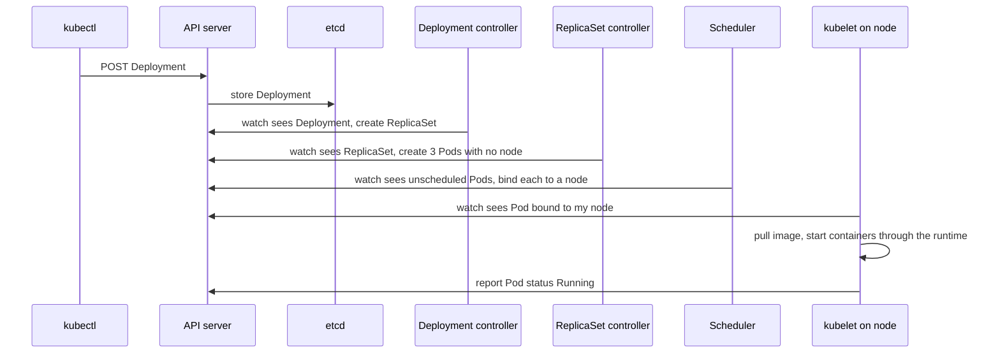
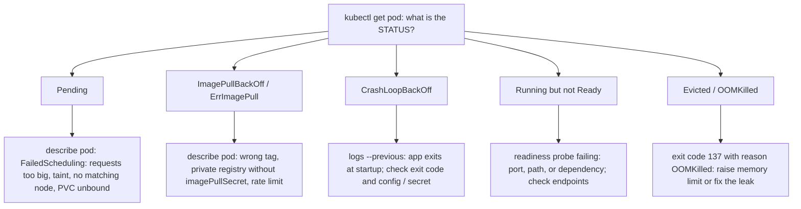

> **Navigation**: [← Docker](17_Docker_Complete.md) | [Index](00_INDEX.md) | [Next → CI/CD](19_CICD_Pipelines.md)

# ☸️ Chapter 18: Kubernetes Complete — Orchestrating Containers at Scale

> _"Docker runs ONE container. Kubernetes runs THOUSANDS across HUNDREDS of machines, handles failures, scales automatically, and rolls out updates without downtime. That's the leap."_

---

# PART 1: Why Kubernetes? — The Problem It Solves

---

```
WITH DOCKER ALONE (10 containers):
  You manually: start containers, map ports, restart on crash, place on servers.
  Manageable at small scale.

WITH 500 CONTAINERS ACROSS 50 SERVERS:
  Which server should this container run on? (Resource-aware scheduling)
  Server 12 died — restart its 20 containers somewhere else. (Self-healing)
  Traffic spiked 10x — need more containers NOW. (Auto-scaling)
  New version deploy — don't take down the WHOLE service. (Rolling updates)
  Services need to find each other. (Service discovery)
  Some containers need persistent storage. (Volume management)

  KUBERNETES HANDLES ALL OF THIS AUTOMATICALLY.

KUBERNETES ARCHITECTURE:

  CONTROL PLANE (brain):               WORKER NODES (muscle):
  ┌─────────────────────────┐          ┌──────────────────────┐
  │ API Server              │          │ kubelet              │
  │ (all communication      │          │ (manages pods        │
  │  goes through here)     │←────────→│  on this node)       │
  │                         │          │                      │
  │ etcd                    │          │ kube-proxy           │
  │ (key-value store,       │          │ (network rules,      │
  │  ALL cluster state)     │          │  service routing)    │
  │                         │          │                      │
  │ Scheduler               │          │ Container Runtime    │
  │ (which node for each    │          │ (containerd/CRI-O    │
  │  pod?)                  │          │  runs containers)    │
  │                         │          │                      │
  │ Controller Manager      │          │ ┌──────┐ ┌──────┐    │
  │ (desired state vs actual│          │ │ Pod  │ │ Pod  │    │
  │  state reconciliation)  │          │ │┌────┐│ │┌────┐│    │
  └─────────────────────────┘          │ ││cntr││ ││cntr││    │
                                       │ │└────┘│ │└────┘│    │
                                       │ └──────┘ └──────┘    │
                                       └──────────────────────┘

THE RECONCILIATION LOOP:
  YOU declare: "I want 3 replicas of my-api running."
  K8s: "There are currently 2. Let me start 1 more."
  Server dies (1 pod lost): "There are now 2. Let me start 1 more on a healthy server."

  THIS IS THE CORE PRINCIPLE: declarative desired state → K8s reconciles actual state.
```

---

### Where Kubernetes came from, and what it is competing with

Google ran its production fleet on an internal cluster manager called **Borg** for years before Docker made containers popular (Docker appeared in 2013). Kubernetes was announced by Google in June 2014 as an open-source system built on the lessons of Borg (and its successor, Omega); version 1.0 shipped in July 2015, and the Cloud Native Computing Foundation was created that year with Kubernetes as its first project. The thing that made it win was not the scheduler but the **API model**: everything is a declarative object stored in one place, and independent controllers converge reality toward it. That is also why it is extensible (Custom Resource Definitions and operators) in a way its early rivals were not.

| Option | Strength | Weakness | Pick it when |
| --- | --- | --- | --- |
| One VM + systemd or Docker Compose | trivially simple, easy to debug | one machine = one failure domain, manual scaling | one small service, no uptime SLA beyond "restart it" |
| Managed container service (ECS/Fargate, Cloud Run, Azure Container Apps) | no cluster to operate, scale-to-zero on some | provider-specific, fewer knobs | a handful of services on one cloud, small team |
| HashiCorp Nomad | simple single binary, runs non-container workloads too | smaller ecosystem | mixed workloads, you want less machinery than Kubernetes |
| Docker Swarm | very easy | in maintenance mode, small ecosystem | rarely a new choice today |
| Kubernetes (usually managed: EKS, GKE, AKS) | the ecosystem, portability, extensibility | operational surface area, steep learning curve | many services/teams, you need the ecosystem (operators, service mesh, GitOps) or multi-cloud |

Rule of thumb: if you cannot name the specific Kubernetes feature you need (custom controllers, multi-tenant isolation, a specific operator), a managed container service is probably the cheaper answer. If you do choose Kubernetes, use a managed control plane unless you have a team whose job is running it.

### What really happens between `kubectl apply` and a running container

No component calls another directly. Each one watches the **API server** for objects it cares about and writes its results back as more objects; `etcd` is just where the API server stores them. Tracing a single `kubectl apply -f deployment.yaml`:



**How to read this diagram.** Read top to bottom; every arrow to the API server is a write or a watch, and nothing talks sideways. The user's request creates only one object (a Deployment). The Deployment controller turns it into a ReplicaSet, the ReplicaSet controller turns that into Pods that have no node yet, the scheduler's only job is to fill in the node name, and only then does the kubelet on that node start containers. Notice that the scheduler never starts anything and the kubelet never decides placement: each component does one narrow job on shared state, which is why you can debug by asking "which object is missing or stuck?" with `kubectl get` and `kubectl describe`.

The consequence you can test: a Pod stuck in **Pending** with no node means step 3 did not happen (the scheduler could not find a node: look at `kubectl describe pod` for `FailedScheduling` and the reason, such as insufficient CPU or an unsatisfied taint), while a Pod with a node in **ContainerCreating** or **ImagePullBackOff** means step 5 failed on the node (image name, registry credentials, or storage mount). The Pod status tells you which controller to blame.

### The reconciliation loop, runnable on your laptop

The loop is simple enough to simulate. This is not Kubernetes code, but it has the same shape: it never reacts to "events"; every pass it compares the *current* state with the *desired* state and acts only on the difference (**level-triggered**), which is why a controller that was down for an hour still does the right thing when it comes back.

```python
import random, itertools
random.seed(7)
desired = 3
pods = {}                       # name -> state ("Running")
ids = itertools.count(1)

def reconcile():
    """Level-triggered: look at the CURRENT state, compare with DESIRED, act on the difference only."""
    diff = desired - len(pods)
    for _ in range(max(diff, 0)):
        name = f"my-api-{next(ids):02d}"
        pods[name] = "Running"
        print(f"    + created {name}")
    for name in list(pods)[: max(-diff, 0)]:
        del pods[name]
        print(f"    - deleted {name}")

events = {2: "node dies: kills 2 pods", 4: "user edits desired=5", 6: "user edits desired=2"}
for tick in range(1, 8):
    print(f"tick {tick}: desired={desired} actual={sorted(pods)}")
    ev = events.get(tick)
    if ev:
        print(f"  EVENT {ev}")
        if tick == 2:
            for n in random.sample(sorted(pods), 2): del pods[n]
        if tick == 4: desired = 5
        if tick == 6: desired = 2
    reconcile()
```

Output of that script (a node "dies" at tick 2, desired is edited at ticks 4 and 6; abridged):

```text
tick 2: desired=3 actual=['my-api-01', 'my-api-02', 'my-api-03']
  EVENT node dies: kills 2 pods
    + created my-api-04
    + created my-api-05
tick 4: desired=3 actual=['my-api-03', 'my-api-04', 'my-api-05']
  EVENT user edits desired=5
    + created my-api-06
    + created my-api-07
tick 6: desired=5 actual=[...5 pods...]
  EVENT user edits desired=2
    - deleted my-api-03
    - deleted my-api-04
    - deleted my-api-05
```

Note that the "node died" case and the "user scaled up" case run the *same code path*: the controller does not know why the numbers differ. That is the whole design.

**When Kubernetes is the wrong tool:** a single stateless service with modest traffic; a team with no one who will own upgrades (a control-plane minor version is supported for roughly a year, so you will upgrade at least annually); latency-critical single-node workloads where the abstraction adds nothing; and databases you cannot afford to lose, unless you use a mature operator and understand the storage underneath (see Part 6).

🔬 **Section Challenge — Architecture and reconciliation**

**Challenge 1 (Reasoning):** You `kubectl delete pod my-api-7f9c-abc12` in a cluster running a Deployment with 3 replicas. A new pod with a different name appears within seconds. Which component created the replacement, and what would happen if you deleted the **ReplicaSet** instead?

<details><summary>Answer</summary>

The **ReplicaSet controller** noticed `actual (2) != desired (3)` and created a new Pod (the name suffix is generated, which is why Pod names are not stable identities). If you delete the ReplicaSet, the **Deployment controller** notices that the Deployment has no ReplicaSet for its current pod template and recreates it, which then recreates the pods; to really remove the app you delete the top-level Deployment (child objects are garbage-collected through `ownerReferences`). The lesson: delete or edit the **owner**, because anything you do to an owned object is undone by its controller.

</details>

**Challenge 2 (Debugging):** A new Deployment's pods are all `Pending` and `kubectl describe pod` shows `0/5 nodes are available: 5 Insufficient cpu`. Nothing is wrong with the cluster's health. What are two different causes and fixes?

<details><summary>Answer</summary>

The scheduler places pods by **requested** resources, not actual use. Cause 1: the pod's `resources.requests.cpu` is larger than any node can still offer (for example 4 CPU on 2-CPU nodes, or the requests of existing pods already add up to the nodes' allocatable CPU even though real usage is 10%). Fix: lower the request to a measured value, or add nodes (cluster autoscaler or Karpenter). Cause 2: requests are inflated across the cluster ("just in case" values), so capacity is reserved but unused; right-size requests from real usage (`kubectl top pods`, the VPA recommender, or Prometheus). Check with `kubectl describe node` and compare "Allocated resources" against real usage in `kubectl top node`.

</details>

---

# PART 2: Core Resources — Pods, Deployments, Services

---

```yaml
# ── POD: the smallest deployable unit ──
# A pod = 1 or more containers that share network + storage.
# In practice: usually 1 container per pod. Multi-container = sidecars.

apiVersion: v1
kind: Pod
metadata:
  name: my-api
  labels:
    app: my-api
    version: v1
spec:
  containers:
    - name: api
      image: myregistry/my-api:1.2.3
      ports:
        - containerPort: 8000
      resources:
        requests: # guaranteed allocation
          memory: "256Mi"
          cpu: "250m" # 250 millicores = 0.25 CPU core
        limits: # max allowed
          memory: "512Mi" # exceeds → OOM killed
          cpu: "500m" # exceeds → throttled (not killed)
      livenessProbe: # "is the process stuck?"
        httpGet:
          path: /health
          port: 8000
        initialDelaySeconds: 15
        periodSeconds: 10
        failureThreshold: 3 # 3 failures → restart container
      readinessProbe: # "is it ready to receive traffic?"
        httpGet:
          path: /ready
          port: 8000
        initialDelaySeconds: 5
        periodSeconds: 5
      startupProbe: # "has it finished starting?"
        httpGet:
          path: /health
          port: 8000
        failureThreshold: 30 # 30 × 10s = 5 minutes to start
        periodSeconds: 10
      env:
        - name: DATABASE_URL
          valueFrom:
            secretKeyRef:
              name: db-credentials
              key: url
      volumeMounts:
        - name: config
          mountPath: /app/config
          readOnly: true
  volumes:
    - name: config
      configMap:
        name: api-config
```

```yaml
# ── DEPLOYMENT: manages pod replicas with rolling updates ──
apiVersion: apps/v1
kind: Deployment
metadata:
  name: my-api
  namespace: production
spec:
  replicas: 3
  selector:
    matchLabels:
      app: my-api
  strategy:
    type: RollingUpdate
    rollingUpdate:
      maxSurge: 1 # create 1 extra pod during update
      maxUnavailable: 0 # never have fewer than 3 running → zero downtime!
  template:
    metadata:
      labels:
        app: my-api
        version: v1.2.3
    spec:
      terminationGracePeriodSeconds: 30 # time for graceful shutdown
      containers:
        - name: api
          image: myregistry/my-api:1.2.3
          # ... (same as pod spec above)
```

```yaml
# ── SERVICE: stable endpoint for pods (load balancing + discovery) ──
apiVersion: v1
kind: Service
metadata:
  name: my-api-service
  namespace: production
spec:
  type: ClusterIP # internal only (most common for microservices)
  selector:
    app: my-api # route to ALL pods with label app=my-api
  ports:
    - port: 80 # service port (what clients use)
      targetPort: 8000 # pod port (what your app listens on)
      protocol: TCP

# Service types:
# ClusterIP (default): internal only. Accessible within K8s cluster.
# NodePort: exposes on each node's IP at a static port (30000-32767).
# LoadBalancer: creates cloud provider LB (AWS ELB/NLB, GCP LB).
#   Used for: exposing services to the internet.
# ExternalName: alias to external DNS name (CNAME).
```

```yaml
# ── INGRESS: HTTP routing (host/path → service) ──
apiVersion: networking.k8s.io/v1
kind: Ingress
metadata:
  name: main-ingress
  annotations:
    cert-manager.io/cluster-issuer: letsencrypt-prod
    nginx.ingress.kubernetes.io/limit-rps: "100"     # the real ingress-nginx annotation (rate-limit does not exist)
spec:
  ingressClassName: nginx        # which controller owns this Ingress (replaces the old kubernetes.io/ingress.class annotation)
  tls:
    - hosts:
        - api.myapp.com
        - www.myapp.com
      secretName: myapp-tls
  rules:
    - host: api.myapp.com
      http:
        paths:
          - path: /
            pathType: Prefix
            backend:
              service:
                name: my-api-service
                port:
                  number: 80
    - host: www.myapp.com
      http:
        paths:
          - path: /
            pathType: Prefix
            backend:
              service:
                name: frontend-service
                port:
                  number: 80
```

---

### Reading the Pod spec like an operator

**Requests are for the scheduler, limits are for the kernel.** `requests` decide where the Pod may be placed and how much CPU share it gets under contention; `limits` become cgroup settings on the node. A container that exceeds its **memory limit** is killed by the kernel's OOM killer and the container exits with status **137** (128 + SIGKILL 9; I confirmed in a shell that a `kill -9` yields 137 and a plain SIGTERM yields 143). A container that exceeds its **CPU limit** is not killed: it is throttled, which shows up as latency spikes rather than errors. Many teams therefore set memory request = memory limit, and set a CPU request but no CPU limit, to avoid throttling an otherwise idle node; whether that is right for you depends on how noisy your neighbours are. The two QoS classes this creates matter in an incident: pods with requests = limits are `Guaranteed` and are evicted last, pods with no requests are `BestEffort` and are evicted first.

**Three probes, three different questions, three different consequences:**

| Probe | Question | On failure | If you get it wrong |
| --- | --- | --- | --- |
| `startupProbe` | has the app finished booting? | keeps liveness/readiness disabled until it passes; if it never passes, the container is restarted | too short a window: a slow-starting JVM is killed in a loop |
| `livenessProbe` | is the process wedged? | **restart the container** | checking the database here restarts every pod when the database blips (a restart storm) |
| `readinessProbe` | can it serve right now? | **remove from Service endpoints**, no restart | missing: traffic goes to pods that are still warming up, so every deploy causes errors |

When a `startupProbe` is defined, the `initialDelaySeconds: 15` on the liveness probe above is redundant (liveness does not start until startup succeeds), so prefer the startup probe for slow boots over large initial delays.

**What "zero downtime" actually requires.** `maxSurge: 1, maxUnavailable: 0` guarantees that a new Pod is **Ready** before an old one is removed; it says nothing about the old one's connections. Removing a Pod involves two asynchronous things that race: the Pod receives SIGTERM, and the endpoint controller removes it from the Service (and every node's proxy rules update a moment later). If the app exits immediately on SIGTERM, requests routed in that gap fail. The standard fix is a short `preStop` sleep so the app keeps serving while the removal propagates, then a graceful shutdown inside `terminationGracePeriodSeconds`:

```yaml
    spec:
      terminationGracePeriodSeconds: 45     # must exceed preStop + the app's drain time
      containers:
        - name: api
          lifecycle:
            preStop:
              exec:
                command: ["sleep", "10"]      # keep serving while endpoints/proxies update
          readinessProbe:                      # without this, "Ready" means "started"
            httpGet: { path: /ready, port: 8000 }
            periodSeconds: 5
```

Two more things that make a "zero-downtime" rollout fail in practice: the app must handle SIGTERM (PID 1 in a shell-form `CMD` never receives it; see [Docker](17_Docker_Complete.md)), and the image tag must be immutable. `image: my-api:latest` plus `kubectl apply` of an unchanged manifest rolls out nothing, because the Deployment's pod template did not change; pin a version or digest.

**Ingress corrections.** The manifest above used the annotation `nginx.ingress.kubernetes.io/rate-limit`, which is not an ingress-nginx annotation (the real ones are `limit-rps`, `limit-rpm`, `limit-connections`), and omitted `ingressClassName`, which is how a cluster with more than one controller decides who handles the object. Generated and checked with `kubectl create ingress ... --class=nginx --dry-run=client -o yaml` (client 1.30.5, no cluster needed):

```yaml
spec:
  ingressClassName: nginx
  rules:
    - host: api.myapp.com
      http:
        paths:
          - path: /
            pathType: Prefix       # `create ingress` defaults to Exact; Prefix matches /anything/below too
            backend:
              service: { name: my-api-service, port: { number: 80 } }
  tls:
    - hosts: [api.myapp.com]
      secretName: myapp-tls        # cert-manager creates this Secret when the issuer annotation is present
```

An important operational note: the Kubernetes project announced the retirement of **ingress-nginx** (best-effort maintenance ended in March 2026), and the Ingress API itself is frozen in favour of the **Gateway API**. For new clusters, evaluate a Gateway API implementation; for existing ones, plan the migration. Check the project's current status page.

🔬 **Section Challenge — Pods, Deployments and traffic**

**Challenge 1 (Debugging):** Every rollout of `my-api` causes about 2 seconds of 502 errors even though `maxUnavailable: 0` is set and readiness probes pass. Give the sequence of events that causes the errors, and the fix.

<details><summary>Answer</summary>

When the old Pod is deleted, two things start in parallel: the kubelet sends SIGTERM, and the endpoint controller removes the Pod from the Service's EndpointSlice, which then has to propagate to every node's kube-proxy rules and to the ingress controller. The app receives SIGTERM first, closes its listener immediately, and for the next second or two the load balancer and kube-proxy still send new connections to it: those get connection refused or reset, which the proxy reports as 502. Fix: add a `preStop` hook with a `sleep` (5 to 15 seconds) so the app keeps serving while the removal propagates; make the app, on SIGTERM, stop accepting new work and finish in-flight requests; and set `terminationGracePeriodSeconds` larger than `preStop + drain time`, otherwise the kubelet SIGKILLs it mid-drain.

</details>

**Challenge 2 (Calculation):** A pod has `requests: cpu 250m, memory 256Mi` and `limits: cpu 500m, memory 512Mi`. A node has 2 CPUs and 4 GiB allocatable. How many of these pods can the scheduler place on the node, and which limit will bite first if each pod's real usage grows?

<details><summary>Answer</summary>

The scheduler counts **requests**: CPU gives `2000m / 250m = 8` pods, memory gives `4096Mi / 256Mi = 16` pods, so **8** pods fit (CPU is the binding constraint). If each pod then uses its full limit, 8 x 512Mi = 4 GiB memory is exactly the node's allocatable, and 8 x 500m = 4 CPUs is double the node's CPU. CPU is overcommitted, so under load the pods are throttled (slow, not killed); memory can only go up to the limit per pod, but the node can run out of memory if usage across pods approaches 4 GiB plus system overhead, in which case the kubelet evicts pods (BestEffort and Burstable first). The practical answer: CPU limits cause latency, memory limits cause restarts.

</details>

---

# PART 3: Scaling & Self-Healing

---

```yaml
# ── HORIZONTAL POD AUTOSCALER (HPA) ──
apiVersion: autoscaling/v2
kind: HorizontalPodAutoscaler
metadata:
  name: my-api-hpa
spec:
  scaleTargetRef:
    apiVersion: apps/v1
    kind: Deployment
    name: my-api
  minReplicas: 3
  maxReplicas: 20
  metrics:
    - type: Resource
      resource:
        name: cpu
        target:
          type: Utilization
          averageUtilization: 70 # scale up when CPU > 70%
    - type: Resource
      resource:
        name: memory
        target:
          type: Utilization
          averageUtilization: 80   # caution: memory rarely falls after a spike, so this can pin replicas high (see below)
  behavior:
    scaleUp:
      stabilizationWindowSeconds: 30 # wait 30s before scaling up more
    scaleDown:
      stabilizationWindowSeconds: 300 # wait 5min before scaling down (avoid flapping)
```

```
SELF-HEALING MECHANISMS:

1. POD RESTART (livenessProbe fails):
   K8s restarts the container. CrashLoopBackOff if repeatedly fails.

2. POD RESCHEDULING (node dies):
   Controller notices pod is gone → schedules new pod on healthy node.

3. READINESS (readinessProbe fails):
   Pod removed from service endpoints → no traffic. Still running (might recover).

4. POD DISRUPTION BUDGET:
   "NEVER have fewer than 2 pods running, even during maintenance."
   kubectl drain node-3 → K8s moves pods to other nodes, respecting the budget.
```

---

### The autoscaler's arithmetic, and the "why is my pod dead" table

The HPA control loop (every 15 seconds by default) computes `desiredReplicas = ceil(currentReplicas x currentMetric / targetMetric)`. With 4 replicas averaging 105% of the CPU **request** against a 70% target: `ceil(4 x 105 / 70) = ceil(6.0) = 6`. Four consequences follow from the formula:

1. **Utilisation is a percentage of the request, not of the node.** A container with no `resources.requests.cpu` has no denominator, so a CPU-utilisation HPA cannot work (it shows `<unknown>`). Set requests first.
2. **It needs a metrics source.** CPU and memory come from `metrics-server`; without it, `kubectl top` and the HPA both fail. Custom metrics (requests per second, queue length) need an adapter or KEDA.
3. **With several metrics, the HPA takes the largest** result, so the memory rule above can pin the Deployment at a high replica count forever: memory in garbage-collected runtimes rarely falls after a spike, so the HPA never scales down. Prefer CPU, or request-rate, or queue depth for scaling decisions.
4. **Scaling is slow by design.** A new pod needs scheduling (and possibly a new node, which takes minutes), image pull, startup and readiness. If your spikes arrive faster than that, scale on a leading signal (queue length) or keep headroom.

**A PodDisruptionBudget, which the text mentioned but never defined.** Generated and checked with `kubectl create poddisruptionbudget ... --dry-run=client -o yaml`:

```yaml
apiVersion: policy/v1
kind: PodDisruptionBudget
metadata:
  name: my-api-pdb
spec:
  minAvailable: 2            # or maxUnavailable: 1
  selector:
    matchLabels:
      app: my-api
```

A PDB only governs **voluntary** disruptions (node drain, cluster upgrade, autoscaler scale-down). It does nothing against a node crash. And a PDB with `minAvailable` equal to the replica count makes `kubectl drain` wait forever, which blocks cluster upgrades: the classic "my node pool upgrade is stuck" cause.



**How to read this diagram.** Start at the top with the one column of `kubectl get pod` output you always look at, follow the arrow for the status you see, and land on the single command or object that explains it. The statuses are ordered along the pod's life: before a node is chosen (Pending), before the container starts (image pull), after it starts but dies (CrashLoopBackOff), alive but not serving (not Ready), and killed by resource pressure. Notice that each branch ends in a different place to look: scheduler events, registry access, previous container logs, probe config, or memory limits.

| Symptom | Real meaning | Commands |
| --- | --- | --- |
| `CrashLoopBackOff` | the container starts and exits; kubelet waits 10 s, 20 s, 40 s ... up to 5 minutes between restarts | `kubectl logs POD --previous`, then `kubectl describe pod POD` (look at `Last State`, `Exit Code`) |
| `OOMKilled`, exit 137 | the memory **limit** was exceeded | compare `kubectl top pod` with the limit; check for a leak before raising the limit |
| exit 143 | SIGTERM received and the app exited: normal during shutdown | none needed |
| `Pending`, event `FailedScheduling` | no node satisfies requests, taints, affinity or volume zone | `kubectl describe pod POD`; `kubectl describe node` (Allocated resources) |
| `ImagePullBackOff` | image name/tag wrong, or no credentials | `kubectl describe pod POD` event text names the exact error |
| `Running`, `0/1 Ready` | readiness probe failing | `kubectl describe pod POD` events; `kubectl get endpointslices` |

🔬 **Section Challenge — Scaling and self-healing**

**Challenge 1 (Calculation):** A Deployment has 3 replicas, requests `cpu: 200m`, and an HPA targeting 60% average CPU utilisation, min 3, max 10. Load rises so the pods use 360m on average each. What does the HPA set, and what if the pods had no CPU request?

<details><summary>Answer</summary>

Utilisation = 360m / 200m = 180% of request. `desired = ceil(3 x 180 / 60) = ceil(9) = 9` replicas (within the 3 to 10 bounds). If the pods had no CPU request there is no denominator, the HPA reports `<unknown>` for the metric and does not scale at all; the event log shows "missing request for cpu". The point: HPA percentages are relative to requests, so a wrong request (too low) causes over-scaling and a missing one disables scaling.

</details>

**Challenge 2 (Operations):** You run `kubectl drain node-3` during an upgrade; it hangs with "Cannot evict pod ... would violate the pod's disruption budget". `my-api` has 3 replicas and a PDB `minAvailable: 3`. Fix the PDB and say what you should have configured.

<details><summary>Answer</summary>

`minAvailable: 3` with 3 replicas allows zero voluntary disruptions, so no pod can ever be evicted. Set `minAvailable: 2` (or `maxUnavailable: 1`) so one pod at a time may move; this works only if there are spare nodes with room to start the replacement first. For a healthy design: at least 3 replicas, a PDB allowing one disruption, and `topologySpreadConstraints` so replicas are not all on the node being drained. Test the drain procedure in staging before the upgrade night.

</details>

---

# PART 4: Configuration & Secrets

---

```yaml
# ── ConfigMap (non-sensitive configuration) ──
apiVersion: v1
kind: ConfigMap
metadata:
  name: api-config
data:
  LOG_LEVEL: "info"
  CACHE_TTL: "300"
  config.yaml: |
    server:
      port: 8000
      workers: 4
    features:
      analytics: true
      beta_ui: false

---
# ── Secret (sensitive data, base64 encoded) ──
apiVersion: v1
kind: Secret
metadata:
  name: db-credentials
type: Opaque
data:
  url: cG9zdGdyZXNxbDovL3VzZXI6cGFzc0BkYjo1NDMyL215YXBw  # base64 encoded!
  password: c3VwZXJzZWNyZXQ=

# WARNING: K8s Secrets are base64 encoded, NOT encrypted!
# For real production secrets, use:
# - AWS Secrets Manager + External Secrets Operator
# - HashiCorp Vault
# - Sealed Secrets (Bitnami)
# - SOPS (Mozilla) for encrypted secrets in Git
```

```bash
# ── KUBECTL ESSENTIALS ──

# Cluster inspection
kubectl get nodes                      # cluster nodes + status
kubectl get pods -A                    # ALL pods in ALL namespaces
kubectl get pods -o wide               # pods with node + IP info
kubectl get svc,deploy,ing             # multiple resource types

# Debugging
kubectl describe pod my-api-xyz        # detailed status + events
kubectl logs my-api-xyz                # container logs
kubectl logs my-api-xyz -f --tail=50   # follow last 50 lines
kubectl logs my-api-xyz -c sidecar     # specific container in multi-container pod
kubectl exec -it my-api-xyz -- bash    # shell into running pod
kubectl port-forward svc/my-api-service 8080:80  # local access to cluster service (name must match `kubectl get svc`)

# Deployment
kubectl apply -f deployment.yaml       # create/update resources
kubectl rollout status deploy/my-api   # watch rollout progress
kubectl rollout history deploy/my-api  # see revision history
kubectl rollout undo deploy/my-api     # rollback to previous version!

# Scaling
kubectl scale deploy/my-api --replicas=5
kubectl autoscale deploy/my-api --min=3 --max=20 --cpu-percent=70

# Namespace management
kubectl create namespace staging
kubectl config set-context --current --namespace=staging  # switch default NS
kubectl get pods -n production         # peek at another namespace
```

---

### Config and Secrets: the traps that cost an afternoon

- **The two objects in the original fence were not separable.** The ConfigMap and the Secret were written back to back with no `---`, which is a duplicate-`apiVersion` error to any YAML parser (I parsed every YAML fence in this chapter with PyYAML in strict mode; this was the one that failed). A `---` line now separates them.
- **`base64` is encoding, not protection.** The value `cG9zdGdyZXNxbDovL3VzZXI6cGFzc0BkYjo1NDMyL215YXBw` decodes with `base64 -d` to `postgresql://user:pass@db:5432/myapp`, and `kubectl create secret generic db --from-literal=url=... --dry-run=client -o yaml` generates exactly that string. Anyone who may `get secrets` in the namespace reads it. Real protection is (1) RBAC that does not grant `get/list secrets` broadly, (2) encryption at rest for etcd (an API server setting; managed clusters offer it with a KMS key), and (3) not keeping the value in Git in plain form (see Sealed Secrets, SOPS, External Secrets in [Networking & Security](02_Networking_Security.md)).
- **The newline trap.** `echo hello | base64` gives `aGVsbG8K`, `echo -n hello | base64` gives `aGVsbG8=`: the first encodes a trailing `\n`. A password stored with a newline fails authentication with no visible difference when printed. Use `echo -n`, or let `kubectl create secret --from-literal` do the encoding.
- **Updates do not reach running pods the way you expect.** Values injected as **environment variables** are read once at container start: changing the ConfigMap changes nothing until the pod restarts. Values **mounted as files** are refreshed by the kubelet after a delay (on the order of a minute), except when mounted with `subPath`, which never updates. The usual pattern is to hash the config into a pod-template annotation (Helm's `checksum/config`) so a config change triggers a rolling restart.
- **`kubectl logs --previous`** is the command for a crash loop: the current container has just started and has no logs, the crashed one has them.

### Commands to add to the cheat sheet

```bash
kubectl get events --sort-by=.lastTimestamp          # what just happened, newest last
kubectl describe pod POD | sed -n '/Events:/,$p'      # the scheduler/kubelet's reasoning
kubectl logs POD --previous                           # logs of the crashed container
kubectl rollout restart deploy/my-api                 # rolling restart without editing YAML
kubectl diff -f deployment.yaml                       # what apply WOULD change (server-side)
kubectl get pod POD -o jsonpath='{.status.containerStatuses[0].lastState}'   # exit code, reason
kubectl auth can-i delete pods -n production --as=developer@mycompany.com   # test RBAC as another user
kubectl debug -it POD --image=busybox --target=api    # ephemeral debug container next to a running one
kubectl top pod --containers                          # needs metrics-server
```

🔬 **Section Challenge — Configuration and secrets**

**Challenge 1 (Debugging):** You change `CACHE_TTL` in the ConfigMap from `"300"` to `"60"` and `kubectl apply` succeeds, but the application still behaves as if the TTL is 300. The pods show `Running` for 3 days. Why, and what are two fixes?

<details><summary>Answer</summary>

`CACHE_TTL` is consumed as an environment variable (`envFrom`/`valueFrom: configMapKeyRef`), and environment variables are copied into the container only when it starts. Fix 1 (immediate): `kubectl rollout restart deploy/my-api`. Fix 2 (durable): add a pod-template annotation containing a hash of the ConfigMap (Helm: `checksum/config: {{ include (print $.Template.BasePath "/configmap.yaml") . | sha256sum }}`) so any config change alters the template and triggers a rolling update automatically; or mount the config as a file and make the app re-read it. Do not "fix" it by deleting pods by hand in production; use the rollout so `maxUnavailable` and readiness protect you.

</details>

**Challenge 2 (Security):** A teammate says "our secrets are safe because they are base64 encoded in Git and RBAC prevents developers from reading them in the cluster." List two ways this fails.

<details><summary>Answer</summary>

(1) Base64 in Git is plain text for any person or tool with repository access (including every historical commit and every fork): one `base64 -d` recovers the secret, so the Git copy must be encrypted (SOPS or Sealed Secrets) or kept out of Git (External Secrets). (2) RBAC on `secrets` is bypassed by anything that can read a pod's environment or run code in it: `kubectl exec`, a user allowed to create pods that mount the Secret, or a user with `get pods` plus access to a logging system that captures env dumps; also, anyone who can read etcd (or its backups) sees Secrets unless encryption at rest is enabled. Also note the cluster-level audit: who can `create pods` in the namespace can effectively read every secret in it.

</details>

---

# PART 5: RBAC — Role-Based Access Control

---

```yaml
# ── WHO CAN DO WHAT IN THE CLUSTER? ──
# RBAC = Role-Based Access Control. K8s default auth model.

# ROLE: permissions within a SINGLE namespace
apiVersion: rbac.authorization.k8s.io/v1
kind: Role
metadata:
  name: pod-reader
  namespace: production
rules:
  - apiGroups: [""] # "" = core API group (pods, services, etc.)
    resources: ["pods", "pods/log"]
    verbs: ["get", "list", "watch"]
  - apiGroups: [""]
    resources: ["services"]
    verbs: ["get", "list"]

---
# ROLEBINDING: attach the role to a user/group/service account
apiVersion: rbac.authorization.k8s.io/v1
kind: RoleBinding
metadata:
  name: read-pods-binding
  namespace: production
subjects:
  - kind: User
    name: developer@mycompany.com
    apiGroup: rbac.authorization.k8s.io
  - kind: Group
    name: developers # LDAP/OIDC group
    apiGroup: rbac.authorization.k8s.io
roleRef:
  kind: Role
  name: pod-reader
  apiGroup: rbac.authorization.k8s.io

---
# CLUSTERROLE: permissions across ALL namespaces
apiVersion: rbac.authorization.k8s.io/v1
kind: ClusterRole
metadata:
  name: secret-reader
rules:
  - apiGroups: [""]
    resources: ["secrets"]
    verbs: ["get"] # read-only, no list/watch

---
# SERVICE ACCOUNT: identity for PODS (not humans)
apiVersion: v1
kind: ServiceAccount
metadata:
  name: api-service-account
  namespace: production
  annotations:
    # AWS IRSA: map K8s SA to AWS IAM role (no hardcoded creds!)
    eks.amazonaws.com/role-arn: arn:aws:iam::123456:role/api-s3-reader
```

```
RBAC BEST PRACTICES:
  1. LEAST PRIVILEGE: give only the permissions needed. Never cluster-admin.
  2. Use Groups not Users: manage permissions at the group level.
  3. Audit regularly: kubectl auth can-i --list --as=developer@mycompany.com
  4. Service accounts per service: not the default SA!
  5. Disable auto-mounting SA tokens: automountServiceAccountToken: false
```

---

### How RBAC decides, and how it gets bypassed by accident

An API request carries an identity (user, group, or ServiceAccount) and describes `verb + resource + namespace`. RBAC is **additive only**: there are no deny rules, access is granted if *any* binding matches. Therefore the failure mode is never "I forgot to deny"; it is "a broad rule I forgot about already allows it". Audit by asking `kubectl auth can-i --list --as=SUBJECT -n NAMESPACE` for each important identity, and review who holds `cluster-admin`.

Four permissions that look harmless and are not:

| Permission | Why it is effectively more | 
| --- | --- |
| `get`/`list` on `secrets` | reads every credential in scope; the `ClusterRole` above grants `get` on secrets in **all** namespaces once bound with a ClusterRoleBinding |
| `create` on `pods` | the pod can mount any Secret or ServiceAccount token in its namespace, run privileged if no admission policy forbids it |
| `exec`/`attach` on `pods` | a shell inside a container that holds credentials |
| `escalate`/`bind` on roles, `impersonate` | can grant itself more rights |

Two pieces of the chapter's example are incomplete as written. The `ClusterRole secret-reader` is inert until a `ClusterRoleBinding` (or a `RoleBinding`, which scopes a ClusterRole to one namespace) references it; reusing a ClusterRole through a namespaced RoleBinding is the usual way to define a permission set once and grant it per namespace. And the `eks.amazonaws.com/role-arn` annotation is the **IRSA** mechanism; AWS also offers EKS Pod Identity as a newer alternative that does not need the annotation. In both, the principle is the same: the pod gets a short-lived cloud credential tied to its ServiceAccount, so no static key exists in the cluster.

🔬 **Section Challenge — RBAC**

**Challenge 1 (Reasoning):** A CI system runs with a ServiceAccount bound to a Role granting `create` on `deployments` in `staging`, nothing else. It is later found that the CI job could read production database credentials. How is that possible without any `get secrets` rule?

<details><summary>Answer</summary>

Because the Role can create Deployments, the job can create a Deployment whose pod template mounts any Secret **in the same namespace** (or uses any ServiceAccount there), and whose container prints or exfiltrates it. If the production credential lives in a Secret in `staging` (or the ServiceAccount used there has IRSA access to production), `create deployments` is equivalent to reading it. The mitigation is layered: keep secrets for different environments in different namespaces/clusters, restrict which ServiceAccounts pods may use, and enforce an admission policy (Pod Security Admission, Kyverno or OPA Gatekeeper) controlling what a created pod may mount and run as.

</details>

---

# PART 6: StatefulSets & DaemonSets — Beyond Deployments

---

```yaml
# ── STATEFULSET: for apps that need STABLE identity + PERSISTENT storage ──
# Deployments: pods are interchangeable (cattle). pod-abc123 → pod-xyz789.
# StatefulSets: pods have STABLE names. pod-0, pod-1, pod-2. Always.
# Used for: databases (PostgreSQL, MongoDB), message queues (Kafka), caches.

apiVersion: apps/v1
kind: StatefulSet
metadata:
  name: postgres
  namespace: production
spec:
  serviceName: "postgres" # headless service for DNS
  replicas: 3
  selector:
    matchLabels:
      app: postgres
  template:
    metadata:
      labels:
        app: postgres
    spec:
      containers:
        - name: postgres
          image: postgres:16
          ports:
            - containerPort: 5432
          env:
            - name: POSTGRES_PASSWORD
              valueFrom:
                secretKeyRef:
                  name: pg-secret
                  key: password
            - name: PGDATA                     # a SUBDIRECTORY: a fresh ext4 volume root contains lost+found,
              value: /var/lib/postgresql/data/pgdata   # which makes initdb refuse to start
          volumeMounts:
            - name: pg-data
              mountPath: /var/lib/postgresql/data
  volumeClaimTemplates: # each pod gets its OWN PVC!
    - metadata:
        name: pg-data
      spec:
        accessModes: ["ReadWriteOnce"]
        storageClassName: gp3
        resources:
          requests:
            storage: 100Gi

# This creates:
# Pod: postgres-0 → PVC: pg-data-postgres-0 → PV: 100Gi EBS volume
# Pod: postgres-1 → PVC: pg-data-postgres-1 → PV: 100Gi EBS volume
# Pod: postgres-2 → PVC: pg-data-postgres-2 → PV: 100Gi EBS volume
# If postgres-1 crashes → new pod is STILL postgres-1, mounted to SAME PVC!
# BUT: these are 3 INDEPENDENT databases. Replication/failover needs an operator (see the notes below).
```

```yaml
# ── DAEMONSET: run exactly ONE pod per NODE ──
# Used for: log collectors, monitoring agents, network plugins.

apiVersion: apps/v1
kind: DaemonSet
metadata:
  name: fluentd-logging
spec:
  selector:
    matchLabels:
      name: fluentd
  template:
    metadata:
      labels:
        name: fluentd
    spec:
      tolerations:
        - key: node-role.kubernetes.io/control-plane
          effect: NoSchedule # run even on control plane nodes!
      containers:
        - name: fluentd
          image: fluent/fluentd:v1.16
          volumeMounts:
            - name: varlog
              mountPath: /var/log # mount host's /var/log into container
      volumes:
        - name: varlog
          hostPath:
            path: /var/log

# Result: every node in the cluster gets exactly 1 fluentd pod.
# New node added? → DaemonSet automatically schedules fluentd on it!
```

---

### StatefulSets: what they give you, and what they do not

A StatefulSet guarantees **stable identity and stable storage**: pods are created in order as `postgres-0`, `postgres-1`, `postgres-2`, each has a predictable DNS name (`postgres-0.postgres.production.svc.cluster.local`, via the *headless* Service named in `serviceName`) and its own PVC that is re-attached to the replacement pod. It does **not** give you replication, failover, backups or consistency. The `replicas: 3` example above creates three **independent** PostgreSQL servers that know nothing about each other, each with its own empty data directory. A real database cluster needs either a purpose-built **operator** (CloudNativePG, Zalando postgres-operator, Crunchy, or the equivalent for MySQL, MongoDB, Kafka), which implements primary election, replication and backups, or a managed database outside the cluster. If you take one thing from this part: *running a database in Kubernetes means running the operator's logic, not just the pod*.

Missing pieces and traps in the manifest:

- `serviceName: "postgres"` references a **headless Service** that you must create; the StatefulSet does not create it:

  ```yaml
  apiVersion: v1
  kind: Service
  metadata:
    name: postgres
    namespace: production
  spec:
    clusterIP: None          # headless: DNS returns each pod's own IP
    selector:
      app: postgres
    ports:
      - port: 5432
  ```

- Mounting a fresh ext4 volume directly at `/var/lib/postgresql/data` makes `initdb` fail because the volume root contains `lost+found`; set `PGDATA=/var/lib/postgresql/data/pgdata` (a subdirectory) in `env`.
- An `ReadWriteOnce` cloud block volume (EBS) lives in **one availability zone**. `postgres-1` can only be rescheduled onto nodes in the zone where its volume is; if that zone has no capacity, the pod stays `Pending` ("volume node affinity conflict"). That is the price of block storage and the reason `WaitForFirstConsumer` (Part 8) matters.
- Deleting a StatefulSet does **not** delete its PVCs by default (this protects your data, and also leaves cost behind); the `persistentVolumeClaimRetentionPolicy` field controls it. Scaling down leaves PVCs of the removed pods too.
- Pods start and stop one at a time, in order, by default. A pod stuck unready blocks the next one: use `podManagementPolicy: Parallel` only if the app does not need ordered startup.

A DaemonSet toleration for `node-role.kubernetes.io/control-plane` makes it run on control-plane nodes (named `master` before Kubernetes 1.24); on managed clusters you cannot schedule there at all. DaemonSets that mount `hostPath: /var/log` are privileged by nature: they can read every container's logs on the node, so treat the log agent's image as a high-value target.

🔬 **Section Challenge — StatefulSets and DaemonSets**

**Challenge 1 (Reasoning):** `postgres-1` runs on a node that dies. Describe what Kubernetes does, what data the new pod sees, and one reason it might stay `Pending`.

<details><summary>Answer</summary>

Unlike a Deployment, a StatefulSet promises **at most one** pod per identity, so it will not start a second `postgres-1` while the first might still be running. When the node goes `NotReady`, the old pod is marked for deletion after the toleration period (5 minutes by default), but the kubelet that could confirm the shutdown is gone, so the pod sits in `Terminating` and the replacement does **not** start. It starts only when the old pod object is confirmed gone: the node object is deleted (a cloud controller does this automatically when the VM is terminated), an operator force-deletes the pod, or the node is tainted `node.kubernetes.io/out-of-service` (the non-graceful node shutdown feature). Then the new `postgres-1` mounts the same PVC and sees the same data directory, once the cloud has detached the volume from the dead node (which can add minutes). It can also stay `Pending` if no schedulable node exists in the volume's availability zone (RWO block volumes cannot cross zones). Note that this restores the *pod*, not the database's role: if `postgres-1` was the primary, promoting a replica is the operator's job, not Kubernetes'.

</details>

---

# PART 7: Network Policies — Pod-Level Firewalls

---

```yaml
# ── DEFAULT DENY ALL (start with zero trust!) ──
apiVersion: networking.k8s.io/v1
kind: NetworkPolicy
metadata:
  name: default-deny-all
  namespace: production
spec:
  podSelector: {} # applies to ALL pods in namespace
  policyTypes:
    - Ingress
    - Egress
  # No ingress/egress rules → deny everything!

---
# ── ALLOW API TO RECEIVE TRAFFIC FROM INGRESS CONTROLLER ──
apiVersion: networking.k8s.io/v1
kind: NetworkPolicy
metadata:
  name: allow-ingress-to-api
  namespace: production
spec:
  podSelector:
    matchLabels:
      app: my-api
  ingress:
    - from:
        - namespaceSelector:
            matchLabels:
              kubernetes.io/metadata.name: ingress-nginx # automatic namespace label (a hand-made "name" label matches nothing)
      ports:
        - port: 8000
          protocol: TCP

---
# ── ALLOW API TO TALK TO DATABASE ──
apiVersion: networking.k8s.io/v1
kind: NetworkPolicy
metadata:
  name: allow-api-to-db
  namespace: production
spec:
  podSelector:
    matchLabels:
      app: my-api
  policyTypes:
    - Egress
  egress:
    - to:
        - podSelector:
            matchLabels:
              app: postgres
      ports:
        - port: 5432
    - to: # also allow DNS, but only to CoreDNS (namespaceSelector: {} would allow ANY pod on port 53)
        - namespaceSelector:
            matchLabels:
              kubernetes.io/metadata.name: kube-system
          podSelector:
            matchLabels:
              k8s-app: kube-dns
      ports:
        - port: 53
          protocol: UDP
        - port: 53
          protocol: TCP

---
# ── ...AND THE DATABASE MUST ACCEPT IT (default-deny also isolates postgres for ingress) ──
apiVersion: networking.k8s.io/v1
kind: NetworkPolicy
metadata:
  name: allow-db-from-api
  namespace: production
spec:
  podSelector:
    matchLabels:
      app: postgres
  policyTypes:
    - Ingress
  ingress:
    - from:
        - podSelector:
            matchLabels:
              app: my-api
      ports:
        - port: 5432
          protocol: TCP

# PATTERN: default deny → whitelist specific traffic paths.
# API → DB: allowed. API → payment-service: allowed.
# API → other-random-service: DENIED.
# Compromised pod can only reach explicitly allowed targets.
```

---

### Making the NetworkPolicy set actually work

Three pitfalls in a default-deny policy set like the one above (the YAML has been corrected for all three; policies are **additive and per-direction**; a pod is isolated for a direction once *any* policy selecting it lists that direction in `policyTypes`):

1. **`namespaceSelector: matchLabels: name: ingress-nginx` matches nothing** unless someone labelled that namespace `name=ingress-nginx` by hand. Kubernetes labels every namespace automatically with `kubernetes.io/metadata.name: <namespace name>`; use that.
2. **The database side is missing.** `default-deny-all` isolates the `postgres` pods for ingress too, and no policy allows traffic *into* them. The `allow-api-to-db` policy only opens the API's *egress*, so API to database is still blocked (a packet must be permitted by the sender's egress **and** the receiver's ingress).
3. **`namespaceSelector: {}` on port 53 allows DNS queries to any pod in any namespace**, not only CoreDNS. Narrow it to `kube-system` and the DNS pods' label.

The policies in the YAML block above have been corrected in place (YAML parsed with PyYAML; not applied to a cluster here): the namespace label, a narrowed DNS rule, an explicit `policyTypes`, and a new `allow-db-from-api` ingress policy for the `postgres` pods.

Remember that a NetworkPolicy is enforced by the **CNI plugin**: Calico, Cilium and Antrea enforce it; a cluster running plain flannel accepts the objects and ignores them. Test with a pod that must be blocked: `kubectl run t --rm -it --image=busybox -n production -- nc -zv -w 2 postgres 5432` must time out. A timeout (not "refused") is the signature of a policy drop, which is also how to recognise one in production.

🔬 **Section Challenge — NetworkPolicy**

**Challenge 1 (Debugging):** After applying default-deny and the `allow-api-to-db` policy from the original text, the API logs `connection timed out` to `postgres:5432`. DNS resolves. Which object is missing and why does "timed out" (not "refused") point to it?

<details><summary>Answer</summary>

An ingress policy on the `postgres` pods: with default-deny ingress, nothing is allowed into them, and the API's egress allowance is only half of the path. A policy drop silently discards the SYN, so the client sees a timeout; a "connection refused" would mean the packet reached the host and nothing was listening, a different problem. Add an ingress policy on the `postgres` pods (`allow-db-from-api` in the YAML above). Verify from the API pod with `nc -zv -w 2 postgres 5432` and from an unrelated pod, which must still time out.

</details>

---

# PART 8: Persistent Storage — Volumes That Survive Pod Death

---

```
KUBERNETES STORAGE MODEL:

  PersistentVolume (PV):     The actual storage (EBS, GCE PD, NFS, Ceph).
  PersistentVolumeClaim (PVC): a REQUEST for storage by a pod.
  StorageClass:               defines HOW to provision PVs dynamically.

  LIFECYCLE:
  1. Admin creates StorageClass: "gp3 = AWS EBS gp3, encrypted, 3000 IOPS."
  2. Pod requests storage via PVC: "I need 50Gi of gp3 storage."
  3. K8s dynamically provisions PV (creates EBS volume in AWS).
  4. K8s binds PVC to PV.
  5. Pod mounts the PVC.
  6. Pod deleted → PVC persists → data survives!
  7. PVC deleted → PV retained OR deleted (based on reclaimPolicy).

  ACCESS MODES:
  ReadWriteOnce (RWO): one node can mount read-write (EBS, default).
  ReadOnlyMany (ROX):  many nodes can mount read-only (NFS, CephFS; S3 only via a CSI driver).
  ReadWriteOncePod (RWOP): exactly ONE pod may use it (stable since Kubernetes 1.29).
  ReadWriteMany (RWX): many nodes can mount read-write (EFS, NFS, CephFS).
```

```yaml
# ── StorageClass for AWS EBS gp3 ──
apiVersion: storage.k8s.io/v1
kind: StorageClass
metadata:
  name: gp3
provisioner: ebs.csi.aws.com
volumeBindingMode: WaitForFirstConsumer # provision in same AZ as pod!
allowVolumeExpansion: true # lets you grow a PVC later (shrinking is never possible)
reclaimPolicy: Retain # keep volume after PVC deletion
parameters:
  type: gp3
  encrypted: "true"
  iops: "3000"
  throughput: "125"

---
# ── PVC: requesting 50Gi of gp3 ──
apiVersion: v1
kind: PersistentVolumeClaim
metadata:
  name: app-data
  namespace: production
spec:
  accessModes: ["ReadWriteOnce"]
  storageClassName: gp3
  resources:
    requests:
      storage: 50Gi
```

---

### Storage corrections and the failure you will meet first

- **`ReadOnlyMany (ROX): NFS, S3`**: object storage is not a block/file device a pod mounts natively; an S3 bucket can be exposed through a CSI driver (for example Mountpoint for Amazon S3), with POSIX limitations. For ROX/RWX with real file semantics use NFS, EFS, CephFS or similar. There is also **ReadWriteOncePod (RWOP)**, stable since Kubernetes 1.29: only a single *pod* (not merely a single node) may use the volume, which is what a single-writer database wants.
- **`WaitForFirstConsumer`** delays creating the volume until a pod using the PVC is scheduled, so the volume is created in the zone where the pod actually landed. With the default `Immediate`, the volume is created in an arbitrary zone first and the pod may later be unschedulable because its volume is somewhere it cannot run.
- **`reclaimPolicy: Retain`** keeps the volume (and its cost) after the PVC is deleted; it must be cleaned up by hand. `Delete` (the default for dynamically provisioned volumes) destroys the data with the claim. Choose per data value, not by habit.
- Add **`allowVolumeExpansion: true`** to the StorageClass, otherwise a full disk can only be fixed by migrating data; with it, editing `spec.resources.requests.storage` on the PVC grows the volume (shrinking is never supported).
- A PVC stuck `Pending` is almost always: no default StorageClass, wrong `storageClassName`, `WaitForFirstConsumer` with no pod yet (this is normal: it binds when a pod is created), or the CSI driver not installed. `kubectl describe pvc NAME` shows the reason.

🔬 **Section Challenge — Persistent storage**

**Challenge 1 (Design):** You must run a single-writer PostgreSQL in Kubernetes on AWS. Pick the StorageClass settings, and explain what happens to the data when a developer runs `kubectl delete pvc pg-data-postgres-0` at 3 a.m.

<details><summary>Answer</summary>

Settings: provisioner `ebs.csi.aws.com`, `volumeBindingMode: WaitForFirstConsumer` (volume created in the pod's zone), `allowVolumeExpansion: true`, `encrypted: "true"`, `reclaimPolicy: Retain` for production data, and access mode `ReadWriteOnce` (or `ReadWriteOncePod`). On `kubectl delete pvc`: the PVC enters `Terminating` and is held by the `pvc-protection` finalizer until the pod using it is gone, so the delete does not instantly pull the disk from a running database; once the pod is deleted, with `Retain` the PV becomes `Released` and the EBS volume **still exists with the data**, recoverable by creating a new PV/PVC pointing at it; with `Delete`, the EBS volume is destroyed. That is why production data classes use `Retain`, plus volume snapshots and database-level backups, since neither Retain nor RAID protects against a bad `DROP TABLE`.

</details>

---

### Hands-on exercise (needs a local cluster: not run in my environment)

My lab had `kubectl` 1.30.5 as a client but no Docker daemon, no cluster, and no root, so the pieces above that need a running cluster are written from the documented behaviour and flagged as such. To reproduce everything on your machine, create a cluster with `kind create cluster` (requires Docker) and walk through:

1. `kubectl create deployment web --image=nginx:1.27 --replicas=3`, then `kubectl get pods -w` in one terminal and `kubectl delete pod <one>` in another. **Expect:** a replacement with a new name within seconds, `READY 1/1` after the pull completes.
2. `kubectl set image deploy/web nginx=nginx:does-not-exist`, then `kubectl rollout status deploy/web`. **Expect:** the rollout stalls; old pods stay up (default `maxUnavailable: 25%`), new pods show `ImagePullBackOff`; `kubectl rollout undo deploy/web` restores service.
3. Create the default-deny NetworkPolicy and `nc -zv -w 2` between pods. **Expect:** a timeout only if your CNI enforces policy; check whether your kind version's default CNI does, and install Calico or Cilium if you are not sure.
4. `kubectl drain` a worker with a PDB of `minAvailable` equal to the replica count. **Expect:** it hangs with the eviction message from the PDB challenge above, until you loosen the budget.

---

## 🔗 Cross-References

| Topic                            | Related Content                                                            |
| -------------------------------- | -------------------------------------------------------------------------- |
| **Docker (containers K8s runs)** | [Ch 17: Docker](17_Docker_Complete.md)                                     |
| **Container networking**         | [Ch 04-06](04_Networking_Complete.md) — pod-to-pod, services               |
| **DNS (CoreDNS)**                | [Ch 07: DNS](07_DNS_Complete.md) — K8s internal DNS                        |
| **Load balancing**               | [Ch 11: LB](11_Load_Balancing_Proxies.md) — kube-proxy, Ingress            |
| **Helm charts**                  | [Ch 23: GitOps](23_GitOps_Deployments.md) — Helm + ArgoCD                  |
| **Monitoring**                   | [Ch 21: Observability](21_Monitoring_Observability.md) — Prometheus in K8s |
| **Terraform provisions K8s**     | [Ch 20: Terraform](20_Terraform_IaC.md) — EKS/GKE modules                  |
| **Network policies**             | [Ch 10: Firewalls](10_Firewalls_Access_Control.md) — pod firewalls         |
| **Linux (kubelet, cgroups)**     | [Ch 16: Linux](16_Linux_Administration.md)                                 |
| **RBAC for security**            | [Networking & Security](02_Networking_Security.md) — zero trust            |
| **SQL in StatefulSets**          | [SQL Internals](../08_SQL/49_SQL_Internals_Deep.md) — PostgreSQL HA        |


---

## Reality Check

**"Kubernetes runs my containers"** — Kubernetes is a DECLARATIVE RECONCILIATION engine that happens to schedule containers: you declare desired state (three replicas, this image, these resources), and controllers continuously converge reality toward it — which reframes everything as "what is the desired state and why does actual differ" ([Terraform]'s reconciliation model, made continuous and container-native). The mystery behaviors decode from this: the pod that keeps restarting (reconciliation fighting a crash), the deployment that will not progress (a controller blocked on an unschedulable constraint), the deleted pod that reappears (the ReplicaSet reconciling). "Runs my containers" is the outcome; the reconciliation loop is the mechanism you actually debug.

**"Kubernetes makes applications highly available"** — k8s reschedules FAILED pods, which is HA for stateless, well-configured workloads and does nothing for the common failure modes teams actually hit: the missing readiness probe (traffic routed to a pod that is not ready — the [load-balancing] health-check lesson at pod scale), the missing resource requests/limits (the pod OOM-killed or the node oversubscribed into instability), the single replica (nothing to fail over TO), the stateful workload treated as stateless (the database pod rescheduled away from its data), and the app that does not handle graceful shutdown (the SIGTERM ignored, connections dropped on every deploy — [13_DE Docker]'s PID 1). k8s provides the MECHANISM for HA; the availability comes from configuring probes, resources, replicas, disruption budgets, and graceful shutdown correctly — the default is not HA, it is restart-on-crash.

**"kubectl apply and it's deployed"** — apply records desired state; whether it becomes reality is a separate, observable question that teams skip at their peril: the rollout that is stuck (ImagePullBackOff, insufficient resources, failing readiness — the deploy that "succeeded" per apply but has zero healthy pods), the config that applied but the app cannot use (the misconfigured env, the missing secret, the [13_DE Docker] works-locally gap), and the rollout strategy actually in effect (the default rolling update, or the recreate that caused downtime). The discipline is watching the rollout to completion and health, not treating apply's success as deploy's success — apply is "the cluster accepted my intent," which is the beginning of the deploy, not its confirmation.

**"Kubernetes networking just works"** — k8s networking is a layered abstraction whose layers are exactly what you debug: pod-to-pod (the flat network the CNI provides), Services as stable virtual IPs with load balancing (the ClusterIP, and the kube-proxy/iptables/IPVS mechanism behind it), DNS-based service discovery (the service-name resolution, [13_DE Docker networking] and [DNS] combined — the "cannot resolve my-service" that is a namespace or DNS issue), Ingress for external HTTP routing ([load-balancing] at the edge), and NetworkPolicies for segmentation ([networking-security]'s zero-trust — and the default of NO policy meaning all pods can reach all pods, the flat-internal-network risk). "Just works" holds until it does not, and then it is a specific layer — service DNS, endpoint health, network policy, or Ingress config — that the abstraction was hiding.

**"We need Kubernetes to scale"** — Kubernetes is a powerful, COMPLEX platform whose operational cost is frequently underestimated and frequently unjustified at the adopting team's scale ([cloud-native]'s point): the three-engineer team running a cluster spends its scarcest resource on platform toil (upgrades, CNI issues, the etcd that needs care, the security patching) that a managed container service or serverless would have absorbed, and the "scale" invoked as justification is often hypothetical (the app serving modest traffic on a Kubernetes cluster sized for Google). The honest questions: do you have the operational maturity to run it (or a managed control plane), does your scale justify the complexity, and would a simpler platform meet the actual (not aspirational) requirement — because Kubernetes solves real problems at real scale and manufactures problems below it.
