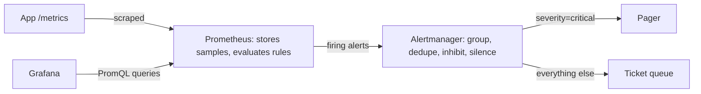

> **Navigation**: [← Terraform](20_Terraform_IaC.md) | [Index](00_INDEX.md) | [Next → SRE](22_SRE_Practices.md)

# 📊 Chapter 21: Monitoring & Observability — Seeing Inside Your System

> _"If you can't measure it, you can't improve it — and you definitely can't debug it at 3 AM when the on-call pager wakes you up. Observability is the difference between 'I think it crashed' and 'I know exactly which function, on which server, is failing for 2.3% of users from EU region.'"_

---

# PART 1: The Three Pillars of Observability

---

```
1. METRICS (numbers over time):
   "CPU is at 78%." "Error rate is 2.3%." "p99 latency is 450ms."
   Cheap to store, fast to query, easy to alert on.
   WHEN: "Is something wrong?" → metrics tell you.
   Tools: Prometheus, Grafana, Datadog, CloudWatch.

2. LOGS (discrete events):
   "2024-03-24 10:15:32 ERROR [req-abc123] Database connection timeout at pool.get()"
   Rich context. Structured (JSON) for searchability.
   WHEN: "What exactly went wrong?" → logs tell you.
   Tools: Elasticsearch (ELK), Loki (Grafana stack), Splunk, CloudWatch Logs.

3. TRACES (request journey across services):
   "Request abc123: API Gateway (5ms) → Auth Service (12ms) → User Service (35ms) → Database (200ms)"
   Shows WHERE time is spent. Critical for microservices.
   WHEN: "Where is it slow?" → traces tell you.
   Tools: Jaeger, Zipkin, Tempo (Grafana), AWS X-Ray.

THE MELT MODEL (+ Events):
  Metrics + Events + Logs + Traces = complete observability.
  Events: deploys, config changes, incidents → correlate with metrics/logs.
```

---

### Why three pillars, and what each one costs

The three signals exist because each answers a different question at a different price, not because a framework says so. Metrics are **pre-aggregated numbers**: storing "requests per second" costs the same whether you serve 10 or 10 million requests, which is why you can alert on them every few seconds. Logs are **one record per event**, so cost grows with traffic (and with verbosity); they keep detail that a metric threw away. Traces are **one record per request per hop**, so cost grows with traffic times the number of services, which is why they are sampled. The practical consequence is a workflow, not a tool choice: a metric alert tells you *that* something is wrong and roughly where; you pivot to traces to find *which hop* is slow; you pivot to the logs of that hop and that trace id to see *why*.

The idea of observability as distinct from monitoring comes from control theory (a system is observable if its internal state can be inferred from its outputs); in software it was popularised after 2015, when microservices made "which of 40 services is slow?" unanswerable with a pre-built dashboard. Before that, the standard stack was Nagios-style checks ("is the host up, is the disk full"), which still have a place for infrastructure facts but cannot tell you why checkout is slow for one tenant.

**Cardinality is the hidden cost driver.** Each distinct combination of label values is a separate time series, and every series costs memory in the database. A counter labelled `{method, route, status}` with 5 methods, 50 routes and 10 statuses is at most 2,500 series: fine. Add a `user_id` label with a million users and it becomes billions: the database falls over, or your Datadog bill does. The rule: labels must have a small, bounded set of values; put unbounded things (user id, request id, full URL) in logs and traces, never in metric labels.

| Question | Signal | Why not the others |
| --- | --- | --- |
| Is the error rate above the SLO right now? | metrics | logs would have to be counted at query time |
| Which customers saw errors in the last hour? | logs | metrics cannot hold per-customer detail without exploding cardinality |
| Which of the 7 services in this call chain added 800 ms? | traces | metrics show each service's average, not the chain for one request |
| Did the 14:03 deploy cause the spike? | events (deploy markers) correlated with metrics | none of the three carries "what changed" |

🔬 **Section Challenge — Choosing signals**

**Challenge 1 (Design):** A product manager asks "what fraction of checkouts fail for users on the new mobile app version, by country?" Which signal(s) do you use, and what must you avoid doing to the metrics?

<details><summary>Answer</summary>

The question has two bounded dimensions (app version, country) and a rate, so a metric is appropriate: `checkout_total{result, app_version, country}`. Count the series: with, say, 20 versions, 150 countries and 3 results that is 9,000 series, acceptable. What to avoid: adding `user_id`, `order_id` or the raw device model string as labels (unbounded). If the PM then asks "which specific users failed?", that is a logs or events query, not a metric. Also record the dimension as a label at the source; you cannot recover "by country" from a metric that was recorded without it.

</details>

---

# PART 2: Prometheus — Metrics Collection

---

```
PROMETHEUS ARCHITECTURE (arrows below show the layout, not the data flow: Grafana QUERIES Prometheus, and
PROMETHEUS evaluates the alert rules and PUSHES firing alerts to Alertmanager; Alertmanager only routes them):
  ┌─────────────────┐
  │ Your App exports │──── /metrics endpoint (HTTP)
  │ metrics           │
  └─────────────────┘
         ↑
  ┌──────┴──────────┐
  │ Prometheus       │ PULLS metrics from apps every 15-60 seconds (config default 1m)
  │ (scrapes targets)│
  │ Time-series DB   │ Stores: metric name + labels + timestamp + value
  └──────┬──────────┘
         │
  ┌──────▼──────────┐
  │ Grafana          │ Queries Prometheus → visualizes dashboards
  └──────┬──────────┘
         │
  ┌──────▼──────────┐
  │ Alertmanager     │ Receives alerts → groups/dedups → PagerDuty/Slack
  └─────────────────┘

METRIC TYPES:
  COUNTER: only goes UP. Total requests, total errors, total bytes sent.
    http_requests_total{method="GET", path="/api/users", status="200"} 15234

  GAUGE: goes up AND down. Current temperature, queue size, active connections.
    active_connections{server="web-1"} 42

  HISTOGRAM: distribution of values. Request latency, response size.
    Records: counts in buckets (≤50ms, ≤100ms, ≤250ms, ≤500ms, ≤1s, ≤5s).
    http_request_duration_seconds_bucket{le="0.25"} 9800
    http_request_duration_seconds_bucket{le="0.5"}  9950
    http_request_duration_seconds_bucket{le="+Inf"} 10000   (always present; equals _count)
    → buckets are CUMULATIVE: with 10,000 total, 98% of requests complete in ≤250ms, 99.5% in ≤500ms.

  SUMMARY: similar to histogram but calculates quantiles client-side.
    Less commonly used. Histograms are preferred (can aggregate server-side).
```

```python
# ── INSTRUMENTING YOUR APP (Python) ──
from prometheus_client import Counter, Histogram, Gauge, start_http_server
import time

# Define metrics
REQUEST_COUNT = Counter(
    'http_requests_total',
    'Total HTTP requests',
    ['method', 'route', 'status']      # route TEMPLATE ("/users/{id}"), never the raw URL: one series per id explodes memory
)

REQUEST_LATENCY = Histogram(
    'http_request_duration_seconds',
    'Request latency in seconds',
    ['method', 'route'],
    buckets=[0.01, 0.025, 0.05, 0.1, 0.25, 0.5, 1, 2.5, 5, 10]
)

ACTIVE_REQUESTS = Gauge(
    'active_requests',
    'Number of requests currently being processed'
)

DB_POOL_SIZE = Gauge('db_connection_pool_size', 'Database connection pool size')
DB_POOL_USED = Gauge('db_connection_pool_used', 'Database connections in use')

# Use in your request handler
def handle_request(method, route):
    ACTIVE_REQUESTS.inc()
    start_time = time.perf_counter()     # monotonic: time.time() can jump when the clock is adjusted

    try:
        # ... your business logic ...
        status = "200"
    except Exception:
        status = "500"
        raise
    finally:
        duration = time.perf_counter() - start_time
        REQUEST_COUNT.labels(method=method, route=route, status=status).inc()
        REQUEST_LATENCY.labels(method=method, route=route).observe(duration)
        ACTIVE_REQUESTS.dec()

# Start metrics endpoint on port 8000 (9090 is Prometheus's OWN default port: avoid the collision)
start_http_server(8000)
# Prometheus scrapes http://your-app:8000/metrics
```

```
PROMQL QUERIES (Prometheus Query Language):

# Request rate (per second, over last 5 minutes)
rate(http_requests_total[5m])

# Error rate percentage
sum(rate(http_requests_total{status=~"5.."}[5m]))
/
sum(rate(http_requests_total[5m]))
* 100

# p99 latency (99th percentile — worst 1% of requests), ONE overall value:
# aggregate the buckets first (keeping `le`), THEN take the quantile
histogram_quantile(0.99, sum by (le) (rate(http_request_duration_seconds_bucket[5m])))
# (without `sum by (le)` you get one p99 per series, e.g. per route and per pod)

# Top 5 slowest endpoints  (`le` MUST stay in the grouping; `sum by (route)` alone returns EMPTY, verified)
topk(5, histogram_quantile(0.95, sum by (le, route) (rate(http_request_duration_seconds_bucket[5m]))))

# Rate of increase of errors (deriv() is for gauges; counters use rate()/increase())
rate(http_requests_total{status="500"}[5m])
increase(http_requests_total{status="500"}[1h])
```

---

### Prometheus: how it works, and the PromQL mistakes that return plausible wrong answers

**History and design.** Prometheus was started at SoundCloud in 2012, made public in 2015, and joined the CNCF in 2016 as its second project after Kubernetes (it graduated in 2018). It was modelled on Google's internal Borgmon. Its defining choice is **pull**: Prometheus scrapes `/metrics` from each target on an interval (the config default is 1 minute; 15 to 60 seconds is typical) instead of apps pushing. Pull means a dead target is visible by itself (the `up` metric becomes 0), you can scrape any instance from your laptop for debugging, and there is no ingest endpoint to overload. The cost: short-lived batch jobs may finish between scrapes (the Pushgateway exists for that case, and is meant only for it), and targets must be reachable from Prometheus. Each sample is `(metric name + label set, timestamp, float64)` stored in a local time-series database (default retention 15 days); for longer retention or a global view across clusters you add Thanos, Mimir, Cortex or VictoriaMetrics.

**Metric types in practice.** A counter only increases (and resets to 0 when the process restarts, which `rate()` accounts for); a gauge goes up and down. A **histogram** exposes *cumulative* bucket counters, each counting observations with value `<=` its `le` bound, plus `_sum` and `_count`. That means `le="0.25"` includes everything in the smaller buckets, and the `le="+Inf"` bucket equals `_count`. The text above says "98% in <=250ms" which is only true if the total is 10,000; the percentage always comes from dividing a bucket by `_count`. Quantiles are **estimated** by linear interpolation inside the bucket that contains the rank, so their accuracy depends on your bucket boundaries: if the bucket around your SLO threshold is wide (say 1 s to 2.5 s) the p99 can be wrong by hundreds of milliseconds. Choose boundaries around the SLO.

**Lab: real PromQL against a real Prometheus.** Prometheus 2.45.3 and `python3-prometheus-client` 0.19.0 from the Ubuntu archive, extracted and run unprivileged. A Python app serves three routes with different latencies (`/users` fast, `/orders` medium, `/pay` slow with a 12% error rate) and Prometheus scraped it every second:

```text
sum(rate(http_requests_total[10s]))                                       -> 197.8   requests/s
error ratio (5xx / all) * 100                                              -> 5.28    percent
average latency (sum(rate(_sum)) / sum(rate(_count)))                      -> 0.146 s
histogram_quantile(0.99, sum by (le) (rate(..._bucket[10s])))              -> 0.871 s   (one overall answer)
histogram_quantile(0.99, rate(..._bucket[10s]))        <- missing sum     -> 3 series: /users 0.096, /orders 0.245, /pay 0.959
histogram_quantile(0.95, sum by (le, route) (rate(..._bucket[10s])))       -> /users 0.082, /orders 0.227, /pay 0.767
topk(5, histogram_quantile(0.95, sum by (route) (rate(..._bucket[10s]))))  -> EMPTY (0 series, no error!)
```

Read the results as lessons:

- **The average (146 ms) looks healthy while the overall p99 is 871 ms**: the mean hides a 6x gap. Alert and set SLOs on percentiles.
- **Dropping `le` silently returns nothing.** `histogram_quantile` needs the `le` label to reconstruct the distribution; aggregating with `sum by (route)` removes it, and the query returns an empty result instead of an error. The version in the chapter above had this bug in its "top 5 slowest endpoints" query. Correct form: `topk(5, histogram_quantile(0.95, sum by (le, route) (rate(http_request_duration_seconds_bucket[5m]))))`.
- **Without `sum by (le)`, you get one answer per series** (here per route and method; in production also per pod), not one overall figure, and averaging those percentiles is meaningless. Aggregate the buckets first, then take the quantile.
- **`deriv()` is for gauges.** On the counter it returned nearly the same numbers as `rate()` (0.88 vs 0.89 errors/s for `/orders` in my run) because the counter was steady, but `deriv` fits a regression line and does not handle counter resets, so use `rate()` or `increase()` for counters.
- Use `rate()` over a window of at least **4x the scrape interval** (so a 15 s scrape needs `[1m]` or more); a window shorter than two scrapes returns nothing.

**Instrumentation fixes.** The Python example had three problems: it listened on port **9090**, which is Prometheus's own default (two processes on one host collide; `prometheus_client` examples use 8000); it labelled metrics with the raw `path` (a request to `/users/12345` makes one series per user id: label with the *route template* `/users/{id}`); and it used `time.time()` (can jump when the clock is adjusted) where `time.perf_counter()` or the `Histogram.time()` context manager is correct.

🔬 **Section Challenge — Prometheus and PromQL**

**Challenge 1 (Debugging):** Your dashboard panel `topk(5, histogram_quantile(0.95, sum by (service) (rate(http_request_duration_seconds_bucket[5m]))))` is empty but `rate(http_requests_total[5m])` shows data. Why, and what is the fix?

<details><summary>Answer</summary>

`sum by (service)` removes the `le` label, so `histogram_quantile` has no buckets to work with and returns an empty vector (I reproduced this: 0 series, no error message). Keep `le` in the grouping: `sum by (le, service) (rate(http_request_duration_seconds_bucket[5m]))`. Then `topk(5, ...)` operates on one p95 value per service.

</details>

**Challenge 2 (Calculation):** A histogram has cumulative buckets over a 5-minute `rate` window: `le="0.5"` 900, `le="1"` 980, `le="+Inf"` 1000 (observations). Estimate the p95 and say why you cannot give an exact value.

<details><summary>Answer</summary>

Rank for p95 = 0.95 x 1000 = 950. The 900 mark is in the le=0.5 bucket and 980 in le=1, so the 950th observation falls in the (0.5, 1] bucket. Prometheus interpolates linearly: it assumes the 80 observations in that bucket (980 - 900) are spread evenly, so p95 = 0.5 + (950 - 900) / 80 x (1 - 0.5) = 0.5 + 0.3125 = **0.8125 s**. It cannot be exact because the histogram stores only counts per bucket, not the individual values; the true p95 could be anywhere in (0.5, 1]. Narrower buckets near the value you care about give a tighter estimate.

</details>

**Challenge 3 (Design):** A teammate adds the label `customer_email` to `http_requests_total` "so we can filter by customer". What happens, and what do you propose?

<details><summary>Answer</summary>

Every distinct email creates a new time series for each existing label combination, so series count grows without bound with the customer base, memory in Prometheus grows with it, queries slow down, and eventually the server is OOM-killed or a hosted bill explodes. Metrics labels must be bounded. For per-customer questions, log the email (or better a hashed customer id) in structured logs and attach it as a span attribute in traces, and for the biggest few customers, a separate metric with a customer *tier* label (bounded) can be used.

</details>

---

# PART 3: Structured Logging — Beyond Console.log

---

```python
# ── STRUCTURED LOGGING (JSON — machine readable) ──
import structlog
import logging
import sys

# REQUIRED: without this the stdlib root logger stays at WARNING and every info() call below is silently dropped
logging.basicConfig(format="%(message)s", stream=sys.stdout, level=logging.INFO)

structlog.configure(
    processors=[
        structlog.contextvars.merge_contextvars,
        structlog.stdlib.add_log_level,
        structlog.processors.TimeStamper(fmt="iso"),
        structlog.processors.JSONRenderer()
    ],
    wrapper_class=structlog.stdlib.BoundLogger,
    logger_factory=structlog.stdlib.LoggerFactory(),
)

logger = structlog.get_logger()

# GOOD: structured with context
logger.info("request_completed",
    method="GET",
    path="/api/users",
    status=200,
    duration_ms=45.2,
    user_id="usr_123",
    request_id="req_abc456"
)
# Output: {"event":"request_completed","method":"GET","path":"/api/users",
#          "status":200,"duration_ms":45.2,"user_id":"usr_123",
#          "request_id":"req_abc456","level":"info","timestamp":"2024-03-24T10:15:32Z"}

# BAD: unstructured (can't search, can't aggregate, can't alert)
print(f"GET /api/users returned 200 in 45.2ms for user usr_123")

# WHY STRUCTURED?
# 1. Search: query logs WHERE status=500 AND duration_ms > 1000
# 2. Aggregate: count errors by path, average duration by user
# 3. Alert: trigger alert when error count > threshold
# 4. Correlate: find ALL logs for request_id="req_abc456" across services
```

---

### The structlog example silently drops its own output

I ran the configuration above (structlog 24.1.0, Python 3.12) unchanged. `logger.info(...)` printed **nothing**, and only the `warning` call appeared. The reason is that `LoggerFactory()` hands records to the standard-library `logging`, whose root logger defaults to level `WARNING`, and nobody configured it. Fix: configure the stdlib side too, and bind per-request context once instead of passing it on every call.

```python
import logging, sys
import structlog

logging.basicConfig(format="%(message)s", stream=sys.stdout, level=logging.INFO)   # without this, INFO is dropped

structlog.configure(
    processors=[
        structlog.contextvars.merge_contextvars,      # adds anything bound with bind_contextvars
        structlog.stdlib.add_log_level,
        structlog.processors.TimeStamper(fmt="iso"),
        structlog.processors.JSONRenderer(),
    ],
    wrapper_class=structlog.stdlib.BoundLogger,
    logger_factory=structlog.stdlib.LoggerFactory(),
)
log = structlog.get_logger()

structlog.contextvars.bind_contextvars(request_id="req_abc456")   # e.g. in middleware, once per request
log.info("request_completed", method="GET", path="/api/users", status=200, duration_ms=45.2, user_id="usr_123")
log.warning("slow_query", duration_ms=1210)
```

Output of that script (verified):

```text
{"method": "GET", "path": "/api/users", "status": 200, "duration_ms": 45.2, "user_id": "usr_123", "event": "request_completed", "request_id": "req_abc456", "level": "info", "timestamp": "2026-10-24T18:59:41.573366Z"}
{"duration_ms": 1210, "event": "slow_query", "request_id": "req_abc456", "level": "warning", "timestamp": "2026-10-24T18:59:41.573539Z"}
```

Note that `request_id` appears on both lines although only bound once: that is the point of context variables, and it is what lets you query "all logs for this request across the service". To join logs with traces, also add the current trace id (OpenTelemetry's logging instrumentation can inject `trace_id` and `span_id` automatically).

Logging rules that save money and incidents: log to **stdout** and let the platform collect it (containers should not manage files or rotation); never log secrets, tokens or full card/PII fields (one `logger.info(request.headers)` puts bearer tokens into a system many people can search); keep levels meaningful (`ERROR` means a human may need to act: if it fires thousands of times a day it is noise and will be filtered, hiding the real one); and sample or aggregate high-volume `DEBUG`. Cost grows linearly with volume and retention, so decide retention per class (security audit: long, debug: days).

🔬 **Section Challenge — Logging**

**Challenge 1 (Debugging):** After the migration to structured logging, production shows no INFO lines but your local run shows them. The code is identical. Give the two most likely causes.

<details><summary>Answer</summary>

(1) The root logger level: locally `logging.basicConfig(level=INFO)` (or a framework like uvicorn) set it; in production the entrypoint differs and the stdlib default `WARNING` applies, so INFO records never reach the processors (I reproduced exactly this). (2) The log-level environment variable or Helm value is set to WARN/ERROR in production, or the collector (Fluent Bit/Loki pipeline) filters INFO. Check by printing `logging.getLogger().level` at startup and by running the container image with the production env locally.

</details>

---

# PART 4: OpenTelemetry — The Universal Standard

---

```
OPENTELEMETRY (OTel) = vendor-neutral standard for telemetry.
  One instrumentation → export to ANY backend (Prometheus, Jaeger, Datadog, etc.).

  BEFORE OTel: instrument for Prometheus AND Jaeger AND Datadog → 3x work!
  WITH OTel: instrument ONCE → OTel Collector → routes to any backend.

  OTel Collector:
  Your App → OTel SDK → OTel Collector → Prometheus (metrics)
                                        → Loki (logs)
                                        → Tempo (traces)

  The Collector:
  - Receives telemetry from apps.
  - Processes: batch, filter, transform, sample.
  - Exports: to multiple backends simultaneously.

  Supported languages: Python, Java, Go, Node.js, .NET, Rust, C++.
```

---

### Why OpenTelemetry exists, and what it does and does not standardise

**The pain.** Through the 2010s every vendor shipped its own agent and API, and open-source projects split into two competing instrumentation standards: **OpenTracing** (a vendor-neutral API) and **OpenCensus** (Google's library for metrics and traces). Switching backend meant re-instrumenting every service. In 2019 the two projects merged into **OpenTelemetry**, now a CNCF project (incubating, not graduated). What it standardises: the **API/SDK** you call in your code, the **wire protocol** (OTLP, over gRPC on port 4317 or HTTP on 4318), semantic conventions (what an attribute like `http.request.method` is called), and the **Collector** that receives, processes and forwards telemetry. What it deliberately does *not* provide: storage, query, or dashboards; those remain Prometheus, Tempo, Loki, Jaeger, or a vendor.

A minimal Collector pipeline (written to the Collector configuration schema; the Collector binary was not available in my lab, so **not verified here**):

```yaml
receivers:
  otlp:
    protocols:
      grpc: {}          # :4317
      http: {}          # :4318
processors:
  memory_limiter:
    check_interval: 1s
    limit_percentage: 75
  batch: {}
exporters:
  otlphttp/tempo:
    endpoint: http://tempo:4318
  prometheusremotewrite:
    endpoint: http://mimir:9009/api/v1/push
service:
  pipelines:
    traces:
      receivers: [otlp]
      processors: [memory_limiter, batch]
      exporters: [otlphttp/tempo]
    metrics:
      receivers: [otlp]
      processors: [memory_limiter, batch]
      exporters: [prometheusremotewrite]
```

Order matters: `memory_limiter` first, so an overloaded Collector sheds load instead of crashing. Running it as an agent per node plus a gateway tier is the common production shape.

**Sampling is the cost control for traces.** *Head sampling* decides when the trace starts (keep 5%): cheap, but it throws away the interesting slow or failed requests along with the rest. *Tail sampling* decides after the trace completes (keep every error and every trace slower than 1 s, plus 1% of the rest): far better signal, but the Collector must buffer whole traces and all spans of a trace must reach the same Collector instance. Start with head sampling, move to tail sampling when you need the failures.

**When not to bother:** one service, no downstream calls, a single vendor you are happy with (use its agent, accept the lock-in); but the moment you have two languages or a second backend, OTel pays for itself.

🔬 **Section Challenge — OpenTelemetry**

**Challenge 1 (Design):** You keep 5% of traces with head sampling. An outage affects 0.2% of requests. What fraction of failing traces do you capture, and what do you change?

<details><summary>Answer</summary>

Head sampling is decided before the outcome is known, so it keeps 5% of failing requests as well: roughly 5% of the failures (and with 0.2% of traffic failing, a service doing 1,000 req/s has 2 failures/s, of which you store 0.1/s, about one every 10 seconds). That is thin evidence during an incident. Move to tail-based sampling in the Collector (`tail_sampling` processor) with policies "keep all traces with an error status", "keep all traces over the latency threshold", and "5% probabilistic for the rest". Ensure all spans of one trace route to the same Collector (load-balance by trace id) or the policy decides on partial traces.

</details>

---

# PART 5: Alerting — The Last Line of Defense

---

```yaml
# ── PROMETHEUS ALERTING RULES ──
groups:
  - name: application_alerts
    rules:
      - alert: HighErrorRate
        expr: |
          sum(rate(http_requests_total{status=~"5.."}[5m]))
          / sum(rate(http_requests_total[5m]))
          > 0.05
        for: 5m # must be true for 5 minutes (avoid flapping)
        labels:
          severity: critical
        annotations:
          summary: "High error rate: {{ $value | humanizePercentage }}"
          runbook: "https://wiki.mycompany.com/runbooks/high-error-rate"

      - alert: HighLatency
        expr: histogram_quantile(0.99, sum by (le) (rate(http_request_duration_seconds_bucket[5m]))) > 2
        for: 10m
        labels:
          severity: warning
        annotations:
          summary: "p99 latency above 2s: {{ $value }}s"

      - alert: PodCrashLooping
        expr: rate(kube_pod_container_status_restarts_total[15m]) > 0
        for: 5m
        labels:
          severity: critical
        annotations:
          summary: "Pod {{ $labels.pod }} is crash-looping"

      - alert: DiskSpaceRunningOut
        expr: (node_filesystem_avail_bytes{fstype!~"tmpfs|overlay"} / node_filesystem_size_bytes{fstype!~"tmpfs|overlay"}) < 0.1
        for: 15m
        labels:
          severity: warning
        annotations:
          summary: "Disk space < 10% on {{ $labels.instance }}"
```

```
ALERTING BEST PRACTICES:

1. ALERT ON SYMPTOMS, NOT CAUSES:
   BAD:  "CPU > 80%" → CPU might be high and everything is fine.
   GOOD: "Error rate > 5%" → users are experiencing errors. Actionable!

2. EVERY ALERT MUST HAVE A RUNBOOK:
   "What do I do when this fires at 3 AM?"
   Link to wiki page with: what it means, how to diagnose, how to fix.

3. AVOID ALERT FATIGUE:
   Too many alerts → team ignores ALL of them → miss the critical one.
   If an alert fires but doesn't need action → delete or tune it.
   Review alerts monthly: "Did every alert this month need human action?"

4. USE SEVERITY LEVELS:
   Page (wake someone up): only for user-impacting, revenue-impacting issues.
   Ticket (next business day): degraded performance, non-critical warnings.
   Log (informational): no action needed, just track.
```

---

### Alert rules that were tested, and the routing that decides who is woken

Everything below was run with `promtool` and `amtool` 2.45.3 / 0.26.0 from the Ubuntu archive.

**Two bugs fixed in the rules above.** `HighLatency` used `histogram_quantile(0.99, rate(..._bucket[5m]))` without `sum by (le)`, so it alerts **per series** (per route, per pod): a hundred pods means up to a hundred separate alerts, each judged on its own tiny traffic share. And the disk rule fired on `tmpfs` and container overlay mounts; it also only fired *after* the disk was nearly full. A better disk alert predicts: `predict_linear(node_filesystem_avail_bytes{fstype!~"tmpfs|overlay"}[6h], 24*3600) < 0` ("this filesystem will be full within 24 hours at the current trend") is a ticket, not a page.

```yaml
groups:
  - name: application_alerts
    rules:
      - alert: HighLatency
        expr: histogram_quantile(0.99, sum by (le) (rate(http_request_duration_seconds_bucket[5m]))) > 2
        for: 10m
        labels: { severity: warning }
      - alert: DiskWillFillIn24h
        expr: predict_linear(node_filesystem_avail_bytes{fstype!~"tmpfs|overlay"}[6h], 24 * 3600) < 0
        for: 30m
        labels: { severity: warning }
      - alert: ErrorBudgetFastBurn            # SLO 99.9%: budget = 0.001; 14.4x burn exhausts 2% of a 30-day budget in 1 hour
        expr: |
          (
            sum(rate(http_requests_total{status=~"5.."}[1h])) / sum(rate(http_requests_total[1h])) > (14.4 * 0.001)
          and
            sum(rate(http_requests_total{status=~"5.."}[5m])) / sum(rate(http_requests_total[5m])) > (14.4 * 0.001)
          )
        for: 2m
        labels: { severity: critical }
```

`promtool check rules` accepted all four rules (including the original `HighErrorRate`); a deliberately broken expression was rejected with `parse error: unclosed left parenthesis`, which is why rule files belong in CI. Then `promtool test rules` replayed synthetic data (`status="200"` +100/min and `status="500"` +10/min, i.e. 9.09% errors):

```text
eval_time 3m  : HighErrorRate not firing   (pending: the 5m "for" has not elapsed)
eval_time 12m : HighErrorRate firing, summary "High error rate: 9.091%"
0.1% errors for 90 minutes: neither HighErrorRate nor ErrorBudgetFastBurn fires (0.1% is exactly on budget)
```

**Burn-rate alerting, the reason for the extra rule.** An SLO of 99.9% allows 0.1% errors (the budget). "Burn rate 14.4" means errors at 14.4 times the allowed rate: at that speed the 30-day budget is gone in 30 days / 14.4, about 2 days, and 2% of it is consumed in one hour. Pairing a long window (1h: the problem is real, not a blip) with a short window (5m: it is still happening) gives fast detection and fast recovery of the alert, which a single `> 5%` threshold cannot. The Google SRE Workbook recommends several pairs (for example 14.4x over 1h/5m pages, 6x over 6h/30m pages, 1x over 3d/6h opens a ticket); see [SRE Practices](22_SRE_Practices.md).

**Alertmanager is the router, not the evaluator.** Prometheus evaluates rules and sends firing alerts to Alertmanager (the architecture box above is easy to misread); Alertmanager **groups** related alerts into one notification, **deduplicates** across Prometheus replicas, **silences** during maintenance and **inhibits** lower-severity alerts when a higher one fires. A configuration that passes `amtool check-config` (1 inhibit rule, 2 receivers):

```yaml
route:
  receiver: ticket
  group_by: [alertname, service]
  group_wait: 30s          # wait this long to batch the first notification of a new group
  group_interval: 5m       # then batch further changes for this long
  repeat_interval: 4h      # re-notify an unresolved alert this often
  routes:
    - matchers: [severity="critical"]
      receiver: pager
inhibit_rules:
  - source_matchers: [severity="critical"]
    target_matchers: [severity="warning"]
    equal: [alertname, service]
receivers:
  - name: pager
    webhook_configs: [{ url: "http://localhost:9/pager" }]
  - name: ticket
    webhook_configs: [{ url: "http://localhost:9/ticket" }]
```

`amtool config routes test` confirmed the routing decisions: `severity=critical service=api` goes to **pager**, `severity=warning service=api` goes to **ticket**. Test routing the same way before an incident, not during one.



**How to read this diagram.** Follow the data: the app exposes metrics, Prometheus pulls them, evaluates the alert rules against what it stored, and sends only the alerts that are firing to Alertmanager, which decides who hears about them. The notable arrow is the last one: Grafana does not sit in the alert path, it only queries Prometheus, so a broken dashboard never blocks a page and a working dashboard never sends one.

**When an alert is wrong, ask in this order:** is it actionable (if the answer is "look and do nothing", delete it), does it describe user impact (symptom) or a cause (put causes on a dashboard), does the `for:` duration match how long a human would wait before acting, and does it link to a runbook that says what to do first? A good page is rare, specific and has a first step written down.

🔬 **Section Challenge — Alerting**

**Challenge 1 (Calculation):** Your SLO is 99.5% over 30 days. What is the error budget in minutes of total outage, and at what error ratio does a 6x burn rate alert fire?

<details><summary>Answer</summary>

Budget = 0.5% of 30 days = 0.005 x 43,200 minutes = **216 minutes** of full outage (or the equivalent in partial failures). Allowed error ratio is 0.005, so a 6x burn corresponds to an error ratio above 6 x 0.005 = **0.03 (3%)** sustained over the alert's windows. At that rate the 216-minute budget would be exhausted in 30 days / 6 = 5 days.

</details>

**Challenge 2 (Design):** Three alerts (`DiskWillFillIn24h`, `HighLatency`, `ErrorBudgetFastBurn`) are all warning/critical and all fire during a database outage. How should Alertmanager reduce the 3 AM noise, and what must you not suppress?

<details><summary>Answer</summary>

Use `group_by: [service]` (or the incident-level label) so related alerts arrive as one notification, and an inhibit rule that mutes the lower-severity alerts for the same service while the critical one is firing (as in the config above), so the on-call sees "ErrorBudgetFastBurn: critical" with the others attached rather than three pages. Do not inhibit across unrelated services (the `equal:` list restricts the match), and never silence the user-impact alert itself; inhibition should hide causes and echoes, not the symptom.

</details>

---

# PART 6: Grafana Dashboards — Visualization as Code

---

```
GRAFANA = visualization layer for ALL your telemetry data.
  Connects to: Prometheus, Loki, Tempo, Elasticsearch, MySQL, PostgreSQL.

  THE RED METHOD (for microservices):
  Rate:    requests per second.
  Errors:  error rate (percentage of requests that fail).
  Duration: latency (p50, p95, p99).

  THE USE METHOD (for infrastructure):
  Utilization: how full? (CPU %, disk %, memory %).
  Saturation: how queued? (run queue length, swap usage).
  Errors: any errors? (disk errors, NIC errors).

DASHBOARD BEST PRACTICES:
  1. TOP ROW: Golden signals (error rate, latency, throughput).
  2. MIDDLE: resource utilization (CPU, memory, disk, network).
  3. BOTTOM: detailed breakdowns (per-endpoint, per-instance).
  4. Include deployment markers (vertical annotations on graphs).
  5. Store dashboard JSON in Git → Grafana loads on startup (dashboards-as-code).
```

---

### Three dashboards worth building, and dashboards as code

The three methods have an author and a scope, which tells you when to use each. **RED** (Rate, Errors, Duration) is Tom Wilkie's rule for request-driven services. **USE** (Utilisation, Saturation, Errors) is Brendan Gregg's checklist for every *resource* (CPU, memory, disk, NIC). Google's **four golden signals** (latency, traffic, errors, saturation) cover the same ground from the SRE book. A practical rule: RED for every service's top row, USE for the node and pod panels underneath. The difference between utilisation and saturation is the most useful thing in USE: a CPU at 100% utilisation with a run-queue of 0 is fully used and fine; a run-queue of 20 means work is waiting.

Per service, the RED row maps to three PromQL expressions (the same shapes I ran against the lab Prometheus above, there with a 10-second window because the lab only had seconds of data):

```text
Rate     : sum(rate(http_requests_total[5m]))
Errors   : sum(rate(http_requests_total{status=~"5.."}[5m])) / sum(rate(http_requests_total[5m]))
Duration : histogram_quantile(0.95, sum by (le) (rate(http_request_duration_seconds_bucket[5m])))
```

**Dashboards as code.** Click-built dashboards drift and disappear. Grafana loads dashboards and data sources from files via *provisioning* (a YAML pointing at a folder of dashboard JSON, read at startup and on change), so the dashboard lives in Git, is reviewed like code, and is rebuilt identically in every environment. For large estates generate the JSON from code (Grafonnet/Jsonnet, the Grafana Foundation SDKs). Pitfalls: a provisioned dashboard cannot be saved from the UI (by design), and variables like `$datasource` must be used instead of hard-coded data source names or the dashboard breaks in another environment.

🔬 **Section Challenge — Dashboards**

**Challenge 1 (Reasoning):** A dashboard shows average CPU 35% across 12 pods and looks fine, yet users report slowness. Which USE signals do you add and why?

<details><summary>Answer</summary>

Averages hide hot pods: show the **maximum** and per-pod CPU (one pod at 100% while eleven idle averages to 35%). Add **saturation**: CPU throttling (`container_cpu_cfs_throttled_periods_total` ratio) which shows when a container hit its CPU limit even though node CPU is low, node load or run-queue length, and memory pressure/eviction. Add the RED duration panel by pod to see whether the slow requests concentrate on one instance. The failure pattern: low average utilisation, high saturation on one resource that has a limit.

</details>

---

# PART 7: The ELK Stack — Log Aggregation at Scale

---

```
ELK = Elasticsearch + Logstash + Kibana.

  Elasticsearch: search engine + document store. Indexes logs for fast queries.
  Logstash: ETL pipeline. Receives → parses → transforms → sends to ES.
  Kibana: web UI for searching and visualizing logs.

  MODERN ALTERNATIVE: Grafana Loki (lighter, cheaper: indexes only labels, not the full text of each line).

  ARCHITECTURE:
  App → Filebeat/Fluent Bit → Logstash → Elasticsearch → Kibana

WHY NOT JUST grep ON SERVERS?
  1. 50 servers → grep on each one manually? No.
  2. Logs rotate/delete → old logs lost. ES retains them.
  3. Full-text search across ALL services in milliseconds.
  4. Aggregation: "how many 500 errors per endpoint per hour?"

KIBANA QUERY EXAMPLES (KQL):
  status:500                                # all 500 errors
  status:500 AND path:"/api/payments"       # payment errors only
  duration_ms > 1000                         # slow requests
  request_id:"req_abc123"                   # trace a single request
```

---

### Log aggregation: ELK, OpenSearch, Loki, and the costs

Elastic changed the Elasticsearch and Kibana licence in January 2021 (away from Apache 2.0); Amazon responded by forking the last Apache-licensed versions as **OpenSearch**, so "ELK" now means one of two lineages with the same query concepts. Elastic later added an AGPL option to its licence in 2024, so check the current terms for your use. The architectural choice is what to **index**: Elasticsearch builds an inverted index over the full text of every log line (fast arbitrary search, high storage and CPU cost); **Loki** indexes only the labels (service, namespace, level) and stores compressed log chunks, so storage is cheap and queries by label are fast, but a free-text search across everything must scan chunks (it supports `|=` line filters, just not an index of the content). Pick Elasticsearch/OpenSearch when you need ad-hoc full-text and aggregation over structured fields; pick Loki when you mostly look at "logs of this service in this time window" and want predictable cost.

Operational realities: a collector DaemonSet (Fluent Bit, Filebeat, Vector or the OTel Collector) reads container stdout from the node and forwards it; ingestion backpressure and node loss both drop logs, so decide whether you care. A missing or wrongly typed field (`status` as `"200"` in one service and `200` in another) breaks Elasticsearch mappings and aggregations, which is a strong argument for a shared logging library and schema. Set **index lifecycle** rules (hot, warm, delete) on day one: unbounded retention is the usual cause of the Elasticsearch outage that follows a quiet month.

🔬 **Section Challenge — Log storage choice**

**Challenge 1 (Trade-off):** You ingest 500 GB of logs a day and almost every query is "show me service X's logs between times T1 and T2, filter for a request id". Compare Elasticsearch with Loki for this workload.

<details><summary>Answer</summary>

The query is label-plus-time-range with one needle: exactly Loki's strength. It stores compressed chunks keyed by labels, so ingest and storage are much cheaper than building a full inverted index of 500 GB/day, and the request id lookup is a bounded scan inside the narrowed streams. Elasticsearch would answer the needle search faster over arbitrary ranges but at a multiple of the storage, memory and node count, which you only justify if analysts need free-text search and aggregations across all services. Mitigate Loki's weak spot by keeping labels low-cardinality (service, level, namespace) and putting the request id in the line (or structured metadata), not in a label.

</details>

---

# PART 8: Distributed Tracing — Following Requests

---

```
IN MICROSERVICES: one request touches 5-15 services.
"The page is slow" → WHERE? Which service? Which query?

TRACE: the complete journey of ONE request through all services.
  Trace ID: req-abc123 (unique per request, propagated via headers).

  Spans (each service creates one):
  ┌──────────────────┬──────────────────────────────────────────────┐
  │ API Gateway      │ ████ 5ms                                     │
  │ Auth Service     │     ████████ 12ms                            │
  │ User Service     │             ████████████████████████ 235ms   │
  │   → DB Query     │                ████████████████████ 200ms    │
  │ Response         │                                    ██ 2ms   │
  └──────────────────┴──────────────────────────────────────────────┘
  (A parent span contains its children: User Service = 35ms of its own work + the 200ms DB call.)
  TOTAL: 5 + 12 + 235 + 2 = 254ms. Bottleneck: DB query at 200ms (79%!).

TRACE PROPAGATION:
  Service A adds header: traceparent: 00-<trace-id>-<span-id>-01
  Service A calls B → passes the header.
  B reads trace-id → creates its own span with same trace-id.
  Backend (Jaeger/Tempo) reassembles the full trace.

CORRELATION (the holy grail):
  Metrics: "error rate spiked at 14:23."
  Traces: "request req-abc123 at 14:23 took 45 seconds."
  Logs: "req-abc123: database connection timeout at pool.get()."

  trace_id links all three → ONE click: metric spike → trace → exact log line.
```

---

### Anatomy of a trace, and why it breaks

**History.** Google's internal Dapper paper (2010) described tracing at scale; Twitter's **Zipkin** (open-sourced 2012) and Uber's **Jaeger** (2015, now a CNCF graduated project) implemented the idea in the open, each with its own header format, until the W3C **Trace Context** standard fixed the header. A **span** is one timed operation (name, start, duration, attributes, status); a **trace** is the tree of spans that share a trace id, linked by `parent span id`.

The chart above has an inconsistency worth fixing: the User Service bar (35 ms) is shorter than its own child (the 200 ms database query), which cannot happen, because a parent span covers its children. The correct reading is that the User Service span lasts about 235 ms, of which 200 ms is the database call and 35 ms is its own work (its **self time**); the total is 5 + 12 + 235 + 2 = 254 ms, and the database accounts for 200 / 254 = 79% of the wall time. When you read a trace, look for the child that takes most of its parent's duration, then descend into it: that is the bottleneck.

**The header.** W3C `traceparent` has four dash-separated fields: `00-<32 hex trace id>-<16 hex parent span id>-<2 hex flags>`, for example `00-4bf92f3577b34da6a3ce929d0e0e4736-00f067aa0ce8d22d-01` (flag `01` = sampled). Each service must copy the trace id and set its own span id as the new parent on outbound calls. **Propagation breaks silently** at every hop that is not instrumented: an async queue consumer that does not carry the header in the message, a thread pool where the context object is not copied to the worker thread, a legacy service, an HTTP client created without the instrumentation. Symptom: your trace has a gap or is split into two traces.

| Symptom in the trace UI | Likely cause |
| --- | --- |
| Many one-span traces for what is one user action | context not propagated across a call (check outbound headers) |
| Gap between parent end and child start | queue wait, thread-pool wait, or clock skew between hosts |
| A trace with spans only from the first service | sampling decided "drop" downstream: the parent's sampled flag must be honoured |
| Trace shows the right services but 0 ms for the slow one | the slow work is not wrapped in a span (add a manual span around the expensive call) |

**Correlation in practice.** Put `trace_id` into every log line (from the active span), keep exemplars on histogram metrics (a sample trace id attached to a latency bucket), and your dashboards can jump from "p99 spiked" to "here is a trace in that bucket" to "here are its logs". Without the shared id, you correlate by timestamps, which fails under load.

🔬 **Section Challenge — Tracing**

**Challenge 1 (Debugging):** A trace for `POST /checkout` shows `api -> orders` taking 900 ms, but `orders` itself shows only a 40 ms span, and no trace exists in `payments` although `orders` calls it. List what you check, in order.

<details><summary>Answer</summary>

The 860 ms gap sits between the `api` span's child and the `orders` span or after it: first check clock skew (compare the host clocks: spans from different machines are only comparable if NTP is healthy). Second, queueing before `orders` code runs (thread-pool or connection-pool wait, or a service mesh sidecar queue), which appears as time in the `api` client span that the server never sees. Third, the missing `payments` trace: confirm `orders` forwards `traceparent` on the outbound call (inspect the request headers from `orders` to `payments`), and that the outbound HTTP client library is instrumented; if `payments` has its own trace with a different trace id, propagation is broken at that hop. Finally verify the sampler: if `orders` samples independently instead of honouring the parent's sampled flag, `payments` may be dropping the trace.

</details>

---

## 🔗 Cross-References

| Topic                       | Related Content                                                         |
| --------------------------- | ----------------------------------------------------------------------- |
| **K8s monitoring**          | [Ch 18: K8s](18_Kubernetes_Complete.md) — pod metrics, HPA uses metrics |
| **SRE (SLOs use metrics)**  | [Ch 22: SRE](22_SRE_Practices.md) — SLIs, SLOs, error budgets           |
| **Docker stats**            | [Ch 17: Docker](17_Docker_Complete.md) — container monitoring           |
| **Load balancer metrics**   | [Ch 11: LB](11_Load_Balancing_Proxies.md) — upstream response time      |
| **SQL slow query logs**     | [SQL Internals](../08_SQL/49_SQL_Internals_Deep.md) — query monitoring  |
| **Linux system monitoring** | [Ch 16: Linux](16_Linux_Administration.md) — USE method                 |
| **CI/CD (deploy markers)**  | [Ch 19: CI/CD](19_CICD_Pipelines.md) — correlate deploys with metrics   |
| **Network debugging**       | [Ch 15: Debugging](15_Network_Debugging.md) — packet-level analysis     |


---

## Reality Check

**"Monitoring and observability are the same thing"** — Monitoring answers KNOWN questions (predefined dashboards and alerts for failure modes you anticipated); observability is being able to answer UNKNOWN questions from rich telemetry (the ad-hoc slice you never predicted — [13_DE monitoring] covers this fully): the divide is cardinality (metrics aggregate cheaply but discard dimensions; traces and wide events keep them at cost), and mature stacks buy both deliberately. The DevOps-scale addition is the THREE PILLARS and their distinct jobs — metrics for aggregate trends and alerting (cheap, low-cardinality), logs for detailed events (searchable, higher cost), traces for request flow across services (the [service-mesh]-emitted spans that show WHERE in a distributed call the latency lives) — and knowing which pillar answers which question rather than logging everything and hoping.

**"More dashboards mean better visibility"** — Unowned dashboards are where signal dies ([13_DE monitoring]): the wall of green nobody reads, the 40-panel page whose one meaningful panel is forgotten. The functioning structure is inverted — a small set of golden-signal views per service (latency, traffic, errors, saturation — the RED and USE methods), each panel answering a question someone asks, each alert wired to a runbook — with everything else queried ad hoc from the underlying data (the observability property making bespoke dashboards unnecessary). Dashboard COUNT correlates with tooling enthusiasm; incident MTTR correlates with whether the first three clicks answer where-is-it-broken.

**"Averages tell us how the system performs"** — Averages HIDE the suffering users ([13_DE monitoring]): latency is long-tailed (the 200ms average of 50ms medians and 8-second p99s — and the p99 users are often the heaviest accounts), tail latency COMPOUNDS across fan-out (a request touching five services at p99 each is far worse than p99 overall — the distributed-systems reason single-service percentiles understate user pain), and error averages mask concentration (99.9 percent success that is 100 percent failure for the one tenant whose data shape triggers the bug). Percentiles sliced by tenant/region/version is the default lens that separates measurement from reassurance — and at DevOps scale, the SLO is defined in percentiles precisely because averages let you meet a target while a percentile of users has a broken product.

**"Alert on everything important"** — Alerts spend a fixed budget of human attention, and overspending is self-defeating ([13_DE monitoring]): every non-actionable page trains acknowledgment reflexes (alert fatigue behind a genre of missed-the-real-one postmortems), so the discipline is symptom-based alerting on user-visible degradation (SLO burn rate — is the error budget draining fast) with causes left to dashboards, every alert carrying a runbook and an implicit action (no answer to "what should a human do now," no page), and a pruning ritual (the alert that fired 40 times without action is automated or deleted). The SRE framing sharpens it: page on SYMPTOMS the user feels, not causes — the disk-filling is a ticket, the API-erroring is a page.

**"Observability is added when we have problems"** — Post-hoc instrumentation arrives one incident too late by definition ([13_DE monitoring, production-debugging]'s artifact lesson — you debug with what past-you emitted): the economical pattern is instrumentation as part of the feature (the new service ships with its RED metrics, trace propagation, and business events — the checkout ships with a funnel counter because product questions are observability questions), standardized through shared libraries or the [service-mesh]'s automatic instrumentation so the marginal cost approaches zero, and versioned like code (the metric rename that broke every dashboard). The DevOps-scale test for any service's readiness: what will its incident look like in the tooling — a blank query means the service is not done, no matter how well it passes tests.
