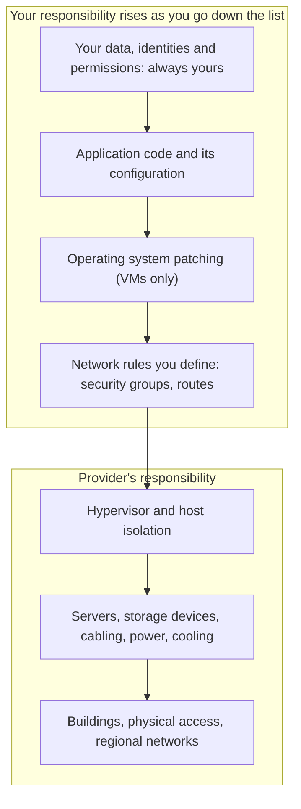
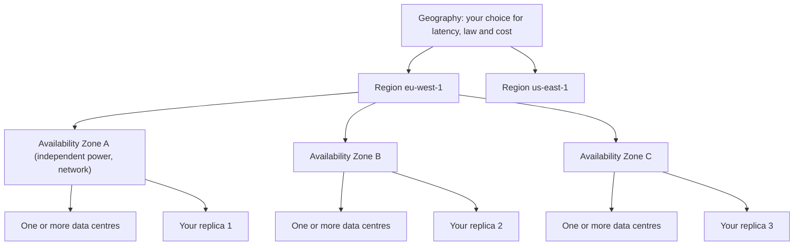
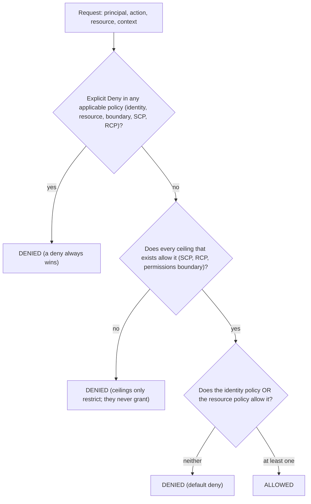
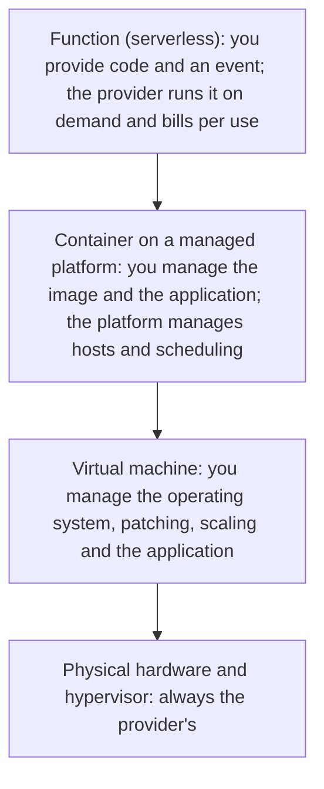
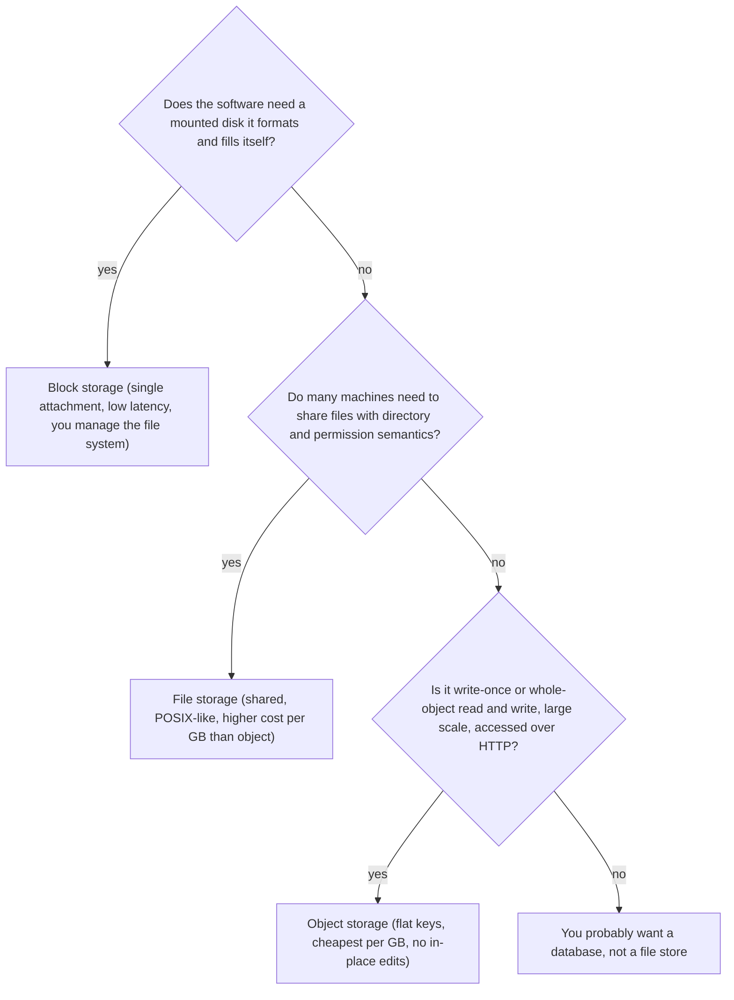

**Navigation**: [← Terraform](20_Terraform_IaC.md) | [Index](00_INDEX.md) | [Learning path, Stage 6](00_INDEX.md#-learning-path--first-principles-to-advanced) | Next: [25 Secrets and PKI](25_Secrets_And_PKI.md) · [28 Enterprise architecture](28_Enterprise_Reference_Architecture.md)

# ☁️ Chapter 24: Cloud Fundamentals — Geography, Identity, Compute and Storage

_"The cloud is not someone else's computer. It is someone else's computer with an API, a meter and a blast radius — and you are responsible for the parts of that sentence you configure."_

---

## 5W1H

- **WHAT**: The four primitives every cloud service is built from: **where** things run (regions and availability zones), **who** may do what (identity and access management), **what runs** (virtual machines, containers, functions) and **where data lives** (block, file and object storage). Examples use AWS names because its documentation is the most explicit; the ideas map directly to Azure and Google Cloud.
- **WHY**: Every later chapter assumes these. A Terraform file, a Kubernetes cluster or a landing zone is just these four primitives combined. Most cloud incidents are one of them misunderstood: an over-broad permission, a single-zone design, a public bucket, an unexpected data-transfer bill.
- **WHO**: Anyone deploying to a cloud — developers, SREs, architects. The shared-responsibility split in Part 1 decides which failures are yours.
- **WHEN**: Before you design anything that must survive a failure, handle money, or hold personal data.
- **WHERE**: Every public cloud, and — by analogy — private clouds and Kubernetes platforms that copy the same model.
- **HOW**: Derive each primitive from the problem it solves, check the vendor's own definition, and test the reasoning with a small executable model where you can (an IAM evaluator in Part 3).

> **Verified on** — The IAM evaluation model in Part 3 was run with Python 3 on WSL2 Ubuntu 24.04 (kernel 6.6.87); its eight printed cases are exactly what the shown code outputs. Statements about policy evaluation, Availability Zones and S3 behaviour were read from the AWS IAM User Guide ("Policy evaluation logic"), the AWS whitepaper on fault isolation boundaries (Availability Zones) and the Amazon S3 User Guide ("What is Amazon S3?") on 2026-11-15. No cloud account, AWS CLI or LocalStack was used; anything needing them is marked **not verified here**.

---

# PART 1: What "Cloud" Actually Is

## 1.1 Derive it from the problem

A company needs servers. The old way: forecast demand, buy hardware, wait weeks, rack it, then own it whether or not you use it. Ask what would have to change to make capacity something you *rent in minutes*:

1. **You must be able to ask for capacity by program, not by purchase order.** So the provider exposes an **API**: "create a server of this size in this place." Everything — the console, the CLI, Terraform — is a client of that API. This is why infrastructure can be code ([chapter 20](20_Terraform_IaC.md)).
2. **Many customers must share the same hardware safely.** So the provider **virtualises**: a hypervisor carves one physical machine into many isolated virtual ones, and the network, storage and identity systems isolate customers from each other.
3. **Capacity must appear and disappear.** So resources are **pooled** and handed out on demand, which is *elasticity*.
4. **The provider must charge for what you use.** So usage is **metered**, which is why every resource has a price, including traffic that leaves the provider.

The US National Institute of Standards and Technology (NIST) definition of cloud computing lists essentially these five traits — on-demand self-service, broad network access, resource pooling, rapid elasticity and measured service — and is the standard reference when someone asks what the word means. Notice what each trait costs you: self-service means mistakes happen at the speed of an API call; metering means an unattended resource keeps billing.

## 1.2 The shared responsibility model

The provider secures and operates the building, the hardware, the hypervisor and the managed-service internals. **You** configure what runs on top. The line moves with the service type:



**How to read this diagram.** The top box group is what you configure; the bottom group is what the provider runs. Read down the chain: the closer to your data, the more it is your job, and the diagram is ordered so you can see that **data, identities and permissions are never delegated**, whatever service you pick. The dividing line moves: with a virtual machine you also own the operating system and its patches; with a managed database or a function the provider takes the operating system, but you still own who can reach the data. The thing to notice is the first box — a public storage bucket or an over-broad permission is *always* the customer's configuration, never "an AWS problem."

---

# PART 2: Geography and Failure Domains

## 2.1 Why geography matters

Everything fails, and the question is how much fails *together*. Derive the structure from that: a single server fails (one machine's problem), so run two. Two servers in one room share power and cooling, so a room failure takes both. Two rooms in one building share the building's utilities. Each step up in separation reduces the chance a single event takes everything, and costs more latency and money.

Clouds package that into two named levels:

- **Availability Zone (AZ):** per the AWS fault-isolation whitepaper, one or more discrete data centres with independent and redundant power, networking and connectivity within a Region. AZs in a Region are meaningfully distant from each other — up to about 60 miles (100 km) — so a flood, fire or utility failure does not take out two at once, yet close enough for synchronous replication at single-digit-millisecond latency. AWS also staggers service deployments across AZs in time so that a bad update does not hit them all together.
- **Region:** a geographic area containing multiple AZs. Regions are isolated from each other and are where you choose to keep data for latency, cost or legal reasons. Data stored in a Region does not leave it unless you explicitly move or replicate it.



**How to read this diagram.** Start at the top: you pick a Region, which decides where your data legally and physically lives. Inside it are separate Availability Zones, each backed by its own data centres. The three replicas at the bottom are placed one per zone, which is the whole point: losing one zone loses one replica, not the service. The thing to notice is that **a zone, not a server, is the unit you design around**. A design with three replicas inside one zone looks redundant and shares one set of utilities.

## 2.2 Failure-domain design rules

| Rule | Reason |
| --- | --- |
| Spread every stateful and stateless tier across at least two zones, preferably three | A zone outage then removes a fraction of capacity, not all of it |
| Size so the survivors can carry the load after losing a zone (N+1 across zones) | Surviving instances overload if you ran them at 90% in all three zones |
| Treat data transfer *between* zones and *out of* the cloud as billed and slower than local traffic | Chatty designs across zones cost money and latency; check the provider's current pricing |
| Use multiple Regions only when you have a stated reason: legal residency, user latency, or a recovery objective a single Region cannot meet | A second Region doubles operational and data-consistency problems ([chapter 27](00_INDEX.md) 🔜 covers recovery strategies) |
| Never assume the zone *names* match between accounts | Providers may map zone labels differently per account to spread load, so use zone IDs when coordinating |

The last rule is documented AWS behaviour worth remembering when two accounts must co-locate resources; the other rules follow from the definitions above.

---

# PART 3: Identity and Access — Who May Do What

## 3.1 Authentication and authorisation

Two separate questions run through every request:

- **Authentication:** *who are you?* (a person signing in, a service presenting credentials.)
- **Authorisation:** *given who you are, may you do this to that?*

Cloud identities are **principals**: users, roles and services. For almost everything you build, prefer **roles** — an identity with permissions that *anyone or anything trusted can temporarily assume* — over users with long-lived keys. The assumption exchange returns **temporary credentials** that expire, which is the property [chapter 25](25_Secrets_And_PKI.md) argues for. A role has two separate policies:

| Policy on a role | Question it answers |
| --- | --- |
| **Trust policy** | *Who is allowed to become this role?* (a user in another account, a service such as a virtual machine, a CI job) |
| **Permission policy** | *Once someone is this role, what may they do?* |

A frequent confusion: granting permissions without a trust relationship does nothing, because nobody can assume the role; a trust relationship without permissions lets them become a role that can do nothing.

## 3.2 How a request is decided

A policy is a statement: *effect* (Allow or Deny), *actions*, *resources* and optional *conditions*. The rules for combining them are the part to memorise. From the AWS policy-evaluation documentation:

- **Default deny.** Everything is denied unless something allows it.
- **An explicit deny wins.** A Deny in any applicable policy overrides every Allow.
- **Same account: union of identity and resource grants.** When an identity requests a resource in its own account, an Allow in the identity-based policy, the resource-based policy, or both permits it, and an explicit deny in either overrides.
- **Ceilings are intersections.** A *permissions boundary* intersects with the identity policy; an organisation *service control policy* (SCP) or *resource control policy* (RCP) intersects with everything below it. The action must be allowed by every ceiling that exists, and an explicit deny in any of them wins. (SCPs were introduced in [chapter 28](28_Enterprise_Reference_Architecture.md).)

For **cross-account** access the AWS documentation requires an allow on *both* sides — the caller's account must permit it *and* the resource's account must permit it — instead of the same-account union. Check the current IAM documentation for the precise cases before relying on a detail.



**How to read this diagram.** Follow one request from the top through three tests, in order. First, a deny anywhere ends it. Second, every ceiling that exists must permit the action; a ceiling can only remove permissions, which is why a permissive ceiling alone grants nothing. Third, something must actually grant it, and either the identity policy or the resource policy is enough within one account. The thing to notice is that the order of the questions is the debugging order: when something is denied, work through the same three questions instead of editing policies at random. (This is a simplified model of one request in one account; the real service handles conditions, sessions and cross-account rules.)

## 3.3 A model you can run

The reasoning is easy to state and easy to get wrong in your head, so here it is as code. This is a **teaching model** (conditions omitted, one account), not the real service:

```python
"""A teaching model of cloud IAM policy evaluation (single request, conditions omitted).

Rules modelled (they match the documented behaviour):
  1. Everything starts as DENIED (default deny).
  2. An explicit Deny in ANY applicable policy wins over every Allow.
  3. Same account: identity-based and resource-based policies are a UNION (either may allow).
  4. A permissions boundary, an SCP or an RCP are CEILINGS: the action must be allowed by them AND by the identity/resource grant.
"""
from fnmatch import fnmatchcase

def matches(patterns, action):
    return any(fnmatchcase(action, p) for p in patterns)

def decision(policies, action):
    """policies: list of {'effect': 'Allow'|'Deny', 'actions': [...]}.
    returns 'deny' (explicit), 'allow', or None (no statement matched)."""
    hit = [p for p in policies if matches(p["actions"], action)]
    if any(p["effect"] == "Deny" for p in hit): return "deny"
    if any(p["effect"] == "Allow" for p in hit): return "allow"
    return None

def evaluate(action, identity=(), resource=(), boundary=None, scp=None):
    layers = {"identity": list(identity), "resource": list(resource)}
    ceilings = {"boundary": boundary, "scp": scp}                    # None = layer not present
    # rule 2: explicit deny anywhere
    for name, pol in {**layers, **{k: v for k, v in ceilings.items() if v is not None}}.items():
        if decision(pol, action) == "deny": return f"DENY  (explicit deny in {name})"
    # rule 4: every ceiling that exists must allow
    for name, pol in ceilings.items():
        if pol is not None and decision(pol, action) != "allow":
            return f"DENY  ({name} does not allow it: it is a ceiling, not a grant)"
    # rule 3: union of identity and resource grants
    if decision(layers["identity"], action) == "allow": return "ALLOW (granted by identity policy)"
    if decision(layers["resource"], action) == "allow": return "ALLOW (granted by resource policy)"
    return "DENY  (default deny: nothing grants it)"

A = lambda *a: {"effect": "Allow", "actions": list(a)}
D = lambda *a: {"effect": "Deny", "actions": list(a)}
cases = [
 ("1 nothing grants it",                      dict(action="s3:GetObject")),
 ("2 identity allows",                        dict(action="s3:GetObject", identity=[A("s3:*")])),
 ("3 resource policy alone allows",           dict(action="s3:GetObject", resource=[A("s3:GetObject")])),
 ("4 explicit deny beats allow",              dict(action="s3:DeleteObject", identity=[A("s3:*")], resource=[D("s3:DeleteObject")])),
 ("5 SCP allows only ec2; identity wants s3", dict(action="s3:GetObject", identity=[A("s3:*")], scp=[A("ec2:*")])),
 ("6 SCP allows everything, identity none",   dict(action="s3:GetObject", scp=[A("*")])),
 ("7 boundary narrows a broad grant",         dict(action="iam:CreateUser", identity=[A("*")], boundary=[A("s3:*", "ec2:*")])),
 ("8 all layers agree",                       dict(action="ec2:StartInstances", identity=[A("ec2:*")], boundary=[A("ec2:*")], scp=[A("*")])),
]
for name, kw in cases:
    print(f"{name:<44} -> {evaluate(**kw)}")
```

Output:

```text
1 nothing grants it                          -> DENY  (default deny: nothing grants it)
2 identity allows                            -> ALLOW (granted by identity policy)
3 resource policy alone allows               -> ALLOW (granted by resource policy)
4 explicit deny beats allow                  -> DENY  (explicit deny in resource)
5 SCP allows only ec2; identity wants s3     -> DENY  (scp does not allow it: it is a ceiling, not a grant)
6 SCP allows everything, identity none       -> DENY  (default deny: nothing grants it)
7 boundary narrows a broad grant             -> DENY  (boundary does not allow it: it is a ceiling, not a grant)
8 all layers agree                           -> ALLOW (granted by identity policy)
```

Read the cases as the rules. Case 3 shows that a resource policy alone can grant access within an account. Case 4 shows an explicit deny in the *resource* policy overriding the identity's broad `s3:*`. Cases 5 and 7 show ceilings blocking a request the identity policy would otherwise allow. **Case 6 is the one people get wrong:** an SCP that allows everything does not give the user anything — someone still has to grant it. If you can predict all eight outputs before running the script, you hold the model.

## 3.4 Least privilege as a process, not a policy

Writing a perfect least-privilege policy up front is impossible: you do not yet know what the application needs. The workable process: **start narrow, observe denials and actual usage, widen only what is proven, and review on a schedule.** Cloud audit logs show which actions were really called, and analysers (the S3 documentation names IAM Access Analyzer for S3 for bucket policies) flag grants that expose resources more broadly than intended. Treat any `"Action": "*"` on `"Resource": "*"` as a defect with an owner and an expiry date.

---

# PART 4: Compute — What Runs Your Code

## 4.1 The abstraction ladder

Derive the choices by asking how much of the machine you want to manage. Each rung up gives away control to the provider in exchange for less to operate:



**How to read this diagram.** Each arrow points from a higher-level abstraction to the thing it is built on. A function runs on a container-like platform, which runs on virtual machines, which run on the provider's hardware; the provider hides one more layer at each step up. Read it as a menu of *how much you want to operate*: more control at the bottom, less to maintain at the top. The thing to notice is that nothing disappears — "serverless" still runs on servers, you simply do not see them, and the limits (execution time, memory, cold starts) are the visible trace of the layers you gave up.

| Model | You manage | Choose it when | Watch for |
| --- | --- | --- | --- |
| **Virtual machine** | OS, patches, scaling, app | You need full control, special software or long-running state | Patching burden; idle capacity billing; configuration drift |
| **Containers on a managed platform** | Image and app; platform runs hosts | Many services, standard packaging, portability ([chapter 17](17_Docker_Complete.md), [18](18_Kubernetes_Complete.md)) | Platform complexity; resource limits ([I04](00_INDEX.md) 🔜) |
| **Functions** | Code and triggers | Spiky, event-driven work; you want to pay per execution | Cold starts, time and memory limits, hard local testing, vendor-specific triggers |
| **Managed services (database, queue)** | Configuration and data | The thing is not your differentiator and the provider can run it better | Lock-in; provider limits; you still own data and permissions |

## 4.2 Facts every compute user needs

- **Instances are cattle, not pets.** An instance can be retired, replaced or interrupted. Build so that any instance can be destroyed and recreated from code ([chapter 20](20_Terraform_IaC.md)) with no hand-made state. This is *immutable infrastructure*.
- **Instance storage may be ephemeral.** Disks local to the host usually vanish with the instance; network-attached block volumes persist independently. Know which one holds your data before you rely on it.
- **Purchase models trade commitment for price.** On-demand has no commitment and the highest rate; committing to a usage level for a term lowers the rate; spare capacity sold cheaply (often called spot or preemptible) can be reclaimed on short notice, so it suits interruption-tolerant work only. Prices change; check the provider's page, and see FinOps in a later chapter.
- **The metadata service is a secret-bearing endpoint.** A virtual machine can query a link-local address to learn its identity and obtain temporary credentials. If an application can be tricked into fetching an attacker-chosen URL (server-side request forgery), that endpoint becomes a way to steal the instance's credentials. Providers therefore offer a session-token mode for the metadata service that blocks simple forwarded requests; require it where the provider offers it.
- **Launch-time configuration** (user data, cloud-init) runs once at first boot. Keep it small, idempotent and free of secrets; heavyweight setup belongs in an image built ahead of time.

---

# PART 5: Storage — Three Shapes of Persistence

## 5.1 Derive the three shapes

A program can need to persist data in three different ways, and each has its own natural interface:

| Need | Natural interface | Shape | Typical use |
| --- | --- | --- | --- |
| "Give me a disk" | Fixed-size blocks addressed by number; the OS puts a file system on top | **Block** storage | Operating system disks, databases that manage their own files |
| "Let many machines share a directory tree" | Paths, permissions, locking, POSIX-like semantics | **File** storage | Shared content, home directories, legacy applications |
| "Store huge numbers of independent blobs, cheaply and durably, reachable from anywhere over HTTP" | A flat key → object map with metadata | **Object** storage | Backups, media, logs, data lakes, static websites |



**How to read this diagram.** Answer the questions from the top: the first is about *who manages the file system* (if your software wants a raw disk, you want block storage), the second about *sharing semantics*, the third about *scale and access pattern*. The fourth exit matters: if you keep asking for in-place updates of small records, queries and transactions, none of the three shapes is the right tool and you need a database. The thing to notice is that **object storage is not a slow file system** — it is a different contract (whole objects, no rename, no partial update), and code written as if it were a disk breaks in surprising ways.

## 5.2 What object storage guarantees, and what it does not

Using Amazon S3's own documentation as the concrete case:

- **Model.** Data is stored as objects in **buckets**. An object is data plus metadata; its **key** is its unique name within the bucket. Think of it as a map from *bucket + key (+ version)* to the object. The namespace is flat; a "folder" is just a shared key prefix.
- **Private by default.** Buckets and objects are private until you grant access; S3 Block Public Access settings add a second guard against accidental exposure, and the documentation recommends keeping them on unless you need otherwise.
- **Strong read-after-write consistency.** For PUT and DELETE of objects, in all AWS Regions: after a successful write, a read or list returns the new data; after a delete, a read returns nothing and the listing no longer shows it. Updates to a single key are atomic: a concurrent reader sees the old object or the new one, never a partial one.
- **What it does *not* give you.** No atomic update across keys (you cannot make one key's update depend on another's), and no locking for concurrent writers — with simultaneous writes to one key, the last writer wins, so applications that need coordination must build it. Bucket *configuration* changes are eventually consistent (the documentation suggests waiting about 15 minutes after first enabling versioning before writing).
- **Versioning, Object Lock, lifecycle.** Versioning keeps every version so an accidental overwrite or delete is recoverable; Object Lock provides write-once-read-many protection for a fixed time or indefinitely (the basis of ransomware-resistant backups in [chapter 27](00_INDEX.md) 🔜); lifecycle rules move or expire objects automatically to control cost.
- **Storage classes** trade retrieval speed and price: frequently accessed, infrequent-access, and several archive tiers from instant retrieval to deep archive. A cheap archive tier with slow retrieval is the wrong place for data you must restore within an hour.

The practical lesson is a design habit: **ask for the consistency and atomicity contract of every storage service before you build on it**, because the answer differs between block, file, object and database storage and between providers.

## 5.3 Storage is also where the surprise bills hide

Storing a gigabyte is cheap; *moving* it is not: requests, retrievals from archive tiers, replication, and transfer out of the provider are all metered. A design that is correct but copies terabytes across zones or out to the internet nightly can cost more than the compute. Estimate transfer volumes as carefully as capacity, and see the cost-architecture material in [chapter 33](00_INDEX.md) 🔜 when it lands.

---

# PART 6: Alternatives and When Not To Use the Cloud

## 6.1 The same ideas, different names

| Concept | AWS | Azure | Google Cloud |
| --- | --- | --- | --- |
| Hard-boundary container | Account | Subscription | Project |
| Group above it | OU in an organisation | Management group | Folder |
| Virtual machine | EC2 | Virtual Machines | Compute Engine |
| Object storage | S3 | Blob Storage | Cloud Storage |
| Identity and permissions | IAM (+ IAM Identity Center for people) | Microsoft Entra ID with Azure role-based access control | Cloud IAM |
| Region/zone | Region / Availability Zone | Region / availability zone | Region / zone |

This table is orientation only: the service names are well known, but the detailed behaviour of Azure and Google Cloud was **not verified here**, and precise semantics differ (for example, how policies inherit). Read each vendor's documentation before relying on a detail.

## 6.2 When another model is better

| Situation | Better choice | Why |
| --- | --- | --- |
| Steady, predictable, very large workload with a skilled operations team | Owned or colocated hardware, or committed capacity | At constant high utilisation, renting elasticity you do not use can cost more than owning |
| Strict data-sovereignty or air-gap requirements | Private or sovereign cloud, on-premises | The shared public model may not satisfy the rule |
| Very low latency to a specific site | Edge or on-premises compute | Distance is physics |
| A small team with one product | A managed platform (managed containers or a platform-as-a-service) | Operating raw VMs and networks is more work than the product |

"Cloud first" is a default, not a law. The senior skill is stating the reason when you depart from it, and costing the departure honestly in both directions.

---

# PART 7: How It Fails

| Symptom | Cause | How to prove it | Prevention |
| --- | --- | --- | --- |
| Whole service down although it has three replicas | All replicas in one availability zone | Instance placement shows one zone | Spread across zones; test by draining a zone |
| Customer data exposed publicly | Bucket policy or ACL opened to everyone; block-public-access off | The bucket's public-access settings and policy; access analyser findings | Keep Block Public Access on, organisation guardrail ([chapter 28](28_Enterprise_Reference_Architecture.md)), review analyser findings |
| "Access denied" despite an Allow | A ceiling (SCP, boundary) or an explicit deny elsewhere | Walk the three-question order in Part 3.2; read the denial reason in the audit log | Debug in order; never widen blindly |
| An administrator-level key appears in a public repository | Long-lived access key in code | The key id in a secret scan; its last-used time | Roles and temporary credentials only ([chapter 25](25_Secrets_And_PKI.md)) |
| A large unexpected invoice | Data transfer, forgotten resources, a runaway job, an unbounded retry loop | Cost breakdown by service and tag | Budgets and alerts; tags; teardown automation |
| Data silently lost after an instance was replaced | Data was on ephemeral instance storage | Disk type of the lost volume | Persistent volumes or object storage; instances rebuildable from code |
| Credential theft from a compromised web app | Application fetched an attacker-controlled URL and reached the metadata service | Request logs show the link-local address | Session-token metadata mode; egress controls; input validation |
| Two writers corrupt one object | Assumed object storage locks | Last-writer-wins on concurrent PUTs | Application-level coordination or a database |

---

# PART 8: Lab — Prove It Without a Cloud Account

All steps run on a laptop with Python 3. The optional step needs a cloud account and a spending limit.

1. **Run the IAM model.** Save the script from §3.3 as `iam_eval.py`.
   - *Expected:* the eight lines shown.
   - *Check:* before running, write your own predicted outcome for each case, then compare; any mismatch is a gap in your model, so find the rule that explains the real output.
2. **Add four cases of your own.** (a) An identity with `Allow s3:*` and a boundary that allows only `s3:GetObject`, requesting `s3:PutObject`. (b) A resource policy `Allow s3:GetObject` plus an SCP that allows only `ec2:*`. (c) Two identity statements — one Allow `s3:*`, one Deny `s3:DeleteObject` — requesting `s3:DeleteObject`. (d) No policies at all but an SCP allowing `*`.
   - *Expected:* (a) denied by boundary, (b) denied by SCP, (c) denied by explicit deny, (d) denied by default.
   - *Check:* all four match, and you can say in one sentence why each is denied.
3. **Where is the denial?** Given a request denied with "explicit deny in resource", list which three policy types you would inspect first and in what order, using the diagram in §3.2.
4. **Design for zones.** You run an API at 60% CPU on 6 instances across 3 zones (2 per zone). Compute the CPU utilisation of the survivors if one zone is lost, assuming load is unchanged.
   - *Expected:* 6 instances carry 360% of one instance's capacity-in-use (6 × 60%); on 4 instances that is 90%.
   - *Check:* then work out how many instances per zone keep the survivors at or below 70% after losing one zone at the same total load. With *n* per zone across 3 zones, survivors are 2n and utilisation is 360 / (2n); solve 360 / (2n) ≤ 70 and round up. *Expected answer:* n = 3 (9 instances total), giving 360 / 6 = 60%.
5. **Estimate a transfer bill.** Write a short script that, for a job copying 2 TB per night out of the provider at a per-GB rate you look up from the provider's current pricing page, prints the monthly cost. Record the price and the date you read it.
   - *Expected:* a number you can defend with the page and date.
   - *Check:* change the volume to 20 TB and confirm the cost scales linearly; say what architectural change would remove the transfer entirely.
6. **Design assignment (paper).** Decide block, file or object storage, and the storage class and lifecycle, for: application logs kept 90 days then archived for 7 years; a shared directory used by 30 legacy desktop clients; a database's data files; user-uploaded images served to a website. Defend each in one sentence, naming the consistency or access property you rely on.
7. **(Not verified here — needs an AWS account or LocalStack with Docker.)** Create a bucket, upload an object, enable versioning, overwrite and delete the object, and list the versions. *Expected:* the delete creates a delete marker and the earlier versions remain retrievable. Run it only inside a budget-capped sandbox account and delete everything afterwards.

---

# PART 9: Challenges

🔬 **Section Challenge — Failure domains**

**Challenge 1 (Reasoning):** A service has six instances. Four are in zone A and two in zone B of the same Region. The team says it is highly available because it has six instances. What do you tell them, and what do you change?

<details><summary>Answer</summary>

Instances are not the unit of failure; **zones** are. Losing zone A removes four of six instances (two thirds of capacity) at once, and the two survivors must carry the full load — likely overloading and turning a partial outage into a full one. Change: spread evenly across at least two, preferably three, zones, and size so the survivors of a zone loss can carry the traffic (with three zones, run at no more than about two thirds of per-instance capacity so losing one leaves the rest under their limit). Prove it by draining one zone in a test and watching latency and error rate. Also check the *data* tier: stateless replicas across zones do not help if the database lives in one.

</details>

🔬 **Section Challenge — Identity and policy**

**Challenge 2 (Debug):** A developer's role has `Allow s3:*` on `*`. They get `AccessDenied` reading an object in a bucket in the same account. Give the ordered checks you run and three possible causes.

<details><summary>Answer</summary>

Work in the evaluation order: (1) **Explicit deny** anywhere — the bucket policy, the role's other statements, a boundary, an SCP or RCP; (2) **Ceilings** — does the organisation policy and the permissions boundary actually *allow* S3 (they are intersections, so an SCP that allows only other services blocks it); (3) **Grants** — the identity policy allows, so it is not the grant. Likely causes: an explicit `Deny` in the bucket policy (for example for requests not coming through a given network path), an SCP that does not allow `s3:*` or restricts the Region, or an object-level issue such as the data being encrypted with a key the role cannot use. The audit log entry for the denied call names the layer; use it instead of guessing.

</details>

**Challenge 3 (Design):** Explain, using case 6 of the model, why "the SCP allows everything, so the new hire has all permissions" is wrong, and what the minimum fix is to give them read access to one bucket.

<details><summary>Answer</summary>

An SCP is a ceiling: it limits what *can* be granted, and grants nothing itself. In case 6 the SCP allows `*`, yet the result is `DENY (default deny: nothing grants it)`, because no identity or resource policy allows the action. The minimum fix is a **grant**: attach an identity policy allowing only `s3:GetObject` (and `s3:ListBucket` if listing is needed) on that bucket's ARN to the new hire's role — or a resource policy on the bucket naming that role — and keep the SCP as the guardrail. Do not grant `s3:*` on `*` to make the error go away.

</details>

🔬 **Section Challenge — Storage contracts**

**Challenge 4 (Scenario):** Two services update the same configuration object in an object store at the same time. Users sometimes see settings revert. What is happening and what do you change?

<details><summary>Answer</summary>

Object storage updates are atomic per key, but there is **no locking for concurrent writers**: simultaneous PUTs to the same key resolve as last-writer-wins, so one service's change silently overwrites the other's. (Readers never see a partial object, which hides the problem.) Fix by giving the setting a single writer, or add coordination: a conditional write if the store supports it, a version check in the application, a lock in a database, or store each service's settings under separate keys and merge on read. If you keep asking for transactional behaviour across keys, move that data to a database.

</details>

**Challenge 5 (Trade-off):** Place these on block, file or object storage and name the property that decides it: (a) a PostgreSQL data directory, (b) a 5 PB archive of video, (c) a directory shared read-write by 40 application servers, (d) nightly database backups kept for 7 years.

<details><summary>Answer</summary>

(a) **Block**: the database manages its own files and needs low-latency raw-disk semantics with a single writer. (b) **Object**, in an infrequent-access or archive class: huge scale, whole-object access, lowest cost per GB. (c) **File**: many machines need shared paths, permissions and locking semantics. (d) **Object** with versioning/Object Lock and a lifecycle rule to an archive tier: write-once, long retention, cheap, protected from deletion — then *test the restore* ([chapter 27](00_INDEX.md) 🔜). The deciding property in each case is the access contract (single-disk, shared-tree, or whole-object), not the size.

</details>

🔬 **Section Challenge — Compute and cost**

**Challenge 6 (Calculation):** An API runs on 6 instances (2 per zone, 3 zones) at 60% CPU each. A zone fails. What is the survivor utilisation, and how many instances per zone do you need to keep survivors at or below 70% after losing one zone at the same total load?

<details><summary>Answer</summary>

Total load is 6 × 60% = 360 "percent-of-one-instance". After losing a zone, 4 instances carry it: 360 / 4 = **90%**, too hot. To keep survivors at or below 70% with 3 zones, you need enough instances that after losing one third, the remaining two thirds can carry 360 at ≤70% each: survivors needed = 360 / 70 ≈ 5.14, so at least 6 survivors, meaning **9 instances total (3 per zone)**. Check: 360 / 6 = 60% ≤ 70%. Running 9 instead of 6 costs 50% more capacity as the price of surviving a zone loss at a safe load; capacity planning is the subject of [chapter 27](00_INDEX.md) 🔜.

</details>

**Challenge 7 (Security):** A web application fetches a URL supplied by users (for link previews). A penetration tester gets it to fetch the instance metadata address and recovers temporary credentials. List the layered fixes.

<details><summary>Answer</summary>

Layered, because any one can fail: (1) **Require the session-token mode** of the metadata service where the provider offers it, so a simple forwarded GET no longer works. (2) **Egress control** on the application: allow only the destinations it needs and block the link-local metadata address. (3) **Validate and resolve** user-supplied URLs server-side against an allowlist, re-checking after redirects and DNS resolution. (4) **Least-privilege role** on the instance, so stolen credentials can do little, with short lifetimes and alerts on use from unexpected networks. (5) Detect via request logs and audit logs. The principle: assume the application will be tricked, and make the credential it holds as small and short-lived as possible.

</details>

---

# Reality Check

**"The cloud is automatically highly available."** The provider gives you separate zones; *you* must place replicas in them and size for a zone loss. A default single-zone deployment is a single point of failure with a nicer logo.

**"An administrator permission is fine for a trusted service."** A compromise of that service becomes a compromise of the account. Grant what is needed, observe, and tighten.

**"The SCP allows it, so it's allowed."** An organisation policy is a ceiling, not a grant. Allowed means: no deny anywhere, every ceiling allows, and a policy grants.

**"Object storage is a cheap disk."** It is a key-to-object store with no rename, no partial update, no cross-key atomicity and no write locking. Programs written as if it were a disk lose data under concurrency.

**"Serverless means no servers to think about."** There are still limits, cold starts, quotas and failure modes; you gave up visibility, not responsibility.

**"Cloud is always cheaper."** It is cheaper for variable and small workloads and for avoiding up-front capital. At steady high utilisation, or with heavy data transfer, it can cost more than owning. Measure; do not assume.

**"Multi-region is the safe default."** A second Region adds a hard problem (data consistency across distance) and double the operating cost. Use it for a stated recovery or latency requirement, not for comfort.

---

# Books and References

Chapter numbers come from [BOOKS.md](BOOKS.md) where listed; the vendor pages were read on 2026-11-15.

| Source | Read | What it adds beyond this chapter |
| --- | --- | --- |
| AWS IAM User Guide, "Policy evaluation logic" (FREE) — https://docs.aws.amazon.com/IAM/latest/UserGuide/reference_policies_evaluation-logic.html | The sections on identity with resource policies, permissions boundaries and SCPs or RCPs | The authoritative statement of the rules the Part 3 model approximates, including the cross-account cases |
| AWS whitepaper, *AWS Fault Isolation Boundaries* — Availability Zones (FREE) — https://docs.aws.amazon.com/whitepapers/latest/aws-fault-isolation-boundaries/availability-zones.html | The Availability Zones section | The vendor's definition of AZ independence and the reasoning behind zone spacing |
| Amazon S3 User Guide, "What is Amazon S3?" (FREE) — https://docs.aws.amazon.com/AmazonS3/latest/userguide/Welcome.html | "How Amazon S3 works" and "Amazon S3 data consistency model" | The exact consistency and concurrency contract in Part 5 |
| NIST Special Publication 800-145, *The NIST Definition of Cloud Computing* (FREE) | The whole document (it is short) | The five essential characteristics and the service and deployment models |
| *Building Secure & Reliable Systems* (FREE, https://sre.google/books/) | Ch 5 "Design for Least Privilege" | Principles behind the least-privilege process in §3.4 |
| *Designing Data-Intensive Applications*, Kleppmann (PAID) | Chapters on replication and consistency (chapter numbers not verified) | The theory behind "what does this storage service actually guarantee?" |

---

## 🔗 Cross-References

- [28 Enterprise Reference Architecture](28_Enterprise_Reference_Architecture.md) — accounts, SCPs and the network plan built from these primitives
- [25 Secrets and PKI](25_Secrets_And_PKI.md) — temporary credentials and key management
- [13 Cloud Networking (VPC)](13_Cloud_Networking_VPC.md) — the network half of cloud fundamentals
- [20 Terraform and IaC](20_Terraform_IaC.md) — declaring all of this as code
- [17 Docker](17_Docker_Complete.md) and [18 Kubernetes](18_Kubernetes_Complete.md) — the container rung of the compute ladder
- [SENIOR_READINESS](SENIOR_READINESS.md) — stage 6 proof tasks
