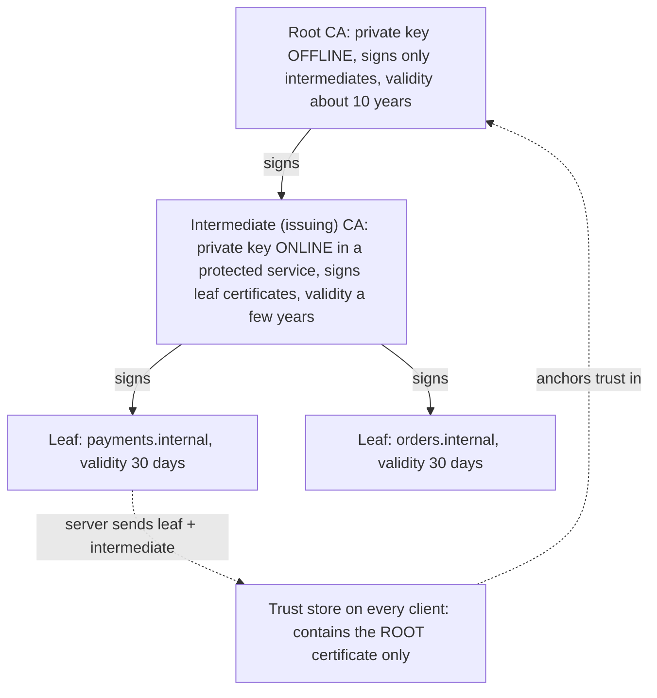
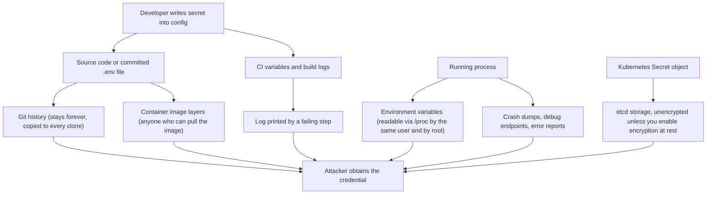
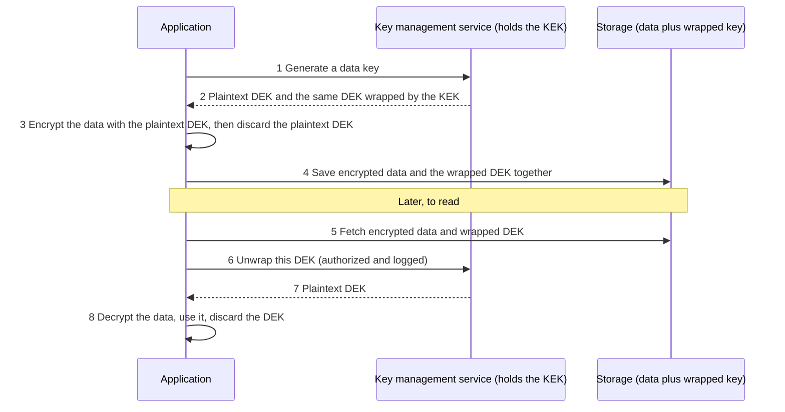
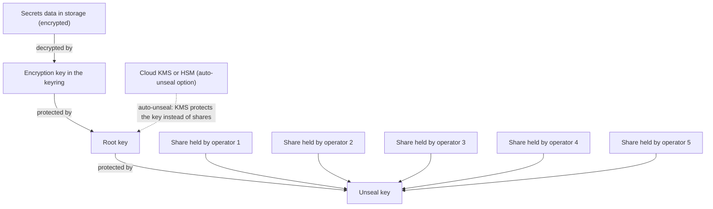

**Navigation**: [← Index](00_INDEX.md) | [Learning path, Stage 6](00_INDEX.md#-learning-path--first-principles-to-advanced) | Related: [09 TLS](09_TLS_Encryption.md) · [28 Enterprise architecture](28_Enterprise_Reference_Architecture.md) · [14 SSH](14_SSH_Remote_Access.md)

# 🔑 Chapter 25: Secrets and PKI — Trust Between Strangers, and Keeping Keys Out of the Wrong Hands

_"Cryptography does not remove the need for secrets. It shrinks what must be secret to a few small keys — and then the whole job is making sure those keys are never where an attacker can read them."_

---

## 5W1H

- **WHAT**: Two linked problems. **PKI** (public key infrastructure) answers *"how does a machine that has never met another machine know who it is talking to?"* **Secrets management** answers *"how do programs get the passwords and keys they need without those values ending up in git, logs, images or someone's laptop?"*
- **WHY**: A leaked credential is the most common root cause of a serious breach, and an expired certificate is one of the most common causes of an avoidable outage. Both are failures of *lifecycle*: issue, deliver, rotate, revoke, expire — and most teams only built the first step.
- **WHO**: Anyone who runs services: platform engineers, SREs, backend developers. Whoever owns the certificate authority and the secret store owns the keys to the company.
- **WHEN**: From the first service that has a database password or a TLS certificate — which is the first service. Retrofitting rotation onto a system that never rotated is far harder than building it in.
- **WHERE**: Between every pair of services ([chapter 29](29_Microservices_On_The_Platform.md) uses it for mutual TLS), at the edge ([chapter 9](09_TLS_Encryption.md)), in the pipeline, in Kubernetes, and in the cloud key and secret services ([chapter 28](28_Enterprise_Reference_Architecture.md)).
- **HOW**: Build a small certificate authority with `openssl` and watch each verification rule fail on purpose; reproduce the three classic leaks; implement envelope encryption and Shamir secret sharing in a few lines each; then read how production tools use the same ideas.

> **Verified on** — The certificate-authority, leak, envelope-encryption and Shamir outputs below were produced with OpenSSL **3.0.13**, Git and Python 3 on WSL2 Ubuntu 24.04 (kernel 6.6.87); no tools beyond those were installed. Statements about Vault's seal mechanism, the Kubernetes Secret object and the certificate-lifetime schedule were read from HashiCorp's Vault documentation, the Kubernetes Secret documentation and press summaries of the CA/Browser Forum ballot on 2026-11-15. Vault itself, a KMS and cert-manager were **not run** here and are marked **not verified here**.

---

# PART 1: PKI — Derive Trust From Nothing

## 1.1 The problem

Your browser connects to `bank.example`. Anyone on the path can pretend to be the bank. Encryption alone does not help: encrypting to an attacker is still encrypting to an attacker. You need to be sure the *key* you encrypt to belongs to the *name* you meant to reach. Work forward from that requirement:

1. **A key proves identity by signing.** Whoever holds a private key can produce a signature that anyone with the matching public key can check. So an identity is "the holder of this private key."
2. **But how do you learn the right public key?** If the bank sends its public key, an attacker sends theirs. You need an independent party vouching: *"this public key belongs to `bank.example`"*, with a signature you can verify.
3. **That vouching document is a certificate**: a name, a public key, a validity period, and a signature from an issuer.
4. **You must already trust the issuer's public key.** Otherwise you have only moved the problem. So a small, fixed set of issuers' keys ships inside your operating system or browser: the **trust store**. Those are the **root** certificate authorities.
5. **Roots must be protected extremely well, so they cannot be used day to day.** A root key kept online and used to sign every certificate is one breach from catastrophe. So the root signs a few **intermediate** CAs, then goes offline. The intermediates sign the certificates actually used.
6. **The result is a chain**: *leaf → intermediate → root*. You trust the leaf because the intermediate signed it, the intermediate because the root signed it, and the root because you were already given it.

That is the whole of PKI. Everything else — extensions, revocation, formats — is detail added to make these six ideas safe at scale. The reference for the certificate fields is RFC 5280 (the Internet X.509 certificate and CRL profile).



**How to read this diagram.** Read the solid arrows downward: authority flows from the root, which signs the intermediate, which signs each leaf. The dotted arrow on the left is what a client actually has: only the root, installed ahead of time. The dotted arrow on the right is what a server sends during a connection: its own leaf and the intermediate, so the client can walk the chain *up* to the root it already trusts. The thing to notice is the validity labels: the lower you go, the shorter the lifetime, because a leaf key is used constantly and exposed to the network, while the root key is almost never touched.

## 1.2 Build it and break it

Do not trust the description; build the whole chain. These commands create a root, an intermediate and a leaf, all with `openssl` (version 3.0.13 here):

```bash
# 1. Root CA: self-signed, can only sign one level of intermediates (pathlen:1)
openssl req -x509 -newkey rsa:3072 -nodes -keyout root.key -out root.crt -days 3650 \
  -subj "/O=Example Corp/CN=Example Root CA" \
  -addext "basicConstraints=critical,CA:TRUE,pathlen:1" -addext "keyUsage=critical,keyCertSign,cRLSign"

# 2. Intermediate: a key and a signing request, signed by the root, cannot sign further CAs (pathlen:0)
openssl req -newkey rsa:2048 -nodes -keyout int.key -out int.csr -subj "/O=Example Corp/CN=Example Issuing CA"
printf "basicConstraints=critical,CA:TRUE,pathlen:0\nkeyUsage=critical,keyCertSign,cRLSign\n" > int.ext
openssl x509 -req -in int.csr -CA root.crt -CAkey root.key -CAcreateserial -out int.crt -days 1825 -extfile int.ext

# 3. Leaf: for a service, valid 30 days, with the names clients will check (SAN)
openssl req -newkey rsa:2048 -nodes -keyout leaf.key -out leaf.csr -subj "/CN=payments.internal"
printf "basicConstraints=CA:FALSE\nkeyUsage=critical,digitalSignature,keyEncipherment\nextendedKeyUsage=serverAuth,clientAuth\nsubjectAltName=DNS:payments.internal,DNS:payments.prod.svc\n" > leaf.ext
openssl x509 -req -in leaf.csr -CA int.crt -CAkey int.key -CAcreateserial -out leaf.crt -days 30 -extfile leaf.ext
```

Now verify, and then break each rule on purpose. Each command below was run, and each output is what it printed.

**The chain verifies when the client has the root and is handed the intermediate:**

```text
$ openssl verify -CAfile root.crt -untrusted int.crt leaf.crt
leaf.crt: OK
```

**Without the intermediate, verification fails** — the single most common real-world TLS misconfiguration (a server that sends only its leaf):

```text
$ openssl verify -CAfile root.crt leaf.crt
error 20 at 0 depth lookup: unable to get local issuer certificate
error leaf.crt: verification failed
```

Error 20 means "I cannot find who signed this." The leaf is fine; the *chain* is incomplete because the client has the root but no way to learn the intermediate. Browsers sometimes fetch missing intermediates themselves, so this fault can hide for months and then fail only in a command-line client or a service-to-service call.

**The leaf's details**, including the names a client will check:

```text
$ openssl x509 -in leaf.crt -noout -subject -issuer -dates -ext subjectAltName
subject=CN = payments.internal
issuer=O = Example Corp, CN = Example Issuing CA
notBefore=Nov 15 06:39:48 2026 GMT
notAfter=Dec 15 06:39:48 2026 GMT
X509v3 Subject Alternative Name:
    DNS:payments.internal, DNS:payments.prod.svc
```

**An expired certificate**, checked at a time two days after a one-day certificate was issued:

```text
$ openssl verify -CAfile root.crt -untrusted int.crt -attime <now+2 days> short.crt
error 10 at 0 depth lookup: certificate has expired
error short.crt: verification failed
```

**A valid chain for the wrong name.** The chain proves the certificate was issued by a trusted CA; it does *not* prove the certificate is for the host you meant. That is a separate check, against the Subject Alternative Names:

```text
$ openssl verify -CAfile root.crt -untrusted int.crt -verify_hostname evil.example leaf.crt
error 62 at 0 depth lookup: hostname mismatch
error leaf.crt: verification failed

$ openssl verify -CAfile root.crt -untrusted int.crt -verify_hostname payments.internal leaf.crt
leaf.crt: OK
```

Four distinct failures — *incomplete chain*, *expired*, *wrong name* and (not shown, but the same mechanism) *untrusted root* — each has its own error code. Learning to read those codes is most of certificate debugging. A client that skips the hostname check (a common shortcut written as "disable certificate verification" to make an error go away) accepts *any* valid certificate for *any* name, which defeats the purpose.

## 1.3 Revocation, and why lifetimes got short

Suppose a leaf's private key leaks. You need to tell every client *"stop trusting this certificate"* before its expiry. The mechanisms are a **certificate revocation list** (a signed list of revoked serial numbers that clients download) and **OCSP** (a live "is this still good?" query). Both have the same weakness: they depend on the client checking, and checking can fail — so many clients **fail open**, treating "could not reach the revocation service" as "fine." Revocation works worst exactly when you need it.

The industry's answer is to make revocation mostly unnecessary by making certificates **short-lived**. A certificate that expires in 30 days limits the damage of a stolen key to 30 days with no revocation needed. This also drives the public web: according to press summaries of the CA/Browser Forum ballot SC-081v3 (passed April 2025), the maximum lifetime of a public TLS certificate fell to 200 days from 15 March 2026 and steps down to 100 days from 15 March 2027 and 47 days from 15 March 2029; treat these dates as reported and confirm them against the Forum's own ballot record before depending on them. The consequence is the same either way: **certificates must be issued and rotated by automation**, because a human renewing a 47-day certificate by hand will eventually miss one.

---

# PART 2: Secrets — Where They Leak and Why

## 2.1 What counts as a secret

A **secret** is any value that grants access if known: database passwords, API keys, private keys, tokens, signing keys. The management problem is the same for all of them: *each program needs the value at the moment it runs, but nobody and nothing else should ever be able to read it.* Those two requirements fight each other, and every leak is a place where the compromise went the wrong way.



**How to read this diagram.** Each box is a place a secret commonly ends up by accident. Follow any path from the top three starting points (a developer, a running process, the cluster) and you reach the same bottom box: an attacker holding a working credential. The grouping shows the real lesson: leaks come from *copies*. The secret goes into source control once and is then duplicated into every clone, every image layer and every log. The thing to notice is how many of these paths exist **before the code ever runs in production**, which is why the fix is a design — secrets delivered at run time from one controlled place — and not a reminder to "be careful."

## 2.2 Three leaks, reproduced

**Environment variables are readable by whatever can read the process's `/proc` entry.** Run a process with a secret in its environment and read it back without touching the process:

```text
$ SECRET_API_KEY=sk_live_demo_12345 sleep 30 &
$ tr '\0' '\n' < /proc/<pid>/environ | grep SECRET
SECRET_API_KEY=sk_live_demo_12345
$ stat -c '%A %U' /proc/<pid>/environ
-r-------- ash
```

The file is readable only by its owner (and root), so *other* users cannot read it — but anything running as the **same user** can, including a compromised dependency, a debug shell, or a diagnostic tool, and so can root. Environment variables also appear in crash reports and are inherited by every child process the program starts. They are convenient, not secret. (The `/proc` filesystem is derived in [I01](internals/I01_What_Really_Happens_When_You_Type_ls.md).)

**Deleting a secret from the current file does not remove it from git.** Commit a secret, then "remove" it in the next commit:

```text
$ git rm .env && git commit -m "remove secret"
$ git grep -c hunter2 HEAD          # current tree: nothing found
$ git log --all -p -S hunter2-prod --oneline
121d791 remove secret
9a54be8 add config
+DB_PASSWORD=hunter2-prod
```

The current tree is clean, and the history search finds the value in the first commit. Every clone made since contains it. The only safe response to a committed secret is **rotate it** — assume it is public — and *then*, optionally, rewrite history. Scanning for secrets *before* commit (a pre-commit hook and a pipeline check) is cheaper than either.

**Kubernetes Secret objects are not encrypted by default.** The Kubernetes documentation states that Secrets are stored unencrypted in the API server's data store (etcd), that anyone with API access can read them, and that anyone allowed to create a Pod in a namespace can read any Secret in it, including indirectly through a Deployment. It recommends enabling encryption at rest, least-privilege RBAC, restricting which containers can use a Secret, and considering an external store (for example through the Secrets Store CSI Driver). Base64 in a manifest is an *encoding*, not encryption: anyone can reverse it.

---

# PART 3: Envelope Encryption — Why Keys Have Keys

## 3.1 The problem

You must store 10 terabytes encrypted, and you must be able to rotate the encryption key. If one key encrypts everything, rotation means decrypting and re-encrypting 10 terabytes — slow, risky, and during that window both the old and new keys exist. Derive a better design:

1. Encrypt each object (or table, or volume) with its **own random data key** (DEK). Compromising one DEK exposes one object.
2. Store each DEK *next to its data*, but **encrypted** by a higher-level **key-encryption key** (KEK).
3. Keep the KEK in a place that is hard to read and easy to audit (a hardware security module or a managed key service). It never leaves; it only *wraps* and *unwraps* small keys.
4. To rotate the KEK, **re-wrap only the small DEKs**. The 10 terabytes of data are never touched.

This is **envelope encryption**, and it is how cloud key management services and disk or database encryption work. A minimal version, with `openssl`:

```bash
echo "patient record 4711: allergic to penicillin" > data.txt
openssl rand -hex 32 > dek.hex                                           # a fresh data key
openssl enc -aes-256-cbc -pbkdf2 -salt -in data.txt -out data.enc -pass file:dek.hex   # encrypt the data
openssl rand -hex 32 > kek.hex                                           # key-encryption key (an HSM/KMS in real life)
openssl enc -aes-256-cbc -pbkdf2 -salt -in dek.hex -out dek.enc -pass file:kek.hex     # wrap the data key
rm dek.hex                                                                # discard the plaintext data key
```

```text
stored: data.enc (64 B) + wrapped dek.enc (96 B); plaintext DEK deleted
unwrap DEK with KEK, decrypt: patient record 4711: allergic to penicillin
rotate the KEK = re-wrap only the 32-byte DEK; data.enc is untouched. sha256 of data.enc before/after: 1ac060e85a52 / 1ac060e85a52
```

The stored data is `data.enc` plus a wrapped key; the plaintext key exists only in memory during use. Rotating the KEK changed nothing in `data.enc` — the two hashes are identical — while still invalidating the old KEK for new wraps. (This demo uses a simple password-based cipher mode to keep the commands short; production systems use authenticated encryption such as AES-GCM through a KMS, and generate keys inside the HSM rather than in a file.)



**How to read this diagram.** Steps 1–4 are writing: the key service hands out a data key in two forms, the application uses the plain one only to encrypt and then forgets it, and storage keeps the data together with the *wrapped* key. Steps 5–8 are reading, and the important one is step 6: the application must ask the key service to unwrap, which means every read of protected data creates an **authorisation decision and an audit record** at a single choke point. The thing to notice is that the key service never sees the data and the storage never sees a usable key; compromising either alone yields nothing.

## 3.2 What can go wrong

The scheme moves the whole problem into one place — the KEK — so the design questions are about that key: who may call "unwrap," what is logged, and **what happens if the KEK is lost.** If the only copy of the KEK is destroyed, every DEK it wrapped is unreadable and so is all the data, permanently. Key backup and key loss are *disaster-recovery* topics (a planned chapter on backup, disaster recovery and capacity covers them), not afterthoughts.

---

# PART 4: Splitting a Secret — Shamir and the Sealed Vault

## 4.1 The problem

The master key that protects everything cannot sit in one person's head or one file: one person leaving, or one stolen laptop, would end the company. Writing it on three pieces of paper and requiring any two fails differently — each piece alone leaks a third of the key. You want something stronger: split a secret into *n* pieces so that **any *k* of them recover it, and fewer than *k* reveal nothing at all**, not even a hint.

Adi Shamir's 1979 construction does exactly that, with an idea from school algebra: a polynomial of degree *k − 1* is fully determined by *k* points and by no fewer. Hide the secret as the value of a random polynomial at x = 0, give each person one other point, and *k* people can reconstruct the polynomial and read off the secret, while *k − 1* people have an equation with infinitely many solutions.

```python
"""Shamir secret sharing over GF(p): any k of n shares rebuild the secret; fewer reveal nothing."""
import random, itertools
P = 2**127 - 1                          # a Mersenne prime, larger than any secret we split
random.seed(2026)

def split(secret, k, n):
    coeffs = [secret] + [random.randrange(P) for _ in range(k - 1)]      # random polynomial, f(0) = secret
    f = lambda x: sum(c * pow(x, i, P) for i, c in enumerate(coeffs)) % P
    return [(x, f(x)) for x in range(1, n + 1)]

def combine(shares):
    s = 0
    for i, (xi, yi) in enumerate(shares):                                # Lagrange interpolation at x = 0
        num = den = 1
        for j, (xj, _) in enumerate(shares):
            if i != j:
                num = num * (-xj) % P
                den = den * (xi - xj) % P
        s = (s + yi * num * pow(den, -1, P)) % P
    return s

secret = int.from_bytes(b"root-unseal-key!", "big")                     # 16 bytes
shares = split(secret, k=3, n=5)
print("shares:", [f"#{x}:{y:#034x}"[:22] + "..." for x, y in shares])
ok = all(combine(list(c)) == secret for c in itertools.combinations(shares, 3))
print("every one of the", len(list(itertools.combinations(shares, 3))), "combinations of 3 shares rebuilds the secret:", ok)
wrong = combine(shares[:2])
print("2 shares give:", hex(wrong)[:20] + "...", "== secret?", wrong == secret)
other = int.from_bytes(b"a-different-key!", "big")
(x1, y1), (x2, y2) = shares[0], shares[1]
pts = [(0, other), (x1, y1), (x2, y2)]
print("a polynomial exists through those 2 shares AND a different secret:", combine(pts) == other)
print("secret recovered as text:", combine(shares[1:4]).to_bytes(16, "big").decode())
```

```text
shares: ['#1:0x662f50978a434d5e5...', '#2:0x4de3c4049f632b6a9...', '#3:0x298cc9bb6cd508982...', '#4:0x792a61bbf298e4e70...', '#5:0x3cbc8c0630aec0572...']
every one of the 10 combinations of 3 shares rebuilds the secret: True
2 shares give: 0x7e7add2a75236f521a... == secret? False
a polynomial exists through those 2 shares AND a different secret: True
secret recovered as text: root-unseal-key!
```

All ten ways of choosing three of the five shares rebuild the secret. Two shares give a different, meaningless number. The fourth line is the security argument in one sentence: for **any** secret you might guess, a degree-2 polynomial exists that passes through the two shares you hold and through that guess, so two shares rule out nothing. (The code is a teaching model; use a vetted library for real systems, never your own implementation.)

## 4.2 How a secret store uses it

HashiCorp's Vault documentation describes the same design. A Vault server **starts sealed**: it can reach its storage but cannot decrypt anything in it. The data is encrypted with an encryption key in a keyring; the keyring is encrypted by a **root key**; the root key is encrypted by an **unseal key**, stored alongside the data. By default the unseal key is split with Shamir's scheme into shares, a threshold number of which must be submitted — one at a time, by different operators — to unseal. Sealing deletes the root key from memory.



**How to read this diagram.** Read upward from the data: it is protected by a key, which is protected by a root key, which is protected by the unseal key — the same *keys with keys* layering as envelope encryption. At the bottom, the unseal key itself is not stored anywhere in one piece: it exists only as five shares in five people's hands, and any threshold of them must act together to start the server. The dotted arrow is the alternative called **auto-unseal**: the server asks a cloud key service to unwrap the root key at startup, trading the human quorum for automation. The thing to notice is that **the design has a recovery cost**: the Vault documentation notes that if the seal mechanism or its keys are permanently lost, the cluster cannot be recovered, even from backups.

The trade-off between the two modes is a real design choice:

| Mode | Strength | Weakness | Choose it when |
| --- | --- | --- | --- |
| **Shamir shares, manual unseal** | No single person or system can start it alone; no dependency on a cloud service | Someone must be present after every restart; the quorum can be unavailable in an incident | Strict separation-of-duty requirements; small, stable clusters |
| **Auto-unseal via KMS/HSM** | Restarts and failover are automatic | The cloud key service becomes a hard dependency and a high-value target | Most production clusters that must self-heal |

---

# PART 5: Giving Programs Their Secrets Safely

## 5.1 The delivery problem

Storing secrets is half of it. The other half is the moment of delivery: the program must receive the value without it passing through a person, a repository or a log. Ranked from weakest to strongest:

| Approach | What it does | Weakness |
| --- | --- | --- |
| Hard-coded in source | Value is in the repository | Everyone with repository access, forever, plus every clone |
| Environment variable set by the deploy tool | Value injected at start | Visible in `/proc`, crash dumps, child processes; often logged by the deploy tool |
| File mounted at run time from a secret store | The value is written into the process's file system (ideally an in-memory volume) | Anyone who can read that path in the container |
| **Fetched at run time by the workload using its own identity** | The workload authenticates (platform identity, not a stored password) and asks the store | The identity system becomes critical; needs good least-privilege policy |
| **Short-lived, dynamically generated credentials** | The store *creates* a database user valid for an hour, per request or per pod | Needs integration with each backend; the store must be highly available |
| **No secret at all** | The platform proves the workload's identity (cloud roles, OIDC federation, mTLS) | Only works where the other side accepts that identity |

The last two rows are the direction of travel. A credential that expires in an hour needs no rotation process and has a tiny blast radius if stolen. A workload that authenticates with a platform-issued identity has nothing to leak. This is why [chapter 28](28_Enterprise_Reference_Architecture.md) insists on roles instead of access keys, and why CI systems now federate to cloud roles with short-lived tokens instead of storing keys. Dynamic database credentials, as offered by secret managers such as Vault, are **not verified here**: that needs a running server and a database.

## 5.2 The stores

| Tool family | Examples | Notes |
| --- | --- | --- |
| **Cloud secret managers** | AWS Secrets Manager, Azure Key Vault, Google Secret Manager | Integrated with each cloud's identity and audit; simplest when you are single-cloud |
| **Self-managed secret stores** | HashiCorp Vault | Cross-cloud, dynamic credentials, PKI engine; you operate it, including unseal and recovery |
| **Kubernetes integration** | Secrets Store CSI Driver, External Secrets Operator | Pull values from an external store into pods, so the cluster does not own the master copy |
| **Certificate automation** | cert-manager (in Kubernetes), ACME clients for public certificates | Issue and renew certificates automatically; the answer to short lifetimes |
| **Encrypted files in git** | SOPS, sealed secrets | Secrets live encrypted in the repository and decrypt only with a key the cluster holds; good for GitOps ([chapter 23](23_GitOps_Deployments.md)) |

The names are listed for orientation. Their exact current feature sets were not re-verified for this chapter; check each project's documentation before choosing.

---

# PART 6: Alternatives and When Not To

| Decision | Option A | Option B | Rule of thumb |
| --- | --- | --- | --- |
| Run your own CA or use a public one | Private CA for internal service-to-service TLS | Public CA (ACME) for anything internet-facing | **Public for the edge, private for the inside.** Internal names cannot get public certificates, and a private CA lets you set short lifetimes and custom identities |
| One CA or many | One issuing CA | One per environment/business unit | Separate production from non-production, so a leaked non-production issuing key cannot mint production trust |
| Where the root lives | Online | Offline (powered off, in a safe, used only to sign intermediates) | Offline for any root you intend to keep for years |
| Secrets in a manager or in the platform | Platform-native (cloud roles, workload identity) | Central secret manager | Prefer *no secret* where the platform can prove identity; use the manager for what remains |
| Build or buy | Operate Vault and a CA yourself | Cloud-managed services | Operating a secret store is operating a tier-0 system with its own recovery plan; small teams should usually buy |

When is all this too much? A single internal tool with one database password does not need Vault. It needs the password *out of git*, delivered by the platform's native mechanism, with a documented rotation step. The skill is matching the control to the value protected, and being able to explain when you are *accepting* a weaker design on purpose.

---

# PART 7: How It Fails

| Symptom | Cause | How to prove it | Prevention |
| --- | --- | --- | --- |
| Sudden outage across services at an odd hour | A certificate expired | `openssl x509 -noout -enddate` on the served certificate shows a past date; clients log `certificate has expired` (error 10) | Automated renewal, plus an alert at 30, 14 and 7 days before expiry that **does not depend on the renewal job working** |
| `unable to get local issuer certificate` from one client but not a browser | Server sends only its leaf; the intermediate is missing | `openssl verify` without `-untrusted` fails with error 20; with it succeeds | Serve the full chain; test with a strict client, not a browser |
| `hostname mismatch` | Certificate lacks the name the client uses | `openssl verify -verify_hostname` fails with error 62; SAN list lacks the name | Put every real name in the SAN; never fix by disabling verification |
| A credential from a deleted commit is used in an attack | Secret remains in git history | `git log --all -p -S <value>` finds it | Rotate immediately; pre-commit and pipeline secret scanning |
| The secret store is up but nothing can read it | Sealed after a restart, quorum of shares unavailable | The store reports "sealed"; fewer than the threshold operators reachable | Auto-unseal or a rehearsed unseal procedure and share distribution |
| All encrypted data is unreadable after an incident | The key-encryption key was deleted or lost with no backup | Unwrap calls fail for every data key | Key backup and recovery tested like any other backup; protection against accidental deletion |
| A rotated credential breaks half the estate | Rotation was never exercised; some consumers cache the old value | Errors start exactly at the rotation time | Rotate on a schedule so it is routine; support two valid credentials during the changeover |
| A leaked CI log reveals a token | A step echoed an environment variable | The token appears in the build log | Mask secrets in CI, never `set -x` around secret use, short-lived federated tokens |

---

# PART 8: Lab — Build a CA, Leak a Secret, Split a Key

Work in `~/lab/pki`. Everything runs on a laptop with `openssl`, `git` and Python 3.

1. **Build the chain.** Run the three commands from §1.2 to create the root, intermediate and leaf.
   - *Expected:* `root.crt`, `int.crt` and `leaf.crt` exist.
   - *Check:* `openssl verify -CAfile root.crt -untrusted int.crt leaf.crt` prints `leaf.crt: OK`.
2. **Break the chain three ways.** Run the verify without `-untrusted`; verify the one-day certificate with `-attime` set two days ahead; verify with a wrong `-verify_hostname`.
   - *Expected:* error 20, error 10 and error 62 respectively.
   - *Check:* match each error code to its cause in one sentence each, without looking at the chapter.
3. **Constrain the intermediate.** Try to use the *leaf* key to sign another certificate and verify the result against the chain.
   - *Expected:* `openssl x509 -req` happily signs (the tool does not stop you), but verification of the result fails with `error 32 ... key usage does not include certificate signing`.
   - *Check:* use `-CA leaf.crt -CAkey leaf.key`, then `openssl verify -CAfile root.crt -untrusted <leaf+intermediate bundle> evil.crt`. Explain why the leaf's `CA:FALSE` and key usage, and `pathlen:0` on the intermediate, are safety rules enforced by the *verifier*, not decoration.
4. **Reproduce the leaks.** Run the `/proc/<pid>/environ` demonstration and the git history demonstration from §2.2.
   - *Expected:* the secret is readable from `/proc`, and found by `git log -S` after deletion.
   - *Check:* then run `git filter-branch -f --index-filter "git rm -q --cached --ignore-unmatch .env" -- --all` on the scratch repository and search again. *Expected:* the value is **still found** (through the backup ref `refs/original`) until you delete that ref, expire the reflog and run `git gc --prune=now`, after which the search finds nothing. State why even a fully rewritten history does **not** make the secret safe if the repository was ever pushed or cloned.
5. **Envelope encryption.** Run the commands from §3.1. Then generate a *second* KEK, re-wrap the DEK with it, and decrypt successfully with the new KEK.
   - *Expected:* `data.enc` unchanged, `dek2.enc` decrypts with `kek2.hex`.
   - *Check:* `sha256sum data.enc` before and after the re-wrap is identical.
6. **Share a secret.** Save `shamir.py` from §4.1, run it, then change `k=3, n=5` to `k=4, n=7` and show that three shares no longer reconstruct the secret while four do.
   - *Expected:* with `k=4`, `combine(shares[:3]) != secret` and `combine(shares[:4]) == secret`.
   - *Check:* explain in one sentence what the fourth line of the original output proves.
7. **Design assignment (paper).** Your company has 40 services and runs a private CA. Decide the leaf lifetime, where the root key lives, who may operate the issuing CA, how services receive certificates, what alert fires before expiry, and what the break-glass procedure is if the issuing CA is down at 3 a.m. Defend each choice in one sentence.
8. **(Not verified here — needs Vault or a cloud account.)** Stand up a development-mode secret store, enable dynamic database credentials and show that a lease expires. The steps follow the tool's own getting-started guide.

---

# PART 9: Challenges

🔬 **Section Challenge — Chains and trust**

**Challenge 1 (Debug):** A new internal service works from your browser but `curl` and the other services fail with "unable to get local issuer certificate". The certificate was issued by your private issuing CA. What is wrong and how do you prove it in one command?

<details><summary>Answer</summary>

The server almost certainly sends **only its leaf**, not the intermediate certificate. Browsers sometimes fetch a missing intermediate on their own, which hides the fault; strict clients do not. Prove it by running `openssl verify -CAfile root.crt leaf.crt` (fails with error 20, "unable to get local issuer certificate") and then `openssl verify -CAfile root.crt -untrusted int.crt leaf.crt` (succeeds). Fix the server to present the chain (leaf followed by intermediate). Do not fix it by installing the intermediate everywhere or by disabling verification in clients.

</details>

**Challenge 2 (Reasoning):** A colleague says "the certificate is signed by our trusted CA, so the connection is secure no matter what name I connect to." Explain what is missing, using the error codes from the lab.

<details><summary>Answer</summary>

A valid chain proves who *issued* the certificate; it does not prove the certificate was issued *for the name you intended*. That is a separate hostname check against the Subject Alternative Names. In the lab the same leaf verified as `OK` for `payments.internal` and failed with error 62 (`hostname mismatch`) for `evil.example`. If a client skips the hostname check, an attacker with any certificate from your CA — for any name — can impersonate any service. "Disable certificate verification" to silence an error is therefore the same as removing the lock.

</details>

🔬 **Section Challenge — Revocation and lifetime**

**Challenge 3 (Design):** A leaf private key is stolen from a build server. You have a CRL and OCSP. Explain why relying on revocation is weak here, and what design choice makes the incident small without revocation.

<details><summary>Answer</summary>

Revocation depends on clients actually checking and on the revocation service being reachable; many clients **fail open**, so a revoked certificate often keeps working exactly when an attacker is using it. The design choice is **short-lived certificates** (days or hours) issued by automation: the stolen key becomes useless when its certificate expires, with no reliance on revocation. Combine it with narrow certificates (one service name, one purpose) and an alert on unexpected issuance. The public-web trend toward ever shorter maximum lifetimes follows the same reasoning.

</details>

🔬 **Section Challenge — Secrets in practice**

**Challenge 4 (Scenario):** A developer commits a database password, notices within a minute, and force-pushes a rewritten history. The password was in the repository for 60 seconds. What do you do and why is the rewrite not enough?

<details><summary>Answer</summary>

**Rotate the password immediately** and treat it as public. A rewrite does not recall copies: any clone, CI cache, fork, mirror, code-search index or log taken during those 60 seconds still contains it, and the platform may keep unreachable commits for a time. After rotation, find what used the old credential and update it, check the database's audit log for use from unexpected sources, and add a pre-commit scanner and a pipeline check. History rewriting is hygiene *after* rotation, never a substitute.

</details>

**Challenge 5 (Trade-off):** Compare passing a database password to a container as an environment variable, as a mounted file from a secret store, and by having the workload fetch a short-lived credential using its platform identity. Which would you require for production and why?

<details><summary>Answer</summary>

Environment variable: easiest, but readable through the process's `/proc` entry by anything running as that user and by root, inherited by child processes, and often captured in crash dumps and deploy logs. Mounted file: better, because the value is not in the process environment and can be on an in-memory volume, but anyone who can read that path in the container can read it, and you must still rotate it. Fetching a **short-lived credential with the workload's own identity**: strongest, because there is no stored long-lived secret to leak and the credential expires on its own. Require the third for production where the platform supports it, the second as the fallback, and forbid the first for high-value credentials. State the dependency you accept: the identity system and the secret store become critical to starting the workload.

</details>

🔬 **Section Challenge — Keys with keys**

**Challenge 6 (Design):** Explain, with the lab numbers, why envelope encryption makes key rotation cheap, and what single failure destroys all the data regardless of how well you encrypt.

<details><summary>Answer</summary>

Data is encrypted with per-object data keys; the data keys are themselves encrypted by a key-encryption key. Rotating the key-encryption key means re-wrapping the small data keys (32 bytes each in the lab, 96 bytes once wrapped) while the encrypted data stays untouched: the lab's `data.enc` had the identical hash before and after rotation. With a single key for everything, rotation would mean re-encrypting all the data. The failure that destroys everything is **losing the key-encryption key** with no recoverable backup: every wrapped data key becomes unreadable, so all the data is permanently lost even though it is perfectly intact on disk. Key backup and recovery must therefore be tested as carefully as data backup.

</details>

**Challenge 7 (Calculation):** You split a recovery key with Shamir's scheme into 7 shares with a threshold of 4. How many different groups of operators can unseal, how many operators can be unavailable before nobody can, and what happens if five shares are leaked to an attacker?

<details><summary>Answer</summary>

Groups of exactly 4 from 7: 7!/(4!·3!) = **35**; any larger group also works. Up to **3** shares can be unavailable (lost or operators absent) and the remaining 4 still suffice; with 4 or more unavailable, nobody can unseal and the key is permanently lost unless backed up elsewhere. If **five** shares leak, the attacker holds more than the threshold (4) and can reconstruct the key — the scheme gives perfect secrecy only below the threshold. Choose the threshold to balance *availability* (more shares can be absent) against *theft resistance* (more shares needed to attack), and distribute shares across people who would not be compromised together.

</details>

---

# Reality Check

**"Our traffic is encrypted, so we're secure."** Encryption to an unauthenticated party is still disclosure. The chain *and* the hostname check are what make the lock mean something.

**"We can disable certificate verification in dev and re-enable it in prod."** Code paths that skip verification have a way of reaching production. Make it impossible to turn off, and fix the trust problem (install the private root in the test environment) instead.

**"Base64 is a form of encryption."** It is an encoding anyone can reverse. A Kubernetes Secret is base64 in a manifest and, by default, unencrypted in the data store.

**"Revocation will save us if a key leaks."** Revocation checking often fails open and is slowest to take effect exactly when you need it. Short lifetimes are the control that does not depend on the client's cooperation.

**"We rotate secrets every 90 days, so we're safe."** Rotation limits how long a stolen value works only if the old one actually stops working and every consumer copes. A rotation that has never been *exercised* will fail the first time you need it.

**"A secret manager makes secrets safe."** It concentrates risk into one tier-0 system. It helps only if access is least-privilege, every read is logged, and its own seal, backup and recovery are tested.

**"Environment variables are the twelve-factor way, so they're fine for secrets."** They are fine for configuration. For high-value secrets they are readable through `/proc`, inherited by every child process and routinely captured in diagnostics.

---

# Books and References

Chapter numbers are those recorded in [BOOKS.md](BOOKS.md); the two primary sources are cited by name because the exact wording lives in the originals.

| Source | Read | What it adds beyond this chapter |
| --- | --- | --- |
| *Terraform: Up & Running*, 3rd ed., Brikman (PAID) | Ch 6 "Managing Secrets with Terraform" | Where secrets leak specifically in infrastructure code (variables, state files) and the standard mitigations |
| *Building Secure & Reliable Systems* (FREE, https://sre.google/books/) | Ch 5 "Design for Least Privilege" | The access-design principles that decide who can read a secret or call "unwrap" |
| RFC 5280, *Internet X.509 Public Key Infrastructure Certificate and CRL Profile* (FREE) — https://www.rfc-editor.org/rfc/rfc5280 | Sections on certificate fields, basic constraints and path validation | The exact meaning of `pathlen`, `CA:TRUE` and the chain-validation algorithm used in the lab |
| RFC 8446, *TLS 1.3* (FREE) — https://www.rfc-editor.org/rfc/rfc8446 | The certificate and authentication sections | How the certificate chain is used inside the handshake (see [chapter 9](09_TLS_Encryption.md)) |
| Adi Shamir, "How to Share a Secret", *Communications of the ACM*, 1979 | The whole paper (it is short) | The original construction behind §4.1 |
| HashiCorp Vault documentation, "Seal/Unseal" concepts (FREE) — https://developer.hashicorp.com/vault/docs/concepts/seal | The seal/unseal and auto-unseal sections | The production use of Shamir shares and the recovery implications in §4.2 |
| Kubernetes documentation, "Secrets" (FREE) — https://kubernetes.io/docs/concepts/configuration/secret/ | The security recommendations | The authoritative statement of how Secret objects are stored and the recommended hardening steps |

No FinOps or cloud-secret-manager book was verified for this chapter; consult each vendor's own documentation for current feature details.

---

## 🔗 Cross-References

- [09 TLS and Encryption](09_TLS_Encryption.md) — the handshake that consumes the certificates built here
- [28 Enterprise Reference Architecture](28_Enterprise_Reference_Architecture.md) — role-based access that removes whole classes of secrets
- [29 Microservices on the Platform](29_Microservices_On_The_Platform.md) — mutual TLS between services and per-service identity
- [14 SSH and Remote Access](14_SSH_Remote_Access.md) — key pairs and host keys, the same trust ideas on a smaller scale
- [23 GitOps and Deployments](23_GitOps_Deployments.md) — keeping secrets out of the repository that holds your cluster state
- [I01 What really happens when you type `ls`](internals/I01_What_Really_Happens_When_You_Type_ls.md) — `/proc` and process environments
- [SENIOR_READINESS](SENIOR_READINESS.md) — capstone C3 requires secrets and PKI for the enterprise estate
