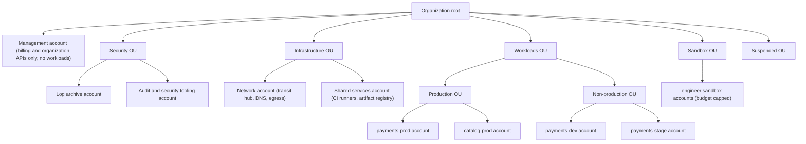
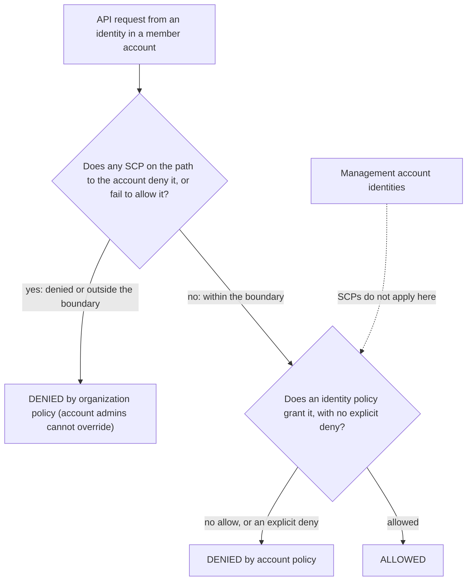
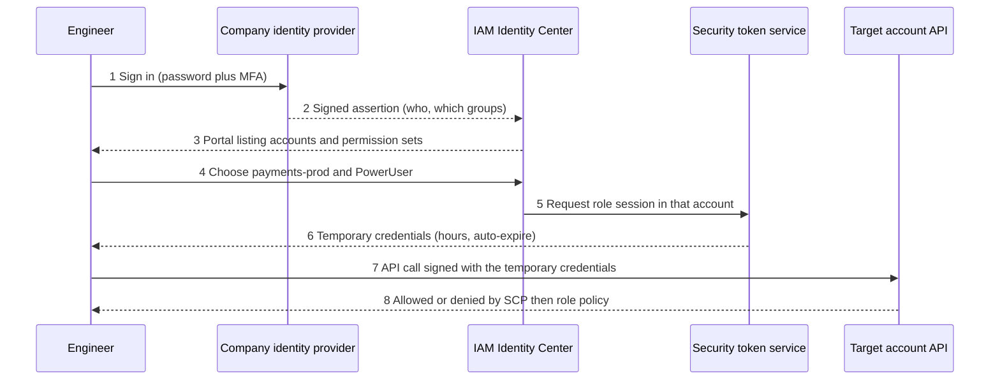
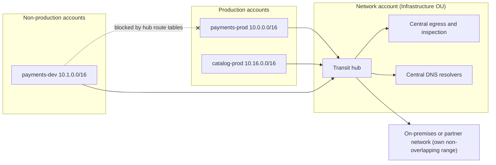
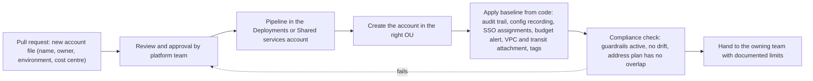

**Navigation**: [← Index](00_INDEX.md) | [Learning path, Stage 9](00_INDEX.md#-learning-path--first-principles-to-advanced) | Related: [13 Cloud Networking (VPC)](13_Cloud_Networking_VPC.md) · [20 Terraform](20_Terraform_IaC.md) · [Readiness and capstones](SENIOR_READINESS.md)

# 🏛️ Chapter 28: Enterprise Reference Architecture — Accounts, Guardrails, Identity and Network

_"One cloud account is a house. An enterprise needs a city: districts with walls, one set of laws, one road plan, one registry of who lives where — and a way to build a new house in an hour without anyone drawing it by hand."_

---

## 5W1H

- **WHAT**: The skeleton every large cloud estate is built on: a hierarchy of isolated accounts, organisation-wide guardrails, central identity, a non-overlapping network plan, shared services (logging, security tooling, networking) and a pipeline that creates new accounts from code.
- **WHY**: Almost every severe cloud incident is a *boundary* failure — one compromised key reaching production, one team's runaway cost, one misconfigured network exposing everything. Boundaries designed in year one are cheap; boundaries retrofitted after 200 workloads exist take years.
- **WHO**: Platform and cloud architects, senior DevOps engineers, and anyone asked "how would you set up the cloud for the whole company?" — the central question of Stage 9.
- **WHEN**: Before the second production workload. A single account is fine for learning; the moment two teams, two environments or two data classifications share it, you are carrying risk you cannot see.
- **WHERE**: The management layer above every workload: AWS Organizations and Control Tower (this chapter's worked example), and the equivalent concepts in Azure and Google Cloud.
- **HOW**: Derive each boundary from the failure it prevents, then express it as code: an account/OU tree, inherited policies, SSO-issued temporary credentials, a CIDR plan, and a vending pipeline. Prove each piece with a command you can run without a cloud account.

> **Verified on** — The network-plan, overlap-check and policy-JSON outputs in this chapter were produced with Terraform **1.17.2** and Python 3 on WSL2 Ubuntu 24.04 (kernel 6.6.87), using only Terraform's built-in `terraform_data` resource (no provider download, no cloud account). The AWS descriptions were checked against the AWS whitepaper *Organizing Your AWS Environment Using Multiple Accounts* (publication date 30 April 2025) and the AWS Control Tower User Guide, both read on 2026-11-15. Anything that needs a live AWS organisation is marked **not verified here**.

---

# PART 1: The Problem — Derive It Before You Name It

## 1.1 Start with one account and one network

A startup begins with one cloud account, one network and a few engineers who all have administrator rights. This is the right choice for week one. Now let the company grow and ask, one failure at a time, *what would we have to invent?*

| Failure | Why one account cannot stop it | What you would have to invent |
| --- | --- | --- |
| A developer's laptop key leaks and an attacker deletes the production database | Every key can reach everything, because there is one permission domain | A **hard boundary** between environments: separate permission domains that deny by default |
| One team's load test exhausts the API rate limit or instance quota, and production throttles | Quotas and rate limits are shared per account and region | **Separate quota domains**, so a noisy neighbour hits its own ceiling |
| Finance asks "what does the payments service cost?" and nobody can answer | Bills are one blob; tags are optional and inconsistent | A **billing boundary** that maps one-to-one to something the business names |
| An auditor asks for proof that nobody can turn off security logging | The people who generate the logs can also delete them | **Separation of duty**: the log store lives where workload admins cannot reach |
| A regulation says customer data must stay in one country | Any engineer can launch resources in any region | A **rule that applies to every account at once**, set by someone other than the account owners |
| You need 40 new environments this quarter | Each one is configured by hand and each is slightly different | **Automation that creates an account** with the baseline already applied |

Read the right-hand column as a specification. The boundary you need is a container that carries its own identity, its own quota, its own bill and its own blast radius. Every major cloud ships exactly that container, under a different name:

| Cloud | The hard-boundary container | The grouping above it |
| --- | --- | --- |
| AWS | **Account** | Organizational unit (OU) inside an organisation |
| Azure | **Subscription** | Management group |
| Google Cloud | **Project** | Folder inside an organisation |

This chapter uses AWS names because the AWS guidance is the most explicit, and notes where the other clouds differ. The *reasoning* is identical in all three.

## 1.2 From containers to a city

One boundary per workload still leaves open questions. Walk through them in order, because each answer creates the next problem:

1. **How do you apply a rule to hundreds of accounts?** You cannot edit hundreds of accounts. You need a *tree* so a rule set on a branch is inherited by everything beneath it. That is the OU hierarchy.
2. **Who owns the rules?** If the account owner can remove the rule, it is advice, not a rule. The rule must be enforced from *outside* the account. That is a **service control policy** (SCP).
3. **Where do shared things live?** Logs, security scanners, the network hub and the CI/CD runners belong to no single workload. They need accounts of their own, in branches that workload teams cannot reach.
4. **How do humans get in?** Hundreds of accounts times dozens of people cannot be hundreds of local users with passwords. You need *one* identity source and short-lived access issued per account. That is **single sign-on** into temporary credentials.
5. **How do the networks talk without colliding?** Two accounts that both picked `10.0.0.0/16` can never be connected. You need a **single address plan** owned centrally.
6. **How do you create account number 201?** By hand it takes an afternoon and differs from account 200. You need an **account factory** that applies the baseline from code.

That list *is* the architecture. The rest of the chapter takes each item in turn.

## 1.3 What the vendors converged on

AWS's own guidance, *Organizing Your AWS Environment Using Multiple Accounts*, makes the same argument: an account is an isolation boundary for identity and access, access between accounts is denied unless you explicitly allow it, the number of accounts can range from a few to thousands, and charges depend on resource usage, not on the number of accounts. The last point removes the usual objection ("more accounts cost more"): you pay for what runs, not for the container.

**Control Tower** is AWS's packaged answer to the six questions above. It orchestrates AWS Organizations, AWS Service Catalog and AWS IAM Identity Center to build a *landing zone* — a multi-account environment that follows security and compliance best practice — and adds *controls* (also called guardrails) and an *Account Factory*. Treat it as one implementation of the architecture, not the architecture itself; Part 7 compares it with building the same thing yourself.

---

# PART 2: The Account and OU Model

## 2.1 The recommended OU tree

The AWS whitepaper recommends these organizational units. Foundational OUs hold the estate's own plumbing; the others hold what the business builds.

| Group | OU | What it holds |
| --- | --- | --- |
| Foundational | **Security** | Accounts that apply security policy, governance and compliance controls across the organisation |
| Foundational | **Infrastructure** | Core and shared infrastructure and networking resources |
| Application | **Workloads** | The business's own workloads, production and non-production |
| Experimental | **Sandbox** | Experimentation, testing and development with limited access to production |
| Procedural | **Exceptions** | Workloads that need configurations or policies that deviate from the standard |
| Procedural | **Transitional** | Accounts temporarily parked during a migration or restructuring |
| Procedural | **Suspended** | Accounts deactivated for security or policy reasons |
| Procedural | **Policy Staging** | Accounts used to test new or changed organisational policies before they reach production |
| Advanced | **Individual Business Users** | Accounts tied to individual employees or business units |
| Advanced | **Deployments** | Accounts hosting the services that orchestrate deployments across accounts |
| Advanced | **Business Continuity** | Accounts for disaster recovery, backup and continuity of critical functions |

The whitepaper states you do not need all of them; expand as you learn what you need. A practical starting tree for a mid-sized company looks like this:



**How to read this diagram.** Start at the root: every account in the company lives below it, and a policy attached to a node applies to everything under that node. The management account sits beside the OUs, not inside a workload branch, because it can create and delete accounts and is exempt from the policies that constrain the others. Read the four main branches as four *different trust levels*: Security and Infrastructure are run by the platform team, Workloads by product teams, Sandbox by anyone with a budget cap. The thing to notice is that **production and non-production are siblings under Workloads**: one policy on the Production OU (for example, "no public S3 buckets, no unapproved regions") tightens every production account at once without touching development.

## 2.2 Why each account exists

| Account | Reason it must be separate | What breaks if you merge it into a workload account |
| --- | --- | --- |
| **Management** | It holds billing and the power to create accounts and attach policies. SCPs do not restrict it. | A compromised workload role could reach organisation-wide controls |
| **Log archive** | Immutable store for the organisation-wide audit trail | An attacker with workload admin deletes the evidence of their own activity |
| **Audit / security tooling** | Read-only reach into every account for scanners and responders | Security tooling shares a failure domain with the thing it watches |
| **Network** | Owns the transit hub, central DNS and shared egress | Any workload admin can reroute traffic for every other workload |
| **Shared services** | CI runners, artifact registry, internal DNS zones | A build job's credentials can touch production data |
| **Workload (per app per environment)** | One blast radius, one bill, one quota domain | One leaked key, one cost spike, one throttled quota hits every app |

## 2.3 Granularity: how many accounts?

| Pattern | Accounts for 20 services | Use when | Cost |
| --- | --- | --- | --- |
| One account for everything | 1 | Learning, prototypes | Everything else in this chapter fails |
| One account per environment | 3 (dev, stage, prod) | Very small teams with one product | Teams share quotas, bills and blast radius inside each |
| One account per team per environment | roughly teams × 3 | Several product teams | A good default; billing maps to teams |
| One account per workload per environment | 20 × 3 = 60 | Regulated data, strict isolation, many teams | Needs automation: you must vend accounts from code |

The decision rule: **make the account the smallest unit you would be willing to hand to a team and say "this is yours, you cannot hurt anyone else with it."** If vending an account takes a day of manual work, you will under-split; if it takes ten minutes of pipeline, you can afford to split finely. Automation, not preference, sets the practical granularity.

---

# PART 3: Guardrails — Policies That Cannot Be Removed From Inside

## 3.1 Two layers of "who can do what"

An action succeeds only if **both** of these agree:

1. **The organisation's policies** (SCPs) define the *outer boundary*: the maximum anything in the account can ever do. They never grant permission.
2. **The account's own IAM policies** grant permissions to specific identities, *inside* that boundary.

The effective permission is the **intersection**. An explicit `Deny` in either layer overrides any `Allow`. Two consequences senior engineers must hold in their head:

- An SCP that allows `ec2:*` grants nobody anything. Someone still needs an IAM `Allow`.
- Removing a permission from an account administrator is impossible *inside* the account if an SCP forbids it — which is the whole point.



**How to read this diagram.** Follow one request from the top. It meets the organisation's boundary *first*: if any policy above the account forbids the action, or no policy on the path allows that service at all, the request stops there and nothing an account administrator does can change the result. Only requests inside the boundary reach the account's own permissions, where they still need an explicit allow. Notice the dotted line: identities in the **management account** skip the first gate, which is why you keep that account empty of workloads and tightly held.

## 3.2 A guardrail you can read

This policy, saved as `scp.json`, does two things. It stops anyone leaving the organisation, and it denies actions outside two approved regions *except* for global services that do not have a region:

```json
{
  "Version": "2012-10-17",
  "Statement": [
    {"Sid": "DenyLeavingTheOrg", "Effect": "Deny", "Action": "organizations:LeaveOrganization", "Resource": "*"},
    {"Sid": "DenyOutsideApprovedRegions", "Effect": "Deny", "NotAction": ["iam:*","organizations:*","sts:*","support:*"],
     "Resource": "*", "Condition": {"StringNotEquals": {"aws:RequestedRegion": ["eu-west-1","us-east-1"]}}}
  ]
}
```

Run `python3 -c "import json;d=json.load(open('scp.json'));print('valid JSON,',len(d['Statement']),'statements,',len(open('scp.json').read()),'bytes')"` and you will see:

```text
valid JSON, 2 statements, 396 bytes
```

Read the second statement carefully, because it contains the most common production mistake. `NotAction` means "deny everything *except* these". The exception list is mandatory: global services such as IAM and STS are not regional, so without exempting them a region-restriction policy blocks sign-in itself. Validating JSON syntax proves only that the file parses. **Whether the policy does what you intend is not verified here** — that needs a live organisation and a member account, which is why Part 8 tells you to stage every policy in a Policy Staging OU first.

## 3.3 The control types in Control Tower

Control Tower expresses guardrails as **controls**, in plain language, of three kinds: *preventive* (stop the action from happening, implemented with organisation policies such as SCPs and, in current guidance, resource control policies), *detective* (notice after the fact and report non-compliance) and *proactive* (check a resource definition before it is deployed). Each carries a guidance level — mandatory, strongly recommended or elective. The design rule that follows:

| Prefer | When | Because |
| --- | --- | --- |
| **Preventive** | The action is never legitimate (disable logging, leave the org, use an unapproved region) | Prevention leaves no incident to clean up |
| **Proactive** | You want infrastructure-as-code to fail *before* it creates something non-compliant | The developer learns in the pull request, not in an audit |
| **Detective** | The action is sometimes legitimate and needs review (open a security group to the internet) | A hard block would stop real work; detection plus response keeps the exception visible |

---

# PART 4: Identity — One Front Door, Temporary Keys

## 4.1 Why not one IAM user per person per account

Derive it. If each of 300 engineers has a user in each of 60 accounts, that is 18,000 credentials, each with a password and often an access key that never expires. Offboarding means finding all 60 of someone's identities. A leaked laptop leaks keys that stay valid for years. The requirements follow directly:

1. **One source of truth** for who works here (the company's identity provider).
2. **Access granted by role, per account**, not per person.
3. **Credentials that expire** in hours, so a leak has a short half-life.
4. **Revocation in one place**: disable the person in the identity provider and every account door closes.

AWS IAM Identity Center is the AWS service built on these ideas (it is one of the services Control Tower orchestrates). You connect your identity provider, define **permission sets** (named bundles of permissions such as "ReadOnly" or "PowerUser"), and assign *group → permission set → account*. When someone signs in and picks an account, the service gives them **temporary credentials** for a role it created in that account.



**How to read this diagram.** Read it top to bottom as eight numbered steps; the engineer never holds a long-lived key. Steps 1–2 prove *who you are* (the identity provider does that, including MFA). Steps 3–4 are authorisation by assignment: the portal only offers account-and-role pairs an administrator granted to one of your groups. Steps 5–6 mint the credentials, which expire by themselves. Step 8 shows the guardrails from Part 3 still apply at the end. The thing to notice is that **offboarding happens at step 1**: disable the person in the identity provider and no new credentials can be issued anywhere.

## 4.2 The identities that remain

| Identity | Rule | Why |
| --- | --- | --- |
| **Humans** | SSO only, MFA enforced at the identity provider, no local users | One revocation point, short-lived keys |
| **Machines inside AWS** | Roles attached to the workload (instance profile, pod identity), never keys in config | There is nothing to leak or rotate |
| **Machines outside AWS (CI/CD)** | Federation from the CI system's identity token to a role (OIDC), never stored access keys | A stolen CI secret store yields nothing reusable |
| **Break-glass** | One or two emergency identities per organisation, credentials sealed offline, alert on any use | SSO is a dependency; when it fails you still need a way in |
| **Root user of each account** | MFA, no access keys, used only for the few tasks that require it | Root bypasses ordinary IAM controls inside the account |

The break-glass row is the one juniors skip. Single sign-on has an outage mode, and if the identity provider is down during your incident you must still be able to act. Write the procedure, test it quarterly, and make any use of it page someone.

---

# PART 5: The Network Plan

## 5.1 Why the address plan is an organisation-level decision

Two networks that use the same address range can never be joined directly. In a company with 60 accounts, a transit hub, a data centre and a partner VPN, a single overlap discovered after launch means renumbering a live network. Because no single team sees the whole picture, the plan must be owned centrally and handed out in blocks.

How much room is there? The private IPv4 space is finite, and the numbers are worth knowing:

```text
256 x /16 in 10.0.0.0/8
10.0.0.0/8 16777216
172.16.0.0/12 1048576
192.168.0.0/16 65536
```

`10.0.0.0/8` holds exactly 256 networks of size `/16`. That sounds like a lot until each region, environment and acquisition takes some. Treat address space as a budget, and spend it in a **regular pattern** you can compute rather than a list someone maintains by hand.

## 5.2 A plan that is code, not a spreadsheet

One pattern: allocate a `/16` per (region, environment), then split each `/16` into `/20` tiers. Express it in Terraform so the plan is reviewable, repeatable and testable. This is the exact configuration that was run:

```hcl
locals {
  org_cidr = "10.0.0.0/8"
  regions  = { "eu-west-1" = 0, "us-east-1" = 1 }
  envs     = { prod = 0, nonprod = 1, shared = 2 }
  vpcs = {
    for pair in setproduct(keys(local.regions), keys(local.envs)) :
    "${pair[0]}/${pair[1]}" => cidrsubnet(local.org_cidr, 8, local.regions[pair[0]] * 16 + local.envs[pair[1]])
  }
}
output "vpcs" { value = local.vpcs }
output "prod_eu_subnets" {
  value = { for i, t in ["public", "app", "data", "reserved"] : t => cidrsubnet(local.vpcs["eu-west-1/prod"], 4, i) }
}
resource "terraform_data" "plan_marker" { input = local.vpcs }
```

`cidrsubnet(prefix, newbits, netnum)` carves a smaller block out of a larger one: `newbits=8` turns a `/8` into `/16`s, and `netnum` picks which one. Putting the region in the high bits (`region * 16`) leaves 16 slots per region for environments and gives each region a contiguous range, which makes route summarisation and firewall rules shorter. `terraform_data` is Terraform's built-in resource, so `terraform init` needs no provider download. After `terraform apply -auto-approve`:

```text
vpcs = {
  "eu-west-1/nonprod" = "10.1.0.0/16"
  "eu-west-1/prod" = "10.0.0.0/16"
  "eu-west-1/shared" = "10.2.0.0/16"
  "us-east-1/nonprod" = "10.17.0.0/16"
  "us-east-1/prod" = "10.16.0.0/16"
  "us-east-1/shared" = "10.18.0.0/16"
}
prod_eu_subnets = {
  "app" = "10.0.16.0/20"
  "data" = "10.0.32.0/20"
  "public" = "10.0.0.0/20"
  "reserved" = "10.0.48.0/20"
}
```

Every region-environment pair gets a unique `/16`, and inside `eu-west-1/prod` the tiers are `/20` blocks of 4,096 addresses with one left `reserved`. (Cloud providers reserve a handful of addresses per subnet, so usable hosts are slightly fewer than 4,096.) The reserved tier is deliberate: it is the answer to "we need a fifth tier next year" without renumbering.

## 5.3 Test the plan, because humans overlap

A plan is only as good as its overlap check. Run `terraform output -json vpcs > plan.json`, then this checker, `cidr_check.py`:

```python
import ipaddress, itertools, json, sys
plan = json.load(open(sys.argv[1]))
nets = {k: ipaddress.ip_network(v) for k, v in plan.items()}
bad = [(a, b) for (a, na), (b, nb) in itertools.combinations(nets.items(), 2) if na.overlaps(nb)]
for a, b in bad:
    print(f"OVERLAP {a} {nets[a]}  <->  {b} {nets[b]}")
total = sum(n.num_addresses for n in nets.values())
print(f"{len(nets)} networks, {total:,} addresses, {len(bad)} overlaps")
sys.exit(1 if bad else 0)
```

On the good plan it prints `6 networks, 393,216 addresses, 0 overlaps` and exits `0`. Now feed it the plan that real organisations produce when teams pick their own ranges — two teams choosing the same block, and a legacy data centre claiming a `/12` that swallows its neighbours:

```json
{"team-a/prod":"10.0.0.0/16","team-b/prod":"10.0.0.0/16","legacy-dc":"10.16.0.0/12","team-c/prod":"10.17.0.0/16"}
```

```text
OVERLAP team-a/prod 10.0.0.0/16  <->  team-b/prod 10.0.0.0/16
OVERLAP legacy-dc 10.16.0.0/12  <->  team-c/prod 10.17.0.0/16
4 networks, 1,245,184 addresses, 2 overlaps
exit=1
```

The non-zero exit code is the point: put this script in the pipeline that changes the address plan, and an overlap fails the pull request instead of surviving until the day you try to connect the two networks. Note the second overlap — a `/12` is sixteen `/16`s wide, so one careless supernet silently consumes a whole range. The checker catches containment as well as equality.

## 5.4 The topology

Most enterprises converge on **hub and spoke**: workload networks (spokes) connect to a central transit hub in the Network account, and the hub owns the routes to on-premises, to the internet egress and to shared services. [Chapter 13](13_Cloud_Networking_VPC.md) derives Transit Gateway and PrivateLink in detail; this chapter only fixes *where they live*.



**How to read this diagram.** Every workload network connects to the hub, never directly to another workload, so the number of connections grows with the number of networks (n) rather than with every pair (n × (n−1) / 2). The hub is in the Network account, so workload teams can attach their network but cannot rewrite the routes. The crossed dotted arrow is the thing to notice: development and production are both attached to the same hub, yet the hub's **route tables** keep them apart. Isolation here is a *routing decision made centrally*, not an accident of which networks exist. Each box shows the `/16` from the plan above, which is why the plan had to be unique before any of this could be built.

---

# PART 6: Everything as Code — The Account Factory

## 6.1 The requirement

Account 201 must come out identical to account 200: same logging, same roles, same network attachment, same budget alert, same guardrails. Humans in a console cannot do that. The structure that works is a **vending pipeline**: a request (a pull request or ticket) goes in, an account with its baseline comes out, and the only manual step is the review of the request.



**How to read this diagram.** Read left to right: a human proposes, a human approves, and then machines do everything. The pipeline runs from a shared account so no individual workload holds the power to create accounts. The baseline step is where every promise from the earlier Parts is attached — logging to the archive, SSO groups, the address block from the plan, the budget alert. The dotted arrow is the one to notice: a failed compliance check sends the change *back for review* rather than leaving a half-configured account in production. Control Tower's **Account Factory** is a packaged version of this loop, built on AWS Service Catalog; a custom pipeline (often Terraform) is the other common implementation.

## 6.2 Repository and state layout

The structure of the code mirrors the structure of the estate, which keeps the blast radius of a mistake small:

```text
platform/
  org/              organisation root, OUs, SCPs, org-wide trail      (applied by: management role, rarely)
  network-plan/     the CIDR plan + checker + tests                    (pure data; reviewed by network owners)
  baseline/         module applied to EVERY new account                (applied by: pipeline, per account)
  accounts/
    payments-prod.tf   one file per account: owner, OU, budget, tags
    payments-dev.tf
  workloads/        each team's own repo, applied with a role in THEIR account only
```

Each of these directories has its **own Terraform state**, stored in the state backend of the account that owns it. One giant state file is a single lock, a single blast radius and a single place where a bad plan can touch everything. The reasoning, and the mechanics of backends, locking and modules, are covered in [chapter 20](20_Terraform_IaC.md) and in *Terraform: Up & Running* (see Books).

---

# PART 7: Alternatives and When Not to Do This

## 7.1 Ways to build the same thing

| Approach | Strength | Cost | Choose it when |
| --- | --- | --- | --- |
| **Control Tower** (AWS-managed landing zone) | Fast to a compliant baseline; controls and Account Factory included; AWS maintains it | Opinionated; you adapt your design to its shape; some customisation needs extra tooling | You are standardising on AWS and want a supported baseline quickly |
| **Organizations plus your own Terraform** | Total control; the whole estate is reviewable code; same patterns across clouds | You build and maintain the factory, the baseline and the drift detection | You have a platform team and non-standard requirements |
| **Hybrid**: Control Tower for the baseline, Terraform for workload accounts | Managed foundation, flexible workloads | Two systems to understand and keep consistent | Most mid-to-large enterprises end up here |
| **Single account with strict tagging** | Zero setup | None of the boundaries in Part 1 exist | Learning only |

## 7.2 When this is too much

If you are a team of five with one product, a full 60-account landing zone is over-engineering. A defensible minimum is **a management account, a log archive, and one account each for production and non-production**, with SSO from day one and the network plan written down. Every other piece can be added later *because the foundation does not lock you out of it*. The senior skill is not building the biggest design; it is knowing which boundary this organisation needs this year and leaving room for the rest.

## 7.3 Other clouds

Azure organises management groups above subscriptions and applies **Azure Policy** to them; Google Cloud organises folders above projects and applies **organisation policies**. The six questions in Part 1 get the same six answers with different names. Treat this paragraph as orientation: the specifics of those two clouds are **not verified here**, and a Stage 9 design should be checked against each vendor's own landing-zone guidance before you rely on a detail.

---

# PART 8: How It Fails

| Symptom | Cause | How to prove it | Prevention |
| --- | --- | --- | --- |
| Nobody can sign in after a policy change | A region-restriction SCP denied the global services sign-in needs | The deny shows in the audit trail with the SCP as the source; the `NotAction` list is missing `iam:*`/`sts:*` | Stage every policy in a Policy Staging account; always exempt global services |
| Two networks cannot be connected | Overlapping address blocks chosen independently | `cidr_check.py` exits non-zero on the plan | One owner of the plan; the checker runs in CI |
| Workload admin deleted audit logs | Logs lived in the account that generates them | Delete succeeded in the same account | Log archive account in a separate OU; preventive control against disabling the trail |
| A "temporary" exception became permanent | Exceptions OU filled up and nobody reviews it | List accounts in Exceptions with creation dates | Expiry date on every exception; quarterly review |
| Drift: an account no longer matches the baseline | Someone changed a setting in the console | Baseline pipeline's plan shows diff; detective control fires | Detective controls plus periodic re-apply |
| Quota exhaustion in one account stops a release | Shared quota domain between unrelated workloads | Quota page shows the limit hit | Account per workload; request increases per account |
| Compromised management account | Used for day-to-day work, no MFA discipline | Any workload credential could reach org APIs | Management account holds only billing and org administration; few people, hardware MFA |
| The factory itself is down | Everything depends on one pipeline | Cannot create an account during an incident | Document a manual fallback; test it |

---

# PART 9: Lab — Design, Compute and Prove

All steps below run on a laptop. Step 5 needs a real AWS organisation and is optional.

**Setup.** `mkdir -p ~/lab/org && cd ~/lab/org`, then save the Terraform from §5.2 as `main.tf`, the checker from §5.3 as `cidr_check.py`, and the policy from §3.2 as `scp.json`.

1. **Build the plan.** Run `terraform init`, `terraform apply -auto-approve`, then `terraform output -json vpcs > plan.json`.
   - *Expected:* six `/16` networks for two regions and three environments, as shown in §5.2.
   - *Check:* `python3 cidr_check.py plan.json; echo $?` prints `0 overlaps` and `0`.
2. **Break it on purpose.** Save the bad plan from §5.3 as `bad.json` and run the checker.
   - *Expected:* two `OVERLAP` lines and exit code `1`.
   - *Check:* `python3 cidr_check.py bad.json; echo $?` ends with `1`.
3. **Extend the plan.** Add a third region `ap-southeast-1` and a fourth environment `security` to the Terraform locals. Re-apply.
   - *Expected:* twelve unique `/16` networks, region in the high bits.
   - *Check:* the checker still reports `0 overlaps`; count entries with `terraform output -json vpcs | python3 -c "import json,sys;print(len(json.load(sys.stdin)))"` (expect `12`). If your numbering makes two entries collide, the checker will tell you — fix the `netnum` formula, not the checker.
4. **Write a guardrail.** Edit `scp.json` so it additionally denies `ec2:*` actions when the request lacks an `Owner` tag (look up the `aws:RequestTag/Owner` condition key in the AWS IAM documentation).
   - *Expected:* valid JSON with three statements.
   - *Check:* the `python3 -c` line from §3.2 prints `3 statements`. Be explicit in a comment-file next to it about *which exceptions* the policy needs and what it could break; syntax validity proves nothing about behaviour.
5. **(Optional, needs AWS)** In a sandbox organisation, create a Policy Staging OU with one test account, attach your policy there, and attempt a denied action from that account.
   - *Expected:* an `AccessDenied` error that names an organisation policy, not an IAM policy.
   - *Check:* the denial appears in the audit trail with the policy source. Emulating Organizations locally (for example with LocalStack) is **not verified here**.
6. **Design assignment (paper).** A company has three product teams (payments, catalog, search), a data platform team, a compliance requirement that payment data stays in the EU, and an acquisition arriving next year that uses `10.0.0.0/8` on-premises. Draw the OU tree, list the accounts, write the region guardrail, and state the CIDR plan. *Check:* your CIDR plan must not overlap a hypothetical acquisition block of `10.64.0.0/12`; run your plan plus that block through `cidr_check.py`.

---

# PART 10: Challenges

🔬 **Section Challenge — Why boundaries exist**

**Challenge 1 (Reasoning):** A colleague proposes "one account per environment (dev/stage/prod) is plenty; separate accounts per team just adds cost." Give two concrete failures that proposal does not prevent and one thing in the proposal that is correct.

<details><summary>Answer</summary>

Failures it does not prevent: (1) **Shared quota and rate-limit domain** — every team's workloads in the prod account share one set of service quotas, so one team's batch job can throttle another team's customer-facing service, and the only fix is a quota increase that benefits everyone's noise. (2) **Shared blast radius and billing** — a leaked key from any team's pipeline can reach every team's production data, and cost cannot be attributed without perfect tagging. What is correct: accounts are *not* billed by count, so splitting costs nothing per se; the real cost is automation effort, which is why the answer depends on whether you can vend accounts from code. A one-per-environment layout is a defensible *starting* point for a single small team and a poor end state for many.

</details>

🔬 **Section Challenge — Guardrails and policy evaluation**

**Challenge 2 (Debug):** An engineer is an account administrator with an IAM policy that allows `s3:*`. They cannot create a bucket in `ap-south-1`, and your region SCP allows only `eu-west-1` and `us-east-1`. Where is the deny, can they fix it from inside the account, and what single change would let them do it legitimately?

<details><summary>Answer</summary>

The deny is in the **organisation policy layer**, evaluated before the account's IAM allow is even consulted. Effective permission is the intersection of the SCP boundary and the IAM allow, so a broad `s3:*` allow cannot widen it. They cannot fix it from inside the account, by design — if they could, the policy would be advice. The legitimate change is made by whoever owns the organisation policy: either add `ap-south-1` to the approved list (after confirming the data-residency requirement allows it), or move the account to an OU whose policy permits the region. Test the change in the Policy Staging OU first, and do not weaken the policy organisation-wide to serve one account.

</details>

**Challenge 3 (Design):** You are asked to deny all actions outside two regions. Explain why a policy written as `"Deny", "Action": "*"` with a `StringNotEquals` region condition would lock the organisation out, and what the fix is. Mention what *kind* of testing proves the fix.

<details><summary>Answer</summary>

Some services are global (identity, token service, organisation APIs, support) and do not carry a normal regional request context. A blanket region-deny blocks the calls that sign people in and manage the organisation, including the calls you would use to remove the bad policy. The fix is `NotAction` with an explicit exception list of the global services (`iam:*`, `sts:*`, `organizations:*`, `support:*`, extended as your estate requires). Syntax checks only prove the JSON parses. Behaviour is proven by attaching the policy to a **Policy Staging OU** with a test account and exercising both an allowed regional action and a denied one, plus a sign-in, *before* attaching it to anything that matters.

</details>

🔬 **Section Challenge — Identity**

**Challenge 4 (Scenario):** Your identity provider has a two-hour outage during a production incident and nobody can sign in to AWS. What should have existed, how should it be protected, and how do you know it works?

<details><summary>Answer</summary>

A **break-glass identity** (one or two, in the management or a dedicated emergency path) whose credentials are sealed offline, not stored in the same SSO system, with a documented procedure. Protect it with hardware MFA, restrict who can retrieve it, and alert loudly on *any* use so it is never silently routine. You know it works only if you **test it on a schedule** (for example quarterly, in a non-incident window) and record that it still gets someone in. The failure mode is an untested break-glass account whose password expired or whose MFA device was lost.

</details>

🔬 **Section Challenge — Network plan**

**Challenge 5 (Calculation):** Using the plan in this chapter, how many `/20` tiers fit in one `/16`, how many total addresses are in a `/20`, and why does the plan reserve one tier? Then say what is wrong with allocating each team a `/12` "to be safe".

<details><summary>Answer</summary>

A `/16` contains 2^(20−16) = **16** blocks of `/20`; a `/20` has 2^(32−20) = **4,096** addresses (fewer usable, since the provider reserves a few per subnet). The plan uses four tiers per network (public, app, data, reserved) and leaves the remaining twelve unallocated, so the *reserved* tier is a pre-agreed slot for next year's requirement without renumbering. Giving each team a `/12` consumes sixteen `/16` ranges per team: `10.0.0.0/8` holds only sixteen `/12` blocks in total, so a handful of teams would exhaust the whole private range, and any `/12` that overlaps a neighbour (as the legacy example showed) blocks connectivity. Allocate the *smallest block you can defend* with an agreed growth reserve, computed by a pattern, and check overlaps in CI.

</details>

🔬 **Section Challenge — Design under constraints**

**Challenge 6 (Architecture):** A bank wants all customer data in one country, no engineer able to disable audit logging, development speed for 12 product teams, and a quick way to onboard an acquired company with its own accounts. Outline the OU structure, three preventive controls, how teams get access, and what you do with the acquired accounts on day one.

<details><summary>Answer</summary>

**Structure:** Security (log archive, audit tooling), Infrastructure (network hub, shared services), Workloads split into Production and Non-production OUs, a Sandbox OU with budget caps, a Policy Staging OU, and a **Transitional OU** for acquired accounts. **Preventive controls:** (1) deny actions outside the approved regions, with the global-service exceptions; (2) deny disabling or modifying the organisation audit trail and its storage; (3) deny leaving the organisation and deny creating access keys for human users. **Access:** SSO from the identity provider with group-to-permission-set assignments per account, enforced MFA, no local users, a tested break-glass path. **Speed:** an account vending pipeline so a team's new account is minutes of automation and a reviewed pull request, not a ticket queue. **Acquired accounts, day one:** invite them into the organisation and place them in the **Transitional OU**, which carries logging and the most critical preventive controls from the first hour but is deliberately not yet production; inventory their address ranges against the central plan *before* connecting any network, then migrate account by account into Workloads as they meet the baseline.

</details>

---

# Reality Check

**"More accounts means more cost."** Accounts are free; resources are billed. The cost of many accounts is automation and discipline, which is a one-time engineering investment, not a recurring fee.

**"An SCP gives permissions."** It never does. It sets a ceiling. Someone still has to grant the permission in the account, and the effective rights are the overlap of both.

**"We'll tidy up the structure once we're bigger."** Moving accounts between OUs is easy, but renumbering networks, rotating long-lived keys and untangling shared resources are not. The two decisions you cannot cheaply reverse are the **address plan** and the **identity model**; make those deliberately on day one.

**"The management account is just another admin account."** It is the one account the guardrails do not constrain. Putting workloads or day-to-day work in it removes the safety the rest of the design provides.

**"Control Tower means we have a secure landing zone."** It gives you a *baseline* and a mechanism. Your design decisions — OU shape, the region list, the controls you enable, who can approve exceptions — are still yours, and the result is only as good as the reviews you hold.

**"Detective controls are enough."** For actions that are *never* legitimate, detection means the damage happens first. Prevent what is never acceptable; detect what is sometimes acceptable.

---

# Books

Chapter numbers below were taken from each book's own table of contents or the vendor page; see [BOOKS.md](BOOKS.md) for how they were verified.

| Source | Read | What it adds beyond this chapter |
| --- | --- | --- |
| *Organizing Your AWS Environment Using Multiple Accounts*, AWS whitepaper (FREE) — https://docs.aws.amazon.com/whitepapers/latest/organizing-your-aws-environment/organizing-your-aws-environment.html | Sections "Recommended OUs and accounts" and the account patterns | The vendor's current recommendations for OUs and account patterns; compare its list with the tree in Part 2 and decide what you would drop |
| *AWS Control Tower User Guide* (FREE) — https://docs.aws.amazon.com/controltower/latest/userguide/what-is-control-tower.html | "What is AWS Control Tower", landing zone, controls, Account Factory | The product's own definitions of the controls and the factory described in Parts 3 and 6 |
| *Building Secure & Reliable Systems* (FREE, https://sre.google/books/) | Ch 5 "Design for Least Privilege", Ch 6 "Design for Understandability", Ch 7 "Design for a Changing Landscape" | The principles behind guardrails and identity design, independent of any cloud |
| *Terraform: Up & Running*, 3rd ed., Brikman (PAID) | Ch 3 Terraform State, Ch 4 Terraform Modules, Ch 8 Production-Grade Terraform Code, Ch 10 Using Terraform as a Team | State isolation, module design and team workflow, which determine how the repository layout in Part 6 behaves under real use |
| *Continuous Delivery*, Humble and Farley (PAID) | Ch 11 Managing Infrastructure and Environments | The reasoning for reproducible environments that predates the cloud tools |

No book source was verified for Azure and Google Cloud landing zones in this repository; check each vendor's own documentation before relying on a detail from Part 7.3.

---

## 🔗 Cross-References

- [13 Cloud Networking (VPC)](13_Cloud_Networking_VPC.md) — Transit Gateway, PrivateLink and VPC design, derived in detail
- [20 Terraform and Infrastructure as Code](20_Terraform_IaC.md) — state, backends, modules used in Part 6
- [02 Networking and Security](02_Networking_Security.md) — zero trust and the DevSecOps pipeline that runs inside these accounts
- [22 SRE Practices](22_SRE_Practices.md) — error budgets and incident response for the platform itself
- [SENIOR_READINESS](SENIOR_READINESS.md) — capstone C3 (the multi-environment enterprise estate) uses this chapter's design
- [10 Enterprise Systems: distributed patterns](../10_Enterprise_Systems/09_Distributed_Patterns.md) — application-level architecture that runs on this platform
