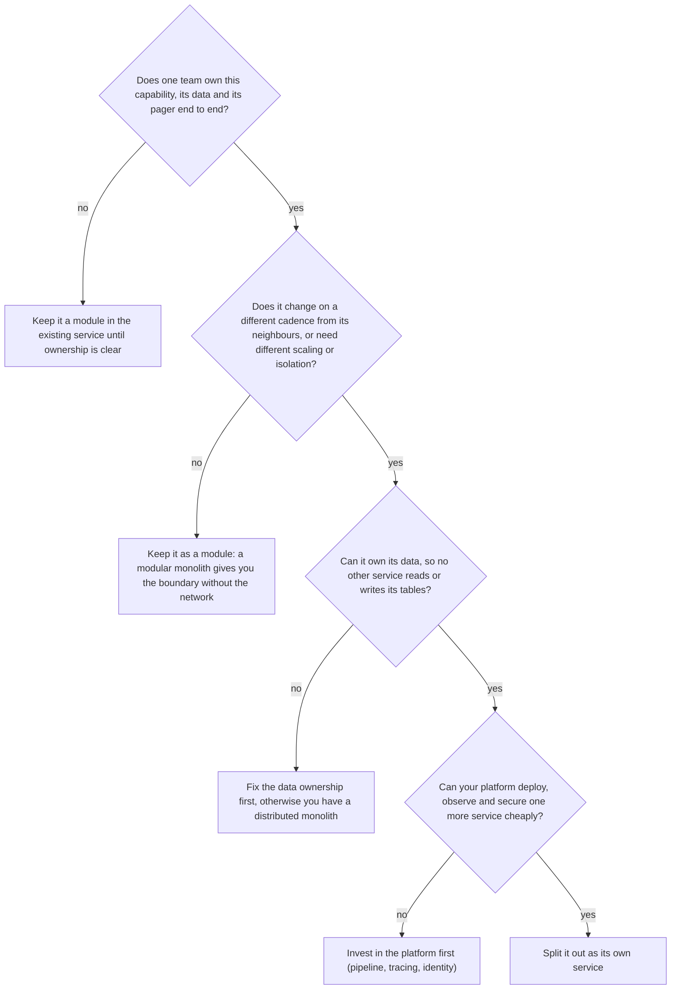
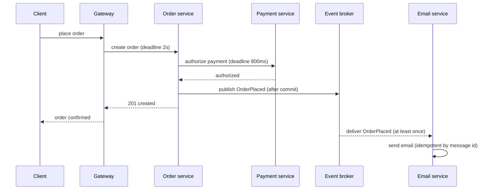
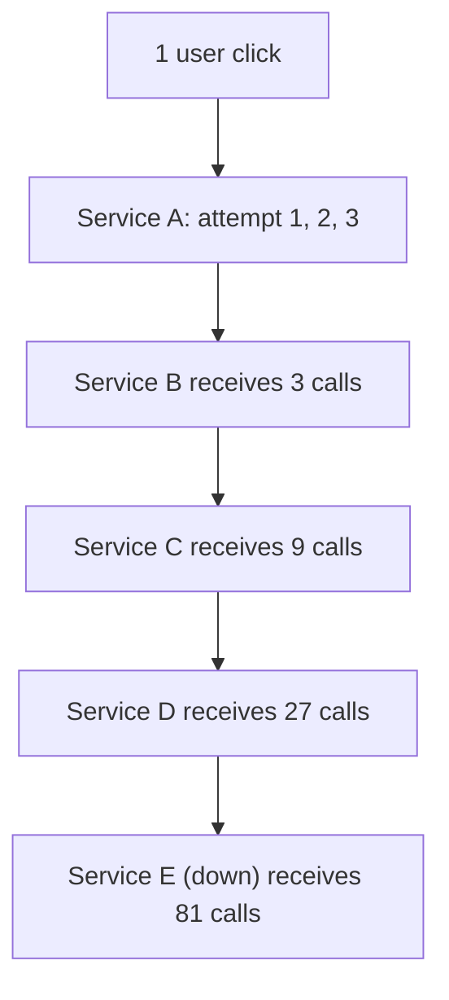
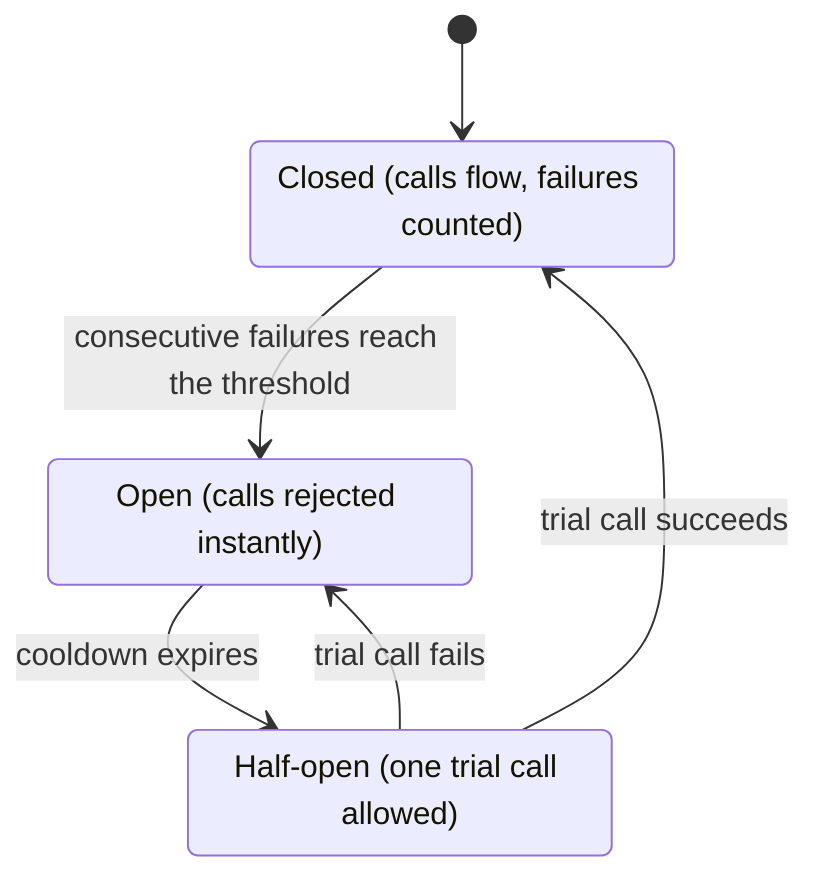
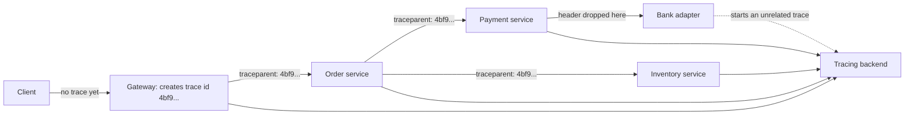

**Navigation**: [← Enterprise Architecture](28_Enterprise_Reference_Architecture.md) | [Index](00_INDEX.md) | Related: [18 Kubernetes](18_Kubernetes_Complete.md) · [21 Monitoring](21_Monitoring_Observability.md) · [10 Distributed patterns](../10_Enterprise_Systems/09_Distributed_Patterns.md)

# 🧩 Chapter 29: Microservices on the Platform — Boundaries, Calls, Failure and Ownership

_"Microservices do not remove complexity. They move it from inside a process, where the compiler and a debugger can see it, to between processes, where only the network and your discipline can."_

---

## 5W1H

- **WHAT**: How an application split into many independently deployed services actually *runs* on a platform: where the boundaries go, how services call each other, what happens when a call fails, how they prove who they are, how traffic enters, and who owns what.
- **WHY**: The split buys independent deployment and team autonomy, and it costs you a network between every pair of components. Most microservice outages are not bugs in a service; they are **failure behaviour at the seams** — retries that multiply load, calls with no timeout, a duplicate message processed twice. This chapter measures those effects instead of describing them.
- **WHO**: Backend, platform and SRE engineers, and the architect who must decide *whether* to split. Application-level patterns (saga, outbox, CQRS) live in [10 Enterprise Systems](../10_Enterprise_Systems/09_Distributed_Patterns.md); this chapter is the **platform half**.
- **WHEN**: When one team can no longer ship without coordinating with several others, when parts of the system need to scale or fail independently, or when you are inheriting a system that already has dozens of services. Not before a modular monolith has stopped working.
- **WHERE**: On Kubernetes or an equivalent runtime ([chapter 18](18_Kubernetes_Complete.md)), inside the accounts and networks of [chapter 28](28_Enterprise_Reference_Architecture.md), behind a gateway, observed by the stack in [chapter 21](21_Monitoring_Observability.md).
- **HOW**: Derive the boundaries from team and data ownership, compute what retries and timeouts do to load, run the three small simulations in the lab, then write the rules your platform enforces for every service.

> **Verified on** — The three simulations (retry amplification, circuit breaker, idempotent consumer) were run with Python 3 on WSL2 Ubuntu 24.04 (kernel 6.6.87) with a fixed random seed; the numbers printed are exactly what the shown code produces. The Kubernetes Ingress and Gateway API status statements were read from the Kubernetes Ingress documentation page and the Gateway API documentation site on 2026-11-15. Nothing here was run against a live Kubernetes cluster: Docker is not enabled in the lab environment, so cluster-level manifests are marked **not verified here**.

---

# PART 1: Should This Be a Separate Service at All?

## 1.1 Derive the benefits, then the bill

Start with one process that contains everything. Why would you ever cut it into pieces that talk over a network? Ask what a *process boundary* gives you that a *module boundary* does not:

| You gain | Because | Only if |
| --- | --- | --- |
| **Independent deployment** | One service ships without rebuilding or retesting the others | Its interface to the others is stable and versioned |
| **Independent scaling** | The hot path gets 40 replicas, the cold path gets 2 | The load profiles genuinely differ |
| **Independent failure** | A crash in recommendations does not take down checkout | Callers degrade gracefully instead of failing with it |
| **Team autonomy** | A team owns a service end to end, including its data and its pager | The boundary matches how the organisation is actually split |
| **Technology freedom** | A service can use the language or database that fits it | You accept the operational cost of every extra stack |

And the bill, which arrives immediately:

| You pay | What it means in practice |
| --- | --- |
| **A network between every pair** | Calls can be slow, lost, duplicated, reordered or half-completed — conditions that do not exist inside one process |
| **Partial failure** | Service A is up, service B is down; your code must decide what that means |
| **Distributed data** | There is no single transaction across services; consistency becomes a design problem |
| **Operational multiplication** | Every service needs a pipeline, dashboards, alerts, an on-call owner, a security review |
| **Debugging across processes** | A single user request now touches six logs; you need traces to follow it |

The rule that follows is the opposite of fashion: **split only when the benefit in the first table is real for this system, and you have the capability to pay the second table.** If you cannot yet run, observe and deploy *one* service well, you cannot run thirty.

## 1.2 Where to draw the line

Boundaries should follow two things in this order: **who owns the data** and **who changes together**. A boundary that cuts through a transaction, or through a pair of things that change in every release, will cost you a distributed transaction and a coordinated deploy forever.



**How to read this diagram.** Follow the questions from the top; each *no* sends you to a cheaper alternative, and only four *yes* answers in a row lead to a new service. The first question is about **people** (ownership), not technology, which is deliberate: services mirror the organisations that build them. The third question is the one teams skip: if two services share a database, they are not independent — they are one system with extra latency, usually called a **distributed monolith**. The thing to notice is that "modular monolith" appears twice as a respectable answer, not a failure.

## 1.3 The distributed monolith

The most common bad outcome has a recognisable signature. Check your system against it:

- You cannot deploy service A without deploying B and C in the same window.
- Services read each other's database tables directly.
- A change to a message format requires coordinated changes in five repositories.
- One slow dependency makes every service slow.

Each of these means the boundaries are in the wrong place or the interfaces are not versioned. Splitting further makes it worse. The remedy is the reverse: merge, or fix ownership and contracts, before adding services.

---

# PART 2: Calls Between Services

## 2.1 Synchronous or asynchronous

Every interaction is one of two shapes, and the choice decides how failures propagate:

| | **Synchronous request/response** (HTTP, gRPC) | **Asynchronous messages** (queue, log, events) |
| --- | --- | --- |
| Caller waits? | Yes, holding a thread/connection | No, hands off and continues |
| If the callee is down | The caller fails or must degrade now | Messages wait; the caller is unaffected |
| Coupling | Caller needs the callee up *at that moment* | Caller needs only the broker up |
| Consistency | Easy to reason about (one answer) | Eventual: you must design for "not yet" |
| Debugging | A call stack across services (use traces) | A trail of events (use correlation ids) |
| Choose it when | The caller needs the answer to proceed (price, authorisation) | The work can happen later (email, indexing, analytics) |

A checkout flow shows both: the *price lookup* and *payment authorisation* are synchronous because the user is waiting, while *confirmation email* and *inventory restock analytics* are asynchronous events.



**How to read this diagram.** The top half, from the client to the `201 created`, is the synchronous path the user waits on; each hop has a **deadline** that is smaller than the one above it, so the order service cannot spend more time than the gateway allows. The email is sent from the bottom half, *after* the user already has an answer: it travels through the broker and is delivered at least once, meaning it may arrive twice. The thing to notice is the two annotations that make this safe: the event is published **after the commit** (so no event announces an order that was never saved), and the consumer is **idempotent by message id** (so a duplicate delivery does no harm). Part 4 measures what happens without the second one.

## 2.2 Timeouts are a budget, not a setting

A call without a timeout is a promise to wait forever. A call with an *unrelated* timeout is nearly as bad. Derive the rule: the user will wait about 2 seconds, so every call in the chain below the gateway must finish inside what remains.

```text
client waits max            2000 ms
  gateway   deadline        2000 ms   (it enforces the budget)
    order    deadline        1800 ms  (leaves 200 ms for its own work)
      payment deadline        800 ms  (one attempt; no retry that cannot fit)
```

Pass the **remaining deadline** downward (most RPC frameworks do this) and make each callee stop work when the budget is spent. A callee that keeps working after its caller gave up burns capacity on answers nobody will read, which is how a slow dependency turns into an outage.

## 2.3 The gateway and the edge

Traffic from outside enters through one controlled door: a gateway that terminates TLS, authenticates the caller, applies rate limits and routes to services. On Kubernetes the routing layer has an official direction worth knowing. The Kubernetes documentation states that the **Ingress** API is *frozen*: it is stable since v1.19, is covered by the GA stability guarantees and will not be removed, but it receives no further development, and the project recommends **Gateway API** instead. Gateway API, an official Kubernetes project for layer-4 and layer-7 routing, defines **GatewayClass**, **Gateway** and **HTTPRoute** (Standard channel, considered stable) and is built around three roles: the infrastructure provider, the cluster operator and the application developer. In practice that means the platform team owns the Gateway, and each product team owns only the routes that attach to it.

| Concern | Put it at the gateway | Put it in the service |
| --- | --- | --- |
| TLS termination, certificates | ✅ one place to rotate | |
| Authenticating the *caller* (tokens, API keys) | ✅ verify once at the edge | Re-check authorisation for the *action* |
| Coarse rate limiting, request size limits | ✅ | Fine-grained quotas per tenant |
| Routing by path/host, canary weights | ✅ | |
| Business rules | ❌ never | ✅ |

The failure to avoid is a gateway that grows business logic: it becomes a single deploy that every team must coordinate on, which recreates the monolith at the edge.

---

# PART 3: Failure at the Seams — Measured

## 3.1 Retries: the helpful default that causes outages

A retry makes sense on its own: the network dropped a packet, ask again. Derive what happens when *every layer* does it. Suppose five services call each other in a chain and every layer retries a failed downstream call twice (three attempts in total). If the bottom service is completely down, how many requests reach it for **one** user click?

At layer 1 the top service tries 3 times. Each of those calls layer 2, which tries 3 times, and so on. The attempts **multiply**: 3 × 3 × 3 × 3 = 3⁴ = **81** requests at the bottom for a single click, at the exact moment the bottom service is least able to cope. This is called a *retry storm* and it is how a partial failure becomes a total one. Run the simulation to see it rather than trust the algebra:

```python
"""Retry amplification: how many calls reach the bottom service when each layer retries?"""
import random
random.seed(7)

def run(layers, retries, p_fail, requests=20000):
    """A chain of `layers` services; the last one fails with probability p_fail.
    Every layer retries a failed downstream call up to `retries` extra times."""
    bottom_calls = 0
    ok = 0
    def call(depth):
        nonlocal bottom_calls
        if depth == layers:                      # the bottom service
            bottom_calls += 1
            return random.random() >= p_fail
        for _ in range(retries + 1):             # this layer calls the next one, retrying
            if call(depth + 1):
                return True
        return False
    for _ in range(requests):
        ok += call(1)
    return ok / requests, bottom_calls / requests

print(f"{'layers':>6} {'retries':>7} {'bottom p_fail':>13} {'success':>8} {'calls hitting bottom per request':>34}")
for layers, retries, p in [(3,0,0.5),(3,2,0.5),(4,2,0.5),(5,2,0.5),(3,2,1.0),(5,2,1.0),(5,0,1.0)]:
    s, a = run(layers, retries, p)
    print(f"{layers:>6} {retries:>7} {p:>13.2f} {s:>8.1%} {a:>34.1f}")
print()
print("theory for a total outage (p_fail=1): (retries+1)^(layers-1) =", [(l, r, (r+1)**(l-1)) for l,r in [(3,2),(5,2)]])
```

Output, with the seed fixed:

```text
layers retries bottom p_fail  success    calls hitting bottom per request
     3       0          0.50    49.5%                                1.0
     3       2          0.50    99.8%                                2.0
     4       2          0.50   100.0%                                2.0
     5       2          0.50   100.0%                                2.0
     3       2          1.00     0.0%                                9.0
     5       2          1.00     0.0%                               81.0
     5       0          1.00     0.0%                                1.0

theory for a total outage (p_fail=1): (retries+1)^(layers-1) = [(3, 2, 9), (5, 2, 81)]
```

Read the rows as two different worlds. When the bottom service fails **half the time**, retries are a clear win: success rises from 49.5% to 99.8% and the extra load is modest (about 2 calls per request). When the bottom service is **down**, the same retries turn 1 call into 9 (three layers) or 81 (five layers), and the success rate is still 0%. Retries help with *transient* failure and hurt with *sustained* failure, and the calling code cannot tell the two apart. The measured values match the formula `(retries+1)^(layers−1)` exactly.



**How to read this diagram.** Each arrow is a layer that retries twice, so the number of calls it forwards is three times the number it received. Reading down the chain, the load grows 1, 3, 9, 27, 81 on the way to the service that is already failing. The thing to notice is that **no single layer is misconfigured**: each one is doing something reasonable, and the harm only exists in the product of all of them.

## 3.2 The rules that follow from the measurement

1. **Retry at one layer only**, normally the one closest to the user, and not in every service on the path.
2. **Cap retries with a budget** (for example, retries may add at most 10% extra load over a window), not a fixed count per call.
3. **Retry only what is safe to repeat**: reads and *idempotent* writes. A retried non-idempotent write is a duplicate charge (Part 4).
4. **Back off with jitter**: wait an increasing, randomised time between attempts so thousands of clients do not retry in lockstep.
5. **Stop calling a dead service**: a circuit breaker.

## 3.3 The circuit breaker

A circuit breaker watches calls to one dependency. After a run of failures it **opens**: further calls fail immediately without being sent, giving the dependency room to recover and giving your callers a fast, honest error instead of a slow one. After a cooldown it lets one **trial** call through; success closes it, failure re-opens it.



**How to read this diagram.** The breaker is always in one of three states. **Closed** is normal operation, where it counts failures. Enough failures in a row move it to **Open**, where it rejects calls without touching the dependency. The cooldown timer moves it to **Half-open**, where a single trial call decides the next state. The thing to notice is the loop at the bottom: a failing trial goes straight back to Open, so a dead dependency is probed rarely and politely instead of being hammered.

Now measure it. The same total outage as before, but only the top layer retries, and every layer has a breaker with a threshold of 5 consecutive failures and a cooldown of 200 requests:

```python
"""Same total outage as retry_amp.py (bottom always fails), but each layer has a circuit breaker
and only the TOP layer retries, with a retry budget."""
import random
random.seed(7)

class Breaker:
    def __init__(self, threshold=5, cooldown=200):
        self.threshold, self.cooldown = threshold, cooldown
        self.fails = 0; self.open_until = 0; self.t = 0
    def allow(self):  return self.t >= self.open_until
    def record(self, ok):
        if ok: self.fails = 0
        else:
            self.fails += 1
            if self.fails >= self.threshold: self.open_until = self.t + self.cooldown; self.fails = 0

def simulate(layers, retries_top, use_breaker, requests=20000, p_fail=1.0):
    bottom = 0; ok = 0; fast_fail = 0
    brk = [Breaker() for _ in range(layers)]
    def call(depth):
        nonlocal bottom, fast_fail
        if depth == layers:
            bottom += 1
            return random.random() >= p_fail
        b = brk[depth]
        if use_breaker and not b.allow():
            fast_fail += 1; return False          # rejected immediately, nothing sent downstream
        r = call(depth + 1)
        if use_breaker: b.record(r)
        return r
    for _ in range(requests):
        for b in brk: b.t += 1
        for _ in range(retries_top + 1):          # only the top layer retries
            if call(1): ok += 1; break
    return bottom / requests, fast_fail / requests

print(f"{'config':<44} {'bottom calls/request':>20} {'fast-fails/request':>19}")
for name, r, brk_on in [("5 layers, each retries 2x (see retry_amp)", None, None),
                        ("5 layers, only top retries 2x, no breaker", 2, False),
                        ("5 layers, only top retries 2x, breakers", 2, True)]:
    if r is None:
        print(f"{name:<44} {81.0:>20.1f} {'n/a':>19}"); continue
    b, f = simulate(5, r, brk_on)
    print(f"{name:<44} {b:>20.3f} {f:>19.2f}")
```

```text
config                                       bottom calls/request  fast-fails/request
5 layers, each retries 2x (see retry_amp)                    81.0                 n/a
5 layers, only top retries 2x, no breaker                   3.000                0.00
5 layers, only top retries 2x, breakers                     0.025                2.98
```

Three configurations, one outage. Retrying in every layer sent **81** calls to the dead service per click. Moving retries to the top only cut that to **3**. Adding breakers cut it to **0.025** — roughly one call in forty reaches the failing service — and the callers get a *fast* rejection (almost 3 per request) instead of a slow timeout. The code is a teaching model, not a production library: real breakers also use failure *rates* over a window and add jitter, and the numbers depend on the threshold and cooldown chosen. What carries over is the order of magnitude and the principle.

The application-level view of this pattern, with the library-level details, is in [10 Enterprise Systems](../10_Enterprise_Systems/09_Distributed_Patterns.md#circuit-breaker-pattern).

## 3.4 Bulkheads and load shedding

Two more defences, both about **not letting one problem use everything**:

- **Bulkhead**: give each dependency its own pool of threads or connections. When the slow dependency exhausts *its* pool, the rest of the service keeps working. Without it, one slow dependency can occupy every thread and the whole service looks down.
- **Load shedding**: when the service is overloaded, reject new work quickly (HTTP 503 with a hint to retry later) rather than accepting all of it and answering none of it in time. A fast refusal protects the requests already in flight.

---

# PART 4: Duplicates — At-Least-Once Is the Real Guarantee

## 4.1 Why exactly-once does not exist on the wire

A message broker delivers a message and waits for an acknowledgement. If the consumer finishes the work but the acknowledgement is lost, the broker cannot tell "never processed" from "processed, ack lost". The only safe move is to **deliver again**. This gives the guarantee nearly every system actually offers: **at least once**. Duplicates are not a rare bug; they are the contract.

The consequence falls on the consumer, which must make processing **idempotent**: handling the same message twice has the same effect as handling it once. The standard mechanism is an **idempotency key**: record the message id in the *same transaction* as the effect, and ignore ids you have already seen.

```python
"""At-least-once delivery means duplicates. Show a double charge, then fix it with an idempotency key."""
import sqlite3
db = sqlite3.connect(":memory:")
db.executescript("""
CREATE TABLE balance(account TEXT PRIMARY KEY, cents INTEGER);
CREATE TABLE processed(message_id TEXT PRIMARY KEY);
INSERT INTO balance VALUES ('alice', 10000);
""")
messages = [("m-1", "alice", -2500), ("m-2", "alice", -1000),
            ("m-1", "alice", -2500)]          # broker redelivers m-1 (the ack was lost)

def handle_naive(mid, acct, delta):
    db.execute("UPDATE balance SET cents = cents + ? WHERE account = ?", (delta, acct))

def handle_idempotent(mid, acct, delta):
    with db:                                   # one transaction: record the id AND apply the effect
        try:
            db.execute("INSERT INTO processed VALUES (?)", (mid,))
        except sqlite3.IntegrityError:
            return                             # already handled: do nothing
        db.execute("UPDATE balance SET cents = cents + ? WHERE account = ?", (delta, acct))

for name, fn in (("naive", handle_naive), ("idempotent", handle_idempotent)):
    db.execute("UPDATE balance SET cents = 10000"); db.execute("DELETE FROM processed")
    for m in messages: fn(*m)
    print(f"{name:<11} final balance: {db.execute('SELECT cents FROM balance').fetchone()[0]} cents (correct: 6500)")
```

```text
naive       final balance: 4000 cents (correct: 6500)
idempotent  final balance: 6500 cents (correct: 6500)
```

The naive handler charged 2,500 cents twice and ended 2,500 short. The idempotent handler recorded `m-1` in the `processed` table inside the same transaction as the balance update, so the redelivery hit a primary-key conflict and was ignored. The **same transaction** is the important part: if the id were stored separately from the effect, a crash between the two steps would again produce either a lost or a doubled update. HTTP clients get the same protection from an `Idempotency-Key` header on non-idempotent requests such as payments, which is why retrying a payment is safe only when the server honours the key.

The same reasoning produces the **outbox** pattern on the publishing side (write the event and the state change in one transaction, publish afterwards) and sagas for multi-service workflows; both are derived in [10 Enterprise Systems](../10_Enterprise_Systems/09_Distributed_Patterns.md) and are not repeated here.

---

# PART 5: Identity and Trust Between Services

## 5.1 Why the network is not a trust boundary

Early microservice setups trusted anything inside the private network: if you could reach the service, you were allowed. Derive the problem: one compromised service now has network reach to all others, and nothing says *which* service is calling. Two things are needed: **authentication between services** (prove who is calling) and **encryption in transit** (so a network observer sees nothing).

The common solution is **mutual TLS**: both sides present certificates and verify each other (the handshake is derived in [chapter 9](09_TLS_Encryption.md)). Giving every service a certificate and rotating it automatically is what a service mesh or a workload-identity system does for you ([chapter 3](03_ServiceMesh_CloudNative.md) covers meshes; the identity framework SPIFFE defines a standard name format for workload identities). Once each call carries a verified service identity, you can write authorisation rules in terms of services instead of IP addresses:

| Rule | Meaning |
| --- | --- |
| `payments` accepts calls only from `order` | A compromised `search` service cannot call payments, even though the network allows it |
| `order` may call `POST /charge`, not `POST /refund` | Least privilege per endpoint |
| Everything else denied by default | A new service starts with no access and is granted what it needs |

Kubernetes `NetworkPolicy` ([chapter 18](18_Kubernetes_Complete.md)) gives you the coarse layer-3/4 version of the same idea; identity-based rules add the layer-7 version. Whether the mesh or application code enforces them, the rule is the same: **authentication per call, authorisation per action, deny by default**.

## 5.2 User identity versus service identity

Two different questions travel with a request. **Which service is calling me?** (mTLS identity.) **On whose behalf?** (the end user's token, verified at the gateway and passed along). Never let a service act with its own broad identity when it should act with the user's: that is how one service's bug exposes all users' data. Pass the user's identity or a narrowed token downward, and have each service check what *this user* may do.

---

# PART 6: Seeing and Operating Many Services

## 6.1 One request, six logs: trace propagation

When a request crosses six services, no single log tells the story. The fix is a **trace**: the gateway generates a trace id, every service copies it into the headers of its outgoing calls and into every log line, and a tracing backend stitches the spans together. The standard is the W3C `traceparent` header and the OpenTelemetry libraries that implement it ([chapter 21](21_Monitoring_Observability.md) derives metrics, logs and traces). The platform rule: **propagating the trace context is mandatory in every service and checked in the pipeline**, because one service that drops the header makes every request through it untraceable.



**How to read this diagram.** The trace id is created once at the gateway and copied through every hop, so the backend on the right can show all the spans of one user request as a single tree. Follow the solid arrows from left to right and you see the id survive three hops. The thing to notice is the dotted line: the payment service forgot to forward the header, so the bank adapter's work appears as a **separate, unrelated trace**. From the operator's chair, the payment path now has a blind spot exactly where the money moves, which is why propagation is enforced centrally rather than left to each team.

## 6.2 What every service must provide

A platform lets teams ship fast by making the *boring requirements* uniform. A reasonable checklist, enforced by templates and pipeline checks rather than by reminders:

| Requirement | Why | Enforced by |
| --- | --- | --- |
| Health endpoints for liveness and readiness | The scheduler must know when to restart or stop routing | Deployment template ([chapter 18](18_Kubernetes_Complete.md)) |
| Structured logs with the trace id | Search and correlate across services | Shared logging library, log pipeline |
| The standard metrics (rate, errors, duration) | Every service gets the same dashboard and SLO ([chapter 22](22_SRE_Practices.md)) | Instrumentation library |
| Timeouts and a retry policy on every outbound call | Part 3 | Shared client library with safe defaults |
| A graceful shutdown on `SIGTERM` | Deploys must not drop requests ([I01](internals/I01_What_Really_Happens_When_You_Type_ls.md) explains signals and PID 1) | Base image and template |
| Resource requests and limits | One service must not starve its neighbours | Admission policy |
| A named owner and an on-call rotation | Someone is accountable at 3 a.m. | Service catalogue entry required to deploy |

## 6.3 Contracts and versions

Services deploy independently only if their **interfaces** are stable. Three habits make that true:

1. **Backwards-compatible changes first.** Add fields; do not rename or remove them until every consumer has moved. Consumers ignore fields they do not know.
2. **Consumer-driven contract tests.** Each consumer publishes the calls it depends on; the provider's pipeline fails if a change breaks one. This replaces a coordinated release with an automated check.
3. **An explicit deprecation window.** Old versions are removed on a published schedule, with metrics showing who still calls them.

---

# PART 7: Ownership — The Part That Is Not Technology

A service nobody owns is an incident waiting for a date. The pattern that works is **you build it, you run it**, with a platform team removing the undifferentiated work:

| Layer | Owned by | Owns |
| --- | --- | --- |
| **Product team** | The team that builds the service | The code, its data, its deploys, its SLO, its on-call |
| **Platform team** | A dedicated team | The cluster, the gateway, the pipeline templates, observability, the paved road |
| **Security and compliance** | A dedicated team | The guardrails ([chapter 28](28_Enterprise_Reference_Architecture.md)), policy, review of exceptions |

The structure of the software follows the structure of the organisation that builds it; a boundary that crosses a team boundary becomes a coordination cost on every change. Decide the team shape deliberately, because it will decide the service shape for you if you do not. How to create and run the platform team's product, a **paved road** that is easier than the alternative, is the subject of chapter 30 🔜.

---

# PART 8: Alternatives and When Not To

| Approach | When it is the better choice | Cost |
| --- | --- | --- |
| **Modular monolith** | One team or a few; the benefit of independence is not yet real; you want clear internal boundaries without a network | Scaling and deployment are coupled; discipline must keep modules from tangling |
| **Microservices** | Many teams that must ship independently; parts with very different scale or isolation needs | Everything in Parts 3–6, forever |
| **Serverless functions** | Spiky, event-driven work; you want to pay per use | Cold starts, limits, harder local testing, distributed state again |
| **Service-oriented with a few coarse services** | A middle path: three to ten services around real business domains | Less independence than fine-grained, far less overhead |

The honest guidance: **start with a modular monolith**, extract a service when a specific boundary has earned it (a team, a scaling need, an isolation need), and measure the cost you pay each time. Teams that start with fifty services usually spend a year building the platform that a monolith would not have needed.

---

# PART 9: How It Fails

| Symptom | Cause | How to prove it | Prevention |
| --- | --- | --- | --- |
| A small blip becomes a full outage | Retry storm: retries in every layer multiply load | Request rate at the bottom service is a large multiple of the rate at the edge | Retry at one layer, budget retries, circuit breakers |
| Threads are all busy, the service looks down, CPU is idle | A dependency is slow and there is no timeout or bulkhead | Thread dump shows threads waiting on one downstream call | Deadlines on every call, bulkheads per dependency |
| Customers are charged twice | Duplicate message or retried non-idempotent request | The same message id appears twice in the logs with two effects | Idempotency keys stored in the same transaction as the effect |
| One bad deploy takes down unrelated services | Shared database or hidden coupling (distributed monolith) | A schema change in one service breaks another | Data ownership per service, versioned contracts |
| Cannot find why a request failed | Trace context dropped by one service | The trace ends mid-path; a separate trace starts downstream | Mandatory propagation, checked in CI |
| A compromised service reaches everything | Flat network trust, no per-call authorisation | One service can call every other service's admin endpoint | mTLS, deny-by-default authorisation, network policy |
| Every release needs a meeting | Services are coupled by unversioned interfaces | A "small" field change forces five repositories to change | Backwards-compatible changes, contract tests |
| Nobody responds to the alert | No named owner | The alert routes to a team that does not exist | Owner and on-call required in the service catalogue |

---

# PART 10: Lab — Measure, Break, Fix

All labs run on a laptop with Python 3. Use `~/lab/ms` as the working directory.

1. **Retry amplification.** Save the first script as `retry_amp.py` and run it.
   - *Expected:* the table in §3.1; the `(5, 2, 1.00)` row shows **81.0** calls at the bottom.
   - *Check:* `python3 retry_amp.py | grep "5       2          1.00"` prints a line ending in `81.0`.
2. **Change one number.** Edit the scenarios to use `retries=1` with 6 layers and a total outage. Before running, **predict** the bottom-service load from the formula.
   - *Expected:* `(1+1)^(6−1) = 32`.
   - *Check:* the simulation prints `32.0`. If it does not, your prediction or your edit is wrong — find which.
3. **Add jitter-free budget.** Modify `run` so retries are allowed only when a global counter of retries is under 10% of requests so far. Observe the success rate at `p_fail = 0.5` and the bottom load at `p_fail = 1.0`.
   - *Expected:* during the total outage the bottom load falls to about `1.1` calls per request (instead of 81). At `p_fail = 0.5` the success rate falls to roughly 55% (instead of 99.8%), because a 10% budget cannot cover a 50% failure rate.
   - *Check:* print both numbers and explain, in two sentences, the trade you made: the budget protects the dependency from a storm, and it costs success during heavy *transient* failure. Then try 25% and find the budget you would defend.
4. **The breaker.** Save the second script as `breaker.py`, run it, then change the cooldown from 200 to 20 and the threshold from 5 to 2.
   - *Expected:* with the shorter cooldown the bottom service is probed more often, so `bottom calls/request` rises from `0.025` to about `0.100` (and fast-fails fall from 2.98 to about 2.90).
   - *Check:* `python3 breaker.py` before and after; the third row's first column must increase. Say which setting you would choose for a dependency that recovers in seconds and why.
5. **The duplicate.** Save the third script as `idempotent.py` and run it.
   - *Expected:* naive `4000`, idempotent `6500`.
   - *Check:* then deliberately move the `INSERT INTO processed` *outside* the `with db:` block, inject a crash (raise an exception) between the two statements, and show that the balance and the `processed` table can disagree. Write down what the second delivery would then do.
6. **(Needs a cluster — not verified here.)** On a Kubernetes cluster, deploy two trivial services, add a `NetworkPolicy` that denies all ingress to one except from the other, and prove the denial with a `curl` from a third pod. The manifest and kubectl steps follow [chapter 18](18_Kubernetes_Complete.md).
7. **Design assignment (paper).** Take a system you know. List its modules, mark which have a different owner, a different scale or a different change cadence, and run each through the §1.2 decision flow. Write one paragraph defending *not* splitting something.

---

# PART 11: Challenges

🔬 **Section Challenge — Should this be a service?**

**Challenge 1 (Reasoning):** A team proposes splitting the "orders" and "invoicing" modules into two services. They share one database and are always changed in the same release. What is wrong, and what would you do first?

<details><summary>Answer</summary>

They are not independent: a shared database means each can break the other through the schema, and changing in the same release means there is no deployment independence to gain. Splitting gives all the network costs (latency, partial failure, tracing) and none of the benefits — a distributed monolith. First, keep them as **modules in one service** with a clear interface between them. If a split is still wanted later, first give each module exclusive ownership of its own tables and communicate through an API or events, then re-run the §1.2 questions. The signal to split is a different owner or cadence, not a different folder name.

</details>

🔬 **Section Challenge — Retries and timeouts**

**Challenge 2 (Calculation):** Four services in a chain each retry a failed downstream call 3 extra times (4 attempts total). The last service is down. How many requests reach it per user click, and what two changes cut that by more than 90% without losing the benefit of retries on transient errors?

<details><summary>Answer</summary>

By the formula `(retries+1)^(layers−1)`: attempts per layer are 4, there are 3 downstream hops, so 4³ = **64** requests per click. Two changes: (1) **retry at one layer only** (the one nearest the user) — with 3 extra retries at the top only the bottom sees 4 calls, a 94% reduction; (2) add a **circuit breaker** (and a retry budget) so a sustained outage stops generating calls at all, which in the lab drove the load from 3 to about 0.025 per click. Transient errors are still retried at the top, which is where retries pay off.

</details>

**Challenge 3 (Debug):** Latency of the whole checkout is fine until the "recommendations" service gets slow, then checkout times out although recommendations is not on the critical path. CPU on checkout is low. What are two likely causes and what do you check?

<details><summary>Answer</summary>

Most likely: checkout calls recommendations **synchronously with no (or a long) timeout**, and a shared thread or connection pool means slow recommendation calls occupy every worker, leaving none for the real work — CPU is low because threads are *waiting*, not computing. Check: a thread dump (threads blocked on the recommendations call), the pool metrics, and the configured timeout. Fixes: a short **deadline** on the optional call with a graceful fallback (render without recommendations), a **bulkhead** giving that dependency its own small pool, and a breaker. The principle: an optional dependency must never be able to consume the capacity of a required one.

</details>

🔬 **Section Challenge — Duplicates and consistency**

**Challenge 4 (Design):** A payment consumer handles "charge customer" messages from a queue with at-least-once delivery. Explain precisely why checking "have I seen this id?" and then charging in two separate steps is still unsafe, and write the safe order of operations.

<details><summary>Answer</summary>

Two separate steps leave a gap. If the process crashes after charging but before recording the id, the redelivery will charge again; if it records the id first and crashes before charging, the charge is lost forever. Safe design: put "record id" and "apply effect" in **one local transaction** so they commit or roll back together; a duplicate then fails the primary-key insert and is skipped. If the effect is an external call (a card network) that cannot join your transaction, pass the **same idempotency key** to that system so it deduplicates on its side, and store the result by key so a retry returns the original outcome.

</details>

🔬 **Section Challenge — Identity and trust**

**Challenge 5 (Scenario):** A pentester compromised the low-privilege "search" service and then called the payments admin endpoint successfully. The network is private and every service uses TLS. What failed, and what is the minimum fix?

<details><summary>Answer</summary>

TLS gave encryption but not **authorisation**: the payments service accepted any caller that could reach it. The network being private is not a trust boundary once one service is compromised. Minimum fix: **mutual TLS with per-service identities** plus a deny-by-default authorisation rule, so payments accepts calls only from the services (and endpoints) that need it — `order` may call `POST /charge`; `search` may call nothing. Add a network policy as the coarse layer. Also check that payments authorises the *user's* action, not merely the calling service's identity, so a compromised caller cannot act for arbitrary users.

</details>

---

# Reality Check

**"Microservices make the system more reliable."** They make it *independently failing*, which is only more reliable if callers degrade gracefully. Without timeouts, breakers and fallbacks, more network hops mean more ways to fail.

**"Retries make calls reliable."** Retries make *transient* failures invisible and *sustained* failures catastrophic. The measured 81-fold load is the cost of retrying in every layer.

**"Exactly-once delivery solves duplicates."** On a real network, the practical guarantee is at-least-once plus an idempotent consumer. Systems that advertise exactly-once achieve it with the same two ingredients, inside their own boundary.

**"A private network is a secure network."** Once any one workload is compromised, the private network is the attacker's network. Authenticate every call and deny by default.

**"A service per function is good design."** A boundary should follow ownership, data and rate of change. Splitting by technical layer or by function produces chatty services that must always deploy together.

**"We can split later if the monolith gets slow."** You can — and it is cheapest if the monolith is *modular*, with clean interfaces and separate data per module. Splitting a tangled one is the expensive path.

**"Service mesh removes the need to think about failure."** A mesh can enforce mTLS and apply uniform timeouts and retries, which helps, but it can also *multiply* retries if the application retries too. The budget still has to be designed.

---

# Books

Chapter numbers are those verified in [BOOKS.md](BOOKS.md) or on the vendor page named.

| Source | Read | What it adds beyond this chapter |
| --- | --- | --- |
| *Site Reliability Engineering*, Google (FREE) — https://sre.google/sre-book/table-of-contents/ | Ch 21 "Handling Overload", Ch 22 "Addressing Cascading Failures" | The load-shedding and cascading-failure analysis behind Part 3, from the operator's side |
| *The Site Reliability Workbook*, Google (FREE) — https://sre.google/workbook/table-of-contents/ | Ch 11 "Managing Load" | Capacity and load management as a design discipline |
| *Release It!* 2nd ed., Nygard (PAID) | The parts on stability patterns and "Design for Production" (chapter numbers not verified) | The origin of the circuit-breaker and bulkhead vocabulary used in Part 3 |
| *Designing Data-Intensive Applications*, Kleppmann (PAID) | Chapters on replication and on messaging and stream processing (chapter numbers not verified) | The trade-offs behind at-least-once delivery and consistency |
| *Building Secure & Reliable Systems* (FREE, https://sre.google/books/) | Ch 5 "Design for Least Privilege" | The access-design principle behind per-call, deny-by-default authorisation |
| Kubernetes documentation: Ingress, Gateway API (FREE) — https://kubernetes.io/docs/concepts/services-networking/ingress/ and https://gateway-api.sigs.k8s.io/docs/ | The Ingress status note; the Gateway API overview | The current direction of edge routing described in §2.3 |

Chapter numbers for the SRE book follow the table of contents recorded in `BOOKS.md`; match by title if your edition differs.

---

## 🔗 Cross-References

- [10 Enterprise Systems: Distributed Patterns](../10_Enterprise_Systems/09_Distributed_Patterns.md) — saga, outbox, CQRS and the library-level circuit breaker
- [18 Kubernetes](18_Kubernetes_Complete.md) — deployments, probes, NetworkPolicy, the objects these rules map to
- [21 Monitoring and Observability](21_Monitoring_Observability.md) — traces, metrics and SLOs for the checklist in §6.2
- [09 TLS](09_TLS_Encryption.md) — the mutual-TLS handshake behind Part 5
- [03 Service Mesh](03_ServiceMesh_CloudNative.md) — the platform component that automates mTLS and uniform retry policy
- [28 Enterprise Reference Architecture](28_Enterprise_Reference_Architecture.md) — the accounts and networks these services run in
- [SENIOR_READINESS](SENIOR_READINESS.md) — capstone C2 (the microservices platform) uses these rules
