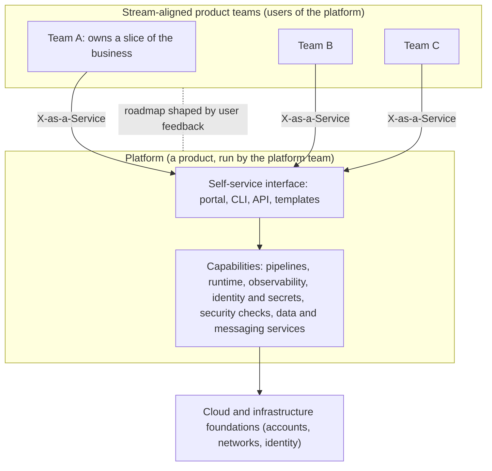
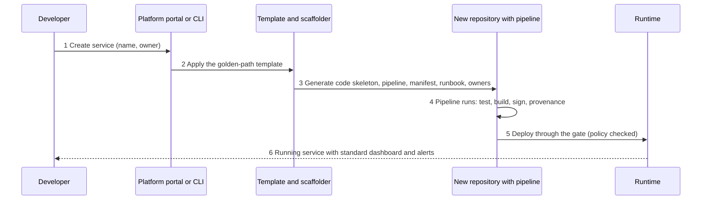
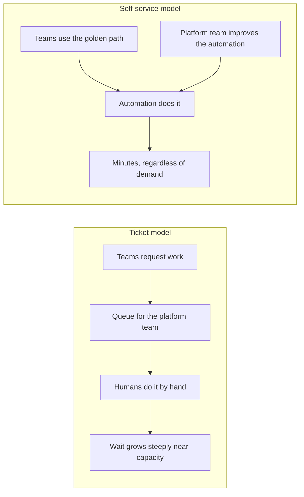
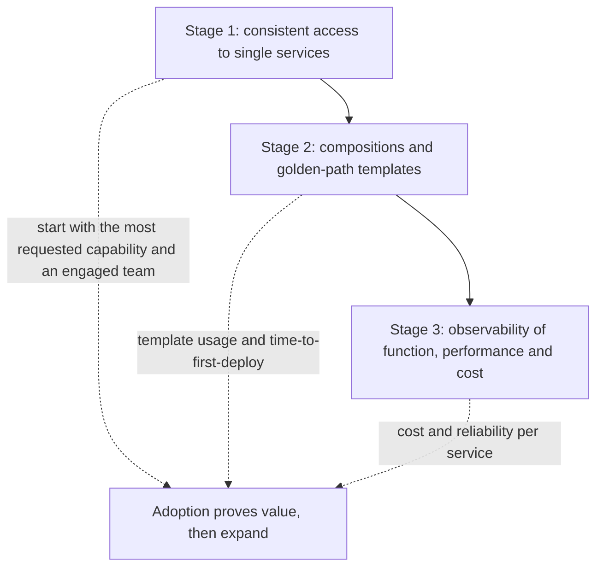

**Navigation**: [← Microservices](29_Microservices_On_The_Platform.md) | [Index](00_INDEX.md) | [Learning path, Stage 9](00_INDEX.md#-learning-path--first-principles-to-advanced) | Related: [31 DevSecOps](31_DevSecOps_Supply_Chain_And_Policy.md) · [28 Enterprise architecture](28_Enterprise_Reference_Architecture.md) · [35 Organisation](35_Organisation_And_Operating_Model.md)

# 🏗️ Chapter 30: Platform Engineering — Building the Paved Road

_"If every team must become an expert in networks, clusters, pipelines, identity and compliance just to ship a feature, you have not built a platform. You have built a hobby for the entire company."_

---

## 5W1H

- **WHAT**: Platform engineering is the discipline of building an **internal platform** — a set of self-service capabilities (environments, pipelines, runtime, observability, identity, secrets, security checks) that product teams consume — and running it **as a product**, with users, a roadmap and measured adoption.
- **WHY**: Without one, each team re-solves the same infrastructure problems differently, and the cost is paid in cognitive load, inconsistency and security gaps. With a ticket-based "DevOps team" instead, the queue becomes the bottleneck (Part 3 computes how fast).
- **WHO**: Platform and SRE teams who build it; product teams who use it; and the architect who decides what belongs in it. At senior level you are expected to know when *not* to build a platform.
- **WHEN**: When several teams repeat the same infrastructure work, when onboarding a service takes weeks, or when security and reliability standards are applied unevenly. Not for a handful of engineers with one product.
- **WHERE**: Between the cloud and the product teams: it sits on the foundations of [chapter 28](28_Enterprise_Reference_Architecture.md), packages the controls of [chapter 31](31_DevSecOps_Supply_Chain_And_Policy.md) and the rules of [chapter 29](29_Microservices_On_The_Platform.md), and is observed by [chapter 21](21_Monitoring_Observability.md).
- **HOW**: Derive the platform from the cognitive-load problem, define its interface as *golden paths*, treat adoption as the success metric, prove "secure and compliant by construction" with a generated service, and measure what the platform saves.

> **Verified on** — The golden-path generator, its policy check and the ticket-queue model were run with Python 3 on WSL2 Ubuntu 24.04 (kernel 6.6.87); the outputs shown are exactly what the code printed. The four team types, three interaction modes and the cognitive-load definition were read from the Team Topologies key-concepts page; the platform definition, success attributes, capability domains and maturity guidance from the CNCF *Platforms* white paper; both on 2026-11-15. Specific developer-portal products and their features were **not evaluated here**.

---

# PART 1: The Problem — Cognitive Load

## 1.1 Derive it

A product team is asked to ship a service. List what they must now know, beyond their own domain:

| Concern | What a team must know without a platform |
| --- | --- |
| Build and test | How to write and maintain a pipeline |
| Packaging | How to build a small, non-root, patched image |
| Deployment | Manifests, rollout strategy, probes, resource limits ([chapter 18](18_Kubernetes_Complete.md)) |
| Identity and secrets | Roles, certificates, how to obtain credentials safely ([chapter 25](25_Secrets_And_PKI.md)) |
| Networking | Ingress, service-to-service rules, DNS |
| Observability | Metrics, logs, traces, dashboards, alerts ([chapter 21](21_Monitoring_Observability.md)) |
| Security and compliance | Scanning, signing, policy ([chapter 31](31_DevSecOps_Supply_Chain_And_Policy.md)) |
| Cost and operations | Budgets, tagging, on-call, runbooks ([chapter 33](33_FinOps_And_Cost_Architecture.md)) |

Each is learnable. Together they are a second full-time job, and every team doing them differently multiplies the maintenance and the risk. The Team Topologies framework names the constraint: **team cognitive load**, the mental capacity a team has to handle complexity, with the observation that overloaded teams make poorer decisions and slow down, often because leaders keep adding responsibilities without removing any.

The structural answer follows: **remove the load that is not the team's differentiator and put it behind a stable interface that someone else owns.** That is a platform. Team Topologies describes four team types — *stream-aligned* (owns end-to-end delivery for a slice of the business), *enabling* (temporarily helps others close skill gaps), *complicated-subsystem* (owns components needing deep specialist knowledge) and *platform* (provides internal services that speed up stream-aligned teams) — and three interaction modes — *collaboration* (work closely for a period to explore something new), *X-as-a-Service* (one team provides, another consumes) and *facilitation* (one team mentors another). A healthy platform is consumed in the **X-as-a-Service** mode: product teams use it without needing to talk to its builders for routine work.

## 1.2 What the CNCF says a platform is

The CNCF *Platforms* white paper defines a platform for cloud-native computing as "an integrated collection of capabilities defined and presented according to the needs of the platform's users", an internal, cross-cutting layer that gives consistent ways to acquire and use shared services. Three points from it deserve emphasis because they correct common mistakes:

- The platform team should often **rely on external providers** rather than build every capability.
- The platform should be **the thinnest reasonable layer** that meets requirements.
- **Adoption should not rely on top-down mandates**; treat the platform as a product developed with its users.



**How to read this diagram.** The product teams at the top consume the platform through one self-service interface (the arrows labelled X-as-a-Service); they do not file tickets or learn the layers below. The interface sits on a set of capabilities, which in turn sit on the cloud foundations from [chapter 28](28_Enterprise_Reference_Architecture.md). The dotted line is the one to notice: the platform's roadmap is shaped *by its users*, which is what makes it a product rather than an infrastructure team that happens to publish tools.

---

# PART 2: The Golden Path

## 2.1 The interface of a platform is a path, not a menu

A platform that exposes every possible option has only moved the cognitive load. The CNCF paper lists documentation and onboarding such as "golden path" workflows among the attributes of a successful platform. A **golden path** is the opinionated, supported, *easiest* way to do a common thing — create a service, deploy it, get an alert — with sensible defaults chosen for you, and a documented way to step off it when you have a reason. The test of a golden path is that **taking it is easier than not taking it**; if teams must be forced onto it, it is the wrong path.

## 2.2 Compliant by construction

Because the platform chooses the defaults, it can make the secure, reliable choice *the default* instead of a rule to remember. Here is that idea in forty lines: one command generates a deployable service from a template. The developer makes two decisions (name and owner); the platform makes the rest.

```python
"""A golden path in 40 lines: one command makes a service that is deployable AND compliant by construction."""
import os, sys, json
def scaffold(name, owner, port=8080, root="out"):
    d = os.path.join(root, name); os.makedirs(d, exist_ok=True)
    files = {
     "Dockerfile": f"FROM registry.corp.example/base/python:3.12-slim\nUSER 10001\nCOPY app.py /app/app.py\nEXPOSE {port}\nCMD [\"python\", \"/app/app.py\"]\n",
     "app.py": f"print('{name} starting')  # health on /healthz and /readyz is added by the platform library\n",
     "pipeline.yml": "stages: [test, build, sign, deploy]\nsecurity: {scan: true, sign: true, provenance: true}\n",
     "deploy.json": json.dumps({"name": name, "labels": {"owner": owner}, "containers": [{
         "image": f"registry.corp.example/{name}:0.1.0",
         "securityContext": {"runAsNonRoot": True, "readOnlyRootFilesystem": True},
         "resources": {"limits": {"memory": "256Mi", "cpu": "500m"}, "requests": {"memory": "128Mi", "cpu": "100m"}}}]}, indent=1),
     "OWNERS": f"{owner}\n",
     "runbook.md": f"# {name} runbook\n- dashboard: standard\n- on-call: {owner}\n",
    }
    for f, c in files.items(): open(os.path.join(d, f), "w").write(c)
    return sorted(files)
print("generated:", scaffold(sys.argv[1], sys.argv[2]))
```

```text
$ python3 scaffold.py orders team-orders
generated: ['Dockerfile', 'OWNERS', 'app.py', 'deploy.json', 'pipeline.yml', 'runbook.md']
```

Six files appear: a base image from the approved registry, a non-root user, memory and CPU limits, a pipeline with scan, sign and provenance stages, an owner file and a runbook. Now run the admission rules from [chapter 31](31_DevSecOps_Supply_Chain_And_Policy.md) against the generated deployment, then weaken one setting as a developer might in a hurry:

```text
policy verdict on the generated service: ('ADMIT', [])
after a developer weakens it:            ('DENY ', ['runs-as-non-root'])
```

The generated service passes every rule without the developer reading the rules, and the one deliberate weakening is caught with a named reason. That is the whole mechanism of "secure by default" (one of the CNCF paper's attributes): **the platform's defaults and the organisation's policy are the same artifact seen from two sides**, so following the easy path *is* complying. The generator is a teaching model; real platforms do this with templates in a developer portal, repository scaffolders or infrastructure modules, but the value is the same.



**How to read this diagram.** Read the six numbered steps in order: a developer supplies only a name and an owner (step 1), and the platform does the rest — generates the project, runs the pipeline, passes the policy gate and delivers a running service with observability already attached (steps 2–6). The thing to notice is how little the developer *did*: every other decision was made once, by the platform team, and is inherited by every service created this way. The metric that follows is **time from "I need a service" to "it serves traffic"**, which a platform should drive from weeks to hours.

---

# PART 3: Why Tickets Do Not Scale

## 3.1 The alternative: a team that does it for you

Many organisations start with a "DevOps team" that provisions environments on request. That works until demand approaches the team's capacity, and then it fails in a way that can be computed. Model the team as a queue: it completes 20 requests per week, and new-service requests arrive at some rate. For a simple single-server queue the mean time a request spends in the system is `1 / (service rate − arrival rate)`:

```python
service_rate = 20          # tickets the team can complete per week
for demand in (5, 10, 15, 18, 19, 19.8):
    util = demand / service_rate
    w_weeks = 1 / (service_rate - demand)
    print(f"{demand:>26} {util:>11.0%} {w_weeks*5:>20.1f} days")
```

```text
 new-service requests/week utilisation   mean wait for a ticket  self-service wait
                         5         25%                  0.3 days           ~minutes
                        10         50%                  0.5 days           ~minutes
                        15         75%                  1.0 days           ~minutes
                        18         90%                  2.5 days           ~minutes
                        19         95%                  5.0 days           ~minutes
                      19.8         99%                 25.0 days           ~minutes
```

(The "days" figures convert weeks to five-day working weeks.) At 50% utilisation a request waits half a day; at 90% two and a half days; at 99% **25 working days** — and the demand rose by less than a factor of four across the table. This is the same utilisation-versus-latency curve that governs every queue ([chapter 27](00_INDEX.md) 🔜 derives it for capacity): waiting time is gentle until utilisation is high and then explodes. Hiring more people shifts the curve but does not remove the shape. **Self-service removes the queue**, because the platform does the work in minutes without a human in the loop, and the platform team's capacity is spent improving the platform instead of servicing requests.



**How to read this diagram.** The top row is the ticket model: every request passes through a human queue, so the wait grows steeply as demand nears the team's capacity (the table above). The bottom row removes the queue: teams call automation directly, and the platform team stands *beside* the automation improving it rather than *in front of* it taking requests. The thing to notice is where the platform team sits — not in the request path.

## 3.2 Exceptions still exist

Self-service covers the common path; unusual needs will still arrive. Keep a **facilitation** route (the platform team helps a team with a unique need for a bounded time, in the Team Topologies sense) and watch the pattern: a need that arrives repeatedly should become a new golden-path capability.

---

# PART 4: What Goes In — Capabilities and Maturity

The CNCF paper lists capability domains a platform may offer: web portals for observing and provisioning; APIs and command-line tools for automatic provisioning; golden-path templates and documentation; automation for building and testing; automation for delivering and verifying; development environments; observability; infrastructure services; data services; messaging and event services; identity and secret services; security services; and artifact storage.

You do **not** build all of them at once. The paper describes a maturity path: platforms **start by offering consistent access to individual services**, then **add compositions** (for example templates for web development or for machine-learning operations), and finally offer **observability of functionality, performance and cost** for the services deployed. Use that as a build order:

| Stage | What you deliver | Typical first targets | Success looks like |
| --- | --- | --- | --- |
| **1. Consistent access** | A reliable, documented way to get each basic service | A project/account per team ([chapter 28](28_Enterprise_Reference_Architecture.md)), a standard pipeline, a cluster namespace, a secret store | Teams stop asking for the same thing in different ways |
| **2. Compositions** | Templates that wire several services together | "A web service with database and dashboard", "A scheduled job" | New service live in hours; defaults compliant ([Part 2](#part-2-the-golden-path)) |
| **3. Insight** | Cost, reliability and security visible per service | Per-service dashboards, unit cost ([chapter 33](33_FinOps_And_Cost_Architecture.md)), SLO status ([chapter 22](22_SRE_Practices.md)) | Teams see the effect of their own choices |



**How to read this diagram.** The solid line is the build order: single services first, then compositions, then insight. The dotted lines are the part that matters: at **every** stage the evidence that the work was worthwhile is *adoption* — teams choosing to use it. The CNCF paper advises starting with frequently needed capabilities and engaged application teams, not with a mandate. The thing to notice is that the loop never closes on "we shipped it"; it closes on "they use it".

---

# PART 5: Build, Buy, or Don't — and the Thinnest Viable Platform

## 5.1 Decision rules

| Question | If yes | If no |
| --- | --- | --- |
| Is the capability a differentiator for the business? | Build it, in the platform if several teams need it | Buy it or use a managed service |
| Is a mature product or managed service available that meets 80% of the need? | Adopt it and wrap it with your golden-path interface | Build the thin layer you need |
| Will teams actually use it voluntarily, and can you name the first three? | Proceed with those three | Do not build a platform yet |
| Can you staff it as a product (a roadmap, support, documentation, a user feedback loop)? | Proceed | A neglected internal tool is worse than none |

The CNCF paper's advice that the platform be **the thinnest reasonable layer** is the constraint to design against: every capability you build is something you must run, document, secure and upgrade forever. Prefer composing existing products behind one interface to writing your own.

## 5.2 The ways platforms fail

| Anti-pattern | What it looks like | Why it fails |
| --- | --- | --- |
| **The ticket factory** | A "platform team" that provisions on request | The queue computed in Part 3; the team never gets time to build |
| **The mandated platform** | Teams forced onto it by decree | Resentment, workarounds, and no feedback on whether it is good |
| **"Kubernetes is the platform"** | Giving teams a cluster and calling it done | The cognitive load is still entirely on the product teams |
| **The everything platform** | Every capability for every use case | Never finished; each capability is poor; the team drowns in maintenance |
| **No product thinking** | No roadmap, no users interviewed, no usage metrics | The platform solves problems nobody has |
| **No escape hatch** | Impossible to step off the golden path | Teams with a legitimate special need are blocked and route around the platform entirely |

---

# PART 6: Measuring a Platform

A platform is a product, so measure it like one — by **outcomes for its users**, not by features shipped.

| Metric | What it tells you | Warning sign |
| --- | --- | --- |
| **Time to first deploy** for a new service | How much cognitive load was removed | Rising, or measured in weeks |
| **Adoption**: share of services created via the golden path; share of teams using each capability | Whether the platform is actually the easy path | High mandate-driven numbers with low satisfaction |
| **Platform user satisfaction** (short recurring survey) | Whether the product is good | Declining scores; teams building their own |
| **Lead time and failure rate of teams on the platform** (DORA's delivery metrics: change lead time, deployment frequency, failed deployment recovery time, change fail rate, deployment rework rate) | Whether it improves delivery | No difference between platform and non-platform teams |
| **Compliance by construction**: share of services passing policy with no exception | Whether defaults are doing the security work | Many exceptions: the defaults are wrong or missing |
| **Cost to run the platform** per supported service | Whether it scales economically | Linear growth in platform headcount with service count |

Report these to leadership in terms of **value streams** (the CNCF paper's advice is to show the platform's impact there), and pair them with the platform's own reliability: a platform is a tier-zero service, with SLOs of its own ([chapter 22](22_SRE_Practices.md)).

---

# PART 7: Alternatives and When Not To

| Situation | Better approach | Why |
| --- | --- | --- |
| One team, one or two services | Shared scripts and good documentation | A platform has a fixed cost that one team cannot amortise |
| A few teams with different technology stacks | A small set of shared *libraries and templates*, not a portal | The platform's thin layer is the shared defaults, not a product organisation |
| Strict, unique per-team needs | Enabling-team support and opt-in modules | A rigid golden path would be worse than nothing |
| Early-stage company moving fast | Use a managed application platform from a cloud provider as your platform | Spend engineering on the product, not on infrastructure plumbing |
| A large organisation with dozens of teams | A dedicated platform team run as a product | The load removed multiplies by the number of teams |

---

# PART 8: How It Fails

| Symptom | Cause | How to prove it | Prevention |
| --- | --- | --- | --- |
| Teams build their own pipelines despite the platform | The golden path is harder than doing it yourself | Few services created via the template; survey comments | Make the path easier; interview users; fix the top friction |
| Platform team permanently overloaded | Acting as a ticket queue | Rising ticket wait; the utilisation table | Self-service; move work from tickets into automation |
| An outage in the platform stops all deploys | A single shared platform with no resilience | The pipeline or portal is down and every team is blocked | SLOs and redundancy for the platform; a documented bypass for emergencies |
| A platform change breaks many services | No versioning or compatibility promise | A template or library update causes a wave of failures | Versioned templates, staged rollout, deprecation windows ([chapter 29](29_Microservices_On_The_Platform.md)) |
| Compliance exceptions accumulate | Defaults do not match actual needs | Exceptions list grows | Treat each exception as product feedback and update the default |
| The platform never ships a second capability | Scope is "everything" | Roadmap items stay in progress for quarters | Thinnest viable platform; ship by adoption |
| Leadership cuts the team | Value not shown | Metrics unreported or unrelated to business outcomes | Report outcomes by value stream |

---

# PART 9: Lab — Build a Golden Path and Measure It

Work in `~/lab/platform` with Python 3. The optional step needs the shared admission model from [chapter 31](31_DevSecOps_Supply_Chain_And_Policy.md) (`admit.py`).

1. **Generate a service.** Save the scaffold script from §2.2 as `scaffold.py` and run `python3 scaffold.py orders team-orders`.
   - *Expected:* six files in `out/orders/`.
   - *Check:* `ls out/orders` lists `Dockerfile OWNERS app.py deploy.json pipeline.yml runbook.md`.
2. **Prove it is compliant.** Copy `admit.py` from the DevSecOps lab and run its `admit` function on `out/orders/deploy.json`.
   - *Expected:* `('ADMIT', [])`.
   - *Check:* then set `runAsNonRoot` to `false` and confirm `('DENY ', ['runs-as-non-root'])`.
3. **Add a capability.** Extend the template so every generated service also carries a `SLO.md` with an availability target and an alert owner, and a `cost.json` with a `team` tag and a monthly budget.
   - *Expected:* eight files, with the owner and team values filled in from the single `owner` argument.
   - *Check:* write one sentence on which future decision (budget alert, on-call routing) the new file removes from the team.
4. **The queue.** Save the ticket model from §3.1 as `tickets.py` and run it. Then change `service_rate` to 40 (doubling the team) and rerun.
   - *Expected:* at 19 requests per week the wait falls from 5.0 days to about 0.24 days (`1/(40−19)` weeks × 5).
   - *Check:* explain in two sentences why doubling the team helped at 19 requests per week but would not help if demand also doubled to 38.
5. **Define a path.** Choose one common task in your organisation (create a database, expose a service, add an alert). Write the golden path as numbered steps from the user's view, the defaults the platform chooses, and the documented way to step off it.
   - *Check:* a new engineer could follow it without asking anyone.
6. **Metrics assignment (paper).** Define time to first deploy for your organisation precisely (start event, end event), how you would measure it automatically, and the target. List three signals that the platform is being avoided rather than used.
7. **Build/buy assignment (paper).** For each of: a CI service, a secret store, a service catalogue, a log pipeline, a deployment template — decide build, buy or adopt-and-wrap using the §5.1 questions, in one sentence each.

---

# PART 10: Challenges

🔬 **Section Challenge — Why a platform**

**Challenge 1 (Reasoning):** A company with 6 product teams and one "DevOps team" of 4 people has deployments that wait days for environments. Management proposes hiring 4 more DevOps engineers. What do you recommend and why?

<details><summary>Answer</summary>

Hiring shifts the curve but keeps the **queue**: the DevOps team is a human service queue, and waiting time explodes as utilisation nears capacity (at 90% utilisation a request waited 2.5 working days and at 99% 25 days in the model). Doubling the team helps temporarily, then demand grows into it. Recommend **converting the top repeated requests into self-service** (an environment-creation template, a standard pipeline) so most requests never reach a human, and using the team's time to build and improve that automation, keeping a facilitation route for genuinely unusual needs. Measure time to first deploy and ticket wait before and after.

</details>

**Challenge 2 (Design):** Using the Team Topologies interaction modes, say which mode a mature platform should use with product teams for routine work, which for a new capability, and what the platform team does when the same special request arrives five times.

<details><summary>Answer</summary>

Routine work: **X-as-a-Service** — product teams consume the platform without talking to its builders. A new capability: **collaboration** for a bounded period, working closely with an engaged team to explore what is needed. Special requests: initially **facilitation** (helping the requesting team); when the same request arrives repeatedly, that is product feedback — turn it into a new golden-path capability so it moves to X-as-a-Service. The pattern keeps the platform responsive without becoming a ticket queue.

</details>

🔬 **Section Challenge — Golden paths and defaults**

**Challenge 3 (Debug):** The platform team published a golden path with strict defaults, but only 20% of new services use it and teams complain it is "in the way". What do you investigate and what do you change?

<details><summary>Answer</summary>

A golden path must be **easier than the alternative**; low adoption says it is not. Investigate: interview teams that avoided it, time how long the golden path takes compared with their own approach, and list the specific friction (a required field, slow pipeline, missing option they need). Change the path to remove the top friction, add a documented *escape hatch* for legitimate special needs, and treat each exception as product feedback. Do **not** respond with a mandate: the CNCF guidance warns against relying on top-down mandates, and forced adoption hides the signal about whether the platform is good.

</details>

**Challenge 4 (Reasoning):** Explain "compliant by construction" using the lab: which artifact did the developer write, which did the platform write, and why did the policy check pass without the developer reading the rules?

<details><summary>Answer</summary>

The developer supplied two inputs (name, owner). The platform's template wrote the Dockerfile, non-root user, resource limits, pipeline stages with scan/sign/provenance, owner file and runbook, using defaults that were chosen to satisfy the organisation's policy. The policy check passed because **the template's defaults and the policy rules express the same requirements**, so any service created from it satisfies them without the developer reading the rules. When the developer weakened one setting (`runAsNonRoot` false) the admission rule caught it and named it. The security work moved from every developer's memory into one maintained template.

</details>

🔬 **Section Challenge — Scope and value**

**Challenge 5 (Trade-off):** The platform team proposes building their own CI system, secret store, log pipeline and service catalogue because "we can make them better". Using the CNCF guidance and the build/buy questions, respond.

<details><summary>Answer</summary>

The CNCF paper advises that the platform team should often **rely on external providers** and that the platform should be **the thinnest reasonable layer**. A CI system, secret store and log pipeline are rarely differentiators; mature products exist, and each one built is something to run, secure, document and upgrade forever. Recommend **adopting and wrapping**: one golden-path interface in front of existing products, building only the thin integration layer. Build something yourself only where it is a real differentiator, no product meets most of the need, and you can staff it as a product. Re-evaluate with adoption data, not preference.

</details>

**Challenge 6 (Calculation):** The platform team handles 20 requests per week. Demand is 16 per week and growing 10% per month. When does the ticket model fail badly, and what does the model suggest about hiring versus automating?

<details><summary>Answer</summary>

Demand 16 → 17.6 after one month → 19.4 after two → 21.3 after three. Utilisation passes 100% in about **three months**; before that the mean wait is `1/(20−λ)` weeks: 0.25 weeks (about 1.3 working days) at 16, 0.42 weeks (2.1 days) at 17.6 and about 1.7 weeks (8.3 days) at 19.4 — and unbounded beyond 20. Hiring raises the capacity ceiling but the growth continues (10% per month doubles demand in about 7 months), so it only delays the same cliff. Automating the common requests reduces the arrival rate *into the queue*, which is the lever that changes the shape.

</details>

---

# Reality Check

**"A platform team is a DevOps team with a new name."** A DevOps team that fulfils requests is a ticket queue; a platform team builds self-service so most requests never exist.

**"Platform engineering means Kubernetes."** A cluster is infrastructure. A platform is the *interface* that spares product teams from operating it.

**"We'll mandate it and adoption will follow."** Mandates produce compliance without value and hide whether the product is good. Make it the easier path and measure voluntary use.

**"More capabilities means a better platform."** The CNCF guidance is the thinnest reasonable layer. Each capability you add is a permanent maintenance obligation.

**"Golden paths remove choice."** They remove *default* decisions. A good one has a documented way off the path; a bad one is a cage.

**"Platform success is measured by features shipped."** It is measured by outcomes for its users: time to first deploy, adoption, delivery performance, satisfaction.

**"The platform team can't be on call; it's internal."** The platform is a tier-zero service. When it is down no team can ship, and it needs SLOs and an on-call rotation.

---

# Books and References

| Source | Read | What it adds beyond this chapter |
| --- | --- | --- |
| CNCF TAG App Delivery, *Platforms White Paper* (FREE) — https://tag-app-delivery.cncf.io/whitepapers/platforms/ | The platform definition, attributes of a successful platform, capability domains and maturity guidance | The cloud-native community's shared vocabulary for what a platform is and how it matures |
| Team Topologies, key concepts (FREE) — https://teamtopologies.com/key-concepts | The four team types, three interaction modes and team cognitive load | The organisational model that explains why a platform team exists and how it should interact with others |
| *Site Reliability Engineering*, Google (FREE) — https://sre.google/sre-book/table-of-contents/ | Ch 5 "Eliminating Toil" | The engineering argument for automating repeated work instead of staffing it |
| *The Site Reliability Workbook*, Google (FREE) — https://sre.google/workbook/table-of-contents/ | Ch 18 "SRE Engagement Model", Ch 20 "SRE Team Lifecycles" | How a central engineering team engages with product teams and how that relationship evolves |
| *Continuous Delivery*, Humble and Farley (PAID) | Ch 5 "Anatomy of the Deployment Pipeline" | The pipeline model that golden-path templates package |

No book on internal developer platforms was verified for this repository; the two primary sources above are the verified references.

---

## 🔗 Cross-References

- [28 Enterprise Reference Architecture](28_Enterprise_Reference_Architecture.md) — the accounts, networks and account factory the platform builds on
- [29 Microservices on the Platform](29_Microservices_On_The_Platform.md) — the rules every service must meet, which the golden path encodes
- [31 DevSecOps, Supply Chain and Policy](31_DevSecOps_Supply_Chain_And_Policy.md) — the policy engine behind "compliant by construction"
- [33 FinOps and Cost Architecture](33_FinOps_And_Cost_Architecture.md) — per-service cost visibility in the platform's third maturity stage
- [22 SRE Practices](22_SRE_Practices.md) — SLOs for the platform itself and the toil-elimination argument
- [19 CI/CD Pipelines](19_CICD_Pipelines.md) — the pipeline capability at the heart of the first platform stage
- [SENIOR_READINESS](SENIOR_READINESS.md) — stage 9 proof tasks and capstone C3
