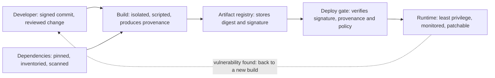
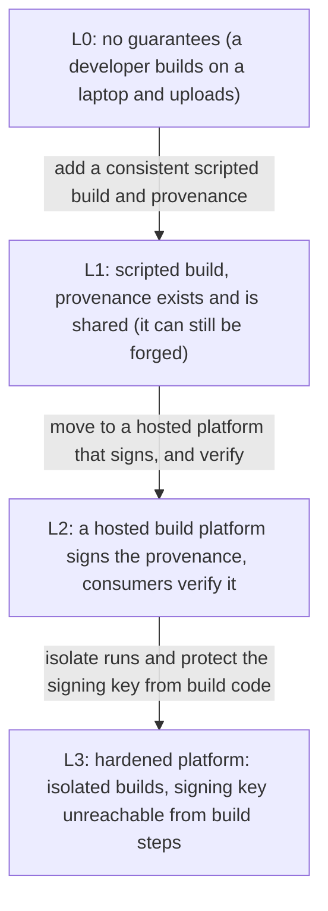
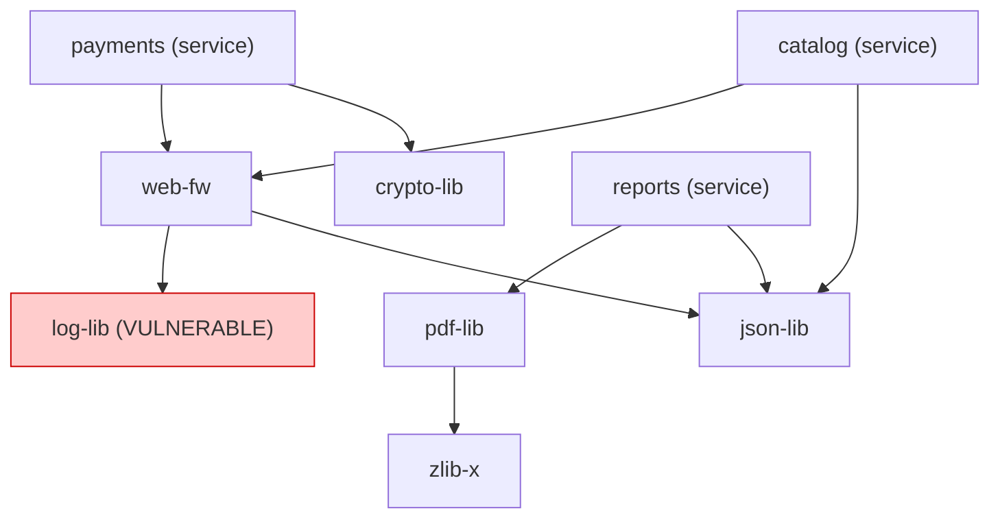
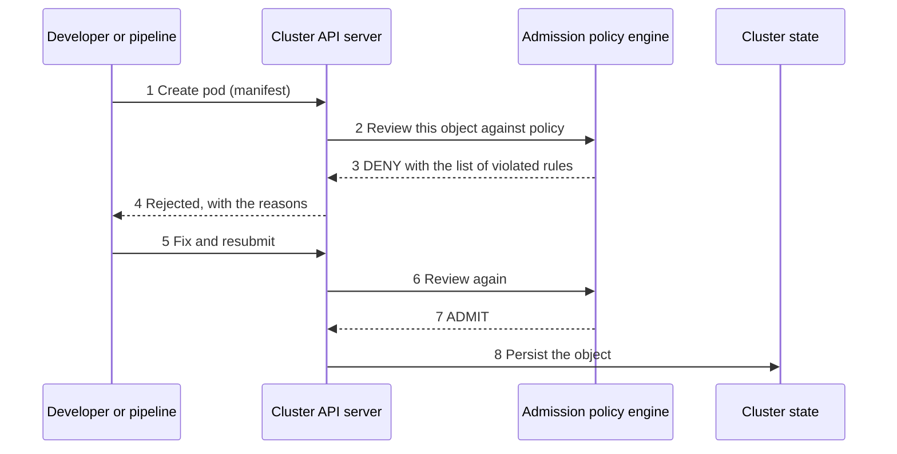

**Navigation**: [← Migration](34_Migration_And_Modernisation.md) | [Index](00_INDEX.md) | [Learning path, Stage 8](00_INDEX.md#-learning-path--first-principles-to-advanced) | Related: [25 Secrets and PKI](25_Secrets_And_PKI.md) · [19 CI/CD](19_CICD_Pipelines.md) · [28 Enterprise architecture](28_Enterprise_Reference_Architecture.md)

# 🛡️ Chapter 31: DevSecOps — Supply Chain, Provenance and Policy as Code

_"Your production system is not just the code you wrote. It is every library you imported, every tool that built it, every credential the build used, and every machine that touched the result. An attacker needs to compromise only one of them."_

---

## 5W1H

- **WHAT**: Securing the *path* software takes from a developer's keyboard to a running process: source, dependencies, build, artifact, deployment and runtime. The core techniques are **integrity** (hashes, signatures, provenance, reproducible builds), **inventory** (software bills of materials), **policy as code** (rules enforced automatically at the pipeline and at admission) and **least-privilege pipelines**.
- **WHY**: Attacks have moved from the running application to the delivery pipeline, because compromising one library or one build server reaches every system that trusts it. A control that lives only in a document, or only in a late security review, does not stop that.
- **WHO**: Platform, DevOps and security engineers; any developer who adds a dependency or edits a pipeline. At senior level you are expected to *design the pipeline so insecure changes cannot ship*, not to review each change.
- **WHEN**: From the first pipeline. The cheapest time to add a signature check or an admission rule is before there are fifty services depending on the old behaviour.
- **WHERE**: In version control, the build system, the artifact registry, the deployment tooling, the cluster admission layer and the cloud's organisation policies ([chapter 28](28_Enterprise_Reference_Architecture.md)).
- **HOW**: Derive the threats from the pipeline's trust links, prove each control with a command you can run (sign and verify, reproducible build, policy evaluation, dependency blast radius), and map the practices to two public frameworks: NIST's secure software development framework and SLSA.

> **Verified on** — The signing, provenance, reproducible-build, admission-policy and dependency-graph outputs below were produced with OpenSSL **3.0.13**, GNU tar, gzip and Python 3 on WSL2 Ubuntu 24.04 (kernel 6.6.87); the numbers and hashes are exactly what the shown commands print. The SLSA v1.0 Build-track levels were read from slsa.dev and the NIST SSDF description (SP 800-218 version 1.1, four practice groups) from the NIST project page on 2026-11-15. Specific scanners, SBOM formats, policy engines (such as Open Policy Agent or Kyverno), signing services and admission-controller deployments were **not run here** and are marked **not verified here**.

---

# PART 1: The Problem — The Pipeline Is the Attack Surface

## 1.1 Derive the threats from the trust links

Follow one change from a developer to production and write down, at every hop, *what is being trusted*:

| Hop | What you trust | If that trust is broken |
| --- | --- | --- |
| **Source** | The person who committed is who they claim, and the review happened | Malicious or stolen-credential commit enters unreviewed |
| **Dependencies** | Every library and its own dependencies are what they say they are | A compromised or look-alike package runs inside your build and your product |
| **Build** | The build machine and its tools are uncompromised, and the build does only what the pipeline says | Malware is injected into an artifact whose source code is perfectly clean |
| **Artifact storage** | What is stored is what was built | A tampered or substituted artifact is deployed |
| **Deployment** | Only approved artifacts from approved pipelines reach production | Anything with credentials can ship anything |
| **Runtime** | The running process is what you deployed, and a flaw in it is fixed quickly | An old vulnerability stays exploitable for months |
| **Credentials** | Pipelines and workloads hold only the access they need, briefly | One leaked token becomes an organisation-wide compromise |

Read down the right-hand column and a pattern appears: **most of these attacks leave the source code unchanged.** A code review sees clean code while the damage is in a dependency, a build step or the stored artifact. That is why the controls below are about *proving where an artifact came from*, not just about scanning source.

## 1.2 Two frameworks to organise the work

You do not have to invent the checklist. Two public references give a shared vocabulary:

- **NIST SP 800-218, the Secure Software Development Framework (SSDF), version 1.1**, describes fundamental secure-development practices in four groups: **PO** *Prepare the Organization*, **PS** *Protect the Software*, **PW** *Produce Well-Secured Software* and **RV** *Respond to Vulnerabilities*. It is outcome-oriented and tool-neutral, and is what auditors and customers often cite.
- **SLSA** (Supply-chain Levels for Software Artifacts) defines increasing levels of build integrity. Part 3 reproduces the v1.0 Build levels.

A useful way to hold them: SSDF tells you *what practices an organisation should have*; SLSA tells you *how trustworthy a particular artifact's build is*.



**How to read this diagram.** Follow the solid arrows from the developer and the dependencies into the build, then through the registry and a gate to runtime. Each box names the *evidence* that stage must produce or check: a signed, reviewed change; an inventory of dependencies; provenance from the build; a stored digest and signature; and a gate that refuses what lacks them. The dotted arrow closes the loop: a vulnerability found in production does not get patched in place, it goes back through the same pipeline as a new build. The thing to notice is the **gate in the middle**: controls upstream produce evidence, but only a gate that *refuses* artifacts without it turns evidence into protection.

---

# PART 2: Integrity — Hashes, Signatures and Provenance

## 2.1 Derive them

Suppose the build produces `app-1.4.2.tgz` and the deployer downloads it. How does the deployer know it is the file the build produced?

1. **A cryptographic hash** (SHA-256) of the file is a short fingerprint: change one bit and the hash changes completely. If the deployer receives the hash from a *trusted* source, it can verify the file. But an attacker who can swap the file can swap the hash beside it.
2. **A digital signature** fixes that. The build signs the file (or its hash) with a *private key* that only the build holds; anyone with the *public key* can verify, and nobody can forge a valid signature for a modified file without the private key ([chapter 25](25_Secrets_And_PKI.md) derived signatures and trust).
3. **Provenance** answers a different question: not just *is this file unmodified* but *where did it come from*: which source commit, which builder, which inputs. SLSA defines provenance as a record of who built an artifact, the process they used and the inputs they used. If the provenance is itself signed and contains the artifact's digest, the deployer can check that *this file* came from *this commit* through *this builder*.

Run it. Build a deterministic archive, sign it, write signed provenance, then verify, then tamper:

```bash
mkdir src && echo 'print("payments v1.4.2")' > src/app.py
tar --sort=name --mtime='@0' --owner=0 --group=0 --numeric-owner -cf - src | gzip -n > app-1.4.2.tgz
sha256sum app-1.4.2.tgz
openssl ecparam -name prime256v1 -genkey -noout -out build.key
openssl ec -in build.key -pubout -out build.pub
openssl dgst -sha256 -sign build.key -out app-1.4.2.tgz.sig app-1.4.2.tgz
# provenance: digest + source + builder, itself signed
cat > provenance.json <<EOF
{"artifact":"app-1.4.2.tgz","sha256":"$(sha256sum app-1.4.2.tgz | cut -d' ' -f1)","source":"git@example:payments.git","commit":"9fceb02","builder":"ci-runner-7","built":"2026-11-15T10:00:00Z"}
EOF
openssl dgst -sha256 -sign build.key -out provenance.json.sig provenance.json
```

```text
5b461b5263a1ea188cd1633818e0a47514444b21c849d5e7f57121194cd6872d  app-1.4.2.tgz
verify artifact signature:        Verified OK
verify provenance signature:      Verified OK
provenance digest matches file:   yes
verify tampered artifact:         Verification failure
```

The first three checks pass for the genuine artifact. Then one byte was appended to a copy (`printf 'x' >> tampered.tgz`) and the same signature was checked against it: **`Verification failure`**. The deployer's rule is therefore three checks, all of which must pass: the signature on the artifact verifies against the *expected* public key, the signature on the provenance verifies, and the provenance's digest equals the digest of the file about to be deployed. A deploy gate that checks only that "a signature exists" is worthless; the key it is checked *against* is the whole point.

A caution about the demonstration: here the same key signs artifact and provenance and lives on one machine. In production the signing key must be held by the build platform in a way that build steps written by developers cannot read — which is exactly what the higher SLSA levels demand (Part 3) — and the verifier must pin the *expected* identity, not accept any valid signature.

## 2.2 Reproducible builds — verification by repetition

A signature proves *who* built something; it does not prove the build was honest. A stronger idea is a **reproducible build**: given the same source and the same tools, the build produces a *bit-for-bit identical* artifact, so anyone can rebuild and compare digests. Disagreement exposes tampering. The enemy of reproducibility is any hidden input — timestamps, file ordering, user ids. A two-line experiment shows it. Build the same source twice, two seconds apart, once with a naive command and once with the variable inputs pinned:

```bash
build_plain() { tar -cf - src | gzip > "$1"; }
build_repro() { tar --sort=name --mtime='@0' --owner=0 --group=0 --numeric-owner -cf - src | gzip -n > "$1"; }
```

```text
plain  build twice: 2da8a740b5db vs f9ff0e55d83d
repro  build twice: 5b461b5263a1 vs 5b461b5263a1
```

The naive build produced two different hashes for identical source (the archive embedded modification times and the compressor embedded a timestamp), while the pinned build produced the same hash twice. Real reproducible builds are harder — compilers, dependency versions, build paths and environment all leak in — but the principle is the same: **find every input, pin it, and make the output a pure function of the inputs.** It also makes your own debugging easier, because "the build is different today" becomes a question with an answer.

---

# PART 3: SLSA — How Much Should You Trust This Build?

SLSA v1.0 defines levels for the **Build track**. Read from slsa.dev:

| Level | Requirement |
| --- | --- |
| **Build L0** | No requirements |
| **Build L1** | A consistent build process; produce **provenance** describing how the artifact was built; distribute the provenance to consumers |
| **Build L2** | Everything in L1, built on a **hosted platform on dedicated infrastructure that digitally signs the provenance**, and consumers **validate its authenticity** |
| **Build L3** | Everything in L2, and the build platform **prevents runs from influencing one another** and **keeps the signing secrets away from user-defined build steps** |



**How to read this diagram.** Each box is a level and each arrow is the single improvement that earns the next one. From laptop builds (L0), you gain *provenance* (L1), then you gain *forgery resistance* by having the platform, not the developer, sign it (L2), then *resistance to a compromised or malicious build step* by isolating runs and hiding the signing key from build code (L3). The thing to notice is the order: the cheap, high-value step is L1 (just record how it was built); the expensive steps buy protection against attackers who control more and more of your pipeline. Pick the level by the attacker you must defend against.

How the lab demo maps: our single-file signing with a locally held key is **L1 at best** — provenance exists, but nothing stops a developer who controls the machine from forging it. L2 requires that a separate platform produce and sign it; L3 requires that even the *code the pipeline runs* cannot read the signing secret. SLSA also has levels and requirements for other tracks and for source integrity that were not part of what was read for this chapter; check the specification for those.

---

# PART 4: Dependencies — An Inventory Is a Graph

## 4.1 What an SBOM is for

Most of the code in a modern service is not yours. A **software bill of materials (SBOM)** is a machine-readable list of the components in a piece of software, with versions and, ideally, where each came from. Standard formats exist (SPDX and CycloneDX are the two commonly named ones; their details were **not verified here**). The point is not the file; it is the question it lets you answer *in minutes*: **"a vulnerability was announced in library X — which of our services contain it?"** Without an inventory you grep forty repositories and hope.

The structure that answers it is a graph: components depend on libraries, which depend on other libraries (*transitive* dependencies). A vulnerable library affects everything that can reach it. In code:

```python
from collections import defaultdict, deque
depends_on = {                     # component -> libraries it uses (direct)
 "payments": ["web-fw", "crypto-lib"], "catalog": ["web-fw", "json-lib"], "reports": ["pdf-lib", "json-lib"],
 "web-fw": ["log-lib", "json-lib"], "pdf-lib": ["zlib-x"], "crypto-lib": [], "json-lib": [], "log-lib": [], "zlib-x": [],
}
used_by = defaultdict(set)
for c, libs in depends_on.items():
    for l in libs: used_by[l].add(c)
def affected(vuln):
    seen, q = set(), deque([vuln])
    while q:
        for parent in used_by[q.popleft()]:
            if parent not in seen: seen.add(parent); q.append(parent)
    return seen
services = {"payments", "catalog", "reports"}
for lib in ("log-lib", "zlib-x", "crypto-lib"):
    a = affected(lib); print(f"vulnerable {lib:<11} -> affected components: {sorted(a)}  | services to patch: {sorted(a & services)}")
```

```text
vulnerable log-lib     -> affected components: ['catalog', 'payments', 'web-fw']  | services to patch: ['catalog', 'payments']
vulnerable zlib-x      -> affected components: ['pdf-lib', 'reports']  | services to patch: ['reports']
vulnerable crypto-lib  -> affected components: ['payments']  | services to patch: ['payments']
```

The first line is the interesting one. `log-lib` is not a *direct* dependency of any service, yet a flaw in it reaches `payments` and `catalog` through the framework `web-fw`. Without the transitive graph you would conclude no service uses it. This is why teams that suffered the large library vulnerabilities of recent years discovered, too late, that they ran the library without ever having chosen it.



**How to read this diagram.** Arrows mean "uses". The red box is the vulnerable library. Follow the arrows *backwards* from it: `web-fw` uses it, and both `payments` and `catalog` use `web-fw`, so both are affected although neither mentions `log-lib` anywhere. `reports` is safe from this particular flaw because its path goes through `pdf-lib` and `json-lib`, not through `web-fw`. The thing to notice is the direction of the question: vulnerability response is a **reverse reachability** query, and the answer only exists if someone recorded the graph.

## 4.2 Controlling what comes in

| Practice | What it prevents |
| --- | --- |
| **Lockfiles and pinned versions** (with hashes where the tool supports it) | A build today silently differing from yesterday's because a dependency updated; a swapped package with the same version number |
| **A private proxy or mirror** as the only source for builds | Builds pulling arbitrary packages from the internet, and dependency-confusion attacks where a public package with an internal name wins |
| **Allow-lists for new dependencies** and a review step when one is added | The slow accumulation of unvetted libraries |
| **Automated update proposals** with tests | Falling years behind, then being unable to patch quickly |
| **Scanning for known vulnerabilities** in the inventory, continuously | Finding out from the news instead of from your own pipeline |

None of these is perfect: scanners miss unknown flaws and flag unreachable code, so treat results as *prioritised input to a human decision* rather than a gate on every finding (Part 7).

---

# PART 5: Policy as Code — Rules That Enforce Themselves

## 5.1 The problem with rules in documents

A rule written on a wiki ("containers must not run as root") is enforced by memory and goodwill. Derive the requirement: the rule must be **executable**, **versioned** like code, **tested**, and applied at a point where a violation can be **refused** — before the resource exists. That is policy as code. The common enforcement points, from earliest to latest:

| Where | What it checks | Strength |
| --- | --- | --- |
| **The pull request** | Infrastructure or manifest files against rules, before merge | Cheapest feedback; developers fix it while still in the change |
| **The pipeline** | Images, dependencies, signatures, configuration | Blocks the artifact from reaching a registry |
| **Admission to the cluster** | The actual object being created, whoever creates it | Catches anything that bypassed the pipeline |
| **Organisation policy** in the cloud ([chapter 28](28_Enterprise_Reference_Architecture.md)) | Account-level actions, regions, public exposure | Cannot be removed from inside the account |
| **Continuous detection** | Drift between what was approved and what runs | A safety net, not a gate |

Defence needs several layers because each has gaps: the pull request can be skipped by an administrator, the pipeline by a direct deploy, admission by a misconfigured exemption. A rule that exists at two layers survives one failing.

## 5.2 A policy engine in thirty lines

Real engines (Open Policy Agent, Kyverno and others) have their own languages and run as admission controllers in a cluster; deploying them was **not verified here**. The *idea* fits in a few lines of Python: rules are data, the evaluator is generic, and the decision lists every violated rule.

```python
APPROVED = ("registry.corp.example/",)
RULES = [
 ("image-from-approved-registry", lambda c, p: c["image"].startswith(APPROVED)),
 ("image-pinned-not-latest",      lambda c, p: ":" in c["image"].split("/")[-1] and not c["image"].endswith(":latest") or "@sha256:" in c["image"]),
 ("runs-as-non-root",             lambda c, p: c.get("securityContext", {}).get("runAsNonRoot") is True),
 ("not-privileged",               lambda c, p: not c.get("securityContext", {}).get("privileged", False)),
 ("has-memory-limit",             lambda c, p: "memory" in c.get("resources", {}).get("limits", {})),
 ("has-owner-label",              lambda c, p: "owner" in p.get("labels", {})),
]
def admit(pod):
    failures = [name for c in pod["containers"] for name, ok in RULES if not ok(c, pod)]
    return ("ADMIT" if not failures else "DENY "), sorted(set(failures))
```

Three pod descriptions were evaluated: a compliant one, a "debug shell" from a public registry with a `latest` tag running privileged, and one that is almost right but has no memory limit.

```text
payments     ADMIT []
debug-shell  DENY  ['has-memory-limit', 'has-owner-label', 'image-from-approved-registry', 'image-pinned-not-latest', 'not-privileged', 'runs-as-non-root']
almost       DENY  ['has-memory-limit']
```

The compliant pod is admitted. The debug shell violates six rules at once and the output names *all* of them, which matters because a developer who fixes one and retries should not discover the other five one at a time. The third pod shows the realistic case: one missing field (`resources.limits.memory`), a precise reason, a one-line fix. The design choices to copy: the **reason is part of the decision**, the rules are **data you can review and test**, and the default for anything not explicitly satisfied is **deny**. (Note that the registry rule matches only a prefix; a real rule also verifies a *signature* or digest, not just the hostname, since an attacker who can push to an approved registry passes a prefix check.)



**How to read this diagram.** Read the eight numbered steps in order. The request does not go straight to storage: the API server asks the admission engine first (step 2), and a denial (steps 3–4) returns the *reasons* to the author at once. Only after a fix and a second review (steps 5–7) is the object stored (step 8). The thing to notice is **where the check sits**: because it runs inside the path to the cluster state, it applies to everyone — including the administrator who bypassed the pipeline — not just to changes that arrive through the approved route.

## 5.3 Exceptions are part of the design

Every policy needs an exception path or people will route around it. The safe version is explicit: a named owner, a reason, a **scope** (one namespace, one workload), an **expiry date**, and an alert when it lapses. Exceptions that never expire become the real policy.

---

# PART 6: The Pipeline's Own Privileges

A build system holds the most valuable credentials in the company: it can deploy to production and read every repository. Treat it as a tier-zero system:

| Control | Why |
| --- | --- |
| **Separate build from deploy permissions** | The job that compiles code cannot also push to production |
| **Short-lived federated credentials** (the pipeline proves its identity and receives a token that expires) instead of stored keys | A stolen token is useless within the hour ([chapter 25](25_Secrets_And_PKI.md), [chapter 28](28_Enterprise_Reference_Architecture.md)) |
| **Protected branches and required review** | No single person (or stolen account) can merge to the main line |
| **Pipeline-as-code in a reviewed repository** | A change to how things are built is a reviewed change |
| **Ephemeral, isolated build runners** | One build cannot poison the next (the SLSA L3 idea) |
| **Pin third-party pipeline steps** to a specific version or digest | A compromised update to a shared action does not run in your pipeline automatically |
| **Audit log of every deployment**, stored where pipeline admins cannot delete it | You can reconstruct who shipped what ([chapter 28](28_Enterprise_Reference_Architecture.md), log archive) |

---

# PART 7: Alternatives and When Not To

| Situation | Approach | Why |
| --- | --- | --- |
| Hundreds of scanner findings, most unreachable | Prioritise by exposure and reachability; fix the top few, suppress with expiry | Gating every finding trains teams to ignore the gate |
| A small team, one service | Lockfile, dependency scanning, one signed build, a few admission rules | Full SLSA L3 is disproportionate; the cheap controls capture most of the risk |
| Regulated environment | Map controls to the framework your auditors use (SSDF is a common one) and **collect evidence automatically** from the pipeline | Manual evidence gathering does not scale and goes stale |
| A vulnerability needs an immediate fix | A fast path through the *same* pipeline with a reduced but not skipped test set | A bypass lane becomes the way everything ships |
| Security reviews as the main control | Shift the rules into code and keep human review for design and the exceptions | Reviewers cannot read every diff; code can check every one |

The failure mode of this whole chapter is **security theatre**: scanners nobody reads, policies with permanent exceptions, signatures nobody verifies. Measure by outcomes — *time from announcement of a vulnerability to the last affected service patched*, *percentage of production artifacts with verified provenance*, *number of policy exceptions past expiry* — not by the number of tools installed.

---

# PART 8: How It Fails

| Symptom | Cause | How to prove it | Prevention |
| --- | --- | --- | --- |
| Malware in production from clean source | Compromised dependency or build step | Artifact digest has no matching provenance; build log shows an unexpected step or download | Provenance verification at deploy; pinned dependencies; isolated runners |
| "We sign everything" but a tampered artifact deploys | The gate checks only that a signature exists, or trusts any key | Deploy a file signed by a *different* key and see it accepted | The verifier pins the expected key or identity |
| A vulnerability announcement takes days to triage | No inventory of what each service contains | Nobody can list affected services quickly | SBOM per build, stored and queryable |
| Policy blocks legitimate work and is switched off | No exception path, or false positives | The policy is in "audit only" for months | Scoped, expiring exceptions; fix noisy rules |
| Build credentials stolen | Long-lived keys stored as pipeline variables | Key used from an unexpected network, years old | Federated short-lived tokens; secret scanning |
| Two builds of the same commit differ | Hidden inputs (time, order, environment) | Digests differ between two builds | Pin inputs, build in a controlled environment |
| Public package overrides an internal one | Builds resolve names from public sources first | A package with an internal name appears from the public index | Private proxy as the only source; reserve internal names |
| Image deployed from an unapproved registry | Admission rule matches prefix only, or is missing | Admission policy accepts a look-alike registry name | Verify signature or digest, not just hostname |

---

# PART 9: Lab — Sign, Rebuild, Block, Trace

Work in `~/lab/supply` with OpenSSL, tar, gzip and Python 3.

1. **Sign and verify.** Run the commands from §2.1.
   - *Expected:* two `Verified OK` lines, `provenance digest matches file: yes`, and `Verification failure` for the tampered copy.
   - *Check:* `echo $?` after the failing `openssl dgst -verify` is non-zero; a gate script should use that exit code.
2. **Wrong key.** Generate a second key pair and try verifying the artifact signature against the *wrong* public key.
   - *Expected:* `Verification failure`.
   - *Check:* explain why "a valid signature exists" is not enough, and which identity a verifier should pin.
3. **Reproducibility.** Run the plain and the pinned build twice each, two seconds apart.
   - *Expected:* plain digests differ, pinned digests match.
   - *Check:* find a third hidden input of your own (for example, build directory name inside the archive or file ordering by modification time) and demonstrate it changes the hash, then pin it.
4. **Tamper with the provenance.** Edit one character of `provenance.json` and verify its signature.
   - *Expected:* `Verification failure`.
   - *Check:* now change the artifact *and* update the provenance digest to match, without re-signing; explain which check catches it.
5. **Blast radius.** Save the graph script from §4.1, run it, then add a new service `search` that uses `zlib-x` directly and re-run for `zlib-x`.
   - *Expected:* `search` appears among the affected services.
   - *Check:* write the query you would run against a real SBOM store to answer "which services contain library X at a vulnerable version?".
6. **Write a rule.** Add a seventh rule to the admission model: containers must set `readOnlyRootFilesystem: true`. Update the three sample pods so one passes and one fails.
   - *Expected:* the verdict lines change as you predicted.
   - *Check:* add a unit test for the rule (a passing case and a failing case) and say what the default result is for a container that does not mention the field.
7. **Design assignment (paper).** Your organisation ships 60 services from three CI systems. Decide the minimum SLSA level you would require for production by service tier, the deploy-gate checks, how exceptions are granted and expire, and the three outcome metrics you will report to leadership.
8. **(Not verified here — needs a registry, a signing service and a cluster.)** Sign a container image with a signing tool, enforce signature verification with an admission controller, and show that an unsigned image is rejected. Follow the tool's own getting-started guide and record the versions.

---

# PART 10: Challenges

🔬 **Section Challenge — Threats and integrity**

**Challenge 1 (Reasoning):** A security review of your repository finds no malicious code, yet a customer reports malware in your released binary. Give two plausible causes and the control that would have detected each.

<details><summary>Answer</summary>

(1) **A compromised dependency or build tool** executed during the build and injected code that is not in your repository; detect with pinned, hashed dependencies and a build that produces provenance listing its inputs, so an unexpected input is visible. (2) **A tampered artifact** swapped in the registry or in transit after a clean build; detect with a signature (and provenance digest) verified at deploy time. A third: a compromised build runner that modified the output; reduced by ephemeral, isolated runners and by reproducible builds that let anyone rebuild and compare digests. The common lesson is that source review cannot see damage introduced *after* the source.

</details>

**Challenge 2 (Debug):** Your deploy gate reports "signature verified" for an artifact, but the artifact was actually built on a developer's laptop. What is wrong with the gate and how would you fix it?

<details><summary>Answer</summary>

The gate verified that *some* signature was valid, not that it was made by the **expected identity**. A developer can sign with their own key and the check still passes. Fix: pin the verifier to the key or identity of the **build platform**, and require provenance whose builder identity and source repository match expectations. In SLSA terms this is the move from L1 (provenance exists) to L2 (a hosted platform signs it and consumers *validate its authenticity*). Test the gate by deploying something signed with the wrong key; it must be refused.

</details>

🔬 **Section Challenge — Reproducible builds**

**Challenge 3 (Calculation):** Two builds of identical source produce different archives. In the lab the plain build differed and the pinned build did not. Name the inputs that differed and the flags that fixed them, and say what you would do if the difference came from a compiler.

<details><summary>Answer</summary>

The archive recorded **file modification times** and the compressor recorded a **timestamp**, and file **ordering and ownership** can vary by machine. The pinned build used `--sort=name`, `--mtime='@0'`, `--owner=0 --group=0 --numeric-owner` for tar and `gzip -n` to omit the compression timestamp, giving the same digest twice. If a compiler introduces the difference (embedded paths, timestamps, nondeterministic ordering), pin the compiler version, build in a fixed directory or with path-remapping options if available, set a fixed timestamp from the source (many tools honour a standard `SOURCE_DATE_EPOCH` convention — confirm for your toolchain), and compare two builds to find the first differing byte. Reproducibility is a property you establish by experiment, not assume.

</details>

🔬 **Section Challenge — Dependencies**

**Challenge 4 (Scenario):** A critical vulnerability is announced in a logging library. Your team says "we don't use it, it's not in our dependency file." Using the graph, explain how they might be wrong and what you ask for.

<details><summary>Answer</summary>

Dependencies are **transitive**: in the example, no service lists `log-lib`, yet `payments` and `catalog` use it through `web-fw`. The dependency file shows only direct dependencies. Ask for the **resolved dependency graph or SBOM per deployed build** (not just the manifest) and run a reverse-reachability query for the library and affected versions; also check what is *actually deployed*, since the repository may not match the running image. Then prioritise by exposure (is the vulnerable function reachable from the internet?) and patch through the normal pipeline.

</details>

🔬 **Section Challenge — Policy**

**Challenge 5 (Design):** An admission rule requires images to come from `registry.corp.example/`. A pentester pushes a malicious image to a different repository in that registry (they had write access to a sandbox repository) and it is admitted. What was missing?

<details><summary>Answer</summary>

The rule trusts the **registry hostname prefix**, not the **provenance** of the image. Anyone who can push *anywhere* in that registry produces an image that passes. Fix with layered controls: separate registries or repositories for sandbox and production with different push permissions; require a **valid signature or provenance from the production build platform** (verified by the admission layer against a pinned identity); require images by **digest** rather than mutable tags. A rule is only as strong as the evidence it checks.

</details>

**Challenge 6 (Trade-off):** A security tool reports 1,200 findings across the organisation. Leadership wants "zero findings" before the next release. What do you propose?

<details><summary>Answer</summary>

Zero is not an achievable gate, and demanding it teaches teams to suppress findings. Propose **risk-based prioritisation**: rank by severity, exposure (internet-facing? authenticated?) and reachability of the vulnerable code; block releases only on a small, agreed category (for example, known-exploited and reachable critical findings); give everything else an owner and a due date; suppress false positives with an expiry and a reason. Report outcomes leadership can act on: median time to patch critical issues, percentage of production artifacts with verified provenance, and number of exceptions past expiry.

</details>

**Challenge 7 (Scenario):** A developer needs a one-off production fix at 2 a.m. The pipeline's checks take 40 minutes. What is the design that avoids a bypass?

<details><summary>Answer</summary>

Design the **fast path inside the pipeline**, not around it: a hotfix route that runs a reduced but meaningful set (build, unit tests, signature and provenance generation, the admission policy) in minutes, requires a second approver, and records the exception for review the next day. If the only way to ship urgently is to skip the pipeline, the bypass becomes the habit and the artifact lacks provenance. Measure the hotfix path's use; frequent use means the normal path is too slow and should be fixed.

</details>

---

# Reality Check

**"We scan for vulnerabilities, so we're secure."** Scanning finds *known* issues in code you can see. It does not prove where an artifact came from, and it says nothing about an honest-looking build that was tampered with.

**"We sign our images, so deployment is safe."** Only if the verifier checks the *expected* signer. A valid signature from the wrong key proves nothing.

**"Reproducible builds are only for cryptographers."** They are the practical way to turn "trust the build server" into "verify the output", and the first step is simply finding hidden inputs such as timestamps.

**"An SBOM is paperwork."** It is the data structure that turns a vulnerability announcement from a multi-day search into a query.

**"More gates mean more security."** Gates that cry wolf are bypassed or disabled. A few trusted, well-explained gates beat many ignored ones.

**"Security slows delivery."** Late, manual security slows delivery. Rules that run automatically in the pull request give feedback in minutes and are usually faster than a review queue.

**"The pipeline is just plumbing."** The pipeline holds the keys to production and every repository; it is among the highest-value targets you operate.

---

# Books and References

| Source | Read | What it adds beyond this chapter |
| --- | --- | --- |
| NIST SP 800-218, *Secure Software Development Framework (SSDF)*, version 1.1 (FREE) — https://csrc.nist.gov/projects/ssdf | The four practice groups PO, PS, PW, RV | The practice vocabulary auditors and customers often cite |
| SLSA specification v1.0, Build track levels (FREE) — https://slsa.dev/spec/v1.0/levels | The levels page and the provenance definition | Exact requirements for each build level and what provenance records |
| *Building Secure & Reliable Systems* (FREE, https://sre.google/books/) | Ch 14 "Deploying Code" | Who may deploy, and how you know what was deployed, from the pipeline-integrity angle |
| *Building Secure & Reliable Systems* (FREE) | Ch 5 "Design for Least Privilege" and Ch 8 "Design for Resilience" | Least privilege and resilience as architecture principles for pipeline permissions |
| *The Site Reliability Workbook*, Google (FREE) — https://sre.google/workbook/table-of-contents/ | Ch 16 "Canarying Releases" | Safe rollout of the artifacts you verify |
| RFC 8446 and RFC 5280 (FREE) — https://www.rfc-editor.org/rfc/rfc8446, https://www.rfc-editor.org/rfc/rfc5280 | Certificate and authentication sections | The signature and certificate machinery under signing and verification (see [chapter 25](25_Secrets_And_PKI.md)) |

No book on SBOM formats, scanners or policy engines was verified for this repository; use each project's own documentation.

---

## 🔗 Cross-References

- [25 Secrets and PKI](25_Secrets_And_PKI.md) — signatures, keys and short-lived credentials used throughout
- [19 CI/CD Pipelines](19_CICD_Pipelines.md) — the pipeline these controls attach to
- [28 Enterprise Reference Architecture](28_Enterprise_Reference_Architecture.md) — organisation policy, audit-log archive and role-based access
- [29 Microservices on the Platform](29_Microservices_On_The_Platform.md) — service identity and deny-by-default authorisation at runtime
- [23 GitOps and Deployments](23_GitOps_Deployments.md) — the deployment path whose state becomes the audited source of truth
- [02 Networking and Security](02_Networking_Security.md) — the earlier DevSecOps overview this chapter deepens
- [SENIOR_READINESS](SENIOR_READINESS.md) — stage 8 proof tasks and the game-day drills for a compromised pipeline
