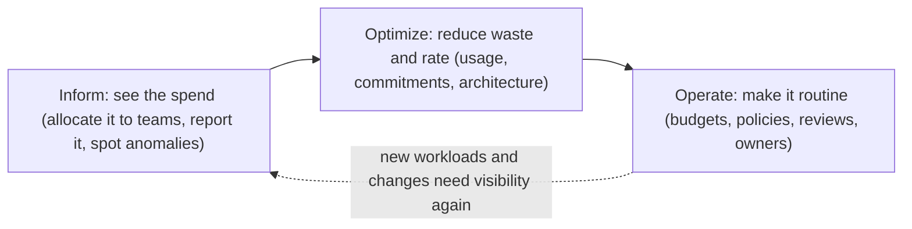
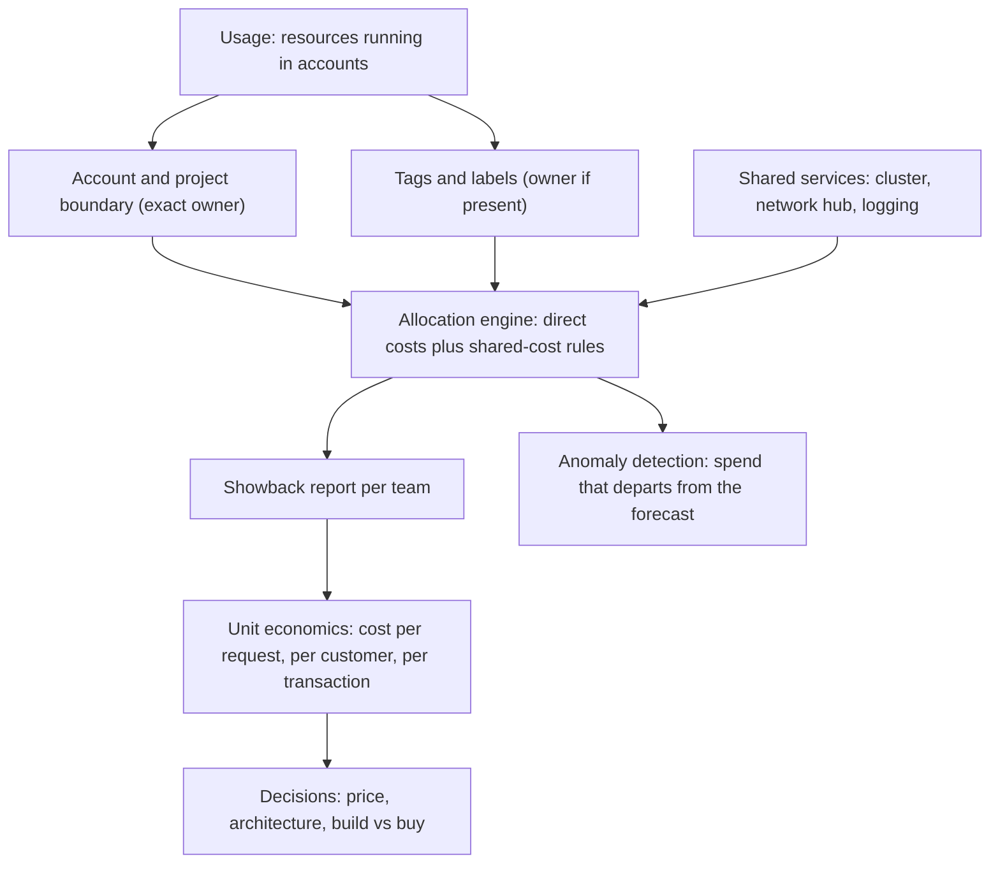
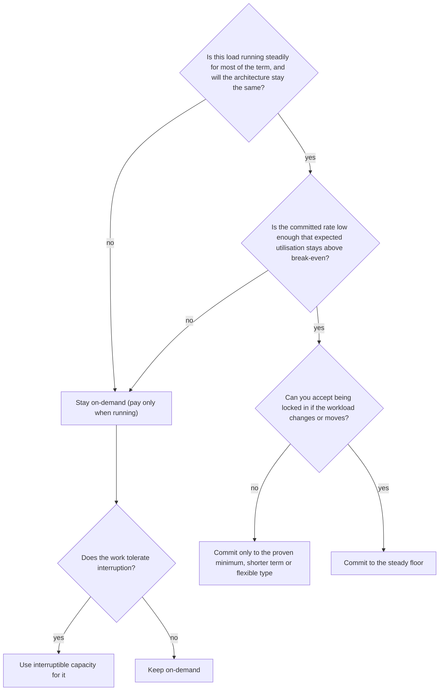

**Navigation**: [← Microservices on the Platform](29_Microservices_On_The_Platform.md) | [Index](00_INDEX.md) | [Learning path, Stage 9](00_INDEX.md#-learning-path--first-principles-to-advanced) | Related: [24 Cloud fundamentals](24_Cloud_Fundamentals.md) · [28 Enterprise architecture](28_Enterprise_Reference_Architecture.md)

# 💰 Chapter 33: FinOps and Cost Architecture — Making Cost an Engineering Property

_"On a data-centre budget, the expensive decision was made once, by a few people, in a purchase order. In the cloud it is made thousands of times a day, by everyone with a keyboard — and nobody sees the invoice until the month ends."_

---

## 5W1H

- **WHAT**: How to understand, allocate, predict and reduce cloud spend without harming reliability, and how to design systems whose *cost shape* is known before they are built. FinOps is the cultural and technical practice of doing this together — engineering, finance and the business.
- **WHY**: Variable pricing plus self-service means cost is created by engineering choices (instance size, data movement, retention, retries). The two failure modes are symmetrical: a large surprise bill, and — often worse — cutting cost by removing the redundancy that kept you available.
- **WHO**: Platform and cloud engineers, architects, engineering managers, and the finance partner who sees the invoice. At senior level you are expected to *state the cost of a design* alongside its reliability and security.
- **WHEN**: At design time (cost shape), at launch (budgets and tags), and continuously (anomaly detection, commitments, review) — not as a one-off clean-up after the bill hurts.
- **WHERE**: In accounts and tags ([chapter 28](28_Enterprise_Reference_Architecture.md)), in architecture choices ([chapters 24](24_Cloud_Fundamentals.md) and [29](29_Microservices_On_The_Platform.md)), and in the pipeline and policies that prevent waste.
- **HOW**: Derive unit economics from first principles, compute break-evens with small executable models, then turn each lever into a policy, a metric and an owner.

> **Verified on** — The four cost models and the tag audit below were run with Python 3 on WSL2 Ubuntu 24.04 (kernel 6.6.87). **All prices are invented round numbers for arithmetic, not any provider's price list**: change them to your current prices and re-run. The FinOps principles, phases, domains and capabilities were read from the FinOps Foundation framework page on 2026-11-15; the six AWS Well-Architected pillars (including cost optimisation) from the AWS multi-account whitepaper read the same day. Provider discounting programmes, exact commitment terms and current rates were **not verified here**; read each provider's pricing page and record the date.

---

# PART 1: The Problem — Derive Why Cost Needs a Practice

## 1.1 What changed when infrastructure became an API

In a data centre, capacity was bought in lumps, approved by finance, and depreciated over years; an engineer could not spend a million dollars by accident. Cloud changed three things at once:

| Old world | Cloud world | New problem |
| --- | --- | --- |
| Capacity bought in advance by a few people | Capacity created by anyone with an API call | Spend decisions are **distributed** to every engineer |
| Fixed cost: paid whether used or not | Variable cost: paid per hour, request, gigabyte | The bill **moves with behaviour** (a bug can raise it overnight) |
| One budget, one invoice per project | One invoice for the whole company, thousands of line items | Nobody can say **who caused what** |
| Waste is visible: an empty rack | Waste is invisible: a forgotten instance, an orphaned disk | Nobody feels the cost of leaving things running |

A practice has to exist because the *incentives* are wrong by default: the person who creates a resource does not see its cost, and the person who sees the bill did not create it. FinOps is the name for closing that gap.

## 1.2 What the framework says

The FinOps Foundation's framework (read on its site) states six principles: teams need to collaborate; business value drives technology decisions; everyone takes ownership for their technology usage; FinOps data should be accessible, timely and accurate; FinOps should be enabled centrally; and take advantage of the variable cost model of the cloud. It describes three phases — **Inform**, **Optimize** and **Operate** — and four domains (outcomes of a practice): *Understand Usage & Cost*, *Quantify Business Value*, *Optimize Usage & Cost* and *Manage the FinOps Practice*. Under *Optimize Usage & Cost* it lists the capabilities *Architecting & Workload Placement*, *Usage Optimization*, *Rate Optimization*, *Licensing & SaaS* and *Sustainability*; under *Understand* it lists *Data Ingestion*, *Allocation*, *Reporting & Analytics* and *Anomaly Management*; under *Quantify Business Value* it lists *Planning & Estimating*, *Forecasting*, *Budgeting*, *KPIs & Benchmarking* and *Unit Economics*.

Strip away the vocabulary and the logic is a loop you can derive yourself: **you cannot optimise what you cannot see, and you cannot keep a saving that nobody owns.**



**How to read this diagram.** Read left to right: first make cost visible and attributable (Inform), then act on it (Optimize), then make the gains permanent with budgets, policies and regular review (Operate). The dotted arrow is the one to notice: it is a **loop, not a project**. Every new service, team or architecture change reopens the visibility question, and savings decay if the third phase is skipped — the instances you removed in March are back by September.

## 1.3 Cost is the sixth pillar, and it trades against the others

The AWS Well-Architected Framework lists six pillars: operational excellence, security, reliability, performance efficiency, cost optimisation and sustainability. They conflict by design. More reliability (extra zones, headroom) costs money; more security (inspection, encryption, logging) costs money; the cheapest design is rarely the safest. The senior skill is not minimising cost — it is **choosing the point on the trade-off curve on purpose and writing down why**.

---

# PART 2: See It — Allocation and Unit Economics

## 2.1 If you cannot say who spent it, you cannot manage it

The first deliverable of the Inform phase is **allocation**: every dollar mapped to an owner. There are three mechanisms, from most to least reliable:

| Mechanism | How it works | Weakness |
| --- | --- | --- |
| **Account or project boundary** | The cloud's own hard boundary is also a billing boundary ([chapter 28](28_Enterprise_Reference_Architecture.md)): one workload per account gives exact attribution for free | Shared services (network, logging, cluster) still need splitting |
| **Tags or labels** | Key-value metadata on each resource (team, environment, cost centre) that appears on the bill | Optional unless enforced; inconsistent spelling; some resources cannot be tagged |
| **Shared-cost allocation rules** | A formula splits shared costs (the Kubernetes cluster, the transit hub) across consumers by usage | Needs agreed rules and metrics; disputes are about the formula, not the cloud |

Two terms to keep apart: **showback** reports each team's cost to them without moving money, and **chargeback** actually bills internal budgets. Start with showback; chargeback adds accounting overhead and politics and is worth it only when teams will otherwise ignore the numbers.

Here is the problem in miniature. A tag audit over a small resource export (`resources.csv`, ten rows with a monthly cost, a `team` tag and an environment):

```python
import csv
rows = list(csv.DictReader(open("resources.csv")))
total = sum(float(r["monthly_cost"]) for r in rows)
untagged = [r for r in rows if not r["team"]]
u = sum(float(r["monthly_cost"]) for r in untagged)
print(f"total ${total:,.2f}/month; untagged (no team) ${u:,.2f} = {u/total:.0%} of spend across {len(untagged)} of {len(rows)} resources")
by = {}
for r in rows: by[r["team"] or "(unallocated)"] = by.get(r["team"] or "(unallocated)", 0) + float(r["monthly_cost"])
for k, v in sorted(by.items(), key=lambda kv: -kv[1]): print(f"  {k:<14} ${v:>9,.2f}  {v/total:>4.0%}")
print("largest unallocated items:", sorted(((float(r['monthly_cost']), r['resource']) for r in untagged), reverse=True)[:3])
```

```text
total $13,130.00/month; untagged (no team) $4,340.00 = 33% of spend across 5 of 10 resources
  shared         $ 5,200.00   40%
  (unallocated)  $ 4,340.00   33%
  payments       $ 2,640.00   20%
  platform       $   950.00    7%
largest unallocated items: [(1800.0, 'db-002'), (1210.0, 'nat-gw'), (640.0, 'bucket-tmp')]
```

A third of the bill has no owner, and the three largest unowned items include a development database (`db-002`, $1,800) and a NAT gateway ($1,210) — exactly the kind of resource that persists because nobody feels it. The first action is not optimisation; it is **assigning owners** and enforcing tags at creation (a guardrail or pipeline check that refuses resources without them — see [chapter 28](28_Enterprise_Reference_Architecture.md) on policy as guardrail).



**How to read this diagram.** Follow the flow downward: every running resource arrives at an allocation step carrying an owner from its account or its tags; shared services are added with explicit rules rather than ignored. The output splits two ways — a report for each team, and an anomaly check that compares spend with a forecast. The thing to notice is the last two boxes: the report is only the *middle* of the chain. Its purpose is the **unit cost**, because that is what a business can reason about ("this feature costs us 0.8 cents per use") in a way that a monthly total never allows.

## 2.2 Unit economics — the number that explains the bill

A rising bill is not bad if the business is growing faster. The question that separates healthy from unhealthy is **cost per unit of value**. Take a bill of $120,000 serving 450 million requests and 80,000 paying users:

```text
cost per 1,000 requests = $0.2667; cost per paying user = $1.50
if requests double but the bill rises only 30%, unit cost falls: $0.1733 per 1,000 requests
```

If traffic doubles and the bill rises 30%, unit cost falls by about a third — the system is getting more efficient even though the invoice is bigger. If instead the bill doubles while traffic is flat, something is wrong, and the unit metric makes that visible long before a finance review would. Choose a unit that matches how the business earns (a request, an order, an active customer), compute it every week, and put it on the same dashboard as latency.

---

# PART 3: Reduce It — Three Kinds of Lever

The framework separates *usage* optimisation (use less), *rate* optimisation (pay less per unit) and *architecting and workload placement* (a cheaper design). Each has different risk, so treat them differently.

## 3.1 Usage: stop paying for what nobody uses

The commonest large saving is idle or oversized capacity. Run the arithmetic:

```text
40 instances at 18% average CPU cost $5,840/month; at a 60% target only 12 are needed -> save $4,088/month
```

(40 instances × $0.20/hour × 730 hours = $5,840; at 18% average load the work fits in 40 × 0.18 / 0.60 = 12 instances at 60%.) Four habits capture most of it: **right-size** (match instance size to measured use), **schedule** (switch off development and test environments outside working hours), **delete** (orphaned volumes, old snapshots, unattached addresses) and **target a utilisation**, not a default. A caution that belongs here and not in the next chapter: *a 60% target is not the same as a 90% target.* Headroom is what survives a zone loss ([chapter 24](24_Cloud_Fundamentals.md) computed that three zones at 60% become 90% after one fails); removing it to "save" money is a reliability decision, not a free one.

## 3.2 Rate: pay less per unit by committing

Providers discount in exchange for **commitment**: you promise to pay for a level of usage over a term, and in return the effective rate is lower. The structural fact is that **you pay for committed capacity whether or not you use it**, so a commitment is a bet on future utilisation. Derive the break-even: if the committed effective rate is *c* and the on-demand rate is *d*, the commitment wins only when the capacity you would otherwise rent on demand is used for more than *c/d* of the hours.

```python
# 1. Commitment break-even
on_demand = 0.100                  # $/hour, pay only for hours you run
committed = 0.062                  # $/hour effective, but you pay for EVERY hour of the term
break_even = committed / on_demand
print(f"1. commitment pays off above {break_even:.0%} utilisation of the committed capacity")
print(f"   {'hours actually used/month':>26} {'utilisation':>11} {'on-demand $':>12} {'committed $':>12}  cheaper")
for used in (200, 365, 453, 548, 730):
    od = used * on_demand; cm = 730 * committed
    print(f"   {used:>26} {used/730:>11.0%} {od:>12.2f} {cm:>12.2f}  {'committed' if cm < od else 'on-demand'}")
```

```text
1. commitment pays off above 62% utilisation of the committed capacity
    hours actually used/month utilisation  on-demand $  committed $  cheaper
                          200         27%        20.00        45.26  on-demand
                          365         50%        36.50        45.26  on-demand
                          453         62%        45.30        45.26  committed
                          548         75%        54.80        45.26  committed
                          730        100%        73.00        45.26  committed
```

A 38% discount sounds large, yet at 50% utilisation the commitment is **more expensive** than paying on demand ($45.26 against $36.50). Break-even sits at 62%, so a commitment is a good deal only for **steady, predictable base load**. This yields the standard portfolio rule: *commit to the floor, run on demand for the peaks, and use interruptible (spot/preemptible) capacity only for work that tolerates being stopped.* Over-committing is the classic mistake, because the cost of being wrong is paid every hour of the term, while on-demand mistakes stop the moment you turn the resource off.



**How to read this diagram.** Start at the top and ask whether the load is *steady and stable*: if not, never commit. Then ask whether utilisation will stay above the break-even computed above, and whether you can live with the lock-in if the workload changes. Only three *yes* answers lead to a commitment, and even then the "no" at the third question leads to a smaller, more flexible one. The bottom branch handles the leftover on-demand load: if it can be interrupted, cheaper spare capacity fits it. The thing to notice is that commitments sit at the *end* of the questions, not the start — the usual order of mistakes is to buy first and discover the workload moved.

## 3.3 Architecture: the cheapest resource is the one you do not need

Architecture decisions create or avoid cost far larger than tuning. Data movement is the clearest case. Using invented prices:

```text
storing 50 TB costs $1,178/month; copying 2 TB out every night costs $5,530/month
```

Storing the data is cheap; **moving it out every night costs about five times as much as keeping all of it**. The fix is architectural (do the processing where the data lives, compress or filter before moving, replicate only what is needed, use private connectivity inside the provider), not a discount negotiation. The same pattern appears inside a cloud: traffic between zones and through shared gateways is metered ([chapter 24](24_Cloud_Fundamentals.md)), so a chatty microservice design ([chapter 29](29_Microservices_On_The_Platform.md)) spread across zones carries a cost you can estimate from request rates and payload sizes before building it.

Compute shows the same logic as a **crossover**. Pay-per-use functions are cheapest at low and spiky load; an always-on instance is cheapest at sustained load. Where the lines cross is arithmetic:

```python
vm_month = 73.00                       # one small VM running all month ($0.10/h x 730 h)
req_price = 2.00 / 1_000_000           # $ per request
gb_s_price = 0.0000167                 # $ per GB-second of compute
memory_gb, seconds = 0.128, 0.200      # 128 MB, 200 ms per request
per_request = req_price + memory_gb * seconds * gb_s_price
n = vm_month / per_request
print(f"function cost per request: ${per_request:.8f}  (per million: ${per_request*1e6:.2f})")
print(f"break-even: {n:,.0f} requests/month = {n/730/3600:.1f} requests/second on average")
```

```text
function cost per request: $0.00000243  (per million: $2.43)
break-even: 30,071,843 requests/month = 11.4 requests/second on average
    0.1 req/s avg -> function $     0.64/month vs VM $73.00
      1 req/s avg -> function $     6.38/month vs VM $73.00
      5 req/s avg -> function $    31.90/month vs VM $73.00
     20 req/s avg -> function $   127.59/month vs VM $73.00
    100 req/s avg -> function $   637.95/month vs VM $73.00
```

With these invented prices the function wins below about 11 requests per second on average and loses badly above it: at 100 requests per second it costs nearly nine times the VM. The conclusion is not "functions are cheap" or "VMs are cheap" but **"know your average and peak request rate and compute the crossover with real prices."** (Cold starts, execution limits and operational effort also differ and belong in the decision; this model prices only the invoice.)

---

# PART 4: Keep It — Governance and Operate

## 4.1 Controls that prevent waste instead of reporting it

| Control | What it does | Where it lives |
| --- | --- | --- |
| **Budgets and alerts** | Notify at thresholds of forecast and actual spend, per account and per team | Cloud billing tools; each account gets one at creation (the account factory, [chapter 28](28_Enterprise_Reference_Architecture.md)) |
| **Mandatory tags** | Refuse or flag resources without owner and environment | A guardrail or pipeline policy |
| **Allow-lists** | Forbid expensive instance types or unneeded regions in development accounts | Organisation policy on the Sandbox and non-production OUs |
| **Expiry dates** | Resources in experiments carry a time-to-live and are deleted automatically | Sandbox automation |
| **Anomaly detection** | Alert when spend departs from the forecast pattern | Cost-management tooling plus a named responder |
| **Pre-merge cost estimates** | Show the cost change of an infrastructure pull request before it merges | The infrastructure-as-code pipeline ([chapter 20](20_Terraform_IaC.md)) |

An alert that goes to nobody is not a control. Every control above needs an **owner and a response**, the same rule as any on-call signal ([chapter 22](22_SRE_Practices.md)).

## 4.2 Metrics worth tracking

| Metric | What it tells you | Warning sign |
| --- | --- | --- |
| **Unit cost** (per request, order, customer) | Efficiency independent of growth | Rising while volume is flat |
| **Unallocated percentage** | How much spend has no owner | Above a small fixed target; the audit above found 33% |
| **Commitment utilisation** | Whether commitments are being used | Below break-even: you are paying for unused capacity |
| **Commitment coverage** | Share of steady usage that is committed | Too low means overpaying; too high means lock-in risk |
| **Waste estimate** | Idle, oversized and orphaned resources | Growing between reviews |
| **Forecast accuracy** | How well finance and engineering predict spend | Large monthly misses mean surprises are coming |

---

# PART 5: Alternatives and When Cost Work Is the Wrong Work

| Situation | Better approach | Why |
| --- | --- | --- |
| A saving of $200 a month would take a senior engineer a week | Skip it | Engineering time has a price; optimise where the saving per hour of effort is highest |
| Cost cuts would remove redundancy or headroom | Treat it as a reliability change and review it with the SLO ([chapter 22](22_SRE_Practices.md)) | An outage costs far more than the spare instances |
| The workload is steady, huge and skilled-team operated | Compare against owned or colocated hardware | At constant high utilisation, renting elasticity you do not use can cost more ([chapter 24](24_Cloud_Fundamentals.md)) |
| Early-stage product with unknown demand | Favour speed and elasticity; keep guardrails and budgets but defer commitments | Over-committing before the workload stabilises is the most expensive error |
| Pressure to "reduce the bill by 30%" with no baseline | Establish allocation and unit cost first | A target without a baseline produces random cuts |

---

# PART 6: How It Fails

| Symptom | Cause | How to prove it | Prevention |
| --- | --- | --- | --- |
| Bill triples overnight | A retry loop or autoscaler with no cap (see the measured retry storm in [chapter 29](29_Microservices_On_The_Platform.md)) | Request and invocation metrics spike at the same time as spend | Caps on scaling and retries; anomaly alerts with an owner |
| Development environments cost as much as production | They run all night and weekend at production size | Utilisation graphs flat near zero out of hours | Schedules and expiry; smaller sizes; allow-lists |
| Savings disappear within months | Phase 3 (Operate) skipped | The same waste categories reappear in the next audit | Budgets, policies, quarterly review with named owners |
| Commitment purchased, then the workload moved | Locked into a configuration that is no longer used | Commitment utilisation below break-even | Commit only the steady floor; stagger terms; review utilisation monthly |
| One team blamed for another's cost | Shared costs unallocated or allocated by an unexplained formula | Dispute over the allocation rule, not the usage | Written allocation rules; showback before chargeback |
| Logging or metrics bill dominates | Unbounded retention or high-cardinality labels ([chapter 21](21_Monitoring_Observability.md)) | Ingestion volume by source | Retention tiers, sampling, cardinality limits |
| A cut caused an outage | Headroom or redundancy removed to save money | Post-incident review traces the cause to a cost change | Cost changes reviewed against SLOs; N+1 headroom is a requirement |
| Data transfer shock | A design moved large volumes across zones or out of the provider | Transfer lines dominate the bill breakdown | Estimate transfer at design time; keep processing near data |

---

# PART 7: Lab — Model, Audit, Decide

All labs run on a laptop with Python 3. Work in `~/lab/finops`. Prices in the scripts are invented; replace them with current prices from your provider's pricing page and record the date.

1. **Run the models.** Save this as `cost_models.py` (it gathers the four calculations from Parts 2 and 3) and run it.

   ```python
   HOURS = 730
   # commitment break-even
   on_demand, committed = 0.100, 0.062
   print(f"commitment pays off above {committed/on_demand:.0%} utilisation")
   for used in (200, 365, 453, 548, 730):
       od, cm = used * on_demand, HOURS * committed
       print(used, f"{used/HOURS:.0%}", f"{od:.2f}", f"{cm:.2f}", "committed" if cm < od else "on-demand")
   # idle capacity
   fleet, per_instance, avg_util, target = 40, 0.20, 0.18, 0.60
   needed = fleet * avg_util / target
   print(f"{fleet} instances cost ${fleet*per_instance*HOURS:,.0f}; need {needed:.0f}; save ${(fleet-needed)*per_instance*HOURS:,.0f}/month")
   # data transfer
   print(f"store 50 TB ${50*1024*0.023:,.0f}/month; copy 2 TB out nightly ${2*1024*0.09*30:,.0f}/month")
   # unit economics
   bill, requests, users = 120_000, 450_000_000, 80_000
   print(f"per 1,000 requests ${bill/requests*1000:.4f}; per paying user ${bill/users:.2f}")
   ```

   - *Expected:* the same numbers as §2.2, §3.1, §3.2 and §3.3 (break-even `62%`; save `$4,088`; `$1,178` against `$5,530`; `$0.2667` and `$1.50`).
   - *Check:* before running, predict the break-even from `committed / on_demand`.
2. **Move the break-even.** Change the committed rate to `0.075` and rerun.
   - *Expected:* break-even rises to 75%, and at 548 used hours the commitment no longer wins.
   - *Check:* write one sentence on what a smaller discount means for how confident you must be in steady usage.
3. **Audit the tags.** Create `resources.csv` as in §2.1 and run the tag audit, then add `team` values to every unowned row that you can attribute and rerun.
   - *Expected:* unallocated falls from 33% as you assign owners.
   - *Check:* the three largest unallocated items, in order, before you start (`db-002`, `nat-gw`, `bucket-tmp`).
4. **Crossover with real numbers.** Replace the function and VM prices in `crossover.py` with current prices you look up, rerun, and record the date.
   - *Expected:* a break-even in requests per second that differs from the illustrative 11.4.
   - *Check:* compute your actual service's average and peak request rate and say which side of the crossover it sits on.
5. **Headroom versus cost.** For the fleet in §3.1, compute the cost of keeping enough headroom to lose one of three zones at 60% utilisation (you computed in [chapter 24](24_Cloud_Fundamentals.md) that 9 instances are needed for 360 units of load at 70% after a loss) versus 6 instances at 60%.
   - *Expected:* 9 instances cost 50% more than 6.
   - *Check:* state the cost of that headroom per month using your own instance price, and the expected cost of the outage it prevents (probability × impact); say which is larger and why.
6. **Design assignment (paper).** Your analytics job copies 8 TB nightly from the main region to a second region for reporting. Propose three architectural alternatives that reduce transfer cost, and the trade-off each introduces (freshness, complexity, availability).
7. **Policy assignment (paper).** Write the five controls you would put on a new Sandbox account at creation (budget, tag rule, allow-list, expiry, alert owner) and the one way each could fail silently.

---

# PART 8: Challenges

🔬 **Section Challenge — Seeing the spend**

**Challenge 1 (Reasoning):** Finance reports the cloud bill grew 40% this quarter and asks engineering to cut it. What do you ask first, and what would convince you that growth is healthy?

<details><summary>Answer</summary>

Ask for **unit cost** and **allocation** before agreeing to any cut. If revenue, requests or customers grew by more than 40%, unit cost fell and the bill is growing *efficiently*; cutting it could cost revenue. If volume was flat, something changed in the cost shape (a new service, a retry storm, data transfer, forgotten environments) and you need the allocation report to find the owner. A target to "reduce by 30%" without a baseline produces random cuts, often to redundancy. Establish the Inform phase first: attribute spend to teams and compute cost per unit of value.

</details>

**Challenge 2 (Calculation):** An audit finds 33% of spend unallocated. List the order in which you would assign owners and the first control you add so it does not recur.

<details><summary>Answer</summary>

Work largest first: the three biggest unowned items covered more than a quarter of the unallocated total in the example (a development database, a NAT gateway, a temporary bucket). For each, find the creator from audit logs, assign the owner, and either tag or delete. Then add a **mandatory-tag control at creation** (an organisation guardrail or a pipeline check that refuses resources without owner and environment), because cleaning once without prevention restores the 33% within months. Shared services such as the NAT gateway get an allocation rule rather than a single owner.

</details>

🔬 **Section Challenge — Commitments**

**Challenge 3 (Design):** A commitment gives a 38% discount over on-demand. A manager wants to commit the whole fleet. Use the model to explain the risk and propose a portfolio.

<details><summary>Answer</summary>

A commitment is paid for every hour of the term, so it only wins when utilisation exceeds the break-even; in the model that is 62% (committed rate ÷ on-demand rate). Commit the whole fleet and any workload that moves, shrinks or turns out to be bursty keeps costing the full commitment: at 50% utilisation the committed fleet cost $45.26 against $36.50 on demand. Portfolio: commit to the **steady floor** (the minimum usage observed over several months, with margin), run the **variable layer on-demand**, and use **interruptible capacity** for fault-tolerant batch work. Track commitment utilisation monthly and stagger terms so a change in workload does not strand the whole commitment.

</details>

**Challenge 4 (Trade-off):** The model says functions beat a VM below about 11 requests per second and lose above it. A team at 40 requests per second says functions are "serverless so cheaper". Respond with numbers and name two non-price factors.

<details><summary>Answer</summary>

At the model's illustrative prices, 40 requests per second is well above the 11.4 break-even, so the function would cost several times the VM (at 20 req/s the model already shows $127.59 against $73.00). Re-run the model with real prices to confirm the sign; the *sign* of the answer, not the exact figure, is the conclusion. Non-price factors: **cold starts and execution limits** (latency tail and maximum runtime), **operational effort** (a VM needs patching and scaling, a function does not), and **local testing and vendor lock-in**. Sustained load favours always-on capacity; spiky, low-average load favours functions.

</details>

🔬 **Section Challenge — Architecture and reliability**

**Challenge 5 (Scenario):** To cut cost, a manager proposes running all instances at 90% utilisation across three zones. What goes wrong when one zone fails, with numbers, and what is the senior response?

<details><summary>Answer</summary>

At 90% in every zone, total load is 3 × 90% = 270 units; after a zone fails the remaining two zones must carry 270 units, which is 135% each — more than they have. The survivors saturate, latency spikes and a partial outage becomes a full one. The response: this is a **reliability decision disguised as a cost cut**. Size so the survivors of a zone loss stay under a safe level (for example, run at about 60% so the post-failure utilisation is about 90% at worst), and quantify the trade: the headroom costs roughly 50% more capacity, while an outage costs revenue and trust. Put the SLO and error budget ([chapter 22](22_SRE_Practices.md)) next to the saving and decide on the same page.

</details>

**Challenge 6 (Design):** A nightly job copies 8 TB out of the cloud for a partner. Name three architectural options that reduce cost and the trade-off of each.

<details><summary>Answer</summary>

(1) **Process where the data lives** and send only the result (a report, an aggregate) — trades flexibility for volume, since the partner no longer gets raw data. (2) **Send only changes** (incremental or compressed deltas) instead of a full copy — adds complexity and a reconstruction step, but can cut the volume by an order of magnitude. (3) **Use private connectivity or colocate** with the partner where the provider offers lower transfer rates — adds a network design and a contract, and may reduce availability options. In all three, estimate the volume first: transfer is billed per gigabyte, so cutting volume cuts the bill linearly, while a discount negotiation changes only the rate.

</details>

---

# Reality Check

**"Cloud is pay for what you use, so it can't be wasteful."** You pay for what you *provisioned and left running*, which is not the same. Idle and oversized resources are the largest category of waste.

**"We'll fix cost after launch."** The big levers — data movement, redundancy, serverless versus always-on — are architectural and expensive to change later. Estimate the cost shape at design time.

**"A bigger discount is always better."** A commitment is a bet. At 50% utilisation, a 38% discount cost more than on-demand in the model. Discounts reward steady usage, not optimism.

**"FinOps is the finance team's job."** The framework's principles say everyone takes ownership for their technology usage. Finance sees the invoice; engineers create the cost.

**"Cutting cost and improving reliability are opposites."** Sometimes (headroom), but often waste hides risk too: forgotten resources, unowned systems and unpatched leftovers are both expensive and dangerous.

**"Tags solve allocation."** Tags help, but only if enforced at creation and consistently spelled; the account boundary gives exact attribution for free, which is another reason to split accounts finely.

**"Unit cost is a vanity metric."** It is the only measure that separates healthy growth from waste; a total bill cannot.

---

# Books and References

| Source | Read | What it adds beyond this chapter |
| --- | --- | --- |
| FinOps Foundation, *FinOps Framework* (FREE) — https://www.finops.org/framework/ | Principles, phases, domains and capabilities | The community's shared vocabulary; use it to map your own practice and find gaps |
| AWS Well-Architected Framework (FREE) — https://aws.amazon.com/architecture/well-architected/ | The Cost Optimization pillar | The vendor's design questions for the cost pillar and how it trades against the others |
| *The Site Reliability Workbook*, Google (FREE) — https://sre.google/workbook/table-of-contents/ | Ch 11 "Managing Load" | Capacity and load as a design discipline, the other side of the headroom trade-off |
| *Site Reliability Engineering*, Google (FREE) — https://sre.google/sre-book/table-of-contents/ | Ch 4 "Service Level Objectives" | Why reliability targets are a cost decision with a price |
| *Terraform: Up & Running*, 3rd ed., Brikman (PAID) | Ch 10 "Using Terraform as a Team" | Review workflows into which pre-merge cost estimates fit |

No FinOps book was verified for this repository; the framework page above is the primary source.

---

## 🔗 Cross-References

- [24 Cloud Fundamentals](24_Cloud_Fundamentals.md) — zones, transfer and storage classes that determine the cost shape
- [28 Enterprise Reference Architecture](28_Enterprise_Reference_Architecture.md) — accounts as billing boundaries, budgets in the account factory
- [29 Microservices on the Platform](29_Microservices_On_The_Platform.md) — retry storms and chatty designs that become bills
- [21 Monitoring and Observability](21_Monitoring_Observability.md) — log and metric volume as a cost driver
- [22 SRE Practices](22_SRE_Practices.md) — SLOs, error budgets and the reliability side of every saving
- [20 Terraform and IaC](20_Terraform_IaC.md) — pre-merge cost review and tag enforcement in code
- [SENIOR_READINESS](SENIOR_READINESS.md) — stage 9 proof tasks and capstone C3 cost tags and budgets
