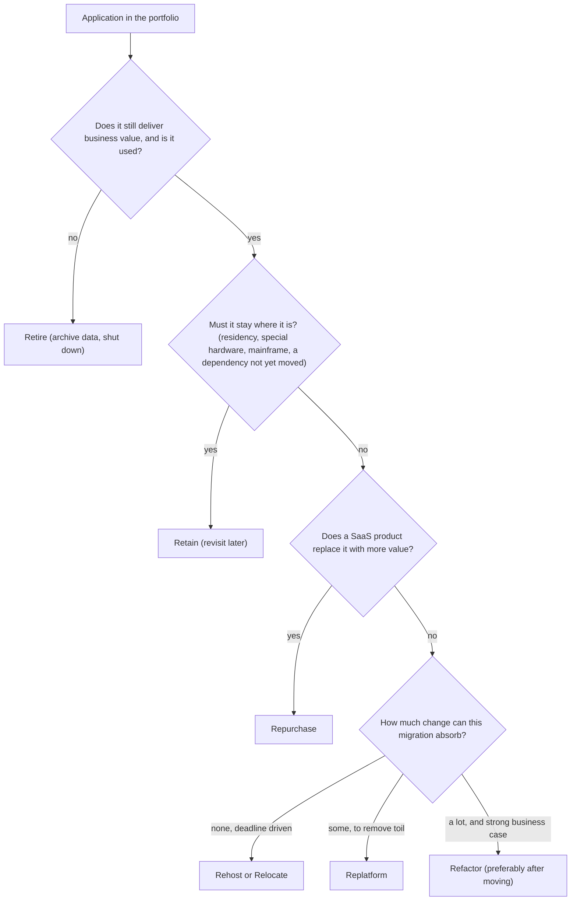
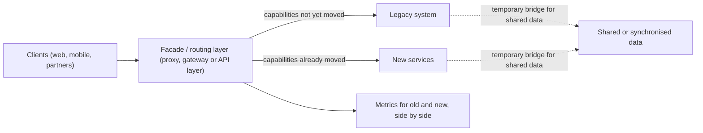
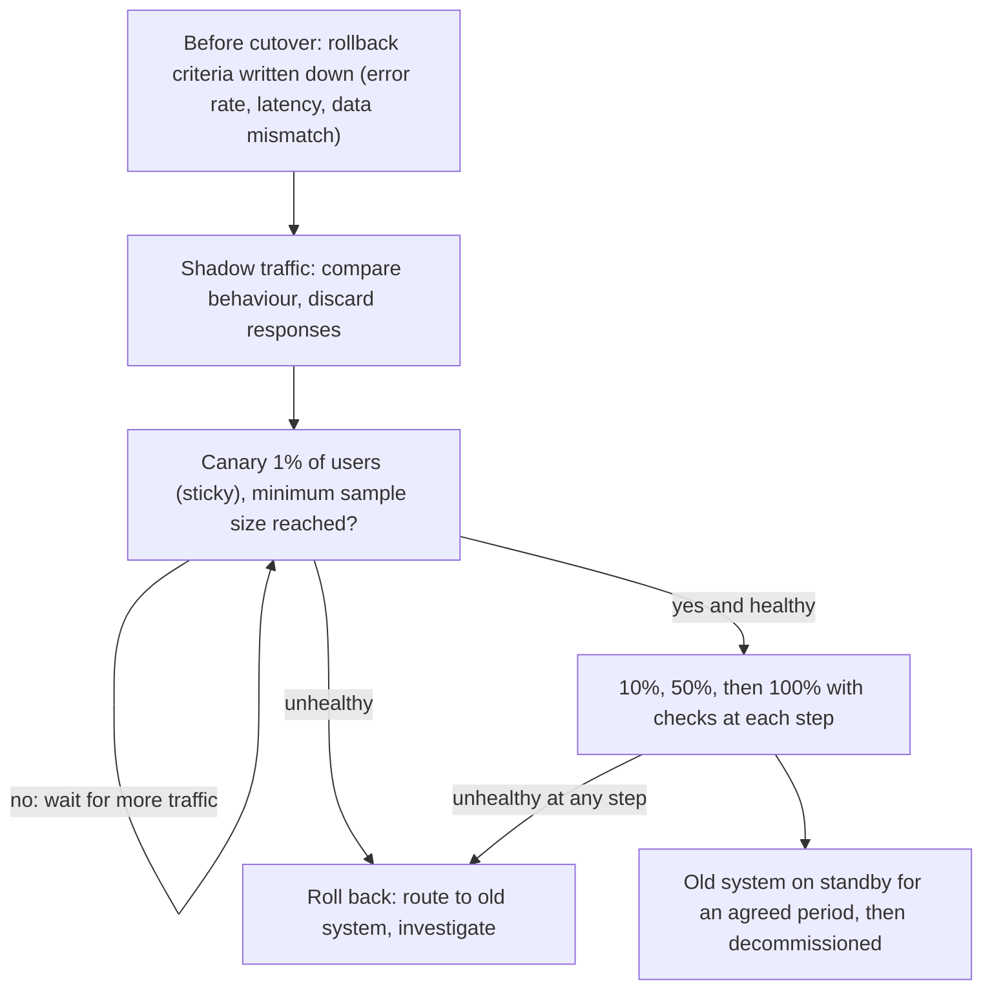

**Navigation**: [← FinOps](33_FinOps_And_Cost_Architecture.md) | [Index](00_INDEX.md) | [Learning path, Stage 9](00_INDEX.md#-learning-path--first-principles-to-advanced) | Related: [29 Microservices](29_Microservices_On_The_Platform.md) · [19 CI/CD](19_CICD_Pipelines.md) · [24 Cloud fundamentals](24_Cloud_Fundamentals.md)

# 🚚 Chapter 34: Migration and Modernisation — Moving a Running System Without Stopping It

_"Nobody has ever been fired for planning a migration too carefully. Many have been for a cutover weekend that had no way back."_

---

## 5W1H

- **WHAT**: How to move existing systems — applications, data and traffic — to a new platform (a cloud, a new architecture, a new data store) while they keep serving users, and how to decide what to move, in what order, by which strategy, and how to prove each step worked.
- **WHY**: Greenfield is rare. Most senior infrastructure work is changing a system that is already carrying revenue. The usual failure is not technical difficulty but **irreversibility**: a big-bang cutover that cannot be undone, driven by dependencies nobody mapped.
- **WHO**: Architects and platform engineers planning a data-centre exit, a monolith decomposition or a database change; anyone inheriting a system that is "too important to touch".
- **WHEN**: When the cost of staying (support end-of-life, capacity, speed of change, risk) exceeds the cost of moving, and *not* before there is a business reason, a baseline and a rollback.
- **WHERE**: At every boundary: servers to a cloud, monolith to services ([chapter 29](29_Microservices_On_The_Platform.md)), one database to another, one region or account to another ([chapter 28](28_Enterprise_Reference_Architecture.md)).
- **HOW**: Classify each workload with a small set of named strategies, order the work by dependency, route traffic gradually with a facade, migrate data with a rehearsed and reversible method, and gate each step on measured evidence.

> **Verified on** — The canary-power, sticky-routing and dependency-wave experiments were run with Python 3 (standard library only) on WSL2 Ubuntu 24.04 (kernel 6.6.87) with fixed random seeds; the printed numbers are exactly what the shown code produces. The seven migration strategies and the guidance on large migrations were read from the AWS Prescriptive Guidance *Large migration guide* ("About the migration strategies"), and the strangler-fig description from Martin Fowler's article, both on 2026-11-15. Data-migration tooling and database-specific procedures were **not run** here and are marked **not verified here**.

---

# PART 1: The Problem — Why Migrations Fail

## 1.1 Derive the hard parts

Start with a running system and a target. List what has to move, and ask what makes each part hard:

| What moves | Why it is hard | Consequence if ignored |
| --- | --- | --- |
| **The code** | Easy to copy; hard to know what else it silently depends on (a shared file, a cron job on another host, a hard-coded address) | It works in test and fails in production on the first cross-system call |
| **The dependencies** | Systems call each other in ways nobody drew | Moving one piece breaks something unrelated |
| **The data** | It is large, constantly changing, and cannot be copied instantly: *data has gravity* | Either downtime while copying, or a copy that is already out of date |
| **The traffic** | Users and other systems point at the old location | A cutover moves everyone at once, with no partial test |
| **The people and process** | On-call, runbooks, monitoring, access and compliance are bound to the old place | The system moves but nobody can operate it |

Two principles follow from the table, and the rest of the chapter applies them:

1. **Make every step small and reversible.** A change you can undo cheaply can be tried; one you cannot must be proven first.
2. **Run old and new side by side, and move traffic gradually,** because that is the only way to learn how the new system behaves under real load before you depend on it.

## 1.2 The wrong reasons

A migration needs a reason that survives scrutiny. "Everyone is moving to the cloud" is not one. Reasons that justify the cost: a data-centre lease ending, hardware or software out of support, a capacity or speed-of-delivery limit that the new platform removes, a compliance requirement, or a measurable cost reduction. Write the goal as a number or a date ("exit the data centre by June", "release daily instead of quarterly") so that you can tell, later, whether the migration worked — and so you can recognise when a *particular application* has no reason to move at all (Part 2, retain and retire).

---

# PART 2: The Strategies — A Small Vocabulary for a Big Decision

## 2.1 The seven Rs

The AWS Prescriptive Guidance *Large migration guide* names seven strategies, "the 7 Rs". They are a useful common vocabulary even if you migrate to another provider, because each answers "how much do we change this application?"

| Strategy | What it means (per the guide) | Choose it when |
| --- | --- | --- |
| **Retire** | Decommission or archive the application and shut down its servers | No business value; unsupported components are a security risk; idle or "zombie" usage (see §3.2) |
| **Retain** | Keep it where it is, possibly migrate later | Data-residency rules, high risk needing a detailed plan, dependencies that must move first, recent upgrade, no benefit, a SaaS replacement is coming, specialised hardware, mainframe and non-x86 systems that need careful assessment |
| **Rehost** | "Lift and shift": move without changing the application | You need speed and low change risk; optimise later, because a running cloud workload is easier to improve |
| **Relocate** | Move a large number of servers or instances to the cloud version of the same platform, or to another VPC, Region or account, without changing architecture | The fastest route when the platform is the same underneath (for example, between accounts) |
| **Repurchase** | "Drop and shop": replace the application with a different product, typically SaaS | Commodity function; custom code you would rather not maintain; licence and infrastructure burden |
| **Replatform** | "Lift, tinker and shift": move and apply some optimisation, such as a managed database or containers, without redesigning | A managed service removes work; OS or runtime upgrade; moving VMs into containers without code changes |
| **Refactor or re-architect** | Modify the architecture to use cloud-native features | Strong business demand to scale, ship faster or cut cost; a monolith blocking delivery; code nobody can maintain |

The guide's advice for **large migrations** is worth memorising because it runs against instinct: common strategies are rehost, replatform, relocate and retire, while *refactor is not recommended during a large migration*, since modernising while moving is the most complex path and is hard to manage across many applications. The recommendation is to **move first, modernise after** — rehost, relocate or replatform the application, then improve it once it is running in the new place.



**How to read this diagram.** Follow the questions from the top for a single application. The first two questions can end the decision cheaply: an unused application is retired, and one that must stay is retained, which together often remove a surprising fraction of the portfolio before any engineering. The third question checks for a replacement product. Only the survivors reach the last question, which is really about **how much risk the programme can absorb**: a deadline pushes you toward rehost or relocate, a wish to remove toil toward replatform, and a strong business case toward refactor. The thing to notice is that "refactor" carries the note *preferably after moving* — the guide's own advice for large migrations.

---

# PART 3: Know What You Have — Discovery and Ordering

## 3.1 The portfolio is the plan

You cannot choose strategies for applications you have not counted. Discovery produces an inventory: each application, its servers, owners, data stores, usage, and — most valuable and most often missing — **what it talks to**. Sources include configuration management data, network flow records, and discovery tooling; each is incomplete, so triangulate.

## 3.2 Zombies and idle applications

The AWS guide gives concrete screening rules for the *retire* strategy, expressed as utilisation: applications with average CPU and memory below **5 percent** are *zombie applications*; those between **5 and 20 percent** over a **90-day** period are *idle applications*; another signal is **no inbound connection for the last 90 days**. Treat these as prompts to ask the owner "can we turn this off?" — not as proof. Every application retired is an application you never have to migrate, secure or pay for, so this is the cheapest work in the whole programme.

## 3.3 Order by dependency

Moving an application away from the things it calls creates a cross-boundary dependency: until the dependency also moves, every call travels across the old and new environments, with extra latency, possible firewall rules and a new failure mode. One defensible rule is to move **dependencies first**, so that each moved application finds what it needs already in place. This is a topological sort, and it can be computed instead of argued. A small dependency graph, with a cycle added to show the special case:

```python
"""Order a migration by dependency: an app moves only after what it depends on is reachable; cycles move together."""
from graphlib import TopologicalSorter, CycleError
deps = {                       # app -> things it calls
 "web":      {"orders", "catalog"},
 "orders":   {"payments", "inventory"},
 "catalog":  {"search"},
 "payments": {"ledger"},
 "inventory": set(), "search": set(), "ledger": set(),
}
ts = TopologicalSorter(deps); ts.prepare(); wave = 1
while ts.is_active():
    ready = sorted(ts.get_ready()); print(f"wave {wave}: {ready}"); ts.done(*ready); wave += 1
print("--- add a cycle: ledger also calls payments")
deps2 = {**deps, "ledger": {"payments"}}
try: list(TopologicalSorter(deps2).static_order())
except CycleError as e: print("cycle found:", e.args[1][:3], "-> these must move in the same wave")
```

```text
wave 1: ['inventory', 'ledger', 'search']
wave 2: ['catalog', 'payments']
wave 3: ['orders']
wave 4: ['web']
--- add a cycle: ledger also calls payments
cycle found: ['payments', 'ledger', 'payments'] -> these must move in the same wave
```

The output is the migration plan: four waves, with everything in a wave independent of the others in it, so each wave can be done in parallel and each application finds its dependencies already moved. The second half shows the case that breaks naive plans: **when two applications call each other they cannot be ordered**, so they must move in the same wave (or one must be decoupled first). The alternative order — move callers first and keep a network link back to the old environment — is also valid and sometimes necessary when the leaf systems are the hardest to move; it accepts cross-environment latency for longer. The decision is a trade-off between **how long you tolerate the boundary** and **which systems are hardest to move**, which is exactly the kind of choice a senior engineer writes down.

---

# PART 4: The Strangler Fig — Replace It Piece by Piece

## 4.1 The idea

Martin Fowler described the pattern after seeing strangler figs: vines that start in the crevice of a tree, grow around it, and eventually stand alone after the host dies. Applied to software: **build the new system around the old one and move functionality over in small increments**, instead of a rewrite that must reach full parity before anyone benefits. The practical ingredients, from his description: find *seams* in the legacy code where a piece can be split off, move small components first, accept temporary transitional code that lets old and new coexist, and remove it when the migration finishes. The claimed benefits are lower risk (each piece is small), earlier value (finished pieces go live before the end), lessons from early pieces informing later ones, and gradual, visible investment.

The mechanism that makes it work is a **facade** — a proxy in front of both systems that decides, per request, which one answers. Initially it sends everything to the old system; as capabilities are rebuilt, it sends more to the new one.



**How to read this diagram.** Every request enters through one facade, so clients never learn that the system behind it is changing. The facade splits traffic by *capability*: the unmoved parts go to the legacy system, the moved parts go to the new one. The dotted lines are the part teams underestimate — both systems usually need the same data during the transition, so a temporary bridge (shared tables, replication, events) exists and must itself be removed at the end. The thing to notice is the bottom box: because both systems sit behind one point, you can **compare them with real traffic**, which is the evidence you need to decide whether to move more.

## 4.2 Routing must be sticky

How the facade splits traffic matters more than it appears. Suppose you send 20% of users to the new system. If you decide *independently for every request*, the same user bounces between two systems with potentially different data and behaviour. Decide *once per user* instead (for example by hashing the user id). The simulation makes the difference concrete:

```python
"""Strangler routing: send 20% of users to the NEW system. Random per request vs sticky per user."""
import hashlib, random
random.seed(5)
def random_route(_user): return "new" if random.random() < 0.20 else "old"
def sticky_route(user):
    h = int(hashlib.sha256(user.encode()).hexdigest(), 16) % 100
    return "new" if h < 20 else "old"
users = [f"user-{i}" for i in range(2000)]
for name, route in (("random per request", random_route), ("sticky by user hash", sticky_route)):
    flips = 0; share_new = 0
    for u in users:
        seq = [route(u) for _ in range(10)]          # the same user makes 10 requests
        flips += len(set(seq)) > 1; share_new += seq.count("new")
    print(f"{name:<20} users who saw BOTH systems: {flips/len(users):>5.0%}   overall share to new: {share_new/(10*len(users)):.1%}")
```

```text
random per request   users who saw BOTH systems:   88%   overall share to new: 19.7%
sticky by user hash  users who saw BOTH systems:    0%   overall share to new: 19.9%
```

Both methods send about 20% of traffic to the new system (19.7% and 19.9%), but random routing exposed **88% of users to both systems** within ten requests, while hashing exposed none. Anything with state — a shopping cart, a session, a draft — breaks under random routing, in ways that are maddening to reproduce. Hash by user (or account, or tenant) and raise the percentage over time; to roll back, lower it, and the same users return to the old system consistently.

---

# PART 5: Data — The Part That Cannot Be Faked

## 5.1 Why data decides the strategy

Code can run in two places at once; data has to have one source of truth at any moment. The options trade downtime against complexity and risk:

| Method | How | Downtime | Risk |
| --- | --- | --- | --- |
| **Offline bulk copy** | Stop writes, copy, switch | Proportional to data size | Simple, but the window may be hours or days |
| **Replicate, then cut over** | Bulk copy, then stream changes continuously until the copy is current; briefly pause writes; switch | Seconds to minutes | Needs a replication mechanism and a verification step |
| **Dual writes** | The application writes to both old and new | None | Dangerous: if one write fails, they diverge, and nothing says which is right |
| **Change-data-capture into the new store, new store becomes primary** | Stream the old database's change log into the new one | Near zero | Needs tooling and careful ordering |
| **Expand and contract** (schema changes) | Add the new structure alongside the old, migrate readers and writers in steps, remove the old structure last | None | Many small steps; each must be compatible with both app versions |

Whichever you choose, three disciplines apply. **Verify**, do not assume: compare row counts and checksums per table or per key range between source and target, and sample records. **Rehearse** the cutover on a copy, timing every step. **Know the way back before you start**: if writes continued on the new system for an hour, rolling back means getting that hour of data back into the old one — decide whether you can, or whether rollback ends at a specific point.

Dual writes deserve the warning label. They look like the easy, no-downtime option and fail in the most confusing way: the two stores differ, both are "correct" from their own application's view, and there is no authority to settle it. If you need continuous data movement, prefer a change stream with one clear writer. Specific tools and database-specific procedures are **not verified here**.

---

# PART 6: Cutover — Proving It Before You Depend on It

## 6.1 Parallel running and shadow traffic

The strongest evidence comes from running the new system against *real* requests before it answers anyone. **Shadow traffic** copies production requests to the new system and discards its responses, so you can compare its behaviour (errors, latency, results) with the old without risk to users. It is not free — side effects must be disabled (no real emails, charges or writes) — but it finds the problems no test finds, because it uses real data shapes and real volume.

## 6.2 Canarying — how much evidence is enough?

After shadowing, you route a small share of real users to the new system (the canary) and compare it with the baseline. The senior question is: *how long must I wait before the comparison means anything?* Small samples are noisy, and a naive "looks fine" is a coin flip. Measure it. Baseline error rate 0.5%; the canary gets 10% of traffic; a simple one-sided test at the 95% level. How often does the test flag a canary that is truly **twice as bad** (1.0%), and how often does it falsely flag an **identical** one?

```python
"""How long must a canary run before you can trust it? Monte Carlo with a simple one-sided z-test."""
import random, math
random.seed(11)

def detect(baseline_err, canary_err, n_canary, n_base, trials=3000, z_crit=1.645):
    hits = 0
    for _ in range(trials):
        e_c = sum(random.random() < canary_err for _ in range(n_canary))
        e_b = sum(random.random() < baseline_err for _ in range(n_base))
        p_c, p_b = e_c / n_canary, e_b / n_base
        pooled = (e_c + e_b) / (n_canary + n_base)
        se = math.sqrt(pooled * (1 - pooled) * (1 / n_canary + 1 / n_base)) or 1e-9
        if (p_c - p_b) / se > z_crit: hits += 1
    return hits / trials

print(f"{'canary requests':>16} {'canary true err':>16} {'flagged':>9}")
for n in (200, 1000, 5000, 20000):
    n_base = n * 9                       # canary gets 10% of traffic
    print(f"{n:>16} {'1.0% (2x worse)':>16} {detect(0.005, 0.010, n, n_base):>9.0%}")
    print(f"{n:>16} {'0.5% (same)':>16} {detect(0.005, 0.005, n, n_base):>9.0%}")
```

```text
 canary requests  canary true err   flagged
             200  1.0% (2x worse)       27%
             200      0.5% (same)        7%
            1000  1.0% (2x worse)       60%
            1000      0.5% (same)        6%
            5000  1.0% (2x worse)       99%
            5000      0.5% (same)        5%
           20000  1.0% (2x worse)      100%
           20000      0.5% (same)        5%
```

Read the table in two columns. The **power** rows show that with only 200 canary requests a canary that is *twice as bad* is flagged just 27% of the time — a 73% chance you would wave through a regression. At 1,000 requests it is 60%, and only at around 5,000 does detection pass 99%. The **false-alarm** rows hover near 5%, which is simply the significance level you chose. The lesson is practical: *the canary needs a minimum sample size set in advance, derived from the error rate you want to detect*, and a short canary on a low-traffic service proves nothing. For rare events (errors at 0.5%), you need thousands of requests; for latency you need enough requests to see the tail. (The model is deliberately simple — real canary analysis also compares latency percentiles and business metrics over time and corrects for repeated looks; see *The Site Reliability Workbook*, Ch 16 "Canarying Releases", for the full treatment.)



**How to read this diagram.** The first box is the discipline people skip: the rollback criteria are decided *before* anyone sees the new system's numbers, so nobody argues with the evidence afterwards. The flow then climbs in steps — shadow, a small sticky canary, larger shares — and at each canary step the loop on "minimum sample size reached?" encodes the lesson from the table above: wait until you have enough requests to mean something. Every unhealthy branch leads to the same place, a rollback that is just a routing change. The thing to notice is the last box: the old system stays **on standby** after 100%, because the cheapest rollback is the one that still exists.

## 6.3 Details that decide whether the cutover is boring

- **Lower DNS TTLs ahead of time**, so a switch propagates in minutes ([chapter 7](07_DNS_Complete.md) derives why a 3,600-second record cannot be changed quickly).
- **Freeze unrelated changes** around the cutover so a failure has few suspects.
- **Rehearse** the whole runbook, including rollback, on a production-like copy and time it.
- **Define "done"** as measured outcomes (error budget intact, latency within SLO, data verified), not "the migration task is closed".
- **Keep the old system's data read-only and backed up** until the agreed standby period ends ([chapter 27](00_INDEX.md) 🔜 covers backups and restore drills).

---

# PART 7: Modernising After the Move

Moving is not modernising, and the guide's advice for large programmes is to separate them. Once a workload runs in its new home, modernise with the same incremental discipline: replace the undifferentiated parts first (a managed database in place of a self-run one), extract services along ownership boundaries ([chapter 29](29_Microservices_On_The_Platform.md), including the warning about distributed monoliths), and use the platform's guardrails and observability ([chapters 21](21_Monitoring_Observability.md), [28](28_Enterprise_Reference_Architecture.md)) to verify each step. Re-run the cost model ([chapter 33](33_FinOps_And_Cost_Architecture.md)) after each stage; a lifted-and-shifted workload is often *more* expensive until it is rightsized, which is a reason to measure rather than a reason not to migrate.

---

# PART 8: Alternatives and When Not To Migrate

| Option | When it is the better answer | Cost |
| --- | --- | --- |
| **Do nothing** (retain) | The application is stable, low-risk, with few users and no deadline | Ongoing support burden; revisit when a trigger appears (end of life, contract) |
| **Retire** | The usage data says nobody uses it | A conversation with the owner and an archive plan |
| **Repurchase (SaaS)** | The function is commodity and a vendor does it better | Data migration, integration, loss of customisation |
| **Rewrite from scratch** | Almost never; only when the old system is truly unsalvageable and small | The "second-system" risk: long delay, no value until parity, requirements that drifted meanwhile |
| **Strangler / incremental** | Most large, valuable, long-lived systems | Temporary bridges and a long period of two systems to operate |
| **Big-bang cutover** | Small systems with a tolerable outage window and a tested rollback | Everything depends on one night |

The general rule: **the larger and more valuable the system, the smaller each step should be.** A rewrite promises a clean start and typically delivers the old system's bugs, rediscovered one at a time, with no revenue until parity.

---

# PART 9: How It Fails

| Symptom | Cause | How to prove it | Prevention |
| --- | --- | --- | --- |
| The migration stalls half-done | Refactored while migrating; scope kept growing | Applications stuck in "in progress" far beyond the plan | Move first, modernise after; fixed strategy per application |
| An application breaks after moving | A hidden dependency (an address, a share, a job) was not in the inventory | Failed calls to the old environment appear in logs; flow records show unexpected destinations | Discovery from network flows, dependency mapping, rehearsal in a copy |
| Users see inconsistent data during the strangler phase | Random per-request routing sends one user to both systems | The same user id appears in both systems' logs within minutes | Sticky routing by user, tenant or account |
| The two databases disagree | Dual writes with a failed write on one side | Row counts or checksums differ; no record of which is right | One writer with replication or change capture; verification jobs |
| A bad canary is promoted | Sample too small to detect the regression | The regression appears at full traffic; the canary summary said "no difference" | Minimum sample size computed from the effect size to detect |
| Rollback impossible | New system accepted writes the old one cannot take back | Data created after cutover has no path to the old store | Decide rollback limits before the cutover; keep reverse replication where needed |
| Costs rise after migration | Lift-and-shift without rightsizing; duplicated environments left running | Cost per unit before and after ([chapter 33](33_FinOps_And_Cost_Architecture.md)) | Decommission old systems on a date; rightsize in the modernise phase |
| Nobody can operate the new system | Runbooks, monitoring and access stayed in the old world | The first incident has no dashboard or on-call owner | Operational readiness as a gate, checked before cutover |

---

# PART 10: Lab — Plan, Route, Prove

All labs run on a laptop with Python 3 (standard library). Work in `~/lab/migrate`.

1. **Order the waves.** Save the script from §3.3 as `waves.py` and run it.
   - *Expected:* four waves and the cycle message shown.
   - *Check:* before running, write the order you expect; explain any difference. Then add an edge `inventory -> search` and predict how wave 1 changes.
2. **Extend the graph with your own system.** Write the dependency map of a system you know (at least eight components) as a dictionary and run it.
   - *Expected:* a wave plan, or a cycle.
   - *Check:* identify the component that appears in the most late waves and say why it is the riskiest to move; if the graph has a cycle, write one change that would break it.
3. **Sticky routing.** Save the script from §4.2 as `sticky.py` and run it.
   - *Expected:* about 88% of users see both systems under random routing, 0% under sticky routing.
   - *Check:* change the rollout from 20% to 5% and predict the random-routing flip rate before running (hint: P(see both in 10 requests) = 1 − 0.05¹⁰ − 0.95¹⁰).
4. **Canary power.** Save the script from §6.2 as `canary.py` and run it.
   - *Expected:* the table shown (counts will match because the seed is fixed).
   - *Check:* change the true canary error rate to 0.75% and find the smallest sample size that detects it at least 90% of the time; state it as a requirement in one sentence ("canary must see at least N requests").
5. **Define rollback criteria.** For a database migration you choose, write the exact conditions (metric, threshold, time window, data check) that trigger rollback, who decides, and the longest point after which rollback is no longer possible.
   - *Check:* a colleague can read your criteria and decide *yes or no* without asking you anything.
6. **Strategy assignment (paper).** Classify ten applications (invent them or use your own estate) into the seven strategies using the diagram in §2.1, and write one line per application justifying it. State how many you retired or retained and what that saved.
7. **(Not verified here — needs a database and replication tooling.)** Set up a replica of a test database, keep it in sync under load, pause writes, verify checksums, and switch an application over; time every step and rehearse the rollback.

---

# PART 11: Challenges

🔬 **Section Challenge — Strategy choice**

**Challenge 1 (Reasoning):** A company must leave its data centre in 9 months and has 400 applications. Management wants every application refactored into microservices during the move "so we only do this once". What do you recommend and why?

<details><summary>Answer</summary>

Separate **moving** from **modernising**. The AWS large-migration guidance explicitly recommends rehost, relocate, replatform and retire for large programmes and advises against refactoring during the move, because modernising while migrating is the most complex path and does not scale across hundreds of applications. Within nine months: screen for **zombie and idle applications** to retire first (the guide's rules: under 5% CPU and memory, or 5–20% over 90 days, or no inbound connections for 90 days), retain what cannot move, rehost or relocate the bulk, replatform where a managed service clearly removes work, and refactor only the few applications with a strong business case, after the deadline-critical wave. "Only doing it once" is the risk, not the benefit: a combined move-and-rewrite has no rollback and no way to tell which change caused a failure.

</details>

🔬 **Section Challenge — Ordering**

**Challenge 2 (Calculation):** Given `A → B`, `A → C`, `B → D`, `C → D`, `D → E` (arrow = "calls"), give the migration waves under the dependencies-first rule, and say what changes if `E → B` is added.

<details><summary>Answer</summary>

Dependencies first means a component moves after everything it calls. E calls nothing, so **wave 1: E**. D calls only E: **wave 2: D**. B and C call only D: **wave 3: B, C** (independent of each other, can run in parallel). A calls B and C: **wave 4: A**. Adding `E → B` creates a cycle B → D → E → B, so B, D and E can no longer be ordered: they must move **in the same wave** (or you must break the cycle, for example by removing or decoupling the E→B call first). C and A then follow once that group has moved. The point is that ordering is computable, and a cycle is a finding to resolve before the schedule is committed.

</details>

🔬 **Section Challenge — Strangler routing**

**Challenge 3 (Debug):** During a 10% strangler rollout, customers report their shopping cart "forgets" items, but only sometimes. The facade routes each request randomly to the old or new system with probability 0.1. What is the bug and what do you change?

<details><summary>Answer</summary>

Routing per request means a single customer's consecutive requests land on **different systems**, each with its own cart state, so items added through one are missing on the other. With 10% to the new system, the chance that a customer making 10 requests sees both is 1 − 0.9¹⁰ − 0.1¹⁰ ≈ 65%. Change to **sticky routing by customer id** (a hash of the id, compared with the rollout percentage) so a customer is always served by the same system; raise the percentage over time, and roll back by lowering it. Also check whether state is *shared* between the two systems; if it must be, the temporary data bridge (§4.1) is part of the migration scope.

</details>

🔬 **Section Challenge — Data**

**Challenge 4 (Design):** You must move a 4 TB database that takes 30 hours to copy, with no more than a 5-minute write outage. Outline the method, the verification, and the rollback limit.

<details><summary>Answer</summary>

**Method:** take a consistent bulk copy while the source stays live (about 30 hours), then **stream the changes made since the copy started** (replication or change capture) until the target is seconds behind. At the cutover, pause writes briefly (within the 5 minutes), let the stream drain to zero lag, verify, then point the application at the target and resume writes. **Verification:** compare row counts and checksums per table or key range, and sample records; do it on a rehearsal first, timing every step, since the drain-and-switch is what must fit in 5 minutes. **Rollback limit:** until writes resume on the target, rollback is trivial (point back to the source). After writes resume, either run **reverse replication** from target to source so the old database stays current, or define a point after which rollback means data loss and get that accepted in advance. Avoid dual writes as the mechanism: a failed write on one side gives two diverging "truths".

</details>

🔬 **Section Challenge — Canary evidence**

**Challenge 5 (Trade-off):** A canary gets 200 requests in the first hour and shows the same error rate as the baseline. A manager says "it's fine, promote to 100%". Use the model's numbers to respond.

<details><summary>Answer</summary>

With only 200 canary requests and a baseline of 0.5% errors, the simulated test flagged a canary that was truly **twice as bad** only **27%** of the time — so a 73% chance that a 2× regression looks "the same". The observation is real but uninformative. Do not promote on it. Either wait until the canary reaches the sample size needed for the effect you care about (about 5,000 requests detected a 2× regression 99% of the time in the model, 1,000 requests only 60%), or increase the canary's share of traffic so it gets there sooner. Agree the required sample size *before* the canary starts, so the decision is not a negotiation in the moment.

</details>

**Challenge 6 (Scenario):** The migration plan says "we will roll back if anything goes wrong." Why is that not a plan, and what does a real plan specify?

<details><summary>Answer</summary>

"Anything goes wrong" is neither measurable nor decided in advance, and "roll back" is not a procedure. A real plan specifies: **the criteria** (for example, error rate above X% over Y minutes, p99 latency above Z, any data-verification mismatch); **who decides** and how fast; **the procedure** (the routing change, with the exact commands, rehearsed and timed); **the data position** (what happens to writes made on the new system, and the last point at which rollback is still safe); and **how long the old system stays on standby**. Without those, the decision in the moment is made by whoever is most tired and most invested in success.

</details>

---

# Reality Check

**"Lift and shift is a waste; we should do it properly."** For a large migration the vendor's own guidance recommends moving first and modernising after. A running workload in the new environment is easier to improve than a half-redesigned one in the old.

**"A rewrite will be cleaner than migrating."** It rediscovers every requirement the old system quietly satisfied, delivers no value until parity, and has no gradual rollback. Incremental replacement usually beats it for systems that matter.

**"Dual writes give us zero-downtime migration."** They give you two databases that eventually disagree, with no authority to settle it. Use a single writer and a change stream.

**"The canary looked fine, so it is fine."** A short canary on a low-traffic path cannot distinguish a good build from a bad one. Sample size is a requirement, not a hope.

**"We can decide the rollback criteria when we see the numbers."** People defend the system they worked hardest on. Write the criteria first.

**"Everything must move."** Retiring and retaining are valid, often large, parts of a migration. The cheapest application to migrate is the one you switch off.

**"Moving to the cloud will cut costs."** It cuts capital cost and adds variable cost; a lifted workload is often *more* expensive until rightsized. Measure unit cost before and after ([chapter 33](33_FinOps_And_Cost_Architecture.md)).

---

# Books and References

| Source | Read | What it adds beyond this chapter |
| --- | --- | --- |
| AWS Prescriptive Guidance, *Large migration guide*, "About the migration strategies" (FREE) — https://docs.aws.amazon.com/prescriptive-guidance/latest/large-migration-guide/migration-strategies.html | The seven strategies and the guidance for large migrations | The vendor's definitions and the recommendation to move first and modernise after |
| Martin Fowler, "Strangler Fig Application" (FREE) — https://martinfowler.com/bliki/StranglerFigApplication.html | The whole article | The origin of the pattern and the four activities that support it |
| *The Site Reliability Workbook*, Google (FREE) — https://sre.google/workbook/table-of-contents/ | Ch 16 "Canarying Releases" | The full treatment of judging a canary, beyond the simple model in §6.2 |
| *Site Reliability Engineering*, Google (FREE) — https://sre.google/sre-book/table-of-contents/ | Ch 8 "Release Engineering" | Treating release and rollout as an engineering discipline |
| *Building Secure & Reliable Systems* (FREE, https://sre.google/books/) | Ch 14 "Deploying Code" | Who may deploy and how you know what was deployed, relevant to cutover control |
| *Continuous Delivery*, Humble and Farley (PAID) | Ch 11 "Managing Infrastructure and Environments" | Environments reproducible enough to rehearse a cutover in |

No book on database-migration tooling was verified for this repository; consult each database's own documentation for replication and cutover specifics.

---

## 🔗 Cross-References

- [29 Microservices on the Platform](29_Microservices_On_The_Platform.md) — the target architecture of many decompositions, and the distributed-monolith warning
- [28 Enterprise Reference Architecture](28_Enterprise_Reference_Architecture.md) — the Transitional OU and landing zone that receive migrated workloads
- [33 FinOps and Cost Architecture](33_FinOps_And_Cost_Architecture.md) — measuring unit cost before and after
- [19 CI/CD Pipelines](19_CICD_Pipelines.md) — deployment strategies (canary, blue-green) the cutover reuses
- [07 DNS Complete](07_DNS_Complete.md) — TTLs and why cutovers need them lowered in advance
- [21 Monitoring and Observability](21_Monitoring_Observability.md) — the old-versus-new comparison depends on it
- [SENIOR_READINESS](SENIOR_READINESS.md) — stage 9 proof tasks and the capstone design defence
