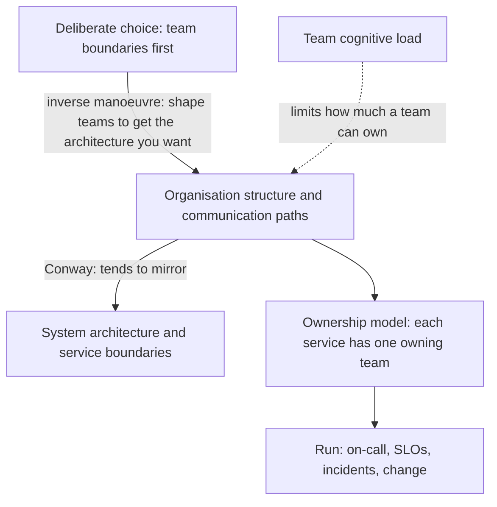
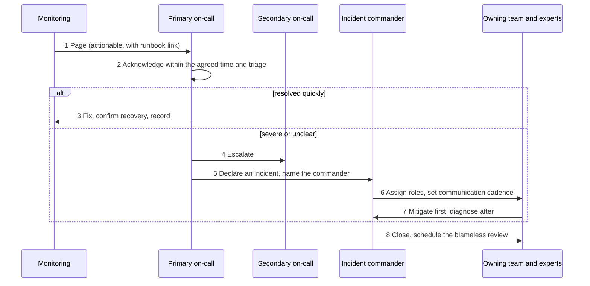
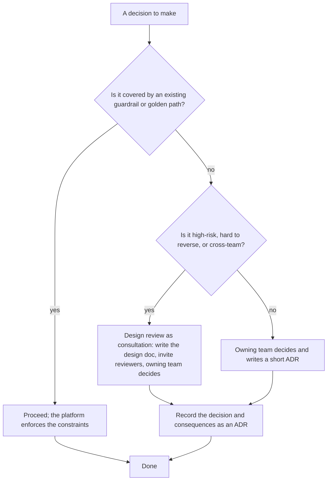

**Navigation**: [← Platform Engineering](30_Platform_Engineering.md) | [Index](00_INDEX.md) | [Learning path, Stage 10](00_INDEX.md#-learning-path--first-principles-to-advanced) | Related: [22 SRE Practices](22_SRE_Practices.md) · [31 DevSecOps](31_DevSecOps_Supply_Chain_And_Policy.md) · [Readiness and capstones](SENIOR_READINESS.md)

# 🧭 Chapter 35: Organisation and Operating Model — Ownership, On-Call, Change and Decisions

_"A technology stack is a set of agreements between machines. An operating model is a set of agreements between people — who is woken up, who may change what, who decides — and it fails in exactly the same ways: ambiguous interfaces, missing owners, and unbounded retries."_

---

## 5W1H

- **WHAT**: How an engineering organisation runs the systems it builds: who owns each service, how on-call is designed, how incidents are handled and learned from, how delivery performance is measured, how change is approved, and how architectural decisions are made and recorded.
- **WHY**: Technical excellence does not survive a broken operating model. Ownerless services rot, unbounded on-call burns people out, heavyweight approvals slow delivery without lowering failure rates, and undocumented decisions are re-litigated forever. At senior level the *system around the system* is part of your remit.
- **WHO**: Senior engineers, SREs, platform and engineering leads — anyone who is asked "how should we run this?" rather than "how do we build this?".
- **WHEN**: As soon as more than one team depends on shared systems, and again every time the organisation changes shape. A model that suited ten engineers fails at a hundred.
- **WHERE**: Between teams and around systems: in the service catalogue, the on-call rota, the incident process, the change process and the decision record.
- **HOW**: Derive each practice from the problem it prevents, use published numbers where they exist (Google's on-call guidance, DORA's delivery research), and compute the human load with small models before you commit people to a design.

> **Verified on** — The on-call arithmetic below was run with Python 3 on WSL2 Ubuntu 24.04 (kernel 6.6.87); the printed tables are exactly what the code produces. The on-call figures (incidents per shift, rotation sizes, time split) were read from *Site Reliability Engineering* chapter "Being On-Call" on sre.google; the change-approval findings from DORA's "Streamlining change approval" capability page; the five delivery metrics from dora.dev; the team types and interaction modes from the Team Topologies key-concepts page; all on 2026-11-15. Organisational outcomes depend heavily on context, so treat the numbers as starting points to test against your own data, not as laws.

---

# PART 1: The Problem — Systems Are Run by People

## 1.1 Derive what an organisation must provide

Take any service in production and ask the questions an incident will force:

| Question | If nobody has a clear answer |
| --- | --- |
| **Who owns it?** | The alert goes to nobody, or to everybody, and the incident lasts longer |
| **Who is woken up, and is that sustainable?** | The best engineers leave; the remainder stop answering |
| **Who may change it, and how fast?** | Either anyone can break it, or nobody can fix it |
| **How do we know whether it is healthy and whether we are improving?** | Opinions replace evidence; every meeting is an argument |
| **Who decided it was built this way, and why?** | The decision is repeated or reversed without anyone remembering the constraints |
| **What do we learn from failures?** | The same incident recurs under a new name |

Each row is a *missing interface*. The operating model is the set of interfaces between people and systems: **ownership** (answers who), **on-call** (who responds), **change management** (who may alter), **measurement** (what is true), **decision records** (why) and **incident learning** (what changed afterwards).

## 1.2 Conway's law, and why the shape of teams is an architectural choice

Melvin Conway observed in 1968 that organisations design systems that mirror their own communication structure. Put practically: **the boundaries between your teams will become the boundaries between your services, whether you plan it or not.** The consequence for design is to choose the team structure deliberately, and to use it as a lever (sometimes called the inverse Conway manoeuvre): if you want independent services, create independent teams that own them end to end.

The Team Topologies framework turns this into a vocabulary already used in [chapter 30](30_Platform_Engineering.md): four team types (stream-aligned, enabling, complicated-subsystem, platform) and three interaction modes (collaboration, X-as-a-Service, facilitation), plus the central constraint of **team cognitive load** — overloaded teams make poorer decisions and slow down, often because responsibilities keep being added without any being removed. An operating model is, among other things, a plan for keeping each team's load within its capacity.



**How to read this diagram.** The first arrow is the observation: the organisation's shape tends to appear in the architecture. The second arrow is the *use* of that fact: if you decide the team boundaries deliberately, you are also deciding the service boundaries. The dotted arrow is the limit: a team can own only as much as its cognitive load allows, so ownership has to be sized, not just assigned. The thing to notice is the direction — organisation first, architecture second — which is the reverse of what most reorganisations assume.

---

# PART 2: Ownership — Every Service Has One Owner

## 2.1 The model

"You build it, you run it" is the simplest model that closes the feedback loop: the people who feel the pain of an outage are the people who can prevent it, which changes how they design. It requires a few concrete things per service, recorded where tools can read them (a service catalogue or a file in the repository, as the platform's golden path generates in [chapter 30](30_Platform_Engineering.md)):

| Item | Content | Used by |
| --- | --- | --- |
| **Owning team** | One team, never "everyone" or "platform" by default | Alert routing, access reviews, cost allocation ([chapter 33](33_FinOps_And_Cost_Architecture.md)) |
| **On-call rota** | Who is paged, with an escalation path | Incident response |
| **SLOs** | The availability and latency the team promises, and the error-budget policy ([chapter 22](22_SRE_Practices.md)) | Prioritising reliability against features |
| **Runbooks and dashboards** | How to diagnose and fix the common failures | On-call |
| **Dependencies** | What it calls and what calls it | Incident scoping, migration order ([chapter 34](34_Migration_And_Modernisation.md)) |
| **Data classification and compliance notes** | What data it holds | Security and audit ([chapter 31](31_DevSecOps_Supply_Chain_And_Policy.md)) |

## 2.2 What breaks it

| Failure | Cause | Repair |
| --- | --- | --- |
| **The orphan** | The owning team was reorganised or left, and nobody noticed | A recurring audit: every service in the catalogue maps to a living team and rota; unowned services get an owner or a retirement date |
| **Shared ownership** | "The platform team and the product team both own it" | One owner, with a documented service interface to the other |
| **Ownership without authority** | A team is paged but cannot change the code or the infrastructure | Give the owning team the access and the budget, or move the ownership |
| **Ownership without capacity** | A team owns more services than it can reason about | Reduce the portfolio (retire, merge, hand to a better-suited team) before adding new services |

---

# PART 3: On-Call — Designed, Not Endured

## 3.1 What the published guidance says

Google's *Site Reliability Engineering* chapter "Being On-Call" gives numbers worth knowing, because they are rare in a field full of opinions:

- **No more than two incidents per 12-hour on-call shift**, a limit that follows from an average of about six hours per incident (handling, follow-up and write-up). Paging should be very flat, with a likely median of zero per day.
- **Rotation size**: at least **8 engineers** for a single-site team using week-long shifts (so each person is on call about one week per month), and at least **6** for a dual-site team.
- **Time split**: at least 50% of an SRE's time goes to engineering work; of the remainder, no more than 25% on on-call and up to another 25% on other operational work.
- **Compensation**: out-of-hours on-call is compensated, with time off in lieu or cash capped at some proportion of salary (the chapter gives no specific percentage).

These are guidance for one organisation's context, not universal laws, but they provide a baseline to check your own rota against: if your engineers handle five pages a night, the system or the alerting is broken, not the engineers.

## 3.2 Run the numbers on your own rota

Pages arrive roughly randomly, so the question "how often will an engineer exceed the guideline of two incidents in a shift?" is a probability question. Model incidents per shift as a Poisson process and compute it, then compute how rotation size turns into weeks on call, and what low-quality alerts cost:

```python
import math
def p_more_than(k, lam):                      # Poisson: P(N > k) for mean lam events per shift
    return 1 - sum(math.exp(-lam) * lam**i / math.factorial(i) for i in range(k + 1))

print("1. incidents per 12-hour shift (Poisson). Guideline: at most 2 per shift")
for lam in (0.1, 0.3, 0.5, 1.0, 1.5):
    p = p_more_than(2, lam)
    print(f"   {lam:>20} {p:>26.2%} {p*730:>40.0f}")
print("\n2. rotation size: weeks on-call per person per year (week-long shifts, one primary)")
for n in (3, 4, 6, 8):
    print(f"   {n} engineers -> on-call {52/n:>4.1f} weeks/year (once every {n} weeks)")
print("\n3. alert quality: 120 pages/week, what fraction needs a human?")
for actionable in (0.9, 0.5, 0.2):
    wasted = 120 * (1 - actionable)
    print(f"   {actionable:.0%} actionable -> {wasted:.0f} wasted pages/week = {wasted*10/60:.1f} engineer-hours/week at 10 min each")
```

```text
1. incidents per 12-hour shift (Poisson). Guideline: at most 2 per shift
   mean incidents/shift  P(more than 2 in a shift)  shifts per year over the limit (of 730)
                    0.1                      0.02%                                        0
                    0.3                      0.36%                                        3
                    0.5                      1.44%                                       11
                    1.0                      8.03%                                       59
                    1.5                     19.12%                                      140

2. rotation size: weeks on-call per person per year (week-long shifts, one primary)
   3 engineers -> on-call 17.3 weeks/year (once every 3 weeks)
   4 engineers -> on-call 13.0 weeks/year (once every 4 weeks)
   6 engineers -> on-call  8.7 weeks/year (once every 6 weeks)
   8 engineers -> on-call  6.5 weeks/year (once every 8 weeks)

3. alert quality: 120 pages/week, what fraction needs a human?
   90% actionable -> 12 wasted pages/week = 2.0 engineer-hours/week at 10 min each
   50% actionable -> 60 wasted pages/week = 10.0 engineer-hours/week at 10 min each
   20% actionable -> 96 wasted pages/week = 16.0 engineer-hours/week at 10 min each
```

Read the three tables as three decisions. **Table 1:** a *mean* of one incident per shift sounds fine, yet it puts about **8% of shifts (59 a year) over the two-incident limit** because pages cluster; at 1.5 per shift it is 140 shifts a year. The average hides the bad nights, so set targets on the tail. **Table 2:** a rotation of three engineers puts each person on call 17 weeks a year — a third of their life — while eight reduces it to 6.5, which is why the guidance sets minimum rotation sizes: it is arithmetic, not generosity. **Table 3:** at 120 pages a week, if only half need a human, the team wastes ten engineer-hours a week before counting broken sleep. The fix for all three is the same: *fewer, better alerts* ([chapter 21](21_Monitoring_Observability.md), and the SLO-based alerting in [chapter 22](22_SRE_Practices.md)), and a big enough rota. (The Poisson model assumes independent incidents; real incidents cluster in storms, so the real tail is worse than the model.)

## 3.3 The shape of a response



**How to read this diagram.** The page goes to one named person (step 1), who acknowledges and triages (step 2). The `alt` block is the fork that matters: small problems end with a recorded fix (step 3), while severe or unclear ones are escalated and a **commander** is named (steps 4–5) who assigns roles and sets communication (step 6). The thing to notice is step 7: the team *mitigates first and diagnoses after* — restoring service comes before finding the root cause — and step 8 guarantees the learning happens even when the incident ends at 4 a.m.

---

# PART 4: Incidents and Learning

The mechanics of incident command, severity and blameless post-mortems are covered with the SRE material in [chapter 22](22_SRE_Practices.md) and in the Books below; the operating-model points to carry from there are:

- **Roles are named, not assumed**: an incident commander (coordinates and decides), someone who communicates outward, and the technical responders. One person doing all three is how incidents drag on.
- **Severity is defined in advance** by customer impact, so nobody debates it at 3 a.m.
- **The review is blameless**: it asks "what made the wrong action look right at the time?" and produces *changes to the system*, tracked to completion. A post-mortem whose action items are never done teaches the organisation that learning is optional.
- **Error budgets connect reliability to priorities** ([chapter 22](22_SRE_Practices.md)): when the budget is spent, reliability work takes precedence over features by a rule agreed *beforehand*.

---

# PART 5: Measuring Delivery — Carefully

## 5.1 The five DORA metrics

DORA (DevOps Research and Assessment) names five software delivery performance metrics, in two groups. **Throughput**: *change lead time* (from committing a change to it running in production), *deployment frequency*, and *failed deployment recovery time* (how long it takes to recover from a failed deployment that needs immediate intervention). **Instability**: *change fail rate* (the share of deployments needing immediate follow-up such as a rollback or hotfix) and *deployment rework rate* (the share of deployments that are unplanned and triggered by a production incident). DORA's page notes that the metrics evolved from an earlier four-metric set, with failed deployment recovery time replacing the older mean-time-to-restore measure.

## 5.2 How measurement goes wrong

| Mistake | Why it fails | Better |
| --- | --- | --- |
| **Targets turned into goals** ("increase deployment frequency by 50%") | When a measure becomes a target, people optimise the number: splitting deploys that change nothing, redefining "failure" | Use the metrics to *find* bottlenecks and watch trends, not to set individual targets |
| **Comparing teams** | Context differs: a payments core and a marketing site are not comparable | Compare a team to *its own* past, and ask what is slowing it |
| **Measuring only throughput** | Speed without stability is just faster breakage | Read throughput *and* instability together |
| **Dashboards nobody owns** | No one acts on the numbers | Review the metrics in a regular team forum with an owner for each improvement |
| **Measuring people instead of systems** | Fear, gaming, hidden problems | Measure the delivery *system*; keep metrics out of individual performance reviews |

---

# PART 6: Change — Approval That Does Not Slow You Down

## 6.1 What the research found

A common reflex after an outage is to add approvals: a change advisory board (CAB), a manager's sign-off. DORA's research on this capability found that **heavyweight external approvals slow delivery**, push teams toward larger and less frequent releases (which carry more risk), and showed **no evidence that formal external review lowers change fail rates**. It recommends instead: **peer review during development**, recorded in the team's development platform (which also satisfies separation-of-duties requirements); **automated checks** — continuous testing, integration and monitoring — to catch bad changes early; a development platform treated as a product ([chapter 30](30_Platform_Engineering.md)); a standard change process fast and reliable enough to also handle **emergency changes**; **risk-based scrutiny**, with extra review for genuinely high-risk changes; clear communication of the process; and **avoiding added process as a reaction to instability**, which tends to worsen lead times and batch sizes. For CABs it sees a strategic role in a continuous-delivery model — coordinating across teams, supporting process improvement and making high-level business trade-offs — rather than detailed gatekeeping.

## 6.2 Putting it into the pipeline

The practical translation: move the approval *into* the change itself, where it can be fast, evidenced and automatic ([chapter 31](31_DevSecOps_Supply_Chain_And_Policy.md)).

| Control | Evidence | Replaces |
| --- | --- | --- |
| Pull request review by a second engineer | Recorded approval in the repository | A manager's signature for a routine change |
| Automated tests, policy checks, signature and provenance verification | Pipeline results retained with the build | A checklist the approver can only trust |
| Protected branches; no direct pushes to production | The branch rules themselves | Reliance on discipline |
| Risk classification in the change description (data, money, security, blast radius) | Labels the pipeline reads to require a second reviewer or a staged rollout | A blanket review for everything |
| A recorded deployment trail (who, what, when, which artifact) | The deployment log, stored where pipeline administrators cannot delete it ([chapter 28](28_Enterprise_Reference_Architecture.md)) | An audit spreadsheet |

For regulated environments the argument that carries weight is the *separation of duties plus evidence*: the author is not the approver, and the record is machine-generated and tamper-resistant. Check with your compliance function what your specific obligations require rather than assuming.

---

# PART 7: Decisions — Written Down and Reviewable

## 7.1 Why decisions need a record

An architectural decision made in a meeting exists in three people's memories. A year later the constraints that justified it are forgotten and someone proposes the rejected alternative, or reverses it without knowing why it was chosen. The remedy is cheap: a short **architecture decision record (ADR)** per significant decision — the context, the options considered, the decision, and the consequences — stored with the code and never deleted (a later ADR supersedes an earlier one rather than rewriting it). Templates for an ADR and for a full design document are in [SENIOR_READINESS](SENIOR_READINESS.md), under the architecture-defence section.

## 7.2 Governance as guardrails, not gates

Architecture review that blocks every change becomes the bottleneck and teaches teams to avoid it. Effective governance works the way [chapter 28](28_Enterprise_Reference_Architecture.md) and [chapter 31](31_DevSecOps_Supply_Chain_And_Policy.md) enforce rules: **encode the non-negotiable constraints as automatic guardrails** (policies, templates, defaults), then spend human review time only on **high-risk or novel decisions**, offered as consultation (the Team Topologies *facilitation* mode) rather than approval. A reviewer's question is "have you considered X?", and the decision stays with the owning team.



**How to read this diagram.** Start at the decision and ask whether a guardrail or golden path already covers it: if so, the platform enforces the constraints and nobody needs to be consulted. If not, ask whether it is high-risk, hard to reverse or crosses teams. Ordinary decisions stay with the owning team (with a short record); only the risky ones get a design review, and even then the review *advises* and the owning team decides. The thing to notice is that **every path ends in a recorded decision**, and that human review is reserved for the cases where it adds information.

---

# PART 8: Scaling the Model

| As the organisation grows | Add | Why |
| --- | --- | --- |
| More than a few teams repeat the same infrastructure work | A platform team run as a product ([chapter 30](30_Platform_Engineering.md)) | Removes load from every product team |
| Teams lack a skill (security, reliability, testing) | **Enabling teams** or champions who help for a period, then move on | Spreads capability without a permanent gate |
| A component needs deep specialist knowledge | A complicated-subsystem team with a clear service interface | Keeps stream-aligned teams from needing the specialism |
| Incidents repeatedly cross team boundaries | A defined incident-commander role and a regularly exercised process | Coordination is a skill that needs practice |
| Services outnumber owners | A service catalogue with ownership audits | Prevents orphans |

And what *not* to add: process for its own sake. DORA's finding that extra process after instability tends to worsen lead times is a warning that the answer to a bad month is usually better automation and fewer, better alerts, not another approval step.

---

# PART 9: Alternatives and When Not To

| Situation | Approach | Why |
| --- | --- | --- |
| A team of five | One rota shared by all five, a simple incident checklist, ADRs in the repository | Formal roles and catalogues cost more than they return at this size |
| A small team that cannot staff a safe rota | Reduce what you run (managed services, fewer services), or share a rota across teams | A rotation of three cannot sustain 24/7 cover (Table 2); the arithmetic is the argument |
| A regulated organisation with a CAB mandate | Keep the CAB for coordination and high-risk changes, automate routine approval with evidence | Meets the obligation without gatekeeping every change |
| A reorganisation is proposed | Ask which services change owners and who inherits their on-call, SLOs and runbooks | Reorganisations create orphans unless ownership is migrated deliberately |
| Leadership wants a delivery scorecard | Offer trends per team against its own history, with throughput and instability together | Cross-team league tables are gamed |

---

# PART 10: How It Fails

| Symptom | Cause | How to prove it | Prevention |
| --- | --- | --- | --- |
| Alerts reach nobody | Service without an owner or rota | The alert routes to a team that no longer exists | Catalogue audit; ownership required to deploy |
| Engineers leave the rota | Too many pages, small rotation | Pages per shift and rota size against the numbers in §3.2 | Fix alert quality; grow the rota; reduce scope |
| Post-mortems repeat | Action items never completed | The same cause appears in successive reviews | Track actions with owners and dates; review completion |
| Releases get slower after an outage | New approvals added as a reaction | Lead time and batch size rise; fail rate does not fall | Automate checks; risk-based review; resist added process |
| Metrics are gamed | Targets attached to the numbers or to individuals | Sudden improvements with no change in outcomes | Use metrics diagnostically; team-level, self-referenced |
| The same decision is re-argued yearly | No record of context | Nobody can say why it was chosen | ADRs stored with the code |
| A reorganisation breaks production | Ownership not migrated | Services paged to the old team | Ownership inventory as a reorganisation checklist |
| Review is a bottleneck | Architecture review as a gate for everything | Queue of waiting reviews | Guardrails for the common cases; consultation for the risky ones |

---

# PART 11: Lab — Model, Audit, Decide

Work in `~/lab/org` with Python 3.

1. **Run the on-call model.** Save the script from §3.2 as `oncall.py` and run it.
   - *Expected:* the three tables shown.
   - *Check:* before running, estimate P(more than 2) for a mean of 1.0 per shift; the script prints `8.03%`.
2. **Your rota.** Replace the means with your team's real pages per shift (from the paging tool's history) and compute the probability and the shifts per year over the limit.
   - *Expected:* a number you can defend.
   - *Check:* decide, using the guidance in §3.1, whether the problem is alerts, rota size or system stability, and write the first action.
3. **Storm effect.** Modify the model so that incidents come in clusters (for example, with probability 0.1 a shift has a burst of 4 extra incidents in addition to the Poisson background) and recompute.
   - *Expected:* the fraction of shifts above two incidents rises compared with the pure Poisson model at the same *mean*.
   - *Check:* explain in two sentences why a rota planned on the mean underestimates the burden.
4. **Ownership audit.** Export your service list with its owning team and rota (or invent ten services). Mark each service as owned-and-staffed, owned-without-rota, or orphaned.
   - *Expected:* at least one gap in a real estate.
   - *Check:* for each gap write the action and the date you would hold the owner to.
5. **A change policy.** Write a one-page change policy for your organisation: what is approved by peer review alone, what needs a second approver or a staged rollout (define risk by data, money, security and blast radius), how an emergency change differs, and what evidence is retained.
   - *Check:* a new engineer could classify five sample changes without asking you.
6. **Write an ADR.** Pick a decision your team made in the last year and write the ADR using the template in [SENIOR_READINESS](SENIOR_READINESS.md): context, options, decision, consequences.
   - *Check:* someone who joined after the decision can tell why the rejected alternative was rejected.
7. **Metrics assignment (paper).** Choose which of DORA's five metrics your organisation can compute today, from what data, and which it cannot; design one experiment that would improve the weakest and the signal that tells you it worked.
8. **Reorganisation assignment (paper).** A reorganisation splits team A into two teams. List every operational artifact that must be re-assigned (services, rotas, SLOs, runbooks, access, budgets, alert routes) and the order you would migrate them in so that no service is ever unowned.

---

# PART 12: Challenges

🔬 **Section Challenge — On-call design**

**Challenge 1 (Calculation):** A team of three runs a service that averages 1.0 incidents per 12-hour shift. They say "one a shift is fine". Using the model and the published guidance, assess it.

<details><summary>Answer</summary>

With Poisson incidents at a mean of 1.0 per shift, about **8% of shifts exceed the two-incident guideline** — roughly 59 shifts a year of 730 — because incidents cluster; real storms make the tail worse. A rotation of three means each engineer is on call about **17 weeks a year** (52/3), far from the guidance of at least eight people (about 6.5 weeks) for a single-site team. So the problem is two-sided: the *alert and incident rate* is too high for a safe rota *and* the rota is too small. First actions: cut the incident rate (fix noisy or non-actionable alerts, automate the common remediation), reduce what the team owns, or share the rota with another team; compensate out-of-hours work. "One a shift is fine" is true only for the mean.

</details>

**Challenge 2 (Design):** A team receives 120 pages a week and says 50% need a human. Quantify the waste and propose two changes.

<details><summary>Answer</summary>

Half of 120 is **60 pages a week** that need no human; at about 10 minutes each that is **10 engineer-hours a week**, before counting broken sleep and loss of trust in the pager. Changes: (1) alert on **symptoms tied to SLOs** (burn rate of the error budget) instead of every cause, deleting or ticket-routing alerts nobody acts on ([chapters 21](21_Monitoring_Observability.md) and [22](22_SRE_Practices.md)); (2) **automate or fix** the top repeating pages so they stop occurring. Measure the actionable fraction weekly; a pager where most pages are actionable keeps the rota sustainable and the trust intact.

</details>

🔬 **Section Challenge — Change management**

**Challenge 3 (Reasoning):** After a serious outage, the director proposes that every production change be approved by a change advisory board meeting weekly. How do you respond using DORA's findings, and what do you offer instead?

<details><summary>Answer</summary>

DORA's research found heavyweight external approval **slows delivery**, leads to **larger, less frequent releases that carry more risk**, and shows **no evidence it lowers change fail rates**; it also warns that adding process after instability tends to worsen lead times and batch sizes. Offer instead: **peer review recorded in the development platform** (which meets separation of duties), **automated checks** (tests, policy, signature and provenance verification) in the pipeline, **risk-based scrutiny** that routes only high-risk changes to extra review, a fast standard process that also handles emergencies, and a **post-incident analysis** of *this* outage that targets its actual cause (for example, a missing test or rollback). Keep a CAB, if one must exist, for cross-team coordination and high-level trade-offs rather than gatekeeping each change.

</details>

🔬 **Section Challenge — Ownership**

**Challenge 4 (Scenario):** A reorganisation moves half of a team to another group. Two weeks later a service pages nobody during an outage. What went wrong and what would have prevented it?

<details><summary>Answer</summary>

The **ownership artifacts** (rota, alert routing, SLOs, runbooks, access, budget) stayed attached to a team that no longer owned the service, so the alert routed to nobody — an *orphan*. Prevention: treat a reorganisation as a **migration** with an ownership inventory (every service, rota and alert route mapped to its new owner before the change takes effect), an audit afterwards that checks that every service resolves to a living team and rota, and a rule that a service cannot be deployed without a valid owner in the catalogue.

</details>

🔬 **Section Challenge — Decisions and governance**

**Challenge 5 (Trade-off):** The architecture review board reviews every design, and teams now wait three weeks for a slot. How do you restructure it?

<details><summary>Answer</summary>

Replace the gate with **guardrails plus consultation**. Encode the standard constraints (approved registries, identity, network and cost rules, logging) as **automatic policy and golden-path defaults** ([chapters 28](28_Enterprise_Reference_Architecture.md), [30](30_Platform_Engineering.md), [31](31_DevSecOps_Supply_Chain_And_Policy.md)) so most decisions need no review. Reserve human review for **high-risk, hard-to-reverse or cross-team** decisions, offered as *consultation* — reviewers advise, the owning team decides — and require a short **ADR** for every significant decision so the reasoning is on record. Measure review turnaround and the share of decisions that go through review.

</details>

**Challenge 6 (Design):** Leadership asks for a "delivery performance league table" of all teams using DORA metrics. What do you recommend instead?

<details><summary>Answer</summary>

Do not rank teams. Contexts differ (a payments core vs a marketing site), and a ranking converts a diagnostic into a target, which gets gamed (deploys split to change nothing, "failure" redefined). Instead: report each team's metrics against **its own history**, show throughput (lead time, deployment frequency, recovery time) and instability (change fail rate, rework rate) together, and use the numbers to find the *constraint* — slow review, flaky tests, manual approvals — then track whether a specific improvement moved them. Keep the metrics out of individual performance reviews.

</details>

**Challenge 7 (Scenario):** A team of five runs a payments service 24/7 and wants a formal on-call rota with a week-long shift. Evaluate the proposal with the numbers.

<details><summary>Answer</summary>

Five engineers on week-long shifts means each is on call about **10 weeks a year** (52/5), above the 6.5 weeks of an eight-person rota and short of the published minimum of eight for a single-site team (six for dual-site). Options: reduce the burden by moving the service toward a managed offering or improving alerting so pages are rare; share the rota with an adjacent team to reach a larger pool; use follow-the-sun cover if the team spans sites (minimum six); or adopt a lighter, explicitly funded model (business-hours response plus a small paid out-of-hours rota) if the SLO permits. Compensate out-of-hours work, and measure pages per shift against the two-incident guideline rather than assuming the rota is sustainable.

</details>

---

# Reality Check

**"You build it, you run it means developers get paged for everything."** It means the owning team is accountable and has the access and capacity to respond; it does not mean unlimited on-call. The sizing rules in §3.1 are part of the model.

**"A mean of one incident a shift is fine."** The mean hides the tail: the model puts about 8% of shifts over the two-incident guideline at that rate.

**"More approvals make changes safer."** DORA's research found no evidence that heavyweight external review reduces change fail rates, and found it slows delivery and enlarges batches.

**"We'll fix on-call by hiring a hero."** A rota that depends on one person is a single point of failure for the team and the person. Fix alerting, scope and rota size.

**"DORA metrics are a scorecard for managers."** They are diagnostics for finding constraints in the delivery system. Targets and rankings invite gaming.

**"Architecture review is how we keep quality."** Review as a universal gate is how you keep a queue. Guardrails keep quality at scale; review is for the rare, risky decision.

**"Reorganisations are about reporting lines."** They are also migrations of operational responsibility. Every service, alert and runbook needs a new owner before the lines move.

**"We don't need to write decisions down; everyone knows."** Everyone knows until they leave. The record is what lets the next person understand the constraints.

---

# Books and References

Chapter numbers are those recorded in [BOOKS.md](BOOKS.md) where listed; the web pages were read on 2026-11-15.

| Source | Read | What it adds beyond this chapter |
| --- | --- | --- |
| *Site Reliability Engineering*, Google (FREE) — https://sre.google/sre-book/being-on-call/ | "Being On-Call" | The published numbers for incidents per shift, rotation size and time split used in Part 3 |
| *Site Reliability Engineering*, Google (FREE) — https://sre.google/sre-book/table-of-contents/ | Ch 14 "Managing Incidents", Ch 15 "Postmortem Culture: Learning from Failure", Ch 28 "Accelerating SREs to On-Call and Beyond", Ch 31 "Communication and Collaboration in SRE", Ch 32 "The Evolving SRE Engagement Model" | The incident, learning and organisational chapters this one summarises |
| *The Site Reliability Workbook*, Google (FREE) — https://sre.google/workbook/table-of-contents/ | Ch 8 "On-Call", Ch 9 "Incident Response", Ch 10 "Postmortem Culture: Learning from Failure", Ch 18 "SRE Engagement Model", Ch 20 "SRE Team Lifecycles", Ch 21 "Organizational Change Management in SRE" | Practical models for rotas, response and change in an organisation |
| DORA, software delivery metrics (FREE) — https://dora.dev/guides/dora-metrics/ | The five metrics and their definitions | The current metric set and the change from the earlier four |
| DORA, "Streamlining change approval" (FREE) — https://dora.dev/capabilities/streamlining-change-approval/ | The whole capability page | The research findings and recommendations summarised in Part 6 |
| Team Topologies, key concepts (FREE) — https://teamtopologies.com/key-concepts | Team types, interaction modes and cognitive load | The vocabulary for Part 1 and Part 8 |
| *Accelerate*, Forsgren, Humble and Kim (PAID) | Part One, Ch 1 and Ch 2 | The research background for the delivery metrics (later chapter numbers not verified) |
| *Building Secure & Reliable Systems* (FREE, https://sre.google/books/) | Ch 20 "Understanding Roles and Responsibilities", Ch 21 "Building a Culture of Security and Reliability" | Ownership and culture as controls |

---

## 🔗 Cross-References

- [22 SRE Practices](22_SRE_Practices.md) — SLOs, error budgets, incident management and post-mortems in depth
- [30 Platform Engineering](30_Platform_Engineering.md) — the platform team, golden paths and team interaction modes
- [31 DevSecOps, Supply Chain and Policy](31_DevSecOps_Supply_Chain_And_Policy.md) — the automated evidence that replaces manual approval
- [28 Enterprise Reference Architecture](28_Enterprise_Reference_Architecture.md) — guardrails, audit-log archive and the account structure ownership maps onto
- [33 FinOps and Cost Architecture](33_FinOps_And_Cost_Architecture.md) — cost allocation depends on the ownership model
- [34 Migration and Modernisation](34_Migration_And_Modernisation.md) — reorganisation and migration share the ownership-inventory problem
- [21 Monitoring and Observability](21_Monitoring_Observability.md) — alert quality that makes on-call sustainable
- [SENIOR_READINESS](SENIOR_READINESS.md) — ADR and design-document templates, game-day drills and the stage 10 proof tasks
