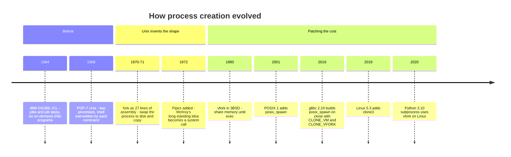
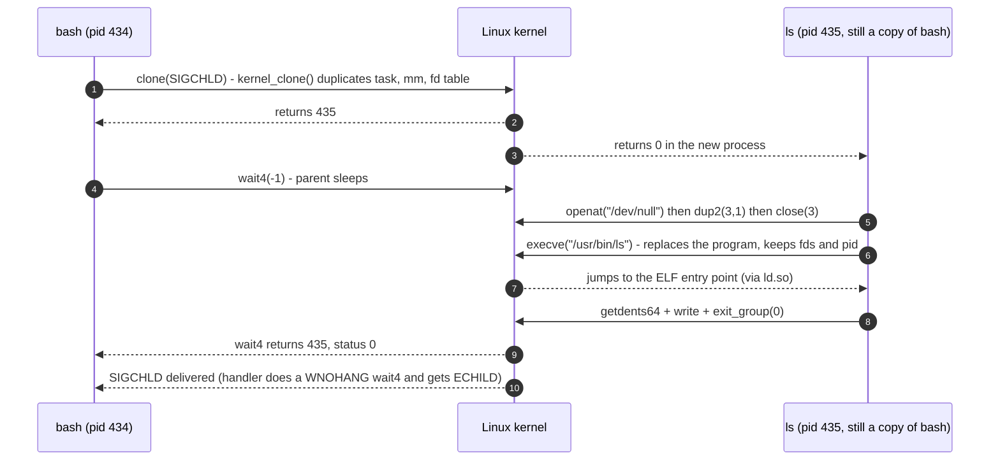
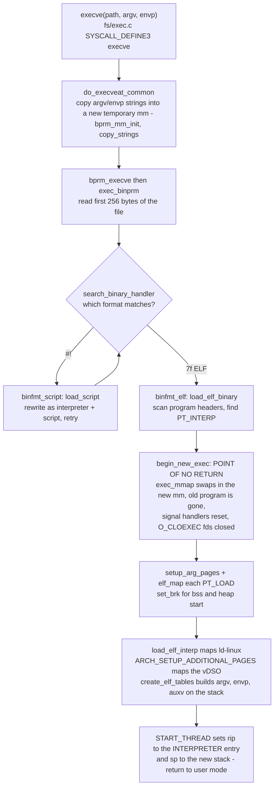
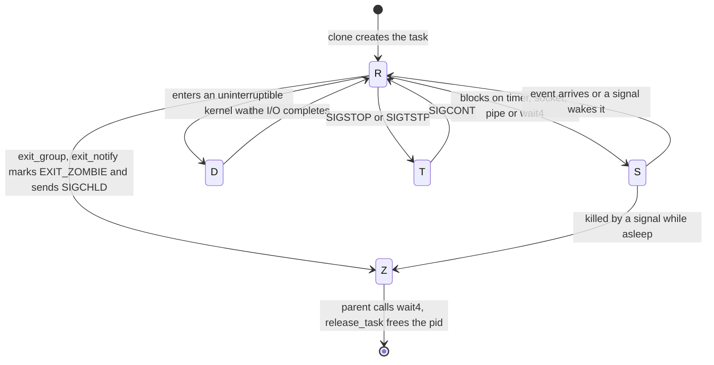
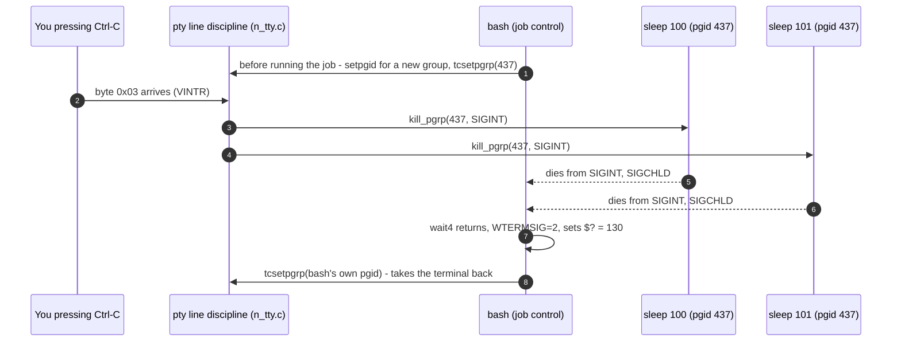
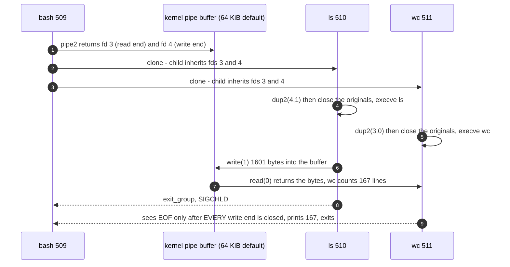
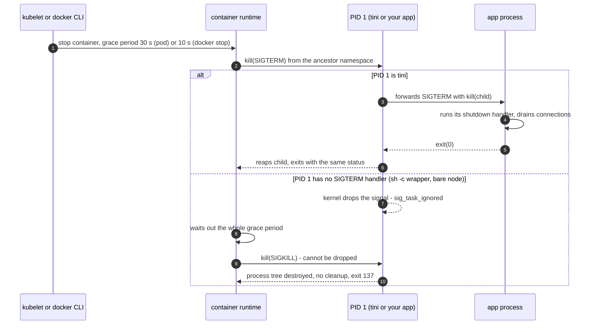
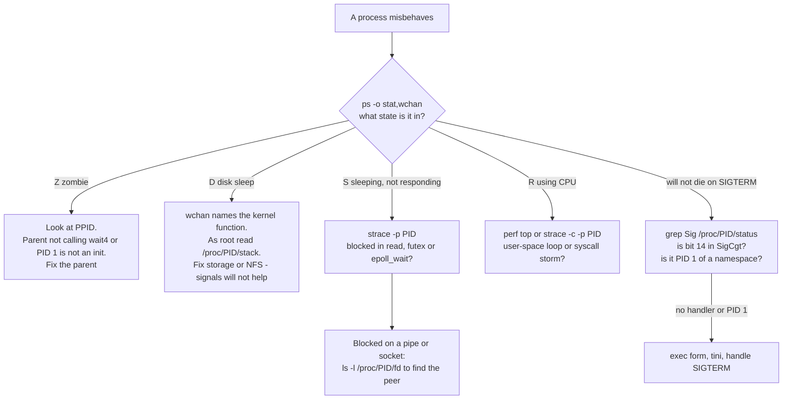

> **Navigation**: [← Internals Index](README.md) | [DevOps Index](../00_INDEX.md) | Related: [Linux Administration](../16_Linux_Administration.md) · [Docker Complete](../17_Docker_Complete.md)

# I01 — What Really Happens When You Type `ls`

> _"Processes, system calls, fork/exec, signals, and PID 1 — the five ideas under every container, every CI job and every `kubectl delete pod`."_

You press Enter after `ls /etc`. about 150 system calls, two ELF images mapped by the kernel, one copy of a process and one wait later, a directory listing appears. This chapter takes that one command apart until nothing is left to hand-wave: which syscall creates the process, which kernel function loads the program, what the dynamic loader does before `main`, how the child's death reaches the shell, and why the *same* mechanisms explain zombie processes, ignored `SIGTERM` in containers, and why a 4 GB Java service spawns subprocesses slowly.

> **Verified on** — every output block below was produced by commands run for this chapter on: Linux **6.6.87.2-microsoft-standard-WSL2** (x86-64, 12 vCPU, 7.6 GB RAM, `tsc` clocksource), Ubuntu **24.04.1**, glibc 2.39, GNU coreutils 9.4, bash 5.2.21, Python 3.12.3, strace 6.8 (rootless, extracted from the `.deb`), tini 0.19.0, dumb-init 1.2.5, util-linux 2.39.3. No root was available, so `/proc/<pid>/stack`, `/proc/<pid>/syscall`, cgroup `pids.max` and `bpftrace` were **not run here** — they are marked where cited instead. WSL2 runs the kernel under Hyper-V, so absolute syscall costs are somewhat higher than bare metal; **ratios** are the point. Kernel source references are to tag **v6.6** (the 6.6.87 branch), checked against the actual files.

---

# PART 1: The World Before — No Such Thing as "A Process"

## 1.1 Batch systems: a computer that runs one thing

In the early 1960s a mainframe ran *jobs*. On IBM's OS/360 you described a job in JCL, a deck of cards where each `//STEP1 EXEC PGM=...` card named a program, and the system ran the steps one after another. There was no "start this and keep working": a program could not start another on demand. Interactive time-sharing (CTSS, Multics) changed who was waiting, but, as Ritchie observes in his 1984 history, such systems typically had **one process per terminal** and needed special mechanisms for detached computations, command files and pipelines.

## 1.2 What PDP-7 Unix did before it had `fork`

Ritchie's paper "The Evolution of the Unix Time-sharing System" is the cleanest statement of the problem. Early PDP-7 Unix had exactly **two processes**, one per terminal, and no `fork`, `wait` or `exec`. The shell's loop: read a command line, **copy a small bootstrap to the top of memory and jump to it**; the bootstrap read the command's file *over the shell's own code* (in effect an `exec`). When the command called `exit`, the system read a **fresh copy of the shell over the corpse**. Consequences: the shell kept no memory between commands, no background jobs, no shell scripts, no pipes — and a directory lacking a `tty` entry made the shell "loop hopelessly" until reboot.

The pain is the one every platform team still meets: **one execution context per human, no way to compose programs.**

---

# PART 2: How the Solution Emerged

## 2.1 `fork` was an accident of convenience

Ritchie's account of the redesign is surprisingly modest. Process control "in its modern form was designed and implemented within a couple of days", and the separation of `fork` and `exec` exists "mainly because of the ease with which fork could be implemented without changing much else". The system already had a process table and swapped processes between memory and disk. The first `fork` required only (1) a bigger process table and (2) a call that **copied the current process to the disk swap area** using the existing swap I/O, plus table adjustments. On the PDP-7 that was **27 lines of assembly**. A combined fork-exec "would have been considerably more complicated, if only because exec as such did not exist" — the shell did that job with ordinary I/O.

Ritchie also records that the split was not unique: it was present in the Berkeley time-sharing system (Project Genie) that Thompson knew. The Baumann et al. HotOS 2019 paper *A fork() in the road* adds that the *term* originates with Conway, that Genie's `fork` was **more flexible** than Unix's (the parent could specify the child's address space), and that Ritchie and Thompson themselves said Unix's was "essentially as we implemented it" in Genie. Folklore says Unix invented fork; the primary sources say Unix **simplified** an existing idea to fit a machine that already swapped whole processes.

## 2.2 The cost problem and the patches

`fork` copies a process. Copy a big process just to throw the copy away on `exec`, and you pay for nothing. Baumann et al. note that fork was already seen as a performance problem by 1979, when the third BSD release introduced `vfork`; only copy-on-write kept it acceptable. The man pages give the rest of the genealogy:

- **`vfork`**: first appeared in 3.0BSD; 4.4BSD made it identical to `fork`; NetBSD later reintroduced it. On Linux it is `clone(CLONE_VM | CLONE_VFORK | SIGCHLD)`: child and parent **share one address space** and the parent sleeps until the child calls `execve` or `_exit`. POSIX.1-2001 marked it obsolete; POSIX.1-2008 removed it.
- **`posix_spawn`**: standardised in POSIX.1-2001, aimed (per its man page) at machines that cannot support `fork` at all — small systems without an MMU. glibc has implemented it since 2.2, and **since glibc 2.24 it calls `clone` with `CLONE_VM | CLONE_VFORK`** — i.e. vfork semantics wrapped in a safe API.
- **`clone` / `clone3`**: Linux's general primitive. `fork`, `vfork` and thread creation are all `clone` with different flags (`kernel/fork.c: kernel_clone`). `clone3` (Linux 5.3) replaced the fixed argument list with an extensible struct.
- **Windows `CreateProcess`**: takes the program to run plus attributes in one call and builds a process from scratch. No copy ever exists, so no copy-on-write bookkeeping and no "state inherited by accident" — but also no cheap way for the parent to adjust the child's file descriptors between "create" and "run" except through a long attribute list.



**How to read this diagram.** *What it shows:* the three eras — before a process model, the original fork/exec shape, and the successive attempts to keep the shape while removing its cost. *Question it answers:* why do five different ways to start a program exist? *Walk-through:* (1) in 1964 JCL, a program cannot start another on demand; (2) in 1969 PDP-7 Unix the shell is literally overwritten by each command and reloaded by `exit`; (3) in 1970-71 `fork` arrives because it was nearly free to implement on a machine that already swapped processes; (4) 1972 pipes make `fork` pay off — a pipeline needs several concurrent processes; (5) from 1980 each entry is a patch around one cost: copying memory the child will never use (`vfork`, `posix_spawn`, `CLONE_VM`). *What people get wrong:* `vfork` and `posix_spawn` are not separate mechanisms from `clone` — on Linux they **are** `clone` with `CLONE_VM | CLONE_VFORK`. The date for glibc 2.24 is 2016 (release year); the Python date comes from CPython's NEWS entry for 3.10.0a2.

---

# PART 3: The Mechanism, at Kernel Level

## 3.1 The whole life of `ls /etc`, shell side

Trace the shell, following children (`-f`), with timestamps. `bash -c 'ls /etc >/dev/null; true'` — the trailing `true` stops bash from using its "last command, just `exec` it" shortcut so that a real `fork` happens:

```text
$ strace -f -tt -o t1.txt bash -c 'ls /etc >/dev/null; true'
434   13:53:25.180572 execve("/usr/bin/bash", ["bash", "-c", "ls /etc >/dev/null; true"], 0x7ffc3410cb10 /* 22 vars */) = 0
 ...                                                                           (bash start-up elided)
434   13:53:25.228963 clone(child_stack=NULL, flags=CLONE_CHILD_CLEARTID|CLONE_CHILD_SETTID|SIGCHLD, child_tidptr=0x7a57e6130a10) = 435
434   13:53:25.230357 wait4(-1,  <unfinished ...>
435   13:53:25.231516 openat(AT_FDCWD, "/dev/null", O_WRONLY|O_CREAT|O_TRUNC, 0666) = 3
435   13:53:25.231783 dup2(3, 1)        = 1
435   13:53:25.231983 close(3)          = 0
435   13:53:25.232162 execve("/usr/bin/ls", ["ls", "/etc"], 0x5b6cb4475e50 /* 22 vars */) = 0
 ...                                                                           (about 150 syscalls by ls itself)
435   13:53:25.261014 exit_group(0)     = ?
435   13:53:25.261426 +++ exited with 0 +++
434   13:53:25.261522 <... wait4 resumed>[{WIFEXITED(s) && WEXITSTATUS(s) == 0}], 0, NULL) = 435
434   13:53:25.262133 --- SIGCHLD {si_signo=SIGCHLD, si_code=CLD_EXITED, si_pid=435, si_uid=1000, si_status=0, ...} ---
434   13:53:25.262212 wait4(-1, 0x7ffc897c3bd0, WNOHANG, NULL) = -1 ECHILD (No child processes)
```

Read the sequence against Ritchie's five-step description from 1984 — it is unchanged. The details that earn their keep:

- **The `clone` flags are glibc's `fork()`**: `SIGCHLD` is the *exit signal* the kernel will send the parent when the child dies; `CLONE_CHILD_SETTID`/`CLEARTID` maintain the thread-id word glibc keeps. No `CLONE_VM`, so the child gets a **copy** (copy-on-write) of the address space.
- **Redirection happens in the child, between `clone` and `execve`**: `openat` → `dup2(3, 1)` → `close(3)`. That is the entire implementation of `>/dev/null`. File descriptors survive `execve`, so `ls` writes to fd 1 without knowing it is a file. This is the payoff of the split Ritchie described: the shell gets a window between "a copy of me exists" and "it becomes `ls`" in which to rewire anything.
- **`wait4(-1, ...)` blocks** parent until the child exits; the kernel wakes it when the child becomes a zombie.
- **SIGCHLD arrives anyway** (`si_code=CLD_EXITED`, `si_status=0`), and bash's handler calls `wait4(-1, WNOHANG)` once more, getting `ECHILD` — the child had already been reaped by the first wait. The signal and the wait are two independent notification paths.



**How to read this diagram.** *What it shows:* who does what between pressing Enter and getting the prompt back, with the real syscall names from the trace above. *Question:* where does the shell stop and `ls` begin? *Steps:* (1) bash calls `clone`; the kernel (`kernel/fork.c: kernel_clone`) builds a child that is an almost exact duplicate. (2)-(3) one syscall returns twice — pid 435 to the parent, `0` to the child — which is how the same code path can branch. (4) the parent blocks in `wait4`; this is why the prompt does not come back early. (5) the **child is still bash code** until `execve`: it uses that window for redirection, signal-disposition resets and `setpgid`. (6) `execve` throws the shell's memory away and loads `ls`; the *pid does not change*, open fds (without `O_CLOEXEC`) survive. (7)-(8) `ls` does its work and `exit_group`; the kernel marks it a zombie and wakes the parent. (9) a `SIGCHLD` also goes to bash. *Common mistake:* thinking `execve` creates a process. It never does — it **replaces the program inside an existing one**. `fork`/`clone` creates; `exec` transforms.

## 3.2 Inside `execve`: from a path to a running program

`execve("/usr/bin/ls", ...)` is `SYSCALL_DEFINE3(execve, ...)` in `fs/exec.c`, which calls `do_execveat_common` → `bprm_execve` → `exec_binprm` → `search_binary_handler`. The kernel keeps a list of **binary formats**; each has a `load_binary` hook, and the first one that recognises the file wins:

The handlers: `binfmt_elf.c` (`7f 45 4c 46`, `load_elf_binary`), `binfmt_script.c` (`#!`, `load_script` — re-execs the interpreter named on the first line) and `binfmt_misc.c` (match by magic or extension, e.g. QEMU user-mode).

`exec_binprm` loops (up to a depth limit, `-ELOOP` beyond) because a script handler *rewrites* the request into "run the interpreter with this file as argument" and tries again. The kernel reads only the first `BINPRM_BUF_SIZE` bytes (**256**, `include/uapi/linux/binfmts.h`) to decide — that is why a `#!` line longer than that is silently truncated.

What `load_elf_binary` (`fs/binfmt_elf.c`) finds in `/usr/bin/ls`:

```text
$ readelf -h /usr/bin/ls | sed -n '2,12p'
  Magic:   7f 45 4c 46 02 01 01 00 ...
  Class:                             ELF64
  Type:                              DYN (Position-Independent Executable file)
  Machine:                           Advanced Micro Devices X86-64
  Entry point address:               0x6d30

$ readelf -lW /usr/bin/ls         (abridged)
  Type     Offset   VirtAddr           FileSiz  MemSiz   Flg Align
  PHDR     0x000040 0x0000000000000040 0x0002d8 0x0002d8 R   0x8
  INTERP   0x000318 0x0000000000000318 0x00001c 0x00001c R   0x1
      [Requesting program interpreter: /lib64/ld-linux-x86-64.so.2]
  LOAD     0x000000 0x0000000000000000 0x0036f8 0x0036f8 R   0x1000
  LOAD     0x004000 0x0000000000004000 0x014db1 0x014db1 R E 0x1000
  LOAD     0x019000 0x0000000000019000 0x0071b8 0x0071b8 R   0x1000
  LOAD     0x020f30 0x0000000000021f30 0x001348 0x0025e8 RW  0x1000
  GNU_STACK 0x000000 ...                       0x000000 0x000000 RW  0x10
```

An ELF file is a table of **program headers** telling the kernel what to `mmap`. Four `LOAD` segments: read-only headers/dynamic info; **R E** (code, 0x14db1 bytes ≈ 85 KB); read-only data; **RW** data whose `MemSiz` (0x25e8) exceeds `FileSiz` (0x1348) — the difference is `.bss`, zero-filled, never read from disk. `INTERP` names the dynamic loader. The kernel does **not** resolve libraries itself; it maps the executable *and the interpreter*, and starts the interpreter.

The kernel-side sequence (function names checked in the v6.6 tree):



**How to read this diagram.** *What it shows:* the kernel's decision path inside one `execve`, top to bottom. *Question:* what happens between "path string" and "first instruction of the new program"? *Steps:* the path and strings are first copied from the *old* address space into a **temporary new one** (`bprm_mm_init`) because the old one is about to disappear. The first 256 bytes pick a handler; `#!` scripts loop back through the handler search with a new target. For ELF, the kernel reads the program headers and, at `begin_new_exec`, crosses the **point of no return** (`bprm->point_of_no_return = true` in `fs/exec.c`, then `exec_mmap`): before this, a failure returns `-ENOENT`/`-ENOEXEC` to the *caller*; after it, a failure kills the process with `SIGSEGV` because there is nothing left to return to. Segments get mapped, the interpreter gets mapped, the **vDSO** is mapped, and `create_elf_tables` writes `argc/argv/envp` plus the **auxiliary vector** onto the stack. Finally the saved user registers are set so the return to user mode begins at the *interpreter's* entry point. *Common mistake:* believing the kernel "links" the libraries. It never opens `libc.so.6`; `ld.so` does, in user space (next section).

The auxiliary vector is the kernel's note to the loader. `LD_SHOW_AUXV=1` prints it:

```text
$ LD_SHOW_AUXV=1 /usr/bin/ls /nonexistent
AT_SYSINFO_EHDR:      0x7ffdb867b000     <- where the kernel mapped the vDSO
AT_PHDR:              0x56f0020b7040     <- the program headers of ls, in memory
AT_BASE:              0x7e08ce0a8000     <- where ld.so itself was mapped
AT_ENTRY:             0x56f0020bdd30     <- ls's own entry point (the loader jumps here last)
AT_RANDOM:            0x7ffdb8606a39     <- 16 random bytes for stack canary / pointer guard
AT_SECURE:            0                  <- 1 for setuid binaries - loader then ignores LD_PRELOAD etc.
```

(Addresses differ per run — that is ASLR, the kernel randomising bases at each `execve`.)

## 3.3 What the dynamic loader does — read straight off the trace

The first syscalls after `execve` returned are **not** `ls`; `ld.so` has the CPU. Annotated from the real trace (abridged):

```text
435 execve("/usr/bin/ls", ["ls", "/etc"], ...) = 0
435 brk(NULL)                                   = 0x5b12b8bc2000      <- loader asks where the heap starts
435 openat(AT_FDCWD, "/etc/ld.so.cache", O_RDONLY|O_CLOEXEC) = 3      <- precomputed name->path index (ldconfig)
435 openat(AT_FDCWD, "/lib/x86_64-linux-gnu/libselinux.so.1", O_RDONLY|O_CLOEXEC) = 3
435 read(3, "\177ELF\2\1\1\0...", 832)          = 832                 <- ELF header of the library
435 mmap(NULL, 181960, PROT_READ, MAP_PRIVATE|MAP_DENYWRITE, 3, 0)    <- reserve the whole span
435 mmap(0x78a6735ae000, 118784, PROT_READ|PROT_EXEC, MAP_PRIVATE|MAP_FIXED|MAP_DENYWRITE, 3, 0x6000)  <- code
    ... same pattern for libc.so.6 (2,125,328 bytes) and libpcre2-8.so.0 ...
435 arch_prctl(ARCH_SET_FS, 0x78a67350b800)     = 0                   <- thread-local storage pointer
435 mprotect(0x78a6733ff000, 16384, PROT_READ)  = 0                   <- RELRO: make GOT read-only
```

Notes: `ld.so.cache` exists because searching `LD_LIBRARY_PATH` and `/lib` for every library of every exec would mean hundreds of failed `openat`s (`ldconfig` precomputes `name → path`). The four `mmap`s per library are the ELF `LOAD` table replayed: one `PROT_READ` reservation to find a contiguous range, then `MAP_FIXED` overlays with the right permissions. Text is a `MAP_PRIVATE` mapping of the *page cache*, so a thousand `ls` processes share one physical copy of libc. Nothing is read into RAM yet — pages arrive by **page faults** on first touch, which strace cannot show.

Then `ls` itself begins: locale initialisation (the 20-odd `openat` of `/usr/lib/locale/C.utf8/LC_*` — most of the 153 syscalls), `statx("/etc")`, `openat(... O_DIRECTORY)`, the directory read and the output:

```text
435 ioctl(1, TCGETS, 0x7ffeaf1b2a80)       = -1 ENOTTY      <- is stdout a terminal? (no: /dev/null) -> no colour, no columns
435 statx(AT_FDCWD, "/etc", AT_STATX_SYNC_AS_STAT|AT_NO_AUTOMOUNT, STATX_MODE, {stx_mode=S_IFDIR|0755, ...}) = 0
435 openat(AT_FDCWD, "/etc", O_RDONLY|O_NONBLOCK|O_CLOEXEC|O_DIRECTORY) = 3
435 getdents64(3, 0x5b12b8bcb8e0 /* 172 entries */, 32768) = 5560   <- ONE syscall returned 172 entries
435 write(1, "PackageKit\nX11\nadduser.conf\nalte"..., 1601) = 1601   <- the entire answer, one write
435 exit_group(0)                          = ?
```

`strace -c ls /etc` over the whole run: 153 lines of trace, ~150 syscalls — 35 `openat` (13 of them failing with `ENOENT`, mostly locale probing), 30 `mmap`, 24 `close`, 23 `fstat`, 10 `read`, and exactly **one** `write`. The program's real job (listing a directory) is about ten syscalls; the other ~140 are *environment setup*. This is the number that explains why container start-up cost is dominated by process start-up, and why static binaries (Go, musl-static) start faster.

## 3.4 A running process, seen through `/proc`

Start `sleep 300 &` and read what the kernel exposes (`/proc/<pid>/*` are generated on read from the `task_struct`; nothing is stored):

```text
$ head -14 /proc/$P/maps | cut -c1-120
63451453a000-63451453c000 r--p 00000000 08:30 2022      /usr/bin/sleep      <- ELF headers
63451453c000-634514540000 r-xp 00002000 08:30 2022      /usr/bin/sleep      <- code (LOAD, R E)
634514540000-634514541000 r--p 00006000 08:30 2022      /usr/bin/sleep      <- rodata
634514542000-634514543000 rw-p 00008000 08:30 2022      /usr/bin/sleep      <- .data/.bss
63451ee55000-63451ee76000 rw-p 00000000 00:00 0         [heap]              <- brk area
7b6d0a800000-7b6d0a828000 r--p 00000000 08:30 12036     /usr/lib/x86_64-linux-gnu/libc.so.6
7b6d0a828000-7b6d0a9b0000 r-xp 00028000 08:30 12036     /usr/lib/x86_64-linux-gnu/libc.so.6   <- libc code
...
7ffd1275e000-7ffd1277f000 rw-p 00000000 00:00 0         [stack]
7ffd127ea000-7ffd127ee000 r--p 00000000 00:00 0         [vvar]              <- kernel-updated time data, read-only to us
7ffd127ee000-7ffd127f0000 r-xp 00000000 00:00 0         [vdso]              <- kernel-provided code (section 3.5)

$ grep -E '^(Name|State|PPid|VmSize|VmRSS|RssAnon|RssFile|Threads|SigBlk|SigIgn|SigCgt|NSpid)' /proc/$P/status
Name:   sleep          State:  S (sleeping)     PPid:   483     NSpid:  484
VmSize:     3124 kB    VmRSS:  1664 kB          RssAnon:  0 kB  RssFile:  1664 kB
Threads:        1      SigIgn: 0000000000000006 SigCgt: 0000000000000000

$ cat /proc/$P/wchan ; echo        # where in the KERNEL it sleeps
hrtimer_nanosleep
$ cat /proc/$P/stat
484 (sleep) S 483 483 483 34816 483 4194304 129 0 2 0 0 0 0 0 20 0 1 0 4395 3198976 416 ...
$ ls -l /proc/$P/exe /proc/$P/cwd ; ls -l /proc/$P/fd
exe -> /usr/bin/sleep        cwd -> /mnt/e/Dev_World/04_Practice/Daily-Prep
0 -> /dev/null   1 -> pipe:[1508]   2 -> pipe:[1509]   7 -> /dev/ptmx
$ cat /proc/$P/stack          # cat: Permission denied  (needs root)
$ cat /proc/$P/syscall        # Operation not permitted (ptrace-access check)
```

How to read it: **`maps`** is the `vm_area_struct` list — the `r-xp` lines are the `PT_LOAD` segments of 3.2 at randomised bases. **`RssAnon: 0 kB / RssFile: 1664 kB`**: `sleep` has touched no private memory; its resident set is page-cache pages shared with every other process. **`wchan: hrtimer_nanosleep`** says where in the kernel it sleeps — the most useful field when a process "hangs". **`SigIgn: 0x6`** = `SIGINT` and `SIGQUIT` ignored (background jobs of a non-interactive shell; ignored dispositions survive `execve`). **`NSpid`** has one entry in the initial namespace; in a container you see `4182  1` (host pid, container pid). `stack` and `syscall` need privilege (`ptrace_scope=1` here); with root, `/proc/<pid>/stack` shows the kernel call chain of a stuck process — the first thing to read for a `D`-state hang.

## 3.5 System-call mechanics: what "the kernel does it" means

**Privilege.** The CPU has rings; Linux uses ring 0 (kernel) and ring 3 (user). User code cannot touch page tables, device registers or other processes' memory. A system call is the *controlled* way across: on x86-64, the `syscall` instruction loads the kernel entry address from an MSR, saves the user `rip` in `rcx` and flags in `r11`, and switches to ring 0 — no interrupt table lookup, which is why it replaced the old `int 0x80`. The number goes in `rax`, arguments in `rdi, rsi, rdx, r10, r8, r9`.

**The kernel side** (v6.6, `arch/x86/entry/`): `entry_SYSCALL_64` (`entry_64.S`) executes `swapgs` to switch to the kernel's per-CPU data, builds a `pt_regs` on the kernel stack and calls `do_syscall_64` (`common.c`) → `do_syscall_x64`, which does `regs->ax = sys_call_table[nr](regs)`. The table is generated from `arch/x86/entry/syscalls/syscall_64.tbl`, in which the entries relevant to this chapter are: `56 clone`, `57 fork`, `58 vfork`, `59 execve`, `61 wait4`, `62 kill`, `228 clock_gettime`, `231 exit_group`, `435 clone3`.

**`errno` is not a kernel variable**: the kernel returns `-EAGAIN`, `-ENOENT`… as the negative return value in `rax`; glibc's syscall wrapper turns values in `[-4095, -1]` into `-1` and stores the magnitude in the thread-local `errno`. strace shows the raw story: `access("/etc/ld.so.preload", R_OK) = -1 ENOENT`.

**The vDSO: a syscall that is not a syscall.** Reading the clock is so frequent that even a fast entry hurts, so the kernel maps a tiny shared library — the **vDSO** — into every process and keeps time data in a read-only page (`[vvar]`) that it updates. `clock_gettime` then becomes a plain function call that reads `[vvar]`. We can dump the mapping from `/proc/self/mem` and ask `readelf`:

```text
$ readelf -W --dyn-syms /tmp/vdso.so    (GLOBAL FUNC rows)
  00000a70  850  __vdso_clock_gettime@@LINUX_2.6
  000007b0  650  __vdso_gettimeofday@@LINUX_2.6
  00000a40   45  __vdso_time@@LINUX_2.6
  00000dd0  100  __vdso_clock_getres@@LINUX_2.6
  00000e40   41  __vdso_getcpu@@LINUX_2.6
  00000e70  160  __vdso_sgx_enter_enclave@@LINUX_2.6
```

Source: `arch/x86/entry/vdso/vclock_gettime.c` defines `__vdso_clock_gettime` via `__cvdso_clock_gettime` from `lib/vdso/gettimeofday.c`. Prove with strace — five vDSO calls, five forced real syscalls, two `getppid`:

```text
$ strace -o p5.txt python3 p5.py
write(1, "-- begin vdso calls\n", 20)     = 20
write(1, "-- begin forced syscalls\n", 25) = 25            <- nothing between the two writes: 5 libc.clock_gettime calls left NO trace
clock_gettime(CLOCK_MONOTONIC, {tv_sec=105, tv_nsec=765756082}) = 0   <- 5 x syscall(SYS_clock_gettime, ...)
clock_gettime(CLOCK_MONOTONIC, {tv_sec=105, tv_nsec=765921534}) = 0
 ...
write(1, "-- begin getppid\n", 17)        = 17
getppid()                                = 388
getppid()                                = 388
```

The same call costs differ by about 2.5x (Python `ctypes`, 300,000 iterations; the 36 ns empty-lambda baseline is Python's own overhead and `ctypes` adds a few hundred ns more to every row, so the **gap** is what to read):

```text
empty python lambda (baseline)                   35.7 ns/call
libc.clock_gettime  (vDSO, no kernel entry)     379.9 ns/call
libc.getppid() (real syscall, not cached)       569.1 ns/call
libc.syscall(SYS_clock_gettime) (forced entry)  966.1 ns/call
```

Limit: the vDSO helps only when the clocksource is readable from user space (here `tsc`); on a VM with a non-vDSO clocksource every `clock_gettime` becomes a real syscall — a classic "why is logging slow on this VM" cause.

**Why `strace` slows programs.** `strace` uses `ptrace`: the tracee is stopped at **every** syscall entry and exit, the kernel wakes the tracer (a context switch), the tracer reads registers and memory with more syscalls, then resumes the tracee (another switch). Measured on a loop of 100,000 `getppid()` calls in Python:

```text
no tracing                                         412 ns/iter
strace -e trace=getppid   (print every call)   199,021 ns/iter    ≈ 480x slower
strace -e trace=none      (print nothing)      221,552 ns/iter    <- filtering output does NOT remove the stops
strace --seccomp-bpf -f -e trace=openat            402 ns/iter    <- the kernel only stops the tracee for openat
pure user-space loop, no syscalls            79 ns vs 130 ns/iter  <- strace costs nothing without syscalls
```

`-e trace=none` is the instructive row: filtering only decides what is *printed*; the stop-and-resume happens regardless. `--seccomp-bpf` (strace(1); needs `-f`; falls back to stop-on-every-syscall if the filter cannot be installed) asks the kernel to stop the tracee **only** for the traced syscalls, so the loop runs at native speed. (`strace -c`'s `usecs/call` is strace's own accounting overhead, not the syscall's cost.) **Production rule:** never `strace -p` a hot process without `--seccomp-bpf`/narrow filters or a plan to detach; use `perf trace` or eBPF (chapter I10).

**What a syscall does *not* tell you:** page faults, scheduler preemption and library-internal work. Section 3.3's "nothing is loaded by `mmap`" is the example — the cost of the first touch of each text page never appears in a syscall trace.

## 3.6 Why `fork` gets slower as your process gets bigger — measured

`fork` must give the child its own page tables. `kernel_clone` → `copy_process` → `copy_mm` → `dup_mmap` (`kernel/fork.c`) walks every VMA and calls `copy_page_range` to copy the page-table entries and mark private writable pages read-only for copy-on-write. **The data pages are not copied, but the page tables are, so the cost is proportional to resident memory** (one PTE per 4 KB page: 262,144 per GB). `CLONE_VM` skips `dup_mmap` entirely (`copy_mm` just shares the `mm_struct`), and `CLONE_VFORK` makes the parent sleep in `wait_for_vfork_done` until the child execs. Python 3.12, a parent that has touched every page of N MB, median of 30 spawns of `/bin/true` (ms):

```text
 RSS_MB   fork+exec   fork only   posix_spawn   subprocess.run   subprocess+preexec_fn
     12       2.10        1.38         0.77           0.80              2.12
    268       8.34        7.67         0.77           0.74              8.57
   1036      26.34       27.16         0.98           0.87             26.97
   2060      51.02       57.89         1.04           1.08             51.65
   3084      75.17       74.57         0.79           0.77             75.77
```

Fork cost grows **~25 ms per GB** here; `posix_spawn` is flat at under 1 ms. `subprocess.run` is flat because since Python 3.10 it uses `vfork` (strace: `vfork(...) = 1285` then `execve`) while `os.posix_spawn` shows `clone3({flags=CLONE_VM|CLONE_VFORK|CLONE_CLEAR_SIGHAND, ...})` — and **adding a `preexec_fn` forces the slow fork path back**, a cheap trap. Baumann et al. measured the same shape on a 2017 machine (posix_spawn ≈ 0.5 ms regardless of parent size) and report Chrome stalls of up to 100 ms and Node.js stalls of seconds when forking large processes. The same effect is why a JVM with a 8 GB heap that shells out per request, or a Redis `BGSAVE` fork on a big dataset, produces latency spikes. THP and kernel version change the constants; the linear shape does not.

## 3.7 Exit, `wait`, zombies, orphans

A process's life is a small state machine. The letters are what `ps`/`/proc/PID/status` print (`fs/proc/array.c`: "R (running)", "S (sleeping)", "D (disk sleep)", "T (stopped)", "Z (zombie)", "I (idle)"):



**How to read this diagram.** *What it shows:* every state a Linux process passes through and the event that moves it. *Question:* what exactly is a zombie and what moves it to "gone"? *Steps:* a new task starts runnable `R` (running **or** waiting for a CPU — `R` does not mean it is on a CPU). It spends most of its life in `S` (interruptible sleep: `wchan` told us `hrtimer_nanosleep` for `sleep`), returning to `R` on its event. `D` is the same wait but **signals do not wake it** — used inside the kernel when abandoning an operation half-way would corrupt state (disk and NFS waits); a `SIGKILL` stays pending until it wakes (kernel waits marked `TASK_KILLABLE` are the exception). `T` is job-control stop. On exit (`exit_group` → `do_exit` → `exit_notify` in `kernel/exit.c`) the kernel releases the memory, files and so on but **keeps the `task_struct` and PID** with `exit_state = EXIT_ZOMBIE`, because the parent has the *right* to learn the exit status. Only `wait4` (`kernel_wait4` → `do_wait` → `release_task`) removes it. *Common mistake:* trying to `kill` a zombie. It is already dead; there is nothing to signal — fix the parent (make it `wait`) or kill the parent so PID 1 inherits and reaps.

Make one on purpose (Python; child exits, parent does not `wait`):

```text
child 482 Name=python3 State=Z (zombie) PPid=481 VmSize=(none - mm released)
    PID    PPID STAT WCHAN    COMMAND         CMD
    482     481 Z+   -        python3         [python3] <defunct>
kill -9 on a zombie does nothing:
  after SIGKILL: Name=python3 State=Z (zombie) PPid=481 VmSize=(none - mm released)
waitpid -> exited code 7 raw status 1792 (= code<<8)
after wait: (no such /proc entry: reaped)
```

The status word that `wait4` returns packs the exit code in bits 8-15 (`7 << 8 = 1792`) and the terminating signal in bits 0-6 — which is why shells report `128 + signal` for a killed process (`$? = 143` for SIGTERM, `137` for SIGKILL, `130` for SIGINT; we saw 143 and 130 in our runs). A zombie costs a PID and a `task_struct` (rule of thumb: a few KB), so one is harmless, but **an unreaping parent that spawns forever exhausts the PID space** (`pid_max` here is 4,194,304; many distributions default to 32,768) and `fork` starts returning `EAGAIN`.

Auto-reaping exists: if the parent sets `SIGCHLD` to `SIG_IGN` (or `SA_NOCLDWAIT`), `do_notify_parent` (`kernel/signal.c`) sees it and the child is released at exit with no zombie phase — my fork-per-request server in section 6.1 uses exactly that.

**Orphans.** When a parent exits first, `exit_notify` → `forget_original_parent` → `find_new_reaper` picks a new parent: the nearest ancestor that set `PR_SET_CHILD_SUBREAPER` (Linux 3.4) *inside the same PID namespace*, else the namespace's init. Experiment:

```text
== orphan: parent dies first; who adopts the child?
grandchild: my PPid is now 495 ; comm of that pid = Relay(496) ; comm of pid 1 = systemd
== subreaper: prctl(PR_SET_CHILD_SUBREAPER) makes THIS process the adopter
grandchild 488 now has PPid 481  (me = 481 )
grandchild exited; I am its adopter so it is a zombie until I wait: State=Z (zombie)
waitpid(-1) reaps adopted child: True
```

The first line is the surprise: on this WSL host the orphan was **not** adopted by PID 1 (`systemd`) but by a WSL session-relay process that is evidently a subreaper. That corrects the common statement "PID 1 is the parent of all orphans" (including the one in [16_Linux_Administration.md](../16_Linux_Administration.md) — `PID 1 → parent of ALL processes`): PID 1 is the *fallback*. `systemd --user`, `tmux`-like supervisors, `dockerd`'s shims and tini are real subreapers.

## 3.8 Signals: how the kernel interrupts a program

A signal is a bit in the target's pending mask plus (optionally) a `siginfo` record. The path for `kill -TERM pid` (v6.6 names): `sys_kill` → `kill_something_info` → `group_send_sig_info` → `__send_signal_locked` (queue it) → `complete_signal` (pick a thread that does not block it and wake it with `signal_wake_up`). Nothing runs yet. **Delivery happens when the target returns to user mode**: `get_signal` (`kernel/signal.c`) dequeues, then either runs the default action, ignores, or builds a frame on the user stack so the handler runs, with `rt_sigreturn` restoring state afterwards.

```text
$ python3 sig.py      # block SIGUSR1, send it to self, inspect, unblock
  SigPnd=0000000000000000  ShdPnd=0000000000000200  SigBlk=0000000000000200  SigCgt=0000000000000202
  unblocking ...
   >>> handler ran (signal 10)
  SigPnd=0000000000000000  ShdPnd=0000000000000000  SigBlk=0000000000000000
```

`ShdPnd` (shared pending, process-directed signals from `kill`) holds bit 9 (signal 10, `SIGUSR1`) while it is blocked; the handler runs the instant it is unblocked. `SigCgt` is the set with handlers, `SigIgn` the ignored set. **`SIGKILL` and `SIGSTOP` cannot be caught, blocked or ignored** — `do_sigaction` rejects them with `-EINVAL`, and strace shows it: `rt_sigaction(SIGKILL, {sa_handler=0x6e7610, ...}) = -1 EINVAL`. Stop/continue: `SIGSTOP` → `State: T (stopped)` → `SIGCONT` → `S`. A child killed by `SIGKILL` reports `WIFSIGNALED`, `WTERMSIG=9`, shell status 137.

Default actions: terminate (`SIGTERM`, `SIGINT`, `SIGHUP`, `SIGUSR1`), terminate+core (`SIGQUIT`, `SIGSEGV`), stop (`SIGSTOP`, `SIGTSTP`), ignore (`SIGCHLD`, `SIGWINCH`). `SIGTERM` is a *request*; `SIGKILL` is the kernel removing the process without asking — so no `finally`, no flush, no lock release, no deregistration. The repo's [16_Linux_Administration.md](../16_Linux_Administration.md) states this correctly; the extra detail here is that a **handler can still be missing for `SIGTERM`**, and for PID 1 that changes everything (3.11).

## 3.9 Process groups, sessions, and why Ctrl-C kills the whole pipeline

`kill(pid)` targets one process; a terminal needs to target *everything the user is running*. Unix added **process groups** (jobs) and **sessions** (a login). Every process has `pid`, `pgid`, `sid`; a session may have one controlling terminal, whose driver records a **foreground process group** (`tpgid`). Ctrl-C is not handled by the shell: the TTY line discipline sees byte `0x03`, and `n_tty.c: isig()` → `__isig()` calls `kill_pgrp(tty_pgrp, SIGINT, 1)` — a signal to **every process in the foreground group**. Experiment on a real pty (Python `pty.fork` + `bash -i`; the job is `sleep 100 | sleep 101`, plus `setsid sleep 102 &`):

```text
--- pipeline running in the foreground (bash is pid 434, the session leader)
    PID    PPID    PGID     SID   TPGID TT       STAT COMMAND
    434     432     434     434     437 pts/2    Ss   bash --norc --noprofile -i
    436     430     436     436      -1 ?        Ss   sleep 102        <- setsid: new session, NO controlling tty
    437     434     437     434     437 pts/2    S+   sleep 100        <- pgid 437 == tpgid 437: foreground group
    438     434     437     434     437 pts/2    S+   sleep 101
terminal echo after ^C: '^C\r\n'
--- after ^C
    434     432     434     434     434 pts/2    Ss+  bash ...         <- tpgid back to bash's own group
    436     430     436     436      -1 ?        Ss   sleep 102        <- survived: not in the tty's foreground group
shell says: 'status=130'
```



**How to read this diagram.** *What it shows:* the signal's path from the keyboard to the pipeline, with the shell as bystander. *Question:* why does one keystroke kill both halves of `a | b`, but not a daemon started from the same terminal? *Steps:* (1) before launching the job, interactive bash puts the pipeline in **one new process group** and makes it the terminal's foreground group (`setpgid`/`tcsetpgrp`; visible as `tpgid`). (2) the pty driver turns the byte into a signal in kernel space — no process was asked. (3)-(4) `kill_pgrp` signals every member of group 437. (5)-(7) the children die, bash's `wait4` returns with `WTERMSIG=2` and reports 130. (8) bash retakes the foreground. *Common mistake:* assuming the shell forwards Ctrl-C. It does not; and a process that called `setsid` (daemons, `nohup`-style launchers, many CI wrappers) is in a different session with no controlling terminal and **will not** receive it — the reason closing an SSH session leaves some jobs alive and kills others (`SIGHUP` goes to the session's foreground group when the tty hangs up).

## 3.10 Pipes and redirection, at syscall level

`ls /etc | wc -l`, traced with `strace -f -e trace=pipe2,clone,dup2,execve,wait4`:

```text
509  execve("/usr/bin/bash", ["bash", "-c", "ls /etc | wc -l; true"], ...) = 0
509  pipe2([3, 4], 0)                       = 0           <- ONE kernel pipe buffer, two fds: 3 = read end, 4 = write end
509  clone(child_stack=NULL, flags=...|SIGCHLD) = 510     <- child 1 (will become ls)
509  clone(child_stack=NULL, flags=...|SIGCHLD) = 511     <- child 2 (will become wc)
510  dup2(4, 1)                             = 1           <- ls: stdout := write end
511  dup2(3, 0)                             = 0           <- wc: stdin  := read end
510  execve("/usr/bin/ls", ["ls", "/etc"], ...) = 0
511  execve("/usr/bin/wc", ["wc", "-l"], ...) = 0
511  write(1, "167\n", 4)                    = 4
509  wait4(-1, ..., 0, NULL) = 510   ...   509  wait4(-1, ..., 0, NULL) = 511
```



**How to read this diagram.** *What it shows:* a pipeline is built by the *parent* before either program exists. *Question:* how can two unrelated programs share a channel without knowing it? *Steps:* (1) the kernel creates an in-memory buffer (default 64 KiB; `F_SETPIPE_SZ` changes it) and returns two descriptors. (2)-(3) both children inherit **both** ends through `clone`. (4)-(5) each child rewires one end onto the standard descriptor the program already uses, closes the extras, then `execve` — descriptors survive exec. (6)-(7) data flows; a writer into a full pipe sleeps, a reader of an empty one sleeps — flow control for free. (8)-(9) the reader gets EOF only when **all** write ends everywhere are closed. *Common mistake:* forgetting the parent also holds the write end — real shells close it right after forking; a program that keeps an unneeded copy open makes its reader hang forever, and the same bug (an inherited fd held by a leaked child) is behind many "the pipeline never finishes" CI hangs. Ritchie records that pipes landed in 1972 after McIlroy's long advocacy; the `pipe` → `fork` → `dup2` → `exec` choreography above is how a shell builds one.

## 3.11 PID 1: the process the kernel treats differently

In every PID namespace one process has PID 1 — the machine's `init`, or the first process of a container. The kernel gives it two special properties (`man pid_namespaces`, kernel v6.6):

1. **Orphans are reparented to it** — so it must `wait()` for children it did not start, or zombies accumulate (3.7).
2. **Signals with default actions are dropped.** `copy_process` sets `SIGNAL_UNKILLABLE` on the namespace init (`kernel/fork.c`, inside `if (is_child_reaper(pid))`), and `sig_task_ignored` (`kernel/signal.c`) returns true when `SIGNAL_UNKILLABLE` is set, the handler is `SIG_DFL`, and the sender is not forcing `SIGKILL`/`SIGSTOP`. Effect: **the kernel's own default for `SIGTERM` (terminate) does not apply to PID 1.** Only a handler the program installed itself runs. `SIGKILL`/`SIGSTOP` from an *ancestor* namespace are still honoured: `__send_signal_locked` sets `force` when the sender has no PID in the target's namespace. From inside the namespace they are dropped.

Rootless proof with `unshare --user --map-root-user --pid --fork --mount-proc` (the process is PID 1 inside, a normal pid outside; the signals are sent from the host side):

```text
=== control: same app, NOT pid 1
exit status: 143 (128+15 = killed by SIGTERM)
=============== A. app with default dispositions as PID 1
host pid of the namespace init: 411     NSpid: 411  1     SigCgt: 0000000000000000
after SIGTERM: STILL ALIVE
after SIGKILL: dead
=============== B. node-like handler as PID 1       (handler restores SIG_DFL and re-raises)
SigCgt: 0000000000004000
app_nodelike: handler ran for signal 15 - restoring SIG_DFL and re-raising
after SIGTERM: STILL ALIVE
after SIGKILL: dead
=============== C. graceful handler as PID 1
after SIGTERM: dead      app_graceful: got SIGTERM, cleaning up and exiting 0     exit status 0
=============== D. tini as PID 1, app with NO handler as its child
after SIGTERM: dead      exit status of unshare: 143
=============== F/G. 'sh -c "python3 app_graceful.py"' as PID 1   (shell form, /bin/sh = dash)
init is: sh   children: python3        after SIGTERM: STILL ALIVE   (the app never even saw the signal)
=============== H. exec form (the app is PID 1 and has a handler)
after SIGTERM: dead      app_graceful: got SIGTERM, cleaning up and exiting 0
```

Row A is the Node-in-Docker bug in its pure form. **What really happens with Node**: it *does* install `SIGINT`/`SIGTERM` handlers (`src/node.cc`, v22.13.0: `RegisterSignalHandler(SIGTERM, SignalExit, true)`), but `SignalExit` only calls `ResetStdio()` and `raise()`s the signal again, and the handler is registered with `SA_RESETHAND`, so it is back to `SIG_DFL` by then. For an ordinary process the re-raise kills it; as PID 1 the kernel rule above drops it. Row B reproduces that sequence with an equivalent Python handler (**I did not run real Node on Linux — none in this WSL image**; the claim rests on the Node and kernel sources plus that emulation). **The JVM** differs: it starts its shutdown sequence (running `Runtime.addShutdownHook` threads) when the OS signals it — per the `Runtime` javadoc — so Java as PID 1 should exit on `SIGTERM` (not run here); its PID-1 hazard is orphans, and "Java ignores SIGTERM in Docker" is usually the shell-form wrapper (rows F/G).

**The zombie half**, same namespace technique — an app that forks short-lived grandchildren and never waits for adopted orphans:

```text
=== leaker.py as PID 1 (never wait()s for adopted orphans)          === tini as PID 1, leaker.py as its child
    PID    PPID STAT COMMAND                                            PID    PPID STAT COMMAND
      1       0 S+   python3                                              1       0 S+   tini
      3       1 Z+   python3                                              2       1 S    python3
      5       1 Z+   python3                                             13       2 R    ps
      7       1 Z+   python3
      9       1 Z+   python3
     11       1 Z+   python3
```

**What an init shim does.** tini (`src/tini.c`, v0.19.0, under 700 lines) sets `PR_SET_CHILD_SUBREAPER`, forks your command, then loops `sigtimedwait` → `kill(child, sig)` (or `kill(-child)` with `-g`) → `waitpid(-1, WNOHANG)` to reap every zombie, and exits with the child's code (128+signal if killed — the `143` in row D). dumb-init does the same but by default creates a session and signals the whole process group. Docker's `--init` (Docker 1.13+, API 1.25+) runs `docker-init`, which is tini. `docker stop` sends `SIGTERM` (or the image's `STOPSIGNAL`), waits **10 s** by default on Linux, then `SIGKILL`; Kubernetes runs any `preStop` hook, sends `TERM` to each container's main process, waits `terminationGracePeriodSeconds` (default **30 s**), then `KILL`.



**How to read this diagram.** *What it shows:* the two possible futures of a stop request. *Question:* why do some pods take exactly 30 seconds to die and exit with 137? *Steps:* (1)-(2) the orchestrator asks the runtime to deliver `SIGTERM` to the container's first process; from the host's side the process is in an ancestor namespace, so the signal is allowed *only if a handler exists*. (3)-(6) with an init shim the signal is forwarded to the real app, which shuts down and exits 0; the shim mirrors the exit code. (7)-(10) without a handler the signal is silently discarded; the runtime waits out the full grace period, then sends `SIGKILL` (honoured even for PID 1 when sent from an ancestor namespace) and the kernel kills the whole namespace — in-flight requests are cut, buffers lost. *Common mistake:* "increase `terminationGracePeriodSeconds`" — that only makes the hang longer; the fix is a process that receives and handles the signal (exec-form `CMD`, `exec "$@"` at the end of entrypoint scripts, or `--init`/tini). And with Kubernetes `shareProcessNamespace: true` the app is no longer PID 1 at all (the pause process is), so the PID-1 rules above no longer apply to it — orphans are then adopted by the pause process, whose `SIGCHLD` handler (`build/pause/linux/pause.c`) does reap them, which is a side benefit of the feature.

---

# PART 4: The Alternatives — How Each Competing Design Works

## 4.1 Creating a process

| Mechanism | How it works inside | Isolation of child | Overhead (measured here) | Ops cost / hazard | Maturity | Wins when |
| --- | --- | --- | --- | --- | --- | --- |
| **`fork` + `exec`** | `clone(SIGCHLD)` copies page tables (CoW), then `execve` discards them | Full: own address space, fd table copy | 2 ms at 12 MB RSS, 75 ms at 3 GB | Latency grows with parent RSS; unsafe in multithreaded parents (only the calling thread is copied) | 1970s, universal | You need to rewire fds/uid/cwd between create and run (shells), or need the **copy** itself |
| **`vfork`** | `clone(CLONE_VM\|CLONE_VFORK)`: shared memory, parent suspended until exec | None until exec; child may corrupt parent | flat, ~1 ms | Child may only `exec`/`_exit`; signal-handler and threading pitfalls (vfork(2) CAVEATS) | 3BSD 1980; removed from POSIX 2008 | Hot path of a big process that only spawns |
| **`posix_spawn`** | libc packages "create + file actions + attributes + exec"; glibc ≥ 2.24 uses `clone(CLONE_VM\|CLONE_VFORK)` | Same as vfork but the API is safe | flat, 0.8-1.0 ms | Declarative subset of what fork+exec can do (no arbitrary code between) | POSIX.1-2001 | Portable library code, no-MMU targets |
| **`clone3`** | Extensible struct: flags, `set_tid`, `cgroup` target, `CLONE_INTO_CGROUP` | Per flags | like clone | Linux-only; runtimes and container runtimes use it | Linux 5.3, 2019 | You are a runtime that needs namespaces/cgroup placement atomically |
| **Windows `CreateProcess`** | One call: image + command line + attributes builds a new process from scratch | Full | no copy, but heavier object creation | No cheap "inherit this one fd" shortcut; hence Cygwin's fork emulation is slow (Baumann et al.) | NT 1993 | Starting *different* programs; no fork semantics needed |
| **Fork server / zygote** (Android Zygote, Chrome, Python `multiprocessing` `forkserver`) | One small, pre-warmed process forks children on request; children share its loaded pages by CoW | Per child | pay init once; each spawn ≈ cheap fork of a *small* process | Must keep the server single-threaded and small | long established | Many short-lived workers sharing a big read-only preload |

`fork` is not only a legacy: **Redis** snapshots with `fork` because the child gets a *consistent frozen copy* of memory for free (the paper lists this as a case that still needs fork), and pre-fork servers (Apache prefork, PostgreSQL backends, Gunicorn workers) use it to share loaded state. Where you want a copy, fork is the best primitive ever built; where you want a different program, it is a detour.

## 4.2 Executing many tasks: process vs thread vs event loop

A **thread** is `clone(CLONE_VM|CLONE_FS|CLONE_FILES|CLONE_SIGHAND|CLONE_THREAD…)`: shared address space and fd table, own stack and signal mask. A **process** shares nothing. An **event loop** is one thread multiplexing sockets with `epoll` (I02). Isolation: process > thread > coroutine; creation cost: process > thread > coroutine. Measured numbers are in 6.1.

## 4.3 Being PID 1

| Option | What it does | Cost | Use when |
| --- | --- | --- | --- |
| App as PID 1 with explicit `SIGTERM`/`SIGINT` handlers and a `wait` loop (or no children) | Nothing extra | Easy to get wrong; every language/runtime differs | Single-process service you control (Go, JVM) |
| **tini / `docker run --init` / `docker-init`** | Forwards signals, reaps zombies, mirrors exit code | One small binary (27 KB dynamic / 795 KB static in the Debian 0.19.0 package) | Default choice for any image whose app spawns children (Node, Python, headless browsers, shell entrypoints) |
| **dumb-init** | Same plus session + whole-process-group signalling by default | Python-package or static binary | Entrypoint **shell scripts** that background things |
| **s6-overlay / runit / supervisord / systemd** | Real supervisor: restarts, ordering, many services | More moving parts; breaks "one process per container" | Legacy multi-process images you cannot split |
| **K8s `shareProcessNamespace: true`** | `pause` becomes PID 1; app containers share one PID namespace | Containers can see/signal each other's processes and `/proc/<pid>/root`; needs `SYS_PTRACE` to signal across | Debug sidecars; sidecar needs to signal main app (e.g. nginx reload) |

---

# PART 5: How It Became the Standard

- **Technology:** `fork`/`exec`/`wait`/pipes made the shell and a toolbox of small filters possible with a handful of syscalls. Ritchie's verdict on the pipe (section "Pipes"): the genius is that pipelines are built from the very commands that are also used on their own, instead of specially written modules as in Multics' spliceable I/O.
- **Politics/timing:** Unix escaped Bell Labs through universities (the BSD line that added `vfork`) and then the POSIX standard fixed the vocabulary: `fork`, `exec`, `wait`, `kill`, `sigaction`, process groups and sessions are POSIX.1; `posix_spawn` joined in POSIX.1-2001; `vfork` was dropped in 2008. Linux implemented the POSIX semantics and added `clone` underneath.
- **Inertia:** *A fork() in the road* (Baumann et al., HotOS 2019) cites an Ubuntu survey: 1,304 packages call `fork`, only 41 use `posix_spawn`. Fork "won" so completely that its costs became invisible until processes got gigabytes big.
- **The container twist:** PID namespaces (`CLONE_NEWPID`, Linux 2.6.24) turned an arbitrary application into "init" — suddenly the 1970s rules about orphans and default signal actions applied to Node scripts. `docker run --init` (Docker 1.13) and tini are the industry's patch; `PR_SET_CHILD_SUBREAPER` (Linux 3.4, the tini source checks "Linux >= 3.4") exists precisely so a non-PID-1 supervisor can do the reaping.

---

# PART 6: When to Use — and When Not To

## 6.1 Process-per-request vs threads vs an event loop — measured

A tiny TCP request/response server in Python 3.12 (accept → read one line → reply → close), 16 client threads × 150 connections each, loopback, 12-vCPU WSL2. The client is Python too, so **the thread and async rows are partly client-limited**; the point is the *shape*, and the cliff in the last fork row:

```text
mode    server_RSS   req/s     p50 ms    p99 ms
fork         15 MB    1377      11.11     18.05      <- fork per connection (SIGCHLD=SIG_IGN, kernel auto-reaps)
thread       16 MB    2807       5.62      6.62
async        16 MB    3396       4.45      9.40

fork       1040 MB      79     185.48    358.93      <- same server, parent holding 1 GB resident
thread     1040 MB    2691       5.88      6.43
async      1040 MB    3613       4.17      8.26
```

Fork-per-request is **2-2.5x slower** on a small server and **~34-46x slower** on a 1 GB one, because every request re-pays the page-table copy of section 3.6; threads and the event loop do not care about heap size. Decision rules (thresholds are **rules of thumb**, derived from the above and from the spawn table; re-measure for your runtime):

- **Per-request/per-job process** only when the isolation is the product (CGI-style plugin sandboxes, untrusted code, memory-leaky libraries you recycle with `max_requests`, PostgreSQL's one-backend-per-connection with a pooler in front). Keep the parent small (`< ~100 MB`) or use a fork server; if the parent is large, spawn via `posix_spawn`/`vfork`, never `fork`.
- **Threads** when work is blocking I/O or CPU-bound in a runtime without a GIL and you need shared state; budget one stack per thread (default 8 MB *virtual*) and watch `threads-max` (60,843 here).
- **Event loop** for many mostly-idle connections; one blocking call stalls everyone, and CPU work needs a worker pool.
- **Cost of being wrong:** a fork-based worker that grows to a few GB turns a 1 ms spawn into 100 ms+ and the p99 of everything that shares its CPU; a thread-per-connection server at 50k idle connections spends its memory on stacks.

## 6.2 Limits and fork bombs

| Limit | Scope | Value here | Failure |
| --- | --- | --- | --- |
| `RLIMIT_NPROC` (`ulimit -u`) | **per real uid, across the whole machine/namespaces** | 30,421 | `fork`/`clone` → `EAGAIN` |
| `kernel.pid_max` | system | 4,194,304 | `EAGAIN` when PIDs exhausted (zombie leak) |
| `kernel.threads-max` | system | 60,843 | `EAGAIN` on thread creation |
| cgroup v2 `pids.max` / `docker run --pids-limit` / pod PID limits | per cgroup (container) | root cgroup has none here; **not run** (needs a delegated cgroup) | `EAGAIN` inside the container only |

Demonstrated rootlessly with a bounded test (`RLIMIT_NPROC` set to 50 inside a throwaway Python process; it fails after 16 children, nothing remained running):

```text
RLIMIT_NPROC=10: fork #1 failed with EAGAIN (Resource temporarily unavailable); 0 children existed
RLIMIT_NPROC=50: fork #17 failed with EAGAIN (Resource temporarily unavailable); 16 children existed
```

Two lessons. First, the failure is `EAGAIN`, not `ENOMEM`; bash says "fork: retry: Resource temporarily unavailable". Second, **the counter is not what `ps` shows**: `ps -u` listed 7 threads for my uid while the kernel's tally at limit 50 implied ~33 — the counter is per user across every PID namespace and thread, so you cannot compute headroom from inside one namespace (I did not trace the other 26 tasks). A **fork bomb** (a process that forks two copies of itself, each repeating) grows exponentially and is stopped only by those limits — which is why per-container `pids.max` (see [17_Docker_Complete.md](../17_Docker_Complete.md), "pids.max … prevents fork bombs") is a security control, not a tuning knob. I did not run a real bomb.

## 6.3 PID-1 hygiene checklist for production images

1. `CMD`/`ENTRYPOINT` in **exec form** (JSON array). Shell form makes `/bin/sh -c` PID 1; measured rows F/G: `sh` ignored `SIGTERM` and never forwarded it.
2. Entrypoint scripts end with `exec "$@"` so the app *replaces* the shell.
3. Run an init (`--init`, tini, dumb-init) if the app spawns subprocesses or you cannot prove it reaps.
4. App handles `SIGTERM` (drain, close, exit 0) **and** you set `STOPSIGNAL` if the app expects another.
5. `terminationGracePeriodSeconds` ≥ `preStop` + drain time; remember the clock includes the hook.
6. Never rely on `SIGKILL` cleanup; design for crash-safety.
7. Set a PID limit per container and alert on `Z` processes.

## 6.4 Enterprise lens

**Scale:** at 1,000 spawns/s, a 25 ms/GB fork tax on a 4 GB process is ~100 CPU-seconds per second. **Security:** `shareProcessNamespace` exposes other containers' environment and filesystems through `/proc` (the Kubernetes task page warns of it). **Compliance:** `execve` auditing (auditd) is the record of "who ran what"; strace is not an audit tool. **Operability:** exit codes 137/143 distinguish "killed" from "asked to stop" and belong in dashboards. **Cost:** a rolling deploy of 200 pods that each wait the full 30 s grace instead of 1 s wastes about 97 pod-minutes of termination time per wave.

> **What a test engineer does with this** — a Playwright job in CI launches Chromium, which forks helper processes (renderer, GPU, zygote). If the container's PID 1 is your `node`/`npx` process, crashed helpers can linger as zombies and `SIGTERM` from the CI runner is ignored (section 3.11), so the job hangs until a hard timeout. The Playwright Docker docs recommend `docker run --init` precisely for this and `--ipc=host` because Chromium uses shared memory (`/dev/shm`) heavily and otherwise "can run out of memory and crash". The repo chapter [59_Docker_For_Playwright.md](../../21_SDET_Playwright_Automation/06_CI_CD_And_Reliability/59_Docker_For_Playwright.md) covers `--ipc=host`/`--shm-size`; **it does not mention `--init`**, which is the PID-1 half of the same story — add it, and use the exit code (143 vs 137) to tell "stopped" from "killed" in CI logs. Also: `strace -f -c` on a flaky browser launch shows failing `execve`/`openat` before any browser log does.

---

# PART 7: How It Fails — and How to Diagnose Each

| Symptom | Mechanism | Diagnose | Fix |
| --- | --- | --- | --- |
| Pod/container needs the full grace period to die, exit **137** | PID 1 has no `SIGTERM` handler → kernel drops it (`sig_task_ignored`) | `grep Sig /proc/1/status` inside; `SigCgt` bit 14 (`0x4000`) = SIGTERM caught. `0000…0000` means no | exec form, `exec "$@"`, handler, or `--init` |
| `Z` entries pile up under one PPID | Parent never `wait`s; or PID 1 isn't an init | `ps -eo pid,ppid,stat,comm \| awk '$3 ~ /^Z/'` | fix/restart the parent; use an init |
| `fork: Resource temporarily unavailable` | `RLIMIT_NPROC`, cgroup `pids.max`, `pid_max`, `threads-max` | `ulimit -u`; `cat /sys/fs/cgroup/pids.current pids.max`; `cat /proc/sys/kernel/pid_max` | raise/limit; find the leak (zombies?) |
| `cannot execute: required file not found` / `ENOENT` for a file that exists | The **interpreter** (`PT_INTERP`, or the `#!` target, possibly with CRLF) is missing | `readelf -l f \| grep interpreter`; `strace -f -e execve` | install the loader / use a matching libc (musl vs glibc) |
| Process stuck, can't be killed | `D` state | `ps -eo pid,stat,wchan:32,comm \| awk '$2 ~ /^D/'`; **root:** `cat /proc/PID/stack` | fix the storage/NFS; `SIGKILL` stays pending until it wakes |
| Spawning from a big service is slow | `fork` page-table copy | `strace -f -T -e trace=clone,execve` shows `clone` duration | `posix_spawn`/vfork; fork server; drop `preexec_fn` |
| Tracing makes the bug vanish / timeouts | ptrace stops on every syscall | compare with `--seccomp-bpf`, `perf trace` | narrow filters |
| Pipeline never ends | A leaked descriptor keeps a pipe write end open | `ls -l /proc/PID/fd`; `lsof \| grep pipe` | close fds (`O_CLOEXEC`), `exec` properly |

A reproducible ENOENT that is not about the file (copy of `/usr/bin/true` with its `PT_INTERP` string patched to a musl loader path):

```text
$ readelf -l /tmp/true-musl | grep interpreter
      [Requesting program interpreter: /lib/ld-musl-x86_64.so.1]
$ /tmp/true-musl
bash: /tmp/true-musl: cannot execute: required file not found          (exit=127)
$ strace -f -e trace=execve bash -c '/tmp/true-musl; true'
416   execve("/tmp/true-musl", ["/tmp/true-musl"], ...) = -1 ENOENT (No such file or directory)
```

The kernel returned `ENOENT` because it could not open the *interpreter* named in the ELF header (section 3.2) — the typical symptom of an Alpine/musl binary copied into a Debian image.



**How to read this diagram.** *What it shows:* the order in which to ask questions about a misbehaving process. *Question:* which tool do I reach for first? *Steps:* start with the **state letter**, which costs one command and no overhead (`ps -o stat,wchan`); `Z` and `D` are not fixable by signalling the process itself; `S` means it is waiting — attach `strace -p` (briefly) to see *what*; `R` means it is burning CPU — decide user vs kernel time with `perf`/`strace -c`; "ignores SIGTERM" is decided by the signal masks in `/proc/PID/status`. *Common mistake:* reaching for `kill -9` first. It cannot remove a `D` process, cannot remove a zombie (shown in 3.7), destroys evidence, and for PID 1 of a container it tears down the whole namespace.

---

# PART 8: Challenges and a Reality Check

<details>
<summary><strong>Challenge 1 — Predict the output</strong>: in <code>bash -c 'ls /etc; true'</code> how many <code>clone</code> calls, how many <code>execve</code> calls, and which process gets <code>SIGCHLD</code>?</summary>

One `clone` (the shell forking) and one `execve` after it (the child becoming `ls`; bash's own `execve` happened earlier, when something started it). `SIGCHLD` goes to bash when `ls` exits; bash's `wait4` has already collected the status, so the handler's `wait4(WNOHANG)` returns `ECHILD` — exactly what the trace in 3.1 shows. Without the trailing `true`, bash would `execve` `ls` directly with no `clone` at all (the "last command" optimisation).
</details>

<details>
<summary><strong>Challenge 2 — A Node API in Kubernetes takes exactly 30 s to terminate, exit code 137, and logs show it never printed "shutting down". Give two independent root causes and two checks each.</strong></summary>

(a) Image `CMD npm start` (shell form or npm as PID 1): `npm`/`sh` is PID 1, has no handler, and does not forward. Check `kubectl exec <pod> -- cat /proc/1/comm` and `grep SigCgt /proc/1/status`. (b) `node` itself is PID 1 and its only `SIGTERM` handler is Node's default `SignalExit`, which re-raises with `SIG_DFL` — dropped by the kernel for PID 1 (3.11). Check `/proc/1/status` `SigCgt` and `strace -p 1` (if allowed) while sending `kill -TERM 1`. Fix: exec-form `CMD ["node","server.js"]` so node is not behind npm/sh, add a real handler that closes the server and exits (`process.on("SIGTERM", …)` then `process.exit`), and run under `--init`/tini so the signal is delivered to a non-PID-1 process.
</details>

<details>
<summary><strong>Challenge 3 — A Python service forks to run <code>ffmpeg</code>; p99 latency spikes only when the service has been up for hours. Why, and what do you change?</strong></summary>

Resident memory grew, so the `fork` page-table copy grew (~25 ms/GB measured). Use `subprocess.run` without `preexec_fn` (`vfork` since 3.10) or `os.posix_spawn`, or a small fork server. Verify with `strace -f -T -e trace=clone,vfork,execve`.
</details>

<details>
<summary><strong>Challenge 4 — Why can <code>docker stop</code> kill a container whose PID 1 ignores <code>SIGTERM</code> with <code>SIGKILL</code>, while <code>kill -9 1</code> typed inside the container does nothing?</strong></summary>

Both are `SIGKILL`, but `__send_signal_locked` sets `force` only when the sender has **no PID in the target's namespace** (the daemon/runtime is in an ancestor namespace). `sig_task_ignored` honours a forced `SIGKILL` for `SIGNAL_UNKILLABLE` tasks; from inside, the signal is dropped. Source: `kernel/signal.c`, v6.6; man `pid_namespaces(7)`.
</details>

## Reality Check

| Folklore | What the evidence shows |
| --- | --- |
| "Unix invented fork." | The term is Conway's; Project Genie had an earlier, more flexible fork. Unix's contribution was a cheap, simple version — Ritchie: 27 lines of PDP-7 assembly. |
| "`exec` creates a process." | It replaces the program in an existing one; pid and open fds survive (trace 3.1). |
| "The kernel links libraries." | The kernel maps the executable and `ld.so`; the loader opens libraries (trace 3.3). |
| "PID 1 is the parent of all orphans." | Nearest **subreaper** first; PID 1 is the fallback. Here the orphan went to a WSL relay process, not systemd. The repo's 16_Linux_Administration.md says "PID 1 … parent of ALL processes". |
| "`kill -9` fixes anything." | Not a zombie, not a `D` process; and for PID 1 inside its own namespace it is not even deliverable. |
| "Java/Node ignore SIGTERM in Docker." | Node installs a handler that re-raises with the default action — which a PID 1 drops. The JVM's handler starts shutdown hooks. Most "Java ignores it" cases are the shell-form wrapper. |
| "`strace -e trace=…` makes strace cheap." | Filtering hides output only; stops continue (221 µs/call). Use `--seccomp-bpf`. |

## 🔗 Cross-References

- [16_Linux_Administration.md](../16_Linux_Administration.md) — process commands (`ps`, `kill`, `systemd`); this chapter corrects its "PID 1 is parent of ALL processes" line and adds the subreaper rule.
- [17_Docker_Complete.md](../17_Docker_Complete.md) — namespaces, cgroups, `pids.max`; the PID-1 consequences are in 3.11.
- [59_Docker_For_Playwright.md](../../21_SDET_Playwright_Automation/06_CI_CD_And_Reliability/59_Docker_For_Playwright.md) — `--ipc=host`/`--shm-size`; add `--init`.

### Sources used

Ritchie, *The Evolution of the Unix Time-sharing System* (1984); Baumann, Appavoo, Krieger, Roscoe, *A fork() in the road*, HotOS 2019; man7.org: `clone(2)`, `vfork(2)`, `posix_spawn(3)`, `pid_namespaces(7)`, `vdso(7)`, `strace(1)`; Linux v6.6 sources: `kernel/fork.c`, `kernel/exit.c`, `kernel/signal.c`, `fs/exec.c`, `fs/binfmt_elf.c`, `drivers/tty/n_tty.c`, `arch/x86/entry/{entry_64.S,common.c,syscall_64.c,vdso/vclock_gettime.c}`, `fs/proc/array.c`; Node v22.13.0 `src/node.cc`; tini v0.19.0 `src/tini.c` and README; dumb-init README; Docker `docker stop` / `docker run --init` reference; Kubernetes *Pod lifecycle* and *Share process namespace* pages; CPython `Misc/NEWS.d/3.10.0a2.rst`; Playwright *Docker* docs; Oracle `java.lang.Runtime` javadoc.
