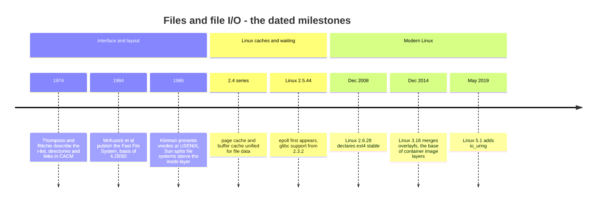
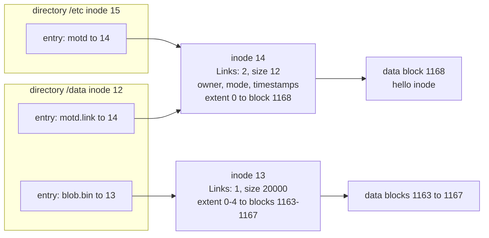
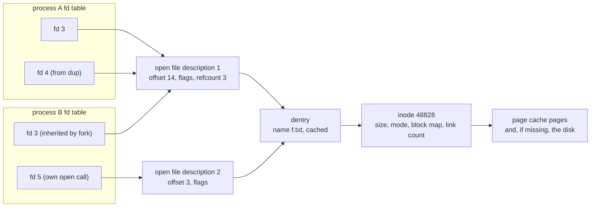
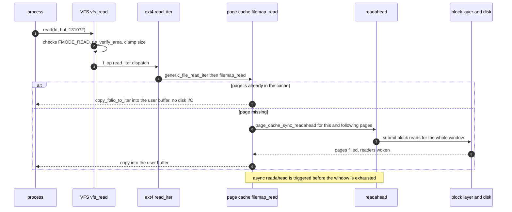
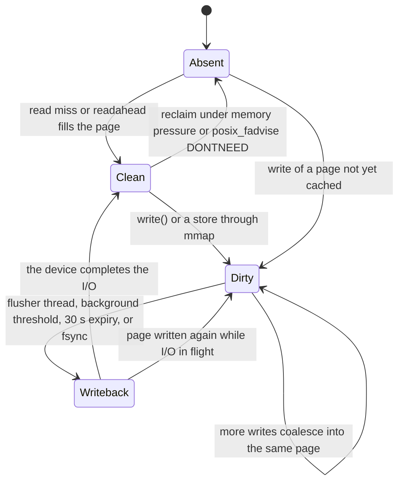
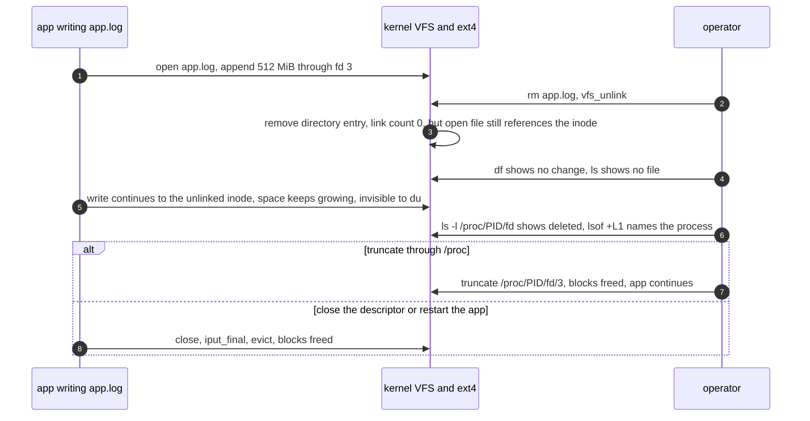
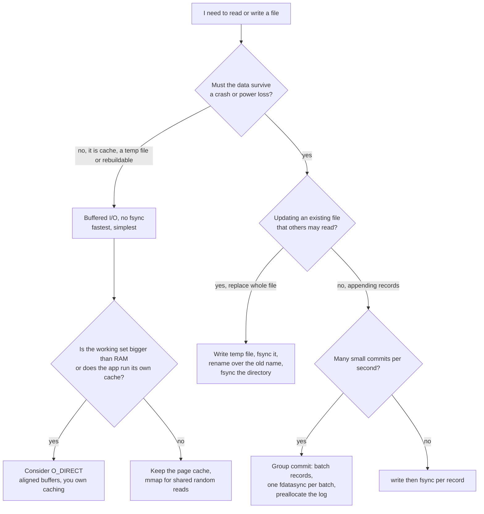
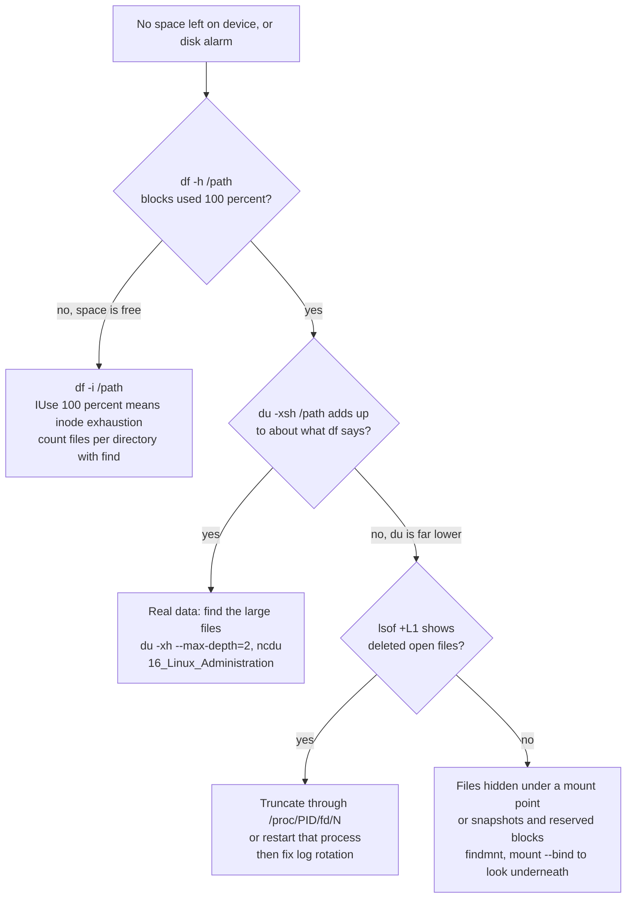
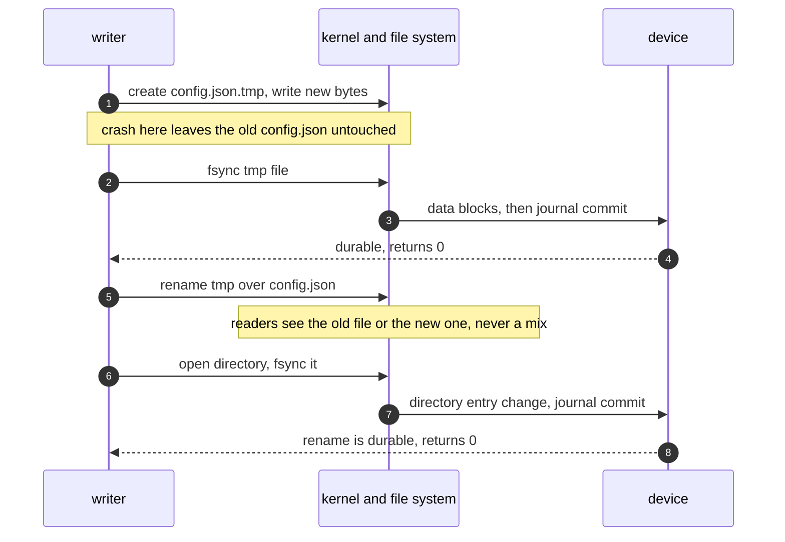

> **Navigation**: [← Internals Index](README.md) | [DevOps Index](../00_INDEX.md) | Previous: [I01 — What Really Happens When You Type `ls`](I01_What_Really_Happens_When_You_Type_ls.md) | Related: [Linux Administration](../16_Linux_Administration.md) · [Docker Complete](../17_Docker_Complete.md) | Reading map: [BOOKS.md](../BOOKS.md)

# I02 — Files, the VFS and the Page Cache

> _"A path is a name, a file is an inode, an open file is a different object again, and almost nothing you read or write ever touches the disk on the call that you made."_

`df` says the disk is 100% full, you delete a 40 GB log, and `df` still says 100%. A service writes a config file, the host loses power, and the file comes back empty. A benchmark reads a file at 5 GB/s on a laptop whose SSD does 500 MB/s. A disk reports 0 bytes free yet `df -h` shows half of it unused. Four different symptoms, one set of ideas: **names are not files, descriptors are not files, writes are not durable, and memory is the real disk.** This chapter derives those ideas from the problem they solve, then takes each apart with commands whose output was produced for this chapter.

## 5W1H

| Question | Answer |
| --- | --- |
| **WHAT** | The kernel's file layer: *inode* (the file), *dentry* (a name), *file* (an open file with its offset), *fd* (a process's handle), the **VFS** that lets one `read()` work on ext4, tmpfs, `/proc` and NFS, the **page cache** in front of every disk, and **writeback / `fsync`**. |
| **WHY** | Every service is a file-system client. Full disks with space free, deleted logs that free nothing, lost writes after a crash and slow "disks" that are network mounts are all consequences of how these layers are built. |
| **WHO** | Engineers who own production Linux hosts, containers or CI runners: SRE, platform, DBA, and SDETs whose runs fill disks and exhaust descriptors. |
| **WHEN** | On every `open`, `write`, `rename`, `unlink` and `fsync`; when sizing disks, picking a file system or I/O mode, or designing for crash safety. |
| **WHERE** | Between the system-call boundary and the block device: `fs/` (VFS and file systems), `mm/filemap.c` and `mm/page-writeback.c` (cache and writeback), `fs/eventpoll.c` and `io_uring/`. |
| **HOW** | A directory maps **name to inode number**; an inode holds **metadata and the location of the data**; an open file adds **an offset**; `file_operations` tables let each file system do the real work; I/O goes through **cached pages**; dirty pages are written back later, or at once on `fsync`. |

> **Verified on** — every output block below was produced by commands run for this chapter on: Linux **6.6.87.2-microsoft-standard-WSL2** (x86-64, 12 vCPU, 7.6 GB RAM), Ubuntu **24.04.1**, GNU coreutils 9.4 (`stat`, `dd`), Python 3.12.3, strace 6.8 (extracted from the `.deb`, rootless), e2fsprogs 1.47.0 (`mke2fs`, `debugfs`, `dumpe2fs`, `filefrag`), lsof 4.95.0, util-linux `unshare`. The root file system is **ext4** on a virtual block device (mounted `rw,relatime,discard,errors=remount-ro,data=ordered`); `/mnt/e` is the Windows drive over **9p**, used as a stand-in for a network file system. No root was available, so `drop_caches`, `/proc/<pid>/stack`, the `debugfs` knobs, `blktrace` and `perf` were **not run here**; neither were XFS, btrfs or NFS (no `mkfs.xfs`, no `mkfs.btrfs`, no server). The WSL2 "disk" is a file on a Windows host with its own cache, so **absolute throughput and latency are optimistic and say nothing about durability**; read the **ratios**. Kernel references are to the Linux **v6.6** files available for this chapter (`fs/read_write.c`, `fs/sync.c`, `fs/inode.c`, `fs/namei.c`, `fs/eventpoll.c`, `fs/ext4/`, `mm/filemap.c`, `mm/page-writeback.c`); names and defaults cited from them were grepped there. A default that lives in an unavailable file (`mm/memory.c`) is marked.

---

# PART 1: The Problem, Derived — What Would You Have to Invent?

Start with nothing but hardware: a disk offers *read block N* and *write block N* and nothing else. Let ten programs share it safely and fast. Each invention below is forced by the one before it (OSTEP's chapters on I/O devices and file-system implementation walk the same ladder).

1. **Which blocks are mine?** Programs that pick block numbers themselves collide, so something must own allocation. The **inode** is a fixed-size record on disk, addressed by number, holding owner, permissions, timestamps, size and the **map from file offset to block number**. The inode *is* the file.
2. **Humans want names.** Names live outside the inode, for three reasons: one file should be reachable by two names (hard links); renaming should be one atomic directory edit that never touches the file; and a program that has the file open should survive its name being removed. So a **directory is a file whose content maps name to inode number**, and a **link count** in the inode counts the entries pointing at it. `rm` removes an entry and decrements; blocks are freed only at count zero *and* no open users (3.9).
3. **Do not walk the path on every read.** `open` resolves and checks once, then creates a kernel object holding the inode, the **offset** and the flags; the program gets a **file descriptor**, an index into a per-process table. Shell redirection is editing that table between `fork` and `exec` (I01).
4. **Programs should not care what the storage is.** One interface (`open`, `read`, `write`, `stat`, `rename`, `unlink`) and one kernel layer, the **VFS**, dispatching through function-pointer tables to whichever file system owns the file. Sun built the first widely copied version in the mid-1980s so that local and NFS files looked alike (Part 2).
5. **A disk is thousands of times slower than memory.** Keep file contents in spare RAM, the **page cache**, shared by all processes, and let writes land there too (**write-behind**). That is why `free` looks nearly full on a healthy server and why an acknowledged write may not be on disk.
6. **RAM forgets.** Programs that cannot tolerate that window need `fsync`; the file system's own multi-block updates need a **journal** (log the intent first, apply it second).
7. **One thread, 50,000 connections.** Readiness APIs (`select`, `poll`, `epoll`) and asynchronous submission (`io_uring`) came later, with a sharp boundary at regular files (3.8).


**How to read this diagram.** *What it shows:* each invention forced by the problem the previous one leaves open. *Flow:* raw disk, then inode (ownership, block map), directory (names, link count), open file and fd (offset), VFS (one interface), page cache (speed), `fsync` and journal (durability), `epoll`/`io_uring` (many files at once). *Notice:* every box is a separate kernel object with its own lifetime, and most confusing incidents are two of them mistaken for one: a name for a file, a descriptor for a file, a write for a durable write.

🔬 **Section Challenge — Names, inodes and link counts**

**Challenge 1 (Predict):** A file has three hard links in three directories. You run `rm` on one of the three names. What is the link count afterwards, is any disk space freed, and can the other two names still read the data?

<details><summary>Answer</summary>

The link count drops from 3 to 2. No space is freed, because blocks are released only when the count is zero **and** no process holds the file open. The other two names still point at the same inode and read the same data; there was only ever one copy. Section 3.1 shows the same sequence with `stat -c %h` going from 2 to 1.

</details>

---


# PART 2: How the Solution Emerged

## 2.1 The original Unix file system (1974)

Thompson and Ritchie's CACM paper *The UNIX Time-Sharing System* (July 1974) is the primary source for the first four inventions of Part 1. It describes an **i-list** (an array of i-nodes on disk, addressed by **i-number**), directories as ordinary files that map names to i-numbers, and **links**: several directory entries naming the same i-number. Everything in sections 3.1 and 3.2 of this chapter, including `ls -i` and the link count, is that design, 50 years later.

## 2.2 FFS: the same abstractions, placed on the disk with intent (1984)

The original layout scattered inodes at the start of the disk and data blocks wherever they fell, so a spinning disk spent most of its time seeking. McKusick, Joy, Leffler and Fabry's *A Fast File System for UNIX* (ACM Transactions on Computer Systems 2(3), August 1984) kept the abstractions and changed the **placement**: larger blocks with fragments for small tails, and **cylinder groups**, regions that each hold their own inodes, bitmaps and data so that a file, its directory and its inodes sit close together. It became the basis of the file system in 4.2BSD, and OSTEP devotes a chapter to it (Ch 41). The lesson for today's engineer: the *interface* (inode, directory, links) survived every redesign; the *layout* changed with the hardware.

## 2.3 The vnode layer (mid-1980s): one interface, many file systems

Kleiman's paper *Vnodes: An Architecture for Multiple File System Types in Sun UNIX* (USENIX Summer 1986) describes the layer that the Linux VFS is the descendant of in spirit. Sun wanted to support the local 4.2BSD file system, **stateless NFS**, stateful remote file systems and even MS-DOS volumes behind one set of calls. Its move was to split the file-system code in two **just above the inode layer**: a file-system-*independent* part and a file-system-*dependent* part, and to rename the generic inode the **vnode**. A vnode carries a pointer to a table of operations supplied by whichever file system owns it. That is exactly the shape of `struct file_operations` and `struct inode_operations` in Linux today (section 3.4). Linux's own VFS is documented in the kernel's *Overview of the Linux Virtual File System* page, which names the objects the chapter uses: superblock, inode, dentry, file and address space.

## 2.4 The page cache, and a dead end: two caches

Early Unix kept a **buffer cache** of raw disk blocks, and Linux additionally had a **page cache** for file contents, so the same data could sit in memory twice. Kernel history sources agree the two were **unified during the 2.4 series** (a mailing-list reply places it at 2.4.10); the buffer cache survives for block-level metadata and raw device I/O, but file data now lives once, in the page cache. Text describing "disk, then buffer cache, then page cache" describes the dead end.

## 2.5 Dates for the rest of the story



**How to read this diagram.** *What it shows:* the verified milestones in order. *Flow:* the inode/directory/link model (1974); a better on-disk layout (1984); the dispatch layer that lets other storage coexist (1986); then Linux's cache unification, `epoll` (2.5.44, per `epoll(7)`), ext4 stable (2.6.28, 25 December 2008), overlayfs (3.18, 7 December 2014) and `io_uring` (5.1, 5 May 2019). *Notice:* the oldest boxes are what every newer one still stands on. Dates not shown (first releases of ext2, ext3, XFS) were not verified and are left out.

🔬 **Section Challenge — Why the vnode split sits where it does**

**Challenge 1 (Explain):** Kleiman's layer splits the file-system code "just above the inode layer". Why there, and what would have gone wrong with a split higher up, at the path-name level?

<details><summary>Answer</summary>

The inode layer is where a path becomes a *thing with operations* (read, write, look up in a directory, get attributes). Splitting just above it lets generic code do name resolution, permission checks and caching once, while each file system supplies only how to find the data. A split at the path level would force every file system, including stateless NFS, to reimplement name resolution; a split below the inode would assume a local on-disk inode, which NFS lacks.

</details>

---

# PART 3: The Mechanism, at Kernel Level

## 3.1 Names and inodes — `stat`, hard links, directories

Create a file and ask the kernel what it knows (`stat` is `statx` underneath). Two lines matter: **Inode** and **Links**.

```text
$ printf 'hello inode\n' > a.txt ; stat a.txt
  File: a.txt
  Size: 12        	Blocks: 8          IO Block: 4096   regular file
Device: 8,48	Inode: 48816       Links: 1
Access: (0644/-rw-r--r--)  Uid: ( 1000/     ash)   Gid: ( 1000/     ash)
Access: 2026-11-15 06:23:30.267483520 +0000
Modify: 2026-11-15 06:23:30.267483520 +0000
Change: 2026-11-15 06:23:30.267483520 +0000
 Birth: 2026-11-15 06:23:30.267483520 +0000
```

The file has 12 bytes but **8 blocks** (counted in 512-byte units): one 4096-byte file-system block, the smallest unit the file system hands out. `Change` is the inode's own timestamp (it changes when metadata changes), distinct from `Modify` (the data). Now add a second name, a symbolic link, and remove the first name:

```text
$ ln a.txt b.txt ; ln -s a.txt c.sym ; ls -li a.txt b.txt c.sym
48816 -rw-r--r-- 2 ash ash 12 Nov 15 06:23 a.txt
48816 -rw-r--r-- 2 ash ash 12 Nov 15 06:23 b.txt
48817 lrwxrwxrwx 1 ash ash  5 Nov 15 06:23 c.sym -> a.txt

$ rm a.txt ; stat -c '%n inode=%i links=%h' b.txt ; cat b.txt
b.txt inode=48816 links=1
hello inode
$ cat c.sym
cat: c.sym: No such file or directory
```

`a.txt` and `b.txt` are two directory entries for **one inode (48816), link count 2**; `rm` removed one entry and the count fell to 1, while the data stayed. The symbolic link is a *different* inode (48817) whose content is the string `a.txt`: it names a **path**, not an inode, so it dangles when the path disappears. Hard links name an inode, symbolic links name a path.

A directory is the table the derivation in 1.2 predicted. `ls -a -i` shows its entries; `os.scandir` returns the same number as `d_ino` straight from the directory block (`getdents64`, which I01 traced in `ls`):

```text
$ mkdir d ; touch d/x d/y ; ls -lai d
48818 drwxr-xr-x 2 ash ash 4096 Nov 15 06:23 .
48815 drwxr-xr-x 3 ash ash 4096 Nov 15 06:23 ..
48819 -rw-r--r-- 1 ash ash    0 Nov 15 06:23 x
48820 -rw-r--r-- 1 ash ash    0 Nov 15 06:23 y
```

`.` is the directory's own inode and `..` is its parent's; both are ordinary entries, which is how the root directory can be its own parent (on this ext4 root, `stat -c %i /` is **2**, the conventional root inode number on ext2/3/4).

### Seeing the on-disk structures without root

Mounting needs root, but the e2fsprogs tools can build and inspect an ext4 image that is just a regular file. `mke2fs -d` populates it from a directory (it contained `etc/motd`, a hard link `data/motd.link`, and a 20,000-byte `data/blob.bin`), and `debugfs` reads the structures directly:

```text
$ mke2fs -q -t ext4 -F -b 4096 -d tree img.ext4 8M
$ dumpe2fs -h img.ext4 | grep -E 'features|Inode count|Block count|Inode size|Journal inode'
Filesystem features:      has_journal ext_attr resize_inode dir_index filetype extent 64bit flex_bg sparse_super large_file huge_file dir_nlink extra_isize metadata_csum
Inode count:              2048
Block count:              2048
Inode size:	          256
Journal inode:            8

$ debugfs -R 'stat /etc/motd' img.ext4 | grep -E 'Inode:|Links'
Inode: 14   Type: regular    Mode:  0644   Flags: 0x80000
Links: 2   Blockcount: 8
$ debugfs -R 'ncheck 14' img.ext4
Inode	Pathname
14	/data/motd.link
14	/etc/motd
$ debugfs -R 'stat /data/blob.bin' img.ext4 | sed -n '/EXTENTS/,$p'
EXTENTS:
(0-4):1163-1167
```

Read it as the structures of Part 1 in miniature: two directory entries point to **inode 14** (`ncheck` reverse-maps an inode to its names, and found `/etc/motd` and `/data/motd.link`); inode 14 has **Links: 2**; `blob.bin` (inode 13) maps its logical blocks 0-4 (20,000 bytes = five 4 KiB blocks) to physical blocks **1163-1167** as one **extent**; and inode 8 is the **journal**, itself a file (4,194,304 bytes in this 8 MiB image). `Inode count: 2048` was fixed **when the file system was created**: ext4 allocates its inode table at `mke2fs` time, which is the cause of the "disk full, space free" failure in section 7.1.



**How to read this diagram.** *What it shows:* the real structures of the 8 MiB test image. *Flow:* directories hold only name-to-inode-number entries; two entries in two directories reach inode 14, so its Links field is 2; the inode holds everything except the name (owner, mode, times, size, extent map); the extent leads to the data. *Notice:* no arrow leads from data back to a name. The kernel cannot derive a file's name from its inode (`ncheck` scans every directory), so the reliable way to find a deleted-but-open file is through the process that holds it (3.9).

### `sed -i` does not edit a file — it replaces its inode

This is where the name/inode split bites. After `ln s.txt s.link`, edit with `sed -i`:

```text
$ stat -c '%n inode=%i links=%h' s.txt s.link
s.txt inode=48823 links=2
s.link inode=48823 links=2
$ sed -i 's/one/two/' s.txt ; stat -c '%n inode=%i links=%h' s.txt s.link ; cat s.link
s.txt inode=48824 links=1
s.link inode=48823 links=1
one
```

`s.txt` now has a **new inode** and the hard link still sees the old content. The strace of `sed -i` (filtered to the interesting calls) shows why:

```text
openat(AT_FDCWD, "s.txt", O_RDONLY) = 3
openat(AT_FDCWD, "./sedKBo2vY", O_RDWR|O_CREAT|O_EXCL, 0600) = 4
rename("./sedKBo2vY", "s.txt")    = 0
```

It writes a **temporary file** and `rename`s it over the old name: atomic (readers see the old file or the new one, never half of each), but it breaks hard links, and it breaks anything that holds the *old inode*: another process with the file open keeps reading the old content. `sed -i` and many editors and config-management tools use create-then-rename. Log rotation has the same trap: renaming the live log aside leaves the writer holding the *renamed* inode until it reopens, which is why `copytruncate` in [16_Linux_Administration.md](../16_Linux_Administration.md) exists. It copies the live log and truncates it in place, for writers that cannot be told to reopen their file (not run here). Section 7.3 uses the rename pattern deliberately for crash-safe updates.

### File systems show up in `stat -f` and the mount table

```text
$ for p in / /dev/shm /mnt/e; do printf '%-9s ' $p; stat -f -c 'fstype=%T inodes=%c ifree=%d' $p; done
/         fstype=ext2/ext3 inodes=67108864 ifree=67056217
/dev/shm  fstype=tmpfs inodes=974746 ifree=974745
/mnt/e    fstype=v9fs inodes=999 ifree=1000000
$ grep ' / / ' /proc/self/mountinfo | cut -c1-90
80 65 8:48 / / rw,relatime - ext4 /dev/sdd rw,discard,errors=remount-ro,data=ordered
```

`stat -f` prints `ext2/ext3` for a file system the mount table calls **ext4**: it labels by the **magic number** (`0xEF53`), which the ext family shares, so `/proc/self/mountinfo` is the truth. The `/mnt/e` inode figures are synthesised by the 9p driver and should not be interpreted.

🔬 **Section Challenge — Names, links and `sed -i`**

**Challenge 1 (Predict):** `b` is a hard link to `a`. You run `echo new > a` (shell redirection, no `rename`). Does `b` show the new content? Now repeat with `sed -i`. Does `b` change?

<details><summary>Answer</summary>

`echo new > a` opens the existing inode with `O_TRUNC` and writes into it, so `b` (same inode) **shows the new content**. `sed -i` creates a new inode and renames it over `a`, so `b` keeps the **old** content (the transcript above: `s.link` still printed `one`). The difference is "write into the inode" versus "replace the name".

</details>

**Challenge 2 (Debug):** A deploy script updates `/etc/app/app.conf` with `sed -i`. The app, which opened the file at start-up and re-reads from the same file descriptor on `SIGHUP`, keeps seeing the old settings. Why, and what are two fixes?

<details><summary>Answer</summary>

The app's descriptor points at the **old inode**, which `sed -i` unlinked; the new settings are in a different inode under the same name. Fix (a): make the app **re-`open` the path** on reload (the standard practice). Fix (b): update in place (`cat new > app.conf`, or `cp` over it, which write into the same inode) accepting that readers can see a half-written file. Prove which inode the app holds with `ls -l /proc/<pid>/fd` and compare `stat -c %i` of the path against `stat -L -c %i /proc/<pid>/fd/N`.

</details>

## 3.2 From an inode to bytes — extents, sparse files and delayed allocation

**Size and allocated blocks are different numbers.** A 1 GiB file with a single 4 KiB write in the middle:

```text
$ truncate -s 1G sparse.bin ; stat -c 'size=%s allocated_blocks(512B)=%b' sparse.bin ; du -h sparse.bin ; du -h --apparent-size sparse.bin
size=1073741824 allocated_blocks(512B)=0
0	sparse.bin
1.0G	sparse.bin
$ dd if=/dev/urandom of=sparse.bin bs=4k count=1 seek=1000 conv=notrunc status=none
$ stat -c 'size=%s blocks=%b' sparse.bin
size=1073741824 blocks=8
```

`truncate` set the size but allocated nothing: the inode's extent map is **empty**, and reading any offset returns zeros without touching the disk. Writing 4 KiB allocates exactly one block. `du` reports allocated space, `ls -l` and `du --apparent-size` report logical size; **this is why a sparse VM image or database file can be "1 TB" and use little disk**, and why copying it with a tool that does not understand holes expands it.

**Allocation is delayed.** `filefrag -v` asks the file system for the extent map (the `FIEMAP` ioctl). Right after `write()` the block has been *reserved* but not placed:

```text
$ head -c 40960 /dev/urandom > da.bin ; filefrag -v da.bin | sed -n '3,4p'
 ext:     logical_offset:        physical_offset: length:   expected: flags:
   0:        0..       9:          0..         0:      0:             last,unknown_loc,delalloc,eof
$ sync da.bin ; filefrag -v da.bin | sed -n '3,4p'
 ext:     logical_offset:        physical_offset: length:   expected: flags:
   0:        0..       9:  134010881.. 134010890:     10:             last,eof
```

The flag **`delalloc`** (delayed allocation) means ext4 has not yet chosen physical blocks: it waits until writeback so it can place a whole run of dirty pages contiguously in one extent. After `sync` (here, an `fsync` of that file) the physical range exists. Delayed allocation is also why `ENOSPC` can surface at `write()` time even though the disk is not yet touched: the file system must *reserve* space when it accepts the data.

**Inode count is fixed at creation.** From the numbers above, the root file system has `blocks × 4096 / inodes ≈ 16 KiB per inode`, matching `inode_ratio = 16384` in the default section of `/etc/mke2fs.conf` (the `small` profile used for the 8 MiB test image sets 4096, which gave 2048 inodes for 8 MiB). Make a file system with lots of tiny files and the inode table runs out long before the blocks do (section 7.1).

## 3.3 Descriptors, open file descriptions and inodes — three tables

`cat` is the smallest complete program that uses the file layer. Its trace, with the library start-up omitted (strace 6.8):

```text
openat(AT_FDCWD, "f.txt", O_RDONLY)     = 3
fstat(3, {st_mode=S_IFREG|0644, st_size=18, ...}) = 0
fadvise64(3, 0, 0, POSIX_FADV_SEQUENTIAL) = 0
mmap(NULL, 139264, PROT_READ|PROT_WRITE, MAP_PRIVATE|MAP_ANONYMOUS, -1, 0) = 0x7373eed85000
read(3, "line1\nline2\nline3\n", 131072) = 18
write(1, "line1\nline2\nline3\n", 18)   = 18
read(3, "", 131072)                     = 0
close(3)                                = 0
```

`openat` resolves the path once and returns **fd 3**; `fstat` reads the inode's size; `cat` tells the kernel it will read **sequentially** (`fadvise64`, a readahead hint, section 3.5), reads in 128 KiB chunks, treats the return value **0 as end of file**, and closes. The descriptor never mentions a path again. Now look at what a descriptor *is*, in a live process:

```text
$ ls -l /proc/814/fd | grep f.txt ; cat /proc/814/fdinfo/3
lr-x------ 1 ash ash 64 Nov 15 06:23 3 -> /tmp/i02/w/f.txt
pos:	8
flags:	02100000
mnt_id:	80
ino:	48828
```

`/proc/PID/fd/N` is a magic symlink to the file; `fdinfo` exposes the **open file description**: the current offset `pos` (8 bytes were read), the flags (`02100000` is `O_LARGEFILE|O_CLOEXEC`), the mount, and the inode. Three separate objects exist, and the experiment below proves they behave differently:

```text
-- dup shares the offset, a second open() does not
read 3 via fd :  b'ne2'
read 3 via dup:  b'\nli'
read 3 via 2nd open:  b'lin'
lseek(fd,0,CUR) = 14   lseek(fd2) = 14   lseek(fd3) = 3
-- fork shares the open file description too
parent offset after child read 2 bytes: 16
```

`dup` produced a *second descriptor for the same open file description*: reads through either advance one shared offset (`ne2`, then `\nli`; both lseeks report 14). A second `open()` of the path created a **new open file description** with its own offset (it read `lin` from the start, offset 3). A `fork`ed child shares the parent's descriptions, so the child's 2-byte read moved the *parent's* offset from 14 to 16. That sharing is what makes `cmd1 | cmd2` and `cmd > file` work across processes (I01, 3.10), and what makes two processes appending through an inherited descriptor interleave rather than overwrite.



**How to read this diagram.** *What it shows:* the three layers between a number in your program and the file's data. *Flow:* each process has an fd table; entries point at open file descriptions (offset and flags), which `dup` and `fork` share; every description reaches one inode through a dentry; the inode owns the cached pages. *Notice:* the offset lives in the middle layer, so "one position or two" depends on whether descriptors share a description. Blocks are freed only when the link count and every such reference are gone (3.9).

**Limits.** Each process has a descriptor limit; exceeding it fails with `EMFILE`, and the system has a global ceiling:

```text
# abridged script: setrlimit(RLIMIT_NOFILE, (20, 20)), then os.open('f.txt') in a loop until it fails
opened 16 files then: [Errno 24] Too many open files
$ cat /proc/sys/fs/file-nr ; ulimit -n ; ulimit -Hn
992	0	9223372036854775807
10240
1048576
```

`file-nr` is allocated handles, free handles (0 here) and the system maximum; `ulimit -n` is the soft limit (10240 here, **1024** is the common default elsewhere) and `-Hn` the hard limit. A service that leaks sockets or log handles dies of `EMFILE` long before memory or disk pressure appears.

🔬 **Section Challenge — Descriptors and open file descriptions**

**Challenge 1 (Predict):** A parent opens `log.txt` for writing, then forks two children, and each child writes the line `hi\n` once. What does the file contain and why? Repeat the thought experiment if each child instead calls `open("log.txt", O_WRONLY)` itself.

<details><summary>Answer</summary>

Inherited descriptor: both children share **one** open file description and its offset, so the file contains `hi\nhi\n` (the second write starts where the first ended). If each child opens the path itself, each gets its **own offset starting at 0**, the second write overwrites the first, and the file contains a single `hi\n`. With `O_APPEND` on those separate opens each `write` seeks to end-of-file atomically, so both lines appear. Evidence in this chapter: the `dup`/second-`open` experiment above.

</details>

## 3.4 The VFS — one `read()`, many file systems

The kernel documentation's *Overview of the Linux Virtual File System* names the objects. Each is a C structure that carries a pointer to a table of operations, which is how "the same call, different implementation" is achieved:

| Object | Represents | Operations table | Seen from user space |
| --- | --- | --- | --- |
| `super_block` | one mounted file system instance | `super_operations` | one line in `/proc/self/mountinfo` |
| `inode` | one file (the thing, 1.1) | `inode_operations` (`lookup`, `create`, `unlink`, `rename`, `getattr`…) | `stat`, `ls -i` |
| `dentry` | one cached *name* in one directory, linking to an inode | `dentry_operations` | path lookup speed; `/proc/sys/fs/dentry-state` |
| `file` | one open file description (3.3) | `file_operations` (`read_iter`, `write_iter`, `mmap`, `fsync`, `poll`…) | `/proc/PID/fdinfo/N` |
| `address_space` | the cache of one inode's pages | `address_space_operations` | `Cached` in `/proc/meminfo`, `mincore` |

`read(fd, buf, n)` becomes `ksys_read` → **`vfs_read`** (`fs/read_write.c`). Reading the v6.6 function shows the VFS's own share of the work: reject a descriptor not opened for reading (`-EBADF`), reject a file that has no read operation (`-EINVAL`), check the user buffer (`-EFAULT`), run the security and range checks (`rw_verify_area`), clamp the size to `MAX_RW_COUNT`, then **dispatch**: `file->f_op->read` if the file system defines it, else `file->f_op->read_iter` through `new_sync_read`. After success it fires the `fsnotify_access` event (what `inotify` listens to) and adds to the process's `rchar` counter, the number shown in `/proc/PID/io` (section 3.5). For ext4 the table in `fs/ext4/file.c` says `.read_iter = ext4_file_read_iter`, `.write_iter = ext4_file_write_iter`, `.mmap = ext4_file_mmap`, `.fsync = ext4_sync_file`. Programs see the uniformity directly: the same `cat` on a kernel file, an ext4 file and a file on the 9p mount issues **the same system calls**:

```text
$ strace -e trace=openat,read,close cat /proc/version             (kernel-generated text)
openat(AT_FDCWD, "/proc/version", O_RDONLY) = 3
read(3, "Linux version 6.6.87.2-microsoft"..., 131072) = 166
read(3, "", 131072)                     = 0
$ strace ... cat /tmp/i02/w/f.txt                              (ext4)
read(3, "line1\nline2\nline3\n", 131072) = 18
$ strace ... cat /mnt/e/Dev_World/.../AGENTS.md                     (9p, the Windows drive)
read(3, "# Agent Operating Manual\n\n**Star"..., 131072) = 1379
```

`cat /proc/filesystems` lists what this kernel can mount: `ext2`, `ext3`, `ext4`, `xfs`, `vfat`, `squashfs`, plus the `nodev` kinds (`tmpfs`, `proc`, `sysfs`, `overlay`, `9p`, `fuse`, `virtiofs`, `devpts`, ...). `xfs` is built in but no `mkfs.xfs` is installed, so XFS behaviour was **not run here**; `btrfs` is not registered. Pipes, sockets and `/proc` entries use the same `file` object with different tables, which is the real content of "everything is a file": the **calls** are uniform, not the semantics. A `read` on a socket blocks differently from a `read` on a disk file, and `epoll` accepts one but not the other (3.8).



**How to read this diagram.** *What it shows:* one `read` on ext4, with function names from the v6.6 source. *Flow:* `vfs_read` runs the generic checks and dispatches through the table to ext4's `read_iter`, a thin wrapper over the shared `filemap_read`; a cached page is copied straight to the user buffer; a miss triggers readahead for the page and its successors, the block layer fills them, and the process copies and returns. *Notice:* the disk is reached only on the miss branch, and then for a window, not one page; everything above the block layer is shared across file systems.

🔬 **Section Challenge — The VFS dispatch**

**Challenge 1 (Predict):** You `cat` a file on tmpfs and the same bytes on ext4. Which of `openat`, `read`, `close` differ in the strace output, and where in the kernel does the behaviour diverge?

<details><summary>Answer</summary>

None of the **system calls** differ (shown above for `/proc`, ext4 and 9p). The divergence is below `vfs_read`: it calls a different `f_op->read_iter` (ext4's wrapper around `filemap_read`; tmpfs's own `shmem` read path, which has no disk behind it), and on a miss the ext4 path goes to the block layer while tmpfs's pages *are* the storage.

</details>

**Challenge 2 (Design):** A teammate says "FUSE and `/proc` prove that everything in Linux is a file." What is true in that and what is misleading?

<details><summary>Answer</summary>

True: the *calls* (`open`, `read`, `write`, `close`, `stat`) apply uniformly, because each object carries a `file_operations` table. Misleading: semantics differ (a `/proc` read generates text on demand; a socket `read` can return fewer bytes than asked and block until data arrives; a regular file can never be added to `epoll`, 3.8), and not every kernel object is in the name space at all (an `io_uring` instance is an anonymous descriptor, `anon_inode:[io_uring]`, section 3.8). Uniform *interface*, non-uniform *behaviour*.

</details>

## 3.5 The page cache — one measurement, three tools

`posix_fadvise(POSIX_FADV_DONTNEED)` asks the kernel to drop a file's **clean** cached pages and needs no privilege, so it substitutes for the root-only `drop_caches` here. `mincore(2)` reports which pages of a mapping are resident. A 256 MiB file was written, `fsync`ed, evicted, read twice, and examined after each step (the helper `resident.py` is in the [Lab](#part-8-lab-challenges-reality-check-and-books)):

```text
after write+fsync (still cached)   resident  65536/65536 pages (100%)   meminfo Cached = 942 MiB
after posix_fadvise(DONTNEED)      resident      0/65536 pages (  0%)   meminfo Cached = 686 MiB
read #1 (cold):   187.8 ms  =     1363 MiB/s
  /proc/self/io: rchar +256 MiB, read_bytes +256 MiB   <- bytes that really came from the block layer
after read #1                      resident  65536/65536 pages (100%)   meminfo Cached = 942 MiB
read #2 (warm):    76.2 ms  =     3359 MiB/s
  /proc/self/io: rchar +256 MiB, read_bytes +0 MiB
```

Three instruments agree. **`mincore`** went 0% → 100% resident. **`Cached`** in `/proc/meminfo` rose by 256 MiB (686 → 942 MiB), exactly the file's size, once, not twice (this is the single-cache fact from 2.4). **`/proc/PID/io`** distinguishes `rchar` (bytes the process asked `read` for) from `read_bytes` (bytes the block layer had to fetch): the second read asked for 256 MiB and fetched **0**. The wall-clock ratio is only about **2.5x** (187.8 ms vs 76.2 ms) because the "disk" is a virtual device whose backing file the Windows host also caches; on a real SSD the cold read would be far slower and on a spinning disk orders of magnitude slower. The warm number is the honest one: **76 ms is the cost of copying 256 MiB from the cache into user memory**, a lower bound set by memory bandwidth and system-call overhead.

**Readahead.** Reading one page should not cost one disk request, so the kernel guesses. After evicting a cold 64 MiB file and reading **4 KiB** at offset 0:

```text
default                  1 page requested -> 4 pages resident (16 KiB)
                         after 256 sequential 4 KiB reads -> 316 pages (1264 KiB)
POSIX_FADV_RANDOM        1 page requested -> 1 pages resident (4 KiB)
                         after 256 sequential 4 KiB reads -> 256 pages (1024 KiB)
```

By default one page request pulled in four (an initial window), and a sequential reader ended up with 60 pages (240 KiB) *beyond* what it had read, because the window grows while the pattern stays sequential (`page_cache_sync_readahead` on a miss, `page_cache_async_ra` when the reader reaches a marker page inside the window, both in `mm/filemap.c`). `POSIX_FADV_RANDOM` turned readahead off and the residency matched the reads exactly. `cat` sets the opposite hint, `POSIX_FADV_SEQUENTIAL`, as the trace in 3.3 showed. (In this run the sequential hint produced the same page counts as the default, so the numbers above are the evidence for random mode, not for the sequential one.) Each readahead window is bounded by `read_ahead_kb`, **128** here (`/sys/block/sdd/queue/read_ahead_kb`, 32 pages); the kernel starts the next window asynchronously before the current one is consumed, so up to about two windows (60 pages here) can be resident ahead of the reader (the exact windowing was not traced).

**What `free` is telling you.**

```text
$ free -m
               total        used        free      shared  buff/cache   available
Mem:            7615         537        6781           3         445        7077
```

`buff/cache` is the page cache (plus kernel buffers and reclaimable slab). It is **not "used" in the sense that matters**: clean pages are dropped instantly under memory pressure, which is why `available` (7077 MB) is the number to alert on, not `free`. A server whose `free` column is near zero and whose `available` is large is healthy; it is using spare RAM as disk cache, as designed. A container with a memory limit is different: page cache is charged to the cgroup, which is where I03 (planned) will take the "why containers misread `/proc/meminfo`" story.

🔬 **Section Challenge — Reading the cache**

**Challenge 1 (Predict):** Process A reads a 1 GiB file; process B then reads the same file. How much additional `Cached` memory does B cause, and what does `read_bytes` show for B?

<details><summary>Answer</summary>

Essentially **zero** additional cache: both processes read the same pages of the same inode's address space. B's `read_bytes` (in `/proc/<pid>/io`) stays near 0 while its `rchar` grows by 1 GiB. This is the same mechanism that lets a thousand `ls` processes share one physical copy of libc (I01, 3.3).

</details>

**Challenge 2 (Debug):** A benchmark script reads the same 2 GB file five times and reports 3 GB/s for runs 2 to 5 but 400 MB/s for run 1. A colleague concludes "the disk got faster". What actually happened, and what changes would make the benchmark honest?

<details><summary>Answer</summary>

Run 1 filled the page cache; runs 2-5 were memory copies (compare `read_bytes`, which would be ~0 for them). To measure the disk: evict before each run (`echo 3 > /proc/sys/vm/drop_caches` as root, or per file `posix_fadvise(DONTNEED)` as in this section), read with `O_DIRECT` (`dd iflag=direct`), or use a file larger than RAM. To measure the *application's* steady state, keep the cache warm but say so; the two numbers answer different questions.

</details>

## 3.6 The write path, writeback and `fsync`

`write(fd, buf, n)` on ext4 reaches `ext4_buffered_write_iter`, which calls the generic **`generic_perform_write`** (`mm/filemap.c`). For each page the data touches, the loop does four things, visible by name in the v6.6 source: `a_ops->write_begin` (find or create the cached page, reserve space), `copy_page_from_iter_atomic` (copy your bytes in), `a_ops->write_end` (mark the page **dirty**, extend the file size), and `balance_dirty_pages_ratelimited` (check whether this process has dirtied too much and must slow down). **Nothing in that loop waits for the disk.** Measured on the ext4 root, 128 writes of 1 MiB each:

```text
128 x write(1 MiB) = 128 MiB returned in    213.7 ms     Dirty=138 MiB Writeback=0 MiB
fsync                                       111.0 ms     Dirty=10 MiB  Writeback=0 MiB
200 small write() calls                       2.2 us each (page cache only)
200 x (write + fsync)                      2251.1 us each
200 x (write + fdatasync)                  2475.6 us each   <- appends: size changes, so same cost as fsync
200 x write on an O_DSYNC fd               2400.7 us each
```

`Dirty` in `/proc/meminfo` rose by 128 MiB (10 → 138) while the calls returned and fell back when `fsync` finished; the 128 MiB were in memory only until then. A 128-byte `write` costs about **2 microseconds**; the same write followed by `fsync` costs about **2,250 microseconds**, three orders of magnitude, because `fsync` must push the data **and the metadata and a journal commit** through the device and wait. `O_DSYNC` makes every `write` behave like that (2,400 µs). That gap is the whole reason databases batch commits ("group commit").

**`fsync` versus `fdatasync`.** `fsync` flushes data *and* all metadata; `fdatasync` flushes data and only the metadata needed to read it back (`vfs_fsync_range` takes a `datasync` argument). An **append** changes the file size, so both cost the same (above). An **overwrite of an allocated block** changes only timestamps, so `fdatasync` wins (preallocated 8 MiB file, 512-byte overwrite at a fixed offset, two rounds each):

```text
overwrite 512 B in preallocated file:  fsync 1356 us / 1320 us   fdatasync 894 us / 864 us
append 512 B (i_size changes):         fsync 2248 us             fdatasync 2256 us
```

That is why write-ahead logs often **preallocate and overwrite** their segments: the size never changes, so `fdatasync` suffices and no allocation needs journaling. The 35% gap and the append equality transfer; the microseconds are a virtual disk's.

**When does dirty data leave on its own?** Flusher threads (`fs/fs-writeback.c`) write dirty pages back when dirty memory passes the **background threshold**, when a page is older than the **expire interval**, or on `fsync`/`sync`. The defaults are in `mm/page-writeback.c` and match `sysctl` here: `vm.dirty_background_ratio = 10`, `vm.dirty_ratio = 20`, `vm.dirty_writeback_centisecs = 500` (wake every 5 s), `vm.dirty_expire_centisecs = 3000` (30 s). Past 20% the writing *process itself* sleeps in `balance_dirty_pages` (slices of up to 200 ms, per a source comment). A 3 GiB write in 1 MiB calls, with `MemAvailable` = 7092 MiB (10% is about 709 MiB, 20% about 1418 MiB; the kernel uses a slightly different "dirtyable" figure):

```text
written MiB elapsed ms Dirty MiB Writeback MiB  worst single write() in window ms
        256        445       256             0                                2.3
       1024       1903       688             0                                7.2
       1280       2433       119           280                                8.3
       2048       3880       687             0                                4.4
       3072       5876       701             2                                2.8
final fsync: 445 ms; 0 MiB dirty after
```

`Dirty` climbs with the writes, **plateaus near 690-700 MiB (about the 10% mark)** as background writeback engages, and drops (119 MiB at 1280 MiB written) when a flusher batch completes. No `write()` stalled for more than 8.3 ms. **The throttling stall was not reproduced here:** this virtual disk keeps up, so the 20% limit was never reached; forcing it needs a slow device or a small `vm.dirty_bytes` (root), **not run here**. Section 7.4 gives the mechanism.



**How to read this diagram.** *What it shows:* the life of one cached page. *Flow:* a read miss makes it clean; `write` or an `mmap` store makes it dirty (repeated writes merge for free); a flusher thread, the background threshold, 30-second expiry or `fsync` moves it to writeback; the device's acknowledgement makes it clean; only clean pages can be reclaimed. *Notice:* `write()` returning reaches only "dirty"; durability is the writeback arrow, and `fsync` forces and waits for it.

**The file system's own consistency: journaling.** An append touches several blocks (data, the inode's size and extents, the bitmap, maybe the directory); a crash between them would leave the structure inconsistent, which the pre-journal answer, `fsck`, repaired by scanning the whole disk (OSTEP, "FSCK and Journaling"). The journal protocol: write the intended metadata changes to the log, write a **commit** record, then **checkpoint** (apply them in place); recovery replays committed transactions and ignores the rest. The ext4 root is mounted `data=ordered`: only metadata is journaled, but file **data is forced out before the metadata that points to it commits**, so a crash can lose the latest data but not expose another file's old bytes. The journal is a hidden file, inode 8 (4 MiB in the 8 MiB test image). Crash behaviour itself was **not tested here** (it needs power-loss or fault injection).

**What `fsync` returning means, and a trap in how it reports errors.** `fsync(fd)` calls `vfs_fsync_range`, then the file system's `f_op->fsync` (ext4: `ext4_sync_file`). The kernel's VFS documentation (*Handling errors during writeback*) states the contract: writeback errors are reported through `fsync`, `fdatasync`, `msync` or `sync_file_range`; **after an error has been reported, later calls on the same descriptor return success unless a new error occurred**; and since the cache does not record which open file dirtied which page, every description open at the time sees the error. So **a second `fsync` after a failed one proves nothing**: on `EIO`, treat the data as lost. Forcing a real writeback error needs a failing device (root); **not run here**.

**O_DIRECT and the alternatives, measured.** `dd` of the same 256 MiB random file from tmpfs onto ext4, second of two runs (the first run was within about 10% on every row):

```text
buffered, no sync:                        0.425 s  631 MB/s
buffered + conv=fsync:                    0.549 s  489 MB/s     <- includes the flush: this is the honest "written" number
oflag=direct, bs=1M:                      0.224 s  1.2 GB/s
oflag=dsync, bs=1M:                       1.32 s   203 MB/s
8 MiB as 2000 x 4 KiB, buffered:          0.0149 s 548 MB/s
8 MiB as 2000 x 4 KiB, oflag=direct:      0.330 s  24.8 MB/s
8 MiB as 2000 x 4 KiB, oflag=dsync:       4.27 s   1.9 MB/s
```

Read the rows against each other, not the absolutes. Small synchronous writes are about **290x slower** than buffered ones (4.27 s vs 0.0149 s). `O_DIRECT` skips the cache, so a large request is fast, but 4 KiB direct writes pay a device round trip each (24.8 MB/s). Its 1.2 GB/s is **not** raw-disk speed and **not** durable: the host caches the virtual disk's backing file, and `O_DIRECT` bypasses the *kernel's* cache, not the device's. It also demands alignment: a 100-byte `O_DIRECT` write failed with `EINVAL` (`dd: error writing 'dd.bin': Invalid argument`).

**Measurements on 9p say nothing about durability.** On the Windows drive, `Dirty` stayed flat while writing (no write-behind) and `O_DSYNC` writes were *faster* than plain ones (164 vs 200 µs): host artefacts. Only the 9p **metadata** cost (4.3) is used in this chapter.

🔬 **Section Challenge — Write, flush, durable**

**Challenge 1 (Predict):** A program calls `write(fd, buf, 4096)` and gets `4096` back, then the machine loses power one second later. Is the data on disk? What if the program had called `fsync` first and got `0`?

<details><summary>Answer</summary>

Without `fsync`: **not guaranteed**; the page was marked dirty, and the flusher writes pages older than 30 s (`dirty_expire_centisecs = 3000`), so a one-second-old page is very likely still only in RAM. With `fsync` returning 0: the data and the metadata needed to read it back have been handed to the device and acknowledged (subject to the device honouring flushes, which a virtualised or cheap disk with a volatile write cache may not). One more gap: a *newly created* file also needs its **directory entry** durable, which needs an `fsync` of the directory (section 7.3).

</details>

**Challenge 2 (Compute):** A service commits transactions with `write` + `fsync` at 2,250 µs per commit on one thread. What is its commit ceiling per second, and what do you change to raise it without weakening durability?

<details><summary>Answer</summary>

`1,000,000 / 2,250 ≈ 444` commits/s on one thread. **Group commit**: collect the commits that arrive while one `fsync` is running and flush them together with a single call, so `N` transactions share one 2,250 µs cost. Second lever: avoid the allocation cost (preallocate the log and use `fdatasync`, 880 µs in the overwrite measurement). Do **not** switch to `O_DIRECT` or "async" settings and call it the same: either skips the flush barrier or changes the durability contract.

</details>

## 3.7 `mmap` — the page cache, mapped into your address space

`read` copies from the cache into your buffer. `mmap` skips the copy: the cached pages themselves are mapped into your address space, and touching an address is a **page fault** that the kernel resolves by mapping the cached page (reading it from disk first if absent). A 64 MiB cached file mapped `MAP_SHARED` and read one byte per page:

```text
7243ff200000-724403200000 rw-s 00000000 08:30 48798      /tmp/i02/w/map.bin       <- /proc/self/maps
after mmap() but before touching: RssFile 6656 kB, faults 17664
touched 16384 pages: minor faults +1024, major faults +0, 6.8 ms; RssFile 72192 kB
second pass over the same pages: faults +0, 1.3 ms
```

`mmap` itself touched nothing (`RssFile` unchanged). The first pass caused **1,024 minor faults for 16,384 pages: 16 pages per fault**, because on a read fault of a file page already in the cache the kernel maps a whole neighbourhood at once ("fault-around", 64 KiB by default per the `fault_around_bytes` knob in `mm/memory.c`; that file was not among the sources available here and the debugfs knob needs root, so **only the arithmetic is verified here**). A *minor* fault finds the page in the cache; a *major* fault would have had to read the disk (0 here, because the file was cached). The second pass cost no faults and was 5x faster, because the page-table entries now exist. `RssFile` grew by 65,536 kB: the process's resident set counts cached file pages mapped into it, which is how a "small" process can show large RSS.

**It is the same page as `read` and `write` use.** A store through the mapping is visible to `pread` and to a second process at once, with no `msync` and no `munmap`:

```text
m[100:105] = b'HELLO'
  pread() sees: b'HELLO'                       (no msync, no munmap yet)
  second process reading the file: b'HELLO'
  smaps, MAP_SHARED mapping, before msync: Rss 65536 kB, Private_Clean 65532 kB, Private_Dirty 4 kB
  smaps, after msync:                      Rss 65536 kB, Private_Clean 65536 kB, Private_Dirty 0 kB
-- MAP_PRIVATE: a write makes a private copy; the file is unchanged
  private mapping sees: b'ZZZ'   file sees: original bytes (unchanged)
```

`MAP_SHARED` stores dirty the *shared cache page* (4 kB dirty after the one 5-byte store); `msync` (Python `flush()`) writes it back and the dirty count returns to 0. `MAP_PRIVATE` stores trigger **copy-on-write**: the process gets its own copy and the file never changes. One label to read carefully: `smaps` reports `Private_*` for this **`MAP_SHARED`** mapping, because "private" in `smaps` means *mapped by only one process at the moment* (the page's mapcount), not the `MAP_PRIVATE` flag. (The kernel's `fs/proc/task_mmu.c` implements this and was not among the available sources; the output above is the evidence.)

**The sharp edge.** A mapped file that shrinks leaves your pages pointing past end-of-file, and the next access raises **`SIGBUS`**, not an error return: mapping a file, truncating it to one page, then reading page 8 ended the Python process with status 135 (128 + 7). On a network file system that fails, behaviour depends on mount options (a hard mount makes accesses hang in `D` state; not run here). `read` can return `EIO`; a memory load cannot, so `mmap` I/O errors are *signals*, and a library that maps a file must be ready for them.

## 3.8 Waiting for many files — `epoll`, and an introduction to `io_uring`

Descriptors for sockets and pipes have a *not ready yet* state, so a thread can ask the kernel "wake me when any of these 10,000 is readable": `epoll`. Regular files have no such state from the program's point of view (a `read` either finds the page cached or sleeps inside the kernel on the disk), and Linux refuses to pretend:

```text
epoll_ctl(ADD, regular file) -> [Errno 1] Operation not permitted
epoll_ctl(ADD, pipe) -> ok          epoll_ctl(ADD, socket) -> ok
after write to pipe: [(5, 1)]
poll()/select() on the regular file say 'ready' immediately: True
epoll_create1(EPOLL_CLOEXEC)            = 3
epoll_ctl(3, EPOLL_CTL_ADD, 4, {events=EPOLLIN, ...}) = 0
epoll_wait(3, [{events=EPOLLIN, ...}], 1023, 1000) = 1
```

`EPERM` is raised in `fs/eventpoll.c` (v6.6): `error = -EPERM; if (!file_can_poll(tf.file)) goto error_tgt_fput;`. The file system's `file_operations` has no `poll` method for ordinary files, so the target is rejected. `poll`/`select` accept them but report "always ready", which is true and useless. Consequences you will meet: a single-threaded event loop (Node.js, Nginx) cannot make disk reads non-blocking with `epoll`; runtimes hand file operations to a **thread pool** (libuv's approach) and nginx offers `aio threads`; a stalled NFS or disk blocks those workers, not the loop.

**`io_uring`** (Linux 5.1) is the newer answer: two ring buffers shared with the kernel, a *submission queue* for requests (read, write, `fsync`, `accept`) and a *completion queue* for results, so many operations can be submitted with one `io_uring_enter` call, or none when the kernel polls. This chapter only verifies that it exists. One raw `io_uring_setup(8, &params)` call (syscall 425, no library):

```text
ring fd=10: sq_entries=8 cq_entries=16 features=0x3fff
lrwx------ 1 ash ash 64 Nov 15 06:26 10 -> anon_inode:[io_uring]
$ cat /proc/sys/kernel/io_uring_disabled
0
```

A request for 8 entries gave a submission queue of 8 and a completion queue of 16; the ring is an **anonymous inode** in the descriptor table, not a path. `kernel.io_uring_disabled` is an administrator switch (0: enabled). Submitting and reaping operations was **not run here** (no `liburing`), so treat `io_uring` performance claims as unverified until measured on your workload. The cache rules above still apply: a buffered `io_uring` read of a cached file is a memory copy.

🔬 **Section Challenge — mmap and waiting**

**Challenge 1 (Predict):** A process maps a 1 GiB file `MAP_SHARED` and a second process runs `dd of=file conv=notrunc` writing one block in the middle. Does the first process see the change, and what must the writer do first?

<details><summary>Answer</summary>

Yes, and the writer need not do anything first: both use the **same cached page** of the same inode (the `HELLO` experiment: `pread` and a second process saw the store immediately, without `msync`). `msync`/`fsync` matters for *durability*, not for visibility between processes on one machine. On a network file system with attribute caching, visibility between *machines* is another matter.

</details>

**Challenge 2 (Debug):** A log-tailing tool that `mmap`s files crashes with "Bus error" whenever logrotate truncates the log. Why can't it catch an error return, and what are two fixes?

<details><summary>Answer</summary>

A memory access past the new end-of-file cannot return an error code; the kernel raises `SIGBUS` (the 135 exit status above). Fixes: (a) use `read`/`pread` for files that other processes can truncate (an error return or a short read), or (b) install a `SIGBUS` handler and re-map, and in either case re-`stat` the file and compare its size and inode when you wake up.

</details>

## 3.9 Deleting a file does not free its space — and what actually does

`rm` calls `unlink`. In `fs/namei.c`, `vfs_unlink` removes the **directory entry** and decrements the inode's link count; it does not free blocks. The inode is torn down only when the *last reference* to it is dropped: `iput` → `iput_final` → `evict` (`fs/inode.c`), where the file system's `evict_inode` operation (or `truncate_inode_pages_final` for the cached pages) runs and the blocks are released. An **open file description holds a reference** to the inode (the diagram in 3.3), so as long as any process keeps the file open, the inode survives with a link count of 0. A writer with a 512 MiB log open, then `rm`:

```text
$ ls -l app.log ; rm app.log ; ls app.log
-rw-r--r-- 1 ash ash 536870912 Nov 15 06:24 app.log
ls: cannot access 'app.log': No such file or directory
$ ls -l /proc/1097/fd | grep deleted
l-wx------ 1 ash ash 64 Nov 15 06:24 3 -> /tmp/i02/w/app.log (deleted)
$ stat -L -c 'inode=%i links=%h size=%s' /proc/1097/fd/3
inode=48802 links=0 size=536870912
$ du -sh /tmp/i02/w            <- du walks directory entries: it cannot see the file
56K     /tmp/i02/w
$ lsof +L1 /tmp/i02/w          <- +L1: open files with link count below 1 (unrelated cwd rows omitted)
COMMAND  PID USER   FD   TYPE DEVICE  SIZE/OFF NLINK  NODE NAME
python3 1097  ash    3w   REG   8,48 536870912     0 48802 /tmp/i02/w/app.log (deleted)
```

(The first two lines are from one run of the experiment and the rest from a second run, pid 1097; only pids and inode numbers differ.) The name is gone and **`/proc/PID/fd/3` still resolves to the inode**, annotated `(deleted)`, with `links=0`. `du` (which sums files it can reach through directories) reports 56 K, while the file system still holds 512 MiB: **this is the signature of a deleted-but-open file, `df` high and `du` low.** Two ways to recover the space, each measured with `df` on the ext4 file system after a `sync` and a 6 s wait (the writer was alive and holding the descriptor until stated):

```text
[truncate] used with 512 MiB log present :          4365 MiB
[truncate] after rm + sync + 6 s         :          4365 MiB   (writer still holds the fd)
[truncate] after truncate via /proc, sync, 6 s :    3853 MiB   (writer still alive: yes)
[close]    used with 512 MiB log present :          4365 MiB
[close]    after rm + sync + 6 s         :          4365 MiB   (writer still holds the fd)
[close]    after writer exit + sync + 6 s :         3853 MiB
```

`: > /proc/PID/fd/3` **truncates the deleted inode through the process's descriptor**, freeing 512 MiB while the service keeps running, and is the standard emergency move when you cannot restart the process. `cp /proc/PID/fd/3 /safe/place` recovers the bytes of a deleted file as long as the process lives (512 MiB copied in the experiment). Closing the descriptor (here by process exit) triggers `iput_final` and frees the blocks. The `sync` and the 6 s wait are a precaution so that `df` is read after the file system has settled; they were not shown to be necessary here.



**How to read this diagram.** *What it shows:* why `rm` appears to do nothing. *Flow:* the app appends; `rm` removes the name and sets the link count to 0, but the open file description keeps the inode alive; `df` is unchanged, `du` cannot see it, and the app may keep growing it; `/proc/PID/fd` and `lsof +L1` find it; truncating through `/proc` or closing the descriptor frees the blocks. *Notice:* two conditions must both be false before space returns (no names, no open references) and `rm` controls only the first. Rotate logs with a signal or `copytruncate`, or truncate in place (`: > file`).

🔬 **Section Challenge — Deleted but open**

**Challenge 1 (Predict):** `df` says `/var` is 98% used, `du -sx /var` adds up to 31% of it. You find no big files. Name the two most likely causes and one command for each.

<details><summary>Answer</summary>

(1) A **deleted-but-open file**: `lsof +L1 /var` (open files with link count 0), or `ls -l /proc/*/fd 2>/dev/null | grep deleted`. (2) A directory **hidden under a mount point**: files written to `/var/x` before a file system was mounted on `/var/x` still use space on the parent file system but cannot be reached by path; check `findmnt` and bind-mount the parent (`mount --bind / /mnt/root`) to see underneath. (Only the first was reproduced in this chapter.)

</details>

---

# PART 4: The Alternatives — How Each Design Works and What It Trades Away

## 4.1 How to do the I/O: six paths into the same file

|  Path | What happens | Trades away | Better than the default when  |
|  --- | --- | --- | ---  |
|  **Buffered `read`/`write`** (default) | Copy through the page cache; write-behind | Durability until writeback; a memory copy per call; cache competes with your heap | Almost always: general services, builds, logs  |
|  **Buffered + `fsync`/`fdatasync`** | Same, then flush and wait | Latency: ~2,250 µs per small commit | Anything that must survive a crash: databases, saved documents  |
|  **`O_DIRECT`** | DMA between your buffer and the device, cache bypassed; aligned I/O only | Readahead, caching, merging of small writes; alignment burden; still **not durable** without a flush | The application has its own cache and knows better (database buffer pools); streaming data bigger than RAM that would evict useful cache  |
|  **`mmap`** | Pages mapped into the address space; faults load them | Errors become `SIGBUS`; page-fault cost on cold access; TLB pressure; hard to control when writes reach disk | Random access into a large read-mostly file shared by many processes (indexes, ML weights, shared libraries)  |
|  **`io_uring`/async** | Batched submission and completion rings | Complexity; younger API and a bigger kernel attack surface (it can be disabled with `kernel.io_uring_disabled`) | Very high I/O rates per core, or one API for files and sockets  |



**How to read this diagram.** *What it shows:* a path from requirement to I/O pattern. *Flow:* first ask whether the data must survive a crash (if not, plain buffered I/O is right); if yes, whole-file replacement uses the temp-file recipe of 7.3 and record appends use batched `fdatasync` on a preallocated log; separately, only an application with its own cache or data far bigger than RAM should consider `O_DIRECT`. *Notice:* durability and caching are independent decisions; `O_DIRECT` answers the second, `fsync` the first, and using `O_DIRECT` "for safety" buys neither.

## 4.2 Which file system — at the level an architect needs

| File system | Core idea | Strengths | Costs / watch-outs | Run here? |
| --- | --- | --- | --- | --- |
| **ext4** | Extents + journal (`data=ordered` by default as seen) on the ext2 layout | Mature, the default on most distributions, simple to repair; handles most workloads | Inode count fixed at `mke2fs` (section 7.1); can be less scalable for very large parallel workloads | Yes |
| **XFS** | Extent-based, journaled; designed for large files and parallel I/O | Scales with cores and big volumes; common on enterprise and database hosts | **Not run here** (no `mkfs.xfs`) | No |
| **btrfs** | Copy-on-write tree, snapshots, checksums, built-in volume management | Snapshots and data checksums | More moving parts and different failure modes; not registered in this kernel; **not run here** | No |
| **tmpfs** | Page cache *is* the storage, optionally swapped | Fast, no disk; size and `nr_inodes` are mount options | Lost at reboot; counts against memory | Yes (7.1) |
| **overlayfs** | Merge a read-only lower tree and a writable upper tree | Container image layers (I06): cheap reuse, copy-up on write | Copy-up of large files; `rename` and hard-link corner cases; extra layer for every lookup | Yes (below) |
| **NFS** | Remote server; the VFS maps operations to RPCs | Shared data between hosts | Latency per metadata operation; consistency rules weaker than a local file; a hung server hangs processes in `D` state | **Not run here** (no server) |

**Overlayfs, shown without root** (a mount inside a user namespace made with `unshare --user --map-root-user --mount`):

```text
merged sees: a.txt b.txt                          (lower had a.txt "from lower", b.txt "lower only")
modify a.txt through the merged view (copy-up)
upper now holds: a.txt ;  lower a.txt still: from lower
after rm b.txt in merged: lower still has a.txt b.txt
upper/b.txt: mode=c--------- type=character special file
```

Writing `a.txt` through the merged view **copied** it into the upper directory first (copy-up) and left the lower file untouched; deleting `b.txt` created a **whiteout**, a character device with device number 0,0 in the upper layer, which hides the lower file. This is what a container's writable layer does on every `docker run`, and why deleting a file in a later image layer **does not shrink the image** (the lower layer still holds the data, as the `lower still has a.txt b.txt` line shows). Image layers and registries are I06.

## 4.3 Network file systems: the metadata cost, measured

The Windows drive in WSL2 is served over 9p, a network-style protocol (a request to a server per operation). Create, `stat` and `unlink` 2,000 one-byte files in a directory, per file:

```text
                    create       stat     stat again    unlink
ext4 (local)       50.5 us      3.1 us       3.0 us     20.0 us
9p (/mnt/e)      3991.6 us   2774.6 us    2709.8 us   2897.5 us
```

`stat` is **about 900 times slower**. And "stat again" is no faster: this mount does not cache metadata the way a local file system's dentry and inode caches do (the ext4 `stat` is answered from memory in 3 µs). A build tool that stats 100,000 files spends 0.3 s on ext4 and about 4.6 minutes on this mount. NFS has a different cost model (it caches attributes for a bounded time and uses weaker consistency than a local file system), and was **not run here**; but the lesson transfers: **on any remote or user-space file system, the number of metadata operations, not bytes, is the cost**, which is why `node_modules`, `.git` and compilers belong on the local file system, not the shared mount.

🔬 **Section Challenge — Choosing a path**

**Challenge 1 (Design):** A service stores 50,000 small session files per hour (each about 1 KiB, readable only to that service, rebuildable by logging in again). Which I/O path and which file system settings do you choose, and what would change if the sessions were payment records?

<details><summary>Answer</summary>

Sessions are *rebuildable*: plain buffered writes, no `fsync`, ideally on a **tmpfs** or a dedicated volume created with enough inodes for the file count (7.1). Payment records are *not rebuildable*: append to a log with `fdatasync` per batch (group commit), keep one durable log rather than 50,000 files, and replicate. The difference is the first node of the decision flowchart (must it survive a crash?).

</details>

**Challenge 2 (Compare):** A Docker image build deletes a 400 MB archive in the last `RUN rm` step and the image is still 400 MB bigger than expected. Explain with the overlayfs experiment, and give the fix.

<details><summary>Answer</summary>

Each `RUN` writes a new layer; the earlier layer that *added* the archive is a read-only lower directory, and the `rm` in a later layer adds a **whiteout** that hides the file but does not alter the lower data (`lower still has a.txt b.txt`). Fix: add and remove the file in the **same `RUN`**, or use a multi-stage build so the archive never enters a shipped layer. (Docker itself was not run here; the layering mechanism is shown with overlayfs directly.)

</details>

---

# PART 5: How It Became the Standard

- **Small and general.** An inode, a name table and an offset-carrying open file express disk files, devices, pipes and (via dispatch tables) remote files. Kleiman's 1986 goals already included a local 4.2BSD file system, stateless NFS and MS-DOS volumes behind one layer.
- **Fixed by standards.** `open`, `read`, `write`, `close`, `fsync`, `rename` and `unlink` are POSIX calls, so programs move between Unix systems; Linux implements the same semantics, including the atomic `rename` that crash-safe code (7.3) relies on.
- **Fast enough that nobody replaced it.** Cache unification, readahead and write-behind gave ordinary programs near-memory speed; `O_DIRECT`, `mmap` and `io_uring` stayed exceptions.
- **Reused by containers.** Overlayfs (3.18, December 2014) layers over ordinary file systems with no new on-disk format, which helped image layers spread; ext4 (stable in 2.6.28) is the baseline others must justify themselves against.

---

# PART 6: When to Use — and When Not To

## 6.1 Decision rules an architect can apply

1. **Alert on both `df -h` and `df -i`.** Space and inodes run out independently; a volume of tiny files needs a lower bytes-per-inode ratio at creation (`mke2fs -i` or `-N`), because the bytes-per-inode ratio of an ext4 file system is fixed when it is created.
2. **Never `rm` a log that a running process holds.** Rotate with a signal the app handles, with `copytruncate`, or truncate in place (`: > file`). Alert on `lsof +L1` showing multi-gigabyte entries.
3. **Treat "saved" as an `fsync` contract.** Everything that must survive a crash goes through temp-file + `fsync` + `rename` + directory `fsync`, or an append log with `fdatasync` and group commit. Treat an `fsync` error as data loss.
4. **Measure with the cache in mind.** Say whether a benchmark is cold or warm; `read_bytes` in `/proc/PID/io` tells you which.
5. **Keep high-metadata workloads local.** Compilers, package managers and VCS on a network or user-space mount pay per file, not per byte (900x for `stat` here).
6. **Pick the default file system; change it for a measured reason** (XFS for very large files and parallel I/O on dedicated data volumes; tmpfs for rebuildable scratch; avoid btrfs-style features unless you will operate them).

## 6.2 Enterprise lens

**Scale:** millions of directory entries or hundreds of thousands of open files hit `EMFILE`, inode count and metadata latency before bandwidth; set limits per service (`LimitNOFILE`, `ulimit -n`). **Security:** `/proc/PID/fd/N` lets the same user or root read a **deleted** file while the process lives (`cp /proc/PID/fd/3`, 3.9), so "deleted" is not "gone"; overlayfs lower layers keep deleted files, so a secret added and removed in an earlier `RUN` stays in the image. **Compliance:** retention and disposal rules concern *data*, not names; there is no guaranteed overwrite on journaled or SSD storage. **Cost:** page cache is spare RAM used as a free read accelerator; sizing RAM to the hot working set often beats faster disks. In a cgroup the cache is charged to the group (I03, planned). **Operability:** dashboard `df -h`, `df -i`, `Dirty`/`Writeback`, descriptor counts and `fsync` latency; the deleted-open-log and inode-exhaustion incidents are invisible to one "disk used %" graph.

> **What a test engineer does with this** — CI runners are small disks that fill with screenshots, traces and `node_modules`: a test writing thousands of tiny artifacts can exhaust **inodes** while `df -h` looks fine, and a runner that `rm`s a log still held by a browser or reporter frees nothing until that process exits. Put artifacts on tmpfs or a volume sized for the file count, close handles in teardown, and make `df -i` the first command of any "no space left on device" ticket.

🔬 **Section Challenge — Applying the rules**

**Challenge 1 (Decide):** A nightly job unpacks 8 million files of 2 KiB each onto a freshly created 100 GiB ext4 volume with default settings. It fails part-way with `No space left on device` while `df -h` shows roughly 75% free. Compute where it fails, and say what you change.

<details><summary>Answer</summary>

The default `inode_ratio` is 16384 bytes per inode (`/etc/mke2fs.conf`), so `100 GiB = 104,857,600 KiB`, divided by 16 KiB, gives **6,553,600 inodes** (a little fewer are usable, since some are reserved). The job fails near file 6.5 million; by then the files occupy only about `6.55M × 4 KiB ≈ 25 GiB` (each 2 KiB file takes one 4 KiB block), which is why `df -h` still shows about 75% free. The fix is at creation time: `mke2fs -t ext4 -i 4096` (one inode per 4 KiB, about 26 million) or `-N <count>`, or avoid millions of tiny files (pack them into an archive or a database). The ratio cannot be changed afterwards without re-creating the file system. Confirm with `df -i` before and after; the tmpfs run in 7.1 shows the same failure mechanism.

</details>

---

# PART 7: How It Fails — and How to Diagnose Each

| Symptom | Mechanism | Command that proves it | Fix |
| --- | --- | --- | --- |
| `No space left on device`, but `df -h` shows free space | **Inodes exhausted** (7.1) | `df -i /path` shows `IUse% 100%` | Fewer files; recreate with more inodes; clean up directories |
| `df` high, `du` low; deleting logs frees nothing | **Deleted-but-open file** (3.9) | `lsof +L1`; `ls -l /proc/PID/fd \| grep deleted` | Truncate via `/proc/PID/fd/N`, restart the holder, fix rotation |
| Config or data file empty or old after a crash | Update was not crash-safe (no `fsync`, in-place overwrite, missing directory `fsync`) (7.3) | `strace -f -e trace=openat,fsync,rename -p` on the writer | Temp file + `fsync` + `rename` + directory `fsync` |
| `fsync` returned `EIO`, program continued | Writeback error already consumed (3.6) | `strace -e trace=fsync,fdatasync -p` shows the errno | Treat as data loss; do not retry-and-proceed |
| Latency spikes in a writer, `D` state | Dirty-page throttling or a slow device (7.4) | `grep -E 'Dirty\|Writeback' /proc/meminfo`; `ps -o stat,wchan:32 -p PID` | Reduce dirty volume, smooth writes, fix device; limits via `vm.dirty_*` need root |
| `Too many open files` | Per-process descriptor limit (`EMFILE`) or system ceiling (3.3) | `ls /proc/PID/fd \| wc -l`; `grep 'open files' /proc/PID/limits` | Fix the leak; raise the limit for the service |
| Processes stuck in `D` on a dead network mount | Remote I/O never completes | `ps -eo pid,stat,wchan:32,comm \| awk '$2 ~ /^D/'` (**NFS case not run here**) | Fix the server or the network; soft/hard mount policy |



**How to read this diagram.** *What it shows:* a triage order for any disk-full alert. *Flow:* if blocks are not exhausted, check inodes (`df -i`); if they are, compare `du` with `df`: agreement means real data, a large gap means space `du` cannot walk, so check deleted-but-open files first, then files hidden under a mount point or reserved space. *Notice:* the keys are comparisons between tools, not one number: `df` asks the file system, `du` walks directories, `lsof` asks processes.

## 7.1 Full disk with space free: inode exhaustion

ext4 reserves its inode table at creation, so the number of files is capped independent of the blocks (3.2). That could not be reproduced on ext4 without root (it needs a mount), so **the same failure was reproduced on tmpfs as a stand-in**: a tmpfs also has an inode limit (`nr_inodes`) separate from its size, and a user-namespace mount (`unshare --user --map-root-user --mount`) needs no real root. A 10 MiB tmpfs capped at 100 inodes:

```text
$ df -h . ; df -i .
tmpfs            10M     0   10M   0% /tmp/i02/mnt
tmpfs             100     1    99    1% /tmp/i02/mnt
file #99: open(O_CREAT) -> [Errno 28] No space left on device: 'f99'
created 99 files
$ df -h . ; df -i .
tmpfs            10M     0   10M   0% /tmp/i02/mnt
tmpfs             100   100     0  100% /tmp/i02/mnt
writing into an existing file still works: hello
after rm of one file, a new file fits
-- block exhaustion for comparison
dd: error writing 'big': No space left on device
tmpfs            10M   10M     0 100% /tmp/i02/mnt
tmpfs             100     2    98    2% /tmp/i02/mnt
```

With **10 MiB free and 0 inodes free**, creating a *name* fails with `ENOSPC` (errno 28, the same error as running out of blocks) while writing into an existing file still works; removing one file makes one more creation possible. The diagnostic is the second line of `df -i`: `IUse% 100%`. On ext4 the numbers come from the inode table (about one inode per 16 KiB on the root here, 3.2); XFS allocates inodes dynamically and so rarely shows this failure (not run here).

## 7.2 `fsync` surprises — the list

1. **`write` is not durable** (3.6): 2.2 µs versus 2,250 µs per `fsync`.
2. **A failed `fsync` is reported once** (kernel VFS documentation): a retry returning 0 is not proof of success.
3. **`fsync(fd)` does not make the file's *name* durable.** A new file's directory entry lives in the *directory*, which needs its own `fsync`.
4. **`O_DIRECT` is not `fsync`** (4.1): it skips the kernel's cache, not the device's volatile write cache or the metadata update.
5. **The device may lie.** An `fsync` is a promise from the kernel to the device and back. Virtual disks and consumer drives with volatile write caches can acknowledge early; this chapter's numbers come from such a device (WSL2) and prove nothing about that promise.
6. **Group commit and preallocation are the legitimate speed-ups** (3.6), not weaker flags.

## 7.3 The crash-safe update, traced

`sed -i`'s create-then-rename pattern (3.1) is atomic for readers but only crash-safe if the data is flushed before the rename. The complete recipe, as a Python function, traced with `strace -T` (time in each call after the `<`):

```text
openat(AT_FDCWD, "/tmp/i02/w/config.json.tmp", O_WRONLY|O_CREAT|O_TRUNC|O_CLOEXEC, 0644) = 3 <0.000115>
write(3, "{\"v\": 2}\n", 9)             = 9 <0.000088>
fsync(3)                                = 0 <0.004281>
close(3)                                = 0 <0.000068>
rename("/tmp/i02/w/config.json.tmp", "/tmp/i02/w/config.json") = 0 <0.000092>
openat(AT_FDCWD, "/tmp/i02/w", O_RDONLY|O_CLOEXEC|O_DIRECTORY) = 3 <0.000070>
fsync(3)                                = 0 <0.002153>
close(3)                                = 0 <0.000081>
```

Both `fsync`s dominate (4.3 ms and 2.2 ms against about 0.1 ms for every other call): the cost of durability for a 9-byte file is two device round trips.



**How to read this diagram.** *What it shows:* the four durable steps and the crash window each closes. *Flow:* write the new content under a different name so a crash leaves the old file whole; `fsync` it so the data is durable before the rename can be visible (else a crash can keep the new name and lose delayed-allocated data, the classic zero-length file); `rename` swaps the name atomically; `fsync` the directory so the rename itself is durable. *Notice:* order matters more than count. Real crash outcomes were not tested here; this is the contract the calls establish, not a measurement.

## 7.4 Dirty-page writeback stalls

*Mechanism, not measurement.* Past `vm.dirty_ratio` the **writing process** sleeps in `balance_dirty_pages` (3.6) and looks hung in `D` state, while the rest of the system slows because dirty memory is slow to reclaim. It was **not reproduced here** (peak dirty 701 MiB against about 1.4 GiB). To prove it on a real host: sample `grep -E 'Dirty|Writeback' /proc/meminfo` once a second during the spike, and read the writer's `wchan` (`ps -o stat,wchan:32 -p PID`); `Dirty` pinned near 20% of available memory with `Writeback` moving means throttling, while `Writeback` at zero points at a stuck device instead. Lowering `vm.dirty_background_bytes` and `vm.dirty_bytes` (root) makes the flusher start earlier and shrinks the cliff. A burst of `fsync`s from many processes on one device is a separate cause: time each call with `strace -T -e fsync`.

🔬 **Section Challenge — Diagnosing storage incidents**

**Challenge 1 (Diagnose):** `df -h /data` says 100% used; `du -xsh /data` says 12 GB of a 200 GB volume; `df -i /data` shows 3% inodes used; `lsof +L1 /data` prints nothing. What is next?

<details><summary>Answer</summary>

Deleted-open files are excluded, and inodes are fine, so look for space `du` cannot see: files **under a mount point** (a directory that was written to before another file system was mounted over it; check `findmnt`, then `mount --bind` the parent file system elsewhere and `du` the bind mount), snapshot or reserved space (ext4 reserves a percentage for root, `tune2fs -l`, root only), or a bigger hidden directory mounted from another namespace. Follow the right-hand branch of the triage flowchart.

</details>

**Challenge 2 (Order):** Put these four calls in the right order for a crash-safe replace of `state.json`, and name what each prevents: `rename(tmp, state.json)`, `fsync(dirfd)`, `fsync(tmpfd)`, `write(tmpfd, new)`.

<details><summary>Answer</summary>

`write(tmpfd, new)` → `fsync(tmpfd)` → `rename(tmp, state.json)` → `fsync(dirfd)`. Writing to the temp name preserves the old file through any crash; `fsync(tmpfd)` makes the new bytes durable **before** the name changes (preventing a visible but empty/partial file); `rename` makes the switch atomic to readers; `fsync(dirfd)` makes the name change itself durable.

</details>

---

# PART 8: Lab, Challenges, Reality Check and Books

## Lab — the file layer by hand

**Environment.** Any Linux with Python 3 (no root). Use a directory on a **local** file system (ext4, XFS), *not* `/mnt/c` or `/mnt/e` in WSL2: those are 9p and several steps would behave differently (3.6, 4.3). The commands were run as written on the environment in the *Verified on* box; steps 4 and 5 print numbers that differ by machine, so the expected result states the *shape*.

**Step 0. Prepare and confirm the file system.**

```bash
mkdir -p ~/i02-lab && cd ~/i02-lab && df -T . | tail -1
```

*Expected result:* the type column says `ext4` (or `xfs`), not `9p`, `drvfs` or `nfs`.

**Step 1. One inode, two names.**

```bash
echo hello > a; ln a b; stat -c '%n inode=%i links=%h' a b
```

*Expected result:* both lines show the same inode number and `links=2`. *Check:* `[ "$(stat -c %i a)" = "$(stat -c %i b)" ] && echo OK` prints `OK`.

**Step 2. `sed -i` replaces the inode.**

```bash
sed -i 's/hello/world/' a; stat -c '%n inode=%i links=%h' a b; cat b
```

*Expected result:* `a` has a **new** inode and `links=1`; `b` keeps the old inode, `links=1`, and `cat b` still prints `hello`. *Check:* `[ "$(stat -c %i a)" != "$(stat -c %i b)" ] && echo OK`.

**Step 3. Measure the page cache.** Save this helper as `resident.py` (it uses `mincore(2)` to ask which pages of a file are in memory, and `posix_fadvise(DONTNEED)` to evict clean pages without root):

```python
import ctypes, mmap, os, sys
libc = ctypes.CDLL("libc.so.6", use_errno=True)
libc.mmap.restype = ctypes.c_void_p
libc.mmap.argtypes = [ctypes.c_void_p, ctypes.c_size_t, ctypes.c_int, ctypes.c_int, ctypes.c_int, ctypes.c_long]
libc.mincore.argtypes = [ctypes.c_void_p, ctypes.c_size_t, ctypes.c_char_p]

def resident(path):
    """(pages in the page cache, total pages) for a file, via mincore(2)."""
    size = os.stat(path).st_size
    fd = os.open(path, os.O_RDONLY)
    try:
        addr = libc.mmap(None, size, mmap.PROT_READ, mmap.MAP_SHARED, fd, 0)  # mapping reads nothing
        pages = (size + 4095) // 4096
        vec = ctypes.create_string_buffer(pages)
        if libc.mincore(ctypes.c_void_p(addr), size, vec) != 0:
            raise OSError(ctypes.get_errno(), "mincore")
        libc.munmap(ctypes.c_void_p(addr), size)
        return sum(b & 1 for b in vec.raw), pages
    finally:
        os.close(fd)

def evict(path):
    """Drop the file's clean cached pages (no root needed)."""
    fd = os.open(path, os.O_RDONLY)
    os.posix_fadvise(fd, 0, 0, os.POSIX_FADV_DONTNEED)
    os.close(fd)

if __name__ == "__main__":
    for p in sys.argv[1:]:
        n, t = resident(p)
        print(f"{p}: {n}/{t} pages resident ({100 * n // max(t, 1)}%)")
```

```bash
dd if=/dev/urandom of=big.bin bs=1M count=128 status=none; sync
python3 -c "from resident import evict; evict('big.bin')"; python3 resident.py big.bin
python3 - <<'PY'
import os
fd = os.open('big.bin', os.O_RDONLY)
while os.read(fd, 1 << 20): pass
d = dict(l.split(': ') for l in open('/proc/self/io').read().splitlines())
print("rchar MiB:", int(d['rchar']) >> 20, " read_bytes MiB:", int(d['read_bytes']) >> 20)
PY
python3 resident.py big.bin
```

*Expected result:* `0/32768 pages resident (0%)`, then `rchar MiB: 128  read_bytes MiB: 128`, then `32768/32768 pages resident (100%)`. *Check:* run the read loop a **second** time: `rchar` is again 128 MiB but `read_bytes` is 0.

**Step 4. `write` versus `fsync`.**

```bash
python3 - <<'PY'
import os, time
fd = os.open('wtest', os.O_WRONLY | os.O_CREAT | os.O_TRUNC, 0o644)
N = 200
t = time.perf_counter()
for _ in range(N): os.write(fd, b'x' * 128)
a = (time.perf_counter() - t) / N
t = time.perf_counter()
for _ in range(N): os.write(fd, b'x' * 128); os.fsync(fd)
b = (time.perf_counter() - t) / N
print(f"write: {a*1e6:.1f} us   write+fsync: {b*1e6:.1f} us   ratio: {b/a:.0f}x")
PY
```

*Expected result:* a few microseconds for `write`, hundreds to thousands for `write+fsync`, a ratio of **hundreds to thousands** (this environment printed 1.9 µs, 2,219.9 µs, 1186x). *Check:* the ratio is above 100; if it is near 1, you are on a file system or device that acknowledges `fsync` without flushing (tmpfs, or a mount that ignores flushes).

**Step 5. A deleted file that still owns its space.** This uses the shell's own descriptor 9, so no second process is needed:

```bash
exec 9>>big.log; dd if=/dev/zero bs=1M count=200 status=none >&9
used() { df -k --output=used . | tail -1 | awk '{printf "%d MiB", $1/1024}'; }
echo "with log: $(used)"; rm big.log; sync; echo "after rm: $(used)"
ls -l /proc/$$/fd/9
: > /proc/$$/fd/9; sync; echo "after truncate via /proc: $(used)"; exec 9>&-
```

*Expected result:* `used` is unchanged by `rm`; `ls -l` shows `... big.log (deleted)`; the truncate lowers `used` by about 200 MiB (this environment: 4338 → 4338 → 4138 MiB). *Check:* before the truncate, `lsof +L1 .` lists the shell with link count 0. (If another process writes to the same file system during the lab, `used` moves by its amount; use a quiet system.)

**Step 6. Inodes run out before space (tmpfs stand-in, no root).**

```bash
unshare --user --map-root-user --mount sh -c '
mkdir -p t && mount -t tmpfs -o size=10m,nr_inodes=50 tmpfs t && cd t
python3 - <<PY
import os
n = 0
try:
    while True: os.close(os.open(f"f{n}", os.O_CREAT | os.O_WRONLY)); n += 1
except OSError as e: print("created", n, "files, then:", e)
PY
df -h . | tail -1; df -i . | tail -1'
```

*Expected result:* `created 49 files, then: [Errno 28] No space left on device`, `df -h` showing `0` used of `10M`, `df -i` showing `100%`. *Check:* the pair of `df` lines disagree about "full", which is the diagnostic. (If `unshare` is not permitted on your system, this step is **not verified** for you; user namespaces may be disabled.)

**Step 7. Count `mmap` faults.**

```bash
python3 - <<'PY'
import mmap, os, resource
fd = os.open('big.bin', os.O_RDONLY)
m = mmap.mmap(fd, 0, prot=mmap.PROT_READ)
before = resource.getrusage(resource.RUSAGE_SELF).ru_minflt
for off in range(0, len(m), 4096): m[off]
after = resource.getrusage(resource.RUSAGE_SELF).ru_minflt
print(f"{len(m)//4096} pages touched, minor faults: {after-before}")
PY
```

*Expected result:* `32768 pages touched`, and **far fewer** minor faults than pages (2,048 here, 16 pages per fault from fault-around). *Check:* the ratio pages : faults is a power of two, often 16.

**Cleanup.**

```bash
cd .. && rm -rf ~/i02-lab
```

🔬 **Section Challenge — Reading your own lab output**

**Challenge 1 (Predict):** In step 2, if you replaced `sed -i` with `echo world > a`, what would `stat` and `cat b` show, and why?

<details><summary>Answer</summary>

`a` and `b` keep the **same inode** (`links=2`), and `cat b` prints `world`: the shell opens the existing inode with `O_TRUNC` and writes into it, so both names see the change. `sed -i` creates a new inode and renames it into place, which is why step 2 splits the names apart.

</details>

## Reality Check

| Folklore | What the evidence shows |
| --- | --- |
| "`rm` frees disk space." | `rm` removes a **name**. Space returns when the link count is 0 **and** no process holds the file open (3.9: `df` stayed at 4,365 MiB until the descriptor was truncated or closed). |
| "A file name is the file." | Names are directory entries pointing at an inode; one inode can have several names (`links=2`) and `sed -i` moves a name to a new inode (3.1). |
| "Low `free` memory means the server is out of RAM." | `buff/cache` is reclaimable page cache; read `available` (3.5). |
| "`O_DIRECT` is faster and safer." | It bypasses the kernel cache, is slower for small I/O (24.8 MB/s vs 548 MB/s for 4 KiB writes) and is **not** durable without a flush (4.1). |
| "If `fsync` fails once, call it again." | The error is reported once; a second `fsync` returning 0 does not mean the data is safe (kernel VFS docs, 3.6). |
| "Everything is a file, so `epoll` works on files." | `epoll_ctl` on a regular file returns `EPERM` (`file_can_poll` in `fs/eventpoll.c`) (3.8). |
| "`mmap` is always faster than `read`." | It saves a copy and costs page faults; errors become `SIGBUS` (3.7). A head-to-head throughput comparison was **not measured here**, so none is claimed. |
| "`df` full means no space for data, free space means I can create files." | Blocks and inodes are separate pools: 10 MiB free, 0 inodes free, `open(O_CREAT)` fails with `ENOSPC` (7.1). |

## Books

Reading map and chapter numbers follow [BOOKS.md](../BOOKS.md) (verified there on 2026-11-15); the extra OSTEP, TLPI and kernel-documentation entries below were checked against the books' own tables of contents or the documentation pages. No passages are reproduced.

1. **OSTEP, *Operating Systems: Three Easy Pieces*** (FREE, https://pages.cs.wisc.edu/~remzi/OSTEP/). Read Ch 36 *I/O Devices*, Ch 39 *Files and Directories*, Ch 40 *File System Implementation*, Ch 41 *Fast File System (FFS)*, Ch 42 *FSCK and Journaling*, then Ch 49 *Network File System (NFS)*. It adds the same "what must the system invent" reasoning as Part 1 in a longer, step-by-step form, and the journaling chapter shows why a crash in the middle of a multi-block update is the hard problem.
2. **TLPI, *The Linux Programming Interface*** (Kerrisk, PAID, https://man7.org/tlpi/). Read Ch 13 *File I/O Buffering*, Ch 14 *File Systems*, Ch 15 *File Attributes*, Ch 18 *Directories and Links*, Ch 49 *Memory Mappings*, Ch 63 *Alternative I/O Models*. It adds the Linux-exact behaviour of each call and flag this chapter used (buffering layers and their controls, links, `mmap` semantics, readiness APIs) as a reference you can look a specific detail up in.
3. **Linux kernel documentation, *Overview of the Linux Virtual File System*** (FREE, https://docs.kernel.org/filesystems/vfs.html). Read the sections on the inode, dentry and file objects, the address space object, and "Handling errors during writeback". It adds the kernel's own description of the objects and operations tables of 3.4, and the exact contract for how `fsync` reports writeback errors.
4. **Gregg, *Systems Performance*, 2nd ed.** (PAID, Addison-Wesley, 2020). Read Ch 8 *File Systems*, whose sections include "Concepts" and "Architecture" (titles checked against the publisher's table of contents; the detailed contents of those sections were not verified for this chapter). It is the place to compare your own cache, writeback and latency measurements with a general method for analysing file-system performance on Linux.

## 🔗 Cross-References

- [16_Linux_Administration.md](../16_Linux_Administration.md) — `df`, `du`, `lsof`, mount, fstab and `logrotate` (including `copytruncate`) for day-to-day use. This chapter explains why `copytruncate` exists (3.1) and why `df` and `du` can disagree (3.9).
- [17_Docker_Complete.md](../17_Docker_Complete.md) — images, volumes and the writable layer; 4.2 here shows overlayfs copy-up and whiteouts directly.
- [I01 — What Really Happens When You Type `ls`](I01_What_Really_Happens_When_You_Type_ls.md) — `getdents64`, `openat`, descriptors across `fork`/`exec`, pipes, and the cost of tracing.
- I03 (planned) — virtual memory: page tables, faults and the cgroup accounting of page cache. I06 (planned) — container images and overlayfs layering in depth. I10 (planned) — `perf`, eBPF and `blktrace` for observing this layer without `strace`.

### Sources used

Thompson and Ritchie, *The UNIX Time-Sharing System*, CACM, July 1974; McKusick, Joy, Leffler, Fabry, *A Fast File System for UNIX*, ACM TOCS 2(3), August 1984 (citation checked); Kleiman, *Vnodes: An Architecture for Multiple File System Types in Sun UNIX*, USENIX Summer 1986 (citation and design goals checked); man7.org `epoll(7)`; kernelnewbies release pages for Linux 2.6.28, 3.18 and 5.1; Linux kernel documentation *Overview of the Linux Virtual File System* and *Page Cache*; Linux v6.6 sources available for this chapter (listed under *Verified on*); a kernel mailing-list reply on the 2.4 cache unification (secondary); OSTEP and TLPI tables of contents; BOOKS.md in this folder.
