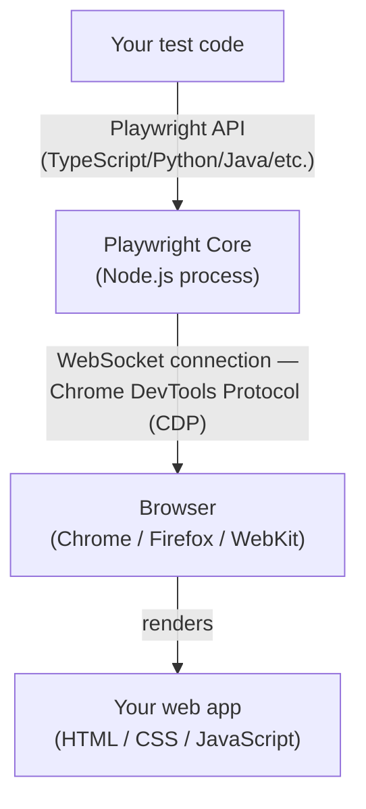
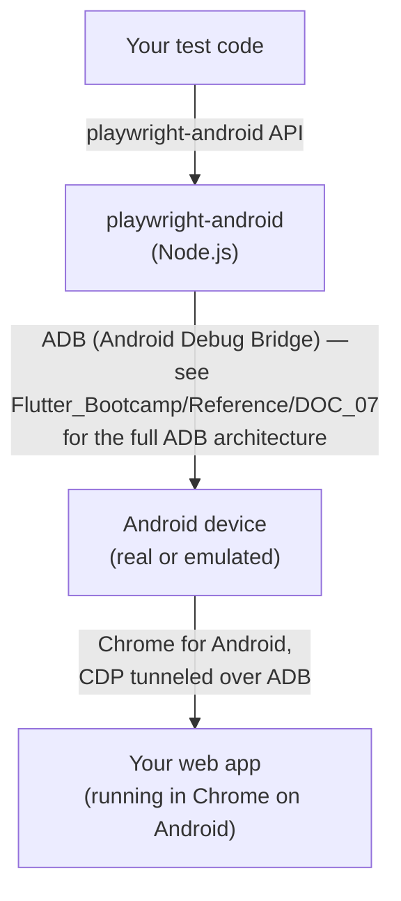
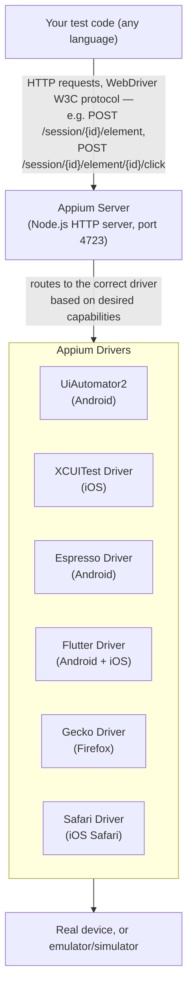

# 01. Playwright vs Appium — Full Comparison

**Navigation**: [📚 Folder Context](CONTEXT.md) | [Mobile Web & Hybrid Testing →](05_Mobile_Web_And_Hybrid_Playwright.md) | [Mobilewright (native, Playwright-powered) →](06_Mobilewright_Native_Testing.md) | [Android Native →](02_Android_Native_Dev_And_Testing.md)

> **Reading contract**: This file teaches you HOW each tool works at the engine level, WHEN to use each one, and WHERE they overlap. By the end you will have a mental model that lets you pick the right tool for any mobile testing scenario — and explain that decision in an interview.

> **A newer third option exists:** [Mobilewright](06_Mobilewright_Native_Testing.md) is a real, actively-developed framework positioning itself directly against Appium for native mobile automation, with a Playwright-inspired API. This file's Playwright/Appium comparison remains accurate and foundational — Mobilewright is genuinely built *on* the same architectural distinctions taught here (native accessibility tree vs. browser DOM), not a replacement for understanding them.

---

## Table of Contents

1. [The Two Worlds of Mobile Apps](#1-the-two-worlds-of-mobile-apps)
2. [How Playwright Works Under the Hood](#2-how-playwright-works-under-the-hood)
3. [How Appium Works Under the Hood](#3-how-appium-works-under-the-hood)
4. [Side-by-Side Architecture Comparison](#4-side-by-side-architecture-comparison)
5. [What Each Tool Can and Cannot Do](#5-what-each-tool-can-and-cannot-do)
6. [Decision Tree — Which Tool for Which Job](#6-decision-tree--which-tool-for-which-job)
7. [Playwright for Mobile Web — Practical Guide](#7-playwright-for-mobile-web--practical-guide)
8. [Appium for Native Apps — Practical Guide](#8-appium-for-native-apps--practical-guide)
9. [Where They Work Together](#9-where-they-work-together)
10. [Interview Questions on This Topic](#10-interview-questions-on-this-topic)

---

## 1. The Two Worlds of Mobile Apps

Before you pick a testing tool, you need to understand what KIND of app you are testing. This is the most important thing in this file because it determines everything else.

### The Three Types of Mobile Apps

| | Native App | Hybrid App | Mobile Web App |
|---|---|---|---|
| **Written in** | Platform-native language — Android → Kotlin, iOS → Swift, Flutter → Dart | Web app wrapped in a native shell (WebView inside) — Capacitor, Ionic, React Native (partly), Cordova/PhoneGap | Website running in a mobile browser — your React/Vue/HTML site on a phone (Chrome/Safari) |
| **UI built with** | Native widgets (View, Widget, UIView) | HTML/CSS wrapped in a native container | Pure HTML/CSS/JS rendered by the browser |
| **Test with** | Espresso (Android), XCUITest (iOS), Flutter test, or Appium (all) | Playwright for the WebView + Appium for the native shell | Playwright ✅ (best choice) |

### Why Does This Matter?

**A native app does NOT use HTML**. Its buttons, text fields, and lists are built from platform-specific UI components. You cannot "inspect" them like a DOM element in a browser. You need a tool that speaks the platform's native accessibility tree — that is Appium (or Espresso/XCUITest).

**A mobile web app IS HTML running in a browser**. Playwright is a browser automation tool — it is perfect here.

**A hybrid app** has BOTH: a native shell (buttons, navigation drawer, camera access) and a WebView (a Chrome/Safari browser embedded in the app). You need Playwright for the web parts and Appium for the native shell parts.

---

### 🎯 Practice — Level 1

**Question**: A banking app has a native login screen (biometric + PIN), then after login shows a `WebView` rendering a web dashboard. Which tool(s) would you use and why?

<details><summary>Answer</summary>

You need **two tools**:

1. **Appium** for the login screen — it is a native screen with native UI components (biometric prompt, PIN pad). You cannot reach those elements with a browser automation tool.

2. **Playwright** for the dashboard — once inside the WebView, it is HTML/CSS/JavaScript running inside a Chrome WebView (on Android) or WKWebView (on iOS). Playwright can connect to it via Chrome DevTools Protocol (CDP) and interact with it exactly like a regular web page.

The boundary is: everything before the WebView loads = Appium; everything inside the WebView = Playwright (or Appium with `context: 'WEBVIEW'` switch).

</details>

---

**Question**: Your e-commerce company has a progressive web app (PWA) — customers use it in Chrome on Android. Which tool is correct?

<details><summary>Answer</summary>

**Playwright only**. A PWA is a website. It runs inside Chrome on Android. There are no native UI elements. Playwright can:

- Emulate any Android device (Pixel 6, Samsung Galaxy S21) — viewport, screen density, touch events
- Test offline mode (`context.setOffline(true)`)
- Test install prompt behavior
- Test notifications
- Run against real Chrome on Android via `playwright-android`

Appium would be overkill and unnecessary complexity here.

</details>

---

## 2. How Playwright Works Under the Hood

### The Core: Chrome DevTools Protocol (CDP)

Playwright is fundamentally a **CDP client**. CDP is a debugging protocol built into Chrome/Chromium (and Firefox/WebKit have their own equivalents). It gives programmatic access to:

- DOM manipulation
- JavaScript execution
- Network interception
- Screenshots
- Console output
- Cookie/storage management



### Mobile Emulation — What Actually Happens

When you tell Playwright "emulate an iPhone 14", it does NOT launch an iOS simulator. It tells Chrome to:

1. Set the viewport to 390×844 pixels
2. Set the User-Agent string to an iPhone's UA
3. Set the device pixel ratio to 3
4. Enable touch events instead of mouse events
5. Set screen orientation

```typescript
// What this code actually does to Chrome:
const iPhone14 = devices["iPhone 14"];
const context = await browser.newContext({
  ...iPhone14,
  // This expands to:
  // userAgent: 'Mozilla/5.0 (iPhone; CPU iPhone OS 16_0...'
  // viewport: { width: 390, height: 844 }
  // deviceScaleFactor: 3
  // isMobile: true
  // hasTouch: true
});
```

**Key insight**: Playwright mobile emulation is browser emulation, not device emulation. You are testing how Chrome renders your app under "phone conditions". The operating system is still your laptop's OS. There is no actual iOS or Android present.

### Playwright for Android (The Real Deal — Experimental)

There is a separate module called `playwright-android` that connects to a REAL Chrome browser running on a REAL Android device (or Android emulator) via ADB (Android Debug Bridge). This is different from emulation.



**Still Chrome only** — playwright-android only controls Chrome (not Safari/Firefox/native apps). This is marked experimental as of 2024.

---

### 🎯 Practice — Level 1

**Question**: Your Playwright test uses `devices['Galaxy S21']`. Your colleague says "this test runs on a real Samsung phone". Is he right?

<details><summary>Answer</summary>

**No**. `devices['Galaxy S21']` is a device descriptor — it sets the viewport, User-Agent, touch events, and pixel ratio to match a Galaxy S21. But the test runs in Chrome on your laptop (or CI runner), not on a Samsung phone.

The only way Playwright runs on a real Android device is via `playwright-android` (connecting via ADB to Chrome on the device). Standard `devices` emulation is purely browser-level.

This matters: some mobile bugs only appear on real devices (GPU rendering differences, specific touch drivers, memory pressure, OS-level permissions). Emulation catches layout and logic bugs; real device testing catches everything else.

</details>

---

## 3. How Appium Works Under the Hood

### The Core: WebDriver Protocol + Platform Drivers

Appium is an HTTP server that implements the **WebDriver W3C protocol**. Your test code sends HTTP requests to Appium; Appium translates them into platform-specific commands and passes them to a **driver** that actually controls the device.



### The UIAutomator2 Driver (Android)

UIAutomator2 is Google's accessibility testing framework. It speaks to Android's **accessibility tree** — a hierarchical representation of every UI element on screen, including:

- Button text
- Content descriptions
- Resource IDs
- Element bounds (x, y, width, height)

```
Android Screen
     │
     │ Android Accessibility Framework
     ▼
Accessibility Tree:
  FrameLayout
    └─ LinearLayout (id: com.myapp:id/main_container)
        ├─ TextView (text: "Welcome back, Harsha")
        ├─ EditText (content-desc: "Username field")
        └─ Button (text: "Login", id: com.myapp:id/btn_login)
             │
             │ UIAutomator2 can click/find/assert any of these
             ▼
         Appium Server → Your Test Code
```

**This is why Playwright cannot test native apps**: native apps do not have a DOM. They have an accessibility tree. Playwright only knows how to talk to a DOM via CDP. UIAutomator2 knows how to talk to the accessibility tree via Android's accessibility framework.

### The XCUITest Driver (iOS)

On iOS, it is the same concept but Apple's framework:

- XCUITest is Apple's own UI testing framework (used in Xcode)
- Appium's XCUITest driver wraps XCUITest and exposes it over the WebDriver protocol
- Your Appium test code → HTTP → Appium server → XCUITest framework → iOS Simulator or real device

---

### 🎯 Practice — Level 1

**Question**: In Appium, what does this selector mean: `By.id("com.example.myapp:id/login_button")`? Why is it different from CSS selectors?

<details><summary>Answer</summary>

`By.id("com.example.myapp:id/login_button")` is an **Android resource ID selector**. It breaks down as:

- `com.example.myapp` — the app's package name (like a namespace)
- `id/login_button` — the specific resource ID of the View

In Android XML layouts, developers assign IDs like:

```xml
<Button
    android:id="@+id/login_button"
    android:text="Login" />
```

This becomes `com.example.myapp:id/login_button` in the accessibility tree at runtime.

**Why it is different from CSS selectors**:

- CSS selectors target HTML elements in a DOM (`#login-button`, `.btn-primary`)
- Appium resource IDs target View objects in Android's View hierarchy
- There is no HTML. There is no CSS. The app is rendered using Android's View system, not a browser engine.

On iOS the equivalent would be `By.accessibilityId("loginButton")` — using the `accessibilityIdentifier` property set in Swift/Objective-C code.

</details>

---

## 4. Side-by-Side Architecture Comparison

| | Playwright | Appium |
|---|---|---|
| **Protocol** | CDP (WebSocket) | HTTP (WebDriver W3C REST) |
| **Server** | None needed — connects directly to the browser process | Requires an Appium server on port 4723 (or Appium Grid for parallel runs) |
| **Target** | Browser DOM (Chrome, Firefox, WebKit) | Native UI accessibility tree (Android View, iOS UIKit, Flutter) |
| **Driver installation** | None | Installed separately — `appium driver install uiautomator2`, `appium driver install xcuitest` |
| **Test language** | TypeScript, JavaScript, Python, Java, C#, Go, .NET | Java, Python, JS, Ruby, C#, any language with an HTTP client |
| **Startup speed** | ~200ms (browser already running) | 15-60 seconds (installs the app, boots the device/simulator) |
| **Selectors** | CSS, XPath, text, role, test-id | Resource ID, XPath, Accessibility ID, class name, Android UiSelector, iOS Class Chain |
| **Network interception** | Yes — `page.route()`, HAR recording | Limited — requires proxy setup, no native CDP |
| **Auto-wait** | Yes, built into every action | Limited — implicit/explicit waits, manual polling |
| **Debugging** | Playwright UI Mode, trace viewer, codegen | Appium Inspector, screenshots, Appium Desktop |

### Performance Reality

The startup speed difference is huge and matters in CI:

| Scenario                   | Playwright                     | Appium                                           |
| -------------------------- | ------------------------------ | ------------------------------------------------ |
| Start 1 test               | ~200ms browser startup         | ~30-60s (boot emulator + install app)            |
| Run 50 tests               | ~5 minutes                     | ~20-40 minutes (slow to start, slow to interact) |
| Run on 10 parallel workers | Easy — just launch 10 browsers | Hard — need 10 emulators or 10 real devices      |

---

## 5. What Each Tool Can and Cannot Do

This is the most important table in this file. When an interviewer asks "why did you choose X over Y", this is your answer.

```
┌──────────────────────────────────────┬──────────────────┬──────────────────┐
│ CAPABILITY                           │   PLAYWRIGHT     │   APPIUM         │
├──────────────────────────────────────┼──────────────────┼──────────────────┤
│ Test mobile website in Chrome        │ ✅ Best-in-class │ ✅ Slower       │
│ Test mobile website in Safari/iOS    │ ✅ WebKit engine │ ✅ Via Safari   │
│ Emulate any phone viewport           │ ✅ Built-in      │ ❌ Not purpose  │
│ Intercept network requests           │ ✅ page.route()  │ ⚠️ Via proxy    │
│ Mock API responses in tests          │ ✅ Native        │ ⚠️ Workaround   │
│ Test native Android UI               │ ❌ Cannot        │ ✅ UIAutomator2 │
│ Test native iOS UI                   │ ❌ Cannot        │ ✅ XCUITest     │
│ Test native Flutter UI               │ ❌ Cannot        │ ✅Flutter driver│
│ Test Android WebView content         │ ✅ Via CDP       │ ✅ WEBVIEW ctx  │
│ Simulate touch gestures              │ ✅ Built-in      │ ✅ Actions API  │
│ Take screenshots                     │ ✅ Fast          │ ✅ Slower       │
│ Access device camera/GPS/sensors     │ ❌ Cannot        │ ✅ Via Appium   │
│ Test push notifications              │ ❌ Cannot        │ ✅ Via Appium   │
│ Test biometric login                 │ ❌ Cannot        │ ✅ Via Appium   │
│ Test deep links / URL schemes        │ ❌ (web only)    │ ✅              │
│ Parallel test execution              │ ✅ Very easy     │ ⚠️ Complex      │
│ CI/CD integration                    │ ✅ Simple        │ ⚠️ Complex setup│
│ Visual regression testing            │ ✅ Built-in      │ ⚠️ Plugin needed│
│ API testing (REST/GraphQL)           │ ✅ request API   │ ❌ Not purpose  │
│ Auto-wait for elements               │ ✅ Built-in      │ ⚠️ Manual setup │
│ Cross-browser (Chrome+Firefox+Safari)│ ✅ Single API    │ ⚠️ Different cfg│
└──────────────────────────────────────┴──────────────────┴──────────────────┘
```

### The Rule in One Sentence

> **Playwright** is the right tool when your test can be run in a browser. **Appium** is the right tool when your test needs to interact with native app UI elements that are NOT in a browser.

---

### 🎯 Practice — Level 2 (Intermediate)

**Scenario 1**: You are hired to test a food delivery app. It is a native Android app (Kotlin). After ordering, users get a push notification. The order tracking screen shows a Google Map embedded as a WebView fragment. Design the testing strategy.

<details><summary>Answer — Point by Point</summary>

**Break the app into zones**:

```
┌──────────────────────────────────────────────────────────┐
│                  Food Delivery App                       │
├──────────────────────────────────────────────────────────┤
│  ZONE 1: Native screens                                  │
│  - Login (native buttons, text fields)                   │
│  - Restaurant list (RecyclerView — native list)          │
│  - Cart (native UI)                                      │
│  - Checkout (native forms)                               │
│  TOOL: Appium + UIAutomator2                             │
├──────────────────────────────────────────────────────────┤
│  ZONE 2: WebView (Google Maps tracking)                  │
│  - Map embedded as WebView fragment                      │
│  - HTML buttons overlaid on map                          │
│  TOOL: Playwright via playwright-android OR              │
│         Appium with context switch to WEBVIEW            │
├──────────────────────────────────────────────────────────┤
│  ZONE 3: API layer (order service, restaurant service)   │
│  - REST APIs behind the app                              │
│  - Test order creation, payment, status updates          │
│ TOOL: Playwright request API or direct HTTP (Postman/k6) │
├──────────────────────────────────────────────────────────┤
│ ZONE 4: Push notifications                               │
│ - Device-level notification tray                         │
│ TOOL: Appium (can interact with notification drawer)     │
└──────────────────────────────────────────────────────────┘
```

**Execution strategy**:

- Use Appium for the full E2E flow (login → order → checkout)
- Switch context to WEBVIEW for the map interaction
- Use Playwright request API separately to smoke-test APIs
- Use Appium's notification API to verify push notification text

</details>

---

**Scenario 2**: Your company's React app has a mobile web version (accessed via Chrome on Android). QA wants to cover: layout at 375px viewport, network performance at 3G speed, and checking API calls when tapping "Add to Cart". Compare Playwright vs Appium for each sub-task.

<details><summary>Answer — Point by Point</summary>

**Sub-task 1: Layout at 375px viewport**

- Playwright: `devices['iPhone SE']` sets viewport to 375×667. CSS media queries apply. Zero setup.
- Appium: Not the right tool. Appium doesn't control browser viewport in a meaningful way for layout testing. You'd need a separate browser session anyway.
- **Winner: Playwright**

**Sub-task 2: Network performance at 3G speed**

```typescript
// Playwright — built in
const context = await browser.newContext({
  ...devices["Pixel 7"],
});
// Emulate 3G: ~1.5Mbps down, 750Kbps up, 40ms latency
await context.route("**/*", async (route) => {
  await new Promise((resolve) => setTimeout(resolve, 40)); // latency
  await route.continue();
});
// OR use CDP directly:
const client = await context.newCDPSession(page);
await client.send("Network.emulateNetworkConditions", {
  offline: false,
  downloadThroughput: (1.5 * 1024 * 1024) / 8, // bytes/sec
  uploadThroughput: (750 * 1024) / 8,
  latency: 40,
});
```

- Appium: Cannot throttle network without external proxy (Charles, mitmproxy). Much more setup.
- **Winner: Playwright**

**Sub-task 3: Check API calls when tapping "Add to Cart"**

```typescript
// Playwright — network interception is native
const [request] = await Promise.all([
  page.waitForRequest(
    (req) => req.url().includes("/api/cart") && req.method() === "POST",
  ),
  page.getByRole("button", { name: "Add to Cart" }).tap(), // touch event
]);

const body = JSON.parse(request.postData() || "{}");
expect(body.productId).toBe("SKU-001");
expect(body.quantity).toBe(1);
```

- Appium: Cannot intercept network requests natively. You'd need to set up a proxy server, configure the device to route through it, and parse the proxy logs. 10x more complex.
- **Winner: Playwright — by a large margin**

</details>

---

## 6. Decision Tree — Which Tool for Which Job

Use this tree whenever you face a mobile testing decision:

```
START: What are you testing?
│
├─► Is it a mobile WEBSITE or PWA (runs in browser)?
│       │
│       └─► YES → USE PLAYWRIGHT
│               - Mobile device emulation
│               - Network interception
│               - Layout testing
│               - API testing
│
├─► Is it a NATIVE app (Kotlin/Java, Swift, Flutter)?
│       │
│       └─► YES → USE APPIUM
│               ├─► Android → UIAutomator2 driver
│               ├─► iOS → XCUITest driver
│               └─► Flutter → Flutter driver
│
├─► Is it a HYBRID app (WebView inside native shell)?
│       │
│       ├─► Native shell parts → APPIUM
│       └─► WebView content → PLAYWRIGHT (or Appium WEBVIEW context)
│
├─► Are you testing the API LAYER (REST/GraphQL) that the app calls?
│       │
│       └─► USE PLAYWRIGHT (request API) — fast, no device needed
│
└─► Are you testing DEVICE FEATURES (camera, GPS, notifications)?
        │
        └─► USE APPIUM — it can access device APIs
```

---

## 7. Playwright for Mobile Web — Practical Guide

### Level 1: Device Emulation (The Basics)

Playwright ships with 40+ device descriptors. Here is how to use them and what they actually set:

```typescript
import { test, expect, devices } from "@playwright/test";

test("mobile checkout flow on Pixel 7", async ({ browser }) => {
  // Create a mobile context — sets all device parameters
  const context = await browser.newContext({
    ...devices["Pixel 7"],
    // devices['Pixel 7'] expands to:
    // userAgent: 'Mozilla/5.0 (Linux; Android 13; Pixel 7)...'
    // viewport: { width: 412, height: 915 }
    // deviceScaleFactor: 2.625
    // isMobile: true
    // hasTouch: true
    // defaultBrowserType: 'chromium'
  });

  const page = await context.newPage();
  await page.goto("https://myapp.com/shop");

  // Touch tap (not mouse click)
  await page.getByRole("button", { name: "Add to Cart" }).tap();

  // Swipe gesture — Playwright's Touchscreen class ONLY has .tap(x, y);
  // there is no built-in .swipe(). Real swipe/drag gestures need manual
  // touch event dispatch (touchstart → touchmove → touchend):
  await page.dispatchEvent('body', 'touchstart', {
    touches: [{ identifier: 0, clientX: 200, clientY: 400 }],
  });
  await page.dispatchEvent('body', 'touchmove', {
    touches: [{ identifier: 0, clientX: 200, clientY: 100 }],
  });
  await page.dispatchEvent('body', 'touchend', { touches: [] });

  // Check mobile-specific layout
  const hamburgerMenu = page.locator('[data-testid="mobile-nav"]');
  await expect(hamburgerMenu).toBeVisible();

  // Desktop nav should be hidden
  const desktopNav = page.locator('[data-testid="desktop-nav"]');
  await expect(desktopNav).toBeHidden();
});
```

### Level 2: Playwright Config for Mobile Projects

A real project uses `playwright.config.ts` to define multiple device targets:

```typescript
// playwright.config.ts
import { defineConfig, devices } from "@playwright/test";

export default defineConfig({
  projects: [
    // --- Mobile devices ---
    {
      name: "mobile-chrome-pixel7",
      use: { ...devices["Pixel 7"] },
    },
    {
      name: "mobile-safari-iphone14",
      use: { ...devices["iPhone 14"] },
    },
    {
      name: "mobile-chrome-samsung",
      use: { ...devices["Galaxy S21"] },
    },

    // --- Tablet ---
    {
      name: "tablet-ipad-pro",
      use: { ...devices["iPad Pro 11"] },
    },

    // --- Desktop (for comparison) ---
    {
      name: "desktop-chrome",
      use: { browserName: "chromium", viewport: { width: 1440, height: 900 } },
    },
  ],
});

// Now run: npx playwright test --project=mobile-chrome-pixel7
```

### Level 3: Network Interception on Mobile Tests

One of Playwright's most powerful features — unavailable in Appium:

```typescript
test("cart API called correctly when adding item on mobile", async ({
  browser,
}) => {
  const context = await browser.newContext({ ...devices["iPhone 14"] });
  const page = await context.newPage();

  // Intercept the add-to-cart API call
  let capturedRequest: any = null;
  await page.route("**/api/v1/cart/items", async (route) => {
    // Capture the request payload
    capturedRequest = JSON.parse(route.request().postData() || "{}");
    // Let the request go through (don't mock it)
    await route.continue();
  });

  await page.goto("/product/123");
  await page.getByRole("button", { name: "Add to Cart" }).tap();

  // Assert the API was called with correct data
  expect(capturedRequest).not.toBeNull();
  expect(capturedRequest.productId).toBe("123");
  expect(capturedRequest.quantity).toBe(1);
  expect(capturedRequest.source).toBe("mobile_web"); // mobile-specific field
});
```

---

### 🎯 Practice — Level 2 (Intermediate)

**Challenge**: Write a Playwright test that:

1. Opens the app on a Pixel 7 emulation
2. Simulates going offline (to test offline mode)
3. Verifies the offline banner appears
4. Goes back online and verifies the banner disappears

<details><summary>Answer — Step by Step</summary>

```typescript
import { test, expect, devices } from "@playwright/test";

test("offline banner appears and disappears", async ({ browser }) => {
  const context = await browser.newContext({ ...devices["Pixel 7"] });
  const page = await context.newPage();
  await page.goto("/");

  // Verify no offline banner at start
  await expect(page.getByTestId("offline-banner")).toBeHidden();

  // Step 1: Go offline — use CDP to set network conditions
  // This simulates the device losing network connectivity
  const client = await context.newCDPSession(page);
  await client.send("Network.enable");
  await client.send("Network.emulateNetworkConditions", {
    offline: true,
    downloadThroughput: -1,
    uploadThroughput: -1,
    latency: 0,
  });

  // OR simpler: use Playwright's built-in context.setOffline()
  await context.setOffline(true);

  // The banner should appear (usually shown by a JavaScript event listener on 'online'/'offline')
  await expect(page.getByTestId("offline-banner")).toBeVisible();
  await expect(page.getByTestId("offline-banner")).toContainText(
    "No internet connection",
  );

  // Step 2: Go back online
  await context.setOffline(false);

  // The banner should disappear (app caught the 'online' event)
  await expect(page.getByTestId("offline-banner")).toBeHidden();
});
```

**Why `context.setOffline(true)` works**: Playwright sends a CDP `Network.emulateNetworkConditions` command to Chrome. Chrome then blocks all network requests, and fires the browser's `window.offline` event. Your app's JavaScript listens to this event to show the banner.

**The edge case to think about**: What if the banner is shown AFTER a failed fetch, not on the `offline` event? Then you also need to verify that `page.reload()` shows a failure state. Test both paths.

</details>

---

## 8. Appium for Native Apps — Practical Guide

### Level 1: Setup and First Test (Android)

Before writing code, you need to understand what needs to be installed:

```
What you need for Appium Android:
1. Java JDK 11+
2. Android Studio (gives you Android SDK + AVD for emulators)
3. Node.js (Appium is a Node.js server)
4. Appium 2.x: npm install -g appium
5. UIAutomator2 driver: appium driver install uiautomator2
6. Your test language dependencies (Java: appium-java-client)
```

**Your first Appium test (Java)**:

```java
import io.appium.java_client.android.AndroidDriver;
import io.appium.java_client.android.options.UiAutomator2Options;
import org.openqa.selenium.By;
import org.openqa.selenium.WebElement;
import java.net.URL;

public class LoginTest {

    @Test
    public void testLoginFlow() throws Exception {
        // Step 1: Define capabilities — tells Appium which app/device to use
        UiAutomator2Options options = new UiAutomator2Options()
            .setPlatformName("Android")
            .setAutomationName("UIAutomator2")
            .setDeviceName("emulator-5554")          // AVD name from `adb devices`
            .setApp("/path/to/my-app.apk")           // installs the APK
            .setAppPackage("com.mycompany.myapp")    // app's package name
            .setAppActivity(".activities.LoginActivity"); // first screen to launch

        // Step 2: Connect to Appium server (must be running on port 4723)
        AndroidDriver driver = new AndroidDriver(
            new URL("http://localhost:4723"),
            options
        );

        // Step 3: Find elements by their Android resource ID
        WebElement usernameField = driver.findElement(
            By.id("com.mycompany.myapp:id/et_username")
        );
        usernameField.clear();
        usernameField.sendKeys("testuser@example.com");

        // Step 4: Find by text (XPath)
        WebElement passwordField = driver.findElement(
            By.xpath("//android.widget.EditText[@hint='Password']")
        );
        passwordField.sendKeys("securepassword123");

        // Step 5: Click the login button
        driver.findElement(
            By.id("com.mycompany.myapp:id/btn_login")
        ).click();

        // Step 6: Wait for the home screen and assert
        WebElement welcomeText = driver.findElement(
            By.id("com.mycompany.myapp:id/tv_welcome")
        );
        assertEquals("Welcome, testuser!", welcomeText.getText());

        driver.quit();
    }
}
```

### Level 2: Finding Elements in Native Apps

This is the hardest part of Appium — selectors are different from CSS/XPath on web:

```
┌────────────────────────────────────────────────────────────────┐
│              APPIUM SELECTOR TYPES — ANDROID                   │
├─────────────────────┬──────────────────────────────────────────┤
│ Selector Type       │ Example and When to Use                  │
├─────────────────────┼──────────────────────────────────────────┤
│ Resource ID         │ By.id("com.app:id/btn_login")            │
│                     │ BEST: stable, set by developer           │
│                     │ WORST: when dev doesn't set IDs          │
├─────────────────────┼──────────────────────────────────────────┤
│ Accessibility ID    │ By.accessibilityId("Login Button")       │
│                     │ Good: set via contentDescription in XML  │
│                     │ Works on BOTH Android and iOS!           │
├─────────────────────┼──────────────────────────────────────────┤
│ XPath               │ //android.widget.Button[@text='Login']   │
│                     │ Avoid: slow, brittle, full tree scan     │
├─────────────────────┼──────────────────────────────────────────┤
│ Class Name          │ By.className("android.widget.Button")    │
│                     │ Bad: finds ALL buttons, not unique       │
├─────────────────────┼──────────────────────────────────────────┤
│ UiAutomator         │ new UiSelector().text("Login")           │
│ (Android only)      │   .className("android.widget.Button")    │
│                     │ Powerful for chained conditions          │
├─────────────────────┼──────────────────────────────────────────┤
│ iOS Class Chain     │ **/XCUIElementTypeButton[`label == 'OK'`]│
│ (iOS only)          │ Fast alternative to XPath on iOS         │
└─────────────────────┴──────────────────────────────────────────┘
```

**The real rule**: Ask the developers to add `android:contentDescription` on interactive elements. This becomes your accessibility ID — works on both Android and iOS Appium tests.

```xml
<!-- Android layout XML — developer adds this -->
<Button
    android:id="@+id/btn_login"
    android:text="Login"
    android:contentDescription="Login button" />

<!-- Now you can find it with accessibilityId — works on Android and iOS Appium -->
```

---

### 🎯 Practice — Level 3 (Advanced)

**Challenge**: You are testing a native Android app. The screen has a `RecyclerView` (a scrollable list of items). You need to scroll down until you find an item with the text "Manage Billing", then tap it. Write the Appium code. Why is this harder than scrolling in a web list?

<details><summary>Answer — Point by Point</summary>

**Why it is harder**: In a web app, you can scroll with JavaScript (`element.scrollIntoView()`). In a native Android RecyclerView, the items that are off-screen are NOT in the accessibility tree yet — they don't exist until RecyclerView renders them (because RecyclerView recycles views for performance). You cannot find an element that is not visible.

**Solution**: Use Appium's `UiScrollable` — an Android-specific API that scrolls until it finds an element:

```java
// Java — Appium with UiAutomator2
import io.appium.java_client.AppiumBy;

// UiScrollable scrolls a scrollable container until it finds the target element
// This is the ONLY reliable way to scroll and find in RecyclerView
WebElement manageBillingItem = driver.findElement(
    AppiumBy.androidUIAutomator(
        "new UiScrollable(new UiSelector().scrollable(true))" +
        ".scrollIntoView(new UiSelector().text(\"Manage Billing\"))"
    )
);

// Once it's in view, tap it
manageBillingItem.click();
```

**How UiScrollable works**:

1. `new UiSelector().scrollable(true)` — finds the scrollable container (RecyclerView)
2. `scrollIntoView(...)` — scrolls the container, checking after each scroll if the element exists
3. When found, it stops scrolling and returns the element
4. Android's UIAutomator framework handles this natively — it is fast and reliable

**The equivalent for iOS** (also off-screen elements don't exist):

```javascript
// WebdriverIO + Appium iOS
await driver.execute("mobile: scroll", {
  direction: "down",
  element: await $("~manage-billing-section"), // scroll until accessible
});
```

**Web comparison** (why web is simpler):

```typescript
// Playwright — the DOM contains all items even if off-screen
await page.locator("text=Manage Billing").scrollIntoViewIfNeeded();
await page.locator("text=Manage Billing").click();
// DOM element exists before scroll — no special logic needed
```

**The lesson**: RecyclerView virtual scrolling is a fundamental difference between native and web. In native, the accessibility tree only shows what is VISIBLE. In web, the DOM contains all items.

</details>

---

## 9. Where They Work Together

The most powerful mobile testing strategy uses BOTH tools — each doing what it does best.

### Real-World Integration Pattern

```typescript
// PLAYWRIGHT handles the API layer
// This creates test data before Appium needs it
async function createTestCitation(amount: number): Promise<string> {
  const apiContext = await request.newContext({
    baseURL: "https://api.myapp.com",
  });

  const response = await apiContext.post("/citations", {
    data: { amount, status: "PENDING" },
  });

  const { citationId } = await response.json();
  return citationId; // return to Appium test
}
```

```java
// APPIUM handles the native UI flow
@Test
public void testPayCitationE2E() throws Exception {
  // Step 1: Use Playwright (via REST call) to create test data
  // (Or call the createTestCitation function if using a shared test service)
  String citationId = apiClient.createCitation(150.00);

  // Step 2: Use Appium to drive the native app
  driver.findElement(By.id("com.app:id/btn_search")).click();
  driver.findElement(By.id("com.app:id/et_citation_id"))
        .sendKeys(citationId);
  driver.findElement(By.id("com.app:id/btn_find")).click();

  // Wait for result screen
  WebDriverWait wait = new WebDriverWait(driver, Duration.ofSeconds(10));
  WebElement amountText = wait.until(
      ExpectedConditions.presenceOfElementLocated(
          By.id("com.app:id/tv_amount")
      )
  );
  assertEquals("$150.00", amountText.getText());

  // Step 3: Pay
  driver.findElement(By.id("com.app:id/btn_pay")).click();

  // Step 4: Verify success
  WebElement successMsg = wait.until(
      ExpectedConditions.presenceOfElementLocated(
          By.id("com.app:id/tv_success")
      )
  );
  assertEquals("Payment successful", successMsg.getText());

  // Step 5: Use Playwright API to verify backend state changed
  // (Don't assert only from UI — verify the actual DB state via API)
}
```

---

## 10. Interview Questions on This Topic

Use these when an interviewer asks about mobile testing:

**Q: "Can Playwright test native mobile apps?"**

> "Playwright is a browser automation tool — it speaks to browser engines via Chrome DevTools Protocol. For mobile, it works excellently for mobile web testing and WebView content, with full network interception and device emulation. For truly native UI elements — Android Views, iOS UIKit elements — you need Appium, which speaks to the platform's accessibility framework via UIAutomator2 or XCUITest. I'd use them together: Playwright for the API layer and web content, Appium for native UI flows."

**Q: "Why is Appium slower than Playwright?"**

> "Two reasons. First, Appium uses HTTP (the WebDriver protocol) — each command is an HTTP round-trip to the Appium server, then to the device. Playwright uses a persistent WebSocket connection — no round-trip overhead. Second, Appium must boot a device or emulator, install the APK or IPA, and wait for the app to launch — that is 30-60 seconds of startup vs. 200ms for a browser."

**Q: "How would you test a React Native app?"**

> "React Native has two modes: the JavaScript logic lives in a JS thread, but the UI is rendered with actual native components (not WebViews). So you use Appium with UIAutomator2 or XCUITest. The app LOOKS native because it IS native at the UI layer. However, if the app uses `WebView` components for any screens, you switch context to `WEBVIEW` in Appium, or use Playwright if the page is a full web page."

---

**Navigation**: [📚 Folder Context](CONTEXT.md) | [Mobile Web & Hybrid Testing →](05_Mobile_Web_And_Hybrid_Playwright.md) | [Mobilewright (native, Playwright-powered) →](06_Mobilewright_Native_Testing.md) | [Android Native →](02_Android_Native_Dev_And_Testing.md)


---

## Reality Check

**"Playwright and Appium are competing tools, pick the better one"** ? They test DIFFERENT things: Playwright drives BROWSERS (web apps, including mobile-web via device emulation [21_SDET Ch61]), Appium drives NATIVE mobile apps (the actual iOS/Android app through the OS accessibility layer) — so the choice is dictated by what you are testing, not which is "better." The web app tested on a mobile viewport is Playwright; the native app installed on a device is Appium (or the platform-native tools — Espresso, XCUITest). "Which is better" is the wrong question — they occupy different layers, and a mobile testing strategy often needs BOTH (Playwright for the mobile web, native tooling for the native app), plus the honest recognition that Appium's cross-platform promise carries real reliability and speed costs versus the platform-native frameworks.

**"Cross-platform test tools test once, run everywhere"** ? Appium's write-once-run-on-both-platforms promise carries costs the pitch omits: the platform DIFFERENCES leak through (the iOS and Android UIs differ enough that "one test" often needs platform branches — the [21_SDET Ch61] isMobile branching, worse across OSes), the reliability and speed penalty versus native frameworks (Appium's WebDriver-over-the-accessibility-layer indirection is slower and flakier than Espresso/XCUITest talking directly to the app), and the lowest-common-denominator API (the cross-platform abstraction cannot express platform-specific behaviors). "Run everywhere" is real for the shared happy path and leaks at every platform-specific edge — the mature strategy weighs Appium's cross-platform convenience against native frameworks' speed and reliability, often choosing native for the critical suites and Appium for the broad cross-platform smoke.

**"Emulators and simulators are good enough for testing"** ? Emulators/simulators cover layout and logic and MISS the device-specific reality ([21_SDET Ch61]'s emulation-versus-real-device table, mobile flavor): the real touch behavior, the actual OS keyboard covering the viewport, biometrics, push notifications, the camera and sensors, the real performance on a mid-range device (the app smooth on the emulator and janky on a real budget phone), the network conditions, and the platform fragmentation (the Android device-and-OS-version matrix that no emulator set fully represents). The standard split mirrors [Ch61]: emulators/simulators for the fast broad coverage in CI, a thin real-device suite (device cloud or physical) for the critical flows and the device-specific behaviors emulators cannot reproduce. "Good enough" holds for layout and logic and fails exactly at the mobile-specific hardware and performance realities that are often where mobile bugs live.

**"Mobile test automation is like web test automation"** ? Mobile adds problems web testing does not have: the APP LIFECYCLE (backgrounding, being killed and restored, the interrupted-by-a-call state — the [Android lifecycle] complexity that has no web equivalent), the INSTALLATION and permissions (the app that must be installed, the permission dialogs, the [Ch61] permission handling but OS-native), the platform FRAGMENTATION (the device and OS matrix, far worse than browser matrix), the gestures (the swipes, pinches, long-presses that are richer than web clicks), and the build-and-deploy loop (the app that must be compiled and installed to test — slower than a web deploy). "Like web automation" transfers the locator-and-assertion concepts and misses the lifecycle, installation, fragmentation, gesture, and build-loop realities that make mobile automation its own discipline with its own flakiness sources and slower feedback.

**"The comparison is settled once you know the feature matrix"** ? Feature matrices are the START of the decision, and the lived TRADE-OFFS are what matter ([21_SDET Ch60]'s tool-comparison lesson, mobile flavor): the actual flakiness rate in your app, the team's existing platform knowledge (the iOS team that knows XCUITest versus the QA team that knows Appium), the CI infrastructure (the device cloud cost, the emulator farm), the maintenance burden (the cross-platform tests that break on every OS update versus the native tests maintained per platform), and the specific app's characteristics (the heavily-native app versus the web-view-heavy hybrid). "Settled by the feature matrix" is the checkbox-comparison illusion — the real decision weighs your app's nature, your team's skills, your reliability requirements, and your infrastructure, and the honest comparison includes the costs (Appium's flakiness, native's per-platform duplication, the real-device expense) that a feature matrix's checkmarks hide.
